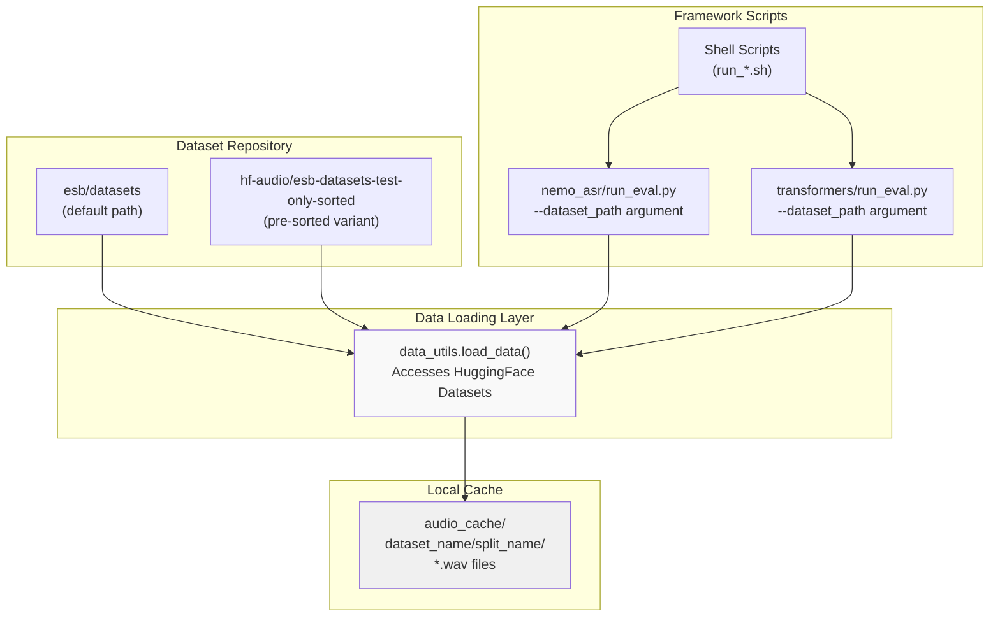
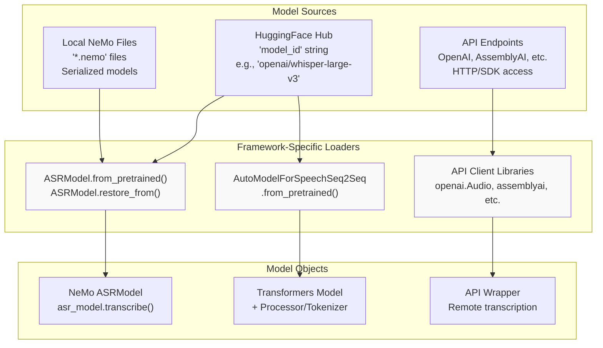
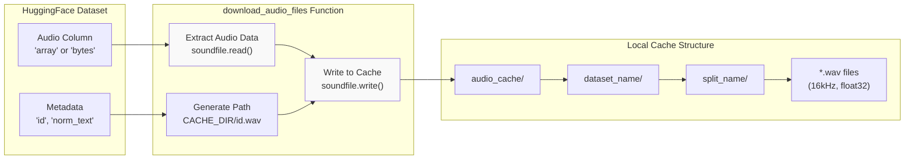
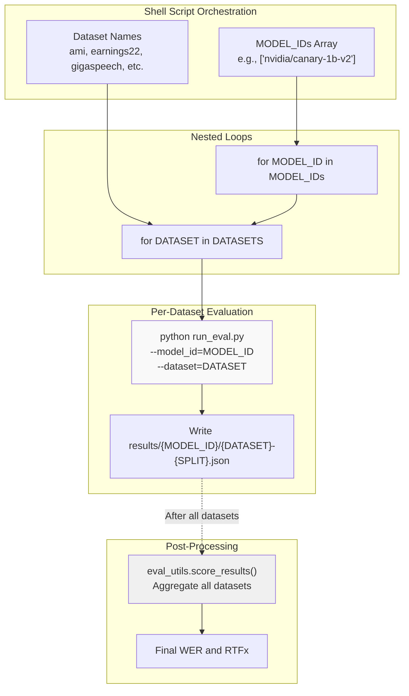

<!-- source: DeepWiki mcp.deepwiki.com · repo huggingface/open_asr_leaderboard · page 5 Datasets and Models · fetched 2026-10-26 -->

# Datasets and Models

<details>
<summary>Relevant source files</summary>

The following files were used as context for generating this wiki page:

- [nemo_asr/run_canary.sh](nemo_asr/run_canary.sh)
- [nemo_asr/run_eval.py](nemo_asr/run_eval.py)
- [transformers/run_whisper.sh](transformers/run_whisper.sh)

</details>


This document describes the datasets used for ASR evaluation in the Open ASR Leaderboard and the various model integration patterns supported by the system. The repository evaluates models on the ESB (End-to-end ASR Systems Benchmark) dataset suite and supports loading models from HuggingFace Hub, local files, and API endpoints.

For information about adding new datasets or models to the evaluation system, see [Adding New Models](#6.1). For details on how datasets are loaded and processed during evaluation, see [Data Processing](#2.2).

---

## ESB Benchmark Suite

The Open ASR Leaderboard uses the **ESB (End-to-end ASR Systems Benchmark)** as its primary evaluation benchmark. ESB is a comprehensive collection of English speech recognition datasets designed to test ASR systems across diverse acoustic conditions, speaking styles, and domains.

### Dataset Inventory

The leaderboard evaluates models on **8 distinct datasets** from the ESB benchmark:

| Dataset | Domain | Characteristics | Split(s) |
|---------|--------|-----------------|----------|
| **LibriSpeech** | Audiobooks | Clean read speech, multiple test sets | `test.clean`, `test.other` |
| **AMI** | Meetings | Multi-speaker, overlapping speech, far-field microphones | `test` |
| **Earnings22** | Earnings calls | Financial domain, varying audio quality | `test` |
| **GigaSpeech** | Podcasts/YouTube | Diverse spontaneous speech, multiple accents | `test` |
| **SPGISpeech** | Financial | S&P Global earnings calls, technical vocabulary | `test` |
| **TED-LIUM** | TED Talks | Presentations, single speaker, good audio quality | `test` |
| **VoxPopuli** | European Parliament | Political speeches, non-native English speakers | `test` |
| **Common Voice** | Crowdsourced | Wide variety of accents and recording conditions | `test` |

The LibriSpeech dataset is unique in providing two test splits: `test.clean` for high-quality audiobook recordings and `test.other` for more challenging acoustic conditions. Both splits are evaluated separately to assess model robustness.

**Sources:** [nemo_asr/run_canary.sh:18-85](), [transformers/run_whisper.sh:17-84](), [nemo_asr/run_eval.py:186-194]()

---

### Dataset Access Paths



**Diagram: Dataset Access Flow**

The repository supports two ESB dataset variants:

1. **Default ESB Path** (`esb/datasets`): The standard ESB benchmark datasets available on HuggingFace
2. **Sorted Variant** (`hf-audio/esb-datasets-test-only-sorted`): A pre-processed version with samples sorted by duration for optimized batch processing

The dataset path is configurable via the `--dataset_path` command-line argument in evaluation scripts, with `esb/datasets` as the default fallback.

**Sources:** [nemo_asr/run_eval.py:186](), [nemo_asr/run_canary.sh:17](), [transformers/run_whisper.sh:16]()

---

## Model Integration Patterns

The Open ASR Leaderboard supports three primary model integration patterns, each suited to different ASR frameworks and deployment scenarios.

### Model Loading Architecture



**Diagram: Model Loading Patterns by Source**

**Sources:** [nemo_asr/run_eval.py:38-41]()

---

### HuggingFace Hub Models

The majority of models in the leaderboard are loaded from the HuggingFace Hub using string identifiers. This pattern is supported by both NeMo and Transformers frameworks.

**NeMo Framework Example:**
```python
# From nemo_asr/run_eval.py:38-41
if args.model_id.endswith(".nemo"):
    asr_model = ASRModel.restore_from(args.model_id, map_location=device)
else:
    asr_model = ASRModel.from_pretrained(args.model_id, map_location=device)
```

The NeMo framework uses `ASRModel.from_pretrained()` to load models from HuggingFace Hub. The method automatically downloads model weights, configuration files, and tokenizers.

**Supported NeMo Models on HuggingFace Hub:**
- `nvidia/canary-1b`, `nvidia/canary-1b-v2`, `nvidia/canary-1b-flash`
- `nvidia/parakeet-tdt-1.1b`, `nvidia/parakeet-rnnt-1.1b`
- `nvidia/stt_en_conformer_*` variants

**Transformers Framework Models:**
The Transformers framework supports a broader range of architectures:
- OpenAI Whisper: `openai/whisper-tiny.en`, `openai/whisper-large-v3`
- Distil-Whisper: `distil-whisper/distil-large-v3`
- Wav2Vec2: `facebook/wav2vec2-large-960h-lv60-self`
- MMS: `facebook/mms-1b-all`
- HuBERT: `facebook/hubert-large-ls960-ft`

**Sources:** [nemo_asr/run_eval.py:38-41](), [transformers/run_whisper.sh:5](), [nemo_asr/run_canary.sh:5]()

---

### Local Model Files

NeMo models can be loaded from local `.nemo` files, which are serialized model archives containing weights, configuration, and tokenizer data. This pattern is useful for:

- Evaluating custom-trained models
- Testing model variants not published to HuggingFace
- Offline evaluation scenarios

The system detects local files by checking if the `model_id` argument ends with `.nemo`:

```python
# Detection logic from nemo_asr/run_eval.py:38-39
if args.model_id.endswith(".nemo"):
    asr_model = ASRModel.restore_from(args.model_id, map_location=device)
```

The `ASRModel.restore_from()` method loads the complete model state from the archive, including:
- Neural network weights
- Decoder configuration (greedy, beam search, etc.)
- Text processing tokenizers
- Model metadata

**Sources:** [nemo_asr/run_eval.py:38-41]()

---

### API-Based Models

The API evaluation framework supports commercial ASR services that expose REST APIs or SDKs. This pattern enables benchmarking cloud-based ASR systems alongside open-source models.

**Supported API Providers:**
- **OpenAI Whisper API** (`gpt-4-audio-preview`)
- **AssemblyAI** (various models)
- **Deepgram**
- **Rev.ai**
- **Speechmatics**

API-based models are accessed through provider-specific SDK clients rather than direct model loading. Audio files are uploaded to the service, and transcriptions are retrieved asynchronously or via polling.

For detailed information on API evaluation, including rate limiting and concurrent request handling, see [API-Based Evaluation](#4.3).

**Sources:** Implied from architecture diagrams and framework overview

---

## Dataset and Audio Processing

### Audio Caching System



**Diagram: Audio Caching Pipeline**

The evaluation system implements a local audio caching strategy to optimize repeated evaluations:

1. **Cache Directory Structure:** Audio files are organized as `audio_cache/{dataset_name}/{split_name}/{id}.wav`
2. **Unique ID Generation:** Sample IDs are sanitized to prevent path conflicts (e.g., `earnings22/test/4432298/281.wav` → `earnings22_test_4432298_281.wav`)
3. **Audio Format:** All cached audio is normalized to 16kHz sampling rate in float32 format
4. **Deduplication:** The system checks for existing cached files before writing, preventing redundant downloads

**Code Implementation:**
```python
# From nemo_asr/run_eval.py:48-88
def download_audio_files(batch):
    audio_paths = []
    durations = []
    
    for id, sample in zip(batch["id"], batch["audio"]):
        # Sanitize ID for unique filenames
        id = id.replace('/', '_').removesuffix('.wav')
        audio_path = os.path.join(CACHE_DIR, f"{id}.wav")
        
        # Extract audio from dataset
        if "array" in sample:
            audio_array = np.float32(sample["array"])
            sample_rate = 16000
        elif "bytes" in sample:
            with io.BytesIO(sample["bytes"]) as audio_file:
                audio_array, sample_rate = soundfile.read(audio_file, dtype="float32")
        
        # Write to cache if not exists
        if not os.path.exists(audio_path):
            soundfile.write(audio_path, audio_array, sample_rate)
        
        audio_paths.append(audio_path)
        durations.append(len(audio_array) / sample_rate)
```

**Sources:** [nemo_asr/run_eval.py:48-88](), [nemo_asr/run_eval.py:22-28]()

---

### Duration-Based Sorting

After audio files are cached, the system sorts samples by duration in descending order. This optimization reduces padding overhead during batched inference:

```python
# From nemo_asr/run_eval.py:116-120
sorted_indices = sorted(range(len(all_data["durations"])), 
                       key=lambda k: all_data["durations"][k], 
                       reverse=True)
all_data["audio_filepaths"] = [all_data["audio_filepaths"][i] for i in sorted_indices]
all_data["references"] = [all_data["references"][i] for i in sorted_indices]
all_data["durations"] = [all_data["durations"][i] for i in sorted_indices]
```

**Benefits of Duration Sorting:**
- **Reduced Padding:** Similar-length samples in a batch minimize wasted computation on padding
- **Stable Batch Processing:** Uniform batch sizes across the evaluation run
- **Improved GPU Utilization:** More efficient memory allocation with consistent tensor shapes

The pre-sorted dataset variant (`hf-audio/esb-datasets-test-only-sorted`) applies this optimization at the dataset level, eliminating the need for runtime sorting.

**Sources:** [nemo_asr/run_eval.py:116-120]()

---

## Model-Dataset Compatibility

### Framework Support Matrix

Different evaluation frameworks have varying levels of dataset support based on their model architectures and inference capabilities:

| Framework | ESB Datasets | Model Source | Special Requirements |
|-----------|--------------|--------------|---------------------|
| **NeMo** | All 8 datasets | HuggingFace Hub, Local .nemo | `cuda-python>=12.4` for RNN-T |
| **Transformers** | All 8 datasets | HuggingFace Hub | PyTorch 2.0+ for `torch.compile` |
| **API** | All 8 datasets | API endpoints | Network access, API keys |
| **CTranslate2** | All 8 datasets | HuggingFace Hub (Whisper only) | CTranslate2 backend |
| **Moonshine** | All 8 datasets | HuggingFace Hub | ONNX runtime |
| **Granite** | All 8 datasets | HuggingFace Hub | Transformers main branch |
| **Phi-4** | All 8 datasets | HuggingFace Hub | Multi-modal pipeline |
| **Kyutai** | All 8 datasets | HuggingFace Hub | Moshi, lhotse |

All frameworks support the complete ESB benchmark suite, ensuring consistent cross-framework comparisons.

**Sources:** Derived from framework overview diagrams and requirements files

---

### Batch Size Guidelines

Recommended batch sizes vary by model architecture and available GPU memory:

| Model Family | Typical Batch Size | Notes |
|--------------|-------------------|-------|
| **Canary** (1B params) | 128 | Efficient encoder-decoder architecture |
| **Parakeet RNN-T** (1.1B) | 32 | Transducer requires more memory |
| **Whisper Large** | 64 | Standard for Transformers framework |
| **Wav2Vec2 Large** | 32 | Self-attention is memory-intensive |
| **API Models** | Varies | Limited by API rate limits, not memory |

Batch sizes are configured in shell scripts (e.g., [nemo_asr/run_canary.sh:6]()) and can be overridden via the `--batch_size` argument. Larger batches improve throughput but may cause out-of-memory errors on smaller GPUs.

**Sources:** [nemo_asr/run_canary.sh:6](), [transformers/run_whisper.sh:6]()

---

## Dataset Iteration Pattern

### Evaluation Loop Structure



**Diagram: Multi-Dataset Evaluation Loop**

Evaluation scripts follow a consistent nested loop pattern:

1. **Outer Loop:** Iterate through model IDs
2. **Inner Loop:** Iterate through ESB datasets and their splits
3. **Evaluation Call:** Invoke `run_eval.py` for each model-dataset pair
4. **Aggregation:** After all datasets complete, run `eval_utils.score_results()` to compute model-level metrics

Example from [nemo_asr/run_canary.sh:11-93]():
```bash
for (( i=0; i<${num_models}; i++ )); do
    MODEL_ID=${MODEL_IDs[$i]}
    
    # Evaluate on each dataset
    python run_eval.py --model_id=${MODEL_ID} --dataset="ami" --split="test" ...
    python run_eval.py --model_id=${MODEL_ID} --dataset="earnings22" --split="test" ...
    # ... (6 more datasets)
    
    # Aggregate results for this model
    python -c "import eval_utils; eval_utils.score_results('results', '${MODEL_ID}')"
done
```

This pattern ensures:
- **Isolated Failures:** If one dataset fails, others continue evaluating
- **Incremental Progress:** Results are saved after each dataset completion
- **Clear Result Organization:** Each model-dataset pair produces a separate manifest file

**Sources:** [nemo_asr/run_canary.sh:11-93](), [transformers/run_whisper.sh:10-92]()

---

## Summary

The Open ASR Leaderboard's dataset and model integration system is designed for:

- **Comprehensive Coverage:** 8 diverse ESB datasets spanning multiple domains and acoustic conditions
- **Flexible Model Loading:** Support for HuggingFace Hub, local files, and API endpoints
- **Efficient Processing:** Audio caching and duration-based sorting optimize inference performance
- **Framework Independence:** Consistent evaluation across 8+ ASR frameworks
- **Reproducible Results:** Standardized dataset access and preprocessing ensure fair comparisons

For information on how these datasets and models are processed during evaluation, see [Data Processing](#2.2). For guidance on integrating new models or datasets, see [Adding New Models](#6.1).

---

