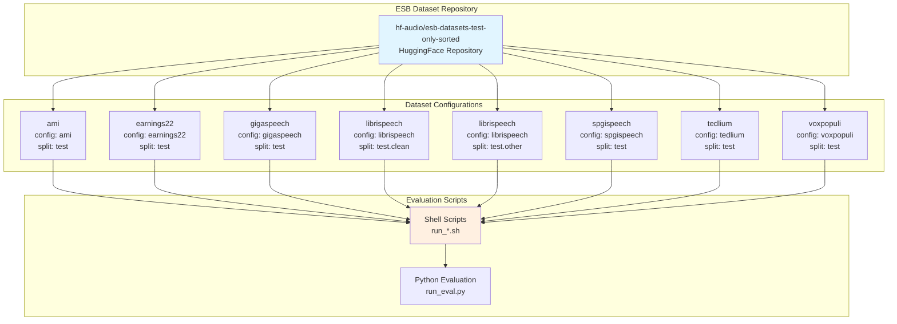
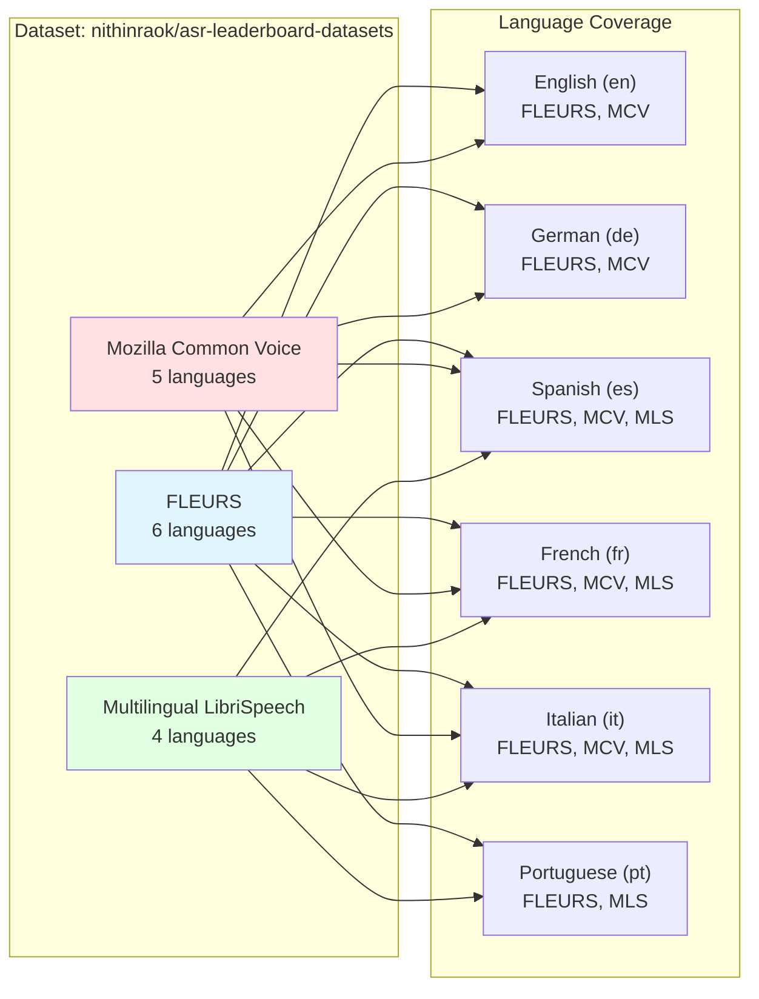
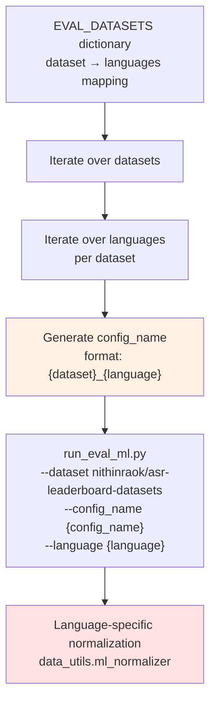
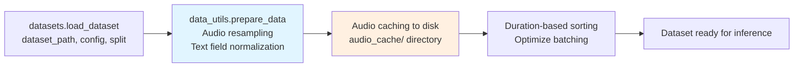
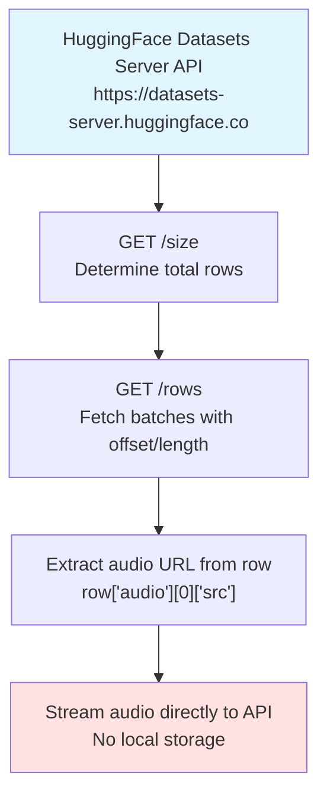
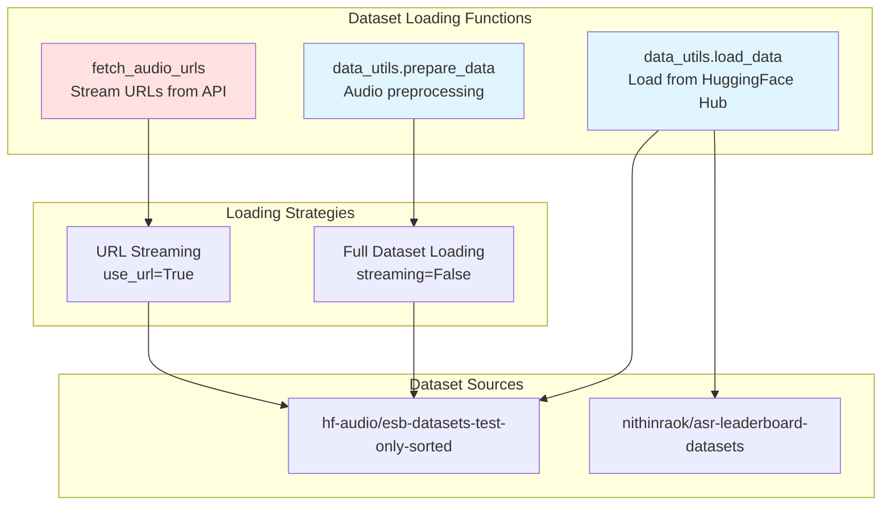
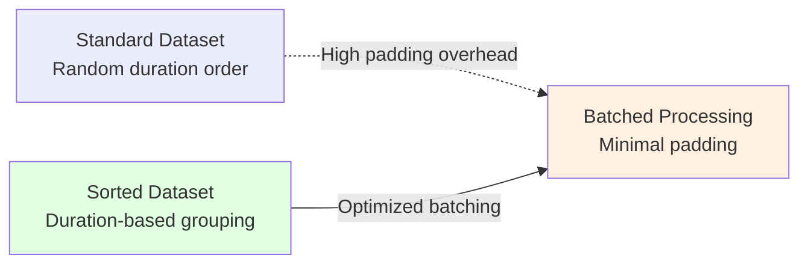

<!-- source: DeepWiki mcp.deepwiki.com · repo huggingface/open_asr_leaderboard · page 5.1 Supported Datasets · fetched 2026-10-26 -->

# Supported Datasets

<details>
<summary>Relevant source files</summary>

The following files were used as context for generating this wiki page:

- [api/run_api.sh](api/run_api.sh)
- [api/run_eval.py](api/run_eval.py)
- [nemo_asr/run_canary.sh](nemo_asr/run_canary.sh)
- [nemo_asr/run_nemo_ml.sh](nemo_asr/run_nemo_ml.sh)
- [nemo_asr/run_parakeet.sh](nemo_asr/run_parakeet.sh)
- [requirements/requirements-api.txt](requirements/requirements-api.txt)

</details>


This document describes the datasets used for ASR model evaluation in the Open ASR Leaderboard. It covers the primary English Speech Benchmark (ESB) datasets, multilingual evaluation datasets, dataset format specifications, and the loading mechanisms used across evaluation frameworks.

For information about how these datasets are processed and normalized for evaluation, see [Data Processing](#2.2). For details on how models are loaded and integrated, see [Model Integration](#5.2).

---

## Overview

The Open ASR Leaderboard supports two primary dataset categories:

1. **ESB (English Speech Benchmark)**: 8 standard English ASR evaluation datasets covering diverse audio domains
2. **Multilingual Datasets**: Multi-language ASR evaluation across FLEURS, Mozilla Common Voice, and Multilingual LibriSpeech

All datasets are hosted on Hugging Face and accessed through standardized interfaces, ensuring consistent evaluation methodology across all frameworks.

**Sources:** [nemo_asr/run_canary.sh:1-94](), [nemo_asr/run_nemo_ml.sh:1-96](), [api/run_api.sh:1-93]()

---

## ESB Benchmark Datasets

The English Speech Benchmark (ESB) suite is the primary evaluation benchmark for the leaderboard. All datasets are accessed from the `hf-audio/esb-datasets-test-only-sorted` repository, which provides pre-sorted audio samples optimized for batch processing.

### Dataset Catalog

| Dataset | Split | Domain | Description |
|---------|-------|--------|-------------|
| **ami** | test | Meetings | AMI Meeting Corpus - conversational meeting transcriptions |
| **earnings22** | test | Financial | Earnings call recordings from corporate earnings announcements |
| **gigaspeech** | test | General | Large-scale, multi-domain English speech recognition corpus |
| **librispeech** | test.clean | Audiobooks | LibriSpeech test-clean split - high-quality audiobook recordings |
| **librispeech** | test.other | Audiobooks | LibriSpeech test-other split - more challenging audiobook samples |
| **spgispeech** | test | Financial | S&P Global financial domain speech |
| **tedlium** | test | Presentations | TED talk recordings |
| **voxpopuli** | test | Political | European Parliament event recordings |

The LibriSpeech dataset is evaluated on two separate test splits (`test.clean` and `test.other`), providing both clean and challenging evaluation conditions.

**Sources:** [nemo_asr/run_canary.sh:17-85](), [api/run_api.sh:31-84](), [nemo_asr/run_parakeet.sh:27-95]()

---

### ESB Dataset Access Pattern

All evaluation frameworks follow an identical pattern for iterating through the ESB datasets:



**Diagram: ESB Dataset Configuration Structure**

Each dataset is evaluated independently by passing the `--dataset_path`, `--dataset`, and `--split` parameters to the evaluation script.

**Sources:** [nemo_asr/run_canary.sh:15-85](), [api/run_api.sh:30-84]()

---

## Multilingual Datasets

For multilingual ASR evaluation, the leaderboard uses the `nithinraok/asr-leaderboard-datasets` repository, which aggregates three major multilingual ASR benchmarks.

### Multilingual Dataset Structure

| Dataset | Languages Evaluated | Config Name Pattern |
|---------|-------------------|---------------------|
| **FLEURS** | en, de, fr, it, es, pt | `fleurs_{lang}` |
| **Mozilla Common Voice (mcv)** | en, de, es, fr, it | `mcv_{lang}` |
| **Multilingual LibriSpeech (mls)** | es, fr, it, pt | `mls_{lang}` |

Each dataset-language combination is treated as a separate configuration. For example:
- `fleurs_en` - FLEURS English
- `fleurs_de` - FLEURS German
- `mcv_fr` - Mozilla Common Voice French
- `mls_es` - Multilingual LibriSpeech Spanish

### Language Support Matrix



**Diagram: Multilingual Dataset Language Coverage**

**Sources:** [nemo_asr/run_nemo_ml.sh:17-27]()

---

### Multilingual Evaluation Pattern

The multilingual evaluation script dynamically generates configuration names by combining the dataset and language:



**Diagram: Multilingual Dataset Evaluation Workflow**

Example invocations:
- `--config_name="fleurs_de" --language="de"` for German FLEURS
- `--config_name="mcv_fr" --language="fr"` for French Mozilla Common Voice
- `--config_name="mls_es" --language="es"` for Spanish Multilingual LibriSpeech

**Sources:** [nemo_asr/run_nemo_ml.sh:28-64](), [nemo_asr/run_nemo_ml.sh:20-26]()

---

## Dataset Loading Mechanisms

The repository supports two distinct loading strategies depending on the evaluation framework and use case.

### Strategy 1: HuggingFace Datasets Library

Most frameworks use the standard `datasets` library for loading:



**Diagram: Standard Dataset Loading Pipeline**

This approach loads the full dataset into memory (streaming disabled) and preprocesses all audio samples before inference begins.

**Sources:** [api/run_eval.py:312-316]()

---

### Strategy 2: URL-Based Streaming

API-based evaluations can optionally use URL streaming to avoid downloading audio files:



**Diagram: URL-Based Streaming Dataset Access**

The `fetch_audio_urls` function implements this pattern, querying the datasets server API with pagination to retrieve audio URLs without downloading full audio content.

**Sources:** [api/run_eval.py:29-66]()

---

### Code Entity Mapping



**Diagram: Dataset Loading Code Entity Relationships**

**Sources:** [api/run_eval.py:29-66](), [api/run_eval.py:312-316]()

---

## Dataset Format and Structure

All datasets follow a standardized schema for compatibility with the evaluation pipeline.

### Required Dataset Fields

Each dataset sample must contain:

| Field | Type | Description | Usage |
|-------|------|-------------|-------|
| `audio` | dict | Audio data structure | Contains `array` (waveform) and `sampling_rate` |
| `text` | str | Reference transcription | Ground truth text for WER calculation |
| `audio_length_s` | float | Audio duration in seconds | Used for RTFx metric calculation |

After preprocessing via `data_utils.prepare_data`, an additional field is added:
- `norm_text` - Normalized reference text ready for comparison

### Audio Data Structure

The `audio` field follows the HuggingFace Datasets audio format:

```
{
  "audio": {
    "array": numpy.ndarray,      # Waveform as float32 array
    "sampling_rate": int,         # Sample rate (typically 16000 Hz)
    "path": str                   # Original file path (optional)
  }
}
```

**Sources:** [api/run_eval.py:340-351]()

---

### Dataset Sorting Optimization

The ESB dataset repository includes pre-sorted variants (`esb-datasets-test-only-sorted`) where samples are ordered by audio duration. This optimization reduces padding waste during batched inference:



**Diagram: Dataset Sorting Impact on Batch Processing**

Samples with similar durations are grouped together, allowing the batch padding logic to minimize the amount of silence added to shorter samples.

**Sources:** [nemo_asr/run_canary.sh:17](), [api/run_api.sh:31]()

---

## Dataset Access Patterns in Code

### ESB Dataset Iteration

All ESB evaluation scripts follow this pattern:

```bash
# From nemo_asr/run_canary.sh
python run_eval.py \
    --model_id=${MODEL_ID} \
    --dataset_path="hf-audio/esb-datasets-test-only-sorted" \
    --dataset="ami" \
    --split="test" \
    --device=${DEVICE_ID} \
    --batch_size=${BATCH_SIZE}
```

This is repeated for all 8 ESB datasets (ami, earnings22, gigaspeech, librispeech×2, spgispeech, tedlium, voxpopuli).

**Sources:** [nemo_asr/run_canary.sh:15-85]()

---

### Multilingual Dataset Iteration

The multilingual evaluation dynamically constructs config names:

```bash
# From nemo_asr/run_nemo_ml.sh
python run_eval_ml.py \
    --model_id="$MODEL_ID" \
    --dataset="nithinraok/asr-leaderboard-datasets" \
    --config_name="${dataset}_${language}" \
    --language="$language" \
    --split="test" \
    --batch_size="$BATCH_SIZE"
```

Where `${dataset}` ∈ {fleurs, mcv, mls} and `${language}` varies per dataset.

**Sources:** [nemo_asr/run_nemo_ml.sh:44-52]()

---

### API-Based URL Fetching

When using URL streaming for API evaluations:

```python
# From api/run_eval.py
def fetch_audio_urls(dataset_path, dataset, split, batch_size=100):
    API_URL = "https://datasets-server.huggingface.co/rows"
    
    # Get total row count
    size_url = f"https://datasets-server.huggingface.co/size?dataset={dataset_path}&config={dataset}&split={split}"
    total_rows = requests.get(size_url).json()["size"]["config"]["num_rows"]
    
    # Fetch rows in batches
    for offset in range(0, total_rows, batch_size):
        params = {
            "dataset": dataset_path,
            "config": dataset,
            "split": split,
            "offset": offset,
            "length": min(batch_size, total_rows - offset),
        }
        response = requests.get(API_URL, params=params)
        yield from response.json()["rows"]
```

This allows processing datasets without downloading audio files locally, useful for API-based transcription services.

**Sources:** [api/run_eval.py:29-66]()

---

## Dataset Statistics

### ESB Dataset Sizes

The ESB benchmark provides comprehensive coverage across different speech domains:

| Dataset | Approximate Samples | Domain Characteristics |
|---------|-------------------|------------------------|
| ami | ~3,000 | Multi-speaker meetings, overlapping speech |
| earnings22 | ~500 | Single speaker, financial terminology |
| gigaspeech | ~2,500 | Mixed domains, diverse speakers |
| librispeech.test.clean | ~2,620 | High SNR audiobooks |
| librispeech.test.other | ~2,939 | Lower SNR audiobooks |
| spgispeech | ~500 | Financial domain, professional recordings |
| tedlium | ~1,155 | Presentation style, varied acoustics |
| voxpopuli | ~1,600 | Political speeches, formal language |

These statistics are approximate and based on the test splits used in the evaluation.

**Sources:** [nemo_asr/run_canary.sh:18-85]()

---

## Authentication and Access

### Public Datasets

All ESB datasets are publicly accessible and require no authentication for basic access. However, setting the `HF_TOKEN` environment variable is recommended to avoid rate limiting:

```bash
export HF_TOKEN="your_huggingface_token"
```

### API Access Requirements

Some evaluation frameworks require API keys for specific services:

```bash
# From requirements-api.txt
export OPENAI_API_KEY="your_api_key"
export ASSEMBLYAI_API_KEY="your_api_key"
export ELEVENLABS_API_KEY="your_api_key"
export REVAI_API_KEY="your_api_key"
export SPEECHMATICS_API_KEY="your_api_key"
export AQUAVOICE_API_KEY="your_api_key"
```

These are only required when evaluating commercial ASR APIs, not for the standard ESB benchmark evaluation.

**Sources:** [api/run_api.sh:5-9](), [requirements/requirements-api.txt:1-8](), [api/run_eval.py:49-52]()

---

## Summary

The Open ASR Leaderboard's dataset infrastructure provides:

1. **8 ESB English datasets** covering diverse speech domains (meetings, audiobooks, financial, presentations, political)
2. **Multilingual evaluation** across 3 major benchmarks (FLEURS, Mozilla Common Voice, MLS) with 6 languages
3. **Dual loading strategies**: Full dataset loading with caching, and URL-based streaming for API evaluations
4. **Pre-sorted variants** optimized for efficient batch processing
5. **Standardized schema** ensuring consistent evaluation across all frameworks

All datasets are accessed through HuggingFace repositories, with the primary ESB benchmark at `hf-audio/esb-datasets-test-only-sorted` and multilingual datasets at `nithinraok/asr-leaderboard-datasets`.

**Sources:** [nemo_asr/run_canary.sh:1-94](), [nemo_asr/run_nemo_ml.sh:1-96](), [api/run_api.sh:1-93](), [api/run_eval.py:29-66]()

---

