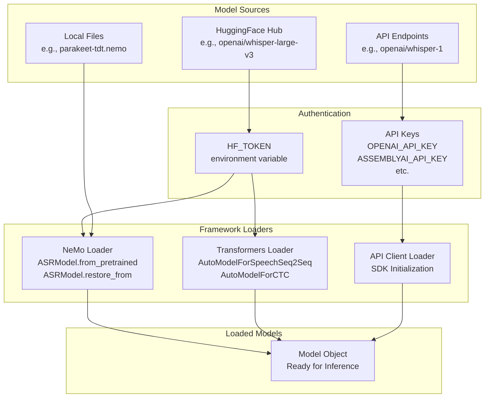
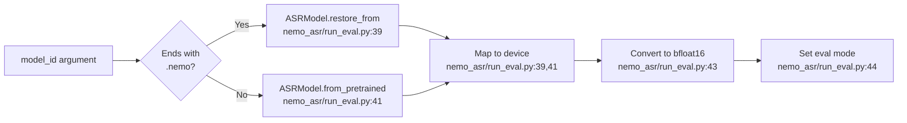
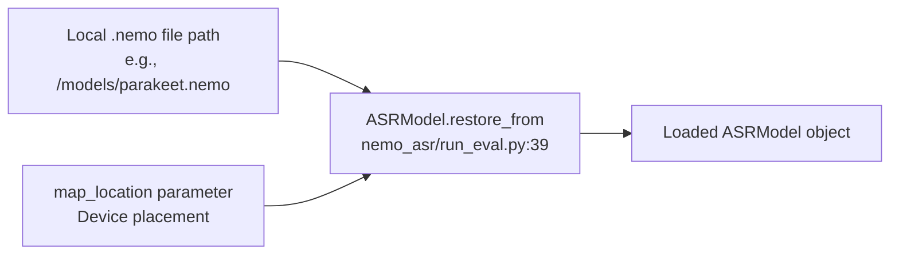
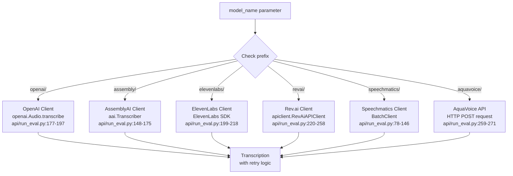
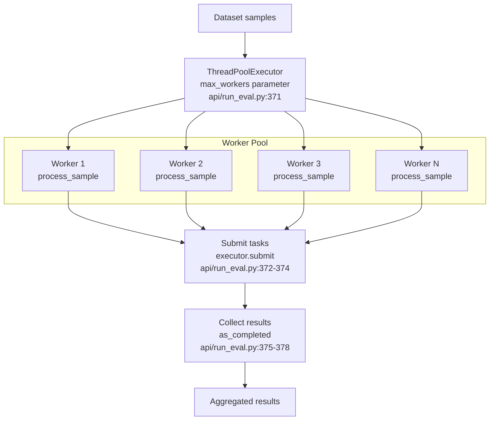
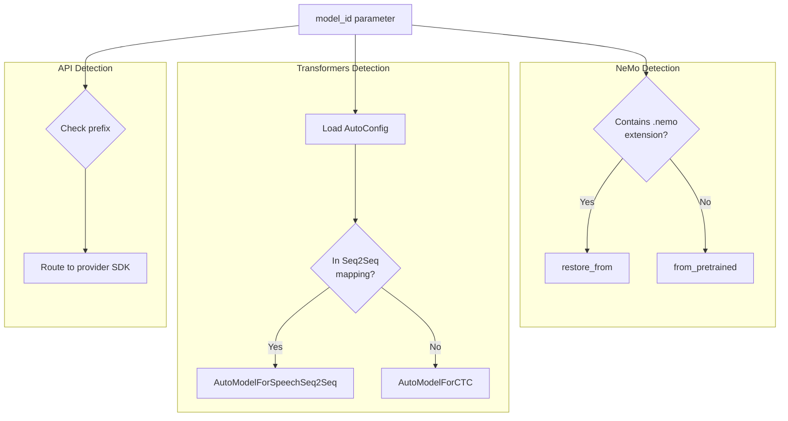
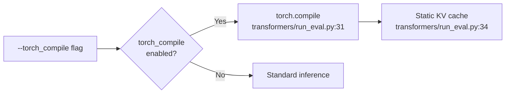

<!-- source: DeepWiki mcp.deepwiki.com · repo huggingface/open_asr_leaderboard · page 5.2 Model Integration · fetched 2026-10-26 -->

# Model Integration

<details>
<summary>Relevant source files</summary>

The following files were used as context for generating this wiki page:

- [api/run_api.sh](api/run_api.sh)
- [api/run_eval.py](api/run_eval.py)
- [nemo_asr/run_eval.py](nemo_asr/run_eval.py)
- [requirements/requirements-api.txt](requirements/requirements-api.txt)
- [transformers/run_eval.py](transformers/run_eval.py)

</details>


This page documents how ASR models are loaded and initialized across the different evaluation frameworks. The repository supports three primary model sources: HuggingFace Hub, local model files, and API endpoints. Each evaluation framework implements its own loading pattern tailored to the underlying library's requirements.

For information about adding support for new model types, see [Adding New Models](#6.1). For framework-specific evaluation details, see [Evaluation Frameworks](#4).

---

## Model Loading Architecture

The repository's multi-framework design requires distinct model loading strategies for each supported library. All frameworks follow a consistent pattern: identify the model source, authenticate if necessary, load the model with appropriate configuration, and prepare it for inference.



**Sources:** [nemo_asr/run_eval.py:38-41](), [transformers/run_eval.py:14-18](), [api/run_eval.py:68-276]()

---

## HuggingFace Hub Integration

### NeMo Models from Hub

NeMo models can be loaded directly from the HuggingFace Hub using the `ASRModel.from_pretrained()` method. The framework automatically detects whether the model identifier refers to a Hub model or a local file based on the `.nemo` extension.



The loading logic in [nemo_asr/run_eval.py:38-44]():

```python
if args.model_id.endswith(".nemo"):
    asr_model = ASRModel.restore_from(args.model_id, map_location=device)
else:
    asr_model = ASRModel.from_pretrained(args.model_id, map_location=device)

asr_model.to(compute_dtype)
asr_model.eval()
```

NeMo models from the Hub typically follow the naming pattern `nvidia/MODEL_NAME`, such as `nvidia/parakeet-tdt-1.1b` or `nvidia/canary-1b`.

**Sources:** [nemo_asr/run_eval.py:30-44]()

---

### Transformers Models from Hub

The Transformers framework uses `AutoModel` classes to automatically detect the model architecture and load the appropriate model type. The system distinguishes between encoder-decoder models (for sequence-to-sequence tasks) and CTC models based on the model configuration.

| Model Loading Component | Purpose | Code Reference |
|------------------------|---------|----------------|
| `AutoConfig.from_pretrained()` | Load model configuration to detect architecture | [transformers/run_eval.py:15]() |
| `AutoModelForSpeechSeq2Seq` | Load encoder-decoder models (e.g., Whisper) | [transformers/run_eval.py:16]() |
| `AutoModelForCTC` | Load CTC models (e.g., Wav2Vec2) | [transformers/run_eval.py:16]() |
| `AutoProcessor.from_pretrained()` | Load feature extractor and tokenizer | [transformers/run_eval.py:18]() |

The model selection logic in [transformers/run_eval.py:15-17]():

```python
config = AutoConfig.from_pretrained(args.model_id)
cls_model = AutoModelForSpeechSeq2Seq if type(config) in MODEL_FOR_SPEECH_SEQ_2_SEQ_MAPPING else AutoModelForCTC
model = cls_model.from_pretrained(args.model_id, torch_dtype=torch.bfloat16, attn_implementation="sdpa").to(args.device)
```

Key configuration details:
- **Data type**: Models are loaded in `torch.bfloat16` for memory efficiency
- **Attention implementation**: Uses scaled dot-product attention (SDPA) for performance
- **Device mapping**: Models are immediately moved to the target device (GPU or CPU)

**Sources:** [transformers/run_eval.py:14-19]()

---

## Local Model Files

### NeMo .nemo Files

Local NeMo models use the `.nemo` extension, which is a checkpoint format specific to NVIDIA NeMo. These files contain the complete model architecture, weights, and configuration.



The `restore_from()` method handles:
- Unpacking the `.nemo` archive
- Reconstructing the model architecture
- Loading weights from the checkpoint
- Applying device mapping

Local models are particularly useful for:
- **Unreleased models**: Testing models before public release
- **Custom fine-tuned models**: Evaluating domain-specific variants
- **Offline evaluation**: Running benchmarks without internet access

**Example usage:**
```bash
python nemo_asr/run_eval.py \
    --model_id /path/to/model.nemo \
    --dataset librispeech \
    --split test.clean
```

**Sources:** [nemo_asr/run_eval.py:38-39]()

---

## API-Based Models

### Supported API Providers

The API evaluation framework supports multiple commercial ASR services through a unified interface. Each provider requires its own API key set as an environment variable.

| Provider | Model Identifiers | API Key Environment Variable | SDK Package |
|----------|------------------|------------------------------|-------------|
| OpenAI | `openai/whisper-1`<br/>`openai/gpt-4o-transcribe`<br/>`openai/gpt-4o-mini-transcribe` | `OPENAI_API_KEY` | `openai` |
| AssemblyAI | `assembly/best` | `ASSEMBLYAI_API_KEY` | `assemblyai` |
| ElevenLabs | `elevenlabs/scribe_v1` | `ELEVENLABS_API_KEY` | `elevenlabs` |
| Rev.ai | `revai/machine`<br/>`revai/fusion` | `REVAI_API_KEY` | `rev-ai` |
| Speechmatics | `speechmatics/enhanced` | `SPEECHMATICS_API_KEY` | `speechmatics-python` |
| AquaVoice | `aquavoice/avalon-v1-en` | `AQUAVOICE_API_KEY` | `requests` |

**Sources:** [api/run_api.sh:11-21](), [requirements/requirements-api.txt:1-7]()

---

### API Client Initialization

The API framework uses a prefix-based routing system to dispatch transcription requests to the appropriate service. Each provider has a distinct initialization and transcription pattern.



**Sources:** [api/run_eval.py:68-276]()

---

### Authentication and Configuration

API keys must be set as environment variables before running evaluations. The [api/run_api.sh:5-9]() script shows the required environment variables:

```bash
export OPENAI_API_KEY="your_api_key"
export ASSEMBLYAI_API_KEY="your_api_key"
export ELEVENLABS_API_KEY="your_api_key"
export REVAI_API_KEY="your_api_key"
export AQUAVOICE_API_KEY="your_api_key"
```

The system loads these keys using the `dotenv` library [api/run_eval.py:26]() and validates them during initialization. Missing or invalid keys result in immediate errors with descriptive messages.

**Special considerations:**
- **Speechmatics**: Uses batch transcription API with job polling [api/run_eval.py:86-146]()
- **Rev.ai**: Supports both URL-based and file-based submission [api/run_eval.py:224-237]()
- **AssemblyAI**: Requires minimum audio duration of 0.16 seconds [api/run_eval.py:158-168]()

**Sources:** [api/run_api.sh:5-9](), [api/run_eval.py:26](), [api/run_eval.py:78-271]()

---

### Concurrent API Requests

The API framework uses `concurrent.futures.ThreadPoolExecutor` to parallelize transcription requests, significantly improving throughput for API-based evaluations.



The default configuration in [api/run_api.sh:23]() sets `MAX_WORKERS=10`, but this can be adjusted based on API rate limits. The transcription function [api/run_eval.py:297-387]() wraps each sample in retry logic to handle transient failures.

**Sources:** [api/run_eval.py:371-387](), [api/run_api.sh:23]()

---

## Model Identification Conventions

### Naming Patterns

The repository uses consistent naming patterns to identify model sources and capabilities:

| Pattern | Source | Example | Framework |
|---------|--------|---------|-----------|
| `organization/model-name` | HuggingFace Hub | `openai/whisper-large-v3` | Transformers |
| `nvidia/model-name` | HuggingFace Hub (NeMo) | `nvidia/parakeet-tdt-1.1b` | NeMo |
| `/path/to/model.nemo` | Local file | `/models/custom-model.nemo` | NeMo |
| `provider/model-id` | API endpoint | `openai/whisper-1` | API |
| `provider/service-tier` | API endpoint | `assembly/best` | API |

**Sources:** [nemo_asr/run_eval.py:183](), [transformers/run_eval.py:161-166](), [api/run_api.sh:11-21]()

---

### Model Type Detection

Each framework implements logic to detect the model type and select the appropriate loading method:



This detection system allows users to specify models using simple identifiers without explicitly declaring the model type or loading method.

**Sources:** [nemo_asr/run_eval.py:38-41](), [transformers/run_eval.py:15-16](), [api/run_eval.py:78-271]()

---

## Device and Precision Configuration

### GPU Acceleration

Models are automatically configured for GPU acceleration when available. The device selection logic varies by framework:

**NeMo Framework** [nemo_asr/run_eval.py:30-35]():
```python
if args.device >= 0:
    device = torch.device(f"cuda:{args.device}")
    compute_dtype=torch.bfloat16
else:
    device = torch.device("cpu")
    compute_dtype=torch.float32
```

**Transformers Framework** [transformers/run_eval.py:17]():
```python
model = cls_model.from_pretrained(
    args.model_id, 
    torch_dtype=torch.bfloat16, 
    attn_implementation="sdpa"
).to(args.device)
```

| Framework | GPU Dtype | CPU Dtype | Device Selection |
|-----------|-----------|-----------|------------------|
| NeMo | `torch.bfloat16` | `torch.float32` | `--device` flag (int) |
| Transformers | `torch.bfloat16` | `torch.bfloat16` | `--device` flag (int) |
| API | N/A (remote) | N/A (remote) | Not applicable |

**Sources:** [nemo_asr/run_eval.py:30-35](), [transformers/run_eval.py:17]()

---

### Model Optimization

The Transformers framework supports additional optimizations through `torch.compile` for improved inference speed:



When compilation is enabled [transformers/run_eval.py:30-34]():
- The model's forward pass is JIT-compiled with the specified mode
- Autoregressive models use static key-value caching
- The `--compile_mode` argument controls optimization aggressiveness

Available compilation modes:
- `default`: Balanced compilation
- `reduce-overhead`: Minimize Python overhead
- `max-autotune`: Maximum performance optimization (default)
- `max-autotune-no-cudagraphs`: Maximum optimization without CUDA graphs

**Sources:** [transformers/run_eval.py:30-34](), [transformers/run_eval.py:221-226]()

---

