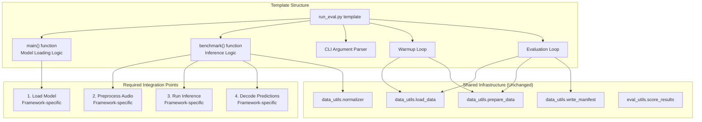
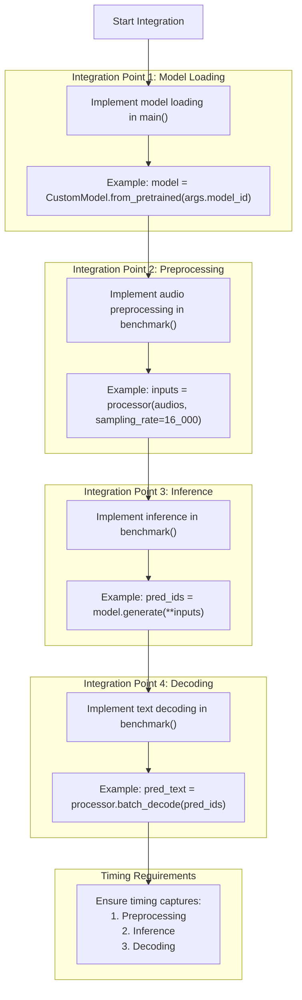
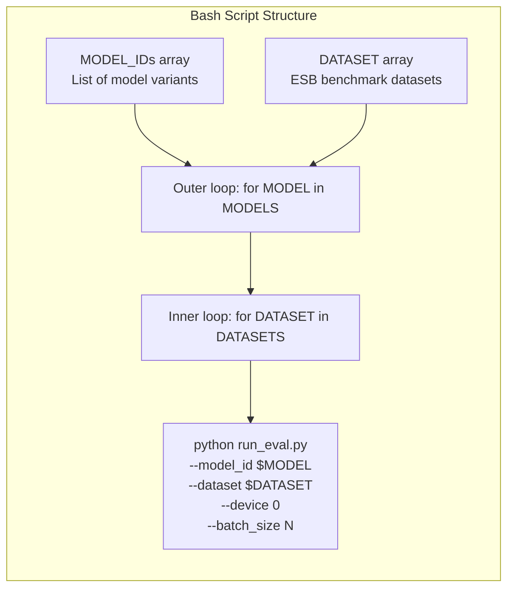
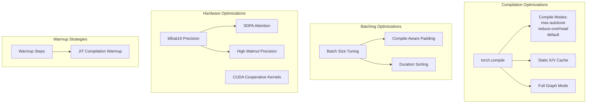
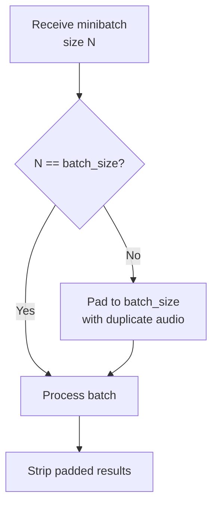
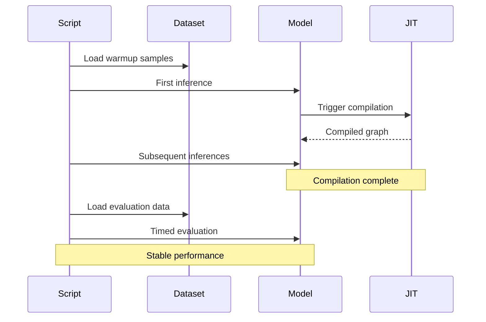
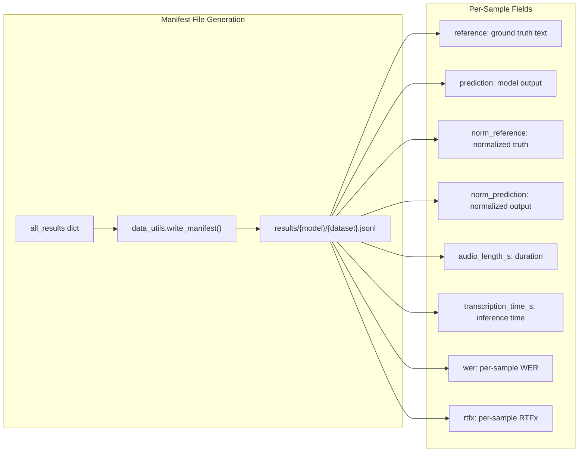
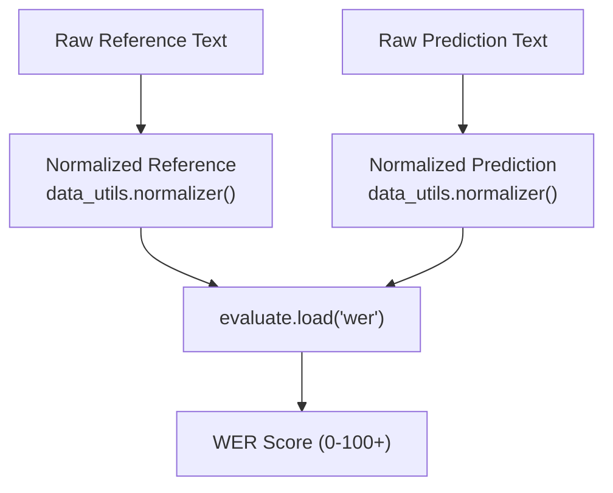
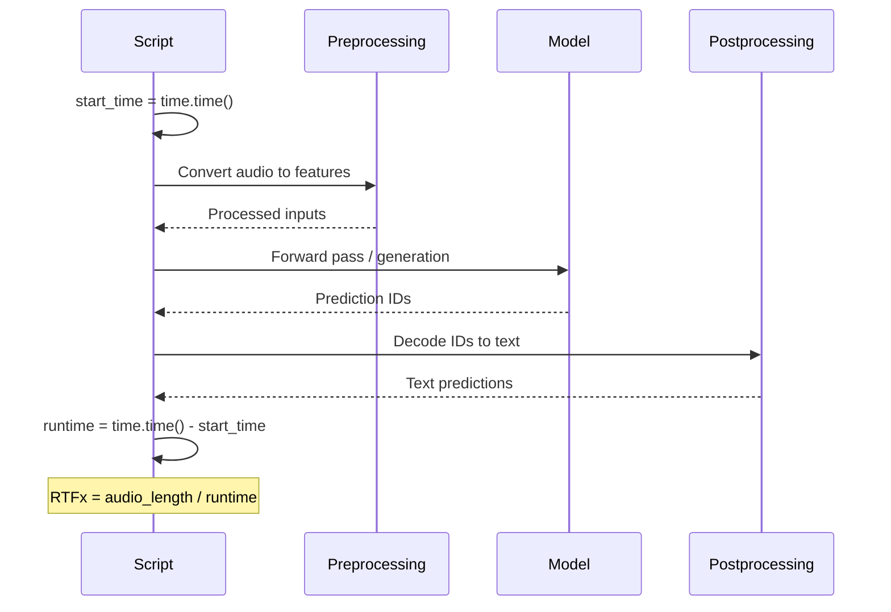
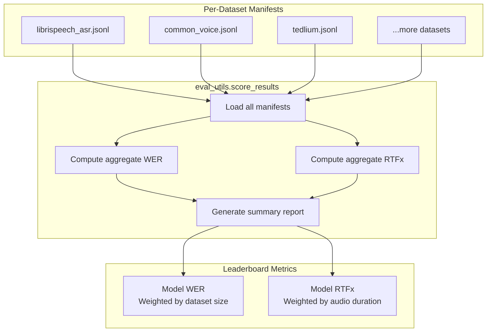

<!-- source: DeepWiki mcp.deepwiki.com · repo huggingface/open_asr_leaderboard · page 6 Advanced Topics · fetched 2026-10-26 -->

# Advanced Topics

<details>
<summary>Relevant source files</summary>

The following files were used as context for generating this wiki page:

- [README.md](README.md)
- [requirements/requirements_nemo.txt](requirements/requirements_nemo.txt)
- [transformers/run_eval.py](transformers/run_eval.py)

</details>


This page covers advanced topics for extending and optimizing the Open ASR Leaderboard evaluation system. It is intended for users who want to integrate new ASR models, maximize evaluation performance, or deeply understand the output metrics.

For basic evaluation workflows, see [Core Evaluation Pipeline](#2). For framework-specific details, see [Evaluation Frameworks](#4). For the shared infrastructure that powers all evaluations, see [Shared Infrastructure](#3).

---

## Purpose and Scope

This document addresses three advanced use cases:

1. **Adding New Models** - Integrating new ASR libraries or models while maintaining consistency with existing evaluation protocols
2. **Performance Optimization** - Leveraging PyTorch compilation, GPU acceleration, and batching strategies to maximize throughput
3. **Result Interpretation** - Understanding manifest file structure, metric computation, and debugging evaluation issues

---

## Extension Architecture

The evaluation system is designed for extensibility through a template-based architecture. All evaluation frameworks follow an identical structure to ensure consistency.

### Template Pattern Overview



**Sources:** [README.md:29-213](), [transformers/run_eval.py:1-237]()

### Framework Integration Requirements

When adding a new evaluation framework, only four functions need customization. All other components remain unchanged:

| Component | Customization Required | Purpose |
|-----------|----------------------|---------|
| **Model Loading** | ✓ Yes | Framework-specific model initialization |
| **Audio Preprocessing** | ✓ Yes | Convert audio to framework's expected format |
| **Inference** | ✓ Yes | Execute model prediction |
| **Decoding** | ✓ Yes | Convert model output to text |
| Data Loading | ✗ No | Handled by `data_utils.load_data` |
| Dataset Preparation | ✗ No | Handled by `data_utils.prepare_data` |
| Text Normalization | ✗ No | Handled by `data_utils.normalizer` |
| Manifest Writing | ✗ No | Handled by `data_utils.write_manifest` |
| Metric Calculation | ✗ No | Handled by `evaluate.load("wer")` |

**Sources:** [README.md:34-36](), [transformers/run_eval.py:14-97]()

---

## Adding New Models

### Step-by-Step Integration Guide

#### Step 1: Create Evaluation Directory

Create a new directory for the framework:

```
mkdir <framework_name>
cd <framework_name>
```

#### Step 2: Implement run_eval.py

Copy the template structure and customize the four integration points:



**Implementation Example (Transformers Framework):**

The model loading logic appears in [transformers/run_eval.py:14-28]():
- Lines 15-16: Auto-detect model class (Seq2Seq vs CTC)
- Line 17: Load model with bfloat16 precision and SDPA attention
- Line 18: Load processor for audio preprocessing
- Lines 21-26: Configure generation parameters for multilingual Whisper

The inference logic appears in [transformers/run_eval.py:36-97]():
- Lines 37-39: Load audio arrays from batch
- Lines 42-68: Preprocessing with compile-aware padding
- Lines 70-78: Model inference (generation or CTC forward)
- Lines 80-86: Post-processing (strip padding, decode text)
- Lines 88-97: Timing and normalization

**Sources:** [transformers/run_eval.py:14-97](), [README.md:42-86]()

#### Step 3: Create Bash Orchestration Script

Create `run_<model_type>.sh` following this structure:



**Key Requirements:**
- All models in the script must use **identical hyperparameters** (batch size, beam size, etc.) across all datasets
- Hyperparameters can be tuned to maximize performance, but must remain constant per model
- This ensures fair comparison as specified in the ESB benchmark protocol

**Sources:** [README.md:215-218]()

#### Step 4: Add Requirements File

Create `requirements/requirements_<framework>.txt` with framework-specific dependencies:

```
# Example for custom framework
custom-asr-library>=1.0.0
tqdm
soundfile
librosa
# Add framework-specific requirements
```

**Critical Dependencies:**

For frameworks requiring fast inference with RNN-T or TDT models, include CUDA-Python:
```
cuda-python>=12.4  # Used for fast TDT and RNN-T inference
```

This dependency enables cooperative kernel optimization as shown in [requirements/requirements_nemo.txt:6]().

**Note:** CUDA 12.6+ is required for RNN-T inference with cooperative kernels. Verify with `nvidia-smi`.

**Sources:** [requirements/requirements_nemo.txt:1-7](), [README.md:15]()

#### Step 5: Validation Checklist

Before submitting a PR, verify:

- [ ] `run_eval.py` uses `data_utils.load_data` for dataset loading
- [ ] `run_eval.py` uses `data_utils.prepare_data` for audio preprocessing
- [ ] `run_eval.py` uses `data_utils.normalizer` for text normalization
- [ ] `run_eval.py` uses `data_utils.write_manifest` for result persistence
- [ ] Timing captures preprocessing + inference + decoding
- [ ] Per-sample timing is computed as `runtime / minibatch_size`
- [ ] All datasets use identical hyperparameters
- [ ] Warmup steps are implemented (default: 10)
- [ ] Results are reproducible on NVIDIA A100-SXM4-80GB with CUDA 12.6

**Sources:** [README.md:26](), [transformers/run_eval.py:88-97]()

---

## Performance Optimization

### Optimization Techniques Overview

The evaluation system supports multiple optimization strategies to maximize throughput while maintaining accuracy:



**Sources:** [transformers/run_eval.py:12,30-35,46-50,70]()

### PyTorch Compilation

#### Enabling torch.compile

The `torch.compile` feature provides significant speedups through JIT compilation. Enable via CLI argument:

```bash
python run_eval.py \
  --model_id openai/whisper-large-v3 \
  --dataset librispeech_asr \
  --torch_compile \
  --compile_mode max-autotune
```

**Implementation Details:**

The compilation logic appears in [transformers/run_eval.py:30-34]():
- Line 31: Compile the forward pass with specified mode and full graph optimization
- Line 34: Enable static K/V cache for autoregressive models

**Compile Modes:**

| Mode | Description | Use Case |
|------|-------------|----------|
| `max-autotune` | Extensive optimization search | Production evaluation (default) |
| `reduce-overhead` | Minimize Python overhead | Large batch sizes |
| `default` | Standard compilation | Quick testing |
| `max-autotune-no-cudagraphs` | Max-autotune without CUDA graphs | Debugging |

**Sources:** [transformers/run_eval.py:30-34,218-226]()

#### Static K/V Cache

For autoregressive models (Whisper, Canary), static caching eliminates dynamic memory allocation during generation:

```python
if model.can_generate():
    model.generation_config.cache_implementation = "static"
```

This optimization is automatically enabled when `torch_compile=True` as shown in [transformers/run_eval.py:34]().

**Benefits:**
- Eliminates cache reallocation during generation
- Enables full graph compilation
- Reduces memory fragmentation

**Requirements:**
- Only applicable to autoregressive models
- Requires `torch_compile=True`
- Cache size determined by `max_new_tokens`

**Sources:** [transformers/run_eval.py:32-34]()

#### Compile-Aware Padding

When using `torch.compile`, batch size changes trigger recompilation. To prevent this, pad the final batch:



**Implementation:** [transformers/run_eval.py:46-50,82-83]()
- Lines 47-50: Detect undersized batches and pad with duplicates
- Lines 82-83: Strip padded predictions from results

**Sources:** [transformers/run_eval.py:46-50,82-83]()

### Batching Strategies

#### Optimal Batch Size Selection

Batch size significantly impacts throughput and memory usage:

| Model Type | Typical Batch Size | Memory Constraint |
|------------|-------------------|-------------------|
| Whisper Small | 16-32 | ~20GB VRAM |
| Whisper Large | 8-16 | ~40GB VRAM |
| Wav2Vec2 Base | 16-32 | ~15GB VRAM |
| Parakeet TDT | 64-128 | Optimized inference |
| CTC Models | 16-64 | Single forward pass |

**Tuning Strategy:**
1. Start with batch size 16
2. Increase until OOM error
3. Reduce by 25% for stability margin
4. Verify with warmup runs

**Sources:** [transformers/run_eval.py:193-196]()

#### Duration-Based Sorting

The `prepare_data` function sorts audio by duration to minimize padding waste. This optimization is automatically applied by [normalizer/data_utils.py]() for all frameworks.

**Benefits:**
- Reduces padding in batched inference
- Improves GPU utilization
- Decreases total evaluation time

**Sources:** Referenced in system diagrams

### Hardware Optimizations

#### Precision Configuration

The evaluation system uses bfloat16 precision for optimal performance:

```python
model = AutoModelForSpeechSeq2Seq.from_pretrained(
    args.model_id, 
    torch_dtype=torch.bfloat16,
    attn_implementation="sdpa"
)
```

**Precision Stack:**
- Model weights: `bfloat16` (Line 17)
- Input features: `bfloat16` (Line 67)
- Matrix multiplication: `high` precision (Line 12)

**Implementation:** [transformers/run_eval.py:12,17,67]()

**Sources:** [transformers/run_eval.py:12,17,67]()

#### SDPA Backend Selection

The Scaled Dot-Product Attention backend is dynamically selected based on compilation:

```python
with sdpa_kernel(SDPBackend.MATH if args.torch_compile else SDPBackend.FLASH_ATTENTION):
    if model.can_generate():
        pred_ids = model.generate(**inputs, **gen_kwargs)
```

**Backend Logic:**
- `SDPBackend.MATH`: Used with `torch.compile` for full graph compatibility
- `SDPBackend.FLASH_ATTENTION`: Used otherwise for memory efficiency

**Implementation:** [transformers/run_eval.py:70]()

**Sources:** [transformers/run_eval.py:4,70-73]()

#### CUDA Cooperative Kernels

For NeMo models with RNN-T or TDT inference, CUDA-Python enables cooperative kernel optimization:

```
cuda-python>=12.4  # Used for fast TDT and RNN-T inference
```

**Requirements:**
- CUDA 12.6+ driver (verify with `nvidia-smi`)
- NVIDIA A100 or newer GPU
- NeMo framework with RNN-T/TDT models

**Performance Impact:** 2-3x speedup for Parakeet TDT models

**Sources:** [requirements/requirements_nemo.txt:6](), [README.md:15]()

### Warmup Strategies

#### Purpose and Implementation

Warmup runs stabilize timing measurements by triggering JIT compilation and GPU cache population:



**Implementation:** [transformers/run_eval.py:99-111]()
- Lines 100-107: Load and prepare warmup dataset
- Line 108: Map benchmark function over warmup samples
- Lines 110-111: Execute warmup loop without timing

**Configuration:**
```bash
python run_eval.py \
  --warmup_steps 10 \
  --batch_size 16
```

Total warmup samples = `warmup_steps × batch_size` (e.g., 10 × 16 = 160 samples)

**Sources:** [transformers/run_eval.py:99-111,228-231]()

#### Warmup Best Practices

| Scenario | Recommended Warmup Steps |
|----------|-------------------------|
| Without `torch.compile` | 5-10 |
| With `torch.compile` | 10-20 |
| Static cache enabled | 15-25 |
| First run on GPU | 20+ |
| Repeated runs | 5 |

**Sources:** [transformers/run_eval.py:230]()

---

## Result Interpretation

### Manifest File Structure

Evaluation results are persisted as JSONL (JSON Lines) files in the `results/` directory. Each line represents one audio sample:



**Example Manifest Entry:**
```json
{
  "reference": "THE QUICK BROWN FOX JUMPS OVER THE LAZY DOG",
  "prediction": "the quick brown fox jumps over the lazy dog",
  "norm_reference": "the quick brown fox jumps over the lazy dog",
  "norm_prediction": "the quick brown fox jumps over the lazy dog",
  "audio_length_s": 4.32,
  "transcription_time_s": 0.089,
  "wer": 0.0,
  "rtfx": 48.54
}
```

**Sources:** [transformers/run_eval.py:138-147]()

### WER (Word Error Rate) Calculation

WER measures transcription accuracy as the normalized Levenshtein distance:

```
WER = (Substitutions + Insertions + Deletions) / Total Words × 100
```

**Computation Pipeline:**



**Implementation:** [transformers/run_eval.py:150-153]()
- Line 11: Load WER metric from HuggingFace `evaluate` library
- Lines 150-152: Compute WER over all samples
- Line 153: Convert to percentage and round to 2 decimals

**Normalization Impact:**

Text normalization is critical for fair WER calculation. The normalizer handles:
- Case normalization (all lowercase)
- Punctuation removal
- Number expansion (e.g., "10" → "ten")
- Contraction expansion (e.g., "don't" → "do not")
- British→American spelling (799 mappings)

**Sources:** [transformers/run_eval.py:11,95,150-153]()

### RTFx (Real-Time Factor) Calculation

RTFx measures inference speed relative to audio duration:

```
RTFx = Total Audio Duration (seconds) / Total Transcription Time (seconds)
```

**Interpretation:**
- RTFx = 1.0: Real-time (transcribes as fast as audio plays)
- RTFx = 10.0: 10× faster than real-time
- RTFx = 0.5: 2× slower than real-time (not real-time capable)

**Timing Methodology:**



**Implementation:** [transformers/run_eval.py:42,89,92,154]()
- Line 42: Start timing before preprocessing
- Line 89: End timing after decoding
- Line 92: Normalize by minibatch size for per-sample time
- Line 154: Compute aggregate RTFx

**Per-Sample RTFx:**
```python
batch["transcription_time_s"] = minibatch_size * [runtime / minibatch_size]
```

This ensures each sample gets an equal share of batch processing time.

**Sources:** [transformers/run_eval.py:42,89,92,154]()

### Aggregate Scoring

After generating manifests for all datasets, the `score_results` function computes model-level metrics:



**Sources:** Referenced in system diagrams

### Debugging Poor Performance

#### Low RTFx (Slow Inference)

**Diagnostic Steps:**

1. **Check Batch Size:** Increase if GPU utilization is low
2. **Enable torch.compile:** Should provide 1.5-2× speedup
3. **Verify CUDA Version:** RNN-T models require CUDA 12.6+
4. **Check GPU Memory:** May need smaller batch or lower precision
5. **Review Warmup:** Insufficient warmup can skew timing

**Common Issues:**

| Symptom | Likely Cause | Solution |
|---------|--------------|----------|
| RTFx << expected | Small batch size | Increase `--batch_size` |
| RTFx varies by 50%+ | No warmup | Set `--warmup_steps 10+` |
| RTFx worse with compile | Undersized batches | Triggers recompilation |
| OOM errors | Batch too large | Reduce `--batch_size` |

#### High WER (Poor Accuracy)

**Diagnostic Steps:**

1. **Check Manifest Files:** Inspect `norm_prediction` vs `norm_reference`
2. **Verify Language Settings:** Multilingual models need `language="en"`
3. **Review Normalization:** Check if custom characters are being removed
4. **Test Generation Params:** May need higher `max_new_tokens`

**Common Issues:**

| Symptom | Likely Cause | Solution |
|---------|--------------|----------|
| High WER on all datasets | Wrong model variant | Verify model_id |
| Predictions are truncated | `max_new_tokens` too low | Increase limit |
| Empty predictions | Wrong language setting | Set `language="en"` |
| Inconsistent normalization | Custom normalizer needed | Add to `normalizer.py` |

**Sources:** [transformers/run_eval.py:22-26,150-155]()

---

## Summary

This page covered three advanced topics for the Open ASR Leaderboard:

1. **Adding New Models:** Follow the template pattern in [README.md:34-213](), customizing only the four integration points (model loading, preprocessing, inference, decoding) while using shared infrastructure for data handling and metrics.

2. **Performance Optimization:** Leverage `torch.compile` with static K/V caching for 1.5-2× speedups ([transformers/run_eval.py:30-34]()), use appropriate batch sizes and warmup steps ([transformers/run_eval.py:99-111]()), and enable CUDA cooperative kernels for RNN-T models ([requirements/requirements_nemo.txt:6]()).

3. **Result Interpretation:** Understand manifest file structure ([transformers/run_eval.py:138-147]()), WER calculation with normalization ([transformers/run_eval.py:150-153]()), and RTFx timing methodology ([transformers/run_eval.py:42,89,92,154]()).

For framework-specific implementation details, consult the individual framework pages under [Evaluation Frameworks](#4).

---

