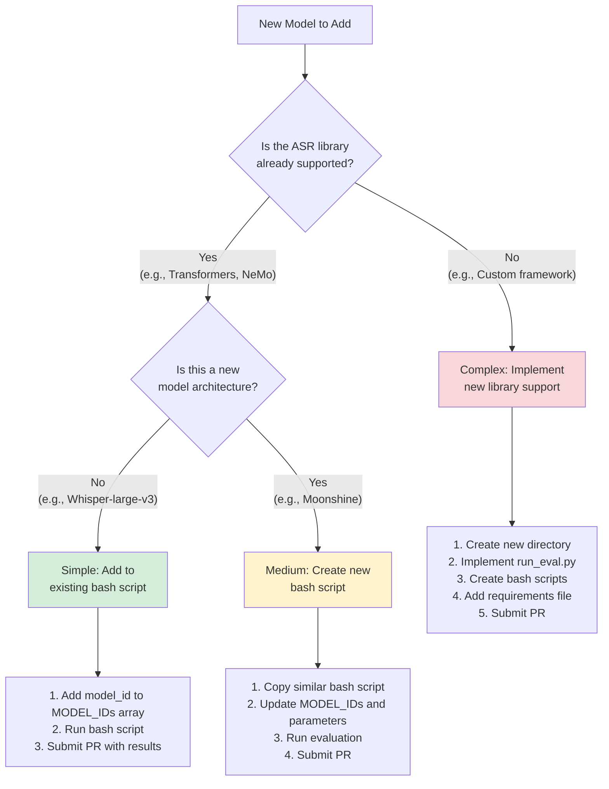
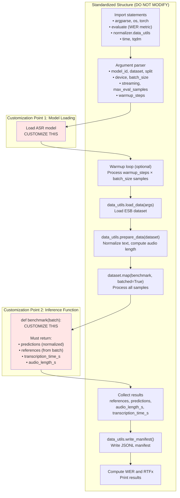
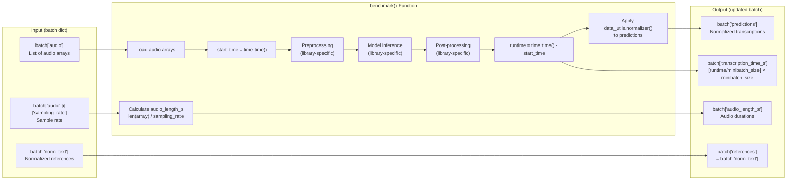
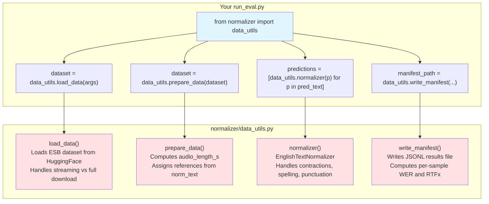

<!-- source: DeepWiki mcp.deepwiki.com · repo huggingface/open_asr_leaderboard · page 6.1 Adding New Models · fetched 2026-10-26 -->

# Adding New Models

<details>
<summary>Relevant source files</summary>

The following files were used as context for generating this wiki page:

- [README.md](README.md)
- [nemo_asr/run_eval.py](nemo_asr/run_eval.py)
- [transformers/run_eval.py](transformers/run_eval.py)

</details>


This document provides step-by-step instructions for integrating new ASR models into the Open ASR Leaderboard evaluation framework. It covers two scenarios: adding models from existing libraries (e.g., a new Whisper variant) and adding models from entirely new ASR frameworks (e.g., a custom inference engine).

For information about the core evaluation pipeline that all models follow, see [Core Evaluation Pipeline](#2). For details on supported datasets, see [Supported Datasets](#5.1).

---

## Decision Tree: Existing vs. New Library

The integration process differs significantly based on whether the model uses an already-supported library:



**Sources:** [README.md:221-231]()

The table below summarizes the three integration paths:

| Scenario | Effort Level | Examples | Required Files |
|----------|-------------|----------|----------------|
| **Existing model, new size** | Low | `openai/whisper-large-v3-turbo` added to Whisper script | None (modify bash script only) |
| **New architecture, existing library** | Medium | New model type using Transformers | New bash script (e.g., `run_newmodel.sh`) |
| **New library** | High | Adding support for Moonshine, Kyutai | New directory with `run_eval.py`, bash scripts, requirements file |

---

## Adding Models to Existing Libraries

This is the simplest integration path. If the model uses a library already supported in the repository (Transformers, NeMo, CTranslate2, etc.), you only need to update existing bash scripts.

### Step 1: Identify the Library Directory

Navigate to the appropriate directory:

```bash
cd transformers/     # For HuggingFace models
cd nemo_asr/        # For NVIDIA NeMo models
cd api_eval/        # For API-based models
cd granite_eval/    # For IBM Granite models
# etc.
```

### Step 2: Update the Bash Script

Locate the bash script for the model architecture (e.g., `run_whisper.sh` for Whisper models). Add your model identifier to the `MODEL_IDs` array:

```bash
# Example from transformers/run_whisper.sh
MODEL_IDs=(
    "openai/whisper-large-v3"
    "openai/whisper-large-v3-turbo"  # New model added here
    "distil-whisper/distil-large-v3"
)
```

**Key Constraints:**

- **Same decoding hyperparameters must be used across all datasets** for a given model. This ensures fair comparison as per the ESB benchmark specification [README.md:218]().
- You may tune hyperparameters (batch size, beam size, etc.) to maximize performance, but they must remain constant across datasets.
- All models in the same bash script should share similar computational requirements.

### Step 3: Run Evaluation

Execute the bash script to evaluate the model on all datasets:

```bash
bash run_whisper.sh
```

The script will iterate through all datasets and produce JSONL manifest files in the `results/` directory.

### Step 4: Submit Results

Create a pull request with:
- Modified bash script showing the new model
- Generated manifest files (`.jsonl`) from the `results/` directory

**Sources:** [README.md:221-231](), [transformers/run_eval.py:1-237]()

---

## Adding a New Library

Adding support for a new ASR library requires implementing the standard evaluation pattern. This section details the required components and integration points.

### Directory Structure

Create a new directory for your library:

```bash
mkdir my_library/
cd my_library/
```

The directory should contain:

```
my_library/
├── run_eval.py           # Main evaluation script (required)
├── run_model_type1.sh    # Bash script for model family 1
├── run_model_type2.sh    # Bash script for model family 2 (if applicable)
└── README.md            # Optional: library-specific documentation
```

Additionally, create a requirements file at the repository root:

```
requirements/
└── requirements_my_library.txt
```

**Sources:** [README.md:28-219]()

### The run_eval.py Template

All evaluation scripts follow a standardized structure with two customization points. Below is the canonical pattern:



**Sources:** [README.md:34-211](), [transformers/run_eval.py:1-237]()

---

### Customization Point 1: Model Loading

The `main()` function must load your ASR model. This is the primary customization point.

**Example for Transformers:**

```python
# transformers/run_eval.py:14-18
config = AutoConfig.from_pretrained(args.model_id)
cls_model = AutoModelForSpeechSeq2Seq if type(config) in MODEL_FOR_SPEECH_SEQ_2_SEQ_MAPPING else AutoModelForCTC
model = cls_model.from_pretrained(args.model_id, torch_dtype=torch.bfloat16, attn_implementation="sdpa").to(args.device)
processor = AutoProcessor.from_pretrained(args.model_id)
```

**Example for NeMo:**

```python
# nemo_asr/run_eval.py:38-44
if args.model_id.endswith(".nemo"):
    asr_model = ASRModel.restore_from(args.model_id, map_location=device)
else:
    asr_model = ASRModel.from_pretrained(args.model_id, map_location=device)

asr_model.to(compute_dtype)
asr_model.eval()
```

**Key Requirements:**

- Load model in `torch.bfloat16` dtype when possible for consistency
- Set model to evaluation mode (`.eval()`)
- Move model to appropriate device (CPU or GPU)
- Load any required processor/tokenizer/feature extractor

**Sources:** [transformers/run_eval.py:14-18](), [nemo_asr/run_eval.py:38-44]()

---

### Customization Point 2: Inference Logic

The `benchmark()` function executes model inference and must conform to a strict interface:



**Required Interface:**

The function must accept a batch dictionary and return it with these keys populated:

| Key | Type | Description | Required |
|-----|------|-------------|----------|
| `predictions` | `List[str]` | Normalized transcriptions using `data_utils.normalizer()` | Yes |
| `references` | `List[str]` | Copy of `batch["norm_text"]` | Yes |
| `transcription_time_s` | `List[float]` | Per-sample inference time (total_time / batch_size) | Yes |
| `audio_length_s` | `List[float]` | Audio duration in seconds | Yes |

**Example Implementation (Transformers):**

```python
# transformers/run_eval.py:36-97
def benchmark(batch):
    # Load audio inputs
    audios = [audio["array"] for audio in batch["audio"]]
    minibatch_size = len(audios)
    
    # START TIMING
    start_time = time.time()
    
    # 1. Pre-Processing
    inputs = processor(audios, sampling_rate=16_000, return_tensors="pt").to(args.device)
    inputs["input_features"] = inputs["input_features"].to(torch.bfloat16)
    
    # 2. Generation
    pred_ids = model.generate(**inputs)
    
    # 3. Post-processing
    pred_text = processor.batch_decode(pred_ids, skip_special_tokens=True)
    
    # END TIMING
    runtime = time.time() - start_time
    
    # Normalize by minibatch size since we want the per-sample time
    batch["transcription_time_s"] = minibatch_size * [runtime / minibatch_size]
    
    # Normalize transcriptions with English normalizer
    batch["predictions"] = [data_utils.normalizer(pred) for pred in pred_text]
    batch["references"] = batch["norm_text"]
    return batch
```

**Critical Requirements:**

1. **Timing must encompass all inference steps**: preprocessing, model forward pass, and post-processing [transformers/run_eval.py:42-89]()
2. **Use `data_utils.normalizer()` for predictions**: This ensures consistent text normalization across all frameworks [transformers/run_eval.py:95]()
3. **References come from `batch["norm_text"]`**: Do not normalize again [transformers/run_eval.py:96]()
4. **Per-sample timing**: Divide total batch time by minibatch size [transformers/run_eval.py:92]()

**Sources:** [transformers/run_eval.py:36-97](), [nemo_asr/run_eval.py:48-163]()

---

### Integration with Shared Infrastructure

All evaluation scripts must use the shared `normalizer` module for consistent data handling:



**Mandatory Shared Functions:**

| Function | Purpose | When to Call |
|----------|---------|--------------|
| `data_utils.load_data(args)` | Loads ESB dataset from HuggingFace with streaming/full download support | Start of evaluation, before warmup |
| `data_utils.prepare_data(dataset)` | Computes `audio_length_s`, assigns `norm_text` to samples | After loading dataset |
| `data_utils.normalizer(text)` | Normalizes predictions using EnglishTextNormalizer | Inside `benchmark()` function for all predictions |
| `data_utils.write_manifest()` | Writes per-sample results to JSONL manifest | After collecting all results |

**Why Shared Infrastructure Matters:**

The normalizer module ensures that all frameworks apply identical:
- Text normalization rules (English contractions, numbers, spelling)
- WER calculation methodology
- Dataset loading and preprocessing
- Result file formatting

Deviating from these functions will produce results that are not comparable with other leaderboard entries.

**Sources:** [transformers/run_eval.py:7-10](), [transformers/run_eval.py:95-96](), [transformers/run_eval.py:138-147]()

---

### Creating Bash Scripts

Each model family should have a dedicated bash script following the naming convention `run_<model_type>.sh`:

```bash
#!/bin/bash

# Array of model identifiers
MODEL_IDs=(
    "organization/model-small"
    "organization/model-medium"
    "organization/model-large"
)

# Array of datasets
DATASET_IDs=(
    "librispeech_asr"
    "librispeech_asr-other"
    # ... (all 8 ESB datasets)
)

# Iterate through models and datasets
for model_id in "${MODEL_IDs[@]}"; do
    for dataset in "${DATASET_IDs[@]}"; do
        python run_eval.py \
            --model_id "${model_id}" \
            --dataset "${dataset}" \
            --device 0 \
            --batch_size 32 \
            --warmup_steps 10
    done
done
```

**Script Structure:**

1. **MODEL_IDs array**: Contains all model identifiers to evaluate
2. **DATASET_IDs array**: Lists all ESB datasets (8 datasets total)
3. **Nested loops**: Evaluates each model on each dataset
4. **Common parameters**: 
   - `--device 0` for GPU evaluation
   - `--batch_size` tuned for model type
   - `--warmup_steps 10` for stable timing

**Important Notes:**

- **Consistent hyperparameters**: Same `--batch_size`, beam settings, etc. across all datasets for a model [README.md:218]()
- **GPU requirements**: All evaluations should use NVIDIA A100-SXM4-80GB with CUDA 12.6 [README.md:26]()
- Different model sizes can have different batch sizes (e.g., large models use smaller batches)

**Sources:** [README.md:215-219]()

---

### Requirements File

Create `requirements/requirements_<library_name>.txt` with all dependencies:

```txt
# Example: requirements/requirements_my_library.txt
my_asr_library>=1.0.0
torch>=2.4.0
torchaudio>=2.4.0
# Add any specific version pins needed
```

**Special Considerations:**

- Pin critical dependencies that affect reproducibility
- Note any CUDA version requirements (like NeMo's requirement for CUDA 12.6 for RNN-T inference [README.md:15]())
- Include framework-specific optimizations (e.g., `cuda-python>=12.4` for fast TDT inference)

**Sources:** [README.md:6-15]()

---

## Testing Your Integration

Before submitting a PR, verify your implementation:

### 1. Smoke Test with Limited Samples

```bash
python run_eval.py \
    --model_id "your/model" \
    --dataset "librispeech_asr" \
    --split "test" \
    --max_eval_samples 64 \
    --device 0
```

This tests the end-to-end pipeline on a small subset.

### 2. Verify Manifest Structure

Check that the generated JSONL file contains:

```json
{
  "audio_filepath": "path/to/audio.wav",
  "duration": 5.23,
  "prediction": "normalized transcription",
  "reference": "normalized reference",
  "wer": 0.05,
  "rtfx": 120.5
}
```

### 3. Full Evaluation

Run the complete bash script:

```bash
bash run_mymodel.sh
```

Verify that:
- All 8 datasets complete successfully
- WER and RTFx are computed correctly
- Results are reproducible across runs

### 4. Check Consistency

Compare WER values with:
- Official model card results (if available)
- Results from other evaluation frameworks
- Expected performance range for the model type

**Sources:** [README.md:17-26](), [transformers/run_eval.py:114-156]()

---

## Submission Process

### Step 1: Prepare Your Branch

```bash
git checkout -b add-my-library
git add my_library/
git add requirements/requirements_my_library.txt
git commit -m "Add support for MyLibrary ASR framework"
```

### Step 2: Include Required Files

Your PR should contain:

- **New directory** with `run_eval.py` and bash scripts
- **Requirements file** at `requirements/requirements_<library>.txt`
- **Manifest files** (JSONL) in `results/` directory for all models and datasets
- **Updated README** (optional) if adding special setup instructions

### Step 3: PR Description

Include in your PR description:

1. **Library name and version**
2. **Model identifiers** being added
3. **Decoding hyperparameters** used (batch size, beam size, etc.)
4. **Hardware configuration** used for evaluation
5. **Any special requirements** (CUDA version, driver version, etc.)
6. **Sample results** showing WER and RTFx for one dataset

### Step 4: Review Process

Maintainers will verify:

- Correct use of `data_utils` functions
- Proper text normalization with `data_utils.normalizer()`
- Consistent evaluation methodology
- Reproducibility of results

If you cannot access an A100 GPU, request that maintainers run your evaluation scripts [README.md:26]().

**Sources:** [README.md:221-231]()

---

## Common Pitfalls

### 1. Incorrect Timing Measurement

**Wrong:**
```python
# Timing only model inference
start_time = time.time()
outputs = model.generate(**inputs)
runtime = time.time() - start_time
```

**Correct:**
```python
# Timing preprocessing + inference + postprocessing
start_time = time.time()
inputs = processor(audios, ...)
outputs = model.generate(**inputs)
pred_text = processor.batch_decode(outputs)
runtime = time.time() - start_time
```

Timing must include all steps required to convert audio to text [transformers/run_eval.py:42-89]().

### 2. Forgetting Text Normalization

**Wrong:**
```python
batch["predictions"] = pred_text  # Raw model output
```

**Correct:**
```python
batch["predictions"] = [data_utils.normalizer(pred) for pred in pred_text]
```

Always normalize predictions using `data_utils.normalizer()` [transformers/run_eval.py:95]().

### 3. Inconsistent Dataset Handling

**Wrong:**
```python
# Custom dataset loading logic
dataset = load_my_dataset(args.dataset)
```

**Correct:**
```python
# Use shared infrastructure
dataset = data_utils.load_data(args)
dataset = data_utils.prepare_data(dataset)
```

Use `data_utils` functions for all dataset operations [transformers/run_eval.py:113-120]().

### 4. Variable Hyperparameters Across Datasets

**Wrong:**
```python
# Different batch sizes per dataset
if dataset == "librispeech_asr":
    batch_size = 32
else:
    batch_size = 16
```

**Correct:**
```python
# Same hyperparameters for all datasets
batch_size = 32  # Fixed for all datasets
```

Hyperparameters must be constant across all datasets for a given model [README.md:218]().

**Sources:** [transformers/run_eval.py:36-97](), [README.md:218]()

---

## Summary

Adding a new model to the leaderboard follows one of three paths:

1. **Existing model, new size**: Add to MODEL_IDs array in existing bash script
2. **New architecture, existing library**: Create new bash script using template
3. **New library**: Implement full evaluation framework following the template pattern

All implementations must:
- Use `data_utils.load_data()` and `data_utils.prepare_data()` for dataset handling
- Apply `data_utils.normalizer()` to all predictions
- Measure timing from audio input to text output (including preprocessing and postprocessing)
- Use `data_utils.write_manifest()` to persist results
- Maintain consistent hyperparameters across all datasets

Following these guidelines ensures your results are comparable with existing leaderboard entries and reproducible by other researchers.

**Sources:** [README.md:28-231](), [transformers/run_eval.py:1-237](), [nemo_asr/run_eval.py:1-226]()

---

