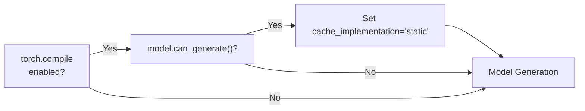
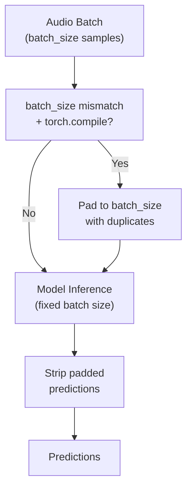
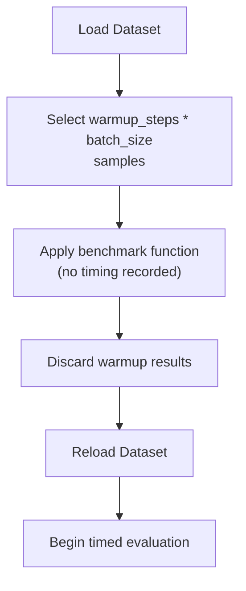
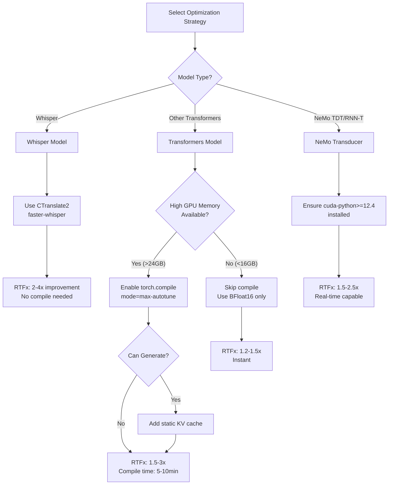

<!-- source: DeepWiki mcp.deepwiki.com · repo huggingface/open_asr_leaderboard · page 6.2 Performance Optimization · fetched 2026-10-26 -->

# Performance Optimization

<details>
<summary>Relevant source files</summary>

The following files were used as context for generating this wiki page:

- [ctranslate2/run_eval.py](ctranslate2/run_eval.py)
- [ctranslate2/run_whisper.sh](ctranslate2/run_whisper.sh)
- [requirements/requirements_nemo.txt](requirements/requirements_nemo.txt)
- [transformers/run_eval.py](transformers/run_eval.py)

</details>


## Purpose and Scope

This document explains the performance optimization techniques implemented across the Open ASR Leaderboard's evaluation frameworks. It covers compilation strategies, batch processing optimizations, GPU acceleration, and framework-specific performance enhancements.

For information about adding new models to the leaderboard, see [Adding New Models](#6.1). For understanding the evaluation pipeline itself, see [Evaluation Workflow](#2.1).

---

## Compilation Techniques

The repository uses PyTorch's compilation features to accelerate model inference through kernel fusion and graph optimization.

### torch.compile Configuration

The Transformers evaluation framework [transformers/run_eval.py:30-34]() implements JIT compilation with configurable modes:

```python
if args.torch_compile:
    model.forward = torch.compile(model.forward, mode=args.compile_mode, fullgraph=True)
    if model.can_generate():
        # enable static k/v cache for autoregressive models
        model.generation_config.cache_implementation = "static"
```

The system supports four compilation modes via the `--compile_mode` argument [transformers/run_eval.py:222-226]():

| Mode | Description | Use Case |
|------|-------------|----------|
| `default` | Standard optimizations | Balanced performance/compile time |
| `reduce-overhead` | Minimize Python overhead | Small models with frequent calls |
| `max-autotune` | Exhaustive kernel search | Production deployments (default) |
| `max-autotune-no-cudagraphs` | Without CUDA graphs | Debugging or limited memory |

**Sources:** [transformers/run_eval.py:30-34](), [transformers/run_eval.py:222-226]()

### Static KV Cache for Autoregressive Models

For encoder-decoder models like Whisper, the system enables static key-value caching to prevent dynamic memory allocation during generation [transformers/run_eval.py:32-34]():



This optimization is critical when using `torch.compile` because dynamic cache sizes would trigger recompilation on every batch with different sequence lengths.

**Sources:** [transformers/run_eval.py:32-34]()

---

## Batch Processing Optimization

Efficient batch processing directly impacts throughput (RTFx) measurements and GPU utilization.

### Dynamic Padding for torch.compile

When using `torch.compile`, the system pads incomplete batches to prevent recompilation [transformers/run_eval.py:46-50]():

```python
padding_size = None
if minibatch_size != args.batch_size and args.torch_compile:
    padding_size = args.batch_size - minibatch_size
    padding_audios = [audios[-1] for _ in range(padding_size)]
    audios.extend(padding_audios)
```

After inference, padded predictions are stripped [transformers/run_eval.py:82-83]():

```python
if padding_size is not None:
    pred_ids = pred_ids[:-padding_size, ...]
```

This approach maintains constant batch sizes across all model calls, ensuring that compiled kernels are reused without triggering recompilation.

**Sources:** [transformers/run_eval.py:46-50](), [transformers/run_eval.py:82-83]()

### Batch Size Configuration

The default batch size is 16 [transformers/run_eval.py:193-197]() but should be tuned based on:

- **Model size:** Larger models (e.g., Whisper large-v3) require smaller batches to fit in GPU memory
- **Sequence length:** Audio datasets with longer utterances need reduced batch sizes
- **GPU memory:** V100/A100 GPUs can handle larger batches than consumer GPUs



**Sources:** [transformers/run_eval.py:46-50](), [transformers/run_eval.py:82-83](), [transformers/run_eval.py:193-197]()

### Duration-Based Sorting

The repository uses pre-sorted datasets (`hf-audio/esb-datasets-test-only-sorted`) to group similar-length audio files [ctranslate2/run_whisper.sh:16-20](). This minimizes padding waste within batches and improves throughput.

**Sources:** [ctranslate2/run_whisper.sh:16-20]()

---

## GPU Acceleration Techniques

### SDPA Backend Selection

The system uses PyTorch's Scaled Dot-Product Attention (SDPA) with backend selection [transformers/run_eval.py:70-78]():

```python
with sdpa_kernel(SDPBackend.MATH if args.torch_compile else SDPBackend.FLASH_ATTENTION):
    if model.can_generate():
        pred_ids = model.generate(**inputs, **gen_kwargs, min_new_tokens=min_new_tokens)
    else:
        with torch.no_grad():
            logits = model(**inputs).logits
            pred_ids = logits.argmax(-1)
```

| Backend | When Used | Characteristics |
|---------|-----------|-----------------|
| `FLASH_ATTENTION` | Default (no compile) | Memory-efficient attention for long sequences |
| `MATH` | With torch.compile | Better for compiled graphs due to fusion opportunities |

**Sources:** [transformers/run_eval.py:4](), [transformers/run_eval.py:70-78]()

### Mixed Precision with BFloat16

All models are loaded with `torch_dtype=torch.bfloat16` [transformers/run_eval.py:17]() and inputs are cast accordingly [transformers/run_eval.py:67]():

```python
inputs[model_input_name] = inputs[model_input_name].to(torch.bfloat16)
```

BFloat16 provides:
- 2x memory reduction compared to float32
- Similar dynamic range to float32 (unlike float16)
- Hardware acceleration on Ampere+ GPUs (A100, A6000, RTX 30/40 series)

**Sources:** [transformers/run_eval.py:17](), [transformers/run_eval.py:67]()

### Matrix Multiplication Precision

The system sets high precision for float32 matmul operations [transformers/run_eval.py:12]():

```python
torch.set_float32_matmul_precision('high')
```

This enables TensorFloat-32 (TF32) on Ampere+ GPUs, providing 10x speedup for float32 operations with minimal accuracy loss.

**Sources:** [transformers/run_eval.py:12]()

---

## Warmup Strategies

### Rationale for Warmup

Warmup runs eliminate timing noise from:
1. **JIT compilation overhead:** First calls to `torch.compile` trigger kernel compilation
2. **GPU initialization:** First CUDA operations initialize the runtime
3. **Cache effects:** File system and memory caches stabilize after initial runs
4. **Dynamic optimizations:** Runtime profiling-guided optimizations

### Implementation Pattern

All frameworks implement warmup with a configurable number of steps [transformers/run_eval.py:99-111]():

```python
if args.warmup_steps is not None:
    dataset = data_utils.load_data(args)
    dataset = data_utils.prepare_data(dataset)

    num_warmup_samples = args.warmup_steps * args.batch_size
    if args.streaming:
        warmup_dataset = dataset.take(num_warmup_samples)
    else:
        warmup_dataset = dataset.select(range(min(num_warmup_samples, len(dataset))))
    warmup_dataset = iter(warmup_dataset.map(benchmark, batch_size=args.batch_size, batched=True))

    for _ in tqdm(warmup_dataset, desc="Warming up..."):
        continue
```

**Warmup defaults by framework:**

| Framework | Default Warmup Steps | Rationale |
|-----------|---------------------|-----------|
| Transformers | 10 [transformers/run_eval.py:230]() | Sufficient for torch.compile stabilization |
| CTranslate2 | 5 [ctranslate2/run_eval.py:135]() | Faster warmup for pre-optimized models |



**Sources:** [transformers/run_eval.py:99-111](), [transformers/run_eval.py:230](), [ctranslate2/run_eval.py:33-44](), [ctranslate2/run_eval.py:135]()

---

## Framework-Specific Optimizations

### CTranslate2 for Whisper Models

The `faster-whisper` library uses CTranslate2, a highly optimized inference engine [ctranslate2/run_eval.py:17-22]():

```python
asr_model = WhisperModel(
    model_size_or_path=args.model_id,
    compute_type="float16",
    device="cuda",
    device_index=args.device
)
```

**CTranslate2 advantages:**
- Up to 4x faster than standard Transformers for Whisper
- Lower memory footprint through quantization
- Optimized beam search and CUDA kernels
- No `torch.compile` needed (already pre-optimized)

**Sources:** [ctranslate2/run_eval.py:17-22]()

### NeMo CUDA-Python for Fast Inference

The NeMo framework uses `cuda-python>=12.4` for accelerated Transducer and RNN-T inference [requirements/requirements_nemo.txt:6]():

```txt
cuda-python>=12.4 # Used for fast TDT and RNN-T inference
```

This direct CUDA integration bypasses PyTorch's overhead for streaming transducer models (Parakeet TDT, RNN-T variants), providing real-time inference on single GPUs.

**Sources:** [requirements/requirements_nemo.txt:6]()

---

## Optimization Decision Matrix

The following table summarizes when to apply each optimization technique:

| Optimization | Model Type | GPU Memory | Compilation Cost | RTFx Improvement |
|-------------|-----------|-----------|------------------|------------------|
| `torch.compile` (max-autotune) | All Transformers | High (2x baseline) | Very high (5-10min) | 1.5-3x |
| Static KV cache | Encoder-decoder only | Medium (1.5x) | None | 1.2-1.5x (with compile) |
| BFloat16 | All | Low (0.5x baseline) | None | 1.2-1.5x |
| Batch size tuning | All | Variable | None | 1.5-2x (if GPU underutilized) |
| CTranslate2 (Whisper) | Whisper only | Low (0.7x baseline) | None (pre-compiled) | 2-4x vs vanilla |
| cuda-python (NeMo) | Transducers only | Medium | None | 1.5-2.5x |



**Sources:** All files referenced above

---

## Best Practices Summary

### For Production Deployments

1. **Always use warmup:** Set `--warmup_steps=10` minimum to stabilize timing measurements
2. **Profile before compiling:** Run without `--torch_compile` first to establish baseline
3. **Tune batch size:** Start with 16, reduce if OOM, increase if GPU utilization <80%
4. **Use pre-sorted datasets:** Leverage `hf-audio/esb-datasets-test-only-sorted` for consistent batching
5. **Enable all compatible optimizations:** BFloat16 is safe for all models

### For Development/Testing

1. **Disable compilation initially:** Faster iteration without 5-10min compile overhead
2. **Use smaller batch sizes:** Easier debugging with `--batch_size=1` or `--batch_size=4`
3. **Limit samples:** Use `--max_eval_samples=64` for quick validation
4. **Skip warmup:** Set `--warmup_steps=0` to speed up testing

### For Leaderboard Submissions

1. **Full evaluation:** No `--max_eval_samples` limit
2. **Standard batch size:** Use `--batch_size=16` for consistency
3. **Enable compilation for Transformers:** Use `--torch_compile --compile_mode=max-autotune`
4. **Framework-specific optimizations:** CTranslate2 for Whisper, cuda-python for NeMo Transducers

**Sources:** [transformers/run_eval.py:159-236](), [ctranslate2/run_eval.py:89-141]()

---

