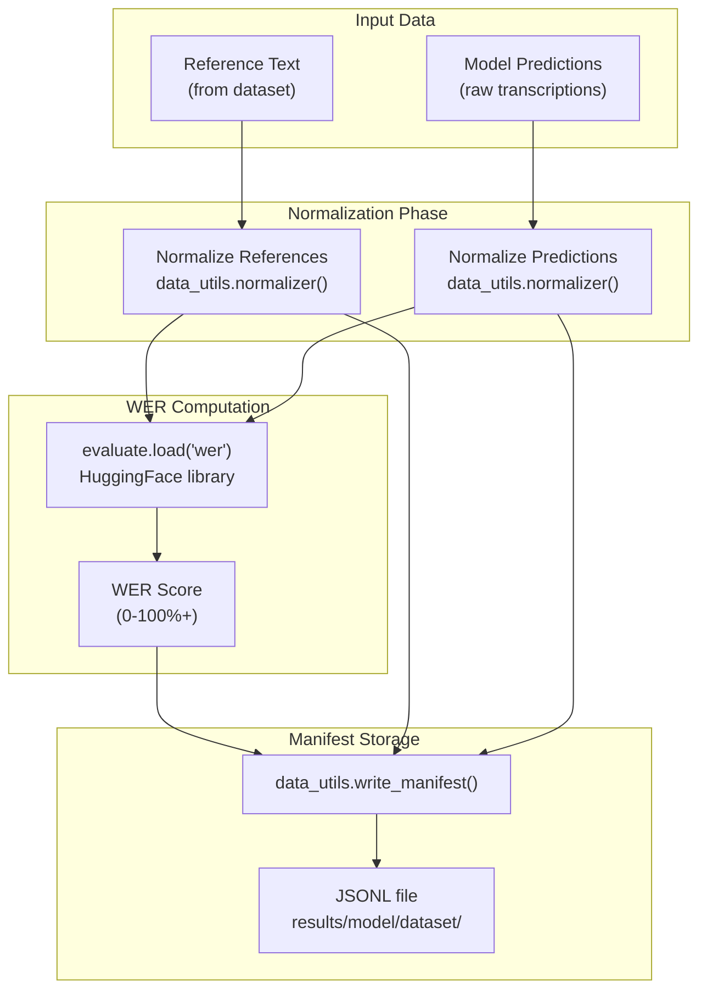
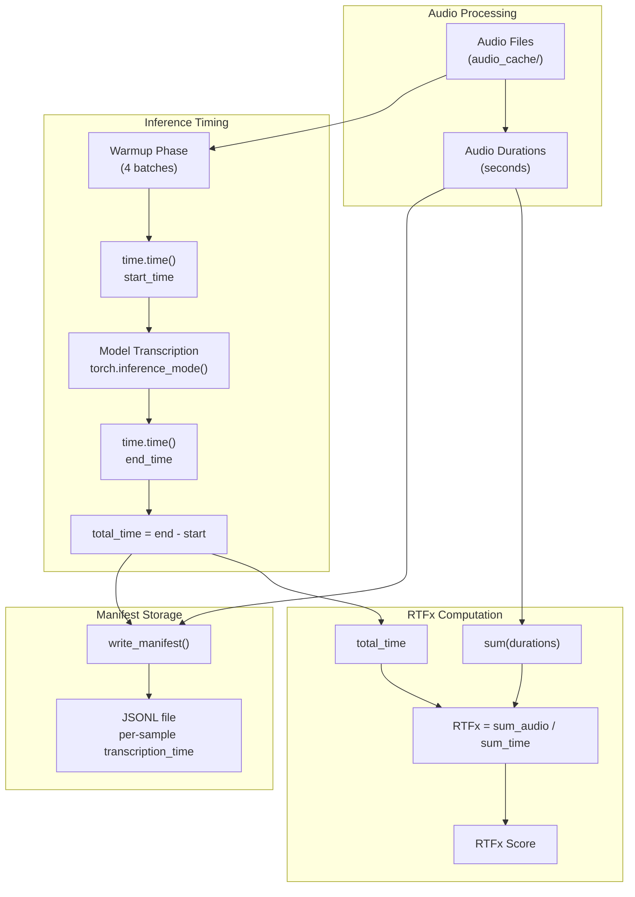
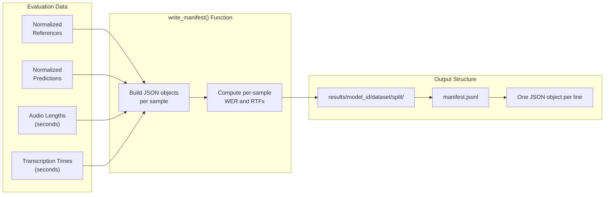
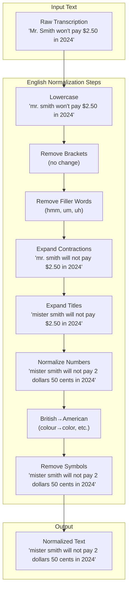
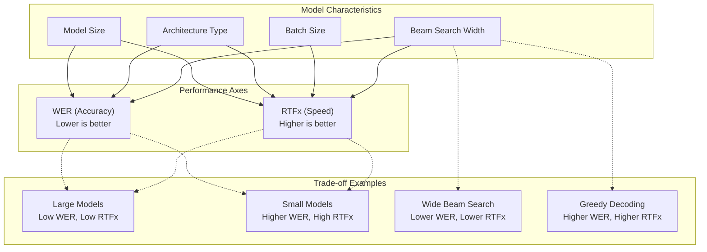

<!-- source: DeepWiki mcp.deepwiki.com · repo huggingface/open_asr_leaderboard · page 6.3 Result Interpretation · fetched 2026-10-26 -->

# Result Interpretation

<details>
<summary>Relevant source files</summary>

The following files were used as context for generating this wiki page:

- [README.md](README.md)
- [nemo_asr/run_eval.py](nemo_asr/run_eval.py)
- [normalizer/__init__.py](normalizer/__init__.py)
- [normalizer/english_abbreviations.py](normalizer/english_abbreviations.py)
- [normalizer/normalizer.py](normalizer/normalizer.py)

</details>


## Purpose and Scope

This page explains how to interpret evaluation results from the Open ASR Leaderboard, including the calculation and meaning of WER (Word Error Rate) and RTFx (Inverse Real-Time Factor) metrics, the structure of result manifest files, and the impact of text normalization on scores. For information about running evaluations, see [Evaluation Workflow](#2.1). For details on the normalization process itself, see [Normalizer Module](#3.1).

---

## WER (Word Error Rate)

### Definition

WER measures transcription accuracy by comparing the predicted transcription against the reference text. It is calculated as:

```
WER = (Substitutions + Insertions + Deletions) / Total_Words_in_Reference
```

Where:
- **Substitutions**: Words that were incorrectly transcribed
- **Insertions**: Words added that weren't in the reference
- **Deletions**: Words missing from the transcription
- **Total Words**: Number of words in the reference text

The metric is expressed as a percentage, with **lower values indicating better accuracy**.

### Calculation Process



**Sources**: [nemo_asr/run_eval.py:17](), [nemo_asr/run_eval.py:146-168]()

The WER calculation follows these steps:

1. **Text Normalization**: Both reference and prediction texts are normalized to ensure fair comparison
   - English texts: [normalizer/normalizer.py:528-613]() applies `EnglishTextNormalizer`
   - Multilingual texts: Uses `BasicMultilingualTextNormalizer` for language-agnostic normalization
   
2. **Metric Computation**: The normalized texts are passed to the HuggingFace `evaluate` library
   ```python
   wer = wer_metric.compute(references=all_data['references'], predictions=predictions)
   wer = round(100 * wer, 2)
   ```
   
3. **Result Storage**: The WER score is written to the manifest file along with per-sample data

**Sources**: [nemo_asr/run_eval.py:167-168]()

### Interpretation Guidelines

| WER Range | Quality | Typical Use Case |
|-----------|---------|------------------|
| 0-5% | Excellent | Near-human accuracy, production-ready for most applications |
| 5-10% | Very Good | Suitable for most production applications with minor corrections |
| 10-20% | Good | Acceptable for many applications, may need user review |
| 20-30% | Fair | Requires significant post-processing or human review |
| 30%+ | Poor | Not suitable for production without extensive correction |

**Important Considerations**:
- WER can exceed 100% when the model produces many insertions
- Domain-specific vocabulary and accents significantly impact WER
- WER is computed after normalization, so raw transcription differences may not affect the score
- Different datasets have different difficulty levels (e.g., LibriSpeech test-clean vs test-other)

**Sources**: [README.md:19]()

---

## RTFx (Inverse Real-Time Factor)

### Definition

RTFx (Inverse Real-Time Factor) measures transcription speed relative to audio duration. It indicates how many times faster (or slower) than real-time the model can transcribe audio:

```
RTFx = Total_Audio_Duration / Total_Transcription_Time
```

**Higher values indicate faster processing**. An RTFx of 1.0 means the model transcribes at real-time speed.

### Calculation Process



**Sources**: [nemo_asr/run_eval.py:123-144](), [nemo_asr/run_eval.py:171-173]()

The RTFx calculation follows these steps:

1. **Warmup Phase**: Models are warmed up with 4 batches to stabilize GPU kernels and caching
   ```python
   for _ in range(2):  # warmup once and calculate rtf
       if _ == 0:
           audio_files = all_data["audio_filepaths"][:args.batch_size * 4]  # warmup with 4 batches
       else:
           audio_files = all_data["audio_filepaths"]
   ```
   
2. **Timed Inference**: The second pass through all audio files is timed
   ```python
   start_time = time.time()
   with torch.inference_mode(), torch.no_grad():
       transcriptions = asr_model.transcribe(audio_files, batch_size=args.batch_size, ...)
   end_time = time.time()
   total_time += end_time - start_time
   ```

3. **RTFx Computation**: Total audio duration divided by transcription time
   ```python
   audio_length = sum(all_data["durations"])
   rtfx = audio_length / total_time
   rtfx = round(rtfx, 2)
   ```

**Sources**: [nemo_asr/run_eval.py:124-144](), [nemo_asr/run_eval.py:171-173]()

### Interpretation Guidelines

| RTFx Range | Speed | Practical Application |
|------------|-------|----------------------|
| 100+ | Very Fast | Batch processing of large archives, high-throughput systems |
| 10-100 | Fast | Real-time transcription with significant headroom for overhead |
| 1-10 | Moderate | Suitable for real-time applications on GPU hardware |
| 0.5-1 | Slow | Near real-time, may struggle with longer audio segments |
| < 0.5 | Very Slow | Not suitable for real-time applications |

**Important Considerations**:
- RTFx varies significantly with batch size (larger batches → higher RTFx)
- GPU model and CUDA version affect performance (evaluations use A100-SXM4-80GB)
- Includes full model inference time but excludes data loading and normalization
- Warmup runs ensure stable timing by priming GPU kernels and caches
- Per-sample transcription time in manifests uses averaged time: `avg_time = total_time / num_samples`

**Sources**: [nemo_asr/run_eval.py:151-162](), [README.md:26]()

---

## Manifest File Structure

### JSONL Format

Evaluation results are stored as JSONL (JSON Lines) files, with one JSON object per audio sample. These files enable detailed analysis and debugging of model performance.



**Sources**: [nemo_asr/run_eval.py:154-165]()

### Manifest Fields

Each line in the manifest file contains a JSON object with the following fields:

| Field | Type | Description |
|-------|------|-------------|
| `reference` | string | Normalized reference text from the dataset |
| `prediction` | string | Normalized model prediction |
| `audio_filepath` | string | Path to the cached audio file (optional) |
| `audio_length` | float | Duration of the audio sample in seconds |
| `transcription_time` | float | Time taken to transcribe this sample (averaged) |
| `wer` | float | Word Error Rate for this specific sample (0-100+) |
| `rtfx` | float | Inverse Real-Time Factor for this sample |

### Example Manifest Entry

```json
{
  "reference": "the quick brown fox jumps over the lazy dog",
  "prediction": "the quick brown fox jumped over the lazy dog",
  "audio_length": 3.52,
  "transcription_time": 0.042,
  "wer": 11.11,
  "rtfx": 83.81
}
```

In this example:
- One word substitution: "jumps" → "jumped" (1 error out of 9 words = 11.11% WER)
- The sample is 3.52 seconds long and took 0.042 seconds to transcribe
- RTFx of 83.81 means the model is ~84x faster than real-time for this sample

### File Location and Naming

Manifest files are organized by model, dataset, and split:
```
results/
├── nvidia_parakeet-tdt_1.1b/
│   ├── librispeech_asr/
│   │   ├── test-clean/
│   │   │   └── manifest.jsonl
│   │   └── test-other/
│   │       └── manifest.jsonl
│   └── common_voice/
│       └── test/
│           └── manifest.jsonl
```

**Sources**: [nemo_asr/run_eval.py:154-165]()

---

## Impact of Text Normalization

Text normalization is critical for fair WER computation, as it standardizes text variations that don't represent true transcription errors.

### Normalization Pipeline



**Sources**: [normalizer/normalizer.py:528-613]()

### English Text Normalization

The `EnglishTextNormalizer` class applies comprehensive transformations:

1. **Lowercasing**: All text is converted to lowercase
   - `"Hello World"` → `"hello world"`

2. **Bracket and Parenthesis Removal**: Content in brackets/parentheses is removed
   - `"transcript [inaudible] continues"` → `"transcript continues"`

3. **Filler Word Removal**: Common speech fillers are removed
   - Removed: `hmm`, `mm`, `mhm`, `mmm`, `uh`, `um`
   - `"um I think that hmm"` → `"i think that"`

4. **Contraction Expansion**: Common contractions are expanded
   - `"won't"` → `"will not"`
   - `"can't"` → `"can not"`
   - `"let's"` → `"let us"`
   - `"don't"` → `"do not"`
   - And 30+ more patterns (see [normalizer/normalizer.py:531-585]())

5. **Title/Prefix Expansion**: Abbreviations are spelled out
   - `"Mr."` → `"mister"`
   - `"Dr."` → `"doctor"`
   - `"Prof."` → `"professor"`
   - And 20+ more patterns

6. **Number Normalization**: Spelled-out numbers and currency are standardized
   - `"twenty three"` → `"23"`
   - `"$2 million"` → `"2000000 dollars"`
   - `"one hundred and fifth"` → `"105th"`
   - Implemented by `EnglishNumberNormalizer` ([normalizer/normalizer.py:112-511]())

7. **British-American Spelling**: 799 British spellings mapped to American equivalents
   - `"colour"` → `"color"`
   - `"realise"` → `"realize"`
   - `"centre"` → `"center"`
   - Full list in [normalizer/english_abbreviations.py:1-1742]()

8. **Symbol and Diacritic Removal**: Non-alphanumeric characters removed (except during number processing)
   - `"café"` → `"cafe"`
   - `"hello!"` → `"hello"`

**Sources**: [normalizer/normalizer.py:528-613](), [normalizer/english_abbreviations.py:1-1742]()

### Multilingual Text Normalization

The `BasicMultilingualTextNormalizer` applies simpler, language-agnostic transformations:

1. **Lowercasing**: All text converted to lowercase
2. **Bracket/Parenthesis Removal**: Same as English normalization
3. **Diacritic Removal**: Unicode diacritics are removed
   - `"café"` → `"cafe"`
   - `"naïve"` → `"naive"`
   - Uses `ADDITIONAL_DIACRITICS` mapping for special characters ([normalizer/normalizer.py:26-43]())
4. **Punctuation Removal**: All punctuation and special characters removed
5. **Whitespace Normalization**: Multiple spaces collapsed to single space

**Note**: Multilingual normalization does NOT expand contractions, numbers, or apply spelling corrections, as these are language-specific.

**Sources**: [normalizer/normalizer.py:95-109]()

### Normalization Impact Example

| Aspect | Before Normalization | After Normalization | WER Impact |
|--------|---------------------|---------------------|------------|
| Contractions | Ref: `"don't"` / Pred: `"do not"` | Both: `"do not"` | 0% instead of 100% |
| Numbers | Ref: `"twenty three"` / Pred: `"23"` | Both: `"23"` | 0% instead of 100% |
| British Spelling | Ref: `"colour"` / Pred: `"color"` | Both: `"color"` | 0% instead of 100% |
| Filler Words | Ref: `"um hello"` / Pred: `"hello"` | Both: `"hello"` | 0% instead of 50% |
| Punctuation | Ref: `"hello!"` / Pred: `"hello"` | Both: `"hello"` | 0% instead of 100% |

Without normalization, these superficial differences would artificially inflate WER scores, making it difficult to assess true transcription accuracy.

**Sources**: [normalizer/normalizer.py:528-613]()

---

## Score Interpretation Guidelines

### WER vs RTFx Trade-offs

The relationship between WER and RTFx involves trade-offs based on model architecture and configuration:



### Dataset Difficulty Comparison

Different datasets in the ESB benchmark have varying difficulty levels:

| Dataset | Split | Typical WER Range | Characteristics |
|---------|-------|-------------------|-----------------|
| LibriSpeech | test-clean | 2-8% | Clean read speech, controlled conditions |
| LibriSpeech | test-other | 5-15% | More challenging speakers and recordings |
| Common Voice | test | 10-25% | Diverse accents, recording quality varies |
| TEDLIUM | test | 8-18% | Presentation speech, technical vocabulary |
| Earnings22 | test | 15-30% | Business domain, telephonic audio quality |

### Comparing Models

When comparing models on the leaderboard:

1. **Same Dataset Required**: Only compare WER scores on the same dataset/split
   - LibriSpeech test-clean WER cannot be compared to Common Voice test WER
   
2. **Hardware Normalization**: RTFx scores are only comparable when measured on the same hardware
   - The leaderboard uses NVIDIA A100-SXM4-80GB with CUDA 12.6
   
3. **Batch Size Impact**: RTFx scales with batch size but WER doesn't
   - Models with larger batch sizes will have higher RTFx but same WER
   
4. **Normalized Scores**: All WER scores account for text normalization
   - Raw transcription differences (punctuation, spelling) don't affect scores

### Aggregated Results

The `eval_utils.score_results` function aggregates per-dataset results for each model:

```python
# Example aggregated scores for a model
{
    "model_id": "nvidia/parakeet-tdt-1.1b",
    "datasets": {
        "librispeech_asr": {
            "test-clean": {"wer": 3.2, "rtfx": 142.5},
            "test-other": {"wer": 7.8, "rtfx": 138.9}
        },
        "common_voice": {
            "test": {"wer": 15.4, "rtfx": 156.2}
        }
    },
    "average_wer": 8.8,  # Across all datasets
    "average_rtfx": 145.9
}
```

**Sources**: [nemo_asr/run_eval.py:165](), [README.md:19]()

---

## Accessing and Using Manifest Files

### Loading Manifests

Manifest files can be loaded and analyzed using Python:

```python
import json

# Load a manifest file
with open("results/model_id/dataset/split/manifest.jsonl", "r") as f:
    results = [json.loads(line) for line in f]

# Analyze per-sample WER distribution
wer_scores = [sample["wer"] for sample in results]
avg_wer = sum(wer_scores) / len(wer_scores)
max_wer = max(wer_scores)
min_wer = min(wer_scores)

# Find samples with high WER for debugging
problematic_samples = [s for s in results if s["wer"] > 50.0]
```

### Debugging High WER Samples

When investigating poor model performance, examine high-WER samples from the manifest:

1. Compare `reference` and `prediction` fields to identify error patterns
2. Check `audio_length` to see if errors correlate with audio duration
3. Review `transcription_time` to identify potential timeout or performance issues
4. Look for systematic errors (e.g., specific words consistently mis-transcribed)

### Per-Dataset Analysis

Since manifests are organized by dataset and split, you can:

1. Compare model performance across different datasets
2. Identify which audio conditions (clean vs noisy) cause problems
3. Analyze domain-specific challenges (technical vocabulary, accents)
4. Track improvements when retraining or fine-tuning models

**Sources**: [nemo_asr/run_eval.py:154-165]()