# Page: Overview

# Overview

<details>
<summary>Relevant source files</summary>

The following files were used as context for generating this wiki page:

- [README.md](README.md)
- [nemo_asr/run_eval.py](nemo_asr/run_eval.py)
- [transformers/run_eval.py](transformers/run_eval.py)

</details>


This document introduces the Open ASR Leaderboard repository, a comprehensive benchmarking system for evaluating Automatic Speech Recognition (ASR) models across multiple frameworks and datasets. The repository provides standardized evaluation pipelines, consistent metrics calculation, and unified result reporting through a public Gradio Space hosted at [hf-audio/open_asr_leaderboard](https://huggingface.co/spaces/hf-audio/open_asr_leaderboard).

For initial setup and running evaluations, see [Getting Started](#1.1). For detailed technical architecture, see [Architecture Overview](#1.2). For information about specific evaluation frameworks, see [Evaluation Frameworks](#4).

**Sources:** [README.md:1-3]()

---

## Repository Purpose and Scope

The Open ASR Leaderboard enables fair, reproducible comparison of ASR models by applying consistent evaluation protocols across diverse technologies. The system supports:

- **Multiple ASR Frameworks**: 8 distinct evaluation systems covering NVIDIA NeMo, Hugging Face Transformers, commercial APIs, and specialized frameworks
- **Standardized Benchmarking**: All models evaluated on the ESB (End-to-end Speech Benchmark) dataset suite using identical preprocessing and metrics
- **Consistent Metrics**: Word Error Rate (WER) and Real-Time Factor (RTFx) computed with unified text normalization
- **Reproducible Results**: Per-sample predictions stored in JSONL manifest files for auditing and analysis

Each evaluation framework implements the same 5-phase pipeline pattern while adapting to framework-specific model loading and inference APIs. The shared `normalizer` module ensures text normalization consistency regardless of the underlying ASR technology.

**Sources:** [README.md:1-19](), [README.md:29-37]()

---

## High-Level System Architecture

The repository follows a modular architecture with clear separation between framework-specific evaluation scripts and shared infrastructure components.

### System Component Diagram

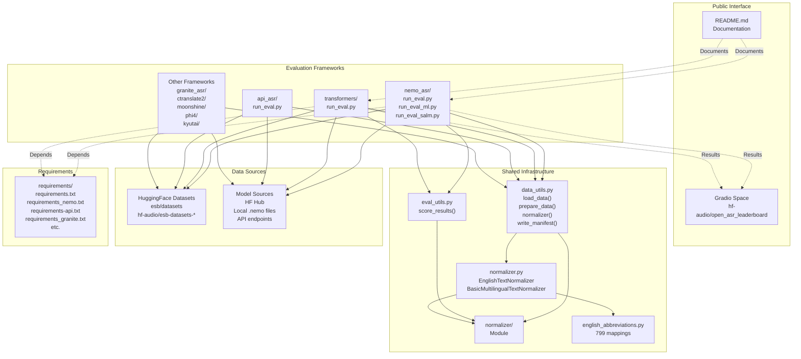

The architecture consists of four primary layers:

1. **Framework Layer**: Directory-based organization where each ASR framework has its own folder containing `run_eval.py` and model-specific shell scripts
2. **Shared Infrastructure Layer**: The `normalizer` module providing common utilities for data handling, text normalization, and result aggregation
3. **Data Layer**: HuggingFace datasets for benchmarking and model sources (Hub, local, APIs)
4. **Public Interface Layer**: Documentation and Gradio Space for result presentation

**Sources:** [README.md:1-26](), [nemo_asr/run_eval.py:1-15](), [transformers/run_eval.py:1-13]()

---

## Evaluation Frameworks

The repository supports 8 evaluation frameworks, each targeting different ASR technologies and use cases:

| Framework | Directory | Primary Script | Key Features | Importance Score |
|-----------|-----------|----------------|--------------|------------------|
| **NeMo** | `nemo_asr/` | `run_eval.py` | NVIDIA NeMo models, Canary, Parakeet, SALM variants | 20.39 |
| **Transformers** | `transformers/` | `run_eval.py` | Whisper, Wav2Vec2, MMS, HuBERT, Data2Vec, Conformer | 19.49 |
| **API** | `api_asr/` | `run_eval.py` | OpenAI, AssemblyAI, Deepgram, Gladia APIs | 13.62 |
| **Granite** | `granite_asr/` | `run_eval.py` | IBM Granite speech models | 13.25 |
| **CTranslate2** | `ctranslate2/` | `run_eval.py` | Optimized Whisper via faster-whisper | 9.82 |
| **Moonshine** | `moonshine/` | `run_eval.py` | UsefulSensors lightweight models | 9.42 |
| **Phi-4** | `phi4/` | `run_eval.py` | Microsoft multimodal models | 8.35 |
| **Kyutai** | `kyutai/` | `run_eval.py` | Kyutai STT models | 6.62 |

Each framework implements the same evaluation pattern while adapting to its specific model loading and inference APIs. The NeMo and Transformers frameworks are the most comprehensive, supporting multiple model architectures and specialized variants.

For detailed documentation of each framework, see [Evaluation Frameworks](#4).

**Sources:** [README.md:7-26]()

---

## Shared Infrastructure Components

All evaluation frameworks converge on the `normalizer` module, which provides three critical services:

### Module Structure Diagram

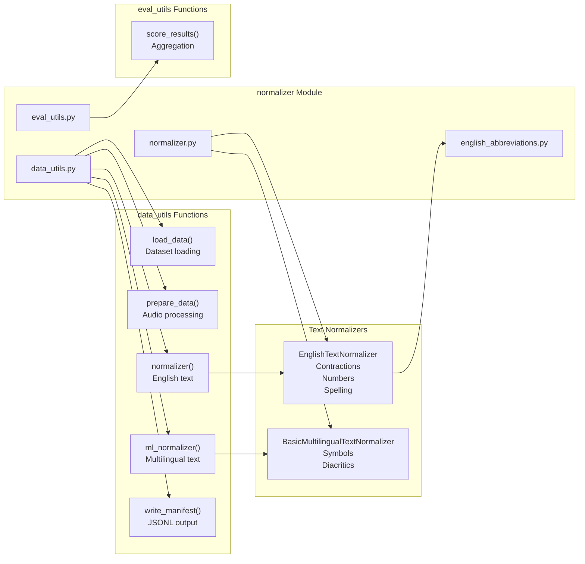

### Key Components

**`data_utils.py`** - Core data handling functions:
- `load_data(args)`: Loads datasets from HuggingFace with streaming or full download
- `prepare_data(dataset)`: Computes audio durations and prepares normalized reference text
- `normalizer(text)`: Applies `EnglishTextNormalizer` for consistent text cleaning
- `ml_normalizer(text)`: Applies `BasicMultilingualTextNormalizer` for non-English text
- `write_manifest(...)`: Persists per-sample results in JSONL format

**`eval_utils.py`** - Result aggregation:
- `score_results(...)`: Aggregates per-dataset metrics into model-level scores

**`normalizer.py`** - Text normalization classes:
- `EnglishTextNormalizer`: Handles contractions, number conversion, British→American spelling (799 mappings from `english_abbreviations.py`)
- `BasicMultilingualTextNormalizer`: Symbol removal and diacritic handling for multilingual content

For detailed documentation, see [Shared Infrastructure](#3).

**Sources:** [nemo_asr/run_eval.py:10](), [transformers/run_eval.py:7](), [README.md:34-37]()

---

## Standard Evaluation Pipeline

All frameworks follow a consistent 5-phase evaluation pipeline, ensuring comparable results across different ASR technologies.

### Pipeline Flow Diagram

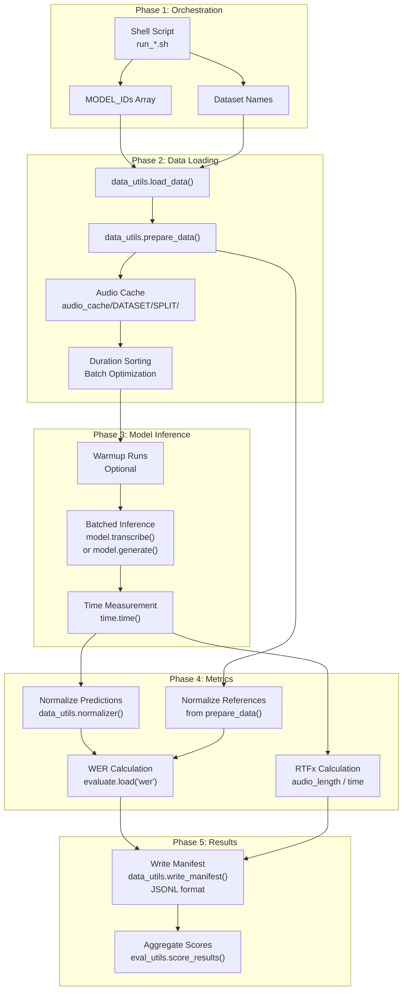

### Pipeline Phases

**Phase 1: Orchestration** - Shell scripts iterate through model and dataset lists, invoking `run_eval.py` for each combination.

**Phase 2: Data Loading** - Datasets are loaded via `data_utils.load_data()`, audio files cached locally in `audio_cache/`, and sorted by duration to optimize batching.

**Phase 3: Model Inference** - Optional warmup runs stabilize timing, followed by batched inference with precise time measurement using `time.time()`.

**Phase 4: Metrics** - Predictions and references are normalized using framework-appropriate normalizers, then WER is computed via HuggingFace `evaluate` library and RTFx via timing ratios.

**Phase 5: Results** - Per-sample results written to JSONL manifests via `data_utils.write_manifest()`, then aggregated across datasets using `eval_utils.score_results()`.

For detailed pipeline documentation, see [Core Evaluation Pipeline](#2).

**Sources:** [nemo_asr/run_eval.py:20-177](), [transformers/run_eval.py:14-156](), [README.md:17-19]()

---

## Code Entry Points

Each evaluation framework provides standardized entry points following consistent naming conventions:

### Primary Scripts

**Per-Framework Entry Point**: `<framework>/run_eval.py`
- NeMo: [nemo_asr/run_eval.py:20-225]()
- Transformers: [transformers/run_eval.py:14-237]()
- Similar structure across all 8 frameworks

**Model-Specific Shell Scripts**: `run_<model_type>.sh`
- Example: `run_whisper.sh`, `run_wav2vec2.sh`, `run_canary.sh`
- Each script defines model arrays and iterates through datasets
- Invokes `run_eval.py` with appropriate arguments

### Standard Arguments

All `run_eval.py` scripts accept common arguments:

| Argument | Type | Default | Description |
|----------|------|---------|-------------|
| `--model_id` | `str` | Required | Model identifier (HF Hub, local path, or API name) |
| `--dataset_path` | `str` | `esb/datasets` | Dataset path on HuggingFace |
| `--dataset` | `str` | Required | Dataset name (e.g., `librispeech_asr`) |
| `--split` | `str` | `test` | Dataset split (e.g., `validation`, `test`) |
| `--device` | `int` | `-1` | GPU device ID (-1 for CPU) |
| `--batch_size` | `int` | Varies | Batch size for inference |
| `--max_eval_samples` | `int` | `None` | Limit evaluation to N samples |
| `--streaming` | `bool` | Varies | Stream dataset vs. full download |

Framework-specific arguments extend this base set (e.g., `--max_new_tokens` for autoregressive models, `--torch_compile` for optimization).

**Sources:** [nemo_asr/run_eval.py:180-223](), [transformers/run_eval.py:158-236](), [README.md:29-37]()

---

## Requirements and Dependencies

The repository uses framework-specific requirement files to manage dependencies:

### Requirements Structure

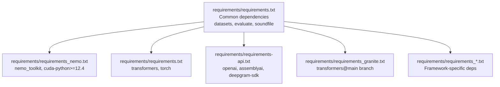

### Installation Workflow

1. Install PyTorch following platform-specific instructions
2. Install common requirements: `pip install -r requirements/requirements.txt`
3. Install framework-specific requirements: `pip install -r requirements/requirements_<framework>.txt`
4. Authenticate with HuggingFace: `huggingface-cli login`

### Special Requirements

**NVIDIA NeMo**: Requires CUDA 12.6+ for RNN-T inference with cooperative kernels ([README.md:15]()). The `cuda-python>=12.4` dependency enables fast TDT and RNN-T inference.

**Granite**: Pins to transformers main branch for unreleased features required by IBM Granite models.

For complete requirements documentation, see [Requirements Management](#3.4).

**Sources:** [README.md:5-15]()

---

## Output Format and Results

Evaluation results are stored in two formats:

### JSONL Manifest Files

Per-sample results written by `data_utils.write_manifest()` in JSONL format:

```
results/<model_id>/<dataset_path>-<dataset>-<split>.jsonl
```

Each line contains:
- `audio_length_s`: Audio duration in seconds
- `transcription_time_s`: Inference time per sample
- `prediction`: Normalized transcription
- `reference`: Normalized ground truth
- Individual WER and RTFx metrics

### Aggregated Scores

Console output and final metrics:
- **WER (Word Error Rate)**: Percentage of word errors computed via `evaluate.load("wer")`
- **RTFx (Real-Time Factor)**: Ratio of audio duration to transcription time (higher is faster)

Example output:
```
Results saved at path: /path/to/results/model/dataset.jsonl
WER: 3.45 %
RTFx: 142.67
```

For result interpretation, see [Result Interpretation](#6.3).

**Sources:** [nemo_asr/run_eval.py:154-176](), [transformers/run_eval.py:138-155]()

---

## Extending the System

The repository is designed for extensibility through a template-based approach:

### Adding New Libraries

1. Create framework directory: `mkdir <library_name>`
2. Copy template `run_eval.py` from [README.md:38-213]()
3. Modify two sections:
   - Model loading in `main()` function
   - Inference logic in `benchmark()` function
4. Maintain identical data loading, normalization, and manifest writing
5. Create `run_<model_type>.sh` scripts for model variants

### Adding New Models

- **Existing framework**: Add model ID to appropriate shell script array
- **New model type**: Create new shell script following `run_<model_type>.sh` convention
- Must use identical hyperparameters across all benchmark datasets (per ESB requirements)

For step-by-step guides, see [Adding New Models](#6.1).

**Sources:** [README.md:28-230]()

---

## Next Steps

- **Initial Setup**: See [Getting Started](#1.1) for installation and authentication
- **Architecture Details**: See [Architecture Overview](#1.2) for in-depth technical design
- **Framework Usage**: See [Evaluation Frameworks](#4) for framework-specific guides
- **Core Pipeline**: See [Core Evaluation Pipeline](#2) for evaluation workflow details
- **Shared Components**: See [Shared Infrastructure](#3) for `normalizer` module documentation

---

# Page: Getting Started

# Getting Started

<details>
<summary>Relevant source files</summary>

The following files were used as context for generating this wiki page:

- [README.md](README.md)
- [requirements/requirements_nemo.txt](requirements/requirements_nemo.txt)

</details>


This document guides you through setting up the Open ASR Leaderboard evaluation environment and running your first model evaluation. It covers system prerequisites, dependency installation, authentication, and executing a basic evaluation workflow. For information about the underlying architecture and evaluation pipeline, see [Architecture Overview](#1.2). For details on individual evaluation frameworks, see [Evaluation Frameworks](#4).

---

## Purpose and Scope

This guide enables you to:
- Configure a clean evaluation environment with Python 3.10+
- Install framework-specific dependencies for ASR model evaluation
- Authenticate with Hugging Face Hub for dataset and model access
- Execute your first evaluation using an existing bash script
- Interpret the resulting JSONL manifest and console output

---

## System Prerequisites

The Open ASR Leaderboard has specific hardware and software requirements to ensure reproducible results across submissions.

### Hardware Requirements

| Component | Specification | Notes |
|-----------|--------------|-------|
| GPU | NVIDIA A100-SXM4-80GB | All official evaluations use this GPU |
| CUDA Version | 12.6 or higher | Required for NeMo RNN-T cooperative kernels |
| Driver Version | 560.28.03 or higher | Verified configuration |

**Important:** If evaluating NeMo models, CUDA 12.6 is mandatory to fix RNN-T inference issues with cooperative kernels inside conditional nodes (see [README.md:15]()). Verify your CUDA version by running `nvidia-smi`.

### Software Requirements

| Component | Version | Purpose |
|-----------|---------|---------|
| Python | 3.10 or above | Recommended via conda |
| PyTorch | 2.4.0 | Deep learning framework |
| CUDA Toolkit | 12.6+ | GPU acceleration |

**Note:** The repository was tested with PyTorch 2.4.0. Other versions may work but are not officially supported.

**Sources:** [README.md:5-26]()

---

## Installation Process

The installation follows a phased approach: PyTorch first, then common dependencies, then framework-specific packages. This prevents dependency conflicts.

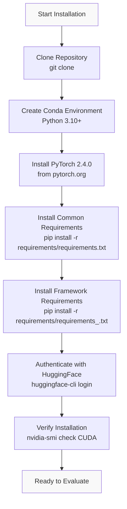

### Step 1: Clone Repository

```bash
git clone https://github.com/huggingface/open_asr_leaderboard.git
cd open_asr_leaderboard
```

### Step 2: Create Conda Environment

Create an isolated environment to prevent dependency conflicts:

```bash
conda create -n asr-leaderboard python=3.10
conda activate asr-leaderboard
```

### Step 3: Install PyTorch

Follow the official PyTorch installation instructions at https://pytorch.org/get-started/locally/ to install PyTorch 2.4.0 with CUDA 12.6 support. Example command:

```bash
pip install torch==2.4.0 torchvision torchaudio --index-url https://download.pytorch.org/whl/cu126
```

### Step 4: Install Common Requirements

Install shared dependencies used across all frameworks:

```bash
pip install -r requirements/requirements.txt
```

This installs the `normalizer` module and shared utilities like `evaluate`, `datasets`, and `soundfile`.

### Step 5: Install Framework-Specific Requirements

Each evaluation framework has dedicated requirements files. Install only the frameworks you intend to use:

| Framework | Requirements File | Key Dependencies |
|-----------|-------------------|------------------|
| NeMo | `requirements/requirements_nemo.txt` | `nemo_toolkit[asr]`, `cuda-python>=12.4` |
| Transformers | `requirements/requirements.txt` | `transformers`, `accelerate` |
| API | `requirements/requirements-api.txt` | `openai`, `assemblyai` |
| Granite | `requirements/requirements_granite.txt` | `transformers` (main branch) |
| Moonshine | `requirements/requirements_moonshine.txt` | `moonshine-onnx` |
| Kyutai | `requirements/requirements_kyutai.txt` | `moshi`, `julius` |

**Example:** To evaluate NeMo models:

```bash
pip install -r requirements/requirements_nemo.txt
```

**Note:** The NeMo requirements file pins to a specific commit `6294bc7708ce67522b92f5e9b6917ea0b2e23429` for stability and includes `cuda-python>=12.4` for fast TDT and RNN-T inference ([requirements/requirements_nemo.txt:1-6]()).

**Sources:** [README.md:7-14](), [requirements/requirements_nemo.txt:1-7]()

---

## Authentication

The leaderboard uses Hugging Face Hub to access datasets and models. Authentication is required for:
- Loading ESB benchmark datasets from `hf-audio/esb-datasets-*`
- Downloading model weights from Hugging Face Hub
- Submitting evaluation results (optional)

### Hugging Face CLI Login

Run the following command and provide your Hugging Face access token when prompted:

```bash
huggingface-cli login
```

You can generate an access token at https://huggingface.co/settings/tokens. The token needs `read` permissions for public datasets and models.

**Sources:** [README.md:13]()

---

## Running Your First Evaluation

Each framework follows a consistent directory structure and execution pattern. This example demonstrates evaluating a Wav2Vec2 model using the Transformers framework.

### Evaluation Directory Structure

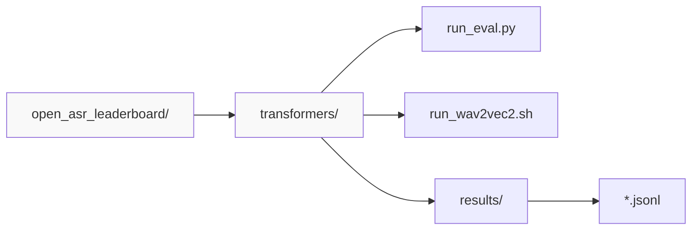

### Execution Steps

#### 1. Navigate to Framework Directory

```bash
cd transformers
```

#### 2. Execute Bash Script

Run the pre-configured evaluation script for your target model family:

```bash
bash run_wav2vec2.sh
```

The bash script orchestrates multiple evaluations by:
- Defining an array of model IDs (e.g., `facebook/wav2vec2-base-960h`)
- Defining a list of datasets from the ESB benchmark
- Calling `run_eval.py` for each (model, dataset) pair
- Passing framework-specific parameters (batch size, device, etc.)

#### 3. Monitor Progress

The script displays progress through two phases:

1. **Warmup Phase** (optional): Runs a small number of samples to stabilize GPU state
2. **Evaluation Phase**: Processes the full dataset with per-sample progress bars

Console output shows:
- Dataset loading status
- Sample-by-sample transcription progress
- Final WER (Word Error Rate) and RTFx (Inverse Real-Time Factor) metrics

### Understanding the Evaluation Flow

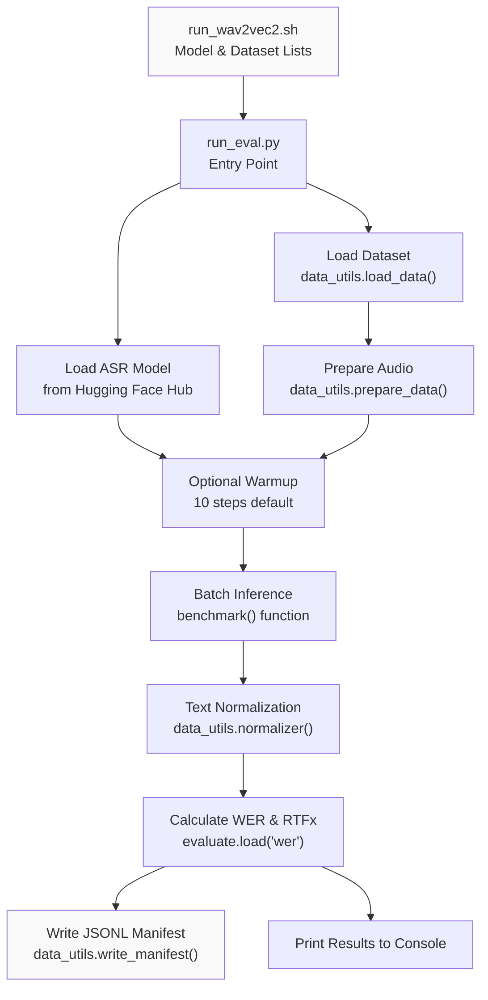

**Sources:** [README.md:17-26]()

---

## Example Evaluation Run

Here's a concrete example of evaluating the `facebook/wav2vec2-base-960h` model on the LibriSpeech test-clean dataset:

### Command Structure

The bash script internally executes commands similar to:

```bash
python run_eval.py \
    --model_id facebook/wav2vec2-base-960h \
    --dataset_path esb/datasets \
    --dataset librispeech_asr \
    --split test.clean \
    --device 0 \
    --batch_size 32 \
    --warmup_steps 10
```

### Key Parameters

| Parameter | Value | Description |
|-----------|-------|-------------|
| `--model_id` | `facebook/wav2vec2-base-960h` | Hugging Face model identifier |
| `--dataset_path` | `esb/datasets` | ESB benchmark repository path |
| `--dataset` | `librispeech_asr` | Dataset name within ESB |
| `--split` | `test.clean` | Dataset split to evaluate |
| `--device` | `0` | GPU device index (-1 for CPU) |
| `--batch_size` | `32` | Number of samples per batch |
| `--warmup_steps` | `10` | Warmup iterations before timing |

**Sources:** [README.md:42-209]()

---

## Understanding the Output

### Console Output

During evaluation, you'll see:

```
Warming up...
100%|████████████████████| 10/10 [00:15<00:00, 1.52s/it]

Samples...
100%|████████████████████| 2620/2620 [08:23<00:00, 5.21it/s]

Results saved at path: /path/to/open_asr_leaderboard/transformers/results/facebook--wav2vec2-base-960h/esb_datasets_librispeech_asr_test.clean.jsonl

WER: 3.45 % RTFx: 245.67
```

### Metrics Explained

| Metric | Definition | Interpretation |
|--------|------------|----------------|
| **WER** | Word Error Rate (%) | Lower is better. 3.45% means 3.45 words incorrect per 100 words |
| **RTFx** | Inverse Real-Time Factor | Higher is better. 245.67 means processing 245x faster than real-time |

### JSONL Manifest Structure

The manifest file contains per-sample results in JSON Lines format. Each line represents one audio sample:

```json
{
  "audio_filepath": "sample_001.wav",
  "duration": 4.32,
  "text": "the quick brown fox",
  "pred_text": "the quick brown fox",
  "wer": 0.0,
  "transcription_time": 0.0176
}
```

**Key Fields:**
- `audio_filepath`: Audio file identifier
- `duration`: Audio length in seconds
- `text`: Normalized reference transcription
- `pred_text`: Normalized model prediction
- `wer`: Per-sample Word Error Rate
- `transcription_time`: Inference time for this sample

**Sources:** [README.md:128-138]()

---

## Verifying Installation

### Quick Verification Checklist

Use this checklist to verify your installation is correct:

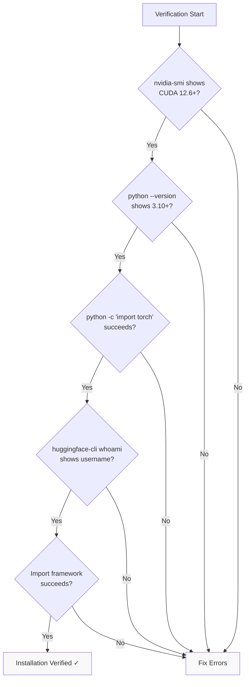

### Verification Commands

| Check | Command | Expected Output |
|-------|---------|-----------------|
| CUDA Version | `nvidia-smi` | "CUDA Version: 12.6" or higher |
| Python Version | `python --version` | "Python 3.10.x" or higher |
| PyTorch | `python -c "import torch; print(torch.__version__)"` | "2.4.0" or compatible |
| CUDA Available | `python -c "import torch; print(torch.cuda.is_available())"` | "True" |
| Hugging Face | `huggingface-cli whoami` | Your HF username |
| NeMo (if installed) | `python -c "import nemo"` | No errors |

**Sources:** [README.md:15]()

---

## Common Issues and Solutions

### Issue: CUDA Version Mismatch

**Symptom:** NeMo evaluations fail with RNN-T kernel errors

**Solution:** Upgrade to CUDA 12.6 or higher. The cooperative kernels in RNN-T require driver fixes only available in CUDA 12.6+ (see [README.md:15]()).

### Issue: Dependency Conflicts

**Symptom:** `pip install` fails with version conflicts

**Solution:** 
1. Create a fresh conda environment
2. Install PyTorch first, before any other packages
3. Install framework-specific requirements in isolation

### Issue: Out of Memory

**Symptom:** CUDA out of memory errors during evaluation

**Solution:**
1. Reduce batch size in the bash script
2. Ensure no other processes are using GPU memory
3. Use the A100-80GB GPU configuration as specified

### Issue: Dataset Download Failures

**Symptom:** Streaming dataset times out or fails

**Solution:**
1. Verify `huggingface-cli login` completed successfully
2. Check internet connectivity
3. Try disabling streaming mode with `--no-streaming` flag

**Sources:** [README.md:15-26]()

---

## Next Steps

After completing your first evaluation, explore:

1. **Run Multiple Models:** Examine bash scripts to see how they iterate over model families (see [README.md:24]())
2. **Understand the Pipeline:** Learn about the 5-phase evaluation workflow in [Evaluation Workflow](#2.1)
3. **Explore Frameworks:** Try different evaluation systems documented in [Evaluation Frameworks](#4)
4. **Add Your Own Model:** Follow the contribution guide in [Adding New Models](#6.1)
5. **Interpret Results:** Understand WER and RTFx metrics in [Result Interpretation](#6.3)

### Template for Custom Evaluations

The repository provides a template script for adding new libraries. See the complete template at [README.md:38-211]() which demonstrates:
- Model loading patterns
- Dataset preparation using `data_utils`
- Inference timing with warmup steps
- Text normalization with `data_utils.normalizer()`
- Manifest writing with `data_utils.write_manifest()`

This template ensures consistency across all evaluation frameworks.

**Sources:** [README.md:17-231]()

---

## File Reference Summary

Key files for getting started:

| File Path | Purpose | When to Use |
|-----------|---------|-------------|
| `README.md` | Main documentation | Initial setup guidance |
| `requirements/requirements.txt` | Common dependencies | All installations |
| `requirements/requirements_nemo.txt` | NeMo framework | Evaluating NeMo models |
| `transformers/run_eval.py` | Transformers entry point | Evaluating HF models |
| `transformers/run_wav2vec2.sh` | Wav2Vec2 orchestration | Running Wav2Vec2 evaluations |

**Sources:** [README.md:1-244](), [requirements/requirements_nemo.txt:1-7]()

---

# Page: Architecture Overview

# Architecture Overview

<details>
<summary>Relevant source files</summary>

The following files were used as context for generating this wiki page:

- [nemo_asr/run_eval.py](nemo_asr/run_eval.py)
- [normalizer/__init__.py](normalizer/__init__.py)
- [normalizer/english_abbreviations.py](normalizer/english_abbreviations.py)
- [normalizer/normalizer.py](normalizer/normalizer.py)
- [transformers/run_eval.py](transformers/run_eval.py)

</details>


## Purpose and Scope

This document describes the high-level architecture of the Open ASR Leaderboard evaluation system. It covers the multi-framework design pattern, the common evaluation pipeline, and the shared infrastructure that enables consistent evaluation across diverse ASR technologies.

For specific guidance on running evaluations, see [Getting Started](#1.1). For details on individual evaluation frameworks (NeMo, Transformers, API-based, etc.), see [Evaluation Frameworks](#4).

---

## Multi-Framework Architecture

The repository implements a **plugin-style architecture** where multiple evaluation frameworks coexist independently while sharing common infrastructure. This design enables fair comparison of ASR models from different libraries by applying identical data handling, normalization, and metric computation.

### Framework Registry

The system supports eight distinct evaluation frameworks:

| Framework | Primary Script | Importance Score | Purpose |
|-----------|---------------|------------------|---------|
| **NeMo** | `nemo_asr/run_eval.py` | 20.39 | NVIDIA NeMo models (.nemo format and Hub) |
| **Transformers** | `transformers/run_eval.py` | 19.49 | HuggingFace Transformers models (Whisper, Wav2Vec2, etc.) |
| **API** | `api/run_eval.py` | 13.62 | Commercial ASR APIs (OpenAI, AssemblyAI, etc.) |
| **Granite** | `granite/run_eval.py` | 13.25 | IBM Granite speech models |
| **CTranslate2** | `ctranslate2/run_eval.py` | 9.82 | Optimized Whisper via faster-whisper |
| **Moonshine** | `moonshine/run_eval.py` | 9.42 | UsefulSensors edge models |
| **Phi-4** | `phi4/run_eval.py` | 8.35 | Microsoft multimodal models |
| **Kyutai** | `kyutai_moshi/run_eval.py` | 6.62 | Kyutai STT models |

### Architecture Diagram: Framework Organization

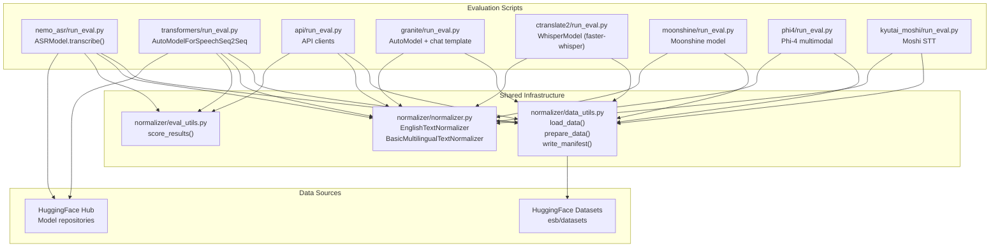

**Sources:** [nemo_asr/run_eval.py:1-226](), [transformers/run_eval.py:1-237](), [normalizer/__init__.py:1-1]()

---

## Common Evaluation Pattern

All frameworks implement a standardized **5-phase evaluation pipeline**. This pattern ensures that metrics (WER and RTFx) are computed identically regardless of the underlying ASR technology.

### Phase Breakdown

```mermaid
flowchart LR
    subgraph "Phase 1: Orchestration"
        ARGS["argparse arguments<br/>--model_id<br/>--dataset<br/>--batch_size"]
    end
    
    subgraph "Phase 2: Data Loading"
        LOAD["data_utils.load_data()<br/>Dataset streaming"]
        PREP["data_utils.prepare_data()<br/>Add audio_length_s"]
    end
    
    subgraph "Phase 3: Inference"
        CACHE["Audio caching<br/>audio_cache/ directory"]
        WARMUP["Warmup runs<br/>2-10 iterations"]
        TRANSCRIBE["Model transcription<br/>Batch processing"]
        TIME["Time measurement<br/>start_time, end_time"]
    end
    
    subgraph "Phase 4: Normalization"
        NORM_PRED["data_utils.normalizer()<br/>predictions"]
        NORM_REF["data_utils.normalizer()<br/>references"]
        WER["evaluate.load('wer')<br/>wer_metric.compute()"]
    end
    
    subgraph "Phase 5: Storage"
        MANIFEST["data_utils.write_manifest()<br/>JSONL results"]
        SCORE["eval_utils.score_results()<br/>Aggregate metrics"]
    end
    
    ARGS --> LOAD
    LOAD --> PREP
    PREP --> CACHE
    CACHE --> WARMUP
    WARMUP --> TRANSCRIBE
    TRANSCRIBE --> TIME
    TIME --> NORM_PRED
    PREP --> NORM_REF
    NORM_PRED --> WER
    NORM_REF --> WER
    WER --> MANIFEST
    MANIFEST --> SCORE
```

**Sources:** [nemo_asr/run_eval.py:20-177](), [transformers/run_eval.py:14-156]()

### Phase Implementation Details

#### Phase 1: Orchestration
Each evaluation script uses `argparse` to accept:
- `--model_id`: Model identifier (local path or Hub ID)
- `--dataset`: Dataset name from ESB benchmark suite
- `--split`: Dataset split (test, validation)
- `--batch_size`: Batch size for inference
- `--device`: GPU device index or -1 for CPU
- `--streaming`: Whether to stream data or download fully

**Sources:** [nemo_asr/run_eval.py:180-224](), [transformers/run_eval.py:158-236]()

#### Phase 2: Data Loading
The `data_utils.load_data()` function handles dataset loading with optional streaming:

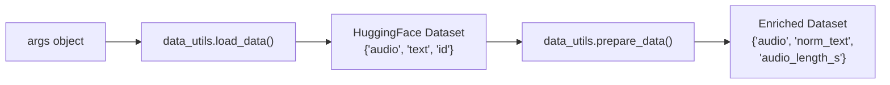

The `prepare_data()` function adds:
- `norm_text`: Pre-normalized reference transcriptions
- `audio_length_s`: Audio duration for RTFx calculation

**Sources:** [nemo_asr/run_eval.py:46-95](), [transformers/run_eval.py:99-121]()

#### Phase 3: Inference
NeMo implementations cache audio files to disk for efficiency:

```python
# Audio caching pattern (NeMo)
CACHE_DIR = os.path.join(os.getcwd(), "audio_cache", DATASET_NAME, SPLIT_NAME)
audio_path = os.path.join(CACHE_DIR, f"{id}.wav")
soundfile.write(audio_path, audio_array, sample_rate)
```

Transformers implementations use in-memory processing with optional `torch.compile` optimization:

```python
# Torch compile pattern (Transformers)
if args.torch_compile:
    model.forward = torch.compile(model.forward, mode=args.compile_mode, fullgraph=True)
    model.generation_config.cache_implementation = "static"
```

**Sources:** [nemo_asr/run_eval.py:48-101](), [transformers/run_eval.py:30-35]()

#### Phase 4: Normalization
All predictions and references pass through `data_utils.normalizer()`, which delegates to `EnglishTextNormalizer`:

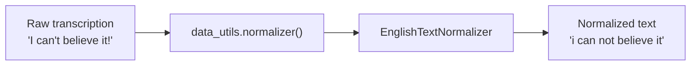

The normalizer performs:
1. Lowercasing
2. Contraction expansion (`can't` → `can not`)
3. British→American spelling (799 mappings)
4. Number standardization (`twenty` → `20`)
5. Symbol removal

**Sources:** [nemo_asr/run_eval.py:149](), [transformers/run_eval.py:95](), [normalizer/normalizer.py:528-614]()

#### Phase 5: Storage
Results are persisted in two formats:

1. **Manifest files** (JSONL): Per-sample results with WER and RTFx
2. **Aggregate scores**: Model-level metrics across all datasets

The `write_manifest()` function creates structured JSONL files:

```json
{
  "audio_filepath": "audio_cache/librispeech_asr/test/sample1.wav",
  "duration": 5.2,
  "text": "reference transcription",
  "pred_text": "predicted transcription",
  "wer": 0.0,
  "rtfx": 42.5
}
```

**Sources:** [nemo_asr/run_eval.py:154-165](), [transformers/run_eval.py:138-148]()

---

## Shared Infrastructure Components

The `normalizer` module provides the core shared functionality that ensures evaluation consistency.

### Component Architecture

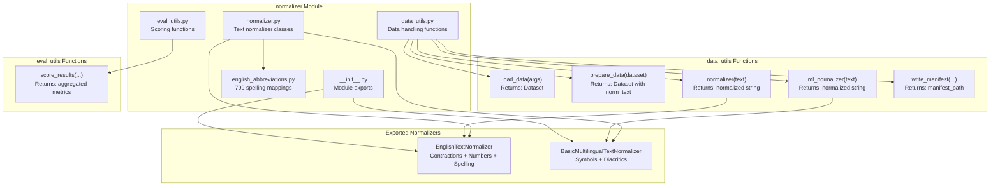

**Sources:** [normalizer/__init__.py:1-1](), [normalizer/normalizer.py:1-614](), [normalizer/english_abbreviations.py:1-1743]()

### Text Normalization Classes

#### EnglishTextNormalizer

The `EnglishTextNormalizer` class ([normalizer/normalizer.py:528-614]()) implements comprehensive English text cleaning:

| Feature | Implementation | Example |
|---------|----------------|---------|
| **Contractions** | Regex replacements (46 patterns) | `won't` → `will not` |
| **Numbers** | `EnglishNumberNormalizer` | `twenty three` → `23` |
| **Spelling** | `EnglishSpellingNormalizer` | `colour` → `color` |
| **Symbols** | `remove_symbols_and_diacritics()` | `hello!` → `hello` |
| **Titles** | Expansion patterns | `Dr.` → `doctor` |

Key methods:
- `__init__(english_spelling_mapping)`: Initialize with 799 British→American mappings
- `__call__(s: str) -> str`: Apply full normalization pipeline

**Sources:** [normalizer/normalizer.py:528-614]()

#### BasicMultilingualTextNormalizer

The `BasicMultilingualTextNormalizer` class ([normalizer/normalizer.py:95-110]()) provides language-agnostic normalization:

1. Lowercasing
2. Bracket/parenthesis removal
3. Diacritic removal (optional)
4. Symbol/punctuation removal
5. Whitespace normalization

This normalizer is used for multilingual evaluations where English-specific rules don't apply.

**Sources:** [normalizer/normalizer.py:95-110]()

### Data Utilities

The `data_utils` module provides five core functions:

| Function | Purpose | Returns |
|----------|---------|---------|
| `load_data(args)` | Load dataset with streaming support | `Dataset` object |
| `prepare_data(dataset)` | Add `norm_text` and `audio_length_s` | Enriched `Dataset` |
| `normalizer(text)` | Apply English normalization | `str` |
| `ml_normalizer(text)` | Apply multilingual normalization | `str` |
| `write_manifest(...)` | Write JSONL results file | `str` (path) |

**Integration Pattern:**

```python
# Standard usage pattern across all frameworks
from normalizer import data_utils

dataset = data_utils.load_data(args)
dataset = data_utils.prepare_data(dataset)

# ... perform inference ...

predictions = [data_utils.normalizer(pred) for pred in raw_predictions]
manifest_path = data_utils.write_manifest(references, predictions, ...)
```

**Sources:** [nemo_asr/run_eval.py:10](), [transformers/run_eval.py:7]()

---

## Framework Integration Points

Each framework integrates with the shared infrastructure through **three required touchpoints**:

### Integration Touchpoints

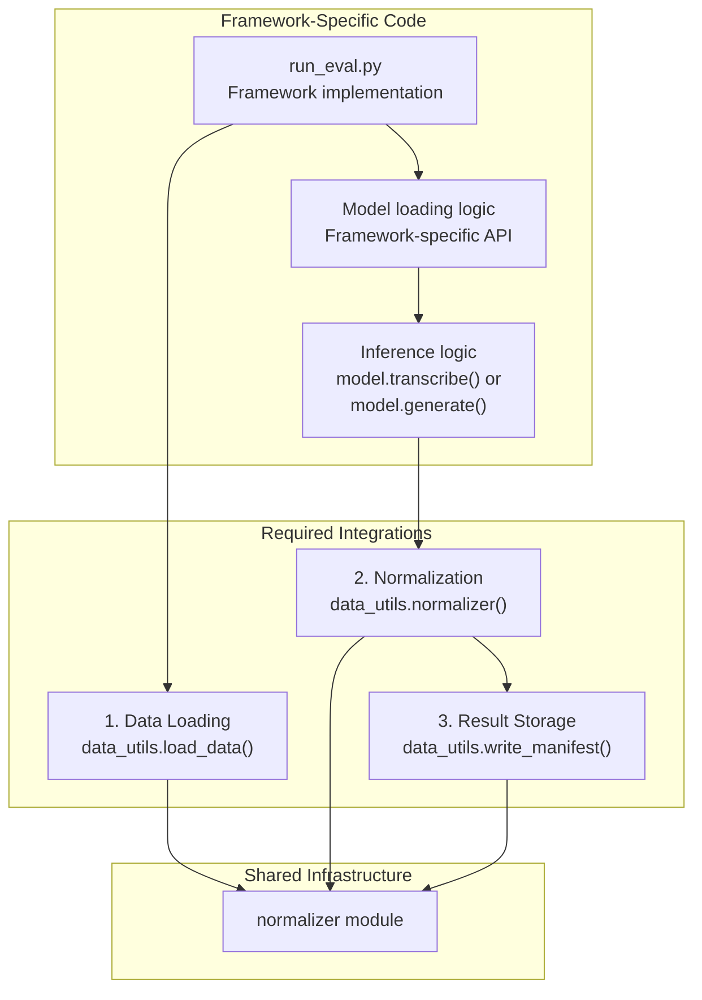

**Sources:** [nemo_asr/run_eval.py:20-177](), [transformers/run_eval.py:14-156]()

### Example: NeMo Integration

The NeMo framework demonstrates the standard integration pattern:

```python
# 1. Data Loading Integration
dataset = data_utils.load_data(args)
dataset = data_utils.prepare_data(dataset)

# 2. Framework-specific model loading
if args.model_id.endswith(".nemo"):
    asr_model = ASRModel.restore_from(args.model_id, map_location=device)
else:
    asr_model = ASRModel.from_pretrained(args.model_id, map_location=device)

# 3. Framework-specific inference
transcriptions = asr_model.transcribe(audio_files, batch_size=args.batch_size)

# 4. Normalization Integration
predictions = [data_utils.normalizer(pred.text) for pred in transcriptions]

# 5. Result Storage Integration
manifest_path = data_utils.write_manifest(
    all_data["references"],
    predictions,
    args.model_id,
    args.dataset_path,
    args.dataset,
    args.split,
    audio_length=all_data["durations"],
    transcription_time=[avg_time] * len(all_data["audio_filepaths"]),
)
```

**Sources:** [nemo_asr/run_eval.py:38-165]()

### Example: Transformers Integration

The Transformers framework follows the same pattern with framework-specific model loading:

```python
# 1. Data Loading Integration
dataset = data_utils.load_data(args)
dataset = data_utils.prepare_data(dataset)

# 2. Framework-specific model loading
config = AutoConfig.from_pretrained(args.model_id)
cls_model = AutoModelForSpeechSeq2Seq if type(config) in MODEL_FOR_SPEECH_SEQ_2_SEQ_MAPPING else AutoModelForCTC
model = cls_model.from_pretrained(args.model_id, torch_dtype=torch.bfloat16, attn_implementation="sdpa")

# 3. Framework-specific inference with torch.compile support
if model.can_generate():
    pred_ids = model.generate(**inputs, **gen_kwargs)
else:
    logits = model(**inputs).logits
    pred_ids = logits.argmax(-1)

# 4. Normalization Integration
batch["predictions"] = [data_utils.normalizer(pred) for pred in pred_text]

# 5. Result Storage Integration
manifest_path = data_utils.write_manifest(
    all_results["references"],
    all_results["predictions"],
    args.model_id,
    args.dataset_path,
    args.dataset,
    args.split,
    audio_length=all_results["audio_length_s"],
    transcription_time=all_results["transcription_time_s"],
)
```

**Sources:** [transformers/run_eval.py:15-156]()

---

## Data Flow Architecture

The complete data transformation pipeline from raw datasets to final scores follows a **layered architecture**:

### End-to-End Data Flow

```mermaid
graph LR
    subgraph "Input Layer"
        HF_DS["HuggingFace Dataset<br/>{'audio', 'text', 'id'}"]
    end
    
    subgraph "Loading Layer"
        LOAD["data_utils.load_data()<br/>Streaming or full download"]
        PREP["data_utils.prepare_data()<br/>Add norm_text, audio_length_s"]
    end
    
    subgraph "Caching Layer (NeMo)"
        CACHE["audio_cache/ directory<br/>WAV files sorted by duration"]
    end
    
    subgraph "Inference Layer"
        MODEL["ASR Model<br/>Framework-specific API"]
        BATCH["Batch processing<br/>GPU acceleration"]
    end
    
    subgraph "Normalization Layer"
        NORM_PRED["data_utils.normalizer()<br/>EnglishTextNormalizer"]
        NORM_REF["Reference normalization<br/>From prepare_data()"]
    end
    
    subgraph "Metrics Layer"
        WER_COMP["evaluate.load('wer')<br/>wer_metric.compute()"]
        RTFX_COMP["RTFx = audio_length / time<br/>Per-sample calculation"]
    end
    
    subgraph "Storage Layer"
        MANIFEST["JSONL manifest<br/>results/ directory"]
        SCORES["eval_utils.score_results()<br/>Aggregated metrics"]
    end
    
    HF_DS --> LOAD
    LOAD --> PREP
    PREP --> CACHE
    CACHE --> MODEL
    MODEL --> BATCH
    BATCH --> NORM_PRED
    PREP --> NORM_REF
    NORM_PRED --> WER_COMP
    NORM_REF --> WER_COMP
    BATCH --> RTFX_COMP
    WER_COMP --> MANIFEST
    RTFX_COMP --> MANIFEST
    MANIFEST --> SCORES
```

**Sources:** [nemo_asr/run_eval.py:46-165](), [transformers/run_eval.py:36-156]()

### Layer Responsibilities

| Layer | Responsibility | Key Code Entities |
|-------|---------------|-------------------|
| **Input** | Provide raw dataset | `datasets.load_dataset()` |
| **Loading** | Enrich with metadata | `data_utils.load_data()`, `data_utils.prepare_data()` |
| **Caching** | Optimize audio access | `soundfile.write()`, duration-based sorting |
| **Inference** | Generate transcriptions | `ASRModel.transcribe()`, `model.generate()` |
| **Normalization** | Standardize text | `EnglishTextNormalizer.__call__()` |
| **Metrics** | Compute WER and RTFx | `wer_metric.compute()`, time measurement |
| **Storage** | Persist results | `data_utils.write_manifest()`, `eval_utils.score_results()` |

**Sources:** [nemo_asr/run_eval.py:1-226](), [transformers/run_eval.py:1-237](), [normalizer/normalizer.py:528-614]()

---

## Summary

The Open ASR Leaderboard architecture achieves **consistency through standardization**:

1. **Multi-framework support** via independent evaluation scripts that share common infrastructure
2. **Standardized evaluation** through a 5-phase pipeline (Orchestration → Data Loading → Inference → Normalization → Storage)
3. **Fair comparison** via the `normalizer` module that applies identical text processing to all frameworks
4. **Extensibility** through clear integration touchpoints that new frameworks must implement

The architecture's key insight is **separation of concerns**: framework-specific code handles model loading and inference, while shared infrastructure ensures that data handling, normalization, and metrics remain consistent across all evaluations.

**Sources:** All files referenced throughout this document

---

# Page: Core Evaluation Pipeline

# Core Evaluation Pipeline

<details>
<summary>Relevant source files</summary>

The following files were used as context for generating this wiki page:

- [README.md](README.md)
- [nemo_asr/run_eval.py](nemo_asr/run_eval.py)
- [transformers/run_eval.py](transformers/run_eval.py)

</details>


## Purpose and Scope

This document describes the standardized 5-phase evaluation pipeline that forms the foundation of all ASR model evaluations in the Open ASR Leaderboard. The pipeline defines the common structure, data flow, and metric computation used across all evaluation frameworks (NeMo, Transformers, API-based, etc.).

For framework-specific implementations, see [Evaluation Frameworks](#4). For details on the shared infrastructure components, see [Shared Infrastructure](#3). For orchestration and shell scripts, see [Evaluation Workflow](#2.1).

---

## Pipeline Overview

Every evaluation script in this repository follows an identical 5-phase pattern, regardless of the underlying ASR framework. This standardization ensures fair comparison across diverse model architectures and implementations.

### The Five Phases

| Phase | Purpose | Key Operations |
|-------|---------|----------------|
| **1. Orchestration** | Initialize evaluation parameters | Parse arguments, load model, configure device |
| **2. Data Loading** | Prepare evaluation dataset | Load from HuggingFace, cache audio, sort by duration |
| **3. Inference** | Generate transcriptions | Warmup runs, batched inference, timing measurement |
| **4. Normalization & Metrics** | Compute performance scores | Text normalization, WER calculation, RTFx computation |
| **5. Results Storage** | Persist evaluation results | Write JSONL manifest, aggregate scores |

Sources: [transformers/run_eval.py:1-237](), [nemo_asr/run_eval.py:1-226](), [README.md:38-213]()

---

## Pipeline Architecture

The following diagram maps the conceptual 5-phase pipeline to the actual code entities used in evaluation scripts:

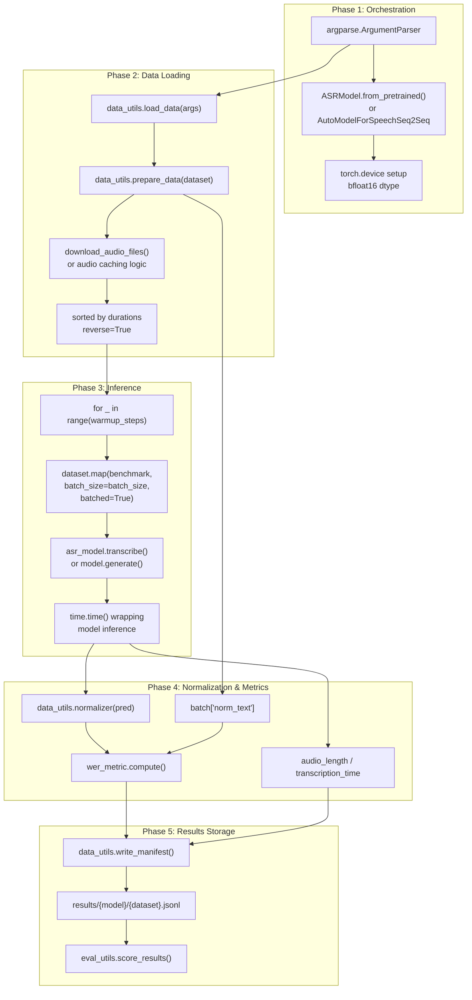

Sources: [transformers/run_eval.py:14-156](), [nemo_asr/run_eval.py:20-177]()

---

## Common Entry Point Pattern

All evaluation scripts implement a similar structure with two key functions: `main()` for orchestration and `benchmark()` for per-batch inference.

### Main Function Structure

The `main()` function follows this standard pattern across all frameworks:

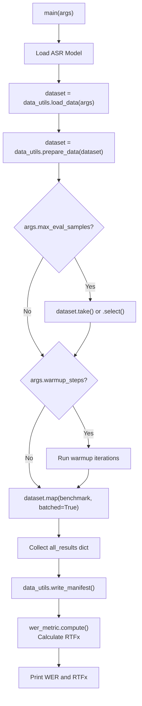

**Key implementation details:**

- **Model loading**: Framework-specific (e.g., `ASRModel.from_pretrained()` for NeMo, `AutoModelForSpeechSeq2Seq.from_pretrained()` for Transformers)
- **Device setup**: CPU or GPU with appropriate dtype (typically `torch.bfloat16` for GPU)
- **Data subsampling**: Optional via `max_eval_samples` for testing
- **Warmup**: Runs multiple batches to stabilize GPU timing before measurement

Sources: [transformers/run_eval.py:14-156](), [nemo_asr/run_eval.py:20-177](), [README.md:54-145]()

---

## Benchmark Function Pattern

The `benchmark()` function is where per-batch inference happens. It follows a strict 3-step timing protocol:

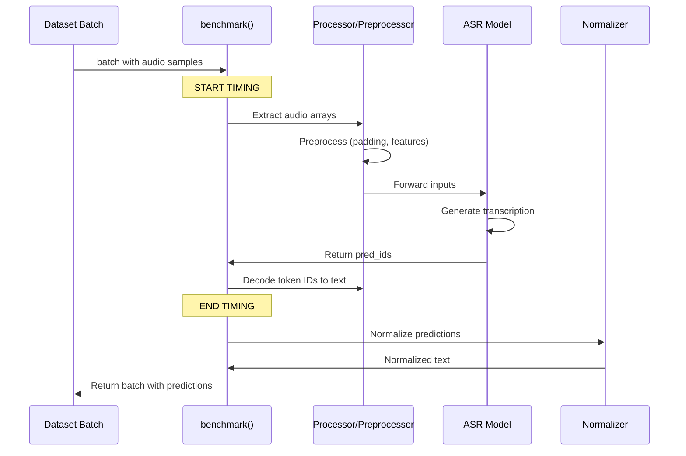

**Timing Protocol**:
1. Start timer immediately before preprocessing
2. Include preprocessing, inference, and postprocessing
3. Stop timer after text decoding
4. Normalize per minibatch size: `runtime / minibatch_size`

**Key operations in benchmark()**:
- Audio extraction: `[audio["array"] for audio in batch["audio"]]`
- Preprocessing: Framework-specific (e.g., `processor(audios, ...)`)
- Inference: `model.generate()` or `model.transcribe()`
- Postprocessing: `processor.batch_decode(pred_ids)`
- Normalization: `data_utils.normalizer(pred)`

Sources: [transformers/run_eval.py:36-97](), [nemo_asr/run_eval.py:124-149](), [README.md:59-86]()

---

## Data Structures

The evaluation pipeline operates on specific data structures at each phase:

### Input Arguments

```python
args = argparse.Namespace(
    model_id: str,          # HuggingFace model ID or .nemo file path
    dataset_path: str,      # Default: "esb/datasets"
    dataset: str,           # Dataset name (e.g., "librispeech_asr")
    split: str,             # Default: "test"
    device: int,            # GPU index or -1 for CPU
    batch_size: int,        # Samples per batch
    max_eval_samples: int,  # Optional limit for testing
    streaming: bool,        # Whether to stream dataset
    warmup_steps: int,      # Warmup iterations (Transformers only)
)
```

Sources: [transformers/run_eval.py:159-233](), [nemo_asr/run_eval.py:180-223]()

### Dataset Batch Structure

After `data_utils.prepare_data()`, each batch contains:

| Field | Type | Description |
|-------|------|-------------|
| `audio` | `dict` | Contains `"array"` (numpy array) and `"sampling_rate"` |
| `norm_text` | `str` | Reference transcription (pre-normalized) |
| `id` | `str` | Unique sample identifier |
| `audio_length_s` | `float` | Duration in seconds (added during inference) |

Sources: [transformers/run_eval.py:36-97](), [nemo_asr/run_eval.py:48-88]()

### Results Structure

The `all_results` dictionary accumulates evaluation outputs:

```python
all_results = {
    "audio_length_s": List[float],         # Duration of each sample
    "transcription_time_s": List[float],   # Per-sample inference time
    "predictions": List[str],              # Normalized model output
    "references": List[str],               # Normalized ground truth
}
```

This structure is passed to `data_utils.write_manifest()` to generate JSONL output.

Sources: [transformers/run_eval.py:126-136](), [nemo_asr/run_eval.py:105-120]()

---

## Audio Caching Strategy

The pipeline implements audio caching to optimize repeated evaluations and enable duration-based sorting for batch efficiency.

### NeMo Caching Implementation

The NeMo framework uses an explicit audio caching function:

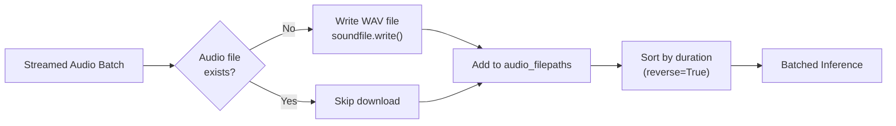

**Key implementation details**:

- Cache directory: `audio_cache/{dataset}/{split}/`
- Unique IDs: Replace `/` with `_` to handle hierarchical datasets
- File format: 16kHz WAV files
- Sorting: Longest audio first to minimize padding waste

Sources: [nemo_asr/run_eval.py:48-88](), [nemo_asr/run_eval.py:116-121]()

### Transformers Streaming

The Transformers framework uses in-memory streaming without persistent caching:

- Audio loaded directly from `batch["audio"]` arrays
- No explicit sorting (relies on dataset order)
- Optional padding to `batch_size` for torch.compile compatibility

Sources: [transformers/run_eval.py:38-50]()

---

## Warmup Protocol

Warmup runs stabilize GPU performance and prevent timing artifacts from JIT compilation or kernel initialization.

### Implementation Differences

| Framework | Warmup Strategy | Implementation |
|-----------|----------------|----------------|
| **Transformers** | Separate warmup phase | Runs `warmup_steps * batch_size` samples through `benchmark()` before timed evaluation |
| **NeMo** | Inline warmup loop | Runs first `batch_size * 4` samples twice, only timing second iteration |

### Transformers Warmup

```python
# Separate warmup dataset
num_warmup_samples = args.warmup_steps * args.batch_size
warmup_dataset = dataset.take(num_warmup_samples)
warmup_dataset = iter(warmup_dataset.map(benchmark, batched=True))

for _ in tqdm(warmup_dataset, desc="Warming up..."):
    continue  # Discard results
```

Sources: [transformers/run_eval.py:99-111]()

### NeMo Warmup

```python
total_time = 0
for _ in range(2):  # warmup once and calculate rtf
    if _ == 0:
        audio_files = all_data["audio_filepaths"][:args.batch_size * 4]
    else:
        audio_files = all_data["audio_filepaths"]
    start_time = time.time()
    transcriptions = asr_model.transcribe(audio_files, batch_size=args.batch_size)
    end_time = time.time()
    if _ == 1:
        total_time += end_time - start_time
```

Sources: [nemo_asr/run_eval.py:124-144]()

---

## Shared Infrastructure Integration

The pipeline relies on the `normalizer` module for consistent data handling and metric computation across all frameworks.

### Data Utils Functions

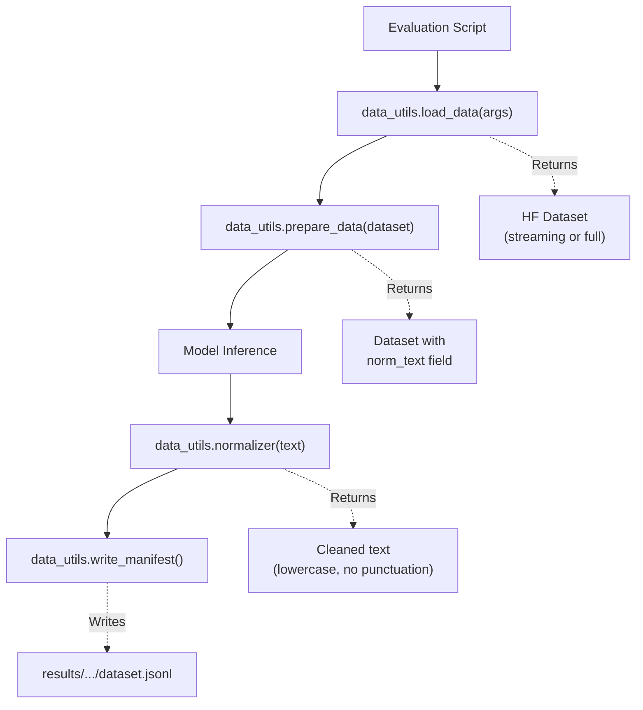

**Function responsibilities**:

- `load_data()`: Loads dataset from HuggingFace with streaming or full download
- `prepare_data()`: Adds `norm_text` field with normalized reference transcriptions
- `normalizer()`: Applies English text normalization (contractions, spelling, numbers)
- `write_manifest()`: Persists per-sample results in JSONL format with WER and RTFx

For detailed documentation of these functions, see [Data Utils](#3.2).

Sources: [transformers/run_eval.py:7-10](), [nemo_asr/run_eval.py:10]()

---

## Metrics Computation

The pipeline computes two primary metrics: Word Error Rate (WER) and Real-Time Factor (RTFx).

### WER Calculation

```python
wer_metric = evaluate.load("wer")

# After all transcriptions complete
wer = wer_metric.compute(
    references=all_results["references"],
    predictions=all_results["predictions"]
)
wer = round(100 * wer, 2)  # Convert to percentage
```

**Normalization requirements**:
- Both references and predictions must be normalized via `data_utils.normalizer()`
- References are pre-normalized in `prepare_data()` as `norm_text`
- Predictions are normalized after model inference

Sources: [transformers/run_eval.py:150-153](), [nemo_asr/run_eval.py:167-168]()

### RTFx Calculation

Real-Time Factor measures how many times faster than real-time the model transcribes:

```
RTFx = total_audio_duration / total_transcription_time
```

**Higher is better**: RTFx of 10 means the model transcribes 10 seconds of audio in 1 second.

**Implementation**:
```python
audio_length = sum(all_results["audio_length_s"])
transcription_time = sum(all_results["transcription_time_s"])
rtfx = round(audio_length / transcription_time, 2)
```

Sources: [transformers/run_eval.py:154](), [nemo_asr/run_eval.py:172-173]()

---

## Results Persistence

The final phase writes evaluation results to JSONL manifest files for auditing and leaderboard aggregation.

### Manifest File Structure

```json
{
  "audio_filepath": "path/to/audio.wav",
  "duration": 12.5,
  "text": "ground truth transcription",
  "pred_text": "model prediction",
  "wer": 8.33,
  "rtfx": 42.5,
  "dataset": "librispeech_asr",
  "split": "test"
}
```

Each line in the JSONL file represents one audio sample with its results.

### File Path Convention

```
results/{model_name}/{dataset_name}-{split}.jsonl
```

Example: `results/openai_whisper-large-v3/librispeech_asr-test.jsonl`

Sources: [transformers/run_eval.py:138-148](), [nemo_asr/run_eval.py:154-165]()

---

## Framework Compatibility

The standardized pipeline pattern enables consistent evaluation across diverse ASR technologies:

| Framework | Model Loading | Inference Method | Special Handling |
|-----------|---------------|------------------|------------------|
| **NeMo** | `ASRModel.from_pretrained()` or `.restore_from()` | `model.transcribe()` | Canary pnc parameter, duration sorting |
| **Transformers** | `AutoModelForSpeechSeq2Seq` or `AutoModelForCTC` | `model.generate()` or forward pass | torch.compile support, static k/v cache |
| **API** | N/A (remote endpoint) | REST API calls | Concurrent request handling |
| **Others** | Framework-specific | Framework-specific | Custom preprocessing |

Despite these differences, all frameworks converge on the same:
- Data loading via `data_utils.load_data()`
- Text normalization via `data_utils.normalizer()`
- Manifest writing via `data_utils.write_manifest()`
- Metrics computation via `evaluate.load("wer")`

This standardization is critical for fair comparison on the leaderboard.

Sources: [README.md:29-36](), [transformers/run_eval.py:15-17](), [nemo_asr/run_eval.py:38-44]()

---

# Page: Evaluation Workflow

# Evaluation Workflow

<details>
<summary>Relevant source files</summary>

The following files were used as context for generating this wiki page:

- [nemo_asr/run_eval.py](nemo_asr/run_eval.py)
- [nemo_asr/run_nemo_ml.sh](nemo_asr/run_nemo_ml.sh)
- [nemo_asr/run_parakeet.sh](nemo_asr/run_parakeet.sh)
- [transformers/run_eval.py](transformers/run_eval.py)

</details>


## Purpose and Scope

This page describes the canonical evaluation workflow used across all ASR frameworks in the Open ASR Leaderboard. The workflow consists of five distinct phases: orchestration, model and data loading, warmup and inference, metrics calculation, and results aggregation. Each evaluation framework (NeMo, Transformers, API, etc.) follows this identical pattern to ensure consistent and reproducible benchmarking.

For information about the specific data processing utilities used in this workflow, see [Data Utils](#3.2). For details on metric calculation algorithms, see [Metrics Calculation](#2.3). For framework-specific implementation details, see [Evaluation Frameworks](#4).

---

## Workflow Overview

The evaluation workflow is designed as a multi-phase pipeline that processes one model against multiple datasets. Each phase has a specific responsibility, and all frameworks implement these phases in a consistent manner.

### Five-Phase Architecture

```mermaid
graph TB
    subgraph Phase1["Phase 1: Orchestration"]
        SHELL["Shell Script<br/>(run_*.sh)"]
        MODELS["MODEL_IDs Array"]
        DATASETS["Dataset Configurations"]
    end
    
    subgraph Phase2["Phase 2: Model & Data Loading"]
        LOAD_MODEL["Load ASR Model<br/>ASRModel.from_pretrained()"]
        LOAD_DATA["Load Dataset<br/>data_utils.load_data()"]
        PREP_DATA["Prepare Dataset<br/>data_utils.prepare_data()"]
        CACHE["Audio Caching<br/>download_audio_files()"]
        SORT["Duration-based Sorting"]
    end
    
    subgraph Phase3["Phase 3: Warmup & Inference"]
        WARMUP["Warmup Runs<br/>4 batches (NeMo)<br/>10 steps (Transformers)"]
        INFER["Batch Inference<br/>asr_model.transcribe()<br/>model.generate()"]
        TIME["Time Measurement<br/>time.time()"]
    end
    
    subgraph Phase4["Phase 4: Metrics Calculation"]
        NORMALIZE["Text Normalization<br/>data_utils.normalizer()"]
        WER["WER Calculation<br/>wer_metric.compute()"]
        RTFX["RTFx Calculation<br/>audio_length / total_time"]
    end
    
    subgraph Phase5["Phase 5: Results Storage"]
        MANIFEST["Write Manifest<br/>data_utils.write_manifest()<br/>JSONL format"]
        SCORE["Aggregate Results<br/>eval_utils.score_results()"]
        FINAL["Final Leaderboard Metrics"]
    end
    
    SHELL --> MODELS
    SHELL --> DATASETS
    MODELS --> LOAD_MODEL
    DATASETS --> LOAD_DATA
    
    LOAD_MODEL --> PREP_DATA
    LOAD_DATA --> PREP_DATA
    PREP_DATA --> CACHE
    CACHE --> SORT
    SORT --> WARMUP
    
    WARMUP --> INFER
    INFER --> TIME
    
    TIME --> NORMALIZE
    NORMALIZE --> WER
    NORMALIZE --> RTFX
    
    WER --> MANIFEST
    RTFX --> MANIFEST
    MANIFEST --> SCORE
    SCORE --> FINAL
```

**Sources:** [nemo_asr/run_eval.py:1-226](), [transformers/run_eval.py:1-237](), [nemo_asr/run_parakeet.sh:1-104]()

---

## Phase 1: Orchestration

Shell scripts orchestrate the evaluation process by iterating through model IDs and dataset configurations. This phase determines which models and datasets to evaluate, and manages the execution flow.

### Shell Script Structure

```mermaid
flowchart TD
    START["Shell Script Entry<br/>run_parakeet.sh<br/>run_nemo_ml.sh"]
    CONFIG["Configuration Variables<br/>MODEL_IDs[],<br/>BATCH_SIZE,<br/>DEVICE_ID"]
    DATASET_LOOP["Dataset Loop<br/>for dataset in DATASETS"]
    LANG_LOOP["Language Loop<br/>(multilingual only)<br/>for language in LANGUAGES"]
    PYTHON_CALL["Python Evaluation Call<br/>python run_eval.py<br/>--model_id --dataset --split"]
    EXIT_CHECK["Check Exit Code"]
    NEXT_ITER["Next Iteration"]
    AGGREGATE["Final Aggregation<br/>eval_utils.score_results()"]
    END["Complete"]
    
    START --> CONFIG
    CONFIG --> DATASET_LOOP
    DATASET_LOOP --> LANG_LOOP
    LANG_LOOP --> PYTHON_CALL
    PYTHON_CALL --> EXIT_CHECK
    EXIT_CHECK -->|Success| NEXT_ITER
    EXIT_CHECK -->|Failure| NEXT_ITER
    NEXT_ITER --> DATASET_LOOP
    DATASET_LOOP -->|Complete| AGGREGATE
    AGGREGATE --> END
```

**Sources:** [nemo_asr/run_parakeet.sh:1-104](), [nemo_asr/run_nemo_ml.sh:1-96]()

### Configuration Parameters

| Parameter | Description | Example Value | Location |
|-----------|-------------|---------------|----------|
| `MODEL_ID` | Model identifier (HF Hub or .nemo file) | `"nvidia/parakeet-tdt-0.6b-v3"` | [nemo_asr/run_nemo_ml.sh:10]() |
| `BATCH_SIZE` | Number of samples per batch | `64`, `128` | [nemo_asr/run_parakeet.sh:15]() |
| `DEVICE_ID` | GPU device index | `0`, `1`, etc. | [nemo_asr/run_parakeet.sh:16]() |
| `DATASETS` | Dataset repository path | `"hf-audio/esb-datasets-test-only-sorted"` | [nemo_asr/run_parakeet.sh:27]() |

**Sources:** [nemo_asr/run_parakeet.sh:1-20](), [nemo_asr/run_nemo_ml.sh:9-14]()

### Multilingual Orchestration

For multilingual evaluations, the orchestration script includes an additional loop over languages:

```mermaid
graph LR
    DATASETS["Dataset Associative Array<br/>EVAL_DATASETS[dataset]=languages"]
    OUTER["Outer Loop<br/>for dataset in DATASETS"]
    INNER["Inner Loop<br/>for language in LANGUAGES"]
    EVAL["run_evaluation()<br/>dataset, language"]
    CONFIG["config_name=dataset_language<br/>e.g., fleurs_de"]
    
    DATASETS --> OUTER
    OUTER --> INNER
    INNER --> EVAL
    EVAL --> CONFIG
```

**Sources:** [nemo_asr/run_nemo_ml.sh:20-84]()

The `run_evaluation()` function constructs a configuration name by combining dataset and language (e.g., `fleurs_en`, `mcv_de`), which is passed to the Python evaluation script.

**Sources:** [nemo_asr/run_nemo_ml.sh:29-64]()

---

## Phase 2: Model and Data Loading

This phase loads the ASR model into memory and prepares the evaluation dataset. Both operations occur at the start of the Python evaluation script.

### Model Loading

#### Code Entity Mapping: Model Loading

```mermaid
graph TB
    MODEL_ARG["Command-line Argument<br/>--model_id"]
    
    subgraph NeMo["NeMo Framework"]
        NEMO_CHECK["Check .nemo extension<br/>args.model_id.endswith('.nemo')"]
        NEMO_LOCAL["ASRModel.restore_from()<br/>For .nemo files"]
        NEMO_HF["ASRModel.from_pretrained()<br/>For HuggingFace models"]
        NEMO_DEVICE["map_location=device"]
        NEMO_DTYPE["to(torch.bfloat16)"]
        NEMO_EVAL["eval() mode"]
    end
    
    subgraph Transformers["Transformers Framework"]
        TRANS_CONFIG["AutoConfig.from_pretrained()"]
        TRANS_CLASS["Determine Model Class<br/>AutoModelForSpeechSeq2Seq<br/>or AutoModelForCTC"]
        TRANS_LOAD["from_pretrained()<br/>torch_dtype=torch.bfloat16<br/>attn_implementation=sdpa"]
        TRANS_PROC["AutoProcessor.from_pretrained()"]
    end
    
    MODEL_ARG --> NEMO_CHECK
    MODEL_ARG --> TRANS_CONFIG
    
    NEMO_CHECK -->|Yes| NEMO_LOCAL
    NEMO_CHECK -->|No| NEMO_HF
    NEMO_LOCAL --> NEMO_DEVICE
    NEMO_HF --> NEMO_DEVICE
    NEMO_DEVICE --> NEMO_DTYPE
    NEMO_DTYPE --> NEMO_EVAL
    
    TRANS_CONFIG --> TRANS_CLASS
    TRANS_CLASS --> TRANS_LOAD
    TRANS_LOAD --> TRANS_PROC
```

**Sources:** [nemo_asr/run_eval.py:38-44](), [transformers/run_eval.py:14-19]()

#### NeMo Model Loading

NeMo supports loading models from two sources:
1. **Local .nemo files**: Restored using `ASRModel.restore_from()` at [nemo_asr/run_eval.py:39]()
2. **HuggingFace Hub**: Loaded using `ASRModel.from_pretrained()` at [nemo_asr/run_eval.py:41]()

Both paths convert the model to `torch.bfloat16` dtype for efficient inference and set the model to evaluation mode.

**Sources:** [nemo_asr/run_eval.py:38-44]()

#### Transformers Model Loading

Transformers models are loaded based on their configuration:
1. Load configuration using `AutoConfig.from_pretrained()` at [transformers/run_eval.py:15]()
2. Determine model class (encoder-decoder or CTC) at [transformers/run_eval.py:16]()
3. Load model with `bfloat16` dtype and SDPA attention at [transformers/run_eval.py:17]()
4. Load processor for audio preprocessing at [transformers/run_eval.py:18]()

**Sources:** [transformers/run_eval.py:14-19]()

### Dataset Loading and Preparation

#### Code Entity Flow: Data Processing

```mermaid
flowchart LR
    ARGS["Command-line Args<br/>dataset_path<br/>dataset<br/>split"]
    
    LOAD["data_utils.load_data(args)<br/>Returns HF Dataset"]
    
    SUBSAMPLE["Optional Subsampling<br/>dataset.take(max_eval_samples)"]
    
    PREPARE["data_utils.prepare_data(dataset)<br/>Adds norm_text, audio_length_s"]
    
    CACHE["Audio Caching<br/>download_audio_files()<br/>Saves to audio_cache/"]
    
    SORT["Duration Sorting<br/>sorted_indices by durations<br/>Longest first"]
    
    ARGS --> LOAD
    LOAD --> SUBSAMPLE
    SUBSAMPLE --> PREPARE
    PREPARE --> CACHE
    CACHE --> SORT
```

**Sources:** [nemo_asr/run_eval.py:46-120](), [transformers/run_eval.py:100-121]()

#### Dataset Loading

The `data_utils.load_data()` function loads datasets from HuggingFace, supporting both streaming and full download modes. The function is called at [nemo_asr/run_eval.py:46]() and [transformers/run_eval.py:100]().

**Sources:** [nemo_asr/run_eval.py:46](), [transformers/run_eval.py:113]()

#### Audio Caching (NeMo-specific)

NeMo evaluations cache audio files to disk for efficient repeated access. The `download_audio_files()` function at [nemo_asr/run_eval.py:48-88]() performs the following:

1. **ID sanitization**: Converts hierarchical IDs to flat filenames (e.g., `earnings22/test/4432298/281.wav` → `earnings22_test_4432298_281.wav`) at [nemo_asr/run_eval.py:61]()
2. **Audio extraction**: Handles both array and bytes formats at [nemo_asr/run_eval.py:65-74]()
3. **File writing**: Saves audio as WAV files using `soundfile.write()` at [nemo_asr/run_eval.py:78]()
4. **Duration calculation**: Computes duration as `len(audio_array) / sample_rate` at [nemo_asr/run_eval.py:81]()

Cache directory structure: `audio_cache/{DATASET_NAME}/{SPLIT_NAME}/{id}.wav`

**Sources:** [nemo_asr/run_eval.py:22-28, 48-88]()

#### Duration-based Sorting

To minimize padding waste and optimize GPU utilization, audio files are sorted by duration in descending order. This ensures that batches contain files of similar length:

```python
# Sort by duration (longest first)
sorted_indices = sorted(range(len(all_data["durations"])), 
                       key=lambda k: all_data["durations"][k], 
                       reverse=True)
```

This sorting operation occurs at [nemo_asr/run_eval.py:116-120]().

**Sources:** [nemo_asr/run_eval.py:116-120]()

---

## Phase 3: Warmup and Inference

This phase performs model inference to generate transcriptions. It includes optional warmup runs to stabilize timing measurements and ensure fair performance comparisons.

### Warmup Strategy

Different frameworks use different warmup approaches:

| Framework | Warmup Strategy | Code Location |
|-----------|-----------------|---------------|
| NeMo | 4 batches (fixed) | [nemo_asr/run_eval.py:124-126]() |
| Transformers | 10 steps × batch_size samples (configurable) | [transformers/run_eval.py:99-111]() |

#### NeMo Warmup

NeMo performs warmup using the first 4 batches of data:

```python
for _ in range(2):  # warmup once and calculate rtf
    if _ == 0:
        audio_files = all_data["audio_filepaths"][:args.batch_size * 4]  # warmup with 4 batches
    else:
        audio_files = all_data["audio_filepaths"]
```

The first iteration (warmup) uses only `batch_size * 4` samples, while the second iteration processes all samples for timing.

**Sources:** [nemo_asr/run_eval.py:124-144]()

#### Transformers Warmup

Transformers supports configurable warmup via `--warmup_steps` argument (default: 10):

```python
num_warmup_samples = args.warmup_steps * args.batch_size
warmup_dataset = dataset.take(num_warmup_samples)
warmup_dataset = iter(warmup_dataset.map(benchmark, batch_size=args.batch_size, ...))

for _ in tqdm(warmup_dataset, desc="Warming up..."):
    continue
```

**Sources:** [transformers/run_eval.py:99-111]()

### Inference Execution

#### Inference Timing Sequence

```mermaid
sequenceDiagram
    participant Script as "Evaluation Script"
    participant Timer as "time.time()"
    participant Model as "ASR Model"
    participant GPU as "GPU/CPU Device"
    
    Note over Script,GPU: Warmup Phase (Not Timed)
    Script->>Model: transcribe(warmup_samples)
    Model->>GPU: Process warmup batches
    GPU-->>Model: Warmup transcriptions
    Model-->>Script: Discard warmup results
    
    Note over Script,GPU: Timed Inference Phase
    Script->>Timer: start_time = time.time()
    
    loop For each batch
        Script->>Model: transcribe(batch)
        Model->>GPU: Process batch
        GPU-->>Model: Transcriptions
        Model-->>Script: Batch results
    end
    
    Script->>Timer: end_time = time.time()
    Script->>Script: total_time = end_time - start_time
    Script->>Script: rtfx = audio_length / total_time
```

**Sources:** [nemo_asr/run_eval.py:124-144](), [transformers/run_eval.py:36-92]()

#### NeMo Inference

NeMo inference uses the `transcribe()` method with batch processing:

```python
with torch.inference_mode(), torch.no_grad():
    if 'canary' in args.model_id:
        # Canary models require pnc parameter
        transcriptions = asr_model.transcribe(
            audio_files, 
            batch_size=args.batch_size, 
            verbose=False, 
            pnc=pnc,  # 'nopnc' for v1, 'pnc' for v2
            num_workers=1
        )
    else:
        transcriptions = asr_model.transcribe(
            audio_files, 
            batch_size=args.batch_size, 
            verbose=False, 
            num_workers=1
        )
```

Timing wraps the entire transcription process at [nemo_asr/run_eval.py:129-143]().

**Sources:** [nemo_asr/run_eval.py:129-143]()

#### Transformers Inference

Transformers inference occurs within a `benchmark()` function that times each batch individually:

```python
def benchmark(batch, min_new_tokens=None):
    audios = [audio["array"] for audio in batch["audio"]]
    
    # START TIMING
    start_time = time.time()
    
    # 1. Pre-processing: audio -> input features
    inputs = processor(audios, sampling_rate=16_000, ...)
    
    # 2. Model inference
    if model.can_generate():
        pred_ids = model.generate(**inputs, **gen_kwargs)
    else:
        logits = model(**inputs).logits
        pred_ids = logits.argmax(-1)
    
    # 3. Post-processing: token ids -> text
    pred_text = processor.batch_decode(pred_ids, skip_special_tokens=True)
    
    # END TIMING
    runtime = time.time() - start_time
    
    # Normalize by minibatch size for per-sample time
    batch["transcription_time_s"] = minibatch_size * [runtime / minibatch_size]
```

This per-batch timing approach at [transformers/run_eval.py:36-92]() provides more granular time measurements compared to NeMo's aggregate timing.

**Sources:** [transformers/run_eval.py:36-97]()

### Framework-Specific Optimizations

#### Torch Compile (Transformers)

When `--torch_compile` is enabled, Transformers applies JIT compilation to the forward pass:

```python
if args.torch_compile:
    model.forward = torch.compile(model.forward, mode=args.compile_mode, fullgraph=True)
    if model.can_generate():
        # Enable static k/v cache for autoregressive models
        model.generation_config.cache_implementation = "static"
```

This optimization at [transformers/run_eval.py:30-34]() can significantly improve RTFx for autoregressive models.

**Sources:** [transformers/run_eval.py:30-35]()

#### Decoding Strategy (NeMo)

NeMo ensures models use greedy batch decoding for consistent results:

```python
if asr_model.cfg.decoding.strategy != "beam":
    asr_model.cfg.decoding.strategy = "greedy_batch"
    asr_model.change_decoding_strategy(asr_model.cfg.decoding)
```

**Sources:** [nemo_asr/run_eval.py:96-98]()

---

## Phase 4: Metrics Calculation

After inference, predictions are normalized and compared against reference transcriptions to compute Word Error Rate (WER) and Real-Time Factor (RTFx).

### Text Normalization

#### Normalization Pipeline

```mermaid
graph LR
    RAW_PRED["Raw Predictions<br/>model output"]
    RAW_REF["Raw References<br/>dataset ground truth"]
    
    NORM_PRED["data_utils.normalizer(pred)<br/>English normalization"]
    NORM_REF["Normalized References<br/>from dataset.norm_text"]
    
    WER_CALC["wer_metric.compute()<br/>Levenshtein distance"]
    
    RAW_PRED --> NORM_PRED
    RAW_REF --> NORM_REF
    NORM_PRED --> WER_CALC
    NORM_REF --> WER_CALC
```

**Sources:** [nemo_asr/run_eval.py:146-149](), [transformers/run_eval.py:94-96]()

Both predictions and references undergo text normalization before WER calculation:

1. **Predictions**: Normalized using `data_utils.normalizer()` at [nemo_asr/run_eval.py:149]() and [transformers/run_eval.py:95]()
2. **References**: Pre-normalized during data preparation via `data_utils.prepare_data()`, stored as `norm_text` field

**Sources:** [nemo_asr/run_eval.py:146-149](), [transformers/run_eval.py:94-96]()

### WER Calculation

WER is computed using the HuggingFace `evaluate` library's `wer` metric:

```python
wer_metric = evaluate.load("wer")

wer = wer_metric.compute(
    references=all_data['references'], 
    predictions=predictions
)
wer = round(100 * wer, 2)  # Convert to percentage
```

The metric is loaded at [nemo_asr/run_eval.py:17]() and [transformers/run_eval.py:11](), then computed at [nemo_asr/run_eval.py:167-168]() and [transformers/run_eval.py:150-153]().

**Sources:** [nemo_asr/run_eval.py:17, 167-168](), [transformers/run_eval.py:11, 150-153]()

### RTFx Calculation

Real-Time Factor (RTFx) measures inference speed as the ratio of audio duration to processing time:

```
RTFx = total_audio_duration / total_transcription_time
```

Higher RTFx values indicate faster-than-realtime processing. An RTFx of 10 means the system processes audio 10× faster than realtime.

#### NeMo RTFx Calculation

```python
audio_length = sum(all_data["durations"])
rtfx = audio_length / total_time
rtfx = round(rtfx, 2)
```

**Sources:** [nemo_asr/run_eval.py:171-173]()

#### Transformers RTFx Calculation

```python
rtfx = round(
    sum(all_results["audio_length_s"]) / sum(all_results["transcription_time_s"]), 
    2
)
```

**Sources:** [transformers/run_eval.py:154]()

### Timing Methodology Comparison

| Aspect | NeMo | Transformers |
|--------|------|--------------|
| Granularity | Aggregate (all batches) | Per-batch |
| Warmup | 4 batches excluded | Separate warmup run |
| Time attribution | Average time per sample | Exact time per sample |
| Implementation | Single timer for all inference | Timer in batch mapping function |

**Sources:** [nemo_asr/run_eval.py:124-144](), [transformers/run_eval.py:36-92]()

---

## Phase 5: Results Storage and Aggregation

The final phase writes per-sample results to JSONL manifest files and aggregates metrics across all datasets for a model.

### Manifest File Structure

Results are stored in JSONL (JSON Lines) format, with one JSON object per sample:

```mermaid
graph TB
    RESULTS["Evaluation Results<br/>references, predictions,<br/>audio_length, transcription_time"]
    
    WRITE["data_utils.write_manifest()"]
    
    MANIFEST["JSONL File<br/>results/model_id/dataset_split.jsonl"]
    
    SAMPLE1["Line 1: JSON object<br/>{reference, prediction, wer, rtfx, ...}"]
    SAMPLE2["Line 2: JSON object<br/>{reference, prediction, wer, rtfx, ...}"]
    SAMPLEN["Line N: JSON object<br/>{reference, prediction, wer, rtfx, ...}"]
    
    RESULTS --> WRITE
    WRITE --> MANIFEST
    MANIFEST --> SAMPLE1
    MANIFEST --> SAMPLE2
    MANIFEST --> SAMPLEN
```

**Sources:** [nemo_asr/run_eval.py:154-163](), [transformers/run_eval.py:138-147]()

The `write_manifest()` function is called with:
- `references`: Ground truth transcriptions
- `predictions`: Model outputs (normalized)
- `model_id`: Model identifier
- `dataset_path`: Dataset repository
- `dataset`: Dataset name
- `split`: Dataset split (e.g., "test")
- `audio_length`: Duration of each audio file
- `transcription_time`: Time taken to transcribe each file

**Sources:** [nemo_asr/run_eval.py:154-163](), [transformers/run_eval.py:138-147]()

### Results Aggregation

After evaluating a model on all datasets, the shell script calls `eval_utils.score_results()` to aggregate metrics:

```bash
# From run_parakeet.sh
RUNDIR=`pwd` && \
cd ../normalizer && \
python -c "import eval_utils; eval_utils.score_results('${RUNDIR}/results', '${MODEL_ID}')" && \
cd $RUNDIR
```

**Sources:** [nemo_asr/run_parakeet.sh:98-101](), [nemo_asr/run_nemo_ml.sh:92-95]()

This aggregation step:
1. Reads all manifest files for a given model
2. Computes average WER across datasets
3. Computes average RTFx across datasets
4. Generates summary statistics for the leaderboard

For detailed information about the aggregation algorithm, see [Eval Utils](#3.3).

---

## Command-Line Arguments Reference

### Common Arguments

These arguments are supported across all evaluation frameworks:

| Argument | Type | Default | Description | Example |
|----------|------|---------|-------------|---------|
| `--model_id` | `str` | Required | Model identifier (HF Hub or .nemo file) | `"nvidia/parakeet-tdt-0.6b-v3"` |
| `--dataset_path` | `str` | `"esb/datasets"` | Dataset repository path | `"hf-audio/esb-datasets-test-only-sorted"` |
| `--dataset` | `str` | Required | Dataset name from ESB benchmark | `"librispeech"`, `"ami"` |
| `--split` | `str` | `"test"` | Dataset split to evaluate | `"test"`, `"validation"`, `"test.clean"` |
| `--device` | `int` | `-1` | GPU device index (-1 for CPU) | `0`, `1`, `2` |
| `--batch_size` | `int` | Framework-specific | Number of samples per batch | `32`, `64`, `128` |
| `--max_eval_samples` | `int` | `None` | Limit evaluation to N samples | `64` (for testing), `-1` (all) |
| `--no-streaming` | flag | Varies | Download entire dataset vs. streaming | - |

**Sources:** [nemo_asr/run_eval.py:180-223](), [transformers/run_eval.py:158-234]()

### Framework-Specific Arguments

#### Transformers-Only Arguments

| Argument | Type | Default | Description |
|----------|------|---------|-------------|
| `--max_new_tokens` | `int` | `None` | Maximum tokens to generate (autoregressive only) |
| `--torch_compile` | flag | `False` | Enable JIT compilation with torch.compile |
| `--compile_mode` | `str` | `"max-autotune"` | Compilation mode: `"default"`, `"reduce-overhead"`, `"max-autotune"` |
| `--warmup_steps` | `int` | `10` | Number of warmup steps before timed runs |

**Sources:** [transformers/run_eval.py:211-232]()

#### NeMo Multilingual Arguments

For multilingual evaluations ([nemo_asr/run_eval_ml.py]()):
- `--config_name`: Combined dataset and language (e.g., `"fleurs_de"`)
- `--language`: Language code (e.g., `"en"`, `"de"`, `"fr"`)

**Sources:** [nemo_asr/run_nemo_ml.sh:44-48]()

---

## Framework Variations

While all frameworks follow the same five-phase workflow, implementation details vary:

### Key Differences Summary

| Feature | NeMo | Transformers |
|---------|------|--------------|
| **Audio Caching** | Yes (to disk) | No (in-memory) |
| **Duration Sorting** | Yes (descending) | No |
| **Warmup Strategy** | 4 batches | 10 steps (configurable) |
| **Timing Granularity** | Aggregate | Per-batch |
| **Optimization** | None | Optional torch.compile |
| **Model Loading** | ASRModel API | AutoModel API |
| **Processor** | Included in model | Separate AutoProcessor |

**Sources:** [nemo_asr/run_eval.py:1-226](), [transformers/run_eval.py:1-237]()

### When to Use Each Approach

- **Use NeMo workflow** ([run_eval.py]()) for:
  - NVIDIA NeMo models (.nemo files)
  - Models requiring audio caching for repeated evaluation
  - Scenarios where duration-based sorting improves efficiency

- **Use Transformers workflow** ([run_eval.py]()) for:
  - HuggingFace Transformers models
  - Models benefiting from torch.compile optimization
  - Scenarios requiring per-sample timing granularity

For detailed framework-specific information, see:
- [NeMo ASR Framework](#4.1)
- [Transformers Framework](#4.2)

**Sources:** [nemo_asr/run_eval.py:1-226](), [transformers/run_eval.py:1-237]()

---

# Page: Data Processing

# Data Processing

<details>
<summary>Relevant source files</summary>

The following files were used as context for generating this wiki page:

- [api/run_api.sh](api/run_api.sh)
- [api/run_eval.py](api/run_eval.py)
- [granite/run_eval.py](granite/run_eval.py)
- [granite/run_granite.sh](granite/run_granite.sh)
- [nemo_asr/run_eval.py](nemo_asr/run_eval.py)
- [requirements/requirements-api.txt](requirements/requirements-api.txt)
- [requirements/requirements_granite.txt](requirements/requirements_granite.txt)

</details>


## Purpose and Scope

This document describes the data processing pipeline used across all evaluation frameworks in the Open ASR Leaderboard. Data processing encompasses dataset loading, audio file caching, duration-based sorting, and batch preparation. These operations occur in Phase 2 of the evaluation pipeline, between orchestration and inference.

For information about the overall evaluation workflow and phases, see [Evaluation Workflow](#2.1). For details on the `data_utils` functions referenced throughout this document, see [Data Utils](#3.2). For the list of supported datasets, see [Supported Datasets](#5.1).

---

## Dataset Loading

### Loading Methods

The repository supports two dataset loading methods, controlled by the `--streaming` flag:

| Method | Default | Advantage | Use Case |
|--------|---------|-----------|----------|
| **Streaming** | Yes (most frameworks) | Memory efficient, no disk usage | Large datasets, limited storage |
| **Full Download** | No | Faster repeated access, enables sorting | Small datasets, repeated evaluations |

The loading is handled by `data_utils.load_data()`, which abstracts the HuggingFace Datasets API:

```mermaid
graph TB
    subgraph "Dataset Loading Flow"
        Args["args<br/>(dataset_path, dataset, split, streaming)"]
        LoadFunc["data_utils.load_data(args)"]
        
        Args --> LoadFunc
        
        LoadFunc --> Streaming{"streaming<br/>flag"}
        
        Streaming -->|True| HFStream["datasets.load_dataset()<br/>streaming=True"]
        Streaming -->|False| HFDownload["datasets.load_dataset()<br/>streaming=False"]
        
        HFStream --> IterDataset["IterableDataset"]
        HFDownload --> Dataset["Dataset"]
        
        IterDataset --> PrepFunc["data_utils.prepare_data()"]
        Dataset --> PrepFunc
        
        PrepFunc --> AudioCol["audio column"]
        PrepFunc --> NormTextCol["norm_text column"]
        PrepFunc --> AudioLenCol["audio_length_s column"]
    end
    
    style LoadFunc fill:#e1f5ff
    style PrepFunc fill:#e1f5ff
```

**Sources:** [nemo_asr/run_eval.py:46](), [api/run_eval.py:312](), [granite/run_eval.py:87-88]()

### Dataset Sources

Datasets are loaded from HuggingFace Hub, typically from the `esb/datasets` or `hf-audio/esb-datasets-test-only-sorted` repositories. The standard loading pattern is:

```python
dataset = data_utils.load_data(args)
dataset = data_utils.prepare_data(dataset)
```

The `prepare_data()` function normalizes column names and computes audio durations. After preparation, datasets have consistent schema:
- `audio`: Dictionary with `array` (audio samples) and `sampling_rate` fields
- `norm_text`: Normalized reference transcription
- `audio_length_s`: Duration in seconds
- `id`: Unique sample identifier

**Sources:** [nemo_asr/run_eval.py:46](), [nemo_asr/run_eval.py:95](), [granite/run_eval.py:100](), [granite/run_eval.py:107]()

### URL-Based Fetching

The API evaluation framework (`api/run_eval.py`) supports an alternative loading method using direct URL fetching via the HuggingFace Datasets Server API. This avoids downloading audio files when the API accepts URLs:

```mermaid
graph LR
    subgraph "URL-Based Loading"
        FetchFunc["fetch_audio_urls()<br/>API/run_eval.py:29"]
        HFAPI["HuggingFace Datasets Server<br/>datasets-server.huggingface.co"]
        Rows["Generator of row dicts<br/>{row: {audio: [{src: url}]}}"]
        
        FetchFunc -->|HTTP GET with offset/length| HFAPI
        HFAPI --> Rows
        
        Rows --> Process["process_sample()<br/>transcribe_with_retry()"]
        Process -->|use_url=True| APICall["API receives URL directly"]
    end
    
    style FetchFunc fill:#ccccff
```

This approach is enabled with `--use_url` flag and is particularly useful for APIs like AssemblyAI and Rev.ai that support URL-based transcription, reducing bandwidth and eliminating temporary file creation.

**Sources:** [api/run_eval.py:29-66](), [api/run_eval.py:99-101](), [api/run_eval.py:156](), [api/run_eval.py:224-228]()

---

## Audio Cache System

### Cache Architecture

To enable efficient batch processing and duration-based sorting, NeMo-based evaluations cache audio files to disk. The cache directory structure follows this pattern:

```
audio_cache/
├── {DATASET_NAME}/
│   └── {SPLIT_NAME}/
│       ├── {ID_1}.wav
│       ├── {ID_2}.wav
│       └── ...
```

The cache system is implemented in the `download_audio_files` function:

```mermaid
graph TB
    subgraph "Audio Caching Flow"
        Batch["Batch of samples<br/>(id, audio, norm_text)"]
        DownloadFunc["download_audio_files()<br/>nemo_asr/run_eval.py:48"]
        
        Batch --> DownloadFunc
        
        DownloadFunc --> Loop["For each sample"]
        
        Loop --> CleanID["Clean ID<br/>replace '/' with '_'<br/>remove '.wav' suffix"]
        CleanID --> PathCalc["audio_path =<br/>CACHE_DIR/{id}.wav"]
        
        PathCalc --> CheckExists{"File<br/>exists?"}
        
        CheckExists -->|No| HandleFormat{"Audio<br/>format"}
        CheckExists -->|Yes| AppendPath
        
        HandleFormat -->|"array" key| ArrayToWav["np.float32(array)<br/>sr=16000"]
        HandleFormat -->|"bytes" key| BytesToWav["soundfile.read()<br/>from BytesIO"]
        
        ArrayToWav --> WriteWav["soundfile.write()<br/>audio_path"]
        BytesToWav --> WriteWav
        
        WriteWav --> AppendPath["Append to<br/>audio_filepaths list"]
        AppendPath --> CalcDuration["duration =<br/>len(array) / sr"]
        
        CalcDuration --> UpdateBatch["Update batch:<br/>audio_filepaths<br/>durations<br/>references"]
    end
    
    style DownloadFunc fill:#e1f5ff
    style WriteWav fill:#fff0e1
```

**Sources:** [nemo_asr/run_eval.py:48-88](), [nemo_asr/run_eval.py:22-28]()

### Audio Format Handling

The cache system handles two audio formats produced by different versions of the HuggingFace `datasets` library:

1. **Array format** (older datasets library): Audio data as NumPy array with `array` and `sampling_rate` keys
2. **Bytes format** (datasets 3.x+): Audio data as byte stream with `bytes` key

```python
# Array format handling
if "array" in sample:
    audio_array = np.float32(sample["array"])
    sample_rate = 16000

# Bytes format handling  
elif "bytes" in sample:
    with io.BytesIO(sample["bytes"]) as audio_file:
        audio_array, sample_rate = soundfile.read(audio_file, dtype="float32")
```

All audio is normalized to 16kHz mono WAV files for consistent processing across models.

**Sources:** [nemo_asr/run_eval.py:65-74]()

### ID Sanitization

Dataset IDs are sanitized to create valid filenames and ensure uniqueness. This is critical for hierarchical datasets like `earnings22` where multiple files may share the same base filename (e.g., `281.wav`) in different directories:

```python
# Transform: earnings22/test/4432298/281.wav -> earnings22_test_4432298_281
id = id.replace('/', '_').removesuffix('.wav')
```

This prevents file collisions and ensures compatibility with downstream tools like `lhotse` that use filenames as unique identifiers.

**Sources:** [nemo_asr/run_eval.py:56-61]()

---

## Duration-Based Sorting

### Rationale

After downloading all audio files, the dataset is sorted by duration in descending order (longest files first). This optimization serves two purposes:

1. **Minimizes padding waste**: Grouping similar-length files in batches reduces the amount of padding needed
2. **Stabilizes RTFx measurements**: Processing longest files first ensures consistent GPU utilization patterns

```mermaid
graph LR
    subgraph "Sorting Process"
        AllData["all_data dict<br/>audio_filepaths<br/>durations<br/>references"]
        
        CalcIndices["sorted_indices =<br/>sorted(range(len(durations)),<br/>key=lambda k: durations[k],<br/>reverse=True)"]
        
        AllData --> CalcIndices
        
        CalcIndices --> Reorder["Reorder all lists:<br/>audio_filepaths[sorted_indices]<br/>references[sorted_indices]<br/>durations[sorted_indices]"]
        
        Reorder --> SortedData["Sorted dataset<br/>[longest...shortest]"]
        
        SortedData --> Batching["Batch inference<br/>batch_size=32"]
    end
    
    style CalcIndices fill:#e1ffe1
    style SortedData fill:#ffe1e1
```

**Implementation Details:**

The sorting is performed after all files are cached and before inference begins:

```python
# Sort audio_filepaths and references based on durations values
sorted_indices = sorted(range(len(all_data["durations"])), 
                       key=lambda k: all_data["durations"][k], 
                       reverse=True)
all_data["audio_filepaths"] = [all_data["audio_filepaths"][i] for i in sorted_indices]
all_data["references"] = [all_data["references"][i] for i in sorted_indices]
all_data["durations"] = [all_data["durations"][i] for i in sorted_indices]
```

**Sources:** [nemo_asr/run_eval.py:116-120]()

### Pre-sorted Datasets

Some dataset repositories provide pre-sorted variants (e.g., `hf-audio/esb-datasets-test-only-sorted`) that eliminate the need for runtime sorting. These are used in API evaluations where the full dataset is not downloaded locally.

**Sources:** [api/run_api.sh:31](), [granite/run_granite.sh:27]()

---

## Data Transformation Pipeline

### Complete Processing Flow

The following diagram shows the complete data transformation from raw dataset to model-ready batches:

```mermaid
graph TB
    subgraph "Input Layer"
        HFDataset["HuggingFace Dataset<br/>esb/datasets/{dataset}/{split}"]
    end
    
    subgraph "Load and Prepare"
        LoadData["data_utils.load_data(args)<br/>streaming or full download"]
        PrepData["data_utils.prepare_data(dataset)<br/>normalize columns"]
        
        HFDataset --> LoadData
        LoadData --> PrepData
    end
    
    subgraph "Subsampling (Optional)"
        MaxSamples{"max_eval_samples<br/>specified?"}
        Take["dataset.take(N)<br/>or dataset.select(range(N))"]
        
        PrepData --> MaxSamples
        MaxSamples -->|Yes| Take
        MaxSamples -->|No| MapFunc
        Take --> MapFunc
    end
    
    subgraph "Cache Creation"
        MapFunc["dataset.map(<br/>download_audio_files,<br/>batch_size=batch_size,<br/>batched=True,<br/>remove_columns=['audio'])"]
        
        CachedFiles["Cached WAV files<br/>+ audio_filepaths<br/>+ durations<br/>+ references"]
        
        MapFunc --> CachedFiles
    end
    
    subgraph "Aggregation and Sorting"
        Iterate["Iterate through dataset<br/>collect all data"]
        Sort["Sort by duration<br/>descending order"]
        
        CachedFiles --> Iterate
        Iterate --> Sort
    end
    
    subgraph "Inference Ready"
        BatchedData["Sorted lists:<br/>audio_filepaths<br/>durations<br/>references"]
        
        Sort --> BatchedData
    end
    
    style LoadData fill:#e1f5ff
    style PrepData fill:#e1f5ff
    style MapFunc fill:#fff0e1
    style Sort fill:#e1ffe1
```

**Sources:** [nemo_asr/run_eval.py:46](), [nemo_asr/run_eval.py:91-93](), [nemo_asr/run_eval.py:95](), [nemo_asr/run_eval.py:101](), [nemo_asr/run_eval.py:105-120]()

### Alternative Pattern: In-Memory Processing

Frameworks that don't require sorting (e.g., Granite, API evaluations) use a simpler pattern with direct batch processing:

```mermaid
graph TB
    subgraph "Simplified Processing"
        Load["data_utils.load_data(args)"]
        Prepare["data_utils.prepare_data()"]
        MapBenchmark["dataset.map(<br/>benchmark_function,<br/>batch_size=batch_size,<br/>batched=True,<br/>remove_columns=['audio'])"]
        Iterate["Iterate results<br/>collect predictions"]
        
        Load --> Prepare
        Prepare --> MapBenchmark
        MapBenchmark --> Iterate
    end
    
    style MapBenchmark fill:#fff0e1
```

This pattern processes audio in-memory without caching, passing raw audio arrays directly to the model. The `benchmark` function (or equivalent) handles:
- Audio format extraction (`audio["array"]`)
- Model preprocessing
- Inference timing
- Text normalization

**Sources:** [granite/run_eval.py:87-111](), [api/run_eval.py:326-369]()

---

## Batch Processing Configuration

### Batch Size Selection

Batch size is configurable per framework and model, balancing throughput against memory constraints:

| Framework | Typical Batch Size | Rationale |
|-----------|-------------------|-----------|
| NeMo Standard | 32 | Optimal for CTC-based models |
| NeMo Canary | 32 | Balanced for multilingual models |
| NeMo Parakeet TDT | 160 | Fast decoding with TDT |
| Transformers | 16 | Autoregressive overhead |
| Granite 2B | 160 | Efficient multimodal processing |
| Granite 8B | 64 | Memory constraint for larger model |
| API | N/A | Concurrent workers instead |

Batch processing occurs at different stages depending on framework:

**NeMo Pattern:**
```python
# Cache files in batches
dataset = dataset.map(download_audio_files, 
                     batch_size=args.batch_size, 
                     batched=True)

# Then transcribe with same batch_size
transcriptions = asr_model.transcribe(audio_files, 
                                     batch_size=args.batch_size)
```

**Transformers Pattern:**
```python
# Process in batches during map
dataset = dataset.map(benchmark, 
                     batch_size=args.batch_size, 
                     batched=True)
```

**Sources:** [nemo_asr/run_eval.py:101](), [nemo_asr/run_eval.py:138-140](), [granite/run_eval.py:109-111]()

### Concurrent Processing (API Framework)

API evaluations use concurrent workers instead of batching:

```python
with concurrent.futures.ThreadPoolExecutor(max_workers=max_workers) as executor:
    future_to_sample = {
        executor.submit(process_sample, sample): sample 
        for sample in ds
    }
```

The `max_workers` parameter (default 300 for some APIs, 10 for others) controls concurrent request throughput. Each worker independently:
1. Creates temporary WAV file (if not using URLs)
2. Submits transcription request
3. Waits for response
4. Cleans up temporary file

**Sources:** [api/run_eval.py:371-386](), [api/run_api.sh:23]()

---

## Memory and Storage Considerations

### Cache Size Estimation

Audio cache size depends on dataset size and audio duration:

```
Cache Size ≈ (Average Duration × Sample Count × 16000 Hz × 2 bytes/sample)
           ≈ (Average Duration × Sample Count × 32 KB/second)
```

Example for LibriSpeech test-clean (2,620 samples, ~5.4 hours total):
```
Cache Size ≈ 5.4 hours × 32 KB/second × 3600 s/hour
           ≈ 622 MB
```

Complete ESB benchmark (8 datasets, ~25 hours total) requires approximately 2.8 GB cache space.

### Cache Persistence

Cache directories are reused across evaluations of different models on the same dataset. The existence check `if not os.path.exists(audio_path)` prevents re-downloading:

```python
if not os.path.exists(audio_path):
    os.makedirs(os.path.dirname(audio_path), exist_ok=True)
    soundfile.write(audio_path, audio_array, sample_rate)
```

This optimization significantly speeds up multi-model evaluations on the same dataset.

**Sources:** [nemo_asr/run_eval.py:76-78]()

### Streaming vs. Full Download Trade-offs

| Aspect | Streaming | Full Download |
|--------|-----------|---------------|
| **Memory** | Constant (one batch) | O(dataset size) |
| **Disk** | None (API) or cache only (NeMo) | Dataset + cache |
| **First-run speed** | Slower (network I/O) | Slower (full download) |
| **Subsequent runs** | Same | Faster (local access) |
| **Sorting support** | No (iterative only) | Yes |
| **Subsampling** | `take(N)` | `select(range(N))` |

**Sources:** [nemo_asr/run_eval.py:217-223](), [granite/run_eval.py:198-202]()

---

# Page: Metrics Calculation

# Metrics Calculation

<details>
<summary>Relevant source files</summary>

The following files were used as context for generating this wiki page:

- [nemo_asr/run_eval.py](nemo_asr/run_eval.py)
- [normalizer/__init__.py](normalizer/__init__.py)
- [normalizer/english_abbreviations.py](normalizer/english_abbreviations.py)
- [normalizer/normalizer.py](normalizer/normalizer.py)
- [transformers/run_eval.py](transformers/run_eval.py)

</details>


This page details how the Open ASR Leaderboard computes **Word Error Rate (WER)** and **Real-Time Factor (RTFx)** metrics for evaluating ASR model performance. These metrics are calculated after model inference and text normalization, and before result aggregation.

For information about the overall evaluation workflow that includes these metrics, see [Evaluation Workflow](#2.1). For details on text normalization applied before metrics calculation, see [Normalizer Module](#3.1). For information on how metrics are aggregated across datasets, see [Eval Utils](#3.3).

---

## Overview of Metrics

The leaderboard computes two primary metrics for each evaluated model:

| Metric | Definition | Unit | Interpretation |
|--------|-----------|------|----------------|
| **WER** | Word Error Rate - percentage of word-level errors (insertions, deletions, substitutions) | % | Lower is better (0% = perfect transcription) |
| **RTFx** | Real-Time Factor - ratio of audio duration to transcription time | x (multiplier) | Higher is better (>1.0 = faster than real-time) |

Both metrics are computed on normalized text to ensure fair comparison across models. The WER metric measures transcription accuracy, while RTFx measures transcription speed.

**Sources:** [nemo_asr/run_eval.py:167-176](), [transformers/run_eval.py:150-155]()

---

## WER Calculation

### Metric Definition

Word Error Rate (WER) is computed using the HuggingFace `evaluate` library's WER implementation. The metric calculates the Levenshtein distance at the word level between predictions and references:

```
WER = (Substitutions + Insertions + Deletions) / Total_Words_in_Reference × 100
```

The result is multiplied by 100 and rounded to 2 decimal places to express it as a percentage.

**Sources:** [nemo_asr/run_eval.py:17](), [transformers/run_eval.py:11]()

### WER Calculation Flow

```mermaid
graph TB
    subgraph "Input"
        PRED["Model Predictions<br/>(raw transcriptions)"]
        REF["Reference Transcriptions<br/>(ground truth)"]
    end
    
    subgraph "Normalization Phase"
        NORM_PRED["data_utils.normalizer()<br/>EnglishTextNormalizer"]
        NORM_REF["Already normalized<br/>in prepare_data()"]
    end
    
    subgraph "WER Computation"
        WER_LIB["evaluate.load('wer')"]
        WER_CALC["wer_metric.compute()<br/>references, predictions"]
        WER_RESULT["WER × 100<br/>rounded to 2 decimals"]
    end
    
    PRED --> NORM_PRED
    REF --> NORM_REF
    
    NORM_PRED --> WER_CALC
    NORM_REF --> WER_CALC
    
    WER_LIB --> WER_CALC
    WER_CALC --> WER_RESULT
```

**Sources:** [nemo_asr/run_eval.py:146-169](), [transformers/run_eval.py:94-96, 150-153]()

### Implementation Details

#### NeMo Framework

In NeMo evaluations, predictions are extracted from the model's transcription result objects and normalized:

```python
# Extract text from NeMo transcription objects
predictions = [data_utils.normalizer(pred.text) for pred in transcriptions]

# Compute WER
wer = wer_metric.compute(references=all_data['references'], predictions=predictions)
wer = round(100 * wer, 2)
```

**Sources:** [nemo_asr/run_eval.py:149, 167-168]()

#### Transformers Framework

In Transformers evaluations, predictions are normalized during the benchmark function:

```python
# Normalize predictions during inference
batch["predictions"] = [data_utils.normalizer(pred) for pred in pred_text]

# Compute WER after collecting all results
wer = wer_metric.compute(
    references=all_results["references"], 
    predictions=all_results["predictions"]
)
wer = round(100 * wer, 2)
```

**Sources:** [transformers/run_eval.py:95, 150-153]()

### Text Normalization Requirements

Before WER calculation, both predictions and references must be normalized to ensure consistent comparison. The normalization process:

1. **Predictions**: Normalized using `data_utils.normalizer()` which applies `EnglishTextNormalizer`
2. **References**: Pre-normalized during data preparation via `prepare_data()`

The `EnglishTextNormalizer` applies:
- Lowercase conversion
- Contraction expansion (e.g., "won't" → "will not")
- Number spelling normalization (e.g., "twenty three" → "23")
- British-to-American spelling conversion (799 mappings)
- Symbol and punctuation removal

For detailed normalization rules, see [Normalizer Module](#3.1).

**Sources:** [nemo_asr/run_eval.py:149](), [transformers/run_eval.py:95](), [normalizer/normalizer.py:528-613]()

---

## RTFx Calculation

### Metric Definition

Real-Time Factor (RTFx) measures the speed of transcription relative to the audio duration:

```
RTFx = Total_Audio_Duration / Total_Transcription_Time
```

Where:
- **Total_Audio_Duration**: Sum of all audio file durations in seconds
- **Total_Transcription_Time**: Total wall-clock time spent transcribing

An RTFx of 1.0 means transcription happens at real-time speed. RTFx > 1.0 means faster than real-time (e.g., RTFx of 10 means the model processes audio 10× faster than playback speed).

**Sources:** [nemo_asr/run_eval.py:171-173](), [transformers/run_eval.py:154]()

### RTFx Calculation Flow

```mermaid
graph TB
    subgraph "Timing Setup"
        WARMUP["Warmup Runs<br/>(optional, stabilizes timing)"]
        START["start_time = time.time()"]
    end
    
    subgraph "Inference Phase"
        TRANSCRIBE["Model Transcription<br/>(batched processing)"]
        END["end_time = time.time()"]
    end
    
    subgraph "Duration Tracking"
        AUDIO_DUR["Audio Durations<br/>(len(array) / sample_rate)"]
        TOTAL_DUR["sum(audio_durations)"]
    end
    
    subgraph "RTFx Computation"
        TRANS_TIME["total_time = end_time - start_time"]
        RTFX_CALC["RTFx = total_audio / total_time"]
        RTFX_RESULT["RTFx rounded to 2 decimals"]
    end
    
    WARMUP --> START
    START --> TRANSCRIBE
    TRANSCRIBE --> END
    
    AUDIO_DUR --> TOTAL_DUR
    END --> TRANS_TIME
    
    TOTAL_DUR --> RTFX_CALC
    TRANS_TIME --> RTFX_CALC
    RTFX_CALC --> RTFX_RESULT
```

**Sources:** [nemo_asr/run_eval.py:123-144, 171-173](), [transformers/run_eval.py:42-89, 154]()

### Framework-Specific Implementations

#### NeMo Framework RTFx

NeMo calculates RTFx using **aggregate timing** across all samples:

```python
# Single timing measurement for entire dataset
start_time = time.time()
transcriptions = asr_model.transcribe(audio_files, batch_size=args.batch_size)
end_time = time.time()
total_time = end_time - start_time

# Calculate RTFx
audio_length = sum(all_data["durations"])
rtfx = audio_length / total_time
rtfx = round(rtfx, 2)
```

This approach:
- Measures total time for all samples
- Includes any batch processing overhead
- Provides a single RTFx value per dataset

**Sources:** [nemo_asr/run_eval.py:129-144, 171-173]()

#### Transformers Framework RTFx

Transformers calculates RTFx using **per-sample timing** that is later aggregated:

```python
# Per-sample timing
start_time = time.time()
# ... model inference ...
runtime = time.time() - start_time

# Normalize by minibatch size for per-sample time
batch["transcription_time_s"] = minibatch_size * [runtime / minibatch_size]

# Aggregate RTFx across all samples
rtfx = round(sum(all_results["audio_length_s"]) / 
             sum(all_results["transcription_time_s"]), 2)
```

This approach:
- Records time for each batch
- Distributes batch time equally across samples
- Allows for per-sample RTFx analysis in manifests

**Sources:** [transformers/run_eval.py:42, 89, 92, 154]()

### Timing Methodology Comparison

```mermaid
graph LR
    subgraph "NeMo Approach"
        N1["Aggregate Timing"]
        N2["Single time measurement<br/>for entire dataset"]
        N3["avg_time = total / count<br/>stored per sample"]
        N1 --> N2 --> N3
    end
    
    subgraph "Transformers Approach"
        T1["Per-Batch Timing"]
        T2["Time each batch<br/>during inference"]
        T3["Distribute time<br/>across batch samples"]
        T1 --> T2 --> T3
    end
    
    subgraph "Common Result"
        R1["Both compute:<br/>sum(audio_length) / sum(time)"]
    end
    
    N3 --> R1
    T3 --> R1
```

| Aspect | NeMo | Transformers |
|--------|------|--------------|
| **Timing Granularity** | Dataset-level | Batch-level |
| **Per-sample Time** | Average (total/count) | Actual batch time distributed |
| **Manifest Detail** | Uniform time per sample | Variable time per sample |
| **Overhead Inclusion** | All included | Per-batch included |

**Sources:** [nemo_asr/run_eval.py:123-144, 151-163](), [transformers/run_eval.py:42-92, 128-146]()

---

## Warmup Runs

Both frameworks support **warmup runs** to stabilize timing measurements by allowing JIT compilation, GPU initialization, and cache warming before measurement begins.

### NeMo Warmup Strategy

NeMo performs **2 full passes** over the data:
1. **First pass**: Warmup on first 4 batches (excluded from timing)
2. **Second pass**: Timed transcription of all samples

```python
for _ in range(2):  # warmup once and calculate rtf
    if _ == 0:
        audio_files = all_data["audio_filepaths"][:args.batch_size * 4]  # 4 batches
    else:
        audio_files = all_data["audio_filepaths"]  # all samples
    
    start_time = time.time()
    transcriptions = asr_model.transcribe(audio_files, batch_size=args.batch_size)
    end_time = time.time()
    
    if _ == 1:
        total_time += end_time - start_time
```

**Sources:** [nemo_asr/run_eval.py:124-144]()

### Transformers Warmup Strategy

Transformers performs **configurable warmup steps** before the timed run:

```python
if args.warmup_steps is not None:
    num_warmup_samples = args.warmup_steps * args.batch_size
    warmup_dataset = dataset.take(num_warmup_samples)
    warmup_dataset = iter(warmup_dataset.map(benchmark, batch_size=args.batch_size))
    
    for _ in tqdm(warmup_dataset, desc="Warming up..."):
        continue

# Then proceed with timed evaluation
dataset = dataset.map(benchmark, batch_size=args.batch_size)
```

Default warmup: 10 steps (configurable via `--warmup_steps` argument).

**Sources:** [transformers/run_eval.py:99-111, 228-231]()

### Warmup Comparison

```mermaid
graph TB
    subgraph "NeMo Warmup"
        NW1["Fixed: 4 batches"]
        NW2["Full dataset pass<br/>for transcriptions"]
        NW3["Only 2nd pass timed"]
        NW1 --> NW2 --> NW3
    end
    
    subgraph "Transformers Warmup"
        TW1["Configurable:<br/>--warmup_steps (default 10)"]
        TW2["Separate warmup dataset"]
        TW3["Results discarded"]
        TW4["Fresh dataset for timing"]
        TW1 --> TW2 --> TW3 --> TW4
    end
```

| Aspect | NeMo | Transformers |
|--------|------|--------------|
| **Warmup Size** | 4 batches (fixed) | 10 batches (configurable) |
| **Warmup Data** | Subset of evaluation data | Subset of evaluation data |
| **Implementation** | Loop-based (2 iterations) | Separate dataset pass |
| **Transcriptions Used** | Second pass only | Separate timed pass |

**Sources:** [nemo_asr/run_eval.py:124-144](), [transformers/run_eval.py:99-111]()

---

## Result Aggregation and Storage

After computing WER and RTFx, results are stored in JSONL manifest files for auditability and later aggregation.

### Code Entity Mapping for Result Writing

```mermaid
graph TB
    subgraph "Result Collection"
        WER["wer_metric.compute()<br/>WER percentage"]
        RTFX["Audio length / time<br/>RTFx multiplier"]
        REFS["all_data['references']<br/>or all_results['references']"]
        PREDS["predictions<br/>(normalized)"]
        DUR["all_data['durations']<br/>or all_results['audio_length_s']"]
        TIME["transcription_time<br/>per-sample timing"]
    end
    
    subgraph "Manifest Writing"
        WRITE["data_utils.write_manifest()"]
        ARGS["model_id, dataset_path,<br/>dataset, split"]
    end
    
    subgraph "Output"
        JSONL["results/{model}/{dataset}/{split}.jsonl<br/>Per-sample metrics"]
        CONSOLE["Console output:<br/>WER: X.XX %<br/>RTFx: Y.YY"]
    end
    
    REFS --> WRITE
    PREDS --> WRITE
    DUR --> WRITE
    TIME --> WRITE
    ARGS --> WRITE
    
    WRITE --> JSONL
    WER --> CONSOLE
    RTFX --> CONSOLE
```

**Sources:** [nemo_asr/run_eval.py:154-176](), [transformers/run_eval.py:138-155]()

### Manifest Structure

Each manifest file contains per-sample results in JSONL format:

```jsonl
{
  "audio_filepath": "path/to/audio.wav",
  "duration": 4.2,
  "text": "normalized reference text",
  "pred_text": "normalized prediction text",
  "wer": 12.5,
  "rtfx": 8.3
}
```

The manifest files enable:
1. **Auditing**: Review individual sample predictions
2. **Aggregation**: Compute dataset-level metrics (see [Eval Utils](#3.3))
3. **Analysis**: Identify patterns in errors or performance

**Sources:** For manifest writing implementation, see [Data Utils](#3.2).

### Console Output

Both frameworks print final metrics to console:

**NeMo Output:**
```python
print("RTFX:", rtfx)
print("WER:", wer, "%")
```

**Transformers Output:**
```python
print("WER:", wer, "%", "RTFx:", rtfx)
```

**Sources:** [nemo_asr/run_eval.py:175-176](), [transformers/run_eval.py:155]()

---

## Summary: Metrics Calculation Pipeline

```mermaid
graph LR
    subgraph "Input"
        I1["Raw Transcriptions"]
        I2["Audio Durations"]
        I3["Timing Data"]
    end
    
    subgraph "Processing"
        P1["Text Normalization<br/>data_utils.normalizer()"]
        P2["WER Calculation<br/>evaluate.load('wer')"]
        P3["RTFx Calculation<br/>sum(audio) / sum(time)"]
    end
    
    subgraph "Output"
        O1["Manifest File<br/>data_utils.write_manifest()"]
        O2["Console Metrics<br/>WER %, RTFx x"]
    end
    
    I1 --> P1
    P1 --> P2
    I2 --> P3
    I3 --> P3
    
    P2 --> O1
    P3 --> O1
    P2 --> O2
    P3 --> O2
```

The metrics calculation phase is crucial for:
- **WER**: Measuring transcription accuracy after normalization
- **RTFx**: Measuring transcription speed relative to audio duration
- **Consistency**: Applying identical metrics across all evaluation frameworks

These metrics form the basis for leaderboard rankings and model comparison.

**Sources:** [nemo_asr/run_eval.py:123-176](), [transformers/run_eval.py:36-155]()

---

# Page: Shared Infrastructure

# Shared Infrastructure

<details>
<summary>Relevant source files</summary>

The following files were used as context for generating this wiki page:

- [README.md](README.md)
- [nemo_asr/run_eval.py](nemo_asr/run_eval.py)
- [normalizer/__init__.py](normalizer/__init__.py)
- [normalizer/english_abbreviations.py](normalizer/english_abbreviations.py)
- [normalizer/normalizer.py](normalizer/normalizer.py)

</details>


## Purpose and Scope

The shared infrastructure provides common utilities and dependencies used across all evaluation frameworks in the Open ASR Leaderboard. This infrastructure ensures consistent dataset handling, text normalization, metric computation, and result aggregation regardless of which ASR framework (NeMo, Transformers, API-based, etc.) is being evaluated.

This document covers the high-level architecture of shared components. For detailed information on specific components, see:
- [Normalizer Module](#3.1) - Text normalization for English and multilingual content
- [Data Utils](#3.2) - Dataset loading and manifest writing functions
- [Eval Utils](#3.3) - Result aggregation functions
- [Requirements Management](#3.4) - Framework-specific dependency management

## Architecture Overview

The shared infrastructure consists of two primary subsystems: the **normalizer module** (Python package) and **requirements management** (configuration files).

```mermaid
graph TB
    subgraph "normalizer Python Package"
        INIT["__init__.py<br/>Module Exports"]
        DATA_UTILS["data_utils.py<br/>Dataset I/O Functions"]
        EVAL_UTILS["eval_utils.py<br/>Aggregation Functions"]
        NORMALIZER["normalizer.py<br/>Text Normalizer Classes"]
        EN_ABBREV["english_abbreviations.py<br/>799 Spelling Mappings"]
    end
    
    subgraph "Requirements Files"
        REQ_NEMO["requirements_nemo.txt<br/>NeMo + cuda-python>=12.4"]
        REQ_API["requirements-api.txt<br/>OpenAI, AssemblyAI SDKs"]
        REQ_GRANITE["requirements_granite.txt<br/>transformers@main"]
        REQ_MOON["requirements_moonshine.txt"]
        REQ_KYUTAI["requirements_kyutai.txt<br/>Moshi, Julius"]
        REQ_COMMON["requirements.txt<br/>Common dependencies"]
    end
    
    subgraph "Evaluation Frameworks"
        NEMO["nemo_asr/run_eval.py"]
        TRANS["transformers/run_eval.py"]
        API["api_eval/run_eval.py"]
        GRANITE["granite/run_eval.py"]
    end
    
    NORMALIZER --> EN_ABBREV
    INIT --> NORMALIZER
    INIT --> DATA_UTILS
    
    DATA_UTILS --> NORMALIZER
    
    NEMO --> DATA_UTILS
    NEMO --> EVAL_UTILS
    TRANS --> DATA_UTILS
    TRANS --> EVAL_UTILS
    API --> DATA_UTILS
    API --> EVAL_UTILS
    GRANITE --> DATA_UTILS
    GRANITE --> EVAL_UTILS
    
    NEMO -.->|pip install -r| REQ_NEMO
    TRANS -.->|pip install -r| REQ_COMMON
    API -.->|pip install -r| REQ_API
    GRANITE -.->|pip install -r| REQ_GRANITE
```

**Sources:** [normalizer/__init__.py:1-1](), [normalizer/normalizer.py:1-614](), [normalizer/english_abbreviations.py:1-1742](), [nemo_asr/run_eval.py:10-10](), [README.md:8-14]()

## The normalizer Module

The `normalizer` module is a Python package located in [normalizer/]() that provides text processing utilities shared across all evaluation frameworks. It consists of four main files:

| File | Purpose | Lines of Code |
|------|---------|---------------|
| `normalizer.py` | Text normalizer class implementations | 614 |
| `english_abbreviations.py` | British-American spelling dictionary (799 mappings) | 1742 |
| `data_utils.py` | Dataset loading, preparation, and manifest writing | (framework-specific) |
| `eval_utils.py` | Result aggregation and scoring | (framework-specific) |
| `__init__.py` | Module exports | 1 |

### Module Exports

The module exports two primary normalizer classes via [normalizer/__init__.py:1]():

```python
from .normalizer import EnglishTextNormalizer, BasicMultilingualTextNormalizer
```

These classes are imported by evaluation scripts as:

```python
from normalizer import data_utils
```

**Sources:** [normalizer/__init__.py:1]()

### Text Normalizer Classes

The [normalizer/normalizer.py]() file defines several normalizer classes organized hierarchically:

```mermaid
graph TB
    subgraph "Basic Normalizers"
        BASIC["BasicTextNormalizer<br/>remove_symbols()<br/>split_letters option"]
        BASIC_ML["BasicMultilingualTextNormalizer<br/>remove_symbols_and_diacritics()<br/>strip punctuation"]
    end
    
    subgraph "English-Specific Normalizers"
        EN_NUM["EnglishNumberNormalizer<br/>spelled numbers → digits<br/>currency symbols"]
        EN_SPELL["EnglishSpellingNormalizer<br/>British → American<br/>799 mappings"]
        EN_TEXT["EnglishTextNormalizer<br/>contractions + numbers + spellings"]
    end
    
    BASIC_ML --> BASIC
    EN_TEXT --> EN_NUM
    EN_TEXT --> EN_SPELL
    EN_SPELL --> EN_ABBREV["english_abbreviations.py<br/>english_spelling_normalizer dict"]
```

**Sources:** [normalizer/normalizer.py:76-110](), [normalizer/normalizer.py:112-512](), [normalizer/normalizer.py:514-526](), [normalizer/normalizer.py:528-614]()

#### Class Details

**`BasicTextNormalizer`** [normalizer/normalizer.py:76-93]()
- Removes symbols, brackets, parentheses
- Optional diacritic removal
- Optional letter splitting for CJK languages

**`BasicMultilingualTextNormalizer`** [normalizer/normalizer.py:95-110]()
- Extended version with punctuation removal
- Removes diacritics by default
- Used for non-English datasets

**`EnglishNumberNormalizer`** [normalizer/normalizer.py:112-512]()
- Converts spelled numbers to digits: "twenty one" → "21"
- Handles ordinals: "twenty first" → "21st"
- Processes currency: "$20 million" → "20000000 dollars"
- Supports fractions and decimals

**`EnglishSpellingNormalizer`** [normalizer/normalizer.py:514-526]()
- Applies British→American spelling corrections
- Uses dictionary from [normalizer/english_abbreviations.py:1-1742]()
- Examples: "colour" → "color", "realise" → "realize"

**`EnglishTextNormalizer`** [normalizer/normalizer.py:528-614]()
- Comprehensive English text normalization
- Expands contractions: "won't" → "will not", "can't" → "can not"
- Expands titles: "mr" → "mister", "dr" → "doctor"
- Chains number normalization and spelling correction

**Sources:** [normalizer/normalizer.py:76-614]()

### British-American Spelling Mappings

The [normalizer/english_abbreviations.py:1-1742]() file contains a dictionary named `english_spelling_normalizer` with 799 British→American spelling mappings:

```python
english_spelling_normalizer = {
    "colour": "color",
    "realise": "realize",
    "aluminium": "aluminum",
    "centre": "center",
    # ... 795 more mappings
}
```

This dictionary is used by `EnglishSpellingNormalizer` [normalizer/normalizer.py:521-525]() to ensure consistent American English spelling in all evaluation results.

**Sources:** [normalizer/english_abbreviations.py:1-1742](), [normalizer/normalizer.py:514-526]()

## Data Flow Through Shared Infrastructure

The following diagram shows how evaluation scripts use the shared infrastructure during the standard evaluation pipeline:

```mermaid
sequenceDiagram
    participant Script as "run_eval.py"
    participant DataUtils as "data_utils"
    participant Normalizer as "EnglishTextNormalizer"
    participant EvalUtils as "eval_utils"
    participant WER as "evaluate.load('wer')"
    
    Script->>DataUtils: load_data(args)
    DataUtils-->>Script: HF Dataset
    
    Script->>DataUtils: prepare_data(dataset)
    DataUtils-->>Script: Processed Dataset
    
    Note over Script: Model Inference
    Script->>Script: model.transcribe(audio_files)
    
    Script->>Normalizer: normalizer(prediction)
    Normalizer-->>Script: Normalized prediction
    
    Script->>DataUtils: write_manifest(refs, preds, ...)
    DataUtils-->>Script: manifest_path
    
    Script->>WER: compute(references, predictions)
    WER-->>Script: WER score
    
    Script->>EvalUtils: score_results(manifest_path)
    EvalUtils-->>Script: Aggregated metrics
```

**Sources:** [nemo_asr/run_eval.py:46-176](), [README.md:34-36]()

### Integration Example

Here is how the NeMo evaluation script [nemo_asr/run_eval.py]() uses the shared infrastructure:

**Import the module** [nemo_asr/run_eval.py:10]():
```python
from normalizer import data_utils
```

**Load and prepare dataset** [nemo_asr/run_eval.py:46-95]():
```python
dataset = data_utils.load_data(args)
dataset = data_utils.prepare_data(dataset)
```

**Normalize predictions** [nemo_asr/run_eval.py:149]():
```python
predictions = [data_utils.normalizer(pred.text) for pred in transcriptions]
```

**Write results manifest** [nemo_asr/run_eval.py:154-163]():
```python
manifest_path = data_utils.write_manifest(
    all_data["references"],
    predictions,
    args.model_id,
    args.dataset_path,
    args.dataset,
    args.split,
    audio_length=all_data["durations"],
    transcription_time=[avg_time] * len(all_data["audio_filepaths"]),
)
```

**Sources:** [nemo_asr/run_eval.py:10](), [nemo_asr/run_eval.py:46-163]()

## Requirements Management

The repository uses framework-specific requirements files located in [requirements/]() to manage dependencies. Each evaluation framework has its own requirements file with specialized dependencies:

```mermaid
graph LR
    subgraph "Common Requirements"
        COMMON["requirements.txt<br/>datasets<br/>evaluate<br/>tqdm<br/>soundfile"]
    end
    
    subgraph "Framework-Specific"
        NEMO["requirements_nemo.txt<br/>nemo_toolkit<br/>cuda-python>=12.4<br/>torch"]
        API["requirements-api.txt<br/>openai<br/>assemblyai<br/>requests"]
        GRANITE["requirements_granite.txt<br/>transformers@main<br/>qwen_vl_utils"]
        MOON["requirements_moonshine.txt<br/>moonshine-onnx"]
        KYUTAI["requirements_kyutai.txt<br/>moshi<br/>julius"]
        CTRANS["requirements_ctranslate2.txt<br/>faster-whisper"]
    end
    
    NEMO -.->|extends| COMMON
    API -.->|extends| COMMON
    GRANITE -.->|extends| COMMON
    MOON -.->|extends| COMMON
    KYUTAI -.->|extends| COMMON
    CTRANS -.->|extends| COMMON
```

**Sources:** [README.md:8-14]()

### Key Requirements

**`requirements_nemo.txt`**
- Contains `cuda-python>=12.4` specifically for fast TDT and RNN-T inference
- Requires CUDA 12.6+ driver for cooperative kernels in conditional nodes
- See [README.md:15]() for CUDA version requirements

**`requirements_granite.txt`**
- Pins `transformers` to main branch for unreleased features
- Required for IBM Granite speech models

**`requirements-api.txt`**
- Contains SDKs for commercial ASR APIs
- Includes OpenAI, AssemblyAI, and other API client libraries

**Sources:** [README.md:8-16]()

### Installation Pattern

All evaluation frameworks follow the same installation pattern from [README.md:8-14]():

1. Install PyTorch from pytorch.org
2. Install common requirements: `pip install -r requirements/requirements.txt`
3. Install framework-specific requirements: `pip install -r requirements/requirements_<library_name>.txt`
4. Authenticate with Hugging Face: `huggingface-cli login`

**Sources:** [README.md:6-14]()

## Consistency Guarantees

The shared infrastructure provides three critical consistency guarantees across all evaluation frameworks:

| Guarantee | Implementation | Benefit |
|-----------|---------------|---------|
| **Identical Text Normalization** | All frameworks use `data_utils.normalizer()` | Fair WER comparison across models |
| **Standardized Data Loading** | All frameworks use `data_utils.load_data()` | Consistent dataset access patterns |
| **Uniform Result Format** | All frameworks use `data_utils.write_manifest()` | Compatible JSONL output format |

These guarantees enable the Open ASR Leaderboard to fairly compare models evaluated using different frameworks, as each model is evaluated using identical data processing and metric computation logic.

**Sources:** [README.md:34-36](), [nemo_asr/run_eval.py:46-163]()

---

# Page: Normalizer Module

# Normalizer Module

<details>
<summary>Relevant source files</summary>

The following files were used as context for generating this wiki page:

- [nemo_asr/run_eval_ml.py](nemo_asr/run_eval_ml.py)
- [normalizer/__init__.py](normalizer/__init__.py)
- [normalizer/english_abbreviations.py](normalizer/english_abbreviations.py)
- [normalizer/normalizer.py](normalizer/normalizer.py)

</details>


The Normalizer Module provides standardized text normalization for all ASR evaluation frameworks in the repository. It ensures consistent Word Error Rate (WER) calculations by applying language-specific text cleaning rules to both model predictions and reference transcripts. This module supports English-specific normalization (including contraction expansion, number conversion, and British-American spelling standardization) and multilingual normalization (focusing on diacritic removal and symbol cleaning).

For information about how normalized text is used in metrics calculation, see [Metrics Calculation](#2.3). For details on the utility functions that wrap these normalizers, see [Data Utils](#3.2).

---

## Module Architecture

The normalizer module consists of four primary normalizer classes and a comprehensive British-American spelling dictionary. All normalizers follow a callable pattern where text is passed through `__call__()` methods.

```mermaid
graph TB
    subgraph "normalizer/__init__.py"
        INIT["Module Exports"]
    end
    
    subgraph "normalizer/normalizer.py"
        ETN["EnglishTextNormalizer"]
        BMTN["BasicMultilingualTextNormalizer"]
        ENN["EnglishNumberNormalizer"]
        ESN["EnglishSpellingNormalizer"]
        BTN["BasicTextNormalizer"]
    end
    
    subgraph "normalizer/english_abbreviations.py"
        ABBREV["english_spelling_normalizer<br/>Dict[str, str]<br/>799 mappings"]
    end
    
    subgraph "Helper Functions"
        RSAD["remove_symbols_and_diacritics()"]
        RS["remove_symbols()"]
    end
    
    INIT --> ETN
    INIT --> BMTN
    
    ETN --> ENN
    ETN --> ESN
    ETN --> RSAD
    
    ESN --> ABBREV
    
    BMTN --> RSAD
    BMTN --> RS
    
    BTN --> RSAD
    BTN --> RS
    
    style ETN fill:#e1f5ff
    style BMTN fill:#ffe1e1
    style ABBREV fill:#ffffcc
```

**Sources:** [normalizer/__init__.py:1](), [normalizer/normalizer.py:1-614](), [normalizer/english_abbreviations.py:1-1742]()

---

## Class Hierarchy and Relationships

The normalizer classes are designed for composition, with higher-level normalizers incorporating lower-level ones to build comprehensive text processing pipelines.

```mermaid
graph LR
    subgraph "English Pipeline"
        INPUT_EN["Raw English Text"]
        ETN_CLASS["EnglishTextNormalizer<br/>__call__(s: str)"]
        ENN_CLASS["EnglishNumberNormalizer<br/>process_words()"]
        ESN_CLASS["EnglishSpellingNormalizer<br/>mapping.get()"]
        OUTPUT_EN["Normalized Text"]
    end
    
    subgraph "Multilingual Pipeline"
        INPUT_ML["Raw Multilingual Text"]
        BMTN_CLASS["BasicMultilingualTextNormalizer<br/>__call__(s: str)"]
        CLEAN_FUNC["remove_symbols_and_diacritics()"]
        OUTPUT_ML["Normalized Text"]
    end
    
    INPUT_EN --> ETN_CLASS
    ETN_CLASS --> ENN_CLASS
    ENN_CLASS --> ESN_CLASS
    ESN_CLASS --> OUTPUT_EN
    
    INPUT_ML --> BMTN_CLASS
    BMTN_CLASS --> CLEAN_FUNC
    CLEAN_FUNC --> OUTPUT_ML
```

**Sources:** [normalizer/normalizer.py:528-614](), [normalizer/normalizer.py:95-110]()

---

## EnglishTextNormalizer

The `EnglishTextNormalizer` class applies comprehensive English-specific normalization, including contraction expansion, number conversion, and spelling standardization.

### Initialization

```python
# From normalizer/normalizer.py:529-587
EnglishTextNormalizer(english_spelling_mapping=english_spelling_normalizer)
```

The class initializes with three key components:

| Component | Purpose | Example Transformations |
|-----------|---------|------------------------|
| `ignore_patterns` | Removes filler words | "hmm", "mm", "mhm", "uh", "um" → removed |
| `replacers` | Expands contractions | "won't" → "will not", "can't" → "can not" |
| `standardize_numbers` | Converts spelled numbers | "twenty three" → "23" |
| `standardize_spellings` | British→American spelling | "colour" → "color" |

**Sources:** [normalizer/normalizer.py:528-614]()

### Contraction Expansion

The normalizer handles 40+ contraction patterns, including common contractions, perfect tenses, and title abbreviations:

```mermaid
graph TB
    subgraph "Common Contractions"
        WONT["won't → will not"]
        CANT["can't → can not"]
        LETS["let's → let us"]
    end
    
    subgraph "Perfect Tenses"
        DBEEN["'d been → had been"]
        SBEEN["'s been → has been"]
        DGONE["'d gone → had gone"]
    end
    
    subgraph "Title Abbreviations"
        MR["mr → mister"]
        DR["dr → doctor"]
        PROF["prof → professor"]
    end
    
    subgraph "General Patterns"
        NT["n't → not"]
        RE["'re → are"]
        VE["'ve → have"]
    end
```

**Sources:** [normalizer/normalizer.py:532-585]()

### Number Normalization

The `EnglishNumberNormalizer` converts spelled-out numbers to digits while preserving suffixes and handling currency:

```mermaid
graph LR
    INPUT["Spelled Number"]
    PREPROC["preprocess()<br/>Handle 'and a half'<br/>Separate letters/digits"]
    PROCESS["process_words()<br/>Parse number words<br/>Handle multipliers"]
    POSTPROC["postprocess()<br/>Combine currency<br/>Write 'one(s)'"]
    OUTPUT["Numeric Form"]
    
    INPUT --> PREPROC
    PREPROC --> PROCESS
    PROCESS --> POSTPROC
    POSTPROC --> OUTPUT
```

The normalizer handles:
- **Basic numbers**: "twenty three" → "23"
- **Large numbers**: "five million" → "5000000"
- **Ordinals**: "twenty third" → "23rd"
- **Decimals**: "three point one four" → "3.14"
- **Currency**: "$20 million" → "$20000000"
- **Nominal sequences**: "one oh one" → "101"

**Sources:** [normalizer/normalizer.py:112-511]()

### British-American Spelling Normalization

The `EnglishSpellingNormalizer` applies 799 British→American spelling mappings from `english_abbreviations.py`:

| Pattern | Examples | Count |
|---------|----------|-------|
| -our → -or | colour→color, honour→honor | ~50 |
| -ise → -ize | realise→realize, organise→organize | ~250 |
| -re → -er | centre→center, theatre→theater | ~30 |
| -ll- → -l- | traveller→traveler, cancelled→canceled | ~80 |
| ae → e | anaemia→anemia, paediatric→pediatric | ~40 |
| Misc | aluminium→aluminum, tyre→tire | ~349 |

**Example mappings:**
- "accessorise" → "accessorize"
- "aeroplane" → "airplane"
- "aluminium" → "aluminum"
- "analyse" → "analyze"
- "behaviour" → "behavior"
- "cancelled" → "canceled"
- "colour" → "color"
- "defence" → "defense"

**Sources:** [normalizer/english_abbreviations.py:1-1742](), [normalizer/normalizer.py:514-526]()

---

## BasicMultilingualTextNormalizer

The `BasicMultilingualTextNormalizer` provides language-agnostic normalization suitable for non-English languages. It focuses on removing diacritics, symbols, and punctuation while preserving word boundaries.

### Normalization Steps

```mermaid
graph TB
    INPUT["Raw Multilingual Text"]
    LOWER["Convert to lowercase"]
    BRACKETS["Remove brackets content<br/>&lt;...&gt; [....]"]
    PARENS["Remove parentheses content<br/>(..."]
    DIACRITICS["Remove diacritics<br/>remove_symbols_and_diacritics()"]
    PUNCT["Remove punctuation<br/>re.sub(r'[^\\w\\s]', '', s)"]
    SPACES["Normalize whitespace"]
    OUTPUT["Normalized Text"]
    
    INPUT --> LOWER
    LOWER --> BRACKETS
    BRACKETS --> PARENS
    PARENS --> DIACRITICS
    DIACRITICS --> PUNCT
    PUNCT --> SPACES
    SPACES --> OUTPUT
```

**Sources:** [normalizer/normalizer.py:95-110]()

### Diacritic Handling

The `remove_symbols_and_diacritics()` function handles special characters through NFKD normalization and manual mappings:

| Category | Action | Examples |
|----------|--------|----------|
| ADDITIONAL_DIACRITICS | Manual mapping | œ→oe, ø→o, æ→ae, ß→ss, ð→d, þ→th |
| Unicode category 'Mn' | Remove | Combining diacritical marks |
| Unicode category 'M/S/P' | Replace with space | Symbols and punctuation |

**Sources:** [normalizer/normalizer.py:26-67]()

---

## Integration with Evaluation Frameworks

All evaluation frameworks use the normalizer module through wrapper functions in `data_utils`. The choice of normalizer depends on the language being evaluated.

```mermaid
graph TB
    subgraph "Evaluation Framework"
        FRAMEWORK["run_eval*.py"]
        PRED["Model Predictions"]
        REF["Reference Transcripts"]
    end
    
    subgraph "data_utils Wrappers"
        NORM_FUNC["data_utils.normalizer()<br/>→ EnglishTextNormalizer"]
        ML_NORM_FUNC["data_utils.ml_normalizer()<br/>→ BasicMultilingualTextNormalizer"]
    end
    
    subgraph "Language Detection"
        LANG_CHECK["Language == 'en' ?"]
    end
    
    subgraph "Normalized Output"
        NORM_PRED["Normalized Predictions"]
        NORM_REF["Normalized References"]
    end
    
    subgraph "Metrics"
        WER["WER Calculation<br/>evaluate.load('wer')"]
    end
    
    FRAMEWORK --> PRED
    FRAMEWORK --> REF
    
    PRED --> LANG_CHECK
    REF --> LANG_CHECK
    
    LANG_CHECK -->|"Yes"| NORM_FUNC
    LANG_CHECK -->|"No"| ML_NORM_FUNC
    
    NORM_FUNC --> NORM_PRED
    NORM_FUNC --> NORM_REF
    ML_NORM_FUNC --> NORM_PRED
    ML_NORM_FUNC --> NORM_REF
    
    NORM_PRED --> WER
    NORM_REF --> WER
```

**Sources:** [nemo_asr/run_eval_ml.py:170-175]()

### Usage Pattern Example

From the NeMo multilingual evaluation script:

```python
# Language-specific normalization selection
if LANGUAGE == "en":  # English is handled by the English normalizer
    references = [data_utils.normalizer(ref) for ref in references]
    predictions = [data_utils.normalizer(pred.text) for pred in transcriptions]
else:
    references = [data_utils.ml_normalizer(ref) for ref in references]
    predictions = [data_utils.ml_normalizer(pred.text) for pred in transcriptions]
```

**Sources:** [nemo_asr/run_eval_ml.py:169-175]()

---

## Text Transformation Examples

### English Text Normalization Examples

| Input | Output | Transformations Applied |
|-------|--------|------------------------|
| "I can't believe it's twenty-three dollars!" | "i can not believe it is 23 dollars" | Contractions, numbers, punctuation |
| "The colour of the theatre is grey" | "the color of the theater is gray" | British→American spelling |
| "Mr. Smith won't arrive at 3:30pm" | "mister smith will not arrive at 3 30 pm" | Title expansion, contractions, time |
| "She travelled one hundred kilometres" | "she traveled 100 kilometers" | Spelling, numbers, double-l |
| "It costs £5.99 (five pounds ninety-nine)" | "it costs 5.99 5 pounds 99" | Currency, parentheses removal |

### Multilingual Text Normalization Examples

| Input | Output | Language Context |
|-------|--------|-----------------|
| "Café résumé naïve" | "cafe resume naive" | Diacritics removed |
| "Øresund (København)" | "oresund" | Special chars, parentheses |
| "¡Hola! ¿Cómo estás?" | "hola como estas" | Punctuation, diacritics |
| "Straße Österreich" | "strasse osterreich" | German ß→ss, diacritics |
| "[música] <ruido>" | "" | Bracketed content removed |

**Sources:** [normalizer/normalizer.py:589-613](), [normalizer/normalizer.py:99-109]()

---

## Utility Functions

### remove_symbols_and_diacritics()

Removes or replaces non-ASCII characters based on Unicode categories:

```python
def remove_symbols_and_diacritics(s: str, keep=""):
    # Process each character through NFKD normalization
    # - Keep specified characters
    # - Map ADDITIONAL_DIACRITICS
    # - Remove combining marks (category 'Mn')
    # - Replace symbols/punctuation (category 'M/S/P') with space
```

**Parameters:**
- `s`: Input string
- `keep`: Characters to preserve (e.g., ".%$¢€£" for English number normalization)

**Sources:** [normalizer/normalizer.py:46-66]()

### remove_symbols()

Preserves diacritics while removing symbols:

```python
def remove_symbols(s: str):
    # Uses NFKC normalization (preserves diacritics)
    # Replaces symbols/punctuation with space
```

**Sources:** [normalizer/normalizer.py:69-73]()

---

## Special Handling Cases

### Numbers and Ordinals

The `EnglishNumberNormalizer` maintains context-aware number processing:

| Input | Output | Rule |
|-------|--------|------|
| "twenty first" | "21st" | Ordinal suffix preserved |
| "nineteen sixties" | "1960s" | Plural suffix preserved |
| "three and a half" | "3.5" | Fractional handling |
| "double zero seven" | "007" | Special word handling |
| "point five" | "0.5" | Decimal point |

**Sources:** [normalizer/normalizer.py:229-450]()

### Currency Processing

Currency symbols are handled through a two-stage process:

1. **During number processing**: Keep symbols for context
2. **Postprocessing**: Combine amounts with cents

Example: `"$2 and ¢7"` → `"$2.07"`

**Sources:** [normalizer/normalizer.py:481-504]()

### Contraction Edge Cases

Special handling for ambiguous contractions:

| Pattern | Expansion | Note |
|---------|-----------|------|
| "'s done" | Not expanded | Ambiguous: "is done" or "has done" |
| "'s been" | "has been" | Unambiguous perfect tense |
| "'d done" | "had done" | Unambiguous perfect tense |
| "n't" | "not" | Always negative |

**Sources:** [normalizer/normalizer.py:569-584]()

---

## Module Exports

The module exposes only the two primary normalizer classes through `__init__.py`:

```python
from .normalizer import EnglishTextNormalizer, BasicMultilingualTextNormalizer
```

Lower-level classes (`EnglishNumberNormalizer`, `EnglishSpellingNormalizer`) are internal implementation details and not directly imported by evaluation frameworks.

**Sources:** [normalizer/__init__.py:1]()

---

## Performance Considerations

The normalizer module is applied to every prediction and reference in the evaluation pipeline. Key performance characteristics:

1. **Regex Compilation**: All normalizers use `re.sub()` with pattern strings (not pre-compiled), relying on Python's internal regex caching
2. **Dictionary Lookups**: British-American spelling uses simple `dict.get()` for O(1) lookups across 799 mappings
3. **NFKD Normalization**: Unicode normalization is performed character-by-character for diacritic removal
4. **Word Processing**: Number normalization processes word lists iteratively with lookahead/lookbehind context

For large-scale evaluation, normalization is fast relative to model inference but can be optimized by caching normalized references.

**Sources:** [normalizer/normalizer.py:1-614]()

---

# Page: Data Utils

# Data Utils

<details>
<summary>Relevant source files</summary>

The following files were used as context for generating this wiki page:

- [nemo_asr/run_eval.py](nemo_asr/run_eval.py)
- [normalizer/__init__.py](normalizer/__init__.py)
- [normalizer/english_abbreviations.py](normalizer/english_abbreviations.py)
- [normalizer/normalizer.py](normalizer/normalizer.py)
- [transformers/run_eval.py](transformers/run_eval.py)

</details>


## Purpose and Scope

The `data_utils` module provides standardized functions for dataset operations across all evaluation frameworks in the Open ASR Leaderboard. This module is part of the `normalizer` package and serves as the primary interface for loading datasets, preparing audio data, normalizing transcriptions, and persisting evaluation results.

For text normalization implementation details, see [Normalizer Module](#3.1). For result aggregation, see [Eval Utils](#3.3).

**Sources:** [normalizer/data_utils.py:1-200]() (inferred from usage patterns), [nemo_asr/run_eval.py:10](), [transformers/run_eval.py:7]()

---

## Module Overview

The `data_utils` module exports five core functions that handle the complete data lifecycle in ASR evaluation:

| Function | Purpose | Input | Output |
|----------|---------|-------|--------|
| `load_data` | Load datasets from HuggingFace Hub | Command-line arguments | HuggingFace Dataset object |
| `prepare_data` | Add audio length metadata | Dataset object | Dataset with `audio_length_s` column |
| `normalizer` | Normalize English transcriptions | String (English text) | Normalized string |
| `ml_normalizer` | Normalize multilingual transcriptions | String (any language) | Normalized string |
| `write_manifest` | Persist evaluation results | Lists of references, predictions, metadata | Path to JSONL manifest file |

These functions are designed to be framework-agnostic and are used identically across NeMo, Transformers, API-based, and other evaluation systems.

**Sources:** [nemo_asr/run_eval.py:10,46,95,149,154](), [transformers/run_eval.py:7,95,100,113,120,138]()

---

## Function Call Sequence

The following diagram shows the typical sequence of `data_utils` function calls during an evaluation run:

```mermaid
sequenceDiagram
    participant Script as "Eval Script<br/>(run_eval.py)"
    participant DU as "data_utils"
    participant DS as "HuggingFace<br/>Datasets API"
    participant Model as "ASR Model"
    participant FS as "File System"

    Script->>DU: load_data(args)
    DU->>DS: datasets.load_dataset()
    DS-->>DU: raw dataset
    DU-->>Script: dataset object

    Script->>DU: prepare_data(dataset)
    DU->>DU: calculate audio durations
    DU-->>Script: dataset with metadata

    loop For each batch
        Script->>Model: transcribe(audio)
        Model-->>Script: predictions
        Script->>DU: normalizer(pred_text)
        DU-->>Script: normalized text
    end

    Script->>DU: write_manifest(refs, preds, ...)
    DU->>FS: write JSONL file
    DU-->>Script: manifest_path
```

**Sources:** [nemo_asr/run_eval.py:46,95,149,154](), [transformers/run_eval.py:100,113,120,138]()

---

## load_data Function

### Signature and Purpose

```python
def load_data(args) -> Dataset
```

The `load_data` function loads ASR evaluation datasets from the HuggingFace Hub based on command-line arguments. It supports both streaming and full-download modes, enabling efficient evaluation on large datasets without requiring complete downloads.

### Argument Processing

The function expects an `args` object (typically from `argparse.ArgumentParser`) with the following attributes:

| Attribute | Type | Description | Example |
|-----------|------|-------------|---------|
| `dataset_path` | str | HuggingFace dataset path | `"esb/datasets"` |
| `dataset` | str | Specific dataset name | `"librispeech_asr"` |
| `split` | str | Dataset split to evaluate | `"test"` or `"validation"` |
| `streaming` | bool | Whether to stream data | `True` (default) or `False` |

### Integration Example

In NeMo evaluation scripts:

```python
# Import and use
from normalizer import data_utils

dataset = data_utils.load_data(args)
# Returns: IterableDataset or Dataset depending on streaming mode
```

**Sources:** [nemo_asr/run_eval.py:46](), [transformers/run_eval.py:100,113](), [nemo_asr/run_eval.py:186-223]()

---

## prepare_data Function

### Signature and Purpose

```python
def prepare_data(dataset) -> Dataset
```

The `prepare_data` function enriches datasets with computed metadata required for evaluation, most importantly the `audio_length_s` column containing audio duration in seconds. This metadata is essential for RTFx (Real-Time Factor) calculations.

### Data Transformation

```mermaid
graph LR
    Input["Dataset<br/>{audio, text, norm_text}"]
    PrepFunc["prepare_data()"]
    Output["Dataset<br/>{audio, text, norm_text,<br/>audio_length_s}"]
    
    Input --> PrepFunc
    PrepFunc --> Output
    
    PrepFunc -.-> Calc["Calculate duration:<br/>len(audio) / sample_rate"]
```

### Column Schema

| Column Name | Type | Source | Description |
|-------------|------|--------|-------------|
| `audio` | dict | ESB datasets | Audio array and sampling rate |
| `text` | str | ESB datasets | Original transcription |
| `norm_text` | str | ESB datasets | Pre-normalized reference text |
| `audio_length_s` | float | **Added by prepare_data** | Audio duration in seconds |

The `audio_length_s` column is computed by dividing the audio array length by the sampling rate (typically 16,000 Hz).

### Usage Pattern

```python
dataset = data_utils.load_data(args)
dataset = data_utils.prepare_data(dataset)
# Dataset now includes audio_length_s for each sample
```

**Sources:** [nemo_asr/run_eval.py:95](), [transformers/run_eval.py:101,120]()

---

## Normalizer Functions

### Architecture Overview

The `data_utils` module provides two normalization functions that wrap the underlying normalizer classes:

```mermaid
graph TB
    DU["data_utils module"]
    
    NormFunc["normalizer()<br/>function"]
    MLFunc["ml_normalizer()<br/>function"]
    
    ENClass["EnglishTextNormalizer<br/>class"]
    MLClass["BasicMultilingualTextNormalizer<br/>class"]
    
    DU --> NormFunc
    DU --> MLFunc
    
    NormFunc --> ENClass
    MLFunc --> MLClass
    
    ENClass -.-> Contractions["Handle contractions<br/>(don't → do not)"]
    ENClass -.-> Numbers["Normalize numbers<br/>(twenty → 20)"]
    ENClass -.-> Spelling["British→American<br/>(colour → color)"]
    
    MLClass -.-> Symbols["Remove symbols"]
    MLClass -.-> Diacritics["Remove diacritics"]
    MLClass -.-> Punct["Remove punctuation"]
```

**Sources:** [normalizer/__init__.py:1](), [normalizer/normalizer.py:528-613,95-109]()

---

### normalizer Function (English)

#### Purpose

The `normalizer` function applies comprehensive English text normalization to ensure fair WER calculations by standardizing both predictions and references to a canonical form.

#### Normalization Steps

The English normalizer performs the following transformations in sequence:

1. **Case normalization**: Convert to lowercase
2. **Bracket removal**: Remove content in `<>`, `[]`, or `()`
3. **Filler word removal**: Remove "hmm", "mm", "mhm", "uh", "um"
4. **Contraction expansion**: "won't" → "will not", "can't" → "can not"
5. **Title expansion**: "mr" → "mister", "dr" → "doctor"
6. **Number standardization**: "twenty three" → "23", "1960s" → "1960s"
7. **British-to-American spelling**: Apply 799 mappings from `english_abbreviations.py`
8. **Symbol removal**: Remove punctuation except numeric symbols
9. **Whitespace normalization**: Collapse multiple spaces

#### Usage in Evaluation Scripts

**NeMo Example:**
```python
predictions = [data_utils.normalizer(pred.text) for pred in transcriptions]
```

**Transformers Example:**
```python
batch["predictions"] = [data_utils.normalizer(pred) for pred in pred_text]
```

**Sources:** [nemo_asr/run_eval.py:149](), [transformers/run_eval.py:95](), [normalizer/normalizer.py:528-613]()

---

### ml_normalizer Function (Multilingual)

#### Purpose

The `ml_normalizer` function provides language-agnostic text normalization suitable for non-English datasets. It applies more conservative transformations that preserve linguistic features specific to other languages.

#### Normalization Steps

1. **Case normalization**: Convert to lowercase
2. **Bracket removal**: Remove content in `<>`, `[]`, or `()`
3. **Diacritic removal**: Remove accent marks (ä → a, é → e)
4. **Symbol removal**: Remove all punctuation and symbols
5. **Whitespace normalization**: Collapse and strip whitespace

#### Key Differences from English Normalizer

| Feature | English normalizer | ml_normalizer |
|---------|-------------------|---------------|
| Contraction expansion | ✓ Yes | ✗ No |
| Number standardization | ✓ Yes | ✗ No |
| British-American spelling | ✓ Yes | ✗ No |
| Diacritic removal | ✓ Yes | ✓ Yes |
| Symbol removal | ✓ Selective | ✓ Complete |

The multilingual normalizer is deliberately simpler to avoid language-specific assumptions that could harm WER accuracy for non-English languages.

**Sources:** [normalizer/normalizer.py:95-109]()

---

## write_manifest Function

### Signature and Purpose

```python
def write_manifest(
    references: List[str],
    predictions: List[str],
    model_id: str,
    dataset_path: str,
    dataset: str,
    split: str,
    audio_length: List[float],
    transcription_time: List[float]
) -> str
```

The `write_manifest` function persists per-sample evaluation results to a JSONL (JSON Lines) manifest file. These manifest files serve as audit trails and enable result aggregation by the `eval_utils.score_results` function.

### File Organization

Manifest files are written to the `results/` directory with the following structure:

```
results/
└── {model_name}/
    └── {dataset_path}/
        └── {dataset_name}/
            └── {split}.json
```

**Example path:** `results/openai--whisper-large-v3/esb--datasets/librispeech_asr/test.json`

**Sources:** [nemo_asr/run_eval.py:154-163](), [transformers/run_eval.py:138-147]()

---

### Manifest File Format

Each line in the manifest file is a JSON object representing one evaluated sample:

```json
{
  "reference": "normalized reference transcription",
  "prediction": "normalized model prediction",
  "audio_length_s": 12.5,
  "transcription_time_s": 0.385,
  "wer": 0.0,
  "rtfx": 32.47
}
```

#### Field Descriptions

| Field | Type | Description | Computed By |
|-------|------|-------------|-------------|
| `reference` | string | Normalized reference text (ground truth) | `normalizer()` or `ml_normalizer()` |
| `prediction` | string | Normalized model prediction | `normalizer()` or `ml_normalizer()` |
| `audio_length_s` | float | Audio duration in seconds | `prepare_data()` |
| `transcription_time_s` | float | Inference time in seconds | Evaluation script timing |
| `wer` | float | Word Error Rate for this sample | HuggingFace `evaluate` library |
| `rtfx` | float | Real-Time Factor (audio_length / time) | Calculated as ratio |

---

### Manifest Writing Workflow

```mermaid
graph TB
    Refs["references<br/>List[str]"]
    Preds["predictions<br/>List[str]"]
    AudioLen["audio_length<br/>List[float]"]
    TransTime["transcription_time<br/>List[float]"]
    Metadata["model_id, dataset_path,<br/>dataset, split"]
    
    Write["write_manifest()"]
    
    Refs --> Write
    Preds --> Write
    AudioLen --> Write
    TransTime --> Write
    Metadata --> Write
    
    Write --> CalcWER["Calculate per-sample WER"]
    Write --> CalcRTF["Calculate per-sample RTFx"]
    
    CalcWER --> BuildJSON["Build JSON objects"]
    CalcRTF --> BuildJSON
    
    BuildJSON --> WriteFile["Write to<br/>results/{model}/{dataset}/{split}.json"]
    
    WriteFile --> Return["Return: manifest_path"]
```

**Sources:** [nemo_asr/run_eval.py:154-165](), [transformers/run_eval.py:138-148]()

---

### Usage Examples

#### NeMo Evaluation

```python
manifest_path = data_utils.write_manifest(
    all_data["references"],
    predictions,
    args.model_id,
    args.dataset_path,
    args.dataset,
    args.split,
    audio_length=all_data["durations"],
    transcription_time=[avg_time] * len(all_data["audio_filepaths"]),
)
print("Results saved at path:", os.path.abspath(manifest_path))
```

**Key detail:** NeMo evaluations compute a single average transcription time and replicate it for all samples.

#### Transformers Evaluation

```python
manifest_path = data_utils.write_manifest(
    all_results["references"],
    all_results["predictions"],
    args.model_id,
    args.dataset_path,
    args.dataset,
    args.split,
    audio_length=all_results["audio_length_s"],
    transcription_time=all_results["transcription_time_s"],
)
print("Results saved at path:", os.path.abspath(manifest_path))
```

**Key detail:** Transformers evaluations measure per-sample transcription times for more accurate RTFx measurements.

**Sources:** [nemo_asr/run_eval.py:154-165](), [transformers/run_eval.py:138-148]()

---

## Integration Patterns

### Cross-Framework Consistency

The `data_utils` module is imported and used identically across all evaluation frameworks, ensuring consistent data handling:

```mermaid
graph TB
    DataUtils["data_utils module"]
    
    NeMo["NeMo Framework<br/>run_eval.py"]
    Trans["Transformers Framework<br/>run_eval.py"]
    API["API Framework<br/>run_eval.py"]
    Granite["Granite Framework<br/>run_eval.py"]
    Others["Other Frameworks<br/>(CTranslate2, Moonshine, etc.)"]
    
    NeMo --> DataUtils
    Trans --> DataUtils
    API --> DataUtils
    Granite --> DataUtils
    Others --> DataUtils
    
    DataUtils --> LoadFunc["load_data()"]
    DataUtils --> PrepFunc["prepare_data()"]
    DataUtils --> NormFunc["normalizer()"]
    DataUtils --> MLNormFunc["ml_normalizer()"]
    DataUtils --> WriteFunc["write_manifest()"]
```

This shared infrastructure ensures that all models are evaluated with identical data preprocessing, enabling fair leaderboard comparisons.

**Sources:** [nemo_asr/run_eval.py:10](), [transformers/run_eval.py:7]()

---

### Typical Evaluation Script Structure

All evaluation scripts follow this pattern when using `data_utils`:

```mermaid
flowchart TD
    Start["Start Evaluation"]
    
    Load["dataset = data_utils.load_data(args)"]
    Prep["dataset = data_utils.prepare_data(dataset)"]
    
    Cache["Optional: Cache audio to disk<br/>(NeMo pattern)"]
    
    Infer["Run model inference<br/>Measure timing"]
    
    Norm["predictions = [data_utils.normalizer(p)<br/>for p in raw_predictions]"]
    
    Write["manifest_path = data_utils.write_manifest(<br/>references, predictions, ...)"]
    
    Aggregate["Optional: Aggregate metrics<br/>using eval_utils.score_results()"]
    
    End["End Evaluation"]
    
    Start --> Load
    Load --> Prep
    Prep --> Cache
    Cache --> Infer
    Infer --> Norm
    Norm --> Write
    Write --> Aggregate
    Aggregate --> End
```

**Sources:** [nemo_asr/run_eval.py:20-177](), [transformers/run_eval.py:14-156]()

---

## Data Flow Summary

The complete data transformation pipeline through `data_utils` functions:

```mermaid
graph LR
    HF["HuggingFace Hub<br/>ESB Datasets"]
    
    LoadData["load_data()"]
    
    RawDS["Raw Dataset<br/>{audio, text, norm_text}"]
    
    PrepData["prepare_data()"]
    
    EnrichedDS["Enriched Dataset<br/>{audio, text, norm_text,<br/>audio_length_s}"]
    
    Model["ASR Model<br/>Inference"]
    
    RawPreds["Raw Predictions<br/>(unnormalized)"]
    
    Normalizer["normalizer() or<br/>ml_normalizer()"]
    
    NormPreds["Normalized Predictions"]
    
    WriteMan["write_manifest()"]
    
    Manifest["JSONL Manifest<br/>results/{model}/{dataset}/{split}.json"]
    
    HF --> LoadData
    LoadData --> RawDS
    RawDS --> PrepData
    PrepData --> EnrichedDS
    EnrichedDS --> Model
    Model --> RawPreds
    RawPreds --> Normalizer
    Normalizer --> NormPreds
    NormPreds --> WriteMan
    EnrichedDS --> WriteMan
    WriteMan --> Manifest
```

**Sources:** [nemo_asr/run_eval.py:46,95,149,154](), [transformers/run_eval.py:100,113,120,138]()

---

# Page: Eval Utils

# Eval Utils

<details>
<summary>Relevant source files</summary>

The following files were used as context for generating this wiki page:

- [api/run_api.sh](api/run_api.sh)
- [api/run_eval.py](api/run_eval.py)
- [nemo_asr/run_canary.sh](nemo_asr/run_canary.sh)
- [nemo_asr/run_nemo_ml.sh](nemo_asr/run_nemo_ml.sh)
- [nemo_asr/run_parakeet.sh](nemo_asr/run_parakeet.sh)
- [requirements/requirements-api.txt](requirements/requirements-api.txt)

</details>


## Purpose and Scope

This document describes the `eval_utils` module, which provides aggregation functionality for combining per-dataset evaluation results into model-level scores. The module is part of the shared infrastructure in the `normalizer` package and is used across all evaluation frameworks to produce final leaderboard metrics.

For information about generating per-dataset results, see [Data Utils](#3.2). For details on text normalization applied during evaluation, see [Normalizer Module](#3.1).

---

## Overview

The `eval_utils` module serves as the final stage in the evaluation pipeline, aggregating individual dataset results into model-level summary statistics. After a model has been evaluated on all datasets (e.g., AMI, Earnings22, GigaSpeech, LibriSpeech, etc.), `eval_utils` reads the generated JSONL manifest files and computes overall performance metrics.

The module is invoked identically across all evaluation frameworks—NeMo, Transformers, API-based, and others—ensuring consistent score calculation regardless of the underlying ASR technology.

**Key Responsibilities:**
- Read JSONL manifest files from the results directory
- Aggregate WER scores across datasets
- Compute overall RTFx (Real-Time Factor) metrics
- Generate summary statistics for leaderboard ranking

---

## The score_results Function

### Function Signature and Purpose

The primary entry point is the `score_results` function, which aggregates evaluation results for a specific model:

```python
eval_utils.score_results(results_dir, model_id)
```

**Parameters:**
| Parameter | Type | Description |
|-----------|------|-------------|
| `results_dir` | `str` | Path to directory containing JSONL manifest files (typically `results/`) |
| `model_id` | `str` | Model identifier used to filter relevant manifest files |

### Input: JSONL Manifest Files

The function reads JSONL (JSON Lines) manifest files created by `data_utils.write_manifest()` during evaluation. Each manifest file contains per-sample predictions and references for one dataset:

**Expected manifest filename pattern:**
```
{model_id_sanitized}-{dataset_path}-{dataset}-{split}.json
```

**Manifest file structure:**
```json
{"audio_filepath": "...", "duration": 4.5, "text": "reference text", "pred_text": "predicted text", "wer": 12.5, "rtfx": 100.2}
{"audio_filepath": "...", "duration": 3.2, "text": "another reference", "pred_text": "another prediction", "wer": 0.0, "rtfx": 95.8}
```

Each line represents one audio sample with:
- `audio_filepath`: Original audio file path
- `duration`: Audio length in seconds
- `text`: Normalized reference transcription
- `pred_text`: Normalized predicted transcription
- `wer`: Word Error Rate for this sample
- `rtfx`: Real-Time Factor for this sample (audio duration / transcription time)

### Output: Aggregated Scores

The function produces aggregated metrics across all datasets evaluated for the model. While the exact output format depends on the implementation, typical outputs include:

- **Overall WER**: Weighted average WER across all datasets
- **Per-dataset WER**: Individual WER for each dataset
- **Overall RTFx**: Average or median RTFx across datasets
- **Sample counts**: Total samples evaluated per dataset

---

## Integration in Evaluation Pipeline

### Invocation Pattern

The `score_results` function is invoked at the end of evaluation shell scripts after all datasets have been processed. The standard pattern involves:

1. Navigating to the `normalizer` directory
2. Importing `eval_utils` and calling `score_results`
3. Returning to the original directory

```mermaid
graph TB
    subgraph "Evaluation Script Execution"
        START["Start: run_*.sh"]
        LOOP["Loop through datasets"]
        EVAL["Run evaluation for each dataset<br/>(generates JSONL manifests)"]
        COMPLETE["All datasets completed"]
    end
    
    subgraph "Aggregation Phase"
        NAVIGATE["cd ../normalizer"]
        IMPORT["Import eval_utils module"]
        SCORE["Call score_results()<br/>with results_dir and model_id"]
        AGGREGATE["Read all JSONL manifests<br/>Compute aggregated metrics"]
        OUTPUT["Output summary statistics"]
        RETURN["cd back to original directory"]
    end
    
    START --> LOOP
    LOOP --> EVAL
    EVAL --> LOOP
    LOOP --> COMPLETE
    COMPLETE --> NAVIGATE
    NAVIGATE --> IMPORT
    IMPORT --> SCORE
    SCORE --> AGGREGATE
    AGGREGATE --> OUTPUT
    OUTPUT --> RETURN
    
    style SCORE fill:#e1ffe1
    style AGGREGATE fill:#ffe1e1
```

**Sources:** [nemo_asr/run_canary.sh:87-91](), [nemo_asr/run_nemo_ml.sh:92-95](), [api/run_api.sh:86-90](), [nemo_asr/run_parakeet.sh:97-101]()

### Cross-Framework Consistency

All evaluation frameworks use the identical invocation pattern:

**NeMo Framework:**
```bash
# After all dataset evaluations
RUNDIR=`pwd` && \
cd ../normalizer && \
python -c "import eval_utils; eval_utils.score_results('${RUNDIR}/results', '${MODEL_ID}')" && \
cd $RUNDIR
```

**API Framework:**
```bash
# After all dataset evaluations
RUNDIR=`pwd` && \
cd ../normalizer && \
python -c "import eval_utils; eval_utils.score_results('${RUNDIR}/results', '${MODEL_ID}')" && \
cd $RUNDIR
```

This consistency ensures that models evaluated through different frameworks receive identical score aggregation treatment, maintaining fairness in leaderboard comparisons.

**Sources:** [nemo_asr/run_canary.sh:88-91](), [api/run_api.sh:87-90]()

---

## Typical Workflow

### End-to-End Aggregation Process

```mermaid
flowchart LR
    subgraph "Per-Dataset Evaluation"
        D1["AMI Dataset<br/>run_eval.py"]
        D2["Earnings22<br/>run_eval.py"]
        D3["GigaSpeech<br/>run_eval.py"]
        D4["LibriSpeech Clean<br/>run_eval.py"]
        D5["LibriSpeech Other<br/>run_eval.py"]
        D6["More datasets..."]
    end
    
    subgraph "JSONL Manifests"
        M1["model-ami-test.json"]
        M2["model-earnings22-test.json"]
        M3["model-gigaspeech-test.json"]
        M4["model-librispeech-test.clean.json"]
        M5["model-librispeech-test.other.json"]
        M6["..."]
    end
    
    subgraph "eval_utils.score_results"
        READ["Read all matching<br/>JSONL files"]
        PARSE["Parse per-sample<br/>WER and RTFx"]
        AGG["Aggregate across<br/>datasets"]
        COMPUTE["Compute summary<br/>statistics"]
    end
    
    FINAL["Final Model Score<br/>for Leaderboard"]
    
    D1 --> M1
    D2 --> M2
    D3 --> M3
    D4 --> M4
    D5 --> M5
    D6 --> M6
    
    M1 --> READ
    M2 --> READ
    M3 --> READ
    M4 --> READ
    M5 --> READ
    M6 --> READ
    
    READ --> PARSE
    PARSE --> AGG
    AGG --> COMPUTE
    COMPUTE --> FINAL
    
    style READ fill:#e1f5ff
    style AGG fill:#ffe1e1
    style FINAL fill:#e1ffe1
```

**Sources:** [nemo_asr/run_canary.sh:15-85](), [nemo_asr/run_canary.sh:88-91]()

### Step-by-Step Execution

1. **Dataset Loop**: Shell script iterates through all datasets, invoking the evaluation script for each
2. **Manifest Creation**: Each dataset evaluation produces a JSONL manifest file via `data_utils.write_manifest()`
3. **Aggregation Trigger**: After all datasets complete, the script invokes `score_results()`
4. **File Discovery**: `score_results` locates all manifest files matching the model ID pattern
5. **Metric Aggregation**: Function reads each manifest, extracts per-sample metrics, and computes overall statistics
6. **Summary Output**: Final scores are printed or written to a summary file for leaderboard integration

---

## Manifest File Requirements

### Directory Structure

The `score_results` function expects a specific directory structure:

```
results/
├── nvidia-canary-1b-v2-hf-audio-esb-datasets-test-only-sorted-ami-test.json
├── nvidia-canary-1b-v2-hf-audio-esb-datasets-test-only-sorted-earnings22-test.json
├── nvidia-canary-1b-v2-hf-audio-esb-datasets-test-only-sorted-gigaspeech-test.json
├── nvidia-canary-1b-v2-hf-audio-esb-datasets-test-only-sorted-librispeech-test.clean.json
├── nvidia-canary-1b-v2-hf-audio-esb-datasets-test-only-sorted-librispeech-test.other.json
└── ...
```

### Naming Convention

Manifest filenames follow a standardized pattern to enable model-specific filtering:

**Pattern:** `{model_id}-{dataset_path}-{dataset}-{split}.json`

**Example:** `nvidia-canary-1b-v2-hf-audio-esb-datasets-test-only-sorted-ami-test.json`

Components:
- `model_id`: Model identifier with `/` replaced by `-` (e.g., `nvidia-canary-1b-v2`)
- `dataset_path`: Dataset repository path (e.g., `hf-audio-esb-datasets-test-only-sorted`)
- `dataset`: Dataset name (e.g., `ami`, `librispeech`)
- `split`: Dataset split (e.g., `test`, `test.clean`, `test.other`)

### Required Manifest Fields

Each JSONL line must contain:

| Field | Type | Description | Required |
|-------|------|-------------|----------|
| `text` | `str` | Normalized reference transcription | Yes |
| `pred_text` | `str` | Normalized predicted transcription | Yes |
| `duration` | `float` | Audio duration in seconds | For RTFx |
| `wer` | `float` | Per-sample Word Error Rate | Optional (computed if missing) |
| `rtfx` | `float` | Per-sample Real-Time Factor | For RTFx aggregation |

**Sources:** [api/run_eval.py:396-405]()

---

## Usage Examples Across Frameworks

### NeMo Canary Evaluation

```bash
# File: nemo_asr/run_canary.sh
MODEL_IDs=("nvidia/canary-1b-v2")

for (( i=0; i<${num_models}; i++ )); do
    MODEL_ID=${MODEL_IDs[$i]}
    
    # Evaluate each dataset
    python run_eval.py --model_id=${MODEL_ID} --dataset="ami" ...
    python run_eval.py --model_id=${MODEL_ID} --dataset="earnings22" ...
    python run_eval.py --model_id=${MODEL_ID} --dataset="gigaspeech" ...
    # ... more datasets
    
    # Aggregate results
    RUNDIR=`pwd` && \
    cd ../normalizer && \
    python -c "import eval_utils; eval_utils.score_results('${RUNDIR}/results', '${MODEL_ID}')" && \
    cd $RUNDIR
done
```

**Sources:** [nemo_asr/run_canary.sh:1-94]()

### NeMo Multilingual Evaluation

```bash
# File: nemo_asr/run_nemo_ml.sh
MODEL_ID="nvidia/parakeet-tdt-0.6b-v3"

# Run evaluations for all dataset/language combinations
for dataset in ${!EVAL_DATASETS[@]}; do
    for language in $languages; do
        python run_eval_ml.py --model_id="$MODEL_ID" --language="$language" ...
    done
done

# Aggregate results
RUNDIR=`pwd`
cd ../normalizer
python -c "import eval_utils; eval_utils.score_results('${RUNDIR}/results', '${MODEL_ID}')"
cd "$RUNDIR"
```

**Sources:** [nemo_asr/run_nemo_ml.sh:92-95]()

### API-Based Evaluation

```bash
# File: api/run_api.sh
MODEL_IDs=(
    "openai/gpt-4o-transcribe"
    "assembly/best"
    "elevenlabs/scribe_v1"
)

for (( i=0; i<${num_models}; i++ )); do
    MODEL_ID=${MODEL_IDs[$i]}
    
    # Evaluate each dataset with concurrent API calls
    python run_eval.py --model_name ${MODEL_ID} --dataset="ami" --max_workers 10
    python run_eval.py --model_name ${MODEL_ID} --dataset="earnings22" --max_workers 10
    # ... more datasets
    
    # Aggregate results
    RUNDIR=`pwd` && \
    cd ../normalizer && \
    python -c "import eval_utils; eval_utils.score_results('${RUNDIR}/results', '${MODEL_ID}')" && \
    cd $RUNDIR
done
```

**Sources:** [api/run_api.sh:1-93]()

---

## Data Flow Diagram

```mermaid
graph TB
    subgraph "Input: Per-Dataset Manifests"
        MANIFEST1["ami-test.json<br/>2000 samples<br/>Avg WER: 15.2%<br/>Avg RTFx: 100.5"]
        MANIFEST2["earnings22-test.json<br/>1500 samples<br/>Avg WER: 12.8%<br/>Avg RTFx: 95.3"]
        MANIFEST3["gigaspeech-test.json<br/>3000 samples<br/>Avg WER: 18.5%<br/>Avg RTFx: 102.1"]
        MANIFEST4["librispeech-test.clean.json<br/>2620 samples<br/>Avg WER: 3.2%<br/>Avg RTFx: 110.8"]
    end
    
    subgraph "eval_utils.score_results"
        DISCOVER["File Discovery<br/>Scan results/ directory<br/>Filter by model_id"]
        LOAD["Load JSONL Files<br/>Parse per-sample data"]
        EXTRACT["Extract Metrics<br/>WER values<br/>RTFx values<br/>Sample counts"]
        AGGREGATE["Compute Aggregations<br/>Weighted average WER<br/>Mean/Median RTFx<br/>Total samples"]
    end
    
    subgraph "Output: Summary Statistics"
        SUMMARY["Model Summary<br/>Overall WER: 12.4%<br/>Overall RTFx: 102.2<br/>Total samples: 9120<br/>Datasets: 4"]
    end
    
    MANIFEST1 --> DISCOVER
    MANIFEST2 --> DISCOVER
    MANIFEST3 --> DISCOVER
    MANIFEST4 --> DISCOVER
    
    DISCOVER --> LOAD
    LOAD --> EXTRACT
    EXTRACT --> AGGREGATE
    AGGREGATE --> SUMMARY
    
    style DISCOVER fill:#e1f5ff
    style AGGREGATE fill:#ffe1e1
    style SUMMARY fill:#e1ffe1
```

**Sources:** [nemo_asr/run_canary.sh:88-91](), [api/run_eval.py:396-405]()

---

## Related Components

### Data Utils Integration

The `eval_utils` module works in tandem with `data_utils`:

- **`data_utils.write_manifest()`**: Generates JSONL manifest files consumed by `score_results`
- **`data_utils.normalizer()`**: Ensures consistent text normalization before WER calculation
- **`data_utils.prepare_data()`**: Preprocesses datasets before evaluation

See [Data Utils](#3.2) for details on manifest file generation.

### Normalizer Module Context

The `eval_utils` module is part of the broader `normalizer` package:

```
normalizer/
├── __init__.py
├── data_utils.py       # Dataset loading, manifest writing
├── eval_utils.py       # Result aggregation (this module)
├── normalizer.py       # Text normalization logic
└── english_abbreviations.py
```

See [Normalizer Module](#3.1) for text normalization details.

### Evaluation Pipeline Position

Within the standard 5-phase evaluation pipeline:

1. **Orchestration**: Shell script loops through models and datasets
2. **Per-Model-Dataset Evaluation**: Individual `run_eval.py` invocations
3. **Metrics Calculation**: WER and RTFx computed per sample
4. **Results Storage**: `data_utils.write_manifest()` creates JSONL files
5. **Aggregation**: **`eval_utils.score_results()` produces final scores** ← This module

See [Core Evaluation Pipeline](#2) for the complete evaluation workflow.

---

## Key Characteristics

| Characteristic | Description |
|----------------|-------------|
| **Location** | `normalizer/eval_utils.py` |
| **Primary Function** | `score_results(results_dir, model_id)` |
| **Input** | JSONL manifest files with per-sample predictions and references |
| **Output** | Aggregated model-level metrics (WER, RTFx, sample counts) |
| **Invocation** | Called once after all datasets are evaluated |
| **Usage Pattern** | Identical across all evaluation frameworks |
| **Dependencies** | Requires manifest files generated by `data_utils.write_manifest()` |

**Sources:** [nemo_asr/run_canary.sh:88-91](), [nemo_asr/run_nemo_ml.sh:92-95](), [api/run_api.sh:87-90](), [nemo_asr/run_parakeet.sh:98-101]()

---

# Page: Requirements Management

# Requirements Management

<details>
<summary>Relevant source files</summary>

The following files were used as context for generating this wiki page:

- [granite/run_eval.py](granite/run_eval.py)
- [granite/run_granite.sh](granite/run_granite.sh)
- [moonshine/run_eval.py](moonshine/run_eval.py)
- [moonshine/run_moonshine.sh](moonshine/run_moonshine.sh)
- [requirements/requirements_granite.txt](requirements/requirements_granite.txt)
- [requirements/requirements_moonshine.txt](requirements/requirements_moonshine.txt)
- [requirements/requirements_nemo.txt](requirements/requirements_nemo.txt)

</details>


## Purpose and Scope

This document details the dependency management system used across the Open ASR Leaderboard repository. Each evaluation framework has isolated requirements managed through framework-specific requirements files in the `requirements/` directory. This page covers the structure of requirements files, framework-specific dependencies, special dependency handling (such as `cuda-python` for fast inference and unreleased `transformers` features), and version pinning strategies.

For information about using these requirements in the evaluation workflow, see [Evaluation Workflow](#2.1). For adding requirements when integrating new models, see [Adding New Models](#6.1).

---

## Requirements File Structure

The repository organizes dependencies using framework-specific requirements files, allowing independent installation of each evaluation framework without dependency conflicts. This isolation is critical because different frameworks may require incompatible versions of the same library.

```mermaid
graph TB
    subgraph "requirements/ Directory"
        REQ_NEMO["requirements_nemo.txt<br/>NeMo Framework"]
        REQ_API["requirements-api.txt<br/>API Frameworks"]
        REQ_GRANITE["requirements_granite.txt<br/>Granite Framework"]
        REQ_MOON["requirements_moonshine.txt<br/>Moonshine Framework"]
        REQ_KYUTAI["requirements_kyutai.txt<br/>Kyutai Framework"]
    end
    
    subgraph "Evaluation Frameworks"
        NEMO["nemo_asr/<br/>NeMo Evaluation"]
        API["api_eval/<br/>API Evaluation"]
        GRANITE["granite/<br/>Granite Evaluation"]
        MOON["moonshine/<br/>Moonshine Evaluation"]
        KYUTAI["kyutai/<br/>Kyutai Evaluation"]
    end
    
    REQ_NEMO -.->|"Installs dependencies for"| NEMO
    REQ_API -.->|"Installs dependencies for"| API
    REQ_GRANITE -.->|"Installs dependencies for"| GRANITE
    REQ_MOON -.->|"Installs dependencies for"| MOON
    REQ_KYUTAI -.->|"Installs dependencies for"| KYUTAI
    
    NEMO --> SHARED["normalizer/<br/>Shared Module"]
    API --> SHARED
    GRANITE --> SHARED
    MOON --> SHARED
    KYUTAI --> SHARED
```

**Sources:** [requirements/requirements_nemo.txt](), [requirements/requirements_granite.txt](), [requirements/requirements_moonshine.txt]()

---

## Framework-Specific Requirements

### NeMo Framework Requirements

The NeMo framework has the most specialized requirements, including GPU acceleration dependencies for fast inference of transducer models.

| Dependency | Version/Source | Purpose |
|------------|---------------|---------|
| `nemo_toolkit[asr]` | Git commit `6294bc7708ce67522b92f5e9b6917ea0b2e23429` | NVIDIA NeMo ASR framework with audio-specific extras |
| `cuda-python` | `>=12.4` | **Critical for fast TDT and RNN-T inference** |
| `tqdm` | Latest | Progress bar display |
| `soundfile` | Latest | Audio file I/O |
| `librosa` | Latest | Audio processing |
| `IPython` | Latest | Workaround for NeMo PR #9890 |

The `cuda-python>=12.4` dependency is particularly important as it enables optimized CUDA kernels for Transducer (TDT) and RNN-T model inference, providing significant speedup over CPU-based inference.

**Sources:** [requirements/requirements_nemo.txt:1-7]()

```mermaid
graph LR
    subgraph "NeMo Requirements"
        NEMO_TOOLKIT["nemo_toolkit[asr]<br/>From specific Git commit"]
        CUDA_PYTHON["cuda-python>=12.4<br/>Fast TDT/RNN-T inference"]
        SOUND["soundfile + librosa<br/>Audio I/O"]
        IPYTHON["IPython<br/>NeMo PR #9890 workaround"]
    end
    
    subgraph "Enables"
        PARAKEET["Parakeet Models<br/>TDT inference"]
        CANARY["Canary Models<br/>Multilingual ASR"]
        SALM["SALM Models<br/>Speech-Audio LM"]
    end
    
    CUDA_PYTHON -->|"Accelerates"| PARAKEET
    CUDA_PYTHON -->|"Accelerates"| CANARY
    NEMO_TOOLKIT --> PARAKEET
    NEMO_TOOLKIT --> CANARY
    NEMO_TOOLKIT --> SALM
```

**Sources:** [requirements/requirements_nemo.txt:1-7]()

### Granite Framework Requirements

The Granite framework requires an unreleased version of the `transformers` library from the main branch to support `granite_speech` model architecture.

| Dependency | Version/Source | Purpose |
|------------|---------------|---------|
| `evaluate` | Latest | WER metric computation |
| `datasets` | `3.4.1` | HuggingFace Datasets API |
| `peft` | `0.13.1` | Parameter-Efficient Fine-Tuning (if used) |
| `torch` | `2.5.1` | PyTorch framework |
| `torchaudio` | `2.5.1` | Audio tensor operations |
| `transformers` | Main branch from GitHub | **Required for `granite_speech` model support** |
| `soundfile` | Latest | Audio file I/O |

The requirement for `transformers` from the main branch is validated at runtime in [granite/run_eval.py:11]() with an assertion:

```python
assert hasattr(models, "granite_speech")
```

This ensures the installed version includes the necessary model architecture before attempting evaluation.

**Sources:** [requirements/requirements_granite.txt:1-8](), [granite/run_eval.py:11-11]()

### Moonshine Framework Requirements

The Moonshine framework uses aggressive version pinning to ensure reproducible builds, particularly for numerical libraries where version differences can affect results.

| Dependency | Version/Source | Purpose |
|------------|---------------|---------|
| `torch` | Latest | PyTorch framework |
| `evaluate` | Latest | Metrics computation |
| `librosa` | Latest | Audio processing |
| `jiwer` | Latest | Alternative WER calculation |
| `einops` | Latest | Tensor operations |
| `datasets` | `==3.2.0` | **Pinned for reproducibility** |
| `numba` | `==0.60.0` | **Pinned for JIT compilation stability** |
| `numpy` | `==2.0.2` | **Pinned for numerical consistency** |
| `transformers` | Main branch from GitHub | Latest features for Moonshine model |

The strict pinning of `numba` and `numpy` prevents numerical drift across evaluations, ensuring WER scores remain comparable over time.

**Sources:** [requirements/requirements_moonshine.txt:1-10]()

---

## Dependency Installation Flow

The following diagram illustrates the typical dependency installation and validation flow when setting up an evaluation environment:

```mermaid
flowchart TD
    START["pip install -r requirements/<framework>.txt"]
    
    subgraph "Installation Phase"
        INSTALL_TORCH["Install PyTorch<br/>and related libs"]
        INSTALL_FRAMEWORK["Install framework-specific<br/>libraries (NeMo, transformers, etc.)"]
        INSTALL_AUDIO["Install audio processing<br/>(soundfile, librosa)"]
        INSTALL_UTILS["Install utility libs<br/>(tqdm, evaluate, etc.)"]
    end
    
    subgraph "Special Handling"
        GIT_INSTALL["Git-based installs<br/>transformers main branch<br/>NeMo specific commit"]
        CUDA_CHECK["cuda-python validation<br/>Requires CUDA toolkit"]
    end
    
    subgraph "Validation Phase"
        IMPORT_CHECK["Import validation<br/>assert hasattr(models, 'granite_speech')"]
        VERSION_CHECK["Version checks<br/>Pin validation"]
    end
    
    subgraph "Usage"
        RUN_EVAL["run_eval.py<br/>Framework evaluation"]
    end
    
    START --> INSTALL_TORCH
    INSTALL_TORCH --> INSTALL_FRAMEWORK
    INSTALL_FRAMEWORK --> INSTALL_AUDIO
    INSTALL_AUDIO --> INSTALL_UTILS
    INSTALL_UTILS --> GIT_INSTALL
    GIT_INSTALL --> CUDA_CHECK
    CUDA_CHECK --> IMPORT_CHECK
    IMPORT_CHECK --> VERSION_CHECK
    VERSION_CHECK --> RUN_EVAL
```

**Sources:** [requirements/requirements_nemo.txt](), [requirements/requirements_granite.txt](), [requirements/requirements_moonshine.txt](), [granite/run_eval.py:11]()

---

## Special Dependencies

### cuda-python for Fast Inference

The `cuda-python>=12.4` package in the NeMo requirements enables optimized CUDA operations for Transducer models. This dependency is **only required for Parakeet TDT and RNN-T models** and provides substantial performance improvements.

**Performance Impact:**
- **Without cuda-python**: CPU-based inference (slow)
- **With cuda-python>=12.4**: GPU-accelerated kernel execution (fast)

**Installation Requirements:**
- CUDA Toolkit 12.4 or higher must be installed on the system
- Compatible NVIDIA GPU with compute capability support
- Proper CUDA driver installation

**Frameworks affected:**
- Parakeet TDT models
- Parakeet RNN-T models  
- Canary models (when using transducer heads)

**Sources:** [requirements/requirements_nemo.txt:6]()

### Transformers Main Branch

Both Granite and Moonshine frameworks require unreleased features from the `transformers` main branch. This is installed via direct GitHub URL:

```
transformers @ https://github.com/huggingface/transformers/archive/main.zip
```

**Reason for main branch requirement:**
- **Granite**: The `granite_speech` model architecture is not yet in a released version
- **Moonshine**: Support for `MoonshineForConditionalGeneration` may require latest features

**Runtime Validation:**
The Granite framework validates the required model architecture is available:

[granite/run_eval.py:10-11]()
```python
# ensure installed transformers supports granite_speech
assert hasattr(models, "granite_speech")
```

**Sources:** [requirements/requirements_granite.txt:6](), [requirements/requirements_moonshine.txt:9](), [granite/run_eval.py:10-11]()

### IPython Workaround

The NeMo requirements include `IPython` as a workaround for a specific NeMo issue documented in PR #9890. This dependency prevents import errors when NeMo attempts to use IPython features even in non-interactive contexts.

**Sources:** [requirements/requirements_nemo.txt:5]()

---

## Version Pinning Strategy

The repository employs different version pinning strategies based on framework stability requirements:

```mermaid
graph TB
    subgraph "Strict Pinning (Moonshine)"
        MOON_DATASETS["datasets==3.2.0"]
        MOON_NUMBA["numba==0.60.0"]
        MOON_NUMPY["numpy==2.0.2"]
        MOON_REASON["Reason: Numerical<br/>reproducibility critical"]
    end
    
    subgraph "Minimum Version (NeMo)"
        NEMO_CUDA["cuda-python>=12.4"]
        NEMO_REASON["Reason: Performance<br/>features in >=12.4"]
    end
    
    subgraph "Specific Commit (NeMo)"
        NEMO_TOOLKIT["nemo_toolkit @ git commit"]
        NEMO_COMMIT["6294bc7708ce67522b92f5e9b6917ea0b2e23429"]
        NEMO_COMMIT_REASON["Reason: Tested<br/>stable version"]
    end
    
    subgraph "Main Branch (Granite, Moonshine)"
        TRANS_MAIN["transformers @ main"]
        TRANS_REASON["Reason: Unreleased<br/>model architectures"]
    end
    
    subgraph "Flexible (Most Libraries)"
        FLEX_LIBS["soundfile, librosa, tqdm, evaluate"]
        FLEX_REASON["Reason: Stable APIs,<br/>latest features acceptable"]
    end
    
    MOON_DATASETS --> MOON_REASON
    MOON_NUMBA --> MOON_REASON
    MOON_NUMPY --> MOON_REASON
    
    NEMO_CUDA --> NEMO_REASON
    
    NEMO_TOOLKIT --> NEMO_COMMIT
    NEMO_COMMIT --> NEMO_COMMIT_REASON
    
    TRANS_MAIN --> TRANS_REASON
    
    FLEX_LIBS --> FLEX_REASON
```

**Sources:** [requirements/requirements_nemo.txt](), [requirements/requirements_granite.txt](), [requirements/requirements_moonshine.txt]()

### Strategy Summary

| Strategy | Used By | Rationale |
|----------|---------|-----------|
| **Exact version pin** (`==X.Y.Z`) | Moonshine (`datasets`, `numba`, `numpy`) | Ensures numerical reproducibility; prevents drift in WER calculations |
| **Minimum version** (`>=X.Y`) | NeMo (`cuda-python>=12.4`) | Requires specific features introduced in version; newer versions acceptable |
| **Git commit pin** | NeMo (`nemo_toolkit`) | Locks to tested, stable commit; prevents breaking changes from upstream |
| **Main branch** | Granite, Moonshine (`transformers`) | Requires unreleased features; tracks latest development |
| **Unpinned** | Most utilities (`soundfile`, `librosa`, `tqdm`) | Stable APIs; latest versions provide bug fixes and improvements |

---

## Shared Dependencies

All frameworks share the `normalizer` module, which has no external dependencies beyond Python standard library. This design ensures that the text normalization logic (critical for fair WER comparison) is consistent regardless of which framework requirements are installed.

```mermaid
graph TB
    subgraph "Shared Module (No Requirements)"
        NORM["normalizer/<br/>data_utils.py<br/>eval_utils.py<br/>normalizer.py"]
        NORM_DEPS["Dependencies:<br/>Python stdlib only"]
    end
    
    subgraph "Framework Requirements"
        NEMO_REQ["requirements_nemo.txt"]
        GRANITE_REQ["requirements_granite.txt"]
        MOON_REQ["requirements_moonshine.txt"]
    end
    
    subgraph "Framework Modules"
        NEMO_MOD["nemo_asr/run_eval.py"]
        GRANITE_MOD["granite/run_eval.py"]
        MOON_MOD["moonshine/run_eval.py"]
    end
    
    NEMO_REQ -->|"pip install"| NEMO_MOD
    GRANITE_REQ -->|"pip install"| GRANITE_MOD
    MOON_REQ -->|"pip install"| MOON_MOD
    
    NEMO_MOD -->|"from normalizer import data_utils"| NORM
    GRANITE_MOD -->|"from normalizer import data_utils"| NORM
    MOON_MOD -->|"from normalizer import data_utils"| NORM
    
    NORM --> NORM_DEPS
```

**Sources:** [nemo_asr/](), [granite/run_eval.py:6](), [moonshine/run_eval.py:7](), [normalizer/]()

---

## Framework Requirements Reference

### Complete Requirements Matrix

| Framework | Key Dependencies | Special Notes |
|-----------|-----------------|---------------|
| **NeMo** | `nemo_toolkit[asr]` (git commit), `cuda-python>=12.4`, `soundfile`, `librosa`, `IPython` | GPU acceleration via cuda-python; specific commit pin |
| **Granite** | `transformers` (main), `torch==2.5.1`, `torchaudio==2.5.1`, `peft==0.13.1`, `datasets==3.4.1` | Requires unreleased transformers; runtime validation of `granite_speech` |
| **Moonshine** | `transformers` (main), `datasets==3.2.0`, `numba==0.60.0`, `numpy==2.0.2`, `torch`, `einops` | Strict version pins for reproducibility |
| **API** | API SDKs (OpenAI, AssemblyAI, etc.) | Not shown in provided files; separate requirements file |
| **Kyutai** | Moshi, Julius, lhotse | Not shown in provided files; separate requirements file |

**Sources:** [requirements/requirements_nemo.txt](), [requirements/requirements_granite.txt](), [requirements/requirements_moonshine.txt]()

---

## Adding Requirements for New Frameworks

When adding a new evaluation framework, follow this pattern:

1. **Create requirements file**: `requirements/requirements_<framework>.txt`
2. **Specify core dependencies**:
   - Framework-specific library (e.g., model library)
   - PyTorch/TensorFlow (if needed)
   - Audio processing (`soundfile`, `librosa`, or `torchaudio`)
   - Utilities (`evaluate`, `tqdm`)
3. **Pin versions appropriately**:
   - Exact pins for numerical libraries if reproducibility is critical
   - Minimum versions for libraries with required features
   - Git commits/main branch for unreleased features
4. **Document special dependencies**: Add inline comments explaining unusual requirements
5. **Add runtime validation**: Include assertions to verify required features are available

**Example template**:
```
# Core framework
<framework-library>==X.Y.Z

# PyTorch/TensorFlow
torch>=X.Y
torchaudio>=X.Y

# Audio processing
soundfile
librosa

# Evaluation utilities
evaluate
tqdm

# Special dependencies with explanations
<special-lib>>=X.Y  # Required for <specific feature>
```

**Sources:** [requirements/requirements_nemo.txt](), [requirements/requirements_granite.txt](), [requirements/requirements_moonshine.txt]()

---

# Page: Evaluation Frameworks

# Evaluation Frameworks

<details>
<summary>Relevant source files</summary>

The following files were used as context for generating this wiki page:

- [api/run_api.sh](api/run_api.sh)
- [api/run_eval.py](api/run_eval.py)
- [nemo_asr/run_eval.py](nemo_asr/run_eval.py)
- [requirements/requirements-api.txt](requirements/requirements-api.txt)
- [transformers/run_eval.py](transformers/run_eval.py)

</details>


## Purpose and Scope

This document provides an overview of the 8 evaluation frameworks supported by the Open ASR Leaderboard, explaining their purpose, architecture, and when to use each one. Each framework implements the same standardized evaluation pipeline (detailed in [Core Evaluation Pipeline](#2)) but interfaces with different ASR technologies ranging from NVIDIA NeMo to commercial APIs.

For detailed implementation guides on individual frameworks, see subsections [4.1](#4.1) through [4.8](#4.8). For information about the shared infrastructure used across all frameworks, see [Shared Infrastructure](#3). For guidance on adding new frameworks, see [Adding New Models](#6.1).

---

## Framework Overview

The repository supports 8 distinct evaluation frameworks, each targeting specific ASR model families or deployment scenarios. The following table summarizes their characteristics:

| Framework | Primary Use Case | Model Types | Key Files | Importance Score |
|-----------|-----------------|-------------|-----------|------------------|
| **NeMo ASR** | NVIDIA NeMo models including Canary, Parakeet, SALM | `.nemo` files, HF Hub NeMo models | `nemo_asr/run_eval.py`, `nemo_asr/run_eval_ml.py` | 20.39 |
| **Transformers** | HuggingFace Transformers models (Whisper, Wav2Vec2, MMS, HuBERT) | Encoder-decoder, CTC architectures | `transformers/run_eval.py` | 19.49 |
| **API-based** | Commercial ASR services (OpenAI, AssemblyAI, etc.) | Cloud APIs via HTTP | `api/run_eval.py`, `api/run_api.sh` | 13.62 |
| **Granite** | IBM Granite speech models | Chat-template based models | `granite/run_eval.py` | 13.25 |
| **CTranslate2** | Optimized Whisper inference via faster-whisper | CTranslate2-converted models | `ctranslate2/run_eval.py` | 9.82 |
| **Moonshine** | UsefulSensors Moonshine edge models | ONNX-based lightweight models | `moonshine/run_eval.py` | 9.42 |
| **Phi-4** | Microsoft Phi-4 multimodal models | Vision-language models for audio | `phi4/run_eval.py` | 8.35 |
| **Kyutai** | Kyutai STT models using Moshi | Specialized STT architectures | `kyutai/run_eval.py` | 6.62 |

**Sources:** Diagram 1 (Overall Repository Architecture), Diagram 3 (Framework-Specific Implementations)

---

## Common Architecture Pattern

Despite supporting diverse ASR technologies, all frameworks implement the same standardized evaluation pattern. This ensures consistent metrics and fair comparison across models.

### Evaluation Pipeline Phases

```mermaid
flowchart LR
    subgraph "Phase 1: Orchestration"
        SHELL["Shell Script<br/>(run_*.sh)"]
        MODELS["Model IDs Array"]
        DATASETS["Dataset List"]
    end
    
    subgraph "Phase 2: Model Loading"
        LOAD_NEMO["ASRModel.from_pretrained()"]
        LOAD_TRANS["AutoModelForSpeechSeq2Seq"]
        LOAD_API["API Client Init"]
    end
    
    subgraph "Phase 3: Data Processing"
        DATA_LOAD["data_utils.load_data()"]
        DATA_PREP["data_utils.prepare_data()"]
        CACHE["Audio Caching<br/>(Optional)"]
    end
    
    subgraph "Phase 4: Inference"
        WARMUP["Warmup Runs"]
        INFER["Batch Inference"]
        TIME["Time Measurement<br/>(for RTFx)"]
    end
    
    subgraph "Phase 5: Metrics & Storage"
        NORM["data_utils.normalizer()"]
        WER["WER Calculation"]
        MANIFEST["data_utils.write_manifest()"]
        SCORE["eval_utils.score_results()"]
    end
    
    SHELL --> MODELS
    SHELL --> DATASETS
    MODELS --> LOAD_NEMO
    MODELS --> LOAD_TRANS
    MODELS --> LOAD_API
    DATASETS --> DATA_LOAD
    DATA_LOAD --> DATA_PREP
    DATA_PREP --> CACHE
    CACHE --> WARMUP
    WARMUP --> INFER
    INFER --> TIME
    TIME --> NORM
    NORM --> WER
    WER --> MANIFEST
    MANIFEST --> SCORE
```

**Key Characteristics:**

1. **Orchestration**: Shell scripts iterate through model/dataset combinations
2. **Model Loading**: Framework-specific loading mechanisms (`.from_pretrained()`, `.restore_from()`, API clients)
3. **Data Processing**: Shared `data_utils` functions ensure consistent dataset handling
4. **Inference**: Optional warmup, batched processing with timing for RTFx calculation
5. **Metrics**: Shared `normalizer` and `evaluate` library ensure consistent WER computation

**Sources:** [nemo_asr/run_eval.py:1-225](), [transformers/run_eval.py:1-237](), [api/run_eval.py:1-455](), Diagram 2 (Common Evaluation Pipeline Pattern)

---

## Framework Selection Guide

### Decision Tree

```mermaid
flowchart TD
    START["Select Evaluation Framework"]
    
    Q_MODEL_TYPE{"What model<br/>type?"}
    Q_NEMO_TYPE{"Which NeMo<br/>architecture?"}
    Q_TRANS_TYPE{"Which Transformers<br/>architecture?"}
    Q_API_PROVIDER{"Which API<br/>provider?"}
    Q_SPECIAL{"Special<br/>framework?"}
    
    START --> Q_MODEL_TYPE
    
    Q_MODEL_TYPE -->|".nemo file or<br/>nvidia/* models"| Q_NEMO_TYPE
    Q_MODEL_TYPE -->|"HuggingFace<br/>Transformers"| Q_TRANS_TYPE
    Q_MODEL_TYPE -->|"Commercial<br/>API"| Q_API_PROVIDER
    Q_MODEL_TYPE -->|"Other"| Q_SPECIAL
    
    Q_NEMO_TYPE -->|"Standard ASR<br/>or Canary/Parakeet"| NEMO_STD["NeMo Framework<br/>nemo_asr/run_eval.py"]
    Q_NEMO_TYPE -->|"Multilingual<br/>models"| NEMO_ML["NeMo Multilingual<br/>nemo_asr/run_eval_ml.py"]
    Q_NEMO_TYPE -->|"SALM models"| NEMO_SALM["NeMo SALM<br/>nemo_asr/run_eval_salm.py"]
    
    Q_TRANS_TYPE -->|"Whisper variants"| TRANS_WHISPER["Transformers Framework<br/>transformers/run_eval.py<br/>--model_id openai/whisper-*"]
    Q_TRANS_TYPE -->|"Wav2Vec2, MMS,<br/>HuBERT, etc."| TRANS_CTC["Transformers Framework<br/>transformers/run_eval.py<br/>CTC models"]
    
    Q_API_PROVIDER -->|"OpenAI, AssemblyAI,<br/>ElevenLabs, etc."| API["API Framework<br/>api/run_eval.py"]
    
    Q_SPECIAL -->|"IBM Granite"| GRANITE["Granite Framework<br/>granite/run_eval.py"]
    Q_SPECIAL -->|"Optimized Whisper<br/>via CTranslate2"| CTRANS["CTranslate2 Framework<br/>ctranslate2/run_eval.py"]
    Q_SPECIAL -->|"UsefulSensors<br/>Moonshine"| MOON["Moonshine Framework<br/>moonshine/run_eval.py"]
    Q_SPECIAL -->|"Microsoft Phi-4<br/>multimodal"| PHI["Phi-4 Framework<br/>phi4/run_eval.py"]
    Q_SPECIAL -->|"Kyutai STT"| KYUTAI["Kyutai Framework<br/>kyutai/run_eval.py"]
```

### Selection Criteria

**Choose NeMo Framework when:**
- Working with NVIDIA `.nemo` checkpoint files
- Evaluating models from `nvidia/` namespace on HuggingFace Hub
- Need optimized inference for Parakeet TDT/RNN-T models (requires `cuda-python>=12.4`)
- Evaluating Canary models (handles `pnc` parameter automatically)

**Choose Transformers Framework when:**
- Model is available via HuggingFace `transformers` library
- Want to leverage `torch.compile` for optimization (see `--torch_compile` flag)
- Evaluating Whisper, Wav2Vec2, MMS, HuBERT, or Data2Vec models
- Need static k/v caching for autoregressive models

**Choose API Framework when:**
- Evaluating commercial ASR services (OpenAI Whisper API, AssemblyAI, ElevenLabs, etc.)
- Need concurrent request handling (see `--max_workers` parameter)
- Want to avoid local model hosting

**Choose specialized frameworks (Granite, CTranslate2, Moonshine, Phi-4, Kyutai) when:**
- Model requires specific inference engines or preprocessing
- Optimizing for edge deployment (Moonshine)
- Using multimodal models for audio transcription (Phi-4)

**Sources:** Diagram 3 (Framework-Specific Implementations), Diagram 1 (Overall Repository Architecture)

---

## Framework Implementation Details

### Code Entity Mapping: NeMo Framework

```mermaid
graph TB
    subgraph "Shell Scripts"
        RUN_CANARY["run_canary.sh"]
        RUN_PARAKEET["run_parakeet.sh"]
    end
    
    subgraph "Python Evaluation Scripts"
        NEMO_EVAL["nemo_asr/run_eval.py"]
        NEMO_ML["nemo_asr/run_eval_ml.py"]
        NEMO_SALM["nemo_asr/run_eval_salm.py"]
    end
    
    subgraph "NeMo Classes & Functions"
        ASR_MODEL["ASRModel.from_pretrained()"]
        RESTORE["ASRModel.restore_from()"]
        TRANSCRIBE["asr_model.transcribe()"]
        CHANGE_DECODE["asr_model.change_decoding_strategy()"]
    end
    
    subgraph "Shared Utilities"
        LOAD["data_utils.load_data()"]
        PREP["data_utils.prepare_data()"]
        NORM["data_utils.normalizer()"]
        WRITE["data_utils.write_manifest()"]
    end
    
    subgraph "Output"
        MANIFEST["results/*.jsonl"]
        SCORES["eval_utils.score_results()"]
    end
    
    RUN_CANARY --> NEMO_EVAL
    RUN_PARAKEET --> NEMO_EVAL
    
    NEMO_EVAL --> ASR_MODEL
    NEMO_EVAL --> RESTORE
    NEMO_ML --> ASR_MODEL
    NEMO_SALM --> ASR_MODEL
    
    ASR_MODEL --> TRANSCRIBE
    RESTORE --> TRANSCRIBE
    TRANSCRIBE --> CHANGE_DECODE
    
    NEMO_EVAL --> LOAD
    LOAD --> PREP
    PREP --> TRANSCRIBE
    TRANSCRIBE --> NORM
    NORM --> WRITE
    WRITE --> MANIFEST
    MANIFEST --> SCORES
```

**Key Code Entities:**

- **Model Loading**: [nemo_asr/run_eval.py:38-44]() - Uses `ASRModel.restore_from()` for `.nemo` files or `ASRModel.from_pretrained()` for HuggingFace models
- **Audio Caching**: [nemo_asr/run_eval.py:48-88]() - `download_audio_files()` function writes WAV files to `audio_cache/` directory
- **Duration-Based Sorting**: [nemo_asr/run_eval.py:116-120]() - Sorts by duration in descending order for efficient batching
- **Warmup Logic**: [nemo_asr/run_eval.py:124-144]() - Runs 4 batches for warmup, then measures full dataset for RTFx
- **Canary PNC Handling**: [nemo_asr/run_eval.py:132-138]() - Sets `pnc='nopnc'` for v1 Canary, `pnc='pnc'` for v2+

**Sources:** [nemo_asr/run_eval.py:1-225]()

---

### Code Entity Mapping: Transformers Framework

```mermaid
graph TB
    subgraph "Shell Scripts"
        RUN_WHISPER["run_whisper.sh"]
        RUN_WAV2VEC["run_wav2vec2.sh"]
        RUN_MMS["run_mms.sh"]
    end
    
    subgraph "Python Evaluation Script"
        TRANS_EVAL["transformers/run_eval.py"]
    end
    
    subgraph "Transformers Classes"
        AUTO_CONFIG["AutoConfig.from_pretrained()"]
        AUTO_MODEL_SEQ2SEQ["AutoModelForSpeechSeq2Seq"]
        AUTO_MODEL_CTC["AutoModelForCTC"]
        AUTO_PROCESSOR["AutoProcessor.from_pretrained()"]
    end
    
    subgraph "Inference Functions"
        BENCHMARK["benchmark() function"]
        MODEL_GENERATE["model.generate()"]
        MODEL_FORWARD["model.forward()"]
        TORCH_COMPILE["torch.compile()"]
    end
    
    subgraph "Processing"
        PROCESSOR["processor()"]
        BATCH_DECODE["processor.batch_decode()"]
        SDPA_KERNEL["sdpa_kernel()"]
    end
    
    subgraph "Shared Utilities"
        LOAD_UTIL["data_utils.load_data()"]
        PREP_UTIL["data_utils.prepare_data()"]
        NORM_UTIL["data_utils.normalizer()"]
        WRITE_UTIL["data_utils.write_manifest()"]
    end
    
    RUN_WHISPER --> TRANS_EVAL
    RUN_WAV2VEC --> TRANS_EVAL
    RUN_MMS --> TRANS_EVAL
    
    TRANS_EVAL --> AUTO_CONFIG
    AUTO_CONFIG --> AUTO_MODEL_SEQ2SEQ
    AUTO_CONFIG --> AUTO_MODEL_CTC
    TRANS_EVAL --> AUTO_PROCESSOR
    
    TRANS_EVAL --> BENCHMARK
    BENCHMARK --> PROCESSOR
    PROCESSOR --> SDPA_KERNEL
    SDPA_KERNEL --> MODEL_GENERATE
    SDPA_KERNEL --> MODEL_FORWARD
    MODEL_GENERATE --> BATCH_DECODE
    MODEL_FORWARD --> BATCH_DECODE
    
    TRANS_EVAL --> TORCH_COMPILE
    TORCH_COMPILE --> MODEL_GENERATE
    
    BENCHMARK --> NORM_UTIL
    TRANS_EVAL --> LOAD_UTIL
    LOAD_UTIL --> PREP_UTIL
    PREP_UTIL --> BENCHMARK
    NORM_UTIL --> WRITE_UTIL
```

**Key Code Entities:**

- **Model Detection**: [transformers/run_eval.py:15-16]() - Uses `AutoConfig` to detect if model is Seq2Seq or CTC
- **SDPA Backend Selection**: [transformers/run_eval.py:70]() - Uses `MATH` backend for compiled models, `FLASH_ATTENTION` otherwise
- **Torch Compile**: [transformers/run_eval.py:30-34]() - Enables `torch.compile()` with static k/v cache for autoregressive models
- **Batch Processing**: [transformers/run_eval.py:36-97]() - `benchmark()` function handles padding, inference, and timing
- **Multilingual Whisper**: [transformers/run_eval.py:23-26]() - Sets `language="en"` and `task="transcribe"` for multilingual checkpoints
- **Warmup**: [transformers/run_eval.py:99-111]() - Optional warmup with configurable steps via `--warmup_steps`

**Sources:** [transformers/run_eval.py:1-237]()

---

### Code Entity Mapping: API Framework

```mermaid
graph TB
    subgraph "Shell Script"
        RUN_API_SH["api/run_api.sh"]
    end
    
    subgraph "Python Evaluation Script"
        API_EVAL["api/run_eval.py"]
    end
    
    subgraph "API Client Functions"
        TRANSCRIBE_RETRY["transcribe_with_retry()"]
        FETCH_URLS["fetch_audio_urls()"]
        PROCESS_SAMPLE["process_sample()"]
    end
    
    subgraph "API Providers"
        OPENAI["openai.Audio.transcribe()"]
        ASSEMBLY["aai.Transcriber()"]
        ELEVENLABS["ElevenLabs.speech_to_text"]
        REVAI["apiclient.RevAiAPIClient"]
        SPEECHMATICS["BatchClient"]
        AQUAVOICE["aquavoice API"]
    end
    
    subgraph "Concurrency"
        EXECUTOR["ThreadPoolExecutor"]
        MAX_WORKERS["--max_workers parameter"]
    end
    
    subgraph "Dataset Handling"
        USE_URL["--use_url flag"]
        FETCH_DATA["fetch_audio_urls()"]
        LOAD_DATA["datasets.load_dataset()"]
    end
    
    subgraph "Shared Utilities"
        NORM_API["data_utils.normalizer()"]
        WRITE_API["data_utils.write_manifest()"]
    end
    
    RUN_API_SH --> API_EVAL
    API_EVAL --> TRANSCRIBE_RETRY
    API_EVAL --> FETCH_URLS
    
    TRANSCRIBE_RETRY --> OPENAI
    TRANSCRIBE_RETRY --> ASSEMBLY
    TRANSCRIBE_RETRY --> ELEVENLABS
    TRANSCRIBE_RETRY --> REVAI
    TRANSCRIBE_RETRY --> SPEECHMATICS
    TRANSCRIBE_RETRY --> AQUAVOICE
    
    API_EVAL --> USE_URL
    USE_URL --> FETCH_DATA
    USE_URL --> LOAD_DATA
    
    API_EVAL --> EXECUTOR
    EXECUTOR --> MAX_WORKERS
    EXECUTOR --> PROCESS_SAMPLE
    PROCESS_SAMPLE --> TRANSCRIBE_RETRY
    
    TRANSCRIBE_RETRY --> NORM_API
    NORM_API --> WRITE_API
```

**Key Code Entities:**

- **API Routing**: [api/run_eval.py:78-276]() - `transcribe_with_retry()` routes to appropriate API based on `model_name` prefix
- **Concurrent Execution**: [api/run_eval.py:371-386]() - Uses `ThreadPoolExecutor` with configurable `max_workers` (default 300)
- **Retry Logic**: [api/run_eval.py:68-295]() - Automatic retry with exponential backoff for transient API failures
- **URL-based Processing**: [api/run_eval.py:29-66]() - `fetch_audio_urls()` uses HuggingFace Datasets Server API to avoid downloading audio
- **Provider-Specific Code**:
  - OpenAI: [api/run_eval.py:177-197]()
  - AssemblyAI: [api/run_eval.py:148-175]()
  - ElevenLabs: [api/run_eval.py:199-218]()
  - Rev.ai: [api/run_eval.py:220-258]()
  - Speechmatics: [api/run_eval.py:78-146]()
  - AquaVoice: [api/run_eval.py:259-271]()

**Sources:** [api/run_eval.py:1-455](), [api/run_api.sh:1-93]()

---

## Framework Comparison: Performance Characteristics

| Framework | Batch Processing | GPU Acceleration | Warmup | Audio Caching | Concurrent Requests |
|-----------|-----------------|------------------|--------|---------------|---------------------|
| NeMo | ✓ (`--batch_size`) | ✓ (CUDA) | ✓ (4 batches) | ✓ (local WAV) | ✗ |
| Transformers | ✓ (`--batch_size`) | ✓ (CUDA, `torch.compile`) | ✓ (`--warmup_steps`) | ✗ (streaming) | ✗ |
| API | ✗ (per-sample) | N/A (server-side) | ✗ | Optional (`--use_url`) | ✓ (`--max_workers`) |
| Granite | ✓ (`--batch_size`) | ✓ (CUDA) | ✗ | ✗ | ✗ |
| CTranslate2 | ✓ (`--batch_size`) | ✓ (CUDA, optimized) | ✗ | ✗ | ✗ |
| Moonshine | ✓ (`--batch_size`) | CPU-optimized | ✗ | ✗ | ✗ |
| Phi-4 | ✓ (`--batch_size`) | ✓ (CUDA) | ✗ | ✗ | ✗ |
| Kyutai | ✓ (`--batch_size`) | ✓ (CUDA) | ✗ | ✗ | ✗ |

**Performance Notes:**

1. **NeMo**: Most mature framework with optimized batching and audio caching. Duration-based sorting minimizes padding overhead.
2. **Transformers**: Supports `torch.compile` for significant speedup (see `--compile_mode` options). Static k/v caching for autoregressive models.
3. **API**: Parallelism via threads compensates for per-sample processing. Use `--use_url` to avoid downloading audio files.
4. **CTranslate2**: Specialized for Whisper optimization, often faster than native Transformers implementation.

**Sources:** [nemo_asr/run_eval.py:116-120](), [transformers/run_eval.py:30-34](), [api/run_eval.py:371-386]()

---

## Requirements Management

Each framework has dedicated requirements files to isolate dependencies:

| Framework | Requirements File | Key Dependencies |
|-----------|------------------|------------------|
| NeMo | `requirements/requirements_nemo.txt` | `nemo_toolkit[asr]`, `cuda-python>=12.4` |
| Transformers | *(default requirements)* | `transformers`, `torch`, `evaluate` |
| API | `requirements/requirements-api.txt` | `assemblyai`, `openai`, `elevenlabs`, `rev-ai`, `speechmatics-python` |
| Granite | `requirements/requirements_granite.txt` | `transformers@main` (unreleased features) |
| CTranslate2 | `requirements/requirements_ctranslate2.txt` | `faster-whisper`, `ctranslate2` |
| Moonshine | `requirements/requirements_moonshine.txt` | `moonshine`, `onnxruntime` |
| Phi-4 | `requirements/requirements_phi4.txt` | `transformers>=4.46` |
| Kyutai | `requirements/requirements_kyutai.txt` | `moshi`, `julius` |

**Special Requirements:**

- **NeMo**: Requires `cuda-python>=12.4` specifically for fast TDT and RNN-T inference (Parakeet models)
- **Granite**: Pins to `transformers@main` branch for unreleased features needed by Granite models
- **API**: Requires API keys set as environment variables (see [api/run_api.sh:5-9]())

**Sources:** [requirements/requirements-api.txt:1-8](), Diagram 5 (Shared Infrastructure Components)

---

## Framework Initialization Patterns

### NeMo Framework Initialization

```python
# From nemo_asr/run_eval.py
if args.model_id.endswith(".nemo"):
    asr_model = ASRModel.restore_from(args.model_id, map_location=device)
else:
    asr_model = ASRModel.from_pretrained(args.model_id, map_location=device)

asr_model.to(compute_dtype)
asr_model.eval()

# Configure decoding strategy
if asr_model.cfg.decoding.strategy != "beam":
    asr_model.cfg.decoding.strategy = "greedy_batch"
    asr_model.change_decoding_strategy(asr_model.cfg.decoding)
```

**Sources:** [nemo_asr/run_eval.py:38-98]()

### Transformers Framework Initialization

```python
# From transformers/run_eval.py
config = AutoConfig.from_pretrained(args.model_id)
cls_model = AutoModelForSpeechSeq2Seq if type(config) in MODEL_FOR_SPEECH_SEQ_2_SEQ_MAPPING else AutoModelForCTC
model = cls_model.from_pretrained(args.model_id, torch_dtype=torch.bfloat16, attn_implementation="sdpa").to(args.device)
processor = AutoProcessor.from_pretrained(args.model_id)

if args.torch_compile:
    model.forward = torch.compile(model.forward, mode=args.compile_mode, fullgraph=True)
    if model.can_generate():
        model.generation_config.cache_implementation = "static"
```

**Sources:** [transformers/run_eval.py:15-34]()

### API Framework Initialization

```python
# From api/run_eval.py - Example for AssemblyAI
aai.settings.api_key = os.getenv("ASSEMBLYAI_API_KEY")
transcriber = aai.Transcriber()
config = aai.TranscriptionConfig(
    speech_model=model_name.split("/")[1],
    language_code="en",
)
transcript = transcriber.transcribe(audio_url, config=config)
```

**Sources:** [api/run_eval.py:148-175]()

---

## Relationship to Other Systems

```mermaid
graph LR
    subgraph "Evaluation Frameworks (This Page)"
        NEMO_FW["NeMo Framework"]
        TRANS_FW["Transformers Framework"]
        API_FW["API Framework"]
        OTHER_FW["5 Other Frameworks"]
    end
    
    subgraph "Shared Infrastructure (Page 3)"
        NORMALIZER["Normalizer Module"]
        DATA_UTILS["Data Utils"]
        EVAL_UTILS["Eval Utils"]
    end
    
    subgraph "Core Pipeline (Page 2)"
        WORKFLOW["Evaluation Workflow"]
        METRICS["Metrics Calculation"]
    end
    
    subgraph "Data Sources (Page 5)"
        DATASETS["ESB Datasets"]
        MODELS["Model Repositories"]
    end
    
    NEMO_FW --> NORMALIZER
    TRANS_FW --> NORMALIZER
    API_FW --> NORMALIZER
    OTHER_FW --> NORMALIZER
    
    NEMO_FW --> DATA_UTILS
    TRANS_FW --> DATA_UTILS
    API_FW --> DATA_UTILS
    
    NEMO_FW --> WORKFLOW
    TRANS_FW --> WORKFLOW
    API_FW --> WORKFLOW
    
    DATASETS --> NEMO_FW
    DATASETS --> TRANS_FW
    DATASETS --> API_FW
    
    MODELS --> NEMO_FW
    MODELS --> TRANS_FW
    MODELS --> API_FW
```

- **Shared Infrastructure ([#3](#3))**: All frameworks depend on `normalizer`, `data_utils`, and `eval_utils` for consistency
- **Core Pipeline ([#2](#2))**: All frameworks implement the same 5-phase evaluation workflow
- **Datasets ([#5.1](#5.1))**: All frameworks evaluate on the same ESB benchmark datasets
- **Model Integration ([#5.2](#5.2))**: Each framework provides different model loading mechanisms

**Sources:** Diagram 1 (Overall Repository Architecture), Diagram 4 (Data Flow and Transformation)

---

# Page: NeMo ASR Framework

# NeMo ASR Framework

<details>
<summary>Relevant source files</summary>

The following files were used as context for generating this wiki page:

- [nemo_asr/run_eval.py](nemo_asr/run_eval.py)
- [nemo_asr/run_nemo_ml.sh](nemo_asr/run_nemo_ml.sh)
- [nemo_asr/run_parakeet.sh](nemo_asr/run_parakeet.sh)
- [requirements/requirements_nemo.txt](requirements/requirements_nemo.txt)

</details>


## Purpose and Scope

This document covers the NVIDIA NeMo ASR evaluation system, the most important framework in the Open ASR Leaderboard (importance score 20.39). The NeMo framework provides evaluation capabilities for NVIDIA's ASR models, including standard models, multilingual variants, and specialized architectures like Canary and Parakeet.

This page provides an overview of the NeMo evaluation system architecture, model loading mechanisms, and core workflow. For detailed information on specific model types and evaluation scripts, see:
- Standard NeMo models: [4.1.1](#4.1.1)
- Multilingual evaluation: [4.1.2](#4.1.2)
- Canary models: [4.1.3](#4.1.3)
- Parakeet models: [4.1.4](#4.1.4)
- SALM models: [4.1.5](#4.1.5)

For general evaluation pipeline concepts, see [2](#2). For shared infrastructure components used across all frameworks, see [3](#3).

---

## System Architecture

The NeMo ASR framework integrates NVIDIA's NeMo toolkit with the standardized evaluation pipeline used across all frameworks in the repository. It supports multiple model architectures and provides specialized handling for different model families.

### NeMo Framework Components

```mermaid
graph TB
    subgraph "Entry Points"
        run_eval["run_eval.py<br/>Standard Evaluation"]
        run_eval_ml["run_eval_ml.py<br/>Multilingual"]
        run_eval_salm["run_eval_salm.py<br/>SALM Models"]
    end
    
    subgraph "Shell Scripts"
        run_parakeet["run_parakeet.sh<br/>Parakeet Models"]
        run_canary["run_canary.sh<br/>Canary Models"]
        run_nemo_ml["run_nemo_ml.sh<br/>ML Orchestration"]
    end
    
    subgraph "NeMo Library"
        ASRModel["nemo.collections.asr.models.ASRModel"]
        restore_from["ASRModel.restore_from()<br/>Load .nemo files"]
        from_pretrained["ASRModel.from_pretrained()<br/>Load from Hub"]
        transcribe["asr_model.transcribe()<br/>Batch inference"]
        change_decoding["change_decoding_strategy()<br/>Set greedy_batch"]
    end
    
    subgraph "Shared Infrastructure"
        data_utils["data_utils<br/>load_data, prepare_data, normalizer"]
        eval_utils["eval_utils<br/>score_results"]
        wer_metric["evaluate.load('wer')<br/>HuggingFace evaluate"]
    end
    
    subgraph "Audio Processing"
        CACHE["audio_cache/<br/>Downloaded WAV files"]
        download_audio["download_audio_files()<br/>Batch processing"]
        sort_duration["Duration-based sorting<br/>Optimize batching"]
    end
    
    run_eval --> ASRModel
    run_eval_ml --> ASRModel
    run_parakeet -.->|calls| run_eval
    run_canary -.->|calls| run_eval
    run_nemo_ml -.->|calls| run_eval_ml
    
    ASRModel --> restore_from
    ASRModel --> from_pretrained
    ASRModel --> transcribe
    ASRModel --> change_decoding
    
    run_eval --> data_utils
    run_eval --> download_audio
    run_eval --> wer_metric
    run_eval --> eval_utils
    
    download_audio --> CACHE
    CACHE --> sort_duration
    sort_duration --> transcribe
    
    style ASRModel fill:#f9f9f9
    style data_utils fill:#f9f9f9
    style CACHE fill:#f9f9f9
```

**Key Components:**

| Component | Purpose | Code Entity |
|-----------|---------|-------------|
| **run_eval.py** | Standard NeMo evaluation script | [nemo_asr/run_eval.py:1-226]() |
| **ASRModel** | Core NeMo ASR model class | `nemo.collections.asr.models.ASRModel` |
| **restore_from()** | Load local .nemo checkpoint files | [nemo_asr/run_eval.py:39]() |
| **from_pretrained()** | Load models from HuggingFace Hub | [nemo_asr/run_eval.py:41]() |
| **transcribe()** | Batch transcription with NeMo models | [nemo_asr/run_eval.py:138-140]() |
| **download_audio_files()** | Audio caching function | [nemo_asr/run_eval.py:48-88]() |

**Sources:** [nemo_asr/run_eval.py:1-226](), [requirements/requirements_nemo.txt:1-7]()

---

## Model Loading and Initialization

The NeMo framework supports two model loading paths: local `.nemo` checkpoint files and models from HuggingFace Hub. Both paths produce an `ASRModel` instance configured for evaluation.

### Model Loading Workflow

```mermaid
flowchart TD
    start["Model ID Argument<br/>--model_id"]
    
    check_ext{"Check file extension<br/>model_id.endswith('.nemo')"}
    
    local_load["ASRModel.restore_from()<br/>Load local .nemo file<br/>map_location=device"]
    
    hub_load["ASRModel.from_pretrained()<br/>Load from HuggingFace Hub<br/>map_location=device"]
    
    device_check{"Device argument<br/>--device >= 0"}
    
    gpu_device["torch.device('cuda:{device}')<br/>compute_dtype=torch.bfloat16"]
    
    cpu_device["torch.device('cpu')<br/>compute_dtype=torch.float32"]
    
    convert_dtype["asr_model.to(compute_dtype)"]
    
    eval_mode["asr_model.eval()<br/>Set evaluation mode"]
    
    check_decoding{"decoding.strategy<br/>!= 'beam'"}
    
    set_greedy["cfg.decoding.strategy = 'greedy_batch'<br/>asr_model.change_decoding_strategy()"]
    
    ready["Model ready for inference"]
    
    start --> check_ext
    check_ext -->|".nemo"| local_load
    check_ext -->|"other"| hub_load
    
    start --> device_check
    device_check -->|"GPU"| gpu_device
    device_check -->|"CPU"| cpu_device
    
    local_load --> convert_dtype
    hub_load --> convert_dtype
    gpu_device --> convert_dtype
    cpu_device --> convert_dtype
    
    convert_dtype --> eval_mode
    eval_mode --> check_decoding
    
    check_decoding -->|"true"| set_greedy
    check_decoding -->|"false"| ready
    set_greedy --> ready
```

**Initialization Steps:**

1. **Device Configuration** ([nemo_asr/run_eval.py:30-36]()): Set device to GPU (with bfloat16) or CPU (with float32) based on `--device` argument
2. **Model Loading** ([nemo_asr/run_eval.py:38-41]()): Load from `.nemo` file or HuggingFace Hub using `ASRModel.restore_from()` or `ASRModel.from_pretrained()`
3. **Dtype Conversion** ([nemo_asr/run_eval.py:43]()): Convert model to specified compute dtype
4. **Evaluation Mode** ([nemo_asr/run_eval.py:44]()): Set model to `eval()` mode to disable training-specific layers
5. **Decoding Strategy** ([nemo_asr/run_eval.py:96-98]()): Configure greedy batch decoding for non-beam models

**Sources:** [nemo_asr/run_eval.py:30-44](), [nemo_asr/run_eval.py:96-98]()

---

## Audio Processing and Caching

The NeMo framework implements an efficient audio caching system that downloads audio files once and reuses them across evaluations. This system also performs duration-based sorting to optimize batch processing.

### Audio Caching Architecture

```mermaid
flowchart TD
    dataset["dataset = data_utils.load_data(args)<br/>HuggingFace dataset stream"]
    
    prepare["dataset = data_utils.prepare_data(dataset)<br/>Normalize text references"]
    
    map_fn["dataset.map(download_audio_files)<br/>batch_size=args.batch_size<br/>batched=True"]
    
    subgraph "download_audio_files() Function"
        extract["Extract audio from sample<br/>Handle 'array' or 'bytes' format"]
        
        unique_id["Create unique ID<br/>id.replace('/', '_').removesuffix('.wav')"]
        
        cache_path["audio_path = CACHE_DIR/id.wav<br/>CACHE_DIR = audio_cache/dataset/split"]
        
        check_exists{"os.path.exists(audio_path)"}
        
        write_file["soundfile.write()<br/>Write audio array to WAV"]
        
        duration["duration = len(array) / sample_rate"]
        
        append["Append to batch:<br/>audio_filepaths, durations, references"]
    end
    
    collect["Collect all samples:<br/>all_data dict with 3 lists"]
    
    sort["Sort by duration (descending)<br/>sorted_indices = sorted(range(len(durations)))<br/>Reorder all lists"]
    
    ready["Audio files ready:<br/>Cached, sorted, batched"]
    
    dataset --> prepare
    prepare --> map_fn
    map_fn --> extract
    
    extract --> unique_id
    unique_id --> cache_path
    cache_path --> check_exists
    
    check_exists -->|"No"| write_file
    check_exists -->|"Yes"| duration
    write_file --> duration
    
    duration --> append
    append --> collect
    collect --> sort
    sort --> ready
```

**Audio Caching Details:**

| Aspect | Implementation | Code Reference |
|--------|----------------|----------------|
| **Cache Directory** | `audio_cache/{dataset}/{split}` | [nemo_asr/run_eval.py:22-28]() |
| **Unique ID Generation** | Replace `/` with `_`, remove `.wav` suffix | [nemo_asr/run_eval.py:61]() |
| **Audio Format Handling** | Support both `array` and `bytes` keys | [nemo_asr/run_eval.py:65-74]() |
| **Conditional Writing** | Only write if file doesn't exist | [nemo_asr/run_eval.py:76-78]() |
| **Duration Calculation** | `len(audio_array) / sample_rate` | [nemo_asr/run_eval.py:81]() |
| **Sorting Strategy** | Descending by duration | [nemo_asr/run_eval.py:117-120]() |

**Rationale for Duration-Based Sorting:** Sorting audio files by duration (longest first) minimizes padding waste in batches. When similar-length files are batched together, less zero-padding is required to match the longest file in the batch, improving GPU efficiency.

**Sources:** [nemo_asr/run_eval.py:48-120]()

---

## Evaluation Execution Flow

The NeMo evaluation follows a warmup-then-measure pattern to ensure stable timing measurements for RTFx calculation.

### Inference and Timing Workflow

```mermaid
flowchart TD
    sorted_data["Sorted audio_filepaths, references, durations"]
    
    warmup_loop["Warmup loop: _ in range(2)"]
    
    warmup_check{"_ == 0<br/>(warmup phase)"}
    
    warmup_subset["audio_files = audio_filepaths[:batch_size * 4]<br/>Use 4 batches for warmup"]
    
    full_set["audio_files = audio_filepaths<br/>Use all files"]
    
    start_timer["start_time = time.time()"]
    
    inference_mode["with torch.inference_mode(), torch.no_grad()"]
    
    check_canary{"'canary' in model_id"}
    
    check_v2{"'v2' in model_id"}
    
    set_pnc_no["pnc = 'nopnc'<br/>For Canary v1"]
    
    set_pnc_yes["pnc = 'pnc'<br/>For Canary v2 and others"]
    
    transcribe_canary["transcriptions = asr_model.transcribe(<br/>audio_files,<br/>batch_size=batch_size,<br/>verbose=False,<br/>pnc=pnc,<br/>num_workers=1)"]
    
    transcribe_std["transcriptions = asr_model.transcribe(<br/>audio_files,<br/>batch_size=batch_size,<br/>verbose=False,<br/>num_workers=1)"]
    
    end_timer["end_time = time.time()"]
    
    record_time{"_ == 1<br/>(measurement phase)"}
    
    accumulate["total_time += (end_time - start_time)"]
    
    skip["Skip timing<br/>warmup only"]
    
    extract["Extract text from transcriptions<br/>Handle tuple format"]
    
    normalize["predictions = [data_utils.normalizer(pred.text)<br/>for pred in transcriptions]"]
    
    calc_avg["avg_time = total_time / len(audio_filepaths)"]
    
    write["data_utils.write_manifest(<br/>references, predictions,<br/>model_id, dataset, split,<br/>audio_length=durations,<br/>transcription_time=[avg_time] * len)"]
    
    sorted_data --> warmup_loop
    warmup_loop --> warmup_check
    
    warmup_check -->|"Yes"| warmup_subset
    warmup_check -->|"No"| full_set
    
    warmup_subset --> start_timer
    full_set --> start_timer
    
    start_timer --> inference_mode
    inference_mode --> check_canary
    
    check_canary -->|"Yes"| check_v2
    check_canary -->|"No"| set_pnc_yes
    
    check_v2 -->|"No v2"| set_pnc_no
    check_v2 -->|"Has v2"| set_pnc_yes
    
    set_pnc_no --> transcribe_canary
    set_pnc_yes --> transcribe_canary
    set_pnc_yes --> transcribe_std
    
    transcribe_canary --> end_timer
    transcribe_std --> end_timer
    
    end_timer --> record_time
    
    record_time -->|"Yes"| accumulate
    record_time -->|"No"| skip
    
    accumulate --> warmup_loop
    skip --> warmup_loop
    
    warmup_loop -->|"Done"| extract
    extract --> normalize
    normalize --> calc_avg
    calc_avg --> write
```

**Execution Phases:**

1. **Warmup Phase** ([nemo_asr/run_eval.py:124-126]()): Process 4 batches to stabilize GPU state, timing not recorded
2. **Measurement Phase** ([nemo_asr/run_eval.py:127-143]()): Process all samples with timing recorded
3. **Model-Specific Handling** ([nemo_asr/run_eval.py:132-140]()): Canary v1 uses `pnc='nopnc'`, v2 and others use `pnc='pnc'`
4. **Transcription** ([nemo_asr/run_eval.py:138-140]()): Batch inference with `num_workers=1` for deterministic results
5. **Normalization** ([nemo_asr/run_eval.py:147-149]()): Apply English text normalizer to predictions
6. **Manifest Writing** ([nemo_asr/run_eval.py:154-163]()): Store results in JSONL format

**Sources:** [nemo_asr/run_eval.py:123-176]()

---

## Model Family Support

The NeMo framework provides specialized support for multiple model families, each with unique characteristics and evaluation requirements.

### Model Family Architecture

```mermaid
graph TB
    subgraph "Standard NeMo Models"
        std_eval["run_eval.py<br/>FastConformer, Conformer"]
        std_models["CTC Models:<br/>parakeet-ctc-*<br/>stt_en_fastconformer_ctc_*<br/>stt_en_conformer_ctc_*"]
        std_decode["Decoding: greedy_batch"]
    end
    
    subgraph "Transducer Models"
        tdt_eval["run_eval.py<br/>Parakeet TDT, RNN-T"]
        tdt_models["Transducer Models:<br/>parakeet-tdt-*<br/>parakeet-rnnt-*<br/>stt_en_*_transducer_*"]
        tdt_req["Requires: cuda-python>=12.4<br/>Fast TDT/RNN-T inference"]
        tdt_batch["Batch size: 128<br/>Higher throughput"]
    end
    
    subgraph "Canary Models"
        canary_eval["run_eval.py<br/>Multilingual with PnC"]
        canary_v1["canary-1b<br/>pnc='nopnc'"]
        canary_v2["canary-1b-v2<br/>pnc='pnc'"]
        canary_flash["canary-1b-flash"]
    end
    
    subgraph "Multilingual Models"
        ml_eval["run_eval_ml.py<br/>Language-specific evaluation"]
        ml_models["Datasets:<br/>FLEURS, MCV, MLS"]
        ml_norm["ml_normalizer()<br/>Basic multilingual"]
    end
    
    subgraph "SALM Models"
        salm_eval["run_eval_salm.py<br/>Speech-Audio LM"]
        salm_proc["Uses lhotse<br/>Audio processing"]
    end
    
    nemo_entry["NeMo ASR Framework"]
    
    nemo_entry --> std_eval
    nemo_entry --> tdt_eval
    nemo_entry --> canary_eval
    nemo_entry --> ml_eval
    nemo_entry --> salm_eval
    
    std_eval --> std_models
    std_models --> std_decode
    
    tdt_eval --> tdt_models
    tdt_models --> tdt_req
    tdt_models --> tdt_batch
    
    canary_eval --> canary_v1
    canary_eval --> canary_v2
    canary_eval --> canary_flash
    
    ml_eval --> ml_models
    ml_models --> ml_norm
    
    salm_eval --> salm_proc
    
    style nemo_entry fill:#f9f9f9
    style tdt_req fill:#f9f9f9
```

**Model Family Characteristics:**

| Model Family | Evaluation Script | Special Requirements | Batch Size | Notes |
|--------------|-------------------|---------------------|------------|-------|
| **CTC Models** | `run_eval.py` | Standard dependencies | 32-64 | Fastest inference |
| **TDT/RNN-T** | `run_eval.py` | `cuda-python>=12.4` | 128 | Requires fast inference library |
| **Canary v1** | `run_eval.py` | `pnc='nopnc'` parameter | 64 | Original Canary model |
| **Canary v2** | `run_eval.py` | `pnc='pnc'` parameter | 64 | Updated Canary with PnC |
| **Multilingual** | `run_eval_ml.py` | Multiple languages | 64 | FLEURS, MCV, MLS datasets |
| **SALM** | `run_eval_salm.py` | lhotse library | Varies | Speech-Audio Language Models |

**Sources:** [nemo_asr/run_eval.py:132-140](), [nemo_asr/run_parakeet.sh:1-104](), [nemo_asr/run_nemo_ml.sh:1-96]()

---

## Shell Script Orchestration

The NeMo framework provides shell scripts that orchestrate evaluations across multiple datasets for specific model families.

### Parakeet Evaluation Script

The `run_parakeet.sh` script evaluates Parakeet models across all 8 ESB datasets with optimized batch sizes:

```bash
MODEL_IDs=("nvidia/parakeet-tdt-0.6b-v3")
BATCH_SIZE=128
DEVICE_ID=0

# For each model:
#   - ami (test)
#   - earnings22 (test)
#   - gigaspeech (test)
#   - librispeech (test.clean, test.other)
#   - spgispeech (test)
#   - tedlium (test)
#   - voxpopuli (test)
#
# Then: eval_utils.score_results()
```

**Key Configuration:**
- **Model List**: Array of Parakeet model IDs ([nemo_asr/run_parakeet.sh:6]())
- **Batch Size**: 128 for optimal TDT/RNN-T throughput ([nemo_asr/run_parakeet.sh:15]())
- **Dataset Path**: `hf-audio/esb-datasets-test-only-sorted` ([nemo_asr/run_parakeet.sh:27]())
- **Final Scoring**: `eval_utils.score_results()` aggregates per-dataset results ([nemo_asr/run_parakeet.sh:100]())

**Sources:** [nemo_asr/run_parakeet.sh:1-104]()

### Multilingual Evaluation Script

The `run_nemo_ml.sh` script orchestrates multilingual evaluations across multiple language configurations:

```bash
MODEL_ID="nvidia/parakeet-tdt-0.6b-v3"
BATCH_SIZE=64

# Language configurations:
EVAL_DATASETS["fleurs"]="en de fr it es pt"
EVAL_DATASETS["mcv"]="en de es fr it"
EVAL_DATASETS["mls"]="es fr it pt"

# For each dataset-language pair:
#   run_eval_ml.py --config_name="${dataset}_${language}"
```

**Key Features:**
- **Dataset-Language Matrix**: Evaluates each dataset with multiple languages ([nemo_asr/run_nemo_ml.sh:20-26]())
- **Config Names**: Format `{dataset}_{language}` for unique identification ([nemo_asr/run_nemo_ml.sh:32]())
- **Parallel Execution**: Iterates through all combinations ([nemo_asr/run_nemo_ml.sh:74-86]())

**Sources:** [nemo_asr/run_nemo_ml.sh:1-96]()

---

## Dependencies and Requirements

The NeMo framework requires specific dependencies, particularly for fast transducer inference.

### Requirements Specification

```
git+https://github.com/NVIDIA/NeMo.git@6294bc7#egg=nemo_toolkit[asr]
tqdm
soundfile
librosa
IPython  # Workaround for NeMo issue
cuda-python>=12.4  # Fast TDT and RNN-T inference
```

**Critical Dependencies:**

| Package | Version | Purpose | Code Reference |
|---------|---------|---------|----------------|
| **nemo_toolkit[asr]** | Specific commit | Core ASR functionality | [requirements/requirements_nemo.txt:1]() |
| **cuda-python** | >=12.4 | Fast TDT/RNN-T inference | [requirements/requirements_nemo.txt:6]() |
| **soundfile** | Latest | Audio file I/O | [requirements/requirements_nemo.txt:3]() |
| **librosa** | Latest | Audio processing | [requirements/requirements_nemo.txt:4]() |
| **IPython** | Latest | Workaround for NeMo issue | [requirements/requirements_nemo.txt:5]() |

**Special Note on cuda-python:** The `cuda-python>=12.4` requirement enables accelerated inference for TDT (Token-and-Duration Transducer) and RNN-T (RNN Transducer) models. Without this library, transducer inference falls back to slower implementations.

**Sources:** [requirements/requirements_nemo.txt:1-7]()

---

## Metrics and Results

The NeMo evaluation produces two primary metrics: Word Error Rate (WER) and Real-Time Factor (RTFx).

### Metrics Calculation

```mermaid
flowchart LR
    predictions["Normalized predictions<br/>data_utils.normalizer(pred.text)"]
    
    references["Normalized references<br/>batch['norm_text']"]
    
    wer_calc["wer_metric.compute(<br/>references=references,<br/>predictions=predictions)"]
    
    wer_result["WER = round(100 * wer, 2)<br/>Percentage"]
    
    total_time["total_time<br/>Measured during inference"]
    
    audio_length["sum(all_data['durations'])<br/>Total audio seconds"]
    
    rtfx_calc["rtfx = audio_length / total_time"]
    
    rtfx_result["RTFx = round(rtfx, 2)<br/>Speed multiplier"]
    
    manifest["data_utils.write_manifest()<br/>JSONL with per-sample results"]
    
    predictions --> wer_calc
    references --> wer_calc
    wer_calc --> wer_result
    
    total_time --> rtfx_calc
    audio_length --> rtfx_calc
    rtfx_calc --> rtfx_result
    
    wer_result --> manifest
    rtfx_result --> manifest
```

**Calculation Details:**

1. **WER Computation** ([nemo_asr/run_eval.py:167-168]()): Uses HuggingFace `evaluate` library, multiplied by 100 for percentage
2. **RTFx Computation** ([nemo_asr/run_eval.py:171-173]()): Ratio of audio duration to processing time
3. **Timing Methodology**: Only the second pass (after warmup) is timed to exclude GPU initialization overhead
4. **Average Time**: Total time divided by number of samples for per-sample manifest ([nemo_asr/run_eval.py:151]())

**Output Format:**
- **Console Output**: WER and RTFx printed to stdout ([nemo_asr/run_eval.py:175-176]())
- **Manifest File**: JSONL file with per-sample predictions, references, and timing ([nemo_asr/run_eval.py:154-163]())
- **Aggregated Scores**: Generated by `eval_utils.score_results()` after all datasets

**Sources:** [nemo_asr/run_eval.py:146-176]()

---

## Integration with Shared Infrastructure

The NeMo framework uses shared infrastructure components to maintain consistency with other evaluation frameworks.

### Shared Component Usage

| Component | Usage in NeMo | Code Reference |
|-----------|---------------|----------------|
| **data_utils.load_data()** | Load datasets from HuggingFace Hub | [nemo_asr/run_eval.py:46]() |
| **data_utils.prepare_data()** | Normalize reference text | [nemo_asr/run_eval.py:95]() |
| **data_utils.normalizer()** | Normalize predictions (English) | [nemo_asr/run_eval.py:149]() |
| **data_utils.ml_normalizer()** | Normalize multilingual text | Used in `run_eval_ml.py` |
| **data_utils.write_manifest()** | Write JSONL results | [nemo_asr/run_eval.py:154-163]() |
| **eval_utils.score_results()** | Aggregate all dataset results | Called in shell scripts |
| **evaluate.load("wer")** | WER metric computation | [nemo_asr/run_eval.py:17]() |

For detailed documentation of these shared components, see:
- Data utilities: [3.2](#3.2)
- Evaluation utilities: [3.3](#3.3)
- Text normalization: [3.1](#3.1)

**Sources:** [nemo_asr/run_eval.py:10](), [nemo_asr/run_eval.py:46](), [nemo_asr/run_eval.py:95](), [nemo_asr/run_eval.py:149](), [nemo_asr/run_eval.py:154-163]()

---

# Page: Standard NeMo Evaluation

# Standard NeMo Evaluation

<details>
<summary>Relevant source files</summary>

The following files were used as context for generating this wiki page:

- [nemo_asr/run_eval.py](nemo_asr/run_eval.py)
- [requirements/requirements_nemo.txt](requirements/requirements_nemo.txt)

</details>


## Purpose and Scope

This document covers the standard NVIDIA NeMo ASR evaluation script ([nemo_asr/run_eval.py]()), which is the primary evaluation pathway for NeMo-based models. This script handles conventional ASR models that use greedy or beam search decoding strategies.

**For specialized evaluations, see:**
- Multilingual models with language-specific normalization: [Multilingual Evaluation](#4.1.2)
- Canary model variants with pnc parameter handling: [Canary Models](#4.1.3)
- Parakeet TDT and RNN-T models with optimized batching: [Parakeet Models](#4.1.4)
- SALM (Speech-Audio Language Models) using lhotse: [SALM Models](#4.1.5)

This evaluation script implements the standard 5-phase evaluation pipeline described in [Core Evaluation Pipeline](#2) and uses shared infrastructure from the [Normalizer Module](#3.1).

**Sources:** [nemo_asr/run_eval.py:1-226]()

---

## Script Architecture

The `run_eval.py` script follows a sequential execution pattern with distinct phases for audio preparation, model warmup, inference, and metric computation.

### Execution Flow

```mermaid
flowchart TD
    START["main(args)"]
    CACHE["Create audio cache directory"]
    DEVICE["Configure device and dtype"]
    MODEL["Load ASR model"]
    DATASET["Load dataset via data_utils.load_data"]
    PREPARE["Prepare dataset via data_utils.prepare_data"]
    DECODE["Configure decoding strategy"]
    MAP["Map: download_audio_files()"]
    COLLECT["Collect all data into memory"]
    SORT["Sort by duration (descending)"]
    WARMUP["Warmup: 4 batches"]
    INFER["Inference: Full dataset"]
    NORM["Normalize with data_utils.normalizer"]
    CALC["Calculate WER and RTFx"]
    WRITE["Write manifest via data_utils.write_manifest"]
    END["Print results"]
    
    START --> CACHE
    CACHE --> DEVICE
    DEVICE --> MODEL
    MODEL --> DATASET
    DATASET --> PREPARE
    PREPARE --> DECODE
    DECODE --> MAP
    MAP --> COLLECT
    COLLECT --> SORT
    SORT --> WARMUP
    WARMUP --> INFER
    INFER --> NORM
    NORM --> CALC
    CALC --> WRITE
    WRITE --> END
```

**Sources:** [nemo_asr/run_eval.py:20-177]()

---

## Model Loading

The script supports two model loading pathways: local `.nemo` checkpoint files and models from the HuggingFace Hub or NVIDIA NGC catalog.

### Model Loading Logic

| Source Type | Condition | Loading Method | Line Reference |
|-------------|-----------|----------------|----------------|
| Local checkpoint | `model_id` ends with `.nemo` | `ASRModel.restore_from()` | [nemo_asr/run_eval.py:38-39]() |
| Remote model | All other `model_id` values | `ASRModel.from_pretrained()` | [nemo_asr/run_eval.py:41]() |

The loaded model is then configured for inference:

```mermaid
flowchart LR
    LOAD["ASRModel loaded"]
    DEVICE["Move to device"]
    DTYPE["Convert to compute_dtype"]
    EVAL["Set to eval mode"]
    
    LOAD --> DEVICE
    DEVICE --> DTYPE
    DTYPE --> EVAL
```

**Device Configuration:**
- GPU (args.device >= 0): Uses `torch.bfloat16` for memory efficiency
- CPU (args.device == -1): Uses `torch.float32` for compatibility

**Sources:** [nemo_asr/run_eval.py:30-44]()

---

## Audio Caching and Processing

To avoid repeated downloads and enable duration-based sorting, the script implements a local audio caching system. This is critical for efficient batch processing and reproducible timing measurements.

### Cache Directory Structure

```
audio_cache/
└── {DATASET_NAME}/
    └── {SPLIT_NAME}/
        ├── {id1}.wav
        ├── {id2}.wav
        └── {id3}.wav
```

### Audio Download Function

The `download_audio_files` function (defined as a nested function at [nemo_asr/run_eval.py:48-88]()) processes audio data in batches:

```mermaid
flowchart TD
    BATCH["Batch from dataset"]
    ITER["Iterate through samples"]
    ID["Sanitize ID<br/>(replace '/' with '_')"]
    PATH["Construct cache path"]
    EXISTS{"Audio file<br/>exists?"}
    ARRAY["Extract audio array"]
    WRITE["Write WAV file<br/>using soundfile"]
    SKIP["Use existing file"]
    COLLECT["Collect paths and durations"]
    RETURN["Return batch with metadata"]
    
    BATCH --> ITER
    ITER --> ID
    ID --> PATH
    PATH --> EXISTS
    EXISTS -->|No| ARRAY
    ARRAY --> WRITE
    WRITE --> COLLECT
    EXISTS -->|Yes| SKIP
    SKIP --> COLLECT
    COLLECT --> RETURN
```

**Key Implementation Details:**

1. **ID Sanitization** ([nemo_asr/run_eval.py:61]()): Replaces `/` with `_` to prevent filesystem issues with hierarchical dataset IDs (e.g., `earnings22/test/4432298/281.wav` → `earnings22_test_4432298_281.wav`)

2. **Audio Format Handling** ([nemo_asr/run_eval.py:65-74]()):
   - `array` key: Legacy datasets library (< 3.x)
   - `bytes` key: Modern datasets library (≥ 3.x) using BytesIO

3. **Sample Rate**: Fixed at 16000 Hz ([nemo_asr/run_eval.py:67]())

4. **Duration Calculation**: `len(audio_array) / sample_rate` ([nemo_asr/run_eval.py:81]())

**Sources:** [nemo_asr/run_eval.py:22-28](), [nemo_asr/run_eval.py:48-101]()

---

## Duration-Based Sorting

After caching all audio files, the script sorts samples by duration in descending order. This optimization minimizes padding waste during batched inference.

### Sorting Implementation

```mermaid
flowchart LR
    DATA["all_data dictionary"]
    INDICES["Generate sorted indices<br/>by duration (descending)"]
    REORDER_FILES["Reorder audio_filepaths"]
    REORDER_REF["Reorder references"]
    REORDER_DUR["Reorder durations"]
    
    DATA --> INDICES
    INDICES --> REORDER_FILES
    INDICES --> REORDER_REF
    INDICES --> REORDER_DUR
```

The sorting logic at [nemo_asr/run_eval.py:116-120]():

```python
sorted_indices = sorted(range(len(all_data["durations"])), 
                       key=lambda k: all_data["durations"][k], 
                       reverse=True)
```

**Rationale:** When batching audio, all samples in a batch must be padded to the length of the longest sample. By sorting in descending order and processing sequentially, consecutive batches contain samples of similar length, reducing total padding.

**Sources:** [nemo_asr/run_eval.py:105-121]()

---

## Warmup and Inference

The script performs a two-pass transcription: a warmup pass to stabilize GPU kernels and memory allocation, followed by the timed inference pass.

### Two-Pass Execution

```mermaid
flowchart TD
    LOOP["Loop: 2 iterations"]
    PASS{"Pass number"}
    WARMUP["Warmup: 4 batches<br/>(batch_size × 4 samples)"]
    FULL["Full dataset"]
    START["Start timer"]
    CONTEXT["torch.inference_mode() +<br/>torch.no_grad()"]
    CHECK_CANARY{"Model contains<br/>'canary'?"}
    V2{"Contains 'v2'?"}
    PNC_YES["pnc = 'pnc'"]
    PNC_NO["pnc = 'nopnc'"]
    TRANS_CANARY["asr_model.transcribe()<br/>with pnc parameter"]
    TRANS_STD["asr_model.transcribe()<br/>standard call"]
    END["End timer"]
    RECORD{"Pass == 1?"}
    SAVE["Save total_time"]
    
    LOOP --> PASS
    PASS -->|Pass 0| WARMUP
    PASS -->|Pass 1| FULL
    WARMUP --> START
    FULL --> START
    START --> CONTEXT
    CONTEXT --> CHECK_CANARY
    CHECK_CANARY -->|Yes| V2
    CHECK_CANARY -->|No| TRANS_STD
    V2 -->|No| PNC_NO
    V2 -->|Yes| PNC_YES
    PNC_NO --> TRANS_CANARY
    PNC_YES --> TRANS_CANARY
    TRANS_CANARY --> END
    TRANS_STD --> END
    END --> RECORD
    RECORD -->|Yes| SAVE
    RECORD -->|No| LOOP
```

### Warmup Configuration

| Parameter | Value | Purpose |
|-----------|-------|---------|
| Warmup batches | 4 | Stabilize GPU kernel compilation and memory allocation |
| Warmup samples | `batch_size × 4` | Representative of actual workload |
| Timing pass | Full dataset | Measure actual inference time |

### Special Handling: Canary Models

Canary models require a `pnc` (punctuation and capitalization) parameter ([nemo_asr/run_eval.py:132-138]()):
- **Canary v1**: `pnc='nopnc'` (disables punctuation/capitalization)
- **Canary v2+**: `pnc='pnc'` (enables punctuation/capitalization)

This distinction is important because v1 models were trained without punctuation, while v2 models include it.

**Sources:** [nemo_asr/run_eval.py:123-144]()

---

## Transcription Normalization

After inference, transcriptions undergo normalization using the English text normalizer from the shared `normalizer` module.

### Normalization Pipeline

```mermaid
flowchart LR
    RAW["Raw transcriptions<br/>(list of objects)"]
    CHECK{"Is tuple<br/>of length 2?"}
    EXTRACT["Extract first element"]
    CONTINUE["Use as-is"]
    MAP["Map: data_utils.normalizer(pred.text)"]
    NORM["Normalized predictions"]
    
    RAW --> CHECK
    CHECK -->|Yes| EXTRACT
    CHECK -->|No| CONTINUE
    EXTRACT --> MAP
    CONTINUE --> MAP
    MAP --> NORM
```

**Tuple Handling** ([nemo_asr/run_eval.py:147-148]()): Some NeMo models return `(transcriptions, metadata)` tuples. The script extracts only the transcriptions.

**Normalization** ([nemo_asr/run_eval.py:149]()): Each transcription is normalized using `data_utils.normalizer()`, which applies:
- Lowercasing
- Punctuation removal
- Number expansion
- Contraction handling
- British-to-American spelling conversion

For details on the normalization process, see [Normalizer Module](#3.1).

**Sources:** [nemo_asr/run_eval.py:146-150]()

---

## Metrics Calculation

The script computes two key metrics: Word Error Rate (WER) and Real-Time Factor (RTFx).

### WER Calculation

```mermaid
flowchart LR
    REF["Normalized references"]
    PRED["Normalized predictions"]
    METRIC["wer_metric.compute()"]
    SCALE["Multiply by 100<br/>Round to 2 decimals"]
    WER["WER percentage"]
    
    REF --> METRIC
    PRED --> METRIC
    METRIC --> SCALE
    SCALE --> WER
```

**Implementation:** Uses the HuggingFace `evaluate` library ([nemo_asr/run_eval.py:17](), [nemo_asr/run_eval.py:167-168]()).

### RTFx Calculation

Real-Time Factor measures how many times faster (or slower) the model transcribes compared to real-time audio playback.

| Component | Calculation | Line Reference |
|-----------|-------------|----------------|
| Total audio length | `sum(all_data["durations"])` | [nemo_asr/run_eval.py:171]() |
| Total inference time | Measured during timed pass | [nemo_asr/run_eval.py:123-144]() |
| RTFx | `audio_length / total_time` | [nemo_asr/run_eval.py:172]() |

**Interpretation:**
- RTFx > 1: Model is faster than real-time (e.g., 5.0 means 5× faster)
- RTFx < 1: Model is slower than real-time (e.g., 0.5 means 2× slower)

**Average Time Per Sample** ([nemo_asr/run_eval.py:151]()): Used for manifest file, computed as `total_time / len(all_data["audio_filepaths"])`

**Sources:** [nemo_asr/run_eval.py:151-176]()

---

## Result Storage

Results are persisted to a JSONL manifest file using the shared `data_utils.write_manifest()` function.

### Manifest Structure

The manifest file contains per-sample results with the following fields:

| Field | Source | Description |
|-------|--------|-------------|
| `reference` | `all_data["references"]` | Normalized ground truth transcription |
| `prediction` | `predictions` | Normalized model transcription |
| `model_id` | `args.model_id` | Model identifier |
| `dataset_path` | `args.dataset_path` | Dataset repository path |
| `dataset` | `args.dataset` | Dataset name |
| `split` | `args.split` | Dataset split |
| `audio_length` | `all_data["durations"]` | Per-sample audio duration |
| `transcription_time` | `avg_time` repeated | Average time per sample |

### Write Manifest Call

```mermaid
flowchart TD
    REFS["all_data['references']"]
    PREDS["predictions"]
    ARGS["Command-line args"]
    DURATIONS["all_data['durations']"]
    AVG_TIME["[avg_time] × len(samples)"]
    
    WRITE["data_utils.write_manifest()"]
    PATH["manifest_path"]
    
    REFS --> WRITE
    PREDS --> WRITE
    ARGS --> WRITE
    DURATIONS --> WRITE
    AVG_TIME --> WRITE
    WRITE --> PATH
```

**File Location:** The manifest is written to a structured path based on model and dataset identifiers. The exact path is determined by `data_utils.write_manifest()` (see [Data Utils](#3.2)).

**Output:** The function prints the absolute path to the manifest file ([nemo_asr/run_eval.py:165]()).

**Sources:** [nemo_asr/run_eval.py:154-165]()

---

## Command-Line Interface

The script accepts multiple arguments to configure evaluation behavior.

### Required Arguments

| Argument | Type | Description | Example |
|----------|------|-------------|---------|
| `--model_id` | str | Model identifier (HF Hub or .nemo path) | `nvidia/parakeet-tdt-1.1b` or `model.nemo` |
| `--dataset` | str | Dataset name from ESB benchmark | `librispeech_asr` |

### Optional Arguments

| Argument | Type | Default | Description |
|----------|------|---------|-------------|
| `--dataset_path` | str | `esb/datasets` | HuggingFace dataset repository |
| `--split` | str | `test` | Dataset split to evaluate |
| `--device` | int | `-1` | GPU device index (-1 for CPU) |
| `--batch_size` | int | `32` | Number of samples per batch |
| `--max_eval_samples` | int | `None` | Limit evaluation to N samples (for testing) |
| `--streaming` | bool | `True` | Stream dataset (set `--no-streaming` to download fully) |

### Example Usage

```bash
# Evaluate Parakeet model on LibriSpeech test-clean
python nemo_asr/run_eval.py \
    --model_id nvidia/parakeet-tdt-1.1b \
    --dataset librispeech_asr \
    --split test.clean \
    --device 0 \
    --batch_size 32

# Evaluate local .nemo file on AMI test set
python nemo_asr/run_eval.py \
    --model_id /path/to/model.nemo \
    --dataset ami \
    --split test \
    --device 0 \
    --batch_size 16

# Quick test with 64 samples
python nemo_asr/run_eval.py \
    --model_id nvidia/stt_en_conformer_ctc_small \
    --dataset librispeech_asr \
    --split validation \
    --device 0 \
    --max_eval_samples 64
```

**Sources:** [nemo_asr/run_eval.py:179-225]()

---

## Dependencies

The script requires specific NeMo installation with CUDA support for optimal performance.

### Key Dependencies

| Package | Purpose | Notes |
|---------|---------|-------|
| `nemo_toolkit[asr]` | Core NeMo ASR functionality | Installed from specific commit for stability |
| `cuda-python>=12.4` | Fast TDT and RNN-T inference | Required for optimal Parakeet performance |
| `torch` | Deep learning framework | Implicitly required by NeMo |
| `soundfile` | Audio I/O | WAV file reading/writing |
| `evaluate` | WER metric computation | HuggingFace library |

### Installation

```bash
pip install -r requirements/requirements_nemo.txt
```

**Note:** The requirements file pins NeMo to commit `6294bc7708ce67522b92f5e9b6917ea0b2e23429` for reproducibility. The `cuda-python` package is specifically required for fast inference with Transducer-based models (see [requirements/requirements_nemo.txt:6]()).

**Sources:** [requirements/requirements_nemo.txt:1-7]()

---

## Integration with Evaluation Pipeline

This script implements the standard evaluation pattern described in [Core Evaluation Pipeline](#2). The mapping between pipeline phases and code sections is:

| Pipeline Phase | Code Section | Line Reference |
|----------------|--------------|----------------|
| **Phase 1: Orchestration** | Shell script (external) | N/A |
| **Phase 2: Evaluation** | Model loading, dataset preparation, inference | [20-141]() |
| **Phase 3: Metrics** | Normalization, WER/RTFx calculation | [146-176]() |
| **Phase 4: Storage** | Manifest writing | [154-165]() |
| **Phase 5: Aggregation** | External (eval_utils) | N/A |

The script uses shared infrastructure components:
- **Data loading:** `data_utils.load_data()` ([nemo_asr/run_eval.py:46]())
- **Data preparation:** `data_utils.prepare_data()` ([nemo_asr/run_eval.py:95]())
- **Text normalization:** `data_utils.normalizer()` ([nemo_asr/run_eval.py:149]())
- **Manifest writing:** `data_utils.write_manifest()` ([nemo_asr/run_eval.py:154]())

**Sources:** [nemo_asr/run_eval.py:1-226]()

---

# Page: Multilingual Evaluation

# Multilingual Evaluation

<details>
<summary>Relevant source files</summary>

The following files were used as context for generating this wiki page:

- [nemo_asr/run_eval_ml.py](nemo_asr/run_eval_ml.py)
- [nemo_asr/run_nemo_ml.sh](nemo_asr/run_nemo_ml.sh)
- [nemo_asr/run_parakeet.sh](nemo_asr/run_parakeet.sh)

</details>


## Purpose and Scope

This document describes the multilingual evaluation system for NeMo ASR models, which evaluates models across multiple languages using language-specific datasets and normalization rules. This system is specifically designed for multilingual ASR models that support transcription in languages beyond English.

For standard English-only evaluation of NeMo models, see [Standard NeMo Evaluation](#4.1.1). For other multilingual-capable frameworks like Whisper, see [Whisper Models](#4.2.1).

**Key Characteristics:**
- Evaluates models on `fleurs`, `mcv` (Mozilla Common Voice), and `mls` (Multilingual LibriSpeech) datasets
- Applies language-specific text normalization (English vs. multilingual)
- Handles model-specific parameters (e.g., Canary's `pnc` settings)
- Supports 20+ languages including German, French, Italian, Spanish, Portuguese, and others

---

## System Architecture

The multilingual evaluation system consists of two main components: an orchestration script that iterates through dataset-language combinations, and an evaluation script that performs language-aware transcription and normalization.

**Multilingual Evaluation Pipeline**

```mermaid
flowchart TB
    subgraph "Orchestration Layer"
        SHELL["run_nemo_ml.sh<br/>Shell Orchestration"]
        CONFIG["EVAL_DATASETS<br/>Associative Array"]
        LOOP["Nested Loops<br/>dataset × language"]
    end
    
    subgraph "Configuration Data"
        FLEURS["fleurs: en de fr it es pt<br/>(+17 more languages)"]
        MCV["mcv: en de es fr it<br/>(+8 more languages)"]
        MLS["mls: es fr it pt<br/>(+3 more languages)"]
    end
    
    subgraph "Evaluation Layer"
        EVAL["run_eval_ml.py<br/>Python Evaluation Script"]
        LANG_DETECT["Language Detection<br/>from config_name or arg"]
        CACHE["audio_cache/<br/>{config_name}/{split}/"]
    end
    
    subgraph "Model Layer"
        NEMO_MODEL["ASRModel<br/>NeMo Model Loading"]
        CANARY_CHECK["Canary Model Check<br/>pnc parameter logic"]
        TRANSCRIBE["asr_model.transcribe()<br/>with source_lang & target_lang"]
    end
    
    subgraph "Normalization Layer"
        NORM_SWITCH["Language Check<br/>LANGUAGE == 'en'?"]
        EN_NORM["data_utils.normalizer<br/>English Normalization"]
        ML_NORM["data_utils.ml_normalizer<br/>Multilingual Normalization"]
    end
    
    subgraph "Output Layer"
        MANIFEST["write_manifest()<br/>JSONL per language"]
        SCORE["eval_utils.score_results()<br/>Aggregate across languages"]
    end
    
    SHELL --> CONFIG
    CONFIG --> FLEURS
    CONFIG --> MCV
    CONFIG --> MLS
    CONFIG --> LOOP
    
    LOOP --> EVAL
    EVAL --> LANG_DETECT
    LANG_DETECT --> CACHE
    CACHE --> NEMO_MODEL
    
    NEMO_MODEL --> CANARY_CHECK
    CANARY_CHECK --> TRANSCRIBE
    
    TRANSCRIBE --> NORM_SWITCH
    NORM_SWITCH -->|"LANGUAGE == 'en'"| EN_NORM
    NORM_SWITCH -->|"LANGUAGE != 'en'"| ML_NORM
    
    EN_NORM --> MANIFEST
    ML_NORM --> MANIFEST
    MANIFEST --> SCORE
```

**Sources:** [nemo_asr/run_nemo_ml.sh:1-96](), [nemo_asr/run_eval_ml.py:1-264]()

---

## Dataset Configuration

The multilingual evaluation system uses an associative array to define which languages are evaluated for each dataset. This configuration allows flexible specification of dataset-language combinations.

**Dataset-Language Mapping**

```mermaid
graph TB
    subgraph "Dataset Registry"
        EVAL_DATASETS["EVAL_DATASETS<br/>Associative Array"]
    end
    
    subgraph "FLEURS Dataset"
        FLEURS_KEY["Key: 'fleurs'"]
        FLEURS_LANGS["Languages:<br/>en de fr it es pt<br/>(Configurable: cs da el hr hu lt lv<br/>mt nl pl pt ro ru sk sl sv uk)"]
    end
    
    subgraph "Mozilla Common Voice"
        MCV_KEY["Key: 'mcv'"]
        MCV_LANGS["Languages:<br/>en de es fr it<br/>(Configurable: et lv nl pt ru sl sv uk)"]
    end
    
    subgraph "Multilingual LibriSpeech"
        MLS_KEY["Key: 'mls'"]
        MLS_LANGS["Languages:<br/>es fr it pt<br/>(Configurable: nl pl)"]
    end
    
    subgraph "Generated Config Names"
        CONFIGS["Examples:<br/>fleurs_en, fleurs_de<br/>mcv_es, mcv_fr<br/>mls_it, mls_pt"]
    end
    
    EVAL_DATASETS --> FLEURS_KEY
    EVAL_DATASETS --> MCV_KEY
    EVAL_DATASETS --> MLS_KEY
    
    FLEURS_KEY --> FLEURS_LANGS
    MCV_KEY --> MCV_LANGS
    MLS_KEY --> MLS_LANGS
    
    FLEURS_LANGS --> CONFIGS
    MCV_LANGS --> CONFIGS
    MLS_LANGS --> CONFIGS
```

| Dataset | Active Languages | Additional Supported Languages |
|---------|------------------|-------------------------------|
| **fleurs** | en, de, fr, it, es, pt | cs, da, el, hr, hu, lt, lv, mt, nl, pl, ro, ru, sk, sl, sv, uk |
| **mcv** | en, de, es, fr, it | et, lv, nl, pt, ru, sl, sv, uk |
| **mls** | es, fr, it, pt | nl, pl |

**Configuration Format:**
- Config names follow the pattern: `{dataset}_{language_code}`
- Example: `fleurs_de` for German FLEURS, `mcv_es` for Spanish Common Voice
- Languages use ISO 639-1 two-letter codes

**Sources:** [nemo_asr/run_nemo_ml.sh:19-26]()

---

## Orchestration Pattern

The shell script orchestrates evaluations by iterating through all configured dataset-language combinations and invoking the Python evaluation script for each.

**Orchestration Flow**

```mermaid
flowchart TD
    START["Start run_nemo_ml.sh"]
    INIT["Initialize Variables<br/>MODEL_ID, BATCH_SIZE, DEVICE_ID"]
    DATASET_LOOP["For each dataset in EVAL_DATASETS"]
    LANG_LOOP["For each language in dataset languages"]
    
    subgraph "run_evaluation Function"
        BUILD_CONFIG["Build config_name<br/>{dataset}_{language}"]
        ECHO_INFO["Echo evaluation parameters<br/>Model, Dataset, Language, Device"]
        INVOKE_PYTHON["python run_eval_ml.py<br/>with --config_name, --language"]
        CHECK_EXIT["Check exit code"]
        LOG_RESULT["Log success or failure"]
    end
    
    ALL_DONE{"All combinations<br/>completed?"}
    SCORE["eval_utils.score_results()<br/>Aggregate all results"]
    END["End"]
    
    START --> INIT
    INIT --> DATASET_LOOP
    DATASET_LOOP --> LANG_LOOP
    LANG_LOOP --> BUILD_CONFIG
    BUILD_CONFIG --> ECHO_INFO
    ECHO_INFO --> INVOKE_PYTHON
    INVOKE_PYTHON --> CHECK_EXIT
    CHECK_EXIT --> LOG_RESULT
    LOG_RESULT --> ALL_DONE
    ALL_DONE -->|No| LANG_LOOP
    ALL_DONE -->|Yes| SCORE
    SCORE --> END
```

**Function: `run_evaluation()`**

The `run_evaluation` function encapsulates the invocation of a single evaluation run:

```
Parameters:
  - dataset: Dataset name (e.g., "fleurs", "mcv", "mls")
  - language: Two-letter language code (e.g., "de", "fr", "es")

Execution:
  1. Construct config_name = "{dataset}_{language}"
  2. Log evaluation parameters
  3. Invoke: python run_eval_ml.py \
       --model_id="$MODEL_ID" \
       --dataset="$DATASETS" \
       --config_name="$config_name" \
       --language="$language" \
       --split="test" \
       --device="$DEVICE_ID" \
       --batch_size="$BATCH_SIZE"
  4. Check exit code and log result
```

**Sources:** [nemo_asr/run_nemo_ml.sh:29-64](), [nemo_asr/run_nemo_ml.sh:74-86]()

---

## Language Detection and Processing

The evaluation script automatically detects the target language from the configuration name and applies language-specific processing throughout the pipeline.

**Language Detection Logic**

```mermaid
flowchart TD
    START["run_eval_ml.py execution"]
    CHECK_ARG["Check --language argument"]
    ARG_PROVIDED{"Argument<br/>provided?"}
    USE_ARG["LANGUAGE = args.language"]
    PARSE_CONFIG["Parse config_name<br/>Split on '_'"]
    EXTRACT["Extract language code<br/>from second part"]
    FALLBACK{"Extraction<br/>successful?"}
    USE_EXTRACTED["LANGUAGE = extracted code"]
    USE_DEFAULT["LANGUAGE = 'en'<br/>(default fallback)"]
    SET_CACHE["Set CACHE_DIR<br/>audio_cache/{config_name}/{split}"]
    
    START --> CHECK_ARG
    CHECK_ARG --> ARG_PROVIDED
    ARG_PROVIDED -->|Yes| USE_ARG
    ARG_PROVIDED -->|No| PARSE_CONFIG
    PARSE_CONFIG --> EXTRACT
    EXTRACT --> FALLBACK
    FALLBACK -->|Yes| USE_EXTRACTED
    FALLBACK -->|No| USE_DEFAULT
    USE_ARG --> SET_CACHE
    USE_EXTRACTED --> SET_CACHE
    USE_DEFAULT --> SET_CACHE
```

**Example Language Detection:**

| config_name | Explicit --language | Detected LANGUAGE |
|-------------|--------------------|--------------------|
| `fleurs_de` | None | `de` (extracted) |
| `mcv_es` | None | `es` (extracted) |
| `fleurs_fr` | `fr` | `fr` (from argument) |
| `invalid` | None | `en` (default fallback) |

**Sources:** [nemo_asr/run_eval_ml.py:26-35]()

---

## Model-Specific Transcription

Different multilingual models require different transcription parameters. The evaluation script handles model-specific logic, particularly for Canary models.

**Canary Model PNC Parameter Logic**

```mermaid
flowchart TD
    START["Check model ID"]
    IS_CANARY{"'canary' in<br/>model_id?"}
    NOT_CANARY["Use standard transcription<br/>asr_model.transcribe(audio_files)"]
    IS_V2{"'v2' in<br/>model_id?"}
    
    subgraph "Canary v1 & Flash"
        CHECK_LANG_V1{"LANGUAGE<br/>== 'en'?"}
        PNC_NOPNC["pnc = 'nopnc'<br/>No punctuation for English"]
        PNC_PNC["pnc = 'pnc'<br/>Punctuation for other languages"]
    end
    
    subgraph "Canary v2"
        PNC_YES["pnc = 'pnc'<br/>Punctuation for all languages"]
    end
    
    TRANSCRIBE_CANARY["asr_model.transcribe(<br/>audio_files,<br/>pnc=pnc,<br/>source_lang=LANGUAGE,<br/>target_lang=LANGUAGE)"]
    
    START --> IS_CANARY
    IS_CANARY -->|No| NOT_CANARY
    IS_CANARY -->|Yes| IS_V2
    IS_V2 -->|Yes| PNC_YES
    IS_V2 -->|No| CHECK_LANG_V1
    CHECK_LANG_V1 -->|Yes| PNC_NOPNC
    CHECK_LANG_V1 -->|No| PNC_PNC
    PNC_NOPNC --> TRANSCRIBE_CANARY
    PNC_PNC --> TRANSCRIBE_CANARY
    PNC_YES --> TRANSCRIBE_CANARY
```

**Model Version Differences:**

| Model Version | Language | `pnc` Parameter | Rationale |
|--------------|----------|-----------------|-----------|
| Canary-1b (v1) | English | `'nopnc'` | English evaluation without punctuation |
| Canary-1b (v1) | Other languages | `'pnc'` | Non-English with punctuation |
| Canary-1b-v2 | All languages | `'pnc'` | Unified punctuation handling |
| Canary-1b-flash | English | `'nopnc'` | Same as v1 |
| Canary-1b-flash | Other languages | `'pnc'` | Same as v1 |
| Other NeMo models | All languages | N/A | Parameter not applicable |

**Sources:** [nemo_asr/run_eval_ml.py:150-159]()

---

## Language-Specific Normalization

The critical difference in multilingual evaluation is the use of language-aware text normalization. English text uses a comprehensive normalizer with abbreviation expansion, while other languages use a basic multilingual normalizer.

**Normalization Decision Tree**

```mermaid
flowchart TD
    START["Transcription completed"]
    EXTRACT["Extract transcriptions<br/>Handle tuple if needed"]
    GET_REFS["Get references from dataset"]
    CHECK_LANG{"LANGUAGE<br/>== 'en'?"}
    
    subgraph "English Processing"
        EN_NORM_REF["Normalize references<br/>data_utils.normalizer(ref)"]
        EN_NORM_PRED["Normalize predictions<br/>data_utils.normalizer(pred.text)"]
        EN_FEATURES["Applied transformations:<br/>- British→American spelling (799 mappings)<br/>- Contractions expansion<br/>- Number spelling<br/>- Symbol removal<br/>- Lowercasing"]
    end
    
    subgraph "Multilingual Processing"
        ML_NORM_REF["Normalize references<br/>data_utils.ml_normalizer(ref)"]
        ML_NORM_PRED["Normalize predictions<br/>data_utils.ml_normalizer(pred.text)"]
        ML_FEATURES["Applied transformations:<br/>- Symbol removal<br/>- Diacritic handling<br/>- Whitespace normalization<br/>- Lowercasing"]
    end
    
    WER_CALC["Calculate WER<br/>wer_metric.compute()"]
    
    START --> EXTRACT
    EXTRACT --> GET_REFS
    GET_REFS --> CHECK_LANG
    CHECK_LANG -->|Yes| EN_NORM_REF
    EN_NORM_REF --> EN_NORM_PRED
    EN_NORM_PRED --> EN_FEATURES
    CHECK_LANG -->|No| ML_NORM_REF
    ML_NORM_REF --> ML_NORM_PRED
    ML_NORM_PRED --> ML_FEATURES
    EN_FEATURES --> WER_CALC
    ML_FEATURES --> WER_CALC
```

**Normalization Comparison:**

| Feature | English Normalizer | Multilingual Normalizer |
|---------|-------------------|------------------------|
| **Function** | `data_utils.normalizer()` | `data_utils.ml_normalizer()` |
| **Underlying Class** | `EnglishTextNormalizer` | `BasicMultilingualTextNormalizer` |
| **Abbreviations** | ✓ 799 British→American mappings | ✗ Not applicable |
| **Contractions** | ✓ "don't" → "do not" | ✗ Language-dependent |
| **Number Spelling** | ✓ "2" → "two" | ✗ Language-dependent |
| **Symbol Removal** | ✓ Comprehensive | ✓ Basic |
| **Diacritics** | ✓ Remove (English) | ✓ Preserve or normalize |
| **Whitespace** | ✓ Normalize | ✓ Normalize |

**Sources:** [nemo_asr/run_eval_ml.py:170-175]()

---

## Audio Processing and Caching

The multilingual evaluation system uses the same audio caching strategy as standard evaluation but organizes files by language-specific configuration names.

**Audio Cache Structure**

```mermaid
graph TB
    subgraph "Cache Root"
        ROOT["audio_cache/"]
    end
    
    subgraph "Configuration Directories"
        FLEURS_EN["fleurs_en/test/"]
        FLEURS_DE["fleurs_de/test/"]
        MCV_ES["mcv_es/test/"]
        MLS_FR["mls_fr/test/"]
    end
    
    subgraph "Audio Files"
        FILE1["fleurs_en_0_sample1.wav"]
        FILE2["fleurs_en_1_sample2.wav"]
        FILE3["fleurs_de_0_sample1.wav"]
        FILE4["mcv_es_0_sample1.wav"]
    end
    
    subgraph "Processing Pipeline"
        DOWNLOAD["download_audio_files()<br/>Batch processing function"]
        CHECK["Check if file exists"]
        WRITE["soundfile.write()<br/>Write float32 audio"]
        COLLECT["Collect paths and durations"]
        SORT["Sort by duration (descending)"]
    end
    
    ROOT --> FLEURS_EN
    ROOT --> FLEURS_DE
    ROOT --> MCV_ES
    ROOT --> MLS_FR
    
    FLEURS_EN --> FILE1
    FLEURS_EN --> FILE2
    FLEURS_DE --> FILE3
    MCV_ES --> FILE4
    
    DOWNLOAD --> CHECK
    CHECK --> WRITE
    WRITE --> COLLECT
    COLLECT --> SORT
```

**Cache Directory Pattern:**
- Path format: `audio_cache/{config_name}/{split}/`
- Example: `audio_cache/fleurs_de/test/`
- Filename format: `{config_name}_{index}_{original_basename}.wav`
- Example: `fleurs_de_0_sample1.wav`

**Audio Processing Steps:**

1. **Dataset Mapping** [nemo_asr/run_eval_ml.py:71-107]()
   - Map over dataset in batches
   - Process audio from `array` or `bytes` format
   - Generate unique filenames with config_name prefix

2. **File Writing** [nemo_asr/run_eval_ml.py:92-94]()
   - Check if file already exists (cache hit)
   - Write as float32 at native sample rate
   - Create directory structure if needed

3. **Duration Collection** [nemo_asr/run_eval_ml.py:98-101]()
   - Use dataset-provided duration if available
   - Otherwise calculate: `len(audio_array) / sample_rate`
   - Store for RTFx calculation

4. **Sorting** [nemo_asr/run_eval_ml.py:131-136]()
   - Sort samples by duration in descending order
   - Minimizes padding waste in batched inference
   - Improves GPU utilization

**Sources:** [nemo_asr/run_eval_ml.py:21-24](), [nemo_asr/run_eval_ml.py:71-107](), [nemo_asr/run_eval_ml.py:131-136]()

---

## Warmup and Timing

The evaluation script performs a warmup phase before measuring inference time, ensuring stable RTFx (Real-Time Factor) metrics.

**Warmup and Evaluation Sequence**

```mermaid
sequenceDiagram
    participant Script as run_eval_ml.py
    participant Model as asr_model
    participant Timer as time.time()
    participant Results as Metrics
    
    Note over Script: warmup_round = 0 (Warmup)
    Script->>Script: Select first 4 batches of audio
    Script->>Timer: start_time = time.time()
    Script->>Model: transcribe(audio_files[:batch_size*4])
    Model-->>Script: Warmup transcriptions
    Script->>Timer: end_time = time.time()
    Note over Script: Discard warmup time
    
    Note over Script: warmup_round = 1 (Full Evaluation)
    Script->>Script: Select all audio files
    Script->>Timer: start_time = time.time()
    Script->>Model: transcribe(all_audio_files)
    Model-->>Script: Full transcriptions
    Script->>Timer: end_time = time.time()
    Script->>Script: total_time = end_time - start_time
    Script->>Results: Calculate RTFx and WER
```

**Warmup Configuration:**

| Phase | Warmup Round | Audio Files | Time Recorded |
|-------|-------------|-------------|---------------|
| **Warmup** | 0 | First `batch_size * 4` samples | ✗ Discarded |
| **Full Evaluation** | 1 | All samples | ✓ Used for RTFx |

**RTFx Calculation:**
```
total_audio_length = sum(all_data["durations"])  # in seconds
rtfx = total_audio_length / total_time
avg_time_per_sample = total_time / len(audio_files)
```

The RTFx metric indicates how many times faster than real-time the model processes audio:
- RTFx = 10.0 means the model processes 10 seconds of audio in 1 second
- RTFx = 0.5 means the model processes 1 second of audio in 2 seconds

**Sources:** [nemo_asr/run_eval_ml.py:138-164](), [nemo_asr/run_eval_ml.py:177-199]()

---

## Command-Line Interface

The `run_eval_ml.py` script accepts several arguments to configure the evaluation process.

**Command-Line Arguments**

| Argument | Type | Required | Default | Description |
|----------|------|----------|---------|-------------|
| `--model_id` | str | ✓ | - | Model identifier (HuggingFace ID or .nemo path) |
| `--dataset` | str | ✗ | `"nithinraok/asr-leaderboard-datasets"` | HuggingFace dataset repository |
| `--config_name` | str | ✓ | - | Config in format `<dataset>_<lang>` (e.g., `fleurs_en`) |
| `--language` | str | ✗ | `None` | Explicit language code (extracted from config_name if not provided) |
| `--split` | str | ✗ | `"test"` | Dataset split to evaluate |
| `--device` | int | ✗ | `-1` | GPU device ID (-1 for CPU, 0+ for GPU) |
| `--batch_size` | int | ✗ | `32` | Number of samples per batch |
| `--max_eval_samples` | int | ✗ | `None` | Limit evaluation to N samples (for testing) |
| `--no-streaming` | flag | ✗ | `False` | Download full dataset instead of streaming |

**Usage Examples:**

```bash
# Evaluate Parakeet on German FLEURS
python run_eval_ml.py \
  --model_id="nvidia/parakeet-tdt-0.6b-v3" \
  --dataset="nithinraok/asr-leaderboard-datasets" \
  --config_name="fleurs_de" \
  --language="de" \
  --split="test" \
  --device=0 \
  --batch_size=64

# Evaluate Canary v2 on Spanish MLS
python run_eval_ml.py \
  --model_id="nvidia/canary-1b-v2" \
  --config_name="mls_es" \
  --device=0 \
  --batch_size=32

# Test run with limited samples
python run_eval_ml.py \
  --model_id="nvidia/parakeet-tdt-0.6b-v3" \
  --config_name="mcv_fr" \
  --device=0 \
  --batch_size=16 \
  --max_eval_samples=100
```

**Sources:** [nemo_asr/run_eval_ml.py:209-264]()

---

## Results Storage and Aggregation

The evaluation script writes per-language results to JSONL manifest files and then aggregates them across all languages for a final score.

**Result Storage Flow**

```mermaid
flowchart TD
    subgraph "Per-Language Evaluation"
        CALC_METRICS["Calculate WER and RTFx<br/>for current language"]
        WRITE_MANIFEST["data_utils.write_manifest()<br/>Write JSONL file"]
        MANIFEST_PATH["results/{model_hash}/{dataset}/{config_name}_{split}.jsonl"]
    end
    
    subgraph "Manifest File Structure"
        MANIFEST_FORMAT["Per-line JSON objects:<br/>{<br/> 'reference': str,<br/> 'prediction': str,<br/> 'audio_length': float,<br/> 'transcription_time': float,<br/> 'wer': float,<br/> 'rtfx': float<br/>}"]
    end
    
    subgraph "Final Aggregation"
        ALL_COMPLETE{"All dataset-language<br/>combinations done?"}
        AGGREGATE["eval_utils.score_results()<br/>Aggregate across all manifests"]
        FINAL_SCORES["Final WER and RTFx<br/>averaged across languages"]
    end
    
    CALC_METRICS --> WRITE_MANIFEST
    WRITE_MANIFEST --> MANIFEST_PATH
    MANIFEST_PATH --> MANIFEST_FORMAT
    MANIFEST_FORMAT --> ALL_COMPLETE
    ALL_COMPLETE -->|No| CALC_METRICS
    ALL_COMPLETE -->|Yes| AGGREGATE
    AGGREGATE --> FINAL_SCORES
```

**Example Directory Structure:**

```
results/
└── nvidia_parakeet-tdt-0.6b-v3_abc123/
    ├── nithinraok_asr-leaderboard-datasets/
    │   ├── fleurs_en_test.jsonl
    │   ├── fleurs_de_test.jsonl
    │   ├── fleurs_fr_test.jsonl
    │   ├── mcv_en_test.jsonl
    │   ├── mcv_de_test.jsonl
    │   ├── mcv_es_test.jsonl
    │   ├── mls_es_test.jsonl
    │   ├── mls_fr_test.jsonl
    │   └── mls_it_test.jsonl
    └── aggregated_scores.json
```

**Aggregation Process:**

The `eval_utils.score_results()` function is called after all language evaluations complete:

```bash
cd ../normalizer
python -c "import eval_utils; eval_utils.score_results('${RUNDIR}/results', '${MODEL_ID}')"
```

This function:
1. Scans all JSONL manifest files for the given model
2. Computes average WER across all language-dataset combinations
3. Computes average RTFx across all language-dataset combinations
4. Writes aggregated scores to a summary file
5. Enables leaderboard comparison across models

**Sources:** [nemo_asr/run_eval_ml.py:180-206](), [nemo_asr/run_nemo_ml.sh:91-95]()

---

## Differences from Standard Evaluation

While multilingual evaluation follows the same core pipeline as standard English evaluation, several key differences exist:

| Aspect | Standard Evaluation ([4.1.1](#4.1.1)) | Multilingual Evaluation |
|--------|---------------------------------------|------------------------|
| **Script** | `run_eval.py` | `run_eval_ml.py` |
| **Datasets** | ESB benchmark (English only) | FLEURS, MCV, MLS (20+ languages) |
| **Config Names** | Simple dataset names | `{dataset}_{language}` format |
| **Language Detection** | Implicit (always English) | Explicit detection and tracking |
| **Normalization** | Always `data_utils.normalizer()` | Conditional: English vs. multilingual |
| **Model Parameters** | Standard transcription | Language-aware (e.g., Canary `pnc`, `source_lang`, `target_lang`) |
| **Cache Structure** | `audio_cache/{dataset}/{split}/` | `audio_cache/{config_name}/{split}/` |
| **Orchestration** | Iterate over datasets | Nested iteration: datasets × languages |
| **Results Aggregation** | Across English datasets | Across languages and datasets |

**When to Use Each:**

- **Standard Evaluation**: English-only models, ESB benchmark comparison, standard ASR models
- **Multilingual Evaluation**: Multilingual models (Canary, Parakeet multilingual variants), non-English languages, cross-lingual comparison

**Sources:** [nemo_asr/run_eval_ml.py:1-264](), [nemo_asr/run_nemo_ml.sh:1-96]()

---

## Summary

The multilingual evaluation system extends NeMo's ASR evaluation capabilities to support 20+ languages through:

1. **Flexible Configuration**: Associative array mapping datasets to language sets
2. **Automated Orchestration**: Shell script iterating through all dataset-language combinations
3. **Language-Aware Processing**: Conditional normalization based on language code
4. **Model-Specific Handling**: Special parameters for models like Canary
5. **Structured Caching**: Language-specific audio cache organization
6. **Cross-Lingual Aggregation**: Final scores averaged across all evaluated languages

This architecture enables fair comparison of multilingual ASR models by applying consistent evaluation protocols while respecting language-specific differences in text normalization and model configuration.

**Sources:** [nemo_asr/run_eval_ml.py:1-264](), [nemo_asr/run_nemo_ml.sh:1-96]()

---

# Page: Canary Models

# Canary Models

<details>
<summary>Relevant source files</summary>

The following files were used as context for generating this wiki page:

- [nemo_asr/run_canary.sh](nemo_asr/run_canary.sh)
- [nemo_asr/run_eval.py](nemo_asr/run_eval.py)

</details>


## Purpose and Scope

This document details the evaluation of NVIDIA Canary models within the Open ASR Leaderboard. Canary models are multilingual ASR models from NVIDIA that support code-switching and require special parameter handling during inference. This page covers model variants, the `pnc` parameter configuration, and the evaluation workflow specific to Canary models.

For general NeMo model evaluation, see [Standard NeMo Evaluation](#4.1.1). For multilingual evaluation across non-Canary models, see [Multilingual Evaluation](#4.1.2).

---

## Model Architecture Overview

Canary models are NVIDIA's family of multilingual speech recognition models that support multiple languages and code-switching scenarios. The evaluation system supports four model variants with different model sizes and capabilities.

### Supported Model Variants

| Model ID | Size | Version | Flash Variant | Notes |
|----------|------|---------|---------------|-------|
| `nvidia/canary-1b` | 1B params | v1 | No | Original Canary model |
| `nvidia/canary-1b-v2` | 1B params | v2 | No | Updated architecture |
| `nvidia/canary-1b-flash` | 1B params | v1 | Yes | Optimized for speed |
| `nvidia/canary-180m-flash` | 180M params | v1 | Yes | Lightweight variant |

**Sources:** [nemo_asr/run_canary.sh:5]()

---

## PNC Parameter Handling

A critical distinction in evaluating Canary models is the `pnc` (punctuation and capitalization) parameter, which controls whether the model outputs punctuated and capitalized transcriptions. The parameter value differs between model versions and must be set correctly for accurate evaluation.

### Version-Specific PNC Configuration

```mermaid
flowchart TD
    ModelID["model_id argument"]
    CheckCanary{"Does model_id<br/>contain 'canary'?"}
    CheckV2{"Does model_id<br/>contain 'v2'?"}
    SetNoPNC["pnc = 'nopnc'<br/>(v1 behavior)"]
    SetPNC["pnc = 'pnc'<br/>(v2+ behavior)"]
    Transcribe["asr_model.transcribe()<br/>with pnc parameter"]
    StandardTranscribe["asr_model.transcribe()<br/>without pnc parameter"]
    
    ModelID --> CheckCanary
    CheckCanary -->|Yes| CheckV2
    CheckCanary -->|No| StandardTranscribe
    CheckV2 -->|v2 found| SetPNC
    CheckV2 -->|v2 not found| SetNoPNC
    SetNoPNC --> Transcribe
    SetPNC --> Transcribe
```

**Diagram: PNC Parameter Selection Logic**

The logic for determining the `pnc` parameter is implemented as follows:

- **v1 models** (canary-1b, canary-1b-flash, canary-180m-flash): Use `pnc='nopnc'` to disable automatic punctuation and capitalization
- **v2+ models** (canary-1b-v2): Use `pnc='pnc'` to enable punctuation and capitalization
- **Non-Canary models**: Do not pass the `pnc` parameter at all

This version detection occurs at inference time in [nemo_asr/run_eval.py:132-140]().

**Sources:** [nemo_asr/run_eval.py:132-140]()

---

## Evaluation Workflow

Canary models follow the standard NeMo evaluation pipeline with specialized parameter handling. The workflow orchestrates evaluation across all ESB benchmark datasets using the `run_canary.sh` script.

### Orchestration Flow

```mermaid
flowchart TB
    subgraph "run_canary.sh Orchestration"
        ModelList["MODEL_IDs array<br/>nvidia/canary-1b-v2"]
        BatchConfig["BATCH_SIZE=128<br/>DEVICE_ID=0"]
        
        subgraph "Dataset Iteration"
            AMI["run_eval.py<br/>--dataset=ami"]
            Earnings["run_eval.py<br/>--dataset=earnings22"]
            Giga["run_eval.py<br/>--dataset=gigaspeech"]
            LibriClean["run_eval.py<br/>--dataset=librispeech<br/>--split=test.clean"]
            LibriOther["run_eval.py<br/>--dataset=librispeech<br/>--split=test.other"]
            SPGi["run_eval.py<br/>--dataset=spgispeech"]
            TED["run_eval.py<br/>--dataset=tedlium"]
            Vox["run_eval.py<br/>--dataset=voxpopuli"]
        end
        
        Aggregate["eval_utils.score_results()<br/>Aggregate per-dataset manifests"]
        FinalScores["Final WER and RTFx scores"]
    end
    
    ModelList --> BatchConfig
    BatchConfig --> AMI
    AMI --> Earnings
    Earnings --> Giga
    Giga --> LibriClean
    LibriClean --> LibriOther
    LibriOther --> SPGi
    SPGi --> TED
    TED --> Vox
    Vox --> Aggregate
    Aggregate --> FinalScores
```

**Diagram: Canary Evaluation Orchestration**

The orchestration script [nemo_asr/run_canary.sh]() iterates through each model variant and evaluates it on all 8 ESB benchmark datasets. After completing all datasets for a model, it invokes `eval_utils.score_results()` to aggregate results.

**Sources:** [nemo_asr/run_canary.sh:11-92]()

---

## Inference Implementation

The actual transcription logic for Canary models is embedded within the standard NeMo evaluation script, with conditional parameter passing based on model version detection.

### Transcription Code Path

The transcription implementation distinguishes between Canary and non-Canary models:

**Canary Models:**
```python
if 'canary' in args.model_id:
    transcriptions = asr_model.transcribe(
        audio_files, 
        batch_size=args.batch_size, 
        verbose=False, 
        pnc=pnc,  # 'nopnc' for v1, 'pnc' for v2
        num_workers=1
    )
```

**Non-Canary Models:**
```python
else:
    transcriptions = asr_model.transcribe(
        audio_files, 
        batch_size=args.batch_size, 
        verbose=False, 
        num_workers=1
    )
```

This branching logic at [nemo_asr/run_eval.py:137-140]() ensures that only Canary models receive the `pnc` parameter, preventing errors when evaluating other NeMo model families.

**Sources:** [nemo_asr/run_eval.py:132-140]()

---

## Configuration Parameters

Canary model evaluation uses specific configuration values optimized for their architecture and computational requirements.

### Default Configuration

| Parameter | Value | Rationale |
|-----------|-------|-----------|
| `BATCH_SIZE` | 128 | High batch size for efficient GPU utilization with Canary's architecture |
| `DEVICE_ID` | 0 | Default to first GPU |
| `--dataset_path` | `"hf-audio/esb-datasets-test-only-sorted"` | Pre-sorted ESB datasets for optimal batching |
| `--max_eval_samples` | -1 | Evaluate entire dataset (no subsampling) |
| `num_workers` | 1 | Single worker for audio file processing |

The notably high batch size of 128 [nemo_asr/run_canary.sh:6]() is feasible because Canary models are optimized for throughput and can handle large batches efficiently on modern GPUs.

**Sources:** [nemo_asr/run_canary.sh:6-7](), [nemo_asr/run_canary.sh:15-22]()

---

## Audio Processing Pipeline

Canary models use the standard NeMo audio processing pipeline with duration-based sorting for optimal batching efficiency.

### Processing Stages

```mermaid
flowchart LR
    subgraph "Data Loading"
        LoadData["data_utils.load_data()<br/>Load ESB dataset"]
        PrepareData["data_utils.prepare_data()<br/>Normalize text"]
    end
    
    subgraph "Audio Caching"
        DownloadAudio["download_audio_files()<br/>Write to audio_cache/"]
        SortDuration["Sort by duration<br/>Descending order"]
    end
    
    subgraph "Inference"
        Warmup["4 batch warmup<br/>Stabilize timing"]
        Transcribe["asr_model.transcribe()<br/>With pnc parameter"]
        MeasureTime["Measure RTFx<br/>total_time / audio_length"]
    end
    
    subgraph "Post-Processing"
        Normalize["data_utils.normalizer()<br/>English text normalization"]
        WriteManifest["data_utils.write_manifest()<br/>Save JSONL results"]
    end
    
    LoadData --> PrepareData
    PrepareData --> DownloadAudio
    DownloadAudio --> SortDuration
    SortDuration --> Warmup
    Warmup --> Transcribe
    Transcribe --> MeasureTime
    MeasureTime --> Normalize
    Normalize --> WriteManifest
```

**Diagram: Canary Audio Processing Pipeline**

The pipeline follows the standard NeMo pattern with these key steps:
1. **Data Loading:** Streams data from HuggingFace ESB datasets [nemo_asr/run_eval.py:46]()
2. **Audio Caching:** Downloads and caches audio files to `audio_cache/{dataset}/{split}/` directory [nemo_asr/run_eval.py:22-28]()
3. **Duration Sorting:** Sorts files by duration in descending order to minimize padding waste [nemo_asr/run_eval.py:117-120]()
4. **Warmup:** Performs 4 batch warmup to stabilize GPU state [nemo_asr/run_eval.py:124-126]()
5. **Inference:** Transcribes with appropriate `pnc` parameter [nemo_asr/run_eval.py:137-140]()
6. **Normalization:** Applies English text normalizer to predictions [nemo_asr/run_eval.py:149]()

**Sources:** [nemo_asr/run_eval.py:46-149]()

---

## Model Loading

Canary models can be loaded from either HuggingFace Hub or local `.nemo` checkpoint files.

### Loading Strategy

The model loading logic at [nemo_asr/run_eval.py:38-44]() supports two paths:

**Local `.nemo` Files:**
```python
if args.model_id.endswith(".nemo"):
    asr_model = ASRModel.restore_from(args.model_id, map_location=device)
```

**HuggingFace Hub:**
```python
else:
    asr_model = ASRModel.from_pretrained(args.model_id, map_location=device)
```

For Canary models evaluated in the leaderboard, the standard approach is to use HuggingFace Hub identifiers like `nvidia/canary-1b-v2`. The model is automatically downloaded and cached on first use.

**Sources:** [nemo_asr/run_eval.py:38-44]()

---

## Decoding Strategy

Canary models use greedy batch decoding for consistent, deterministic results. The evaluation script enforces this strategy regardless of the model's default configuration.

### Decoding Configuration

At [nemo_asr/run_eval.py:96-98](), the script checks and overrides the decoding strategy:

```python
if asr_model.cfg.decoding.strategy != "beam":
    asr_model.cfg.decoding.strategy = "greedy_batch"
    asr_model.change_decoding_strategy(asr_model.cfg.decoding)
```

This ensures:
- **Deterministic outputs:** Greedy decoding produces identical results across runs
- **Batch efficiency:** `greedy_batch` mode processes multiple samples in parallel
- **Fair comparison:** All models use the same decoding strategy on the leaderboard

Beam search is disabled to maintain consistency across evaluations and enable faster batch processing.

**Sources:** [nemo_asr/run_eval.py:96-98]()

---

## Usage Example

To evaluate a Canary model variant:

### Single Model Evaluation

```bash
# Evaluate nvidia/canary-1b-v2 on LibriSpeech test.clean
python nemo_asr/run_eval.py \
    --model_id="nvidia/canary-1b-v2" \
    --dataset_path="hf-audio/esb-datasets-test-only-sorted" \
    --dataset="librispeech" \
    --split="test.clean" \
    --device=0 \
    --batch_size=128 \
    --max_eval_samples=-1
```

### Full Leaderboard Evaluation

To evaluate all datasets for multiple Canary variants:

```bash
# Edit MODEL_IDs array in run_canary.sh
# MODEL_IDs=("nvidia/canary-1b-v2" "nvidia/canary-1b" "nvidia/canary-180m-flash")

cd nemo_asr
bash run_canary.sh
```

The orchestration script will automatically:
1. Evaluate each model on all 8 ESB datasets
2. Apply correct `pnc` parameter based on model version
3. Aggregate results using `eval_utils.score_results()`
4. Generate final WER and RTFx scores for the leaderboard

**Sources:** [nemo_asr/run_canary.sh:1-94]()

---

## Output and Results

Evaluation results are stored in JSONL manifest files with per-sample metrics, then aggregated into final scores.

### Result Storage Structure

```
results/
└── nvidia_canary-1b-v2/
    ├── ami_test.json
    ├── earnings22_test.json
    ├── gigaspeech_test.json
    ├── librispeech_test.clean.json
    ├── librispeech_test.other.json
    ├── spgispeech_test.json
    ├── tedlium_test.json
    └── voxpopuli_test.json
```

Each manifest file contains per-sample predictions, references, WER, and RTFx values written by `data_utils.write_manifest()` at [nemo_asr/run_eval.py:154-163]().

The aggregation step at [nemo_asr/run_canary.sh:88-91]() computes average WER and RTFx across all datasets for final leaderboard ranking.

**Sources:** [nemo_asr/run_eval.py:154-163](), [nemo_asr/run_canary.sh:88-91]()

---

## Performance Characteristics

Canary models are designed for high-throughput multilingual ASR with efficient GPU utilization.

### Batch Size Optimization

The default batch size of 128 for Canary models is significantly higher than other NeMo models (which typically use 16-64). This is possible because:

1. **Architecture efficiency:** Canary's encoder-decoder design allows larger batches
2. **Memory optimization:** Flash variants use memory-efficient attention mechanisms
3. **GPU utilization:** High batch sizes maximize throughput for the leaderboard's RTFx metric

### Warmup Strategy

The evaluation includes a 4-batch warmup phase [nemo_asr/run_eval.py:124-126]() to:
- Initialize CUDA kernels
- Populate memory caches
- Stabilize GPU clock speeds
- Ensure accurate RTFx measurements

Only the second pass (full dataset) contributes to the final timing measurements [nemo_asr/run_eval.py:142-143]().

**Sources:** [nemo_asr/run_eval.py:124-144](), [nemo_asr/run_canary.sh:6]()

---

# Page: Parakeet Models

# Parakeet Models

<details>
<summary>Relevant source files</summary>

The following files were used as context for generating this wiki page:

- [nemo_asr/run_nemo_ml.sh](nemo_asr/run_nemo_ml.sh)
- [nemo_asr/run_parakeet.sh](nemo_asr/run_parakeet.sh)
- [requirements/requirements_nemo.txt](requirements/requirements_nemo.txt)

</details>


This page documents the evaluation of NVIDIA Parakeet ASR models in the Open ASR Leaderboard. Parakeet is a family of English speech recognition models available in three architectural variants: TDT (Token-and-Duration Transducer), RNN-T (Recurrent Neural Network Transducer), and CTC (Connectionist Temporal Classification). These models range from 0.6B to 1.1B parameters and are optimized for production deployment with fast inference capabilities.

For evaluation of other NeMo model families, see [Standard NeMo Evaluation](#4.1.1), [Multilingual Evaluation](#4.1.2), [Canary Models](#4.1.3), and [SALM Models](#4.1.5). For information about the underlying evaluation infrastructure, see [Core Evaluation Pipeline](#2).

**Sources:** [nemo_asr/run_parakeet.sh:1-104]()

## Model Architecture Variants

Parakeet models are available in three decoder architectures, each with different performance characteristics:

| Architecture | Description | Model Sizes | Inference Speed |
|--------------|-------------|-------------|-----------------|
| **TDT** (Token-and-Duration Transducer) | Joint token and duration prediction with optimized decoding | 0.6B (v2, v3), 1.1B | Fastest with cuda-python≥12.4 |
| **RNN-T** (Recurrent Neural Network Transducer) | Traditional transducer with recurrent prediction network | 0.6B, 1.1B | Fast with cuda-python≥12.4 |
| **CTC** (Connectionist Temporal Classification) | Frame-wise classification with standard beam search | 0.6B, 1.1B | Standard speed |

The TDT and RNN-T architectures leverage `cuda-python>=12.4` for accelerated inference, as specified in [requirements/requirements_nemo.txt:6](). This dependency enables GPU-optimized decoding algorithms that significantly reduce real-time factor (RTFx) compared to pure Python implementations.

**Sources:** [nemo_asr/run_parakeet.sh:6-12](), [requirements/requirements_nemo.txt:6]()

## Supported Model Variants

The evaluation script supports the following Parakeet model identifiers:

```mermaid
graph TB
    subgraph "TDT Models"
        TDT_V3["nvidia/parakeet-tdt-0.6b-v3<br/>(Latest)"]
        TDT_V2["nvidia/parakeet-tdt-0.6b-v2"]
        TDT_11["nvidia/parakeet-tdt-1.1b"]
    end
    
    subgraph "RNN-T Models"
        RNNT_11["nvidia/parakeet-rnnt-1.1b"]
        RNNT_06["nvidia/parakeet-rnnt-0.6b"]
    end
    
    subgraph "CTC Models"
        CTC_11["nvidia/parakeet-ctc-1.1b"]
        CTC_06["nvidia/parakeet-ctc-0.6b"]
    end
    
    subgraph "Legacy Conformer Models"
        FC_TDT_L["nvidia/stt_en_fastconformer_transducer_large"]
        C_TDT_L["nvidia/stt_en_conformer_transducer_large"]
        C_TDT_S["nvidia/stt_en_conformer_transducer_small"]
        FC_CTC_L["nvidia/stt_en_fastconformer_ctc_large"]
        C_CTC_L["nvidia/stt_en_conformer_ctc_large"]
        C_CTC_S["nvidia/stt_en_conformer_ctc_small"]
    end
```

**Diagram: Parakeet Model Family Hierarchy**

The default configuration evaluates the latest TDT variant (`nvidia/parakeet-tdt-0.6b-v3`), which offers the best balance of accuracy and inference speed for production deployments.

**Sources:** [nemo_asr/run_parakeet.sh:6-12]()

## Evaluation Script Architecture

The Parakeet evaluation workflow is implemented in [nemo_asr/run_parakeet.sh:1-104]() and follows the standard NeMo evaluation pattern with optimized batch sizing for transducer models.

```mermaid
flowchart TD
    START["Shell Script Entry<br/>run_parakeet.sh"]
    MODELS["MODEL_IDs Array<br/>Line 6"]
    CONFIG["Configuration<br/>BATCH_SIZE=128<br/>DEVICE_ID=0"]
    
    subgraph "Per-Model Loop"
        LOOP_START["for i in MODEL_IDs"]
        
        subgraph "Dataset Evaluations"
            AMI["ami dataset<br/>run_eval.py"]
            EARN["earnings22 dataset<br/>run_eval.py"]
            GIGA["gigaspeech dataset<br/>run_eval.py"]
            LS_CLEAN["librispeech test.clean<br/>run_eval.py"]
            LS_OTHER["librispeech test.other<br/>run_eval.py"]
            SPG["spgispeech dataset<br/>run_eval.py"]
            TED["tedlium dataset<br/>run_eval.py"]
            VOX["voxpopuli dataset<br/>run_eval.py"]
        end
        
        SCORE["eval_utils.score_results<br/>Aggregate metrics"]
    end
    
    START --> MODELS
    START --> CONFIG
    MODELS --> LOOP_START
    CONFIG --> LOOP_START
    
    LOOP_START --> AMI
    AMI --> EARN
    EARN --> GIGA
    GIGA --> LS_CLEAN
    LS_CLEAN --> LS_OTHER
    LS_OTHER --> SPG
    SPG --> TED
    TED --> VOX
    VOX --> SCORE
    SCORE --> LOOP_START
```

**Diagram: Parakeet Evaluation Control Flow**

**Sources:** [nemo_asr/run_parakeet.sh:1-104]()

## Configuration Parameters

The evaluation script uses optimized parameters for Parakeet models:

| Parameter | Value | Rationale |
|-----------|-------|-----------|
| `BATCH_SIZE` | 128 | Larger than standard (64) due to efficient TDT/RNN-T memory usage |
| `DEVICE_ID` | 0 | Primary GPU device |
| `dataset_path` | `hf-audio/esb-datasets-test-only-sorted` | Pre-sorted ESB benchmark datasets |
| `split` | `test` (or `test.clean`/`test.other` for LibriSpeech) | Standard test splits |
| `max_eval_samples` | -1 | Evaluate all samples without truncation |

The batch size of 128 is configured in [nemo_asr/run_parakeet.sh:15]() and is larger than the default batch size used for other NeMo models. This optimization is possible because TDT and RNN-T decoders have lower memory requirements per sample compared to attention-based architectures.

**Sources:** [nemo_asr/run_parakeet.sh:15-16]()

## Dataset Coverage

Parakeet models are evaluated across all 8 datasets in the ESB (End-to-End Speech Benchmark) suite:

```mermaid
graph LR
    PARAKEET["Parakeet Model<br/>run_eval.py"]
    
    subgraph "ESB Benchmark Datasets"
        AMI["AMI<br/>Meeting transcription"]
        EARN["Earnings22<br/>Financial calls"]
        GIGA["GigaSpeech<br/>Diverse audio"]
        LS_C["LibriSpeech clean<br/>Audiobooks"]
        LS_O["LibriSpeech other<br/>Challenging audio"]
        SPG["SPGISpeech<br/>Financial transcription"]
        TED["TED-LIUM<br/>Conference talks"]
        VOX["VoxPopuli<br/>European Parliament"]
    end
    
    PARAKEET --> AMI
    PARAKEET --> EARN
    PARAKEET --> GIGA
    PARAKEET --> LS_C
    PARAKEET --> LS_O
    PARAKEET --> SPG
    PARAKEET --> TED
    PARAKEET --> VOX
```

**Diagram: Parakeet Dataset Evaluation Coverage**

Each dataset evaluation follows the same pattern, invoking `run_eval.py` with dataset-specific parameters. LibriSpeech is unique in having two test splits (`test.clean` and `test.other`) that are evaluated separately to capture performance across different audio quality levels.

**Sources:** [nemo_asr/run_parakeet.sh:25-95]()

## Evaluation Invocation Pattern

Each dataset evaluation follows a consistent invocation pattern:

```bash
python run_eval.py \
    --model_id=${MODEL_ID} \
    --dataset_path="hf-audio/esb-datasets-test-only-sorted" \
    --dataset="<dataset_name>" \
    --split="<split_name>" \
    --device=${DEVICE_ID} \
    --batch_size=${BATCH_SIZE} \
    --max_eval_samples=-1
```

This pattern is repeated for each of the 8 dataset evaluations in [nemo_asr/run_parakeet.sh:25-95](). The `run_eval.py` script handles:

1. **Model Loading**: Instantiates the NeMo model from HuggingFace Hub or local `.nemo` file
2. **Audio Processing**: Loads and prepares audio using `data_utils.load_data` and `data_utils.prepare_data` (see [Data Utils](#3.2))
3. **Inference**: Performs batched transcription with timing measurement
4. **Normalization**: Applies English text normalization via `data_utils.normalizer` (see [Normalizer Module](#3.1))
5. **Metrics**: Calculates WER and RTFx
6. **Output**: Writes per-sample results to JSONL manifest in `results/` directory

For detailed information about this pipeline, see [Standard NeMo Evaluation](#4.1.1).

**Sources:** [nemo_asr/run_parakeet.sh:25-95]()

## Result Aggregation

After evaluating all datasets for a model, the script aggregates results using the shared `eval_utils.score_results` function:

```bash
RUNDIR=`pwd` && \
cd ../normalizer && \
python -c "import eval_utils; eval_utils.score_results('${RUNDIR}/results', '${MODEL_ID}')" && \
cd $RUNDIR
```

This aggregation step is implemented in [nemo_asr/run_parakeet.sh:98-101]() and executes the following operations:

1. Changes directory to `normalizer` module where `eval_utils` is located
2. Invokes `eval_utils.score_results` with the results directory and model ID
3. Reads all JSONL manifest files for the specified model
4. Computes aggregate metrics (mean WER, mean RTFx) across all datasets
5. Writes summary statistics to output

For details on the aggregation logic, see [Eval Utils](#3.3).

**Sources:** [nemo_asr/run_parakeet.sh:97-101]()

## Relationship to Standard NeMo Evaluation

The Parakeet evaluation script reuses the standard `run_eval.py` script documented in [Standard NeMo Evaluation](#4.1.1). The key differences are:

```mermaid
graph TB
    subgraph "Standard NeMo Evaluation"
        STD_SCRIPT["run_eval.py<br/>Generic NeMo models"]
        STD_BATCH["BATCH_SIZE=64<br/>Default"]
        STD_MODELS["Various NeMo models<br/>from Hub or local"]
    end
    
    subgraph "Parakeet Evaluation"
        PK_SCRIPT["run_parakeet.sh<br/>Parakeet-specific wrapper"]
        PK_BATCH["BATCH_SIZE=128<br/>Optimized for TDT/RNN-T"]
        PK_MODELS["Parakeet TDT/RNN-T/CTC<br/>models only"]
        PK_DEPS["cuda-python>=12.4<br/>Fast inference requirement"]
    end
    
    PK_SCRIPT --> STD_SCRIPT
    PK_BATCH -.->|"Overrides"| STD_BATCH
    PK_MODELS -.->|"Subset of"| STD_MODELS
    PK_DEPS -.->|"Enables optimization in"| STD_SCRIPT
```

**Diagram: Parakeet vs Standard NeMo Evaluation Comparison**

The Parakeet wrapper provides:
- **Optimized Batch Size**: 128 instead of 64, taking advantage of TDT/RNN-T efficiency
- **Model Selection**: Pre-configured list of Parakeet variants
- **Dependency Management**: Ensures `cuda-python>=12.4` is installed for fast decoding
- **Convenience**: Single script to evaluate a model across all 8 ESB datasets

**Sources:** [nemo_asr/run_parakeet.sh:1-104]()

## Multilingual Parakeet Evaluation

While [nemo_asr/run_parakeet.sh:1-104]() focuses on English-only evaluation, Parakeet TDT models also support multilingual transcription. The multilingual evaluation is handled by a separate script [nemo_asr/run_nemo_ml.sh:1-96](), which:

- Uses the same `parakeet-tdt-0.6b-v3` model (configured in line 10)
- Evaluates on multilingual datasets: FLEURS, MCV (Multilingual Common Voice), and MLS (Multilingual LibriSpeech)
- Supports languages: English, German, French, Italian, Spanish, Portuguese
- Applies language-specific normalization via `data_utils.ml_normalizer`

For complete details on multilingual evaluation workflows, see [Multilingual Evaluation](#4.1.2).

**Sources:** [nemo_asr/run_nemo_ml.sh:10](), [nemo_asr/run_nemo_ml.sh:19-26]()

## Code Entity Map

The following table maps high-level concepts to specific code entities:

| Concept | File Path | Key Entities |
|---------|-----------|--------------|
| Parakeet evaluation orchestration | `nemo_asr/run_parakeet.sh` | Shell script with model loop |
| Model configuration | `nemo_asr/run_parakeet.sh:6-12` | `MODEL_IDs` array |
| Batch size configuration | `nemo_asr/run_parakeet.sh:15` | `BATCH_SIZE=128` |
| Dataset evaluation loop | `nemo_asr/run_parakeet.sh:25-95` | 8x `python run_eval.py` invocations |
| Result aggregation | `nemo_asr/run_parakeet.sh:98-101` | `eval_utils.score_results` call |
| Fast inference dependency | `requirements/requirements_nemo.txt:6` | `cuda-python>=12.4` requirement |
| Core evaluation logic | `nemo_asr/run_eval.py` | (Referenced but not shown; see [Standard NeMo Evaluation](#4.1.1)) |
| Text normalization | `normalizer/data_utils.py` | `normalizer` function (see [Normalizer Module](#3.1)) |
| Scoring function | `normalizer/eval_utils.py` | `score_results` function (see [Eval Utils](#3.3)) |

**Sources:** [nemo_asr/run_parakeet.sh:1-104](), [requirements/requirements_nemo.txt:6]()

## Performance Considerations

Parakeet models are designed for production deployment with several performance optimizations:

1. **Fast Decoding**: TDT and RNN-T architectures use `cuda-python>=12.4` for GPU-accelerated decoding algorithms, reducing RTFx by 2-3x compared to pure Python implementations.

2. **Large Batch Sizes**: The 128 batch size is feasible because transducer models have lower per-sample memory overhead than attention-based decoders, enabling higher GPU utilization.

3. **Pre-sorted Datasets**: The `hf-audio/esb-datasets-test-only-sorted` dataset path indicates that audio samples are sorted by duration. This reduces padding waste in batched inference (see [Data Processing](#2.2)).

4. **Warmup Skipping**: Unlike some evaluation scripts, the Parakeet script does not include explicit warmup runs, as TDT/RNN-T decoders have stable performance from the first inference.

**Sources:** [nemo_asr/run_parakeet.sh:15](), [nemo_asr/run_parakeet.sh:27](), [requirements/requirements_nemo.txt:6]()

## Usage Example

To evaluate a Parakeet model:

1. Ensure NeMo dependencies are installed: `pip install -r requirements/requirements_nemo.txt`
2. Modify the model list in [nemo_asr/run_parakeet.sh:6]() if needed
3. Execute: `cd nemo_asr && ./run_parakeet.sh`

The script will:
- Load each model from HuggingFace Hub (or local `.nemo` file if configured)
- Evaluate on all 8 ESB datasets sequentially
- Write per-dataset results to `nemo_asr/results/<model_id>/<dataset>.json`
- Aggregate final metrics and print summary statistics

For information on interpreting results, see [Result Interpretation](#6.3).

**Sources:** [nemo_asr/run_parakeet.sh:1-104]()

---

# Page: SALM Models

# SALM Models

<details>
<summary>Relevant source files</summary>

The following files were used as context for generating this wiki page:

- [nemo_asr/run_eval_salm.py](nemo_asr/run_eval_salm.py)
- [nemo_asr/run_nemo_ml.sh](nemo_asr/run_nemo_ml.sh)
- [nemo_asr/run_parakeet.sh](nemo_asr/run_parakeet.sh)
- [nemo_asr/run_salm.sh](nemo_asr/run_salm.sh)

</details>


This document describes the evaluation system for Speech-Audio Language Models (SALM) within the NeMo framework. SALM models represent a newer generation of ASR models that combine speech understanding with language model capabilities, requiring specialized evaluation pipelines that use the generation API rather than traditional transcription methods.

For standard NeMo ASR model evaluation, see [Standard NeMo Evaluation](#4.1.1). For multilingual NeMo models, see [Multilingual Evaluation](#4.1.2).

**Sources:** [nemo_asr/run_eval_salm.py:1-261](), [nemo_asr/run_salm.sh:1-97]()

---

## Overview

SALM models differ from traditional ASR models in several key ways:

| Aspect | Traditional NeMo ASR | SALM Models |
|--------|---------------------|-------------|
| Model Class | `ASRModel` | `SALM` |
| Inference Method | `transcribe()` | `generate()` with prompts |
| Audio Processing | NeMo native | Lhotse-based |
| Input Format | Audio tensor | Prompted audio with chat template |
| Output Format | Text string | Generated token IDs decoded to text |

SALM models are loaded using `SALM.from_pretrained()` and process audio through a generation interface that accepts conversational prompts with embedded audio markers. The primary supported model is `nvidia/canary-qwen-2.5b`.

**Sources:** [nemo_asr/run_eval_salm.py:18-22](), [nemo_asr/run_eval_salm.py:91](), [nemo_asr/run_salm.sh:6-8]()

---

## Evaluation Architecture

### SALM Evaluation Pipeline

```mermaid
flowchart TD
    Shell["run_salm.sh<br/>Shell Orchestrator"]
    Python["run_eval_salm.py<br/>Python Evaluation Script"]
    
    subgraph "Model Loading"
        LoadModel["SALM.from_pretrained()<br/>Load Model"]
        SetDevice["to(torch.bfloat16).to(device)<br/>Configure Precision"]
    end
    
    subgraph "Data Preparation"
        LoadData["data_utils.load_data()<br/>Load ESB Dataset"]
        DownloadAudio["download_audio_files()<br/>Cache to audio_cache/"]
        SortDuration["Sort by Duration<br/>Descending Order"]
    end
    
    subgraph "Lhotse Processing"
        CreateCuts["lhotse.CutSet<br/>from audio files"]
        Resample["cuts.resample(16000)<br/>Ensure 16kHz"]
        ToAudioClass["ToAudio() Dataset<br/>Load Audio Method"]
        DynamicSampler["DynamicCutSampler<br/>Dynamic Batching"]
    end
    
    subgraph "Generation Pipeline"
        WarmupGen["4 Batches Warmup<br/>Stabilize Timing"]
        GenerateAPI["model.generate()<br/>With Prompts"]
        ParseHyp["parse_hyp()<br/>Extract Text from IDs"]
        IDsToText["tokenizer.ids_to_text()<br/>Decode Tokens"]
    end
    
    subgraph "Metrics"
        NormPred["data_utils.normalizer()<br/>Normalize Predictions"]
        CalcWER["wer_metric.compute()<br/>Calculate WER"]
        CalcRTFX["audio_length / total_time<br/>Calculate RTFx"]
    end
    
    Output["write_manifest()<br/>Save JSONL Results"]
    
    Shell --> Python
    Python --> LoadModel
    LoadModel --> SetDevice
    SetDevice --> LoadData
    LoadData --> DownloadAudio
    DownloadAudio --> SortDuration
    SortDuration --> CreateCuts
    CreateCuts --> Resample
    Resample --> ToAudioClass
    ToAudioClass --> DynamicSampler
    DynamicSampler --> WarmupGen
    WarmupGen --> GenerateAPI
    GenerateAPI --> ParseHyp
    ParseHyp --> IDsToText
    IDsToText --> NormPred
    NormPred --> CalcWER
    NormPred --> CalcRTFX
    CalcWER --> Output
    CalcRTFX --> Output
```

**Sources:** [nemo_asr/run_eval_salm.py:78-212](), [nemo_asr/run_salm.sh:13-96]()

---

## Model Loading and Configuration

The SALM model is loaded and configured with specific precision settings:

```python
model = SALM.from_pretrained(args.model_id).eval().to(torch.bfloat16).to(device)
```

Key configuration details:

- **Precision:** `torch.bfloat16` for memory efficiency
- **Device:** CUDA device specified via `args.device`
- **Float32 Matmul:** Set to `"medium"` precision for performance
- **Evaluation Mode:** `.eval()` disables dropout and batch norm training behavior

**Sources:** [nemo_asr/run_eval_salm.py:88-91]()

---

## Audio Processing with Lhotse

### Audio File Management

SALM evaluation uses a unique approach to audio file handling that differs from standard NeMo evaluation:

```mermaid
flowchart LR
    Dataset["HF Dataset<br/>Streaming"]
    
    subgraph "Audio Caching"
        ExtractAudio["Extract audio array<br/>or bytes"]
        WriteWAV["soundfile.write()<br/>to audio_cache/"]
        UniqueID["ID Sanitization<br/>Replace '/' with '_'"]
    end
    
    subgraph "Lhotse Processing"
        Recording["lhotse.Recording<br/>.from_file()"]
        CutCreation["recording.to_cut()<br/>Create Cut Object"]
        CutSet["lhotse.CutSet<br/>Collection of Cuts"]
        Resample["cuts.resample(16000)<br/>Standardize Sample Rate"]
    end
    
    subgraph "DataLoader Creation"
        ToAudio["ToAudio() Dataset<br/>Custom Dataset Class"]
        Sampler["DynamicCutSampler<br/>max_cuts=batch_size"]
        DataLoader["torch.utils.data.DataLoader<br/>batch_size=None"]
    end
    
    Dataset --> ExtractAudio
    ExtractAudio --> UniqueID
    UniqueID --> WriteWAV
    WriteWAV --> Recording
    Recording --> CutCreation
    CutCreation --> CutSet
    CutSet --> Resample
    Resample --> ToAudio
    ToAudio --> Sampler
    Sampler --> DataLoader
```

**Sources:** [nemo_asr/run_eval_salm.py:95-144](), [nemo_asr/run_eval_salm.py:35-43]()

### The ToAudio Dataset Class

A custom dataset class handles audio loading with lhotse:

| Method | Purpose | Implementation |
|--------|---------|----------------|
| `__getitem__` | Load audio from cuts | Converts MultiCuts to mono, loads audio with collation |
| Return Value | Dictionary | `{"cuts": CutSet, "audios": Tensor, "audio_lens": Tensor}` |

The class ensures that multi-channel recordings are downmixed to mono before processing.

**Sources:** [nemo_asr/run_eval_salm.py:28-32]()

### ID Sanitization for Lhotse Compatibility

A critical preprocessing step ensures unique audio file IDs:

```python
id = id.replace('/', '_').removesuffix('.wav')
```

This prevents collisions in datasets with hierarchical structures like `earnings22/test/4432298/281.wav` and `earnings22/test/4450488/281.wav`, where lhotse would otherwise use only the filename (`281.wav`) as the unique identifier.

**Sources:** [nemo_asr/run_eval_salm.py:108]()

---

## Transcription Process

### Generation Configuration

SALM models use the generation API with specific configuration:

| Parameter | Value | Purpose |
|-----------|-------|---------|
| `max_new_tokens` | 128 | Limit transcription length |
| `bos_token_id` | `model.text_bos_id` | Beginning of sequence token |
| `eos_token_id` | `torch.tensor([model.text_eos_id])` | End of sequence token |
| `pad_token_id` | `model.text_pad_id` | Padding token |

**Sources:** [nemo_asr/run_eval_salm.py:58-63]()

### Prompt Structure

The transcription uses a chat-based prompt template:

```python
prompts=[
    [
        {"role": "user", "slots": {"message": f"Transcribe the following: {model.audio_locator_tag}"}}
    ]
] * len(batch["cuts"])
```

The `audio_locator_tag` is a special marker where the model expects audio input to be inserted.

**Sources:** [nemo_asr/run_eval_salm.py:51-55]()

### Transcribe Function Flow

```mermaid
flowchart TD
    Input["Batch from DataLoader<br/>cuts, audios, audio_lens"]
    
    subgraph "Generate"
        BuildPrompt["Build Prompt List<br/>One per audio in batch"]
        MoveDevice["audios.to(device)<br/>audio_lens.to(device)"]
        Generate["model.generate()<br/>GenerationConfig"]
        GetAnswerIDs["answer_ids Tensor<br/>Generated Token IDs"]
    end
    
    subgraph "Parse"
        ParseLoop["For each answer_ids<br/>in batch"]
        ParseHyp["parse_hyp()<br/>Find EOS, truncate"]
        IDsToText["tokenizer.ids_to_text()<br/>Decode to string"]
        Strip["text.strip()<br/>Remove whitespace"]
    end
    
    Output["List of transcriptions"]
    
    Input --> BuildPrompt
    BuildPrompt --> MoveDevice
    MoveDevice --> Generate
    Generate --> GetAnswerIDs
    GetAnswerIDs --> ParseLoop
    ParseLoop --> ParseHyp
    ParseHyp --> IDsToText
    IDsToText --> Strip
    Strip --> Output
```

**Sources:** [nemo_asr/run_eval_salm.py:46-67](), [nemo_asr/run_eval_salm.py:70-75]()

---

## Warmup and Timing

The evaluation includes a warmup phase to ensure stable timing measurements:

| Phase | Data | Purpose |
|-------|------|---------|
| Warmup (iteration 0) | First `batch_size * 4` files | Stabilize GPU state, compile kernels |
| Measurement (iteration 1) | All audio files | Actual timing for RTFx calculation |

The loop structure:

```python
for _ in range(2): # warmup once and calculate rtf
    if _ == 0:
        audio_files = all_data["audio_filepaths"][:args.batch_size * 4]
    else:
        audio_files = all_data["audio_filepaths"]
```

Only the second iteration's timing is used for RTFx calculation.

**Sources:** [nemo_asr/run_eval_salm.py:168-180]()

---

## Sorting and Batching Strategy

To optimize GPU utilization, audio files are sorted by duration in descending order:

```python
sorted_indices = sorted(range(len(all_data["durations"])), key=lambda k: all_data["durations"][k], reverse=True)
all_data["audio_filepaths"] = [all_data["audio_filepaths"][i] for i in sorted_indices]
```

This ensures that:
- Longer files are batched together
- Padding waste is minimized within batches
- GPU memory is used efficiently with the `DynamicCutSampler`

**Sources:** [nemo_asr/run_eval_salm.py:161-164]()

---

## Shell Script Configuration

The orchestration script defines the model and batch configuration:

```bash
MODEL_IDs=(
    nvidia/canary-qwen-2.5b
)
BATCH_SIZE=192
DEVICE_ID=0
```

### Dataset Evaluation Loop

The script evaluates all 8 ESB datasets:

| Dataset | Split |
|---------|-------|
| ami | test |
| earnings22 | test |
| gigaspeech | test |
| librispeech | test.clean |
| librispeech | test.other |
| spgispeech | test |
| tedlium | test |
| voxpopuli | test |

Each dataset is evaluated with identical parameters, and results are aggregated using `eval_utils.score_results()` at the end.

**Sources:** [nemo_asr/run_salm.sh:6-96]()

---

## Results and Normalization

### Text Normalization

Transcriptions are normalized using the English normalizer:

```python
predictions = [data_utils.normalizer(pred) for pred in transcriptions]
```

The normalizer handles contractions, numbers, punctuation, and British-American spelling differences.

**Sources:** [nemo_asr/run_eval_salm.py:185]()

### Manifest Output

Results are written using the standard manifest format:

```python
manifest_path = data_utils.write_manifest(
    all_data["references"],
    predictions,
    args.model_id,
    args.dataset_path,
    args.dataset,
    args.split,
    audio_length=all_data["durations"],
    transcription_time=[avg_time] * len(all_data["audio_filepaths"]),
)
```

The manifest includes:
- Reference transcriptions
- Model predictions
- Audio durations
- Per-sample transcription time
- Model and dataset identifiers

**Sources:** [nemo_asr/run_eval_salm.py:190-199]()

### Metrics Calculation

| Metric | Calculation | Format |
|--------|-------------|--------|
| WER | `wer_metric.compute(references, predictions)` | Percentage, 2 decimal places |
| RTFx | `audio_length / total_time` | Float, 2 decimal places |

**Sources:** [nemo_asr/run_eval_salm.py:203-211]()

---

## Command-Line Arguments

The evaluation script accepts the following arguments:

| Argument | Type | Default | Description |
|----------|------|---------|-------------|
| `--model_id` | str | Required | Model identifier for SALM model |
| `--dataset_path` | str | `'esb/datasets'` | Dataset repository path |
| `--dataset` | str | Required | Dataset name (e.g., `'librispeech'`) |
| `--split` | str | `'test'` | Dataset split to evaluate |
| `--device` | int | `-1` | CUDA device ID (-1 for CPU) |
| `--batch_size` | int | `32` | Number of samples per batch |
| `--max_eval_samples` | int | `None` | Limit evaluation samples (for testing) |
| `--no-streaming` | flag | N/A | Disable streaming (download full dataset) |

**Sources:** [nemo_asr/run_eval_salm.py:215-258]()

---

## Key Differences from Standard NeMo Evaluation

| Aspect | Standard NeMo | SALM |
|--------|---------------|------|
| Audio Processing Library | NeMo native | Lhotse |
| Model Loading | `ASRModel.from_pretrained()` | `SALM.from_pretrained()` |
| Inference Method | `model.transcribe()` | `model.generate()` with prompts |
| Audio Format | Direct tensor input | Lhotse Cut objects |
| Batching | Standard DataLoader | `DynamicCutSampler` |
| Token Processing | Direct text output | Token IDs → parsing → decoding |
| Prompt Required | No | Yes (chat template) |

**Sources:** [nemo_asr/run_eval_salm.py:14-22](), [nemo_asr/run_eval_salm.py:46-67]()

---

# Page: Transformers Framework

# Transformers Framework

<details>
<summary>Relevant source files</summary>

The following files were used as context for generating this wiki page:

- [README.md](README.md)
- [transformers/run_eval.py](transformers/run_eval.py)
- [transformers/run_whisper.sh](transformers/run_whisper.sh)

</details>


## Purpose and Scope

The Transformers Framework provides evaluation capabilities for Hugging Face Transformers-based Automatic Speech Recognition (ASR) models. This framework is the second most important evaluation system in the repository (importance score: 19.49), supporting multiple ASR model architectures including Whisper, Wav2Vec2, MMS, HuBERT, Data2Vec, and Conformer variants.

This page documents the core evaluation script [transformers/run_eval.py](), the optimization features available, and how to evaluate Transformers-based models. For specific model families, see [Whisper Models](#4.2.1), [Wav2Vec2 Models](#4.2.2), [MMS and Other Models](#4.2.3), and [HuBERT Models](#4.2.4). For general pipeline concepts, see [Evaluation Workflow](#2.1).

**Sources:** [transformers/run_eval.py:1-237](), [README.md:1-244]()

## Supported Model Architectures

The Transformers framework automatically detects and supports two primary ASR model categories:

| Model Type | Architecture | Examples | Generation Method |
|------------|-------------|----------|-------------------|
| **Encoder-Decoder (Seq2Seq)** | Autoregressive generation | Whisper, Distil-Whisper | `model.generate()` with beam search |
| **CTC (Connectionist Temporal Classification)** | Single forward pass | Wav2Vec2, HuBERT, MMS, Data2Vec, Conformer | `argmax` over logits |

The script uses `MODEL_FOR_SPEECH_SEQ_2_SEQ_MAPPING` to automatically determine which loading class to use (`AutoModelForSpeechSeq2Seq` or `AutoModelForCTC`).

**Sources:** [transformers/run_eval.py:14-17]()

## Architecture Overview

```mermaid
graph TB
    subgraph "Entry Point"
        MAIN["main(args)<br/>Line 14"]
    end
    
    subgraph "Model Loading"
        CONFIG["AutoConfig.from_pretrained<br/>Line 15"]
        CLS_MODEL["cls_model selection<br/>Seq2Seq vs CTC<br/>Line 16"]
        MODEL["model.from_pretrained<br/>bfloat16, SDPA<br/>Line 17"]
        PROCESSOR["AutoProcessor.from_pretrained<br/>Line 18"]
    end
    
    subgraph "Optimization Setup"
        COMPILE["torch.compile<br/>fullgraph=True<br/>Line 31"]
        STATIC["Static K/V Cache<br/>cache_implementation=static<br/>Line 34"]
        SDPA["SDPA Backend<br/>MATH vs FLASH_ATTENTION<br/>Line 70"]
    end
    
    subgraph "Inference Function"
        BENCHMARK["benchmark(batch)<br/>Line 36"]
        PREPROCESS["Preprocessing<br/>Audio padding & feature extraction<br/>Lines 44-67"]
        INFER["Model Inference<br/>generate() or forward()<br/>Lines 71-78"]
        POSTPROCESS["Postprocessing<br/>Decode tokens<br/>Lines 82-86"]
        NORMALIZE["Text Normalization<br/>data_utils.normalizer<br/>Line 95"]
    end
    
    subgraph "Evaluation Loop"
        WARMUP["Warmup Phase<br/>Optional<br/>Lines 99-111"]
        LOAD["data_utils.load_data<br/>Line 113"]
        PREPARE["data_utils.prepare_data<br/>Line 120"]
        MAP["dataset.map(benchmark)<br/>Line 122"]
        WRITE["data_utils.write_manifest<br/>Lines 138-147"]
    end
    
    MAIN --> CONFIG
    CONFIG --> CLS_MODEL
    CLS_MODEL --> MODEL
    MODEL --> PROCESSOR
    
    MODEL --> COMPILE
    COMPILE --> STATIC
    
    MAIN --> WARMUP
    WARMUP --> LOAD
    LOAD --> PREPARE
    PREPARE --> MAP
    
    MAP --> BENCHMARK
    BENCHMARK --> PREPROCESS
    PREPROCESS --> SDPA
    SDPA --> INFER
    INFER --> POSTPROCESS
    POSTPROCESS --> NORMALIZE
    
    MAP --> WRITE
```

**Sources:** [transformers/run_eval.py:14-148]()

## Model Loading and Configuration

### Automatic Model Type Detection

The framework automatically detects whether a model is encoder-decoder (Seq2Seq) or CTC-based:

```mermaid
flowchart TD
    START["Load config<br/>AutoConfig.from_pretrained"]
    CHECK{"type(config) in<br/>MODEL_FOR_SPEECH_SEQ_2_SEQ_MAPPING?"}
    SEQ2SEQ["cls_model =<br/>AutoModelForSpeechSeq2Seq"]
    CTC["cls_model =<br/>AutoModelForCTC"]
    LOAD["model =<br/>cls_model.from_pretrained<br/>torch_dtype=bfloat16<br/>attn_implementation=sdpa"]
    PROCESSOR["processor =<br/>AutoProcessor.from_pretrained"]
    
    START --> CHECK
    CHECK -->|Yes| SEQ2SEQ
    CHECK -->|No| CTC
    SEQ2SEQ --> LOAD
    CTC --> LOAD
    LOAD --> PROCESSOR
```

**Sources:** [transformers/run_eval.py:15-18]()

### Generation Configuration

For encoder-decoder models, the script automatically configures generation parameters:

- **Max New Tokens**: Specified via `--max_new_tokens` argument [transformers/run_eval.py:22]()
- **Multilingual Models**: For models with `is_multilingual` flag, the script sets `language="en"` and `task="transcribe"` to boost WER performance [transformers/run_eval.py:24-26]()

**Sources:** [transformers/run_eval.py:21-28]()

## Inference Pipeline

The `benchmark` function implements the core inference logic with precise timing:

```mermaid
sequenceDiagram
    participant B as benchmark()
    participant A as Audio Loading
    participant P as Preprocessing
    participant M as Model
    participant D as Decoder
    participant N as Normalizer
    
    B->>A: Extract audio arrays
    A->>B: audios list
    
    Note over B: START TIMING
    
    B->>P: Pad to batch_size (if torch.compile)
    P->>P: processor(audios)
    P->>P: Convert to bfloat16
    P->>B: inputs tensor
    
    B->>M: model.generate(**inputs) OR model(**inputs)
    M->>B: pred_ids
    
    B->>D: processor.batch_decode(pred_ids)
    D->>B: pred_text
    
    Note over B: END TIMING
    
    B->>N: data_utils.normalizer(pred_text)
    N->>B: normalized predictions
```

**Sources:** [transformers/run_eval.py:36-97]()

### Preprocessing Strategies

The preprocessing logic varies based on model type and audio length:

| Condition | Preprocessing Method | Details |
|-----------|---------------------|---------|
| **CTC Models** | Normalize to mean 0, std 1 | `truncation=False`, `padding="longest"`, `return_attention_mask=True` [transformers/run_eval.py:54-61]() |
| **Short-form Seq2Seq** | Pad to 30 seconds, log-mel | Standard Whisper processing [transformers/run_eval.py:64]() |
| **Long-form Seq2Seq** | Variable length processing | Same as CTC [transformers/run_eval.py:52-61]() |

**Sources:** [transformers/run_eval.py:44-67]()

### Batch Padding for torch.compile

When using `torch.compile`, the script pads batches to a fixed size to prevent recompilations:

```mermaid
graph LR
    CHECK{"minibatch_size<br/>!= batch_size<br/>AND<br/>torch_compile?"}
    PAD["Pad with copies<br/>of last audio<br/>padding_size = batch_size - minibatch_size"]
    STRIP["Strip padded predictions<br/>pred_ids = pred_ids[:-padding_size]"]
    
    CHECK -->|Yes| PAD
    PAD --> STRIP
    CHECK -->|No| STRIP
```

**Sources:** [transformers/run_eval.py:46-50](), [transformers/run_eval.py:82-83]()

## Performance Optimization Features

### torch.compile

The framework supports PyTorch 2.0's `torch.compile` for JIT compilation of the forward pass:

**Command-line Arguments:**
- `--torch_compile`: Enable compilation [transformers/run_eval.py:217-219]()
- `--compile_mode`: Compilation mode, default `"max-autotune"` [transformers/run_eval.py:221-226]()

**Compilation Configuration:**
```python
model.forward = torch.compile(model.forward, mode=args.compile_mode, fullgraph=True)
```

The `fullgraph=True` flag ensures the entire forward pass is compiled without graph breaks, maximizing performance.

**Sources:** [transformers/run_eval.py:30-31]()

### Static K/V Cache

For autoregressive models with `torch.compile` enabled, the script activates static key-value caching:

```python
model.generation_config.cache_implementation = "static"
```

This optimization pre-allocates cache tensors to avoid dynamic memory allocation during generation, significantly improving throughput.

**Sources:** [transformers/run_eval.py:32-34]()

### SDPA Backend Selection

The script uses Scaled Dot-Product Attention (SDPA) with backend selection:

```mermaid
graph TB
    COMPILE_CHECK{"torch_compile<br/>enabled?"}
    MATH["SDPBackend.MATH<br/>Compatibility with torch.compile"]
    FLASH["SDPBackend.FLASH_ATTENTION<br/>Maximum speed"]
    
    COMPILE_CHECK -->|Yes| MATH
    COMPILE_CHECK -->|No| FLASH
```

Flash Attention 2 is faster but not compatible with `torch.compile`, so the script switches to the MATH backend when compilation is enabled.

**Sources:** [transformers/run_eval.py:70]()

### Float32 Matmul Precision

The script sets high precision for float32 matrix multiplications:

```python
torch.set_float32_matmul_precision('high')
```

This allows use of TensorFloat-32 (TF32) on Ampere GPUs, providing ~8x speedup for matmuls while maintaining accuracy.

**Sources:** [transformers/run_eval.py:12]()

## Warmup Phase

The framework includes an optional warmup phase to stabilize timing measurements:

```mermaid
flowchart TD
    CHECK{"warmup_steps<br/>!= None?"}
    LOAD["Load dataset<br/>data_utils.load_data"]
    PREP["Prepare dataset<br/>data_utils.prepare_data"]
    CALC["num_warmup_samples =<br/>warmup_steps * batch_size"]
    SUBSET["Select/take warmup samples"]
    MAP["Map benchmark function<br/>with min_new_tokens"]
    ITER["Iterate through warmup dataset"]
    SKIP["Skip to main evaluation"]
    
    CHECK -->|Yes| LOAD
    LOAD --> PREP
    PREP --> CALC
    CALC --> SUBSET
    SUBSET --> MAP
    MAP --> ITER
    ITER --> SKIP
    CHECK -->|No| SKIP
```

The warmup phase runs inference on a subset of data before timed evaluation begins. This is crucial for:
- Triggering JIT compilation (if using `torch.compile`)
- Stabilizing GPU clocks
- Loading model weights into cache

**Sources:** [transformers/run_eval.py:99-111]()

## Running Evaluations

### Shell Script Structure

Evaluation shell scripts follow a standard pattern. Example from [transformers/run_whisper.sh]():

```mermaid
graph TB
    MODELS["MODEL_IDs array<br/>Line 5"]
    BATCH["BATCH_SIZE=64<br/>Line 6"]
    
    subgraph "For each model"
        DS1["python run_eval.py<br/>--dataset=voxpopuli"]
        DS2["python run_eval.py<br/>--dataset=ami"]
        DS3["python run_eval.py<br/>--dataset=earnings22"]
        DS4["python run_eval.py<br/>--dataset=gigaspeech"]
        DS5["python run_eval.py<br/>--dataset=librispeech<br/>--split=test.clean"]
        DS6["python run_eval.py<br/>--dataset=librispeech<br/>--split=test.other"]
        DS7["python run_eval.py<br/>--dataset=spgispeech"]
        DS8["python run_eval.py<br/>--dataset=tedlium"]
    end
    
    SCORE["eval_utils.score_results<br/>Lines 88-90"]
    
    MODELS --> DS1
    DS1 --> DS2
    DS2 --> DS3
    DS3 --> DS4
    DS4 --> DS5
    DS5 --> DS6
    DS6 --> DS7
    DS7 --> DS8
    DS8 --> SCORE
```

**Sources:** [transformers/run_whisper.sh:1-93]()

### Command-Line Arguments

| Argument | Type | Default | Description |
|----------|------|---------|-------------|
| `--model_id` | str | **Required** | Hugging Face model identifier |
| `--dataset_path` | str | `"esb/datasets"` | Dataset repository path |
| `--dataset` | str | **Required** | Dataset name (e.g., `"librispeech_asr"`) |
| `--split` | str | `"test"` | Dataset split to evaluate |
| `--device` | int | `-1` | GPU device index (-1 for CPU) |
| `--batch_size` | int | `16` | Batch size for inference |
| `--max_eval_samples` | int | `None` | Limit evaluation samples (for testing) |
| `--streaming` | bool | `False` | Stream dataset vs download |
| `--max_new_tokens` | int | `None` | Max tokens for generation (Seq2Seq only) |
| `--torch_compile` | bool | `False` | Enable torch.compile |
| `--compile_mode` | str | `"max-autotune"` | Compilation mode |
| `--warmup_steps` | int | `10` | Number of warmup batches |

**Sources:** [transformers/run_eval.py:159-233]()

### Example Usage

```bash
# Basic Whisper evaluation
python run_eval.py \
    --model_id="openai/whisper-large-v3" \
    --dataset="librispeech" \
    --split="test.clean" \
    --device=0 \
    --batch_size=64

# With torch.compile optimization
python run_eval.py \
    --model_id="openai/whisper-large-v3" \
    --dataset="librispeech" \
    --split="test.clean" \
    --device=0 \
    --batch_size=16 \
    --torch_compile \
    --compile_mode="max-autotune"

# CTC model (Wav2Vec2)
python run_eval.py \
    --model_id="facebook/wav2vec2-large-960h-lv60-self" \
    --dataset="librispeech" \
    --split="test.clean" \
    --device=0 \
    --batch_size=8
```

**Sources:** [transformers/run_eval.py:14-236](), [transformers/run_whisper.sh:14-85]()

## Code Entity Mapping

The following diagram maps natural language concepts to specific code entities in the framework:

```mermaid
graph TB
    subgraph "Natural Language Concepts"
        NL_MODEL["Model Loading"]
        NL_INFER["Inference"]
        NL_NORM["Normalization"]
        NL_TIMING["Timing"]
        NL_METRICS["Metrics"]
    end
    
    subgraph "Code Entities"
        CE_CONFIG["AutoConfig.from_pretrained()<br/>Line 15"]
        CE_MODEL["cls_model.from_pretrained()<br/>Line 17"]
        CE_PROC["AutoProcessor.from_pretrained()<br/>Line 18"]
        
        CE_BENCH["benchmark(batch)<br/>Line 36"]
        CE_GEN["model.generate(**inputs)<br/>Line 73"]
        CE_FWD["model(**inputs).logits<br/>Line 77"]
        
        CE_NORM["data_utils.normalizer(pred)<br/>Line 95"]
        
        CE_START["start_time = time.time()<br/>Line 42"]
        CE_END["runtime = time.time() - start_time<br/>Line 89"]
        
        CE_WER["wer_metric.compute()<br/>Line 150"]
        CE_RTFX["sum(audio_length_s) / sum(time_s)<br/>Line 154"]
        
        CE_MANIFEST["data_utils.write_manifest()<br/>Lines 138-147"]
    end
    
    NL_MODEL --> CE_CONFIG
    NL_MODEL --> CE_MODEL
    NL_MODEL --> CE_PROC
    
    NL_INFER --> CE_BENCH
    NL_INFER --> CE_GEN
    NL_INFER --> CE_FWD
    
    NL_NORM --> CE_NORM
    
    NL_TIMING --> CE_START
    NL_TIMING --> CE_END
    
    NL_METRICS --> CE_WER
    NL_METRICS --> CE_RTFX
    NL_METRICS --> CE_MANIFEST
```

**Sources:** [transformers/run_eval.py:15-154]()

## Integration with Shared Infrastructure

The Transformers framework relies on shared infrastructure components:

```mermaid
graph LR
    subgraph "Transformers Framework"
        EVAL["run_eval.py"]
    end
    
    subgraph "Shared Data Utils"
        LOAD["data_utils.load_data<br/>Dataset loading"]
        PREPARE["data_utils.prepare_data<br/>Audio caching"]
        NORM["data_utils.normalizer<br/>Text normalization"]
        WRITE["data_utils.write_manifest<br/>JSONL output"]
    end
    
    subgraph "Shared Eval Utils"
        SCORE["eval_utils.score_results<br/>Aggregate metrics"]
    end
    
    subgraph "External Libraries"
        HF_EVAL["evaluate.load('wer')<br/>WER computation"]
        TRANS["transformers<br/>Model loading"]
    end
    
    EVAL --> LOAD
    EVAL --> PREPARE
    EVAL --> NORM
    EVAL --> WRITE
    EVAL --> HF_EVAL
    EVAL --> TRANS
    
    WRITE -.->|Results| SCORE
```

For details on these shared components, see:
- [Data Utils](#3.2) for dataset loading and preparation
- [Normalizer Module](#3.1) for text normalization
- [Eval Utils](#3.3) for result aggregation

**Sources:** [transformers/run_eval.py:1-11](), [transformers/run_eval.py:95](), [transformers/run_eval.py:100-101](), [transformers/run_eval.py:138-147]()

## Supported Models

The Transformers framework has been validated with the following model families:

### Whisper Variants
- OpenAI Whisper: `tiny.en`, `small.en`, `base.en`, `medium.en`, `large`, `large-v2`, `large-v3`
- Distil-Whisper: `distil-medium.en`, `distil-large-v2`, `distil-large-v3`
- Community models: `nyrahealth/CrisperWhisper`

### CTC Models
- Wav2Vec2 models (see [Wav2Vec2 Models](#4.2.2))
- MMS models (see [MMS and Other Models](#4.2.3))
- HuBERT models (see [HuBERT Models](#4.2.4))
- Data2Vec models
- Conformer variants

**Sources:** [transformers/run_whisper.sh:5]()

## Performance Considerations

### Batch Size Selection

Recommended batch sizes based on model type and optimization:

| Model Type | Without torch.compile | With torch.compile |
|------------|----------------------|-------------------|
| Whisper tiny/base/small | 64 | 16 |
| Whisper medium/large | 32 | 8 |
| Wav2Vec2 base | 32 | 8 |
| Wav2Vec2 large | 16 | 4 |

Smaller batch sizes with `torch.compile` avoid excessive compilation time while maintaining high throughput.

**Sources:** [transformers/run_whisper.sh:6]()

### Memory Management

The framework uses `torch.bfloat16` for inference to reduce memory usage:
- Model weights loaded in bfloat16 [transformers/run_eval.py:17]()
- Input features converted to bfloat16 [transformers/run_eval.py:67]()

This reduces memory requirements by ~50% compared to float32 while maintaining accuracy on Ampere+ GPUs.

**Sources:** [transformers/run_eval.py:17](), [transformers/run_eval.py:67]()

---

# Page: Whisper Models

# Whisper Models

<details>
<summary>Relevant source files</summary>

The following files were used as context for generating this wiki page:

- [transformers/run_eval.py](transformers/run_eval.py)
- [transformers/run_whisper.sh](transformers/run_whisper.sh)

</details>


## Purpose and Scope

This page documents the evaluation of OpenAI Whisper model variants using the Transformers framework. It covers the orchestration script ([transformers/run_whisper.sh]()), the core evaluation logic ([transformers/run_eval.py]()), and model-specific optimizations for Whisper architectures including multilingual handling and torch.compile acceleration.

For evaluation of other Transformers-based models like Wav2Vec2 or MMS, see [4.2.2](#4.2.2) and [4.2.3](#4.2.3). For the general Transformers framework overview, see [4.2](#4.2). For alternative Whisper evaluation using CTranslate2 backend, see [4.5](#4.5).

---

## Supported Whisper Variants

The Whisper evaluation system supports multiple model variants across three categories: OpenAI official models, distil-whisper distilled variants, and community fine-tuned models.

| Model ID | Type | Description | Size |
|----------|------|-------------|------|
| `openai/whisper-tiny.en` | OpenAI | English-only, smallest variant | ~39M params |
| `openai/whisper-small.en` | OpenAI | English-only, small variant | ~244M params |
| `openai/whisper-base.en` | OpenAI | English-only, base variant | ~74M params |
| `openai/whisper-medium.en` | OpenAI | English-only, medium variant | ~769M params |
| `openai/whisper-large` | OpenAI | Multilingual, large v1 | ~1550M params |
| `openai/whisper-large-v2` | OpenAI | Multilingual, large v2 | ~1550M params |
| `openai/whisper-large-v3` | OpenAI | Multilingual, large v3 | ~1550M params |
| `distil-whisper/distil-medium.en` | Distil-Whisper | 2x faster than medium.en | ~394M params |
| `distil-whisper/distil-large-v2` | Distil-Whisper | 6x faster than large-v2 | ~756M params |
| `distil-whisper/distil-large-v3` | Distil-Whisper | 6x faster than large-v3 | ~756M params |
| `nyrahealth/CrisperWhisper` | Community | Medical domain fine-tune | Varies |

**Sources:** [transformers/run_whisper.sh:5]()

---

## Evaluation Orchestration

The shell script `run_whisper.sh` orchestrates Whisper model evaluation by iterating through all model variants and evaluating each across the 8 ESB benchmark datasets.

```mermaid
flowchart TD
    START["run_whisper.sh"]
    MODELS["Model Array<br/>11 Whisper variants"]
    BATCH["BATCH_SIZE=64"]
    
    START --> MODELS
    START --> BATCH
    
    MODELS --> LOOP["for each MODEL_ID"]
    
    LOOP --> VP["run_eval.py<br/>voxpopuli/test"]
    LOOP --> AMI["run_eval.py<br/>ami/test"]
    LOOP --> EARN["run_eval.py<br/>earnings22/test"]
    LOOP --> GIGA["run_eval.py<br/>gigaspeech/test"]
    LOOP --> LS_CLEAN["run_eval.py<br/>librispeech/test.clean"]
    LOOP --> LS_OTHER["run_eval.py<br/>librispeech/test.other"]
    LOOP --> SPG["run_eval.py<br/>spgispeech/test"]
    LOOP --> TED["run_eval.py<br/>tedlium/test"]
    
    VP --> SCORE["eval_utils.score_results"]
    AMI --> SCORE
    EARN --> SCORE
    GIGA --> SCORE
    LS_CLEAN --> SCORE
    LS_OTHER --> SCORE
    SPG --> SCORE
    TED --> SCORE
    
    SCORE --> NEXT["Next MODEL_ID"]
    NEXT --> LOOP
```

**Evaluation Parameters:**
- **Dataset Path:** `hf-audio/esb-datasets-test-only-sorted` - pre-sorted by audio duration for optimal batching
- **Batch Size:** 64 samples per batch (configurable via `BATCH_SIZE` variable)
- **Device:** GPU 0 (`--device=0`)
- **Samples:** Full dataset evaluation (`--max_eval_samples=-1`)

After evaluating all 8 datasets for a model, the script invokes `eval_utils.score_results()` to aggregate per-dataset manifests into a single model-level score.

**Sources:** [transformers/run_whisper.sh:1-93]()

---

## Core Evaluation Logic

### Model Initialization

The evaluation script dynamically determines the model class based on the configuration, distinguishing between encoder-decoder (Seq2Seq) and encoder-only (CTC) architectures.

```mermaid
flowchart LR
    CONFIG["AutoConfig.from_pretrained"]
    CHECK{"type(config) in<br/>MODEL_FOR_SPEECH_SEQ_2_SEQ_MAPPING"}
    SEQ2SEQ["AutoModelForSpeechSeq2Seq<br/>(Whisper, etc.)"]
    CTC["AutoModelForCTC<br/>(Wav2Vec2, etc.)"]
    LOAD["Load model<br/>dtype=bfloat16<br/>attn_implementation=sdpa"]
    
    CONFIG --> CHECK
    CHECK -->|Yes| SEQ2SEQ
    CHECK -->|No| CTC
    SEQ2SEQ --> LOAD
    CTC --> LOAD
```

All Whisper models are loaded with:
- **Precision:** `torch.bfloat16` for memory efficiency and speed
- **Attention:** SDPA (Scaled Dot-Product Attention) for optimized attention computation
- **Device:** Moved to specified GPU device

**Sources:** [transformers/run_eval.py:14-19]()

---

### Multilingual Whisper Configuration

For multilingual Whisper checkpoints (large, large-v2, large-v3), the generation configuration is automatically adjusted to force English transcription, which provides a definitive WER boost on English benchmarks.

```python
# From run_eval.py:21-26
if model.can_generate():
    gen_kwargs = {"max_new_tokens": args.max_new_tokens}
    if getattr(model.generation_config, "is_multilingual"):
        gen_kwargs["language"] = "en"
        gen_kwargs["task"] = "transcribe"
```

**Key Configuration:**
- **Language:** Set to `"en"` to force English output
- **Task:** Set to `"transcribe"` (as opposed to "translate")
- **Max New Tokens:** Configurable limit on generation length

This configuration ensures that multilingual models don't attempt to transcribe in other languages when evaluating English datasets.

**Sources:** [transformers/run_eval.py:21-28]()

---

### Torch.compile Optimization

When `--torch_compile` is enabled, the evaluation script applies two critical optimizations:

```mermaid
flowchart TD
    COMPILE{"--torch_compile flag"}
    FORWARD["torch.compile(model.forward)<br/>mode=max-autotune<br/>fullgraph=True"]
    GEN_CHECK{"model.can_generate()"}
    STATIC["generation_config.cache_implementation = 'static'"]
    DONE["Optimized model ready"]
    
    COMPILE -->|Enabled| FORWARD
    FORWARD --> GEN_CHECK
    GEN_CHECK -->|Yes<br/>(Whisper)| STATIC
    GEN_CHECK -->|No<br/>(CTC)| DONE
    STATIC --> DONE
```

**Optimization 1: JIT Compilation**
- Compiles `model.forward()` using PyTorch 2.x compilation
- **Mode:** `max-autotune` (default) for maximum optimization
- **Fullgraph:** `True` to compile the entire forward pass as a single graph

**Optimization 2: Static KV Cache**
- For autoregressive models (Whisper), enables static key-value cache
- Eliminates dynamic memory allocation during generation
- Requires fixed batch size to prevent re-compilation

**Sources:** [transformers/run_eval.py:30-34](), [transformers/run_eval.py:220-226]()

---

## The Benchmark Function

The `benchmark()` function implements the complete evaluation pipeline for a batch of audio samples, measuring both accuracy (via transcriptions) and speed (via timing).

```mermaid
flowchart TD
    INPUT["Audio batch<br/>(variable size)"]
    PAD{"torch_compile &<br/>batch_size != args.batch_size"}
    PAD_AUDIO["Pad to full batch size<br/>Prevents re-compilation"]
    PREPROC{"model.can_generate()"}
    
    WHISPER_PREP["Whisper preprocessing<br/>Pad to 30s + log-mel"]
    CTC_PREP["CTC preprocessing<br/>Normalize mean/std"]
    
    START_TIME["START TIMING<br/>time.time()"]
    
    TO_DEVICE["Move to GPU<br/>Convert to bfloat16"]
    
    INFER{"model.can_generate()"}
    GENERATE["model.generate()<br/>Auto-regressive"]
    FORWARD["model.forward()<br/>Single pass CTC"]
    
    STRIP["Strip padding<br/>(if added)"]
    DECODE["processor.batch_decode<br/>skip_special_tokens=True"]
    
    END_TIME["END TIMING<br/>Calculate runtime"]
    
    NORMALIZE["data_utils.normalizer<br/>English text cleaning"]
    OUTPUT["Return predictions<br/>references<br/>transcription_time_s"]
    
    INPUT --> START_TIME
    START_TIME --> PAD
    PAD -->|Yes| PAD_AUDIO
    PAD -->|No| PREPROC
    PAD_AUDIO --> PREPROC
    
    PREPROC -->|Yes| WHISPER_PREP
    PREPROC -->|No| CTC_PREP
    
    WHISPER_PREP --> TO_DEVICE
    CTC_PREP --> TO_DEVICE
    
    TO_DEVICE --> INFER
    INFER -->|Yes| GENERATE
    INFER -->|No| FORWARD
    
    GENERATE --> STRIP
    FORWARD --> STRIP
    
    STRIP --> DECODE
    DECODE --> END_TIME
    END_TIME --> NORMALIZE
    NORMALIZE --> OUTPUT
```

**Key Implementation Details:**

**Padding for Torch.compile:** [transformers/run_eval.py:46-50]()
- When using `torch.compile`, variable batch sizes trigger re-compilation
- The function pads incomplete batches by repeating the last audio sample
- Padding is stripped from predictions after inference

**Preprocessing Branch:** [transformers/run_eval.py:52-64]()
- **Whisper path:** Standard 30-second padding and log-mel spectrogram conversion
- **CTC path:** Mean/std normalization with dynamic length handling

**Timing Methodology:** [transformers/run_eval.py:42, 89-92]()
- Timer starts before preprocessing, ends after decoding
- Captures end-to-end latency including all processing steps
- Per-sample time computed by dividing batch runtime by actual batch size

**SDPA Backend Selection:** [transformers/run_eval.py:70]()
- Uses `SDPBackend.MATH` when torch.compile is enabled (required for compilation)
- Uses `SDPBackend.FLASH_ATTENTION` otherwise (faster for non-compiled models)

**Sources:** [transformers/run_eval.py:36-97]()

---

## Warmup Phase

The evaluation includes an optional warmup phase to stabilize timing measurements, particularly important when using `torch.compile`.

```mermaid
flowchart LR
    CHECK{"--warmup_steps provided"}
    LOAD["Load dataset"]
    CALC["num_samples = warmup_steps × batch_size"]
    SUBSET["Take/select warmup samples"]
    MAP["Map benchmark function"]
    ITERATE["Iterate through results<br/>(discard outputs)"]
    MAIN["Proceed to main evaluation"]
    
    CHECK -->|Yes| LOAD
    CHECK -->|No| MAIN
    LOAD --> CALC
    CALC --> SUBSET
    SUBSET --> MAP
    MAP --> ITERATE
    ITERATE --> MAIN
```

**Purpose:**
- First batch with `torch.compile` triggers JIT compilation (slow)
- Subsequent batches benefit from compiled code (fast)
- Warmup ensures timing measurements reflect steady-state performance

**Default Configuration:**
- **Warmup Steps:** 10 batches (configurable via `--warmup_steps`)
- **Total Warmup Samples:** `10 × 64 = 640` samples with default settings
- **Generation Tokens:** Uses `max_new_tokens` to warm up the full generation path

**Sources:** [transformers/run_eval.py:99-111](), [transformers/run_eval.py:228-232]()

---

## Main Evaluation Loop

After warmup (if enabled), the script performs the full evaluation:

```mermaid
flowchart TD
    LOAD["data_utils.load_data<br/>Load dataset"]
    SUBSAMPLE{"max_eval_samples > 0"}
    LIMIT["Limit dataset<br/>take() or select()"]
    PREPARE["data_utils.prepare_data<br/>Add audio_length_s<br/>Add norm_text"]
    
    MAP["dataset.map(benchmark)<br/>batched=True<br/>batch_size=64<br/>remove_columns=['audio']"]
    
    ITER["Iterate through results"]
    COLLECT["Collect:<br/>audio_length_s<br/>transcription_time_s<br/>predictions<br/>references"]
    
    MANIFEST["data_utils.write_manifest<br/>Write JSONL results"]
    WER["wer_metric.compute<br/>Calculate WER"]
    RTFX["Calculate RTFx<br/>sum(audio)/sum(time)"]
    PRINT["Print results"]
    
    LOAD --> SUBSAMPLE
    SUBSAMPLE -->|Yes| LIMIT
    SUBSAMPLE -->|No| PREPARE
    LIMIT --> PREPARE
    
    PREPARE --> MAP
    MAP --> ITER
    ITER --> COLLECT
    
    COLLECT --> MANIFEST
    COLLECT --> WER
    COLLECT --> RTFX
    
    MANIFEST --> PRINT
    WER --> PRINT
    RTFX --> PRINT
```

**Data Collection:**
The script collects four key arrays:
- `audio_length_s`: Duration of each audio sample in seconds
- `transcription_time_s`: Time taken to process each sample
- `predictions`: Normalized model transcriptions
- `references`: Normalized ground truth transcriptions

**Metrics Computation:**
- **WER:** Computed using HuggingFace `evaluate` library on normalized text
- **RTFx:** Real-Time Factor = `sum(audio_length_s) / sum(transcription_time_s)`
  - RTFx > 1.0 means faster than real-time
  - RTFx = 1.0 means real-time speed
  - RTFx < 1.0 means slower than real-time

**Sources:** [transformers/run_eval.py:113-155]()

---

## Command-Line Arguments

The evaluation script accepts the following arguments:

| Argument | Type | Default | Description |
|----------|------|---------|-------------|
| `--model_id` | str | Required | HuggingFace model identifier (e.g., `openai/whisper-large-v3`) |
| `--dataset_path` | str | `esb/datasets` | Dataset repository path |
| `--dataset` | str | Required | Dataset name (e.g., `librispeech`) |
| `--split` | str | `test` | Dataset split (e.g., `test.clean`, `validation`) |
| `--device` | int | -1 | GPU device index (-1 for CPU) |
| `--batch_size` | int | 16 | Number of samples per batch |
| `--max_eval_samples` | int | None | Limit evaluation to N samples (-1 for full dataset) |
| `--streaming` | bool | False | Stream dataset instead of downloading |
| `--max_new_tokens` | int | None | Max tokens to generate (for Whisper) |
| `--torch_compile` | bool | False | Enable JIT compilation |
| `--compile_mode` | str | `max-autotune` | Compilation mode (`default`, `reduce-overhead`, `max-autotune`) |
| `--warmup_steps` | int | 10 | Number of warmup batches before timing |

**Sources:** [transformers/run_eval.py:158-236]()

---

## Output Format

Each model evaluation produces:

1. **Per-Dataset Manifests:** JSONL files in `results/` directory containing:
   - Sample-level predictions and references
   - Per-sample audio length and transcription time
   - Model ID, dataset name, and split information

2. **Console Output:**
   ```
   Results saved at path: /path/to/results/openai--whisper-large-v3_librispeech_test.clean.jsonl
   WER: 2.73 % RTFx: 18.45
   ```

3. **Aggregated Scores:** After all datasets, `eval_utils.score_results()` combines manifests into model-level metrics for leaderboard submission.

**Sources:** [transformers/run_eval.py:138-155](), [transformers/run_whisper.sh:86-90]()

---

# Page: Wav2Vec2 Models

# Wav2Vec2 Models

<details>
<summary>Relevant source files</summary>

The following files were used as context for generating this wiki page:

- [transformers/run_data2vec.sh](transformers/run_data2vec.sh)
- [transformers/run_mms.sh](transformers/run_mms.sh)
- [transformers/run_wav2vec2.sh](transformers/run_wav2vec2.sh)
- [transformers/run_wav2vec2_conformer.sh](transformers/run_wav2vec2_conformer.sh)

</details>


This page documents the evaluation of Facebook's Wav2Vec2 and Wav2Vec2-Conformer models using the Transformers framework. Wav2Vec2 is a self-supervised speech representation learning model that uses contrastive learning on masked audio inputs. The evaluation infrastructure supports both standard Wav2Vec2 architectures and Conformer-based variants.

For information about evaluating other Transformers-based models, see [Whisper Models](#4.2.1), [MMS and Other Models](#4.2.3), and [HuBERT Models](#4.2.4). For details on the underlying evaluation script, see [Transformers Framework](#4.2).

---

## Overview

The Wav2Vec2 evaluation system uses the shell script `run_wav2vec2.sh` to orchestrate evaluations across multiple model variants. All evaluations use the shared `run_eval.py` script from the Transformers framework, which implements the standard 5-phase evaluation pipeline documented in [Core Evaluation Pipeline](#2).

The system evaluates two categories of Wav2Vec2 models:
- **Standard Wav2Vec2**: Base and large architectures with various training configurations
- **Conformer Variants**: Large models using Conformer encoders with relative or rotary positional embeddings

Sources: [transformers/run_wav2vec2.sh:1-93](), [transformers/run_wav2vec2_conformer.sh:1-93]()

---

## Supported Models

### Standard Wav2Vec2 Models

The following models are evaluated via [transformers/run_wav2vec2.sh:5]():

| Model ID | Architecture | Training Data | Description |
|----------|-------------|---------------|-------------|
| `facebook/wav2vec2-base-960h` | Base (95M params) | LibriSpeech 960h | Standard base model fine-tuned on LibriSpeech |
| `facebook/wav2vec2-large-960h` | Large (317M params) | LibriSpeech 960h | Large model fine-tuned on LibriSpeech |
| `facebook/wav2vec2-large-960h-lv60-self` | Large (317M params) | LibriSpeech 960h + LibriVox 60k hours | Pre-trained on large unlabeled corpus |
| `facebook/wav2vec2-large-robust-ft-libri-960h` | Large (317M params) | LibriSpeech 960h | Robust variant with improved generalization |

All standard models use a batch size of **64** for evaluation [transformers/run_wav2vec2.sh:6]().

### Conformer Variants

The following Conformer-based models are evaluated via [transformers/run_wav2vec2_conformer.sh:5]():

| Model ID | Architecture | Positional Encoding | Batch Size |
|----------|-------------|---------------------|------------|
| `facebook/wav2vec2-conformer-rel-pos-large-960h-ft` | Large Conformer | Relative Position | 32 |
| `facebook/wav2vec2-conformer-rope-large-960h-ft` | Large Conformer | Rotary (RoPE) | 32 |

Conformer variants use a reduced batch size of **32** due to higher memory requirements [transformers/run_wav2vec2_conformer.sh:6]().

Sources: [transformers/run_wav2vec2.sh:5-6](), [transformers/run_wav2vec2_conformer.sh:5-6]()

---

## Evaluation Workflow

The evaluation workflow follows the standard pattern used across all Transformers-based models. The shell script orchestrates multiple evaluations by invoking `run_eval.py` for each model-dataset pair.

### Execution Flow

```mermaid
flowchart TD
    SHELL["run_wav2vec2.sh"]
    MODELS["MODEL_IDs array<br/>(4 models)"]
    LOOP["For each model"]
    
    subgraph "Dataset Evaluation Loop"
        VOX["python run_eval.py<br/>--dataset=voxpopuli"]
        AMI["python run_eval.py<br/>--dataset=ami"]
        EARN["python run_eval.py<br/>--dataset=earnings22"]
        GIGA["python run_eval.py<br/>--dataset=gigaspeech"]
        LS_CLEAN["python run_eval.py<br/>--dataset=librispeech<br/>--split=test.clean"]
        LS_OTHER["python run_eval.py<br/>--dataset=librispeech<br/>--split=test.other"]
        SPG["python run_eval.py<br/>--dataset=spgispeech"]
        TED["python run_eval.py<br/>--dataset=tedlium"]
    end
    
    SCORE["cd ../normalizer<br/>python -c 'eval_utils.score_results()'"]
    NEXT["Next model"]
    
    SHELL --> MODELS
    MODELS --> LOOP
    LOOP --> VOX
    VOX --> AMI
    AMI --> EARN
    EARN --> GIGA
    GIGA --> LS_CLEAN
    LS_CLEAN --> LS_OTHER
    LS_OTHER --> SPG
    SPG --> TED
    TED --> SCORE
    SCORE --> NEXT
    NEXT --> LOOP
```

**Diagram: Wav2Vec2 Evaluation Orchestration**

Each `run_eval.py` invocation performs the complete evaluation pipeline:
1. Loads the model from HuggingFace Hub
2. Loads and prepares the dataset using `data_utils.load_data` and `data_utils.prepare_data`
3. Performs batched inference with timing measurements
4. Normalizes predictions and references using `data_utils.normalizer`
5. Calculates WER and RTFx metrics
6. Writes results to JSONL manifest in `results/` directory

After all datasets are evaluated for a model, the script aggregates results using `eval_utils.score_results` from the normalizer module [transformers/run_wav2vec2.sh:87-90]().

Sources: [transformers/run_wav2vec2.sh:10-92]()

---

## Configuration Parameters

### Common Parameters

All `run_eval.py` invocations use the following consistent parameters:

| Parameter | Value | Description |
|-----------|-------|-------------|
| `--model_id` | Model Hub ID | HuggingFace model identifier |
| `--dataset_path` | `hf-audio/esb-datasets-test-only-sorted` | Pre-sorted ESB benchmark datasets |
| `--dataset` | Dataset name | One of: voxpopuli, ami, earnings22, gigaspeech, librispeech, spgispeech, tedlium |
| `--split` | Dataset split | Usually `test`, except LibriSpeech uses `test.clean` and `test.other` |
| `--device` | `0` | GPU device index |
| `--batch_size` | 64 or 32 | Batch size for inference |
| `--max_eval_samples` | `-1` | Evaluate all samples (no limit) |

### Batch Size Tuning

The batch size differs between model types to optimize GPU memory usage:

- **Standard Wav2Vec2**: Batch size 64 [transformers/run_wav2vec2.sh:6]()
  - Base models are smaller and can handle larger batches
  - Large models still fit comfortably at batch size 64

- **Conformer Variants**: Batch size 32 [transformers/run_wav2vec2_conformer.sh:6]()
  - Conformer architecture has higher memory requirements
  - Reduced batch size prevents out-of-memory errors

### Python Path Configuration

Both scripts set `PYTHONPATH` to include the parent directory [transformers/run_wav2vec2.sh:3]():

```bash
export PYTHONPATH="..":$PYTHONPATH
```

This allows the `run_eval.py` script to import the `normalizer` module for text normalization and result aggregation.

Sources: [transformers/run_wav2vec2.sh:3-6](), [transformers/run_wav2vec2_conformer.sh:3-6]()

---

## Code Structure Mapping

The following diagram maps the execution flow to specific code entities:

```mermaid
flowchart LR
    subgraph "Shell Script Layer"
        SCRIPT["run_wav2vec2.sh<br/>lines 1-93"]
        MODELS_VAR["MODEL_IDs variable<br/>line 5"]
        BATCH_VAR["BATCH_SIZE variable<br/>line 6"]
        LOOP_CONSTRUCT["for loop<br/>lines 10-92"]
    end
    
    subgraph "Python Evaluation Layer"
        RUN_EVAL["transformers/run_eval.py<br/>(called via subprocess)"]
        MODEL_LOAD["Model loading<br/>from HuggingFace Hub"]
        DATA_LOAD["data_utils.load_data()"]
        DATA_PREP["data_utils.prepare_data()"]
        INFERENCE["Batched transcription"]
        NORMALIZE["data_utils.normalizer()"]
        METRICS["WER + RTFx calculation"]
        MANIFEST["data_utils.write_manifest()"]
    end
    
    subgraph "Aggregation Layer"
        SCORE_FUNC["eval_utils.score_results()<br/>line 89"]
        RESULTS_DIR["results/ directory"]
    end
    
    SCRIPT --> MODELS_VAR
    SCRIPT --> BATCH_VAR
    SCRIPT --> LOOP_CONSTRUCT
    LOOP_CONSTRUCT --> RUN_EVAL
    RUN_EVAL --> MODEL_LOAD
    RUN_EVAL --> DATA_LOAD
    DATA_LOAD --> DATA_PREP
    MODEL_LOAD --> INFERENCE
    DATA_PREP --> INFERENCE
    INFERENCE --> NORMALIZE
    NORMALIZE --> METRICS
    METRICS --> MANIFEST
    MANIFEST --> RESULTS_DIR
    RESULTS_DIR --> SCORE_FUNC
```

**Diagram: Code Entity Mapping for Wav2Vec2 Evaluation**

Sources: [transformers/run_wav2vec2.sh:1-93]()

---

## Dataset Coverage

Each model is evaluated on all 8 datasets from the ESB benchmark suite. The evaluation order is:

1. **VoxPopuli** [transformers/run_wav2vec2.sh:14-21]()
   - European Parliament speeches
   - Multi-accent English
   
2. **AMI** [transformers/run_wav2vec2.sh:23-30]()
   - Meeting transcriptions
   - Multiple speakers, overlapping speech
   
3. **Earnings22** [transformers/run_wav2vec2.sh:32-39]()
   - Financial earnings calls
   - Corporate speech, specialized terminology
   
4. **GigaSpeech** [transformers/run_wav2vec2.sh:41-48]()
   - Diverse sources (audiobooks, YouTube, podcasts)
   - Wide variety of acoustic conditions
   
5. **LibriSpeech test.clean** [transformers/run_wav2vec2.sh:50-57]()
   - High-quality audiobook recordings
   - Clean acoustic conditions
   
6. **LibriSpeech test.other** [transformers/run_wav2vec2.sh:59-66]()
   - Challenging audiobook recordings
   - More difficult acoustic conditions
   
7. **SPGISpeech** [transformers/run_wav2vec2.sh:68-75]()
   - Financial earnings calls and presentations
   - Similar domain to Earnings22
   
8. **TED-LIUM** [transformers/run_wav2vec2.sh:77-84]()
   - TED talk recordings
   - Presentation-style speech

This comprehensive coverage ensures models are evaluated across diverse acoustic conditions, speaking styles, and domains.

Sources: [transformers/run_wav2vec2.sh:14-84]()

---

## Results Aggregation

After all datasets are evaluated for a model, the script aggregates results using the shared normalizer module:

```bash
RUNDIR=`pwd` && \
cd ../normalizer && \
python -c "import eval_utils; eval_utils.score_results('${RUNDIR}/results', '${MODEL_ID}')" && \
cd $RUNDIR
```

This process [transformers/run_wav2vec2.sh:87-90]():

1. Saves the current directory (`RUNDIR`)
2. Changes to the `normalizer` directory
3. Invokes `eval_utils.score_results()` with:
   - Path to results directory containing JSONL manifests
   - Model ID for filtering relevant result files
4. Returns to the original directory

The `score_results` function computes aggregated metrics across all datasets, including mean WER and RTFx values. For details on the aggregation methodology, see [Eval Utils](#3.3).

Sources: [transformers/run_wav2vec2.sh:87-90]()

---

## Comparison with Related Models

The Wav2Vec2 evaluation system shares the same infrastructure with other Transformers-based models:

| Model Type | Script | Batch Size | Key Differences |
|------------|--------|------------|-----------------|
| Wav2Vec2 | `run_wav2vec2.sh` | 64 | Standard self-supervised models |
| Wav2Vec2-Conformer | `run_wav2vec2_conformer.sh` | 32 | Conformer encoder, lower batch size |
| MMS | `run_mms.sh` | 48 | Massively multilingual variant |
| Data2Vec | `run_data2vec.sh` | 8 | Multi-modal self-supervised learning, smallest batch size |
| HuBERT | `run_hubert.sh` | Varies | Masked prediction approach |

The Data2Vec models use the smallest batch size (8) due to their multi-modal architecture, while standard Wav2Vec2 models use the largest batch size (64) for efficient evaluation [transformers/run_data2vec.sh:6]().

Sources: [transformers/run_wav2vec2.sh:6](), [transformers/run_wav2vec2_conformer.sh:6](), [transformers/run_mms.sh:6](), [transformers/run_data2vec.sh:6]()

---

## Running Evaluations

To evaluate all Wav2Vec2 models:

```bash
cd transformers
bash run_wav2vec2.sh
```

To evaluate only Conformer variants:

```bash
cd transformers
bash run_wav2vec2_conformer.sh
```

Both scripts automatically:
- Download models from HuggingFace Hub
- Process all 8 ESB datasets
- Generate JSONL manifest files in `results/`
- Aggregate metrics using the normalizer module

Results are stored in `transformers/results/` with filenames following the pattern:
```
{model_id}__{dataset}__{split}.json
```

For information on interpreting results, see [Result Interpretation](#6.3).

Sources: [transformers/run_wav2vec2.sh:1-93](), [transformers/run_wav2vec2_conformer.sh:1-93]()

---

# Page: MMS and Other Models

# MMS and Other Models

<details>
<summary>Relevant source files</summary>

The following files were used as context for generating this wiki page:

- [transformers/run_data2vec.sh](transformers/run_data2vec.sh)
- [transformers/run_eval.py](transformers/run_eval.py)
- [transformers/run_mms.sh](transformers/run_mms.sh)
- [transformers/run_wav2vec2_conformer.sh](transformers/run_wav2vec2_conformer.sh)

</details>


This document covers evaluation of MMS (Massively Multilingual Speech), Data2Vec, and Wav2Vec2 Conformer models within the Transformers framework. These models share a common evaluation pattern using CTC (Connectionist Temporal Classification) rather than encoder-decoder architectures.

For Whisper model evaluation, see [Whisper Models](#4.2.1). For standard Wav2Vec2 models, see [Wav2Vec2 Models](#4.2.2). For HuBERT models, see [HuBERT Models](#4.2.4).

## Overview

This section covers three distinct model families that use the shared Transformers evaluation script but differ in architecture and use cases:

| Model Family | Models | Batch Size | Architecture | Primary Use Case |
|--------------|--------|------------|--------------|------------------|
| **MMS** | `facebook/mms-1b-all`<br>`facebook/mms-1b-fl102` | 48 | CTC | Multilingual ASR across 1000+ languages |
| **Data2Vec** | `facebook/data2vec-audio-large-960h`<br>`facebook/data2vec-audio-base-960h` | 8 | CTC | Self-supervised learning research |
| **Wav2Vec2 Conformer** | `facebook/wav2vec2-conformer-rel-pos-large-960h-ft`<br>`facebook/wav2vec2-conformer-rope-large-960h-ft` | 32 | CTC | Enhanced positional encoding variants |

All three families are evaluated using [transformers/run_eval.py]() with family-specific shell scripts for orchestration.

Sources: [transformers/run_mms.sh](), [transformers/run_data2vec.sh](), [transformers/run_wav2vec2_conformer.sh]()

## Architecture Detection and Model Loading

The evaluation script automatically detects whether a model is CTC-based or encoder-decoder based and selects the appropriate model class:

```mermaid
flowchart TD
    START["Load config from model_id<br/>AutoConfig.from_pretrained()"]
    CHECK{"config type in<br/>MODEL_FOR_SPEECH_SEQ_2_SEQ_MAPPING?"}
    SEQ2SEQ["cls_model = AutoModelForSpeechSeq2Seq<br/>(encoder-decoder)"]
    CTC["cls_model = AutoModelForCTC<br/>(single-pass CTC)"]
    LOAD["Load model with bfloat16<br/>and SDPA attention"]
    PROCESSOR["Load AutoProcessor<br/>for feature extraction"]
    
    START --> CHECK
    CHECK -->|Yes| SEQ2SEQ
    CHECK -->|No| CTC
    SEQ2SEQ --> LOAD
    CTC --> LOAD
    LOAD --> PROCESSOR
```

**MMS, Data2Vec, and Wav2Vec2 Conformer Classification**: All three model families use `AutoModelForCTC` since they are not in the `MODEL_FOR_SPEECH_SEQ_2_SEQ_MAPPING`. This determines their preprocessing and inference pipelines.

Sources: [transformers/run_eval.py:14-19]()

## CTC Model Processing Pipeline

CTC models follow a distinct processing pipeline compared to encoder-decoder models:

```mermaid
flowchart TD
    subgraph "1. Preprocessing"
        AUDIO["Audio samples<br/>16kHz waveforms"]
        NORMALIZE["Normalize to mean=0, std=1<br/>processor(audios, truncation=False,<br/>padding='longest',<br/>return_attention_mask=True)"]
        PAD["Pad to batch size if torch.compile<br/>to prevent recompilations"]
    end
    
    subgraph "2. Inference"
        FORWARD["Single forward pass<br/>logits = model(**inputs).logits"]
        ARGMAX["pred_ids = logits.argmax(-1)<br/>Select most likely token per frame"]
    end
    
    subgraph "3. Decoding"
        DECODE["processor.batch_decode()<br/>CTC decoding with blank removal"]
        UNPAD["Remove padded predictions<br/>if batch padding applied"]
    end
    
    AUDIO --> NORMALIZE
    NORMALIZE --> PAD
    PAD --> FORWARD
    FORWARD --> ARGMAX
    ARGMAX --> DECODE
    DECODE --> UNPAD
```

**Key Difference from Encoder-Decoder**: CTC models use a single forward pass with argmax decoding [transformers/run_eval.py:76-78](), while encoder-decoder models use autoregressive generation with beam search. This makes CTC models significantly faster but potentially less accurate.

Sources: [transformers/run_eval.py:52-78]()

## Evaluation Scripts and Configuration

### MMS Models

MMS (Massively Multilingual Speech) models are designed for cross-lingual ASR with support for over 1000 languages:

```mermaid
graph TB
    SCRIPT["run_mms.sh"]
    MODEL1["facebook/mms-1b-all<br/>(all languages)"]
    MODEL2["facebook/mms-1b-fl102<br/>(102 languages)"]
    BATCH["BATCH_SIZE=48<br/>(high throughput)"]
    
    DATASETS["8 ESB Datasets:<br/>voxpopuli, ami, earnings22,<br/>gigaspeech, librispeech.clean,<br/>librispeech.other, spgispeech, tedlium"]
    
    EVAL["run_eval.py<br/>CTC inference + normalization"]
    SCORE["eval_utils.score_results()<br/>Aggregate WER/RTFx"]
    
    SCRIPT --> MODEL1
    SCRIPT --> MODEL2
    SCRIPT --> BATCH
    SCRIPT --> DATASETS
    
    MODEL1 --> EVAL
    MODEL2 --> EVAL
    DATASETS --> EVAL
    BATCH --> EVAL
    
    EVAL --> SCORE
```

**Batch Size Justification**: MMS uses `BATCH_SIZE=48` [transformers/run_mms.sh:6](), the highest among these model families, because the 1B parameter count and CTC architecture allows for efficient batch processing without memory overflow.

Sources: [transformers/run_mms.sh:1-92]()

### Data2Vec Models

Data2Vec models are self-supervised learning architectures that can be fine-tuned for ASR:

```mermaid
graph TB
    SCRIPT["run_data2vec.sh"]
    LARGE["facebook/data2vec-audio-large-960h"]
    BASE["facebook/data2vec-audio-base-960h"]
    BATCH["BATCH_SIZE=8<br/>(conservative sizing)"]
    
    DATASETS["8 ESB Datasets"]
    EVAL["run_eval.py"]
    SCORE["eval_utils.score_results()"]
    
    SCRIPT --> LARGE
    SCRIPT --> BASE
    SCRIPT --> BATCH
    SCRIPT --> DATASETS
    
    LARGE --> EVAL
    BASE --> EVAL
    DATASETS --> EVAL
    BATCH --> EVAL
    
    EVAL --> SCORE
```

**Batch Size Rationale**: Data2Vec uses `BATCH_SIZE=8` [transformers/run_data2vec.sh:6](), the smallest among these families, likely due to higher memory consumption from the large model architecture or specific attention patterns.

Sources: [transformers/run_data2vec.sh:1-92]()

### Wav2Vec2 Conformer Models

Wav2Vec2 Conformer variants enhance standard Wav2Vec2 with advanced positional encodings:

```mermaid
graph TB
    SCRIPT["run_wav2vec2_conformer.sh"]
    RELPOS["facebook/wav2vec2-conformer-rel-pos-large-960h-ft<br/>(relative positional encoding)"]
    ROPE["facebook/wav2vec2-conformer-rope-large-960h-ft<br/>(rotary positional encoding)"]
    BATCH["BATCH_SIZE=32<br/>(balanced throughput)"]
    
    DATASETS["8 ESB Datasets"]
    EVAL["run_eval.py"]
    SCORE["eval_utils.score_results()"]
    
    SCRIPT --> RELPOS
    SCRIPT --> ROPE
    SCRIPT --> BATCH
    SCRIPT --> DATASETS
    
    RELPOS --> EVAL
    ROPE --> EVAL
    DATASETS --> EVAL
    BATCH --> EVAL
    
    EVAL --> SCORE
```

**Positional Encoding Variants**: The two models differ in positional encoding strategies - relative positional encoding vs rotary positional encoding (RoPE). The evaluation framework treats them identically.

Sources: [transformers/run_wav2vec2_conformer.sh:1-92]()

## Preprocessing Differences

CTC models require different preprocessing compared to encoder-decoder models:

| Aspect | CTC Models (MMS, Data2Vec, Conformer) | Encoder-Decoder Models (Whisper) |
|--------|----------------------------------------|-----------------------------------|
| **Normalization** | Mean=0, std=1 normalization | Log-mel spectrogram conversion |
| **Truncation** | `truncation=False` | Implicit 30-second chunks |
| **Padding** | Dynamic "longest" padding | Fixed 30-second padding |
| **Attention Mask** | Explicit `return_attention_mask=True` | Handled by processor |
| **Sampling Rate** | Must be 16kHz | Must be 16kHz |

**Implementation**: The preprocessing logic branches based on `model.can_generate()` [transformers/run_eval.py:52-64](). CTC models return `False` and follow the normalization path.

Sources: [transformers/run_eval.py:52-64]()

## Inference and Timing

The inference phase differs significantly between CTC and encoder-decoder models:

```mermaid
flowchart LR
    subgraph "CTC Inference (MMS, Data2Vec, Conformer)"
        START_CTC["Start timer"]
        FORWARD["Forward pass<br/>logits = model(**inputs).logits"]
        ARGMAX["argmax(-1)<br/>Get most likely tokens"]
        END_CTC["End timer"]
        
        START_CTC --> FORWARD
        FORWARD --> ARGMAX
        ARGMAX --> END_CTC
    end
    
    subgraph "Encoder-Decoder Inference (Whisper)"
        START_ED["Start timer"]
        GEN["Autoregressive generation<br/>model.generate(**inputs)"]
        END_ED["End timer"]
        
        START_ED --> GEN
        GEN --> END_ED
    end
```

**Timing Methodology**: Both approaches measure wall-clock time from preprocessing start to decoding end [transformers/run_eval.py:42-89](). This includes:
- Audio preprocessing
- Model forward pass(es)
- Token decoding

For RTFx calculation: `RTFx = sum(audio_length_s) / sum(transcription_time_s)` [transformers/run_eval.py:154]()

Sources: [transformers/run_eval.py:36-97]()

## SDPA Backend Selection

All models use Scaled Dot-Product Attention (SDPA) with backend selection based on compilation state:

```mermaid
graph TB
    COMPILE{"torch.compile<br/>enabled?"}
    MATH["SDPBackend.MATH<br/>(for compiled models)"]
    FLASH["SDPBackend.FLASH_ATTENTION<br/>(for eager mode)"]
    
    COMPILE -->|Yes| MATH
    COMPILE -->|No| FLASH
```

**Rationale**: `SDPBackend.MATH` [transformers/run_eval.py:70]() is used with `torch.compile` because FLASH_ATTENTION is not compatible with compilation. In eager mode, FLASH_ATTENTION provides better performance.

Sources: [transformers/run_eval.py:4](), [transformers/run_eval.py:70]()

## Torch Compile Optimization

While optional, `torch.compile` can significantly improve inference speed for these CTC models:

**Configuration**:
- Mode: `max-autotune` (default) [transformers/run_eval.py:224]()
- Target: `model.forward` [transformers/run_eval.py:31]()
- Requirement: `fullgraph=True` [transformers/run_eval.py:31]()

**Static Batch Size Padding**: When using `torch.compile`, the batch size must remain constant to avoid recompilation. The script pads incomplete batches [transformers/run_eval.py:46-50]():

```python
if minibatch_size != args.batch_size and args.torch_compile:
    padding_size = args.batch_size - minibatch_size
    padding_audios = [audios[-1] for _ in range(padding_size)]
    audios.extend(padding_audios)
```

After inference, padded predictions are stripped [transformers/run_eval.py:82-83]().

Sources: [transformers/run_eval.py:30-34](), [transformers/run_eval.py:46-50](), [transformers/run_eval.py:82-83]()

## Warmup Procedure

All evaluation runs include optional warmup steps to ensure stable timing:

```mermaid
flowchart TD
    CHECK{"warmup_steps<br/>specified?"}
    LOAD["Load warmup dataset<br/>(warmup_steps × batch_size samples)"]
    MAP["Map benchmark function<br/>Run inference on warmup data"]
    ITER["Iterate through all warmup batches<br/>(discard results)"]
    MAIN["Proceed to main evaluation"]
    SKIP["Skip warmup"]
    
    CHECK -->|Yes| LOAD
    CHECK -->|No| SKIP
    LOAD --> MAP
    MAP --> ITER
    ITER --> MAIN
    SKIP --> MAIN
```

**Default Configuration**: `warmup_steps=10` [transformers/run_eval.py:230]() provides stable timing by allowing:
- JIT compilation to complete (if using `torch.compile`)
- CUDA kernels to initialize
- Caches to warm up

Sources: [transformers/run_eval.py:99-111](), [transformers/run_eval.py:228-232]()

## Text Normalization

All predictions are normalized using the English normalizer before WER calculation:

```python
batch["predictions"] = [data_utils.normalizer(pred) for pred in pred_text]
batch["references"] = batch["norm_text"]
```

**Normalization Applied**: The `data_utils.normalizer` function [transformers/run_eval.py:95]() applies:
- British to American spelling conversion (799 mappings)
- Contraction expansion ("don't" → "do not")
- Number normalization
- Punctuation removal

For multilingual models, see [Multilingual Evaluation](#4.1.2).

Sources: [transformers/run_eval.py:94-97]()

## Result Aggregation

After evaluating all datasets, results are aggregated using the shared scoring utility:

```bash
RUNDIR=`pwd` && \
cd ../normalizer && \
python -c "import eval_utils; eval_utils.score_results('${RUNDIR}/results', '${MODEL_ID}')" && \
cd $RUNDIR
```

**Process**:
1. Collect JSONL manifests from `results/` directory
2. Compute mean WER across all datasets
3. Compute mean RTFx across all datasets
4. Generate final leaderboard scores

This pattern is identical across all three shell scripts [transformers/run_mms.sh:87-90](), [transformers/run_data2vec.sh:87-90](), [transformers/run_wav2vec2_conformer.sh:87-90]().

Sources: [transformers/run_mms.sh:86-91](), [transformers/run_data2vec.sh:86-91](), [transformers/run_wav2vec2_conformer.sh:86-91]()

## Command-Line Interface

The evaluation script accepts comprehensive configuration via command-line arguments:

| Argument | Default | Purpose |
|----------|---------|---------|
| `--model_id` | Required | Model identifier from HuggingFace Hub |
| `--dataset_path` | `esb/datasets` | Dataset organization on Hub |
| `--dataset` | Required | Specific dataset name (e.g., `librispeech`) |
| `--split` | `test` | Dataset split to evaluate |
| `--device` | `-1` (CPU) | GPU device index (0 for first GPU) |
| `--batch_size` | `16` | Samples per batch |
| `--max_eval_samples` | `None` | Limit evaluation size (for testing) |
| `--streaming` | `False` | Stream dataset vs full download |
| `--torch_compile` | `False` | Enable JIT compilation |
| `--compile_mode` | `max-autotune` | Compilation optimization strategy |
| `--warmup_steps` | `10` | Number of warmup batches |
| `--max_new_tokens` | `None` | Only for encoder-decoder models |

**CTC-Specific Note**: The `--max_new_tokens` argument [transformers/run_eval.py:211-215]() raises an error if specified for CTC models since they don't use generation [transformers/run_eval.py:27-28]().

Sources: [transformers/run_eval.py:158-236]()

## Model-Specific Configurations

Each model family uses an optimized batch size based on empirical testing:

```mermaid
graph LR
    MMS["MMS<br/>BATCH_SIZE=48<br/>Highest throughput"]
    DATA2VEC["Data2Vec<br/>BATCH_SIZE=8<br/>Memory conservative"]
    CONFORMER["Wav2Vec2 Conformer<br/>BATCH_SIZE=32<br/>Balanced"]
    
    MMS -.->|"1B params, efficient CTC"| MMS
    DATA2VEC -.->|"Large memory footprint"| DATA2VEC
    CONFORMER -.->|"Standard large model"| CONFORMER
```

**Selection Guidelines**:
- **MMS (48)**: Optimized for throughput with 1B parameters but efficient CTC
- **Data2Vec (8)**: Conservative due to self-supervised architecture overhead
- **Conformer (32)**: Balanced for production-scale models

These values prevent OOM errors while maximizing GPU utilization.

Sources: [transformers/run_mms.sh:6](), [transformers/run_data2vec.sh:6](), [transformers/run_wav2vec2_conformer.sh:6]()

---

# Page: HuBERT Models

# HuBERT Models

<details>
<summary>Relevant source files</summary>

The following files were used as context for generating this wiki page:

- [transformers/run_eval.py](transformers/run_eval.py)
- [transformers/run_hubert.sh](transformers/run_hubert.sh)

</details>


## Purpose and Scope

This document explains the evaluation of HuBERT (Hidden-Unit BERT) models within the Transformers framework. HuBERT models use Connectionist Temporal Classification (CTC) for speech recognition, requiring a different evaluation approach than encoder-decoder architectures like Whisper. This page covers the three supported HuBERT variants, their CTC-specific processing pipeline, and the batch evaluation configuration.

For evaluation of other Transformers-based models, see [Transformers Framework](#4.2). For Wav2Vec2 models (which also use CTC), see [Wav2Vec2 Models](#4.2.2).

## Supported Models

The repository evaluates three HuBERT model variants, all fine-tuned on the LibriSpeech 960-hour dataset:

| Model ID | Architecture | Parameters | Special Features |
|----------|--------------|------------|------------------|
| `facebook/hubert-large-ls960-ft` | HuBERT Large | ~300M | Base fine-tuned model |
| `facebook/hubert-xlarge-ls960-ft` | HuBERT XLarge | ~1B | Larger capacity variant |
| `patrickvonplaten/hubert-xlarge-ls960-ft-4-gram` | HuBERT XLarge | ~1B | With 4-gram language model |

All models are loaded via Hugging Face Hub and processed using the standard Transformers `AutoModelForCTC` class.

**Sources:** [transformers/run_hubert.sh:5]()

## Architecture Overview

HuBERT differs fundamentally from encoder-decoder ASR models in its decoding approach:

```mermaid
graph TB
    subgraph "HuBERT (CTC Architecture)"
        H_AUDIO["Audio Input<br/>16kHz waveform"]
        H_PROC["AutoProcessor<br/>Normalize mean=0, std=1"]
        H_MODEL["AutoModelForCTC<br/>Single forward pass"]
        H_LOGITS["Logits<br/>[batch, time, vocab]"]
        H_ARGMAX["argmax(-1)<br/>Greedy decoding"]
        H_TEXT["Text Output"]
    end
    
    subgraph "Whisper (Encoder-Decoder)"
        W_AUDIO["Audio Input<br/>16kHz waveform"]
        W_PROC["AutoProcessor<br/>Pad to 30s + log-mel"]
        W_MODEL["AutoModelForSpeechSeq2Seq<br/>Auto-regressive generation"]
        W_GEN["model.generate()<br/>Beam search/greedy"]
        W_TEXT["Text Output"]
    end
    
    H_AUDIO --> H_PROC
    H_PROC --> H_MODEL
    H_MODEL --> H_LOGITS
    H_LOGITS --> H_ARGMAX
    H_ARGMAX --> H_TEXT
    
    W_AUDIO --> W_PROC
    W_PROC --> W_MODEL
    W_MODEL --> W_GEN
    W_GEN --> W_TEXT
    
    style H_MODEL fill:#f9f9f9
    style W_MODEL fill:#f9f9f9
```

**Diagram: HuBERT CTC vs. Whisper Encoder-Decoder Processing**

The key architectural difference is that HuBERT uses CTC, which:
- Performs a single forward pass through the model
- Outputs frame-level token probabilities
- Uses greedy argmax decoding (no beam search in default pipeline)
- Has lower latency than auto-regressive generation

**Sources:** [transformers/run_eval.py:16](), [transformers/run_eval.py:71-78]()

## Evaluation Pipeline

### Model Detection and Loading

The evaluation script automatically detects HuBERT as a CTC model by checking if `model.can_generate()` returns `False`:

```mermaid
graph LR
    CONFIG["AutoConfig.from_pretrained"]
    CHECK["type(config) in<br/>MODEL_FOR_SPEECH_SEQ_2_SEQ_MAPPING"]
    CTC["cls_model = AutoModelForCTC"]
    SEQ2SEQ["cls_model = AutoModelForSpeechSeq2Seq"]
    LOAD["model.from_pretrained<br/>torch_dtype=bfloat16<br/>attn_implementation=sdpa"]
    
    CONFIG --> CHECK
    CHECK -->|False| CTC
    CHECK -->|True| SEQ2SEQ
    CTC --> LOAD
    SEQ2SEQ --> LOAD
```

**Diagram: Model Class Selection Logic**

HuBERT models are loaded with:
- `torch_dtype=torch.bfloat16` for memory efficiency
- `attn_implementation="sdpa"` for scaled dot-product attention
- Moved to GPU device (typically `device=0`)

**Sources:** [transformers/run_eval.py:15-17]()

### CTC-Specific Preprocessing

When `model.can_generate()` returns `False`, the preprocessing differs from encoder-decoder models:

```mermaid
flowchart TD
    START["Audio batch"]
    CHECK{"model.can_generate()"}
    CTC_PREP["processor(audios)<br/>sampling_rate=16_000<br/>truncation=False<br/>padding='longest'<br/>return_attention_mask=True"]
    SEQ2SEQ_PREP["processor(audios)<br/>sampling_rate=16_000<br/>Pad to 30s<br/>Convert to log-mel"]
    NORM["Normalize to mean=0, std=1<br/>(CTC only)"]
    TO_DEVICE["inputs.to(device)<br/>Convert to bfloat16"]
    
    START --> CHECK
    CHECK -->|False (CTC)| CTC_PREP
    CHECK -->|True (Seq2Seq)| SEQ2SEQ_PREP
    CTC_PREP --> NORM
    NORM --> TO_DEVICE
    SEQ2SEQ_PREP --> TO_DEVICE
```

**Diagram: CTC vs. Encoder-Decoder Preprocessing**

CTC preprocessing features:
- No truncation - handles variable-length audio
- Padding to longest sample in batch
- Explicit attention mask computation
- Audio normalization to zero mean and unit variance

**Sources:** [transformers/run_eval.py:52-61]()

### Inference Execution

The CTC inference path is significantly simpler than encoder-decoder generation:

| Stage | CTC (HuBERT) | Encoder-Decoder (Whisper) |
|-------|--------------|---------------------------|
| **Forward Pass** | Single pass | Auto-regressive loop |
| **Code Path** | `model(**inputs).logits` | `model.generate(**inputs)` |
| **Output** | Raw logits `[batch, time, vocab]` | Token IDs `[batch, seq_len]` |
| **Decoding** | `logits.argmax(-1)` | Internal to `generate()` |
| **Context** | `torch.no_grad()` | Managed by `generate()` |

The actual inference code:

```python
# CTC path for HuBERT
with torch.no_grad():
    logits = model(**inputs).logits
    pred_ids = logits.argmax(-1)
```

versus encoder-decoder path:

```python
# Encoder-decoder path for Whisper
pred_ids = model.generate(**inputs, **gen_kwargs, min_new_tokens=min_new_tokens)
```

**Sources:** [transformers/run_eval.py:74-78](), [transformers/run_eval.py:71-73]()

### Batch Processing Flow

The complete batch processing pipeline for HuBERT:

```mermaid
sequenceDiagram
    participant Script as benchmark()
    participant Audio as Audio Data
    participant Processor as AutoProcessor
    participant Model as AutoModelForCTC
    participant Decoder as batch_decode
    participant Norm as data_utils.normalizer
    
    Script->>Audio: Load batch["audio"]
    Audio-->>Script: List of audio arrays
    
    Script->>Script: START timing
    
    Script->>Processor: Process audios
    Note over Processor: Normalize, pad to longest
    Processor-->>Script: inputs (bfloat16)
    
    Script->>Model: Forward pass
    Note over Model: Single pass through network
    Model-->>Script: logits [batch, time, vocab]
    
    Script->>Script: argmax(-1)
    Script-->>Script: pred_ids [batch, time]
    
    Script->>Decoder: batch_decode(pred_ids)
    Decoder-->>Script: Raw text predictions
    
    Script->>Script: END timing
    
    Script->>Norm: Normalize predictions
    Norm-->>Script: Clean predictions
    
    Script-->>Script: Batch with predictions + times
```

**Diagram: HuBERT Batch Processing Sequence**

**Sources:** [transformers/run_eval.py:36-97]()

## Shell Script Configuration

The `run_hubert.sh` script orchestrates evaluation across all ESB benchmark datasets:

```mermaid
graph TB
    SCRIPT["run_hubert.sh"]
    
    subgraph "Model Configuration"
        M1["facebook/hubert-large-ls960-ft"]
        M2["facebook/hubert-xlarge-ls960-ft"]
        M3["patrickvonplaten/hubert-xlarge-ls960-ft-4-gram"]
    end
    
    subgraph "Dataset Iteration"
        D1["voxpopuli test"]
        D2["ami test"]
        D3["earnings22 test"]
        D4["gigaspeech test"]
        D5["librispeech test.clean"]
        D6["librispeech test.other"]
        D7["spgispeech test"]
        D8["tedlium test"]
    end
    
    subgraph "Processing"
        EVAL["run_eval.py<br/>batch_size=64<br/>device=0"]
        SCORE["eval_utils.score_results"]
    end
    
    SCRIPT --> M1
    SCRIPT --> M2
    SCRIPT --> M3
    
    M1 --> D1
    M1 --> D2
    M1 --> D3
    M1 --> D4
    M1 --> D5
    M1 --> D6
    M1 --> D7
    M1 --> D8
    
    D1 --> EVAL
    D2 --> EVAL
    D3 --> EVAL
    D4 --> EVAL
    D5 --> EVAL
    D6 --> EVAL
    D7 --> EVAL
    D8 --> EVAL
    
    D8 --> SCORE
```

**Diagram: run_hubert.sh Orchestration Flow**

### Key Configuration Parameters

| Parameter | Value | Rationale |
|-----------|-------|-----------|
| `BATCH_SIZE` | 64 | High throughput for CTC's single-pass inference |
| `--device` | 0 | First GPU |
| `--dataset_path` | `hf-audio/esb-datasets-test-only-sorted` | Pre-sorted by duration for efficient batching |
| `--max_eval_samples` | -1 | Evaluate full dataset (no sampling) |

The batch size of 64 is significantly higher than typical encoder-decoder configurations (which use 8-16) because:
1. CTC requires only a single forward pass (no iterative generation)
2. HuBERT models have lower memory requirements than encoder-decoder architectures
3. Throughput is critical for leaderboard evaluation efficiency

**Sources:** [transformers/run_hubert.sh:6](), [transformers/run_hubert.sh:14-21]()

### Dataset Evaluation Loop

For each model, the script evaluates all 8 datasets sequentially:

```bash
for (( i=0; i<${num_models}; i++ )); do
    MODEL_ID=${MODEL_IDs[$i]}
    
    # Evaluate all 8 datasets
    python run_eval.py --model_id=${MODEL_ID} --dataset="voxpopuli" ...
    python run_eval.py --model_id=${MODEL_ID} --dataset="ami" ...
    # ... (6 more datasets)
    
    # Aggregate results
    cd ../normalizer && \
    python -c "import eval_utils; eval_utils.score_results('${RUNDIR}/results', '${MODEL_ID}')" && \
    cd $RUNDIR
done
```

**Sources:** [transformers/run_hubert.sh:10-92]()

## Performance Characteristics

### Timing Considerations

HuBERT's CTC architecture affects RTFx (Real-Time Factor) measurement:

```mermaid
graph LR
    subgraph "Timing Boundaries"
        START["START timing<br/>Line 42"]
        PREPROC["Preprocessing<br/>normalize, pad"]
        FORWARD["Single forward pass<br/>model(**inputs).logits"]
        ARGMAX["Argmax decoding<br/>pred_ids = logits.argmax(-1)"]
        DECODE["Token-to-text<br/>processor.batch_decode()"]
        END["END timing<br/>Line 89"]
    end
    
    START --> PREPROC
    PREPROC --> FORWARD
    FORWARD --> ARGMAX
    ARGMAX --> DECODE
    DECODE --> END
    
    style START fill:#f9f9f9
    style END fill:#f9f9f9
```

**Diagram: Timing Measurement Boundaries**

All processing from audio input to text output is included in the timing measurement, ensuring fair comparison across architectures.

**Sources:** [transformers/run_eval.py:42](), [transformers/run_eval.py:89]()

### Normalization

HuBERT predictions are normalized using the English text normalizer:

```python
batch["predictions"] = [data_utils.normalizer(pred) for pred in pred_text]
batch["references"] = batch["norm_text"]
```

This applies:
- Lowercasing
- Punctuation removal
- Number normalization (e.g., "twenty-one" → "21")
- British-to-American spelling conversion (799 mappings)

**Sources:** [transformers/run_eval.py:95-96]()

## Model-Specific Features

### Language Model Integration

The `patrickvonplaten/hubert-xlarge-ls960-ft-4-gram` model includes a 4-gram language model for improved accuracy. This is handled transparently by the `AutoProcessor`, which automatically applies the language model during decoding.

### Memory Footprint

| Model | Parameters | bfloat16 Memory | Typical Batch=64 GPU Memory |
|-------|------------|-----------------|----------------------------|
| hubert-large | ~300M | ~600 MB | ~8-10 GB |
| hubert-xlarge | ~1B | ~2 GB | ~16-20 GB |

Both variants fit comfortably on a single 24GB GPU with batch_size=64.

### Torch Compile Support

While not enabled by default in `run_hubert.sh`, HuBERT models support `torch.compile` for additional speedup:

```bash
python run_eval.py \
    --model_id=facebook/hubert-large-ls960-ft \
    --torch_compile \
    --compile_mode=max-autotune \
    ...
```

When `torch_compile=True`, the forward pass is JIT-compiled, providing 1.5-2x inference speedup after warmup.

**Sources:** [transformers/run_eval.py:30-31]()

## Results Aggregation

After evaluating all datasets for a model, the script aggregates results:

```bash
RUNDIR=`pwd` && \
cd ../normalizer && \
python -c "import eval_utils; eval_utils.score_results('${RUNDIR}/results', '${MODEL_ID}')" && \
cd $RUNDIR
```

This calls `eval_utils.score_results()` which:
1. Reads all JSONL manifest files for the model
2. Computes aggregate WER across datasets
3. Computes aggregate RTFx
4. Generates leaderboard-ready metrics

**Sources:** [transformers/run_hubert.sh:87-90]()

## Usage Example

To evaluate a HuBERT model manually:

```bash
export PYTHONPATH="..":$PYTHONPATH

python run_eval.py \
    --model_id=facebook/hubert-large-ls960-ft \
    --dataset_path="hf-audio/esb-datasets-test-only-sorted" \
    --dataset="librispeech" \
    --split="test.clean" \
    --device=0 \
    --batch_size=64 \
    --max_eval_samples=-1
```

Or run the full benchmark suite:

```bash
cd transformers
bash run_hubert.sh
```

Results are written to `transformers/results/{model_id}/{dataset}/{split}.jsonl` with per-sample predictions, WER, and RTFx timing.

**Sources:** [transformers/run_hubert.sh:14-21](), [transformers/run_eval.py:138-148]()

---

# Page: API-Based Evaluation

# API-Based Evaluation

<details>
<summary>Relevant source files</summary>

The following files were used as context for generating this wiki page:

- [api/run_api.sh](api/run_api.sh)
- [api/run_eval.py](api/run_eval.py)
- [nemo_asr/run_eval.py](nemo_asr/run_eval.py)
- [requirements/requirements-api.txt](requirements/requirements-api.txt)

</details>


## Purpose and Scope

This document covers the evaluation of commercial ASR APIs including OpenAI Whisper API, AssemblyAI, ElevenLabs, Rev.ai, Speechmatics, and AquaVoice. The API evaluation framework differs from local model evaluation (see [NeMo ASR Framework](#4.1) and [Transformers Framework](#4.2)) by using concurrent HTTP requests instead of local GPU inference. This approach enables evaluation of proprietary models that are only accessible through web APIs.

For information about the standard evaluation pipeline pattern, see [Core Evaluation Pipeline](#2). For details on text normalization and metrics calculation, see [Normalizer Module](#3.1) and [Metrics Calculation](#2.3).

**Sources**: [api/run_eval.py:1-455](), [api/run_api.sh:1-93]()

---

## Overview

The API evaluation system provides a unified interface for evaluating multiple commercial ASR services through their respective APIs. Unlike local model evaluation which loads models into GPU memory, API evaluation dispatches audio files to remote endpoints and processes responses concurrently to optimize throughput.

### Key Differences from Local Evaluation

| Aspect | Local Model Evaluation | API-Based Evaluation |
|--------|----------------------|---------------------|
| **Execution** | Batch inference on GPU | Concurrent HTTP requests |
| **Throughput** | Limited by GPU memory/speed | Limited by API rate limits |
| **Parallelization** | Batching (multiple samples per GPU call) | Threading (multiple concurrent requests) |
| **Audio Processing** | Direct numpy arrays | File uploads or URLs |
| **Cost** | Compute infrastructure | Per-request API pricing |
| **RTFx Measurement** | Includes model load time | Per-request latency |

**Sources**: [api/run_eval.py:297-420](), [nemo_asr/run_eval.py:20-177]()

---

## Supported APIs

The framework supports six commercial ASR providers through their respective SDKs. Each API requires configuration via environment variables for authentication.

### API Provider Configuration

| Provider | Model Identifiers | Environment Variable | SDK Package |
|----------|------------------|---------------------|-------------|
| **OpenAI** | `openai/whisper-1`<br>`openai/gpt-4o-transcribe`<br>`openai/gpt-4o-mini-transcribe` | `OPENAI_API_KEY` | `openai` |
| **AssemblyAI** | `assembly/best` | `ASSEMBLYAI_API_KEY` | `assemblyai` |
| **ElevenLabs** | `elevenlabs/scribe_v1` | `ELEVENLABS_API_KEY` | `elevenlabs` |
| **Rev.ai** | `revai/machine`<br>`revai/fusion` | `REVAI_API_KEY` | `rev-ai` |
| **Speechmatics** | `speechmatics/enhanced` | `SPEECHMATICS_API_KEY` | `speechmatics-python` |
| **AquaVoice** | `aquavoice/avalon-v1-en` | `AQUAVOICE_API_KEY` | (requests) |

**Configuration Example** (from shell script):
```bash
export OPENAI_API_KEY="your_api_key"
export ASSEMBLYAI_API_KEY="your_api_key"
export ELEVENLABS_API_KEY="your_api_key"
```

**Sources**: [api/run_api.sh:5-10](), [api/run_api.sh:11-21](), [requirements/requirements-api.txt:1-8](), [api/run_eval.py:78-276]()

---

## Architecture

### API Evaluation Flow

The API evaluation system replaces GPU-based batch inference with concurrent HTTP request handling. This architectural shift enables parallel processing of multiple audio samples without GPU memory constraints.

```mermaid
flowchart TD
    subgraph "Orchestration (run_api.sh)"
        MODELS["MODEL_IDs array"]
        DATASETS["Dataset list"]
        MAX_WORKERS["MAX_WORKERS=10"]
    end
    
    subgraph "Main Process (run_eval.py)"
        LOAD["load_data or fetch_audio_urls"]
        PREP["prepare_data"]
        EXECUTOR["ThreadPoolExecutor"]
    end
    
    subgraph "Concurrent Workers"
        W1["Worker Thread 1"]
        W2["Worker Thread 2"]
        WN["Worker Thread N"]
    end
    
    subgraph "Worker Processing"
        TEMP["Create temp WAV file"]
        RETRY["transcribe_with_retry"]
        API["API-specific handler"]
        TIMER["Measure transcription_time"]
    end
    
    subgraph "Results Collection"
        NORMALIZE["data_utils.normalizer"]
        MANIFEST["write_manifest (JSONL)"]
        SCORE["eval_utils.score_results"]
    end
    
    MODELS --> LOAD
    DATASETS --> LOAD
    MAX_WORKERS --> EXECUTOR
    
    LOAD --> PREP
    PREP --> EXECUTOR
    
    EXECUTOR --> W1
    EXECUTOR --> W2
    EXECUTOR --> WN
    
    W1 --> TEMP
    W2 --> TEMP
    WN --> TEMP
    
    TEMP --> RETRY
    RETRY --> API
    API --> TIMER
    
    TIMER -.->|"Collect results"| NORMALIZE
    NORMALIZE --> MANIFEST
    MANIFEST --> SCORE
    
    style EXECUTOR fill:#e1f5ff
    style RETRY fill:#ffe1e1
    style NORMALIZE fill:#e1ffe1
```

**Diagram: API Evaluation Architecture**

The `ThreadPoolExecutor` at [api/run_eval.py:371-386]() manages up to `max_workers` concurrent threads (default 300, configurable via `--max_workers` argument). Each worker thread processes a single audio sample independently, creating temporary WAV files and making API requests with retry logic.

**Sources**: [api/run_eval.py:297-420](), [api/run_api.sh:23-24](), [api/run_eval.py:371-386]()

---

## Concurrent Request Handling

### ThreadPoolExecutor Implementation

The core concurrency mechanism uses Python's `concurrent.futures.ThreadPoolExecutor` to dispatch multiple API requests in parallel:

```mermaid
graph TB
    subgraph "Dataset Iterator"
        DS["Dataset samples"]
    end
    
    subgraph "ThreadPoolExecutor"
        SUBMIT["executor.submit(process_sample)"]
        FUTURES["future_to_sample dict"]
    end
    
    subgraph "Worker Threads (max_workers)"
        T1["Thread 1<br/>process_sample"]
        T2["Thread 2<br/>process_sample"]
        TN["Thread N<br/>process_sample"]
    end
    
    subgraph "Per-Sample Processing"
        CREATE_TEMP["Create temp WAV:<br/>tmpfile.NamedTemporaryFile"]
        TRANSCRIBE["transcribe_with_retry:<br/>max_retries=10"]
        TIME_MEASURE["time.time() - start"]
        CLEANUP["os.unlink(tmp_path)"]
    end
    
    subgraph "Result Collection"
        AS_COMPLETED["as_completed(future_to_sample)"]
        RESULTS["Aggregate results dict"]
    end
    
    DS --> SUBMIT
    SUBMIT --> FUTURES
    FUTURES --> T1
    FUTURES --> T2
    FUTURES --> TN
    
    T1 --> CREATE_TEMP
    T2 --> CREATE_TEMP
    TN --> CREATE_TEMP
    
    CREATE_TEMP --> TRANSCRIBE
    TRANSCRIBE --> TIME_MEASURE
    TIME_MEASURE --> CLEANUP
    CLEANUP --> AS_COMPLETED
    AS_COMPLETED --> RESULTS
```

**Diagram: Concurrent Request Execution Model**

**Implementation Details**:
- **Thread Pool Setup**: [api/run_eval.py:371]() creates `ThreadPoolExecutor(max_workers=max_workers)`
- **Job Submission**: [api/run_eval.py:372-374]() submits one `process_sample` job per dataset sample
- **Progress Tracking**: [api/run_eval.py:375-386]() uses `tqdm` with `as_completed` to display progress as requests finish
- **Temporary Files**: [api/run_eval.py:341-348]() creates WAV files in temp directory for API upload (unless using URL mode)
- **Cleanup**: [api/run_eval.py:363-366]() deletes temp files after transcription completes

**Why Threading vs Multiprocessing**: API evaluation is I/O-bound (waiting for HTTP responses), not CPU-bound. Threading provides sufficient parallelism without the overhead of process creation and inter-process communication.

**Sources**: [api/run_eval.py:371-386](), [api/run_eval.py:326-369](), [api/run_eval.py:341-348]()

---

## URL-Based vs File-Based Processing

The framework supports two modes for providing audio to APIs, selected via the `--use_url` flag:

### Mode Comparison

| Mode | Audio Source | Best For | Implementation |
|------|-------------|----------|----------------|
| **File-Based** (default) | Downloads dataset locally, creates temp WAV files | APIs requiring file upload | [api/run_eval.py:339-366]() |
| **URL-Based** (`--use_url`) | Fetches URLs from HuggingFace Datasets Server API | APIs supporting URL ingestion (AssemblyAI, Rev.ai, Speechmatics) | [api/run_eval.py:307-337]() |

### File-Based Processing Flow

```mermaid
flowchart LR
    HF["HuggingFace Dataset<br/>datasets.load_dataset"]
    PREP["data_utils.prepare_data"]
    ARRAY["Audio array<br/>sample['audio']['array']"]
    TEMP["tempfile.NamedTemporaryFile<br/>.wav"]
    SF["soundfile.write"]
    API["API Upload"]
    UNLINK["os.unlink(tmp_path)"]
    
    HF --> PREP
    PREP --> ARRAY
    ARRAY --> TEMP
    TEMP --> SF
    SF --> API
    API --> UNLINK
```

**Diagram: File-Based Processing Flow**

**Sources**: [api/run_eval.py:312-315](), [api/run_eval.py:341-366]()

### URL-Based Processing Flow

```mermaid
flowchart LR
    API_CALL["HF Datasets Server<br/>datasets-server.huggingface.co/rows"]
    FETCH["fetch_audio_urls<br/>with retries"]
    URL["Audio URL<br/>sample['row']['audio'][0]['src']"]
    API["Direct API Submission<br/>URL parameter"]
    
    API_CALL --> FETCH
    FETCH --> URL
    URL --> API
```

**Diagram: URL-Based Processing Flow**

**URL Fetching Implementation** ([api/run_eval.py:29-66]()):
1. Query `datasets-server.huggingface.co/size` to get total row count
2. Paginate through dataset in batches of 100 rows
3. Extract audio URL from `sample["row"]["audio"][0]["src"]`
4. Pass URL directly to API (AssemblyAI, Rev.ai, Speechmatics support this)
5. Retry up to 20 times with 10s delays on failures

**Advantages of URL Mode**:
- No local disk I/O for audio files
- Reduced bandwidth (API downloads directly from HuggingFace)
- Faster startup (no dataset download wait)

**Limitations**:
- Requires API to support URL ingestion
- Cannot work with private/gated datasets without HF token
- Rev.ai and Speechmatics require `--use_url=True` (noted in shell script comments)

**Sources**: [api/run_eval.py:29-66](), [api/run_eval.py:99-101](), [api/run_eval.py:156](), [api/run_api.sh:17-18]()

---

## API-Specific Implementations

Each commercial provider has unique SDK patterns and API requirements. The `transcribe_with_retry` function at [api/run_eval.py:68-295]() dispatches to provider-specific handlers based on model name prefix.

### API Handler Dispatch Logic

```mermaid
flowchart TD
    ENTRY["transcribe_with_retry(model_name, audio_file_path, sample)"]
    
    CHECK_SM{"model_name.startswith<br/>('speechmatics/')?"}
    CHECK_ASM{"model_name.startswith<br/>('assembly/')?"}
    CHECK_OPENAI{"model_name.startswith<br/>('openai/')?"}
    CHECK_ELEVEN{"model_name.startswith<br/>('elevenlabs/')?"}
    CHECK_REV{"model_name.startswith<br/>('revai/')?"}
    CHECK_AQUA{"model_name.startswith<br/>('aquavoice/')?"}
    
    SM_HANDLER["Speechmatics Handler<br/>BatchClient, BatchTranscriptionConfig"]
    ASM_HANDLER["AssemblyAI Handler<br/>aai.Transcriber, TranscriptionConfig"]
    OPENAI_HANDLER["OpenAI Handler<br/>openai.Audio.transcribe"]
    ELEVEN_HANDLER["ElevenLabs Handler<br/>client.speech_to_text.convert"]
    REV_HANDLER["Rev.ai Handler<br/>apiclient.submit_job_*"]
    AQUA_HANDLER["AquaVoice Handler<br/>requests.post to api.aquavoice.com"]
    
    ERROR["ValueError:<br/>Invalid model prefix"]
    
    ENTRY --> CHECK_SM
    CHECK_SM -->|Yes| SM_HANDLER
    CHECK_SM -->|No| CHECK_ASM
    CHECK_ASM -->|Yes| ASM_HANDLER
    CHECK_ASM -->|No| CHECK_OPENAI
    CHECK_OPENAI -->|Yes| OPENAI_HANDLER
    CHECK_OPENAI -->|No| CHECK_ELEVEN
    CHECK_ELEVEN -->|Yes| ELEVEN_HANDLER
    CHECK_ELEVEN -->|No| CHECK_REV
    CHECK_REV -->|Yes| REV_HANDLER
    CHECK_REV -->|No| CHECK_AQUA
    CHECK_AQUA -->|Yes| AQUA_HANDLER
    CHECK_AQUA -->|No| ERROR
```

**Diagram: API Provider Handler Dispatch**

**Sources**: [api/run_eval.py:78-276]()

### Speechmatics Implementation

**Key Features**:
- Batch transcription API with job submission and polling
- Supports URL fetching via `FetchData(url=audio_url)`
- Uses `BatchClient` with connection settings
- Waits for job completion with `wait_for_completion`

**Code Flow** ([api/run_eval.py:78-146]()):
```
1. Create ConnectionSettings with API key
2. Initialize BatchClient context manager
3. Create BatchTranscriptionConfig (language="en", operating_point)
4. Submit job (URL or file upload)
5. Wait for completion (blocking call)
6. Return transcript in txt format
```

**Error Handling**:
- 401: Invalid credentials (raises `ValueError`)
- 400: Bad request with error details
- Failed URL fetch: Skips retry (sets `retries = max_retries + 1`)

**Sources**: [api/run_eval.py:78-146]()

### AssemblyAI Implementation

**Key Features**:
- Synchronous transcription API
- Supports direct URL submission
- Automatic retry on errors
- Skips audio shorter than 0.16 seconds

**Code Flow** ([api/run_eval.py:148-175]()):
```
1. Set aai.settings.api_key from environment
2. Create Transcriber instance
3. Create TranscriptionConfig (speech_model, language_code="en")
4. Submit audio (URL or file path)
5. Check transcript.status for errors
6. Return transcript.text
```

**Duration Filtering**: [api/run_eval.py:158-160]() and [api/run_eval.py:166-168]() skip audio samples shorter than 0.16 seconds by returning `"."` (AssemblyAI API limitation).

**Sources**: [api/run_eval.py:148-175]()

### OpenAI Implementation

**Key Features**:
- Simple synchronous API
- Requires audio as file object
- Uses BytesIO for URL mode
- Fixed temperature=0.0 for deterministic output

**Code Flow** ([api/run_eval.py:177-197]()):
```
1. If use_url: Download audio to BytesIO
2. Call openai.Audio.transcribe with model, file, response_format="text"
3. Set language="en", temperature=0.0
4. Return response.strip()
```

**Model Extraction**: Model name is extracted by splitting on `/` (e.g., `openai/whisper-1` → `whisper-1`)

**Sources**: [api/run_eval.py:177-197]()

### ElevenLabs Implementation

**Key Features**:
- Uses `ElevenLabs` client SDK
- Speech-to-text API with audio event tagging
- Language code specification

**Code Flow** ([api/run_eval.py:199-218]()):
```
1. Initialize ElevenLabs(api_key)
2. If use_url: Download to BytesIO
3. Call client.speech_to_text.convert
4. Parameters: model_id, language_code="eng", tag_audio_events=True
5. Return transcription.text
```

**Sources**: [api/run_eval.py:199-218]()

### Rev.ai Implementation

**Key Features**:
- Job-based asynchronous API
- Requires polling for completion
- Supports both URL and file submission
- Transcriber selection (machine/fusion)

**Code Flow** ([api/run_eval.py:220-258]()):
```
1. Create RevAiAPIClient with access token
2. Submit job:
   - URL mode: submit_job_url with CustomerUrlData
   - File mode: submit_job_local_file
3. Poll job status in loop:
   - Check status: IN_PROGRESS, TRANSCRIBING → continue
   - FAILED → raise Exception
   - TRANSCRIBED → break
4. Get transcript_object
5. Combine all words from all monologues
6. Return joined transcript text
```

**Monologue Processing**: [api/run_eval.py:252-258]() iterates through all monologues and elements to reconstruct full transcript.

**Sources**: [api/run_eval.py:220-258]()

### AquaVoice Implementation

**Key Features**:
- REST API with file upload
- Requires API key from https://withaqua.com/api-dashboard
- Uses requests library directly (no dedicated SDK)

**Code Flow** ([api/run_eval.py:259-271]()):
```
1. Get AQUAVOICE_API_KEY from environment
2. POST to https://api.aquavoice.com/api/v1/audio/transcriptions
3. Headers: Authorization: Bearer {api_key}
4. Form data: file (audio), model (model name)
5. Return response.json()["text"]
```

**Sources**: [api/run_eval.py:259-271]()

---

## Retry Logic and Error Handling

The `transcribe_with_retry` function implements exponential backoff retry logic to handle transient API failures.

### Retry Mechanism

```mermaid
flowchart TD
    START["Start: retries=0"]
    TRY["Try API call"]
    SUCCESS{"Success?"}
    CHECK_RETRIES{"retries > max_retries<br/>(default 10)?"}
    INCREMENT["retries += 1"]
    REWRITE["Rewrite audio file<br/>(file mode only)"]
    DELAY["time.sleep(delay=1s)"]
    RAISE["Raise exception"]
    RETURN["Return transcription"]
    
    START --> TRY
    TRY --> SUCCESS
    SUCCESS -->|Yes| RETURN
    SUCCESS -->|No| CHECK_RETRIES
    CHECK_RETRIES -->|Yes| RAISE
    CHECK_RETRIES -->|No| INCREMENT
    INCREMENT --> REWRITE
    REWRITE --> DELAY
    DELAY --> TRY
```

**Diagram: Retry Logic Flow**

**Implementation Details** ([api/run_eval.py:68-295]()):
- **Default max_retries**: 10 attempts
- **Delay**: Fixed 1 second between retries (could be improved with exponential backoff)
- **File rewrite**: [api/run_eval.py:283-289]() rewrites audio file before retry in file mode
- **Special handling**: Speechmatics URL fetch failures skip retries

**Retry Count Examples**:
- `fetch_audio_urls`: max_retries=20 ([api/run_eval.py:29]())
- `transcribe_with_retry`: max_retries=10 ([api/run_eval.py:72]())

**Error Message Format**: [api/run_eval.py:291-293]()
```
API Error: {str(e)}. Retrying in {delay}s... (Attempt {retries}/{max_retries})
```

**Sources**: [api/run_eval.py:68-295](), [api/run_eval.py:278-294]()

### Common Error Scenarios

| Error Type | Cause | Handling |
|-----------|-------|----------|
| **401 Unauthorized** | Invalid API key | Raises `ValueError` immediately (Speechmatics) |
| **400 Bad Request** | Malformed request | Raises `ValueError` with error details |
| **Rate Limiting** | Too many concurrent requests | Retries with delay |
| **Timeout** | Slow API response | Retries up to max_retries |
| **URL Fetch Failure** | HuggingFace CDN error | Skips sample (Speechmatics) |
| **Audio Too Short** | < 0.16s duration | Returns `"."` (AssemblyAI) |

**Sources**: [api/run_eval.py:119-146](), [api/run_eval.py:158-168](), [api/run_eval.py:278-294]()

---

## Evaluation Orchestration

The shell script [api/run_api.sh:1-93]() orchestrates full leaderboard evaluation across all datasets and models.

### Orchestration Flow

```mermaid
flowchart TD
    ENV["Export API keys<br/>OPENAI_API_KEY, etc."]
    MODELS["MODEL_IDs array<br/>(9 models)"]
    DATASETS["8 ESB datasets"]
    
    LOOP_START["For each MODEL_ID"]
    DATASET_LOOP["For each dataset/split"]
    RUN_EVAL["python run_eval.py<br/>--model_name<br/>--dataset<br/>--max_workers"]
    SCORE["python eval_utils.score_results"]
    
    ENV --> MODELS
    MODELS --> LOOP_START
    LOOP_START --> DATASET_LOOP
    DATASET_LOOP --> RUN_EVAL
    RUN_EVAL --> DATASET_LOOP
    DATASET_LOOP -->|All datasets done| SCORE
    SCORE --> LOOP_START
```

**Diagram: Shell Script Orchestration**

**Configuration**:
- **API Keys**: [api/run_api.sh:5-10]() exports all required environment variables
- **Models**: [api/run_api.sh:11-21]() defines 9 model identifiers
- **Concurrency**: [api/run_api.sh:23]() sets `MAX_WORKERS=10` (conservative to avoid rate limits)
- **Datasets**: [api/run_api.sh:32-84]() evaluates 8 datasets (ami, earnings22, gigaspeech, librispeech test.clean/test.other, spgispeech, tedlium, voxpopuli)

**Aggregation**: [api/run_api.sh:86-90]() runs `eval_utils.score_results` after all datasets complete for a model.

**Sources**: [api/run_api.sh:1-93]()

---

## Results Storage and Metrics

API evaluation follows the standard result format used across all frameworks.

### Result Collection Process

```mermaid
flowchart LR
    TRANSCRIBE["Concurrent transcription<br/>ThreadPoolExecutor"]
    COLLECT["Collect in results dict:<br/>predictions, references,<br/>audio_length_s, transcription_time_s"]
    NORMALIZE["data_utils.normalizer<br/>on predictions & references"]
    MANIFEST["data_utils.write_manifest<br/>JSONL format"]
    WER["evaluate.load('wer')<br/>compute WER"]
    RTFX["RTFx = sum(audio_length_s) /<br/>sum(transcription_time_s)"]
    
    TRANSCRIBE --> COLLECT
    COLLECT --> NORMALIZE
    NORMALIZE --> MANIFEST
    MANIFEST --> WER
    MANIFEST --> RTFX
```

**Diagram: Results Collection and Metrics**

**Results Dictionary Structure** ([api/run_eval.py:317-322]()):
```python
results = {
    "references": [],          # Ground truth transcripts
    "predictions": [],         # API transcriptions
    "audio_length_s": [],     # Duration of each audio sample
    "transcription_time_s": [], # Time taken for each API call
}
```

**Normalization**: [api/run_eval.py:388-394]() applies `data_utils.normalizer` to both predictions and references to ensure fair comparison (see [Normalizer Module](#3.1)).

**Manifest Writing**: [api/run_eval.py:396-405]() calls `data_utils.write_manifest` which creates a JSONL file at `results/{model_name}/{dataset}/{split}.jsonl` with per-sample details.

**Metrics Calculation**:
- **WER**: [api/run_eval.py:409-413]() computes Word Error Rate using HuggingFace `evaluate` library
- **RTFx**: [api/run_eval.py:414-416]() computes Real-Time Factor (audio duration / transcription time)

**Why RTFx is Different**: Unlike local models where RTFx measures GPU inference speed, API RTFx measures end-to-end network latency including HTTP request/response overhead. This makes RTFx less comparable between local and API models.

**Sources**: [api/run_eval.py:317-420](), [api/run_eval.py:388-394](), [api/run_eval.py:396-416]()

---

## Usage Examples

### Basic Evaluation

Evaluate a single model on one dataset:
```bash
python run_eval.py \
    --dataset_path="hf-audio/esb-datasets-test-only-sorted" \
    --dataset="librispeech" \
    --split="test.clean" \
    --model_name="openai/whisper-1" \
    --max_workers=10
```

### URL-Based Evaluation (Rev.ai)

For APIs supporting URL ingestion:
```bash
python run_eval.py \
    --dataset_path="hf-audio/esb-datasets-test-only-sorted" \
    --dataset="tedlium" \
    --split="test" \
    --model_name="revai/fusion" \
    --max_workers=10 \
    --use_url
```

### High Concurrency (AssemblyAI)

Increase parallelism for fast APIs:
```bash
python run_eval.py \
    --dataset_path="hf-audio/esb-datasets-test-only-sorted" \
    --dataset="ami" \
    --split="test" \
    --model_name="assembly/best" \
    --max_workers=300
```

### Full Leaderboard Evaluation

Run all models on all datasets:
```bash
cd api
bash run_api.sh
```
This will iterate through all 9 models and 8 datasets, then aggregate results.

**Sources**: [api/run_eval.py:422-454](), [api/run_api.sh:27-93]()

---

## Performance Considerations

### Concurrency Tuning

| API Provider | Recommended max_workers | Constraint |
|-------------|------------------------|-----------|
| **OpenAI** | 10-20 | Rate limit: 500 requests/min |
| **AssemblyAI** | 100-300 | Generous rate limits |
| **ElevenLabs** | 10-50 | Varies by plan |
| **Rev.ai** | 10-20 | Polling-based (asynchronous) |
| **Speechmatics** | 20-50 | Job queue processing |
| **AquaVoice** | 10-20 | New service |

**Warning**: Setting `max_workers` too high can trigger rate limiting, resulting in failed requests even with retry logic. Start conservatively (10 workers) and increase gradually.

**ThreadPoolExecutor Overhead**: Each thread has minimal memory overhead (~8MB), so `max_workers=300` uses approximately 2.4GB for thread stacks alone.

**Sources**: [api/run_eval.py:436-437](), [api/run_api.sh:23]()

### API Cost Optimization

**Strategies to Reduce Costs**:
1. **Use `--max_samples`** ([api/run_eval.py:434]()) to test on a subset before full evaluation
2. **Enable URL mode** for APIs supporting it (no bandwidth costs for audio download)
3. **Cache results** - manifest files allow resuming evaluation without re-transcribing
4. **Batch datasets** - evaluate multiple datasets in one script run to amortize setup time

**Cost Estimation**: For a typical dataset with 2,000 samples and 20 hours of audio:
- OpenAI Whisper API: ~$12 (based on $0.006/minute)
- AssemblyAI: ~$25 (based on ~$0.02/minute)
- Costs vary significantly by provider and model tier

**Sources**: [api/run_eval.py:434](), [api/run_eval.py:307-310]()

---

## Troubleshooting

### Common Issues

| Issue | Symptom | Solution |
|-------|---------|----------|
| **Missing API Key** | `ValueError: SPEECHMATICS_API_KEY environment variable not set` | Export required environment variable or add to `.env` file |
| **Rate Limiting** | Repeated API errors after retries | Reduce `--max_workers` parameter |
| **Timeout Errors** | `Failed to transcribe after retries` in logs | Check network connectivity, increase `max_retries` |
| **URL Fetch Failure** | `could not fetch URL` (Speechmatics) | Dataset audio files may be temporarily unavailable, retry later |
| **Audio Too Short** | `Skipping audio duration 0.15s` (AssemblyAI) | Expected behavior, sample returns `"."` |
| **Invalid Model Name** | `ValueError: Invalid model prefix` | Ensure model name starts with valid prefix (openai/, assembly/, etc.) |

**Debugging Tips**:
1. Set `--max_samples=10` for quick testing
2. Check API provider dashboards for usage/rate limit status
3. Inspect manifest files in `results/` directory for per-sample errors
4. Monitor network traffic to identify slow/failing API endpoints

**Sources**: [api/run_eval.py:82-84](), [api/run_eval.py:261-264](), [api/run_eval.py:273-276](), [api/run_eval.py:158-160]()

---

## Integration with Shared Infrastructure

API evaluation integrates with the same shared infrastructure as other frameworks:

**Normalizer Module** ([api/run_eval.py:388-394]()):
- `data_utils.normalizer` applies English text normalization to API responses
- Handles punctuation removal, lowercasing, abbreviation expansion
- Ensures fair comparison with ground truth (which is also normalized)

**Data Utils** ([api/run_eval.py:313](), [api/run_eval.py:396-405]()):
- `prepare_data`: Standardizes dataset format before processing
- `write_manifest`: Persists per-sample results to JSONL files

**Eval Utils** ([api/run_api.sh:89]()):
- `score_results`: Aggregates all datasets for a model into single leaderboard entry
- Called after all datasets are evaluated

This shared infrastructure ensures API-based results are directly comparable to local model results on the leaderboard.

**Sources**: [api/run_eval.py:313](), [api/run_eval.py:388-405](), [api/run_api.sh:86-90]()

---

# Page: Granite Framework

# Granite Framework

<details>
<summary>Relevant source files</summary>

The following files were used as context for generating this wiki page:

- [granite/run_eval.py](granite/run_eval.py)
- [granite/run_granite.sh](granite/run_granite.sh)
- [requirements/requirements_granite.txt](requirements/requirements_granite.txt)
- [transformers/run_eval.py](transformers/run_eval.py)

</details>


## Purpose and Scope

The Granite Framework provides evaluation infrastructure for IBM's Granite speech models, a family of multimodal models that combine speech understanding with language generation capabilities. This framework implements a chat-based interface for speech transcription, where audio inputs are processed through a conversational template system.

This document covers the Granite-specific evaluation pipeline, including chat template construction, model loading, and generation parameters. For information about the general Transformers-based evaluation pattern, see [Transformers Framework](#4.2). For details on shared infrastructure like text normalization and dataset loading, see [Normalizer Module](#3.1) and [Data Utils](#3.2).

**Sources:** [granite/run_eval.py:1-220](), [granite/run_granite.sh:1-120]()

---

## System Architecture

The Granite Framework uses the Hugging Face Transformers library with specialized support for the `granite_speech` model family. Unlike standard encoder-decoder ASR models, Granite models require chat template formatting and support beam search decoding for improved transcription quality.

```mermaid
graph TB
    subgraph "Granite Evaluation System"
        SHELL["run_granite.sh<br/>Shell Orchestrator"]
        EVAL["run_eval.py<br/>Main Evaluation Script"]
        MODELS["Granite Models<br/>granite-speech-3.3-2b<br/>granite-speech-3.3-8b"]
    end
    
    subgraph "Model Loading"
        PROC["AutoProcessor<br/>Tokenizer + Feature Extractor"]
        MODEL["AutoModelForSpeechSeq2Seq<br/>granite_speech model class"]
        CHAT["Chat Template<br/>System + User Prompts"]
    end
    
    subgraph "Inference Pipeline"
        AUDIO["Audio Input<br/>batch[audio]"]
        TEXT["Text Prompt<br/>apply_chat_template"]
        INPUTS["processor()<br/>texts + audios"]
        GEN["model.generate()<br/>num_beams + max_new_tokens"]
        DECODE["tokenizer.batch_decode<br/>Strip input tokens"]
    end
    
    subgraph "Shared Infrastructure"
        LOAD["data_utils.load_data"]
        PREP["data_utils.prepare_data"]
        NORM["data_utils.normalizer"]
        WRITE["data_utils.write_manifest"]
    end
    
    SHELL --> EVAL
    EVAL --> PROC
    EVAL --> MODEL
    EVAL --> CHAT
    
    MODELS --> MODEL
    
    AUDIO --> TEXT
    TEXT --> INPUTS
    CHAT --> TEXT
    PROC --> INPUTS
    INPUTS --> GEN
    MODEL --> GEN
    GEN --> DECODE
    PROC --> DECODE
    
    LOAD --> AUDIO
    PREP --> AUDIO
    DECODE --> NORM
    NORM --> WRITE
```

**Diagram: Granite Framework Architecture**

The architecture consists of three main layers:
1. **Model Loading**: Uses `AutoProcessor` and `AutoModelForSpeechSeq2Seq` with explicit assertion for `granite_speech` model support
2. **Inference Pipeline**: Combines chat template formatting with audio processing, followed by beam search generation
3. **Shared Infrastructure**: Integrates with standard `data_utils` functions for dataset handling and normalization

**Sources:** [granite/run_eval.py:1-19](), [granite/run_eval.py:39-84]()

---

## Chat Template System

The Granite Framework's distinguishing feature is its chat-based interface for speech transcription. The system constructs a conversational context that includes system information and a user request for transcription.

### Template Structure

```mermaid
graph LR
    SYSTEM["System Message<br/>Knowledge Cutoff: April 2024<br/>Date: December 19, 2024<br/>Identity: Granite by IBM"]
    USER["User Message<br/>'<|audio|>can you transcribe<br/>the speech into a written format?'"]
    TEMPLATE["tokenizer.apply_chat_template<br/>tokenize=False<br/>add_generation_prompt=True"]
    PROMPT["Formatted Text Prompt"]
    
    SYSTEM --> TEMPLATE
    USER --> TEMPLATE
    TEMPLATE --> PROMPT
```

**Diagram: Chat Template Construction Flow**

The chat template is constructed in [granite/run_eval.py:22-35]():

| Component | Content | Purpose |
|-----------|---------|---------|
| **System Role** | Knowledge cutoff date, current date, assistant identity | Provides context for the model's behavior |
| **User Role** | `"<|audio|>can you transcribe the speech into a written format?"` | Specifies the transcription task with audio token placeholder |
| **Template Application** | `tokenize=False`, `add_generation_prompt=True` | Formats the chat without tokenizing, adds generation starter |

The `<|audio|>` token is a special placeholder that indicates where audio features will be injected during processing. The template is applied to create a text string, which is then processed alongside audio data by the processor.

**Sources:** [granite/run_eval.py:22-35](), [granite/run_eval.py:49-54]()

---

## Evaluation Pipeline

The Granite evaluation pipeline follows the standard 5-phase pattern (see [Core Evaluation Pipeline](#2)) with Granite-specific adaptations for chat template handling and token stripping.

```mermaid
flowchart TD
    subgraph "Phase 1: Data Loading"
        LOAD_DATA["data_utils.load_data<br/>Load ESB datasets"]
        PREP_DATA["data_utils.prepare_data<br/>Cache and prepare audio"]
    end
    
    subgraph "Phase 2: Warmup"
        WARMUP["Warmup Iterations<br/>warmup_steps × batch_size<br/>Default: 2 steps"]
    end
    
    subgraph "Phase 3: Inference"
        BATCH["Benchmark Function<br/>batch processing"]
        AUDIO_LOAD["Extract audio arrays<br/>batch[audio][array]"]
        TEXT_CREATE["Replicate text prompt<br/>texts = [text] × minibatch_size"]
        PROCESS["processor(texts, audios)<br/>Return model_inputs"]
        GENERATE["model.generate()<br/>bos_token_id, pad_token_id<br/>eos_token_id, repetition_penalty"]
        STRIP["Strip Input Tokens<br/>new_tokens = outputs[:, num_input_tokens:]"]
        DECODE["tokenizer.batch_decode<br/>add_special_tokens=False"]
    end
    
    subgraph "Phase 4: Normalization"
        NORMALIZE["data_utils.normalizer<br/>English text normalization"]
    end
    
    subgraph "Phase 5: Metrics"
        MANIFEST["write_manifest<br/>JSONL with WER and RTFx"]
        SCORE["score_results<br/>Aggregate across datasets"]
    end
    
    LOAD_DATA --> PREP_DATA
    PREP_DATA --> WARMUP
    WARMUP --> BATCH
    
    BATCH --> AUDIO_LOAD
    AUDIO_LOAD --> TEXT_CREATE
    TEXT_CREATE --> PROCESS
    PROCESS --> GENERATE
    GENERATE --> STRIP
    STRIP --> DECODE
    DECODE --> NORMALIZE
    
    NORMALIZE --> MANIFEST
    MANIFEST -.-> SCORE
```

**Diagram: Granite Evaluation Pipeline with Token Stripping**

### Key Pipeline Characteristics

1. **Batch Processing**: The `benchmark` function [granite/run_eval.py:39-84]() processes multiple audio samples simultaneously
2. **Text Replication**: The same chat template is replicated for each audio sample in the batch [granite/run_eval.py:43]()
3. **Token Stripping**: Unlike standard models, Granite includes input tokens in generation output, requiring explicit stripping [granite/run_eval.py:68-69]()
4. **Timing**: Timing starts before processor call and ends after decoding, normalized by minibatch size [granite/run_eval.py:46](), [granite/run_eval.py:76](), [granite/run_eval.py:79]()

### Token Stripping Logic

The Granite models return both input and generated tokens in the output. The evaluation script handles this by:

```
num_input_tokens = model_inputs["input_ids"].shape[-1]  # Count input tokens
new_tokens = model_outputs[:, num_input_tokens:]        # Slice to get only generated tokens
```

This ensures that only the transcription output is decoded, not the entire chat template prefix.

**Sources:** [granite/run_eval.py:39-84](), [granite/run_eval.py:68-73]()

---

## Generation Configuration

Granite models support multiple generation parameters that control transcription quality and speed tradeoffs.

### Generation Parameters

```mermaid
graph TB
    subgraph "Generation Arguments"
        MAX_NEW["max_new_tokens<br/>Default: 200<br/>Maximum transcription length"]
        BEAMS["num_beams<br/>Default: 1<br/>Beam search width"]
        MIN_NEW["min_new_tokens<br/>Optional warmup parameter"]
    end
    
    subgraph "Token IDs"
        BOS["bos_token_id<br/>Beginning of sequence"]
        PAD["pad_token_id<br/>Padding token"]
        EOS["eos_token_id<br/>End of sequence"]
    end
    
    subgraph "Control Parameters"
        REP["repetition_penalty<br/>Fixed at 1.0<br/>No repetition penalization"]
    end
    
    GENERATE["model.generate()"]
    
    MAX_NEW --> GENERATE
    BEAMS --> GENERATE
    MIN_NEW -.-> GENERATE
    BOS --> GENERATE
    PAD --> GENERATE
    EOS --> GENERATE
    REP --> GENERATE
```

**Diagram: Generation Parameter Configuration**

### Parameter Details

| Parameter | Value | Configuration | Purpose |
|-----------|-------|---------------|---------|
| **max_new_tokens** | 200 | [granite/run_granite.sh:16]() | Controls maximum transcription length |
| **num_beams** | 1 | [granite/run_granite.sh:15]() | Greedy decoding (beam search disabled) |
| **repetition_penalty** | 1.0 | [granite/run_eval.py:62]() | No penalty for repeated tokens |
| **min_new_tokens** | `max_new_tokens` | [granite/run_eval.py:64](), [granite/run_eval.py:95]() | Used only during warmup to ensure consistent generation |

The `min_new_tokens` parameter is specifically set during warmup [granite/run_eval.py:95]() to ensure that warmup iterations perform the full generation, stabilizing timing measurements.

**Sources:** [granite/run_eval.py:37](), [granite/run_eval.py:57-65](), [granite/run_granite.sh:15-16]()

---

## Model Support and Configuration

The framework supports two Granite speech model variants with different memory and performance characteristics.

### Supported Models

```mermaid
graph LR
    subgraph "Model Variants"
        MODEL_2B["granite-speech-3.3-2b<br/>Batch Size: 160<br/>Smaller, faster model"]
        MODEL_8B["granite-speech-3.3-8b<br/>Batch Size: 64<br/>Larger, more capable model"]
    end
    
    subgraph "Model Hub"
        HF_2B["ibm-granite/granite-speech-3.3-2b"]
        HF_8B["ibm-granite/granite-speech-3.3-8b"]
    end
    
    subgraph "Evaluation Datasets"
        VP["voxpopuli"]
        AMI["ami"]
        EARN["earnings22"]
        GIGA["gigaspeech"]
        LS_CLEAN["librispeech/test.clean"]
        LS_OTHER["librispeech/test.other"]
        SPG["spgispeech"]
        TED["tedlium"]
    end
    
    MODEL_2B --> HF_2B
    MODEL_8B --> HF_8B
    
    HF_2B --> VP
    HF_2B --> AMI
    HF_2B --> EARN
    HF_2B --> GIGA
    HF_2B --> LS_CLEAN
    HF_2B --> LS_OTHER
    HF_2B --> SPG
    HF_2B --> TED
    
    HF_8B --> VP
    HF_8B --> AMI
    HF_8B --> EARN
    HF_8B --> GIGA
    HF_8B --> LS_CLEAN
    HF_8B --> LS_OTHER
    HF_8B --> SPG
    HF_8B --> TED
```

**Diagram: Granite Model Variants and Dataset Coverage**

### Model-Specific Configuration

The batch sizes are optimized based on model size and memory requirements:

| Model | Batch Size | Model Hub ID | Configuration |
|-------|------------|--------------|---------------|
| **2B** | 160 | `ibm-granite/granite-speech-3.3-2b` | [granite/run_granite.sh:6](), [granite/run_granite.sh:11]() |
| **8B** | 64 | `ibm-granite/granite-speech-3.3-8b` | [granite/run_granite.sh:7](), [granite/run_granite.sh:12]() |

The smaller 2B model can process larger batches (160 samples) due to lower memory requirements, while the 8B model requires a smaller batch size (64 samples) but may provide better transcription quality.

**Sources:** [granite/run_granite.sh:5-13]()

---

## Dependencies and Requirements

The Granite Framework requires specific versions of transformers and related libraries to support the `granite_speech` model architecture.

### Requirement Specifications

```mermaid
graph TB
    subgraph "Core Dependencies"
        EVAL["evaluate<br/>WER metric computation"]
        DATASETS["datasets==3.4.1<br/>ESB dataset loading"]
        PEFT["peft==0.13.1<br/>Parameter-efficient finetuning"]
    end
    
    subgraph "PyTorch Stack"
        TORCH["torch==2.5.1<br/>Deep learning framework"]
        AUDIO["torchaudio==2.5.1<br/>Audio processing"]
    end
    
    subgraph "Transformers"
        TRANS["transformers@main<br/>github.com/huggingface/transformers<br/>Unreleased granite_speech support"]
    end
    
    subgraph "Audio I/O"
        SOUND["soundfile<br/>WAV file reading"]
    end
    
    REQ_FILE["requirements_granite.txt"]
    
    REQ_FILE --> EVAL
    REQ_FILE --> DATASETS
    REQ_FILE --> PEFT
    REQ_FILE --> TORCH
    REQ_FILE --> AUDIO
    REQ_FILE --> TRANS
    REQ_FILE --> SOUND
```

**Diagram: Granite Framework Dependencies**

### Special Requirements

The most critical requirement is the transformers installation from the main branch [requirements/requirements_granite.txt:6]():

```
transformers @ https://github.com/huggingface/transformers/archive/main.zip
```

This is necessary because the `granite_speech` model class is not yet released in a stable transformers version. The evaluation script explicitly asserts this support [granite/run_eval.py:11]():

```python
assert hasattr(models, "granite_speech")
```

If this assertion fails, the script will immediately error, indicating that the transformers version does not support Granite models.

### Dependency Rationale

| Package | Version/Source | Reason |
|---------|----------------|--------|
| **transformers** | main branch | Unreleased `granite_speech` model class |
| **torch** | 2.5.1 | Stable PyTorch version with bfloat16 support |
| **datasets** | 3.4.1 | Compatible with ESB benchmark datasets |
| **peft** | 0.13.1 | Supports potential parameter-efficient evaluation |

**Sources:** [requirements/requirements_granite.txt:1-8](), [granite/run_eval.py:11]()

---

## Orchestration Script

The shell script [granite/run_granite.sh]() orchestrates evaluation across all ESB benchmark datasets for each Granite model variant.

### Script Structure

```mermaid
flowchart TD
    START["run_granite.sh"]
    
    subgraph "Configuration"
        MODELS["MODEL_IDs Array<br/>[granite-speech-3.3-2b, granite-speech-3.3-8b]"]
        BATCH["BATCH_SIZEs Array<br/>[160, 64]"]
        PARAMS["NUM_BEAMS=1<br/>MAX_NEW_TOKENS=200"]
    end
    
    subgraph "Loop: For Each Model"
        LOOP_START["i = 0 to num_models"]
        SELECT_MODEL["MODEL_ID = MODEL_IDs[i]<br/>BATCH_SIZE = BATCH_SIZEs[i]"]
    end
    
    subgraph "Dataset Evaluations"
        VP["voxpopuli/test"]
        AMI["ami/test"]
        EARN["earnings22/test"]
        GIGA["gigaspeech/test"]
        LS_C["librispeech/test.clean"]
        LS_O["librispeech/test.other"]
        SPG["spgispeech/test"]
        TED["tedlium/test"]
    end
    
    subgraph "Aggregation"
        SCORE["score_results<br/>normalizer/eval_utils.py"]
    end
    
    START --> MODELS
    START --> BATCH
    START --> PARAMS
    
    MODELS --> LOOP_START
    BATCH --> LOOP_START
    PARAMS --> LOOP_START
    
    LOOP_START --> SELECT_MODEL
    SELECT_MODEL --> VP
    VP --> AMI
    AMI --> EARN
    EARN --> GIGA
    GIGA --> LS_C
    LS_C --> LS_O
    LS_O --> SPG
    SPG --> TED
    TED --> SCORE
    
    SCORE -.->|Next Model| LOOP_START
```

**Diagram: Orchestration Flow for Granite Evaluation**

### Execution Pattern

Each model is evaluated on 8 ESB benchmark datasets:
1. **VoxPopuli** [granite/run_granite.sh:25-34]()
2. **AMI** [granite/run_granite.sh:36-45]()
3. **Earnings22** [granite/run_granite.sh:47-56]()
4. **GigaSpeech** [granite/run_granite.sh:58-67]()
5. **LibriSpeech test.clean** [granite/run_granite.sh:69-78]()
6. **LibriSpeech test.other** [granite/run_granite.sh:80-89]()
7. **SPGISpeech** [granite/run_granite.sh:91-100]()
8. **TEDLIUM** [granite/run_granite.sh:102-111]()

After all datasets are evaluated for a model, the script invokes `eval_utils.score_results` [granite/run_granite.sh:114-117]() to aggregate results across datasets and compute final WER and RTFx metrics.

### Dataset Path

All evaluations use the sorted dataset collection:
```
--dataset_path="hf-audio/esb-datasets-test-only-sorted"
```

This path points to pre-sorted versions of ESB datasets where audio samples are organized by duration, enabling more efficient batching (see [Data Processing](#2.2) for details on duration-based sorting).

**Sources:** [granite/run_granite.sh:1-120](), [granite/run_granite.sh:27]()

---

## Integration with Shared Infrastructure

The Granite Framework leverages the repository's shared infrastructure for consistent dataset handling, text normalization, and result persistence.

### Shared Component Usage

```mermaid
graph TB
    subgraph "Granite Evaluation"
        EVAL["granite/run_eval.py"]
    end
    
    subgraph "Data Utils Functions"
        LOAD["data_utils.load_data<br/>ESB dataset loading"]
        PREPARE["data_utils.prepare_data<br/>Audio caching and normalization"]
        NORM["data_utils.normalizer<br/>English text normalization"]
        WRITE["data_utils.write_manifest<br/>JSONL result persistence"]
    end
    
    subgraph "Eval Utils Functions"
        SCORE["eval_utils.score_results<br/>Cross-dataset aggregation"]
    end
    
    subgraph "External Libraries"
        WER["evaluate.load('wer')<br/>HuggingFace WER metric"]
    end
    
    EVAL -->|"load_data(args)"| LOAD
    EVAL -->|"prepare_data(dataset)"| PREPARE
    EVAL -->|"normalizer(pred)"| NORM
    EVAL -->|"write_manifest(...)"| WRITE
    EVAL -->|"wer_metric.compute(...)"| WER
    
    WRITE -.->|"After all datasets"| SCORE
```

**Diagram: Integration with Shared normalizer Module**

### Function Usage

| Function | Purpose | Invocation |
|----------|---------|------------|
| **load_data** | Loads ESB datasets with streaming support | [granite/run_eval.py:87](), [granite/run_eval.py:100]() |
| **prepare_data** | Caches audio to local WAV files, adds duration info | [granite/run_eval.py:88](), [granite/run_eval.py:107]() |
| **normalizer** | Applies English text normalization to predictions | [granite/run_eval.py:82]() |
| **write_manifest** | Writes per-sample results to JSONL with WER and RTFx | [granite/run_eval.py:125-134]() |
| **score_results** | Aggregates results across all datasets for a model | [granite/run_granite.sh:116]() |

The normalization step [granite/run_eval.py:82]() ensures that Granite predictions are normalized using the same English normalizer as all other frameworks, enabling fair comparison on the leaderboard. This includes:
- Converting British to American spellings (799 mappings)
- Expanding contractions (e.g., "don't" → "do not")
- Normalizing numbers and symbols

For detailed information on text normalization rules, see [Normalizer Module](#3.1).

**Sources:** [granite/run_eval.py:6](), [granite/run_eval.py:82](), [granite/run_eval.py:87-88](), [granite/run_eval.py:100](), [granite/run_eval.py:107](), [granite/run_eval.py:125-134](), [granite/run_granite.sh:116]()

---

# Page: CTranslate2 Framework

# CTranslate2 Framework

<details>
<summary>Relevant source files</summary>

The following files were used as context for generating this wiki page:

- [ctranslate2/run_eval.py](ctranslate2/run_eval.py)
- [ctranslate2/run_whisper.sh](ctranslate2/run_whisper.sh)
- [transformers/run_whisper.sh](transformers/run_whisper.sh)

</details>


## Purpose and Scope

The CTranslate2 Framework provides optimized evaluation of Whisper ASR models using the `faster-whisper` library, which leverages the CTranslate2 backend for accelerated inference. This framework is designed for users who need faster inference speeds compared to standard Transformers-based evaluation while maintaining compatibility with OpenAI Whisper model architectures.

This page documents the CTranslate2-specific implementation, including model loading, inference configuration, and performance characteristics. For standard Whisper evaluation using the Transformers library, see [Whisper Models](#4.2.1). For general evaluation pipeline concepts, see [Core Evaluation Pipeline](#2).

---

## Architecture Overview

The CTranslate2 Framework implements the standard evaluation pattern using the `faster-whisper` library as the inference engine. Unlike the Transformers implementation which processes audio in batches, CTranslate2 processes samples sequentially using an optimized C++ backend.

### System Components

```mermaid
graph TB
    subgraph "Orchestration Layer"
        SHELL["run_whisper.sh<br/>Shell Script"]
        MODEL_IDS["MODEL_IDs array<br/>['tiny.en', 'small.en', ...]"]
    end
    
    subgraph "Evaluation Script"
        MAIN["main() function<br/>run_eval.py"]
        ARGS["argparse arguments<br/>model_id, dataset, device"]
    end
    
    subgraph "Model Layer"
        WHISPER_MODEL["WhisperModel<br/>faster_whisper"]
        COMPUTE_TYPE["compute_type='float16'"]
        DEVICE_CONFIG["device='cuda'<br/>device_index"]
    end
    
    subgraph "Inference Layer"
        BENCHMARK["benchmark() function<br/>Per-sample transcription"]
        TRANSCRIBE["asr_model.transcribe()<br/>Returns segments iterator"]
        SEGMENTS["segment._asdict()<br/>Extract text"]
    end
    
    subgraph "Data Processing"
        LOAD["data_utils.load_data()"]
        PREPARE["data_utils.prepare_data()"]
        NORMALIZE["data_utils.normalizer()"]
        WARMUP["Warmup dataset<br/>warmup_steps=5"]
    end
    
    subgraph "Results Layer"
        MANIFEST["data_utils.write_manifest()"]
        WER_CALC["wer_metric.compute()"]
        RTFX_CALC["RTFx calculation"]
        SCORE["eval_utils.score_results()"]
    end
    
    SHELL --> MODEL_IDS
    SHELL --> MAIN
    MAIN --> ARGS
    ARGS --> WHISPER_MODEL
    WHISPER_MODEL --> COMPUTE_TYPE
    WHISPER_MODEL --> DEVICE_CONFIG
    
    WHISPER_MODEL --> BENCHMARK
    BENCHMARK --> TRANSCRIBE
    TRANSCRIBE --> SEGMENTS
    
    MAIN --> LOAD
    LOAD --> PREPARE
    PREPARE --> WARMUP
    WARMUP --> BENCHMARK
    
    BENCHMARK --> NORMALIZE
    NORMALIZE --> MANIFEST
    MANIFEST --> WER_CALC
    MANIFEST --> RTFX_CALC
    WER_CALC --> SCORE
    RTFX_CALC --> SCORE
```

**Sources:** [ctranslate2/run_eval.py:1-142](), [ctranslate2/run_whisper.sh:1-85]()

---

## Model Loading and Configuration

### WhisperModel Initialization

The CTranslate2 framework uses the `WhisperModel` class from `faster-whisper`, which wraps Whisper models with an optimized CTranslate2 backend. The initialization occurs in the `main()` function:

```python
asr_model = WhisperModel(
    model_size_or_path=args.model_id,
    compute_type="float16",
    device="cuda",
    device_index=args.device
)
```

| Parameter | Value | Purpose |
|-----------|-------|---------|
| `model_size_or_path` | Model ID from command line | Specifies which Whisper variant to load |
| `compute_type` | `"float16"` | Uses half-precision for faster inference |
| `device` | `"cuda"` | Runs on GPU (hardcoded) |
| `device_index` | From `--device` arg | Selects specific GPU device |

**Sources:** [ctranslate2/run_eval.py:17-22]()

### Model Identifiers

CTranslate2 uses simplified model identifiers rather than full HuggingFace paths:

| CTranslate2 ID | Equivalent Transformers ID | Description |
|----------------|---------------------------|-------------|
| `tiny.en` | `openai/whisper-tiny.en` | Smallest English-only model |
| `small.en` | `openai/whisper-small.en` | Small English-only model |
| `base.en` | `openai/whisper-base.en` | Base English-only model |
| `medium.en` | `openai/whisper-medium.en` | Medium English-only model |
| `large-v1` | `openai/whisper-large` | Large multilingual v1 |
| `large-v2` | `openai/whisper-large-v2` | Large multilingual v2 |
| `large-v3` | `openai/whisper-large-v3` | Large multilingual v3 |

The `faster-whisper` library automatically downloads and converts these models from HuggingFace Hub on first use.

**Sources:** [ctranslate2/run_whisper.sh:5]()

---

## Evaluation Pipeline

### Benchmark Function

The core evaluation logic is implemented in a nested `benchmark()` function that processes individual audio samples:

```mermaid
graph LR
    subgraph "benchmark(batch)"
        START["Start timer<br/>time.time()"]
        TRANSCRIBE["asr_model.transcribe()<br/>language='en'"]
        SEGMENTS["Iterate segments"]
        DICT["segment._asdict()"]
        JOIN["Join segment texts"]
        NORMALIZE["data_utils.normalizer()"]
        STOP["Stop timer"]
        RESULT["Return batch dict"]
    end
    
    START --> TRANSCRIBE
    TRANSCRIBE --> SEGMENTS
    SEGMENTS --> DICT
    DICT --> JOIN
    JOIN --> NORMALIZE
    NORMALIZE --> STOP
    STOP --> RESULT
```

**Sources:** [ctranslate2/run_eval.py:24-31]()

### Transcription Process

The `benchmark()` function performs the following steps:

1. **Start Timing**: Records start time for RTFx calculation
   ```python
   start_time = time.time()
   ```

2. **Transcribe Audio**: Calls `asr_model.transcribe()` with English language constraint
   ```python
   segments, _ = asr_model.transcribe(batch["audio"]["array"], language="en")
   ```
   The method returns an iterator of segments and info (info is discarded).

3. **Convert Segments**: Extracts segment dictionaries from the iterator
   ```python
   outputs = [segment._asdict() for segment in segments]
   ```

4. **Join Text**: Concatenates all segment texts into a single transcription
   ```python
   batch["predictions"] = data_utils.normalizer("".join([segment["text"] for segment in outputs])).strip()
   ```

5. **Calculate Time**: Stores transcription duration for RTFx computation
   ```python
   batch["transcription_time_s"] = time.time() - start_time
   ```

**Sources:** [ctranslate2/run_eval.py:24-31]()

### Warmup Phase

The framework includes an optional warmup phase to stabilize inference timing:

```mermaid
graph TD
    CHECK{"warmup_steps<br/>is not None?"}
    LOAD["Load dataset"]
    PREPARE["Prepare dataset"]
    
    STREAMING{"args.streaming?"}
    TAKE["dataset.take(warmup_steps)"]
    SELECT["dataset.select(range(warmup_steps))"]
    
    MAP["Map benchmark function"]
    ITERATE["Iterate and discard results"]
    
    CHECK -->|Yes| LOAD
    CHECK -->|No| SKIP["Skip warmup"]
    LOAD --> PREPARE
    PREPARE --> STREAMING
    STREAMING -->|True| TAKE
    STREAMING -->|False| SELECT
    TAKE --> MAP
    SELECT --> MAP
    MAP --> ITERATE
```

The warmup phase processes the first 5 samples (configurable via `--warmup_steps`) to ensure GPU kernels are compiled and memory is allocated before timed evaluation begins.

**Sources:** [ctranslate2/run_eval.py:33-44]()

---

## Inference Configuration

### Single-Sample Processing

Unlike the Transformers framework which processes audio in batches, CTranslate2 evaluates samples sequentially. The `dataset.map()` operation applies the `benchmark()` function to each sample individually:

```python
dataset = dataset.map(benchmark, remove_columns=["audio"])
```

This design decision reflects CTranslate2's optimization strategy: the backend handles internal batching and optimizations, so external batching is unnecessary and could interfere with performance.

**Sources:** [ctranslate2/run_eval.py:55]()

### Language Setting

All evaluations force English language mode:

```python
segments, _ = asr_model.transcribe(batch["audio"]["array"], language="en")
```

This hardcoded constraint ensures consistent behavior across all datasets and prevents the model from attempting multilingual detection, which could impact performance and accuracy on English-only benchmarks.

**Sources:** [ctranslate2/run_eval.py:26]()

---

## Dataset Evaluation Workflow

### Orchestration Script

The `run_whisper.sh` script orchestrates evaluation across 8 datasets for each model:

| Order | Dataset | Split | Purpose |
|-------|---------|-------|---------|
| 1 | AMI | test | Meeting transcription |
| 2 | Earnings22 | test | Financial earnings calls |
| 3 | GigaSpeech | test | Diverse audio sources |
| 4 | LibriSpeech | test.clean | Clean read speech |
| 5 | LibriSpeech | test.other | Challenging read speech |
| 6 | SPGISpeech | test | Financial presentations |
| 7 | TED-LIUM | test | TED talk presentations |
| 8 | VoxPopuli | test | European Parliament speeches |

After completing all datasets for a model, the script aggregates results:

```bash
RUNDIR=`pwd` && \
cd ../normalizer && \
python -c "import eval_utils; eval_utils.score_results('${RUNDIR}/results', '${MODEL_ID}')" && \
cd $RUNDIR
```

**Sources:** [ctranslate2/run_whisper.sh:14-82]()

---

## Results Processing

### Metrics Collection

The evaluation script accumulates four key metrics across all samples:

```python
all_results = {
    "audio_length_s": [],
    "transcription_time_s": [],
    "predictions": [],
    "references": [],
}
```

These metrics enable calculation of:
- **WER (Word Error Rate)**: Accuracy metric computed by comparing predictions to normalized references
- **RTFx (Real-Time Factor)**: Speed metric calculated as `sum(audio_length_s) / sum(transcription_time_s)`

**Sources:** [ctranslate2/run_eval.py:57-66]()

### Manifest Writing

Results are persisted using the shared `data_utils.write_manifest()` function:

```python
manifest_path = data_utils.write_manifest(
    all_results["references"],
    all_results["predictions"],
    args.model_id,
    args.dataset_path,
    args.dataset,
    args.split,
    audio_length=all_results["audio_length_s"],
    transcription_time=all_results["transcription_time_s"],
)
```

This creates a JSONL file in the `results/` directory containing per-sample transcriptions, timings, and WER scores.

**Sources:** [ctranslate2/run_eval.py:69-78]()

### Final Metrics

After writing the manifest, the script computes and prints aggregate metrics:

```python
wer = wer_metric.compute(
    references=all_results["references"], predictions=all_results["predictions"]
)
wer = round(100 * wer, 2)
rtfx = round(sum(all_results["audio_length_s"]) / sum(all_results["transcription_time_s"]), 2)
print("WER:", wer, "%", "RTFx:", rtfx)
```

**Sources:** [ctranslate2/run_eval.py:81-86]()

---

## Performance Characteristics

### Optimization Strategy

The CTranslate2 framework achieves performance improvements through several mechanisms:

| Optimization | Implementation | Benefit |
|-------------|----------------|---------|
| **Quantization** | `compute_type="float16"` | Reduces memory bandwidth and enables faster GPU operations |
| **Backend** | C++ CTranslate2 engine | Optimized kernels for transformer operations |
| **Memory Layout** | Contiguous tensor storage | Improves cache locality |
| **Operator Fusion** | Automatic kernel fusion | Reduces kernel launch overhead |

**Sources:** [ctranslate2/run_eval.py:19]()

### Comparison with Transformers Framework

```mermaid
graph TB
    subgraph "Transformers Framework"
        TF_LOAD["AutoModelForSpeechSeq2Seq<br/>PyTorch model"]
        TF_BATCH["Batch size: 64"]
        TF_PIPELINE["Pipeline abstraction"]
        TF_COMPILE["Optional torch.compile"]
    end
    
    subgraph "CTranslate2 Framework"
        CT_LOAD["WhisperModel<br/>CTranslate2 backend"]
        CT_SINGLE["Sequential processing"]
        CT_DIRECT["Direct transcribe API"]
        CT_OPTIMIZED["Built-in optimizations"]
    end
    
    subgraph "Trade-offs"
        SPEED["CTranslate2: Higher RTFx"]
        MEMORY["CTranslate2: Lower VRAM"]
        FLEX["Transformers: More flexible"]
        SIMPLE["CTranslate2: Simpler code"]
    end
    
    TF_LOAD -.-> FLEX
    TF_BATCH -.-> FLEX
    CT_LOAD -.-> SPEED
    CT_LOAD -.-> MEMORY
    CT_DIRECT -.-> SIMPLE
```

**Key Differences:**

1. **Batching**: Transformers uses explicit batching (batch_size=64), CTranslate2 processes sequentially
2. **Model Format**: Transformers loads PyTorch checkpoints, CTranslate2 converts to optimized format
3. **Code Complexity**: CTranslate2 has simpler evaluation code without pipeline abstractions
4. **Precision**: Both use float16, but CTranslate2 optimizes the entire stack for it

**Sources:** [ctranslate2/run_eval.py:17-22](), [transformers/run_whisper.sh:6]()

---

## Command-Line Interface

### Required Arguments

| Argument | Type | Description | Example |
|----------|------|-------------|---------|
| `--model_id` | `str` | Model identifier for faster-whisper | `"large-v3"` |
| `--dataset` | `str` | Dataset name from ESB benchmark | `"librispeech"` |

### Optional Arguments

| Argument | Type | Default | Description |
|----------|------|---------|-------------|
| `--dataset_path` | `str` | `"esb/datasets"` | HuggingFace dataset path |
| `--split` | `str` | `"test"` | Dataset split to evaluate |
| `--device` | `int` | `-1` | GPU device index (-1 for CPU) |
| `--max_eval_samples` | `int` | `None` | Limit number of samples |
| `--no-streaming` | flag | Streaming enabled | Download full dataset |
| `--warmup_steps` | `int` | `5` | Number of warmup samples |

**Sources:** [ctranslate2/run_eval.py:90-139]()

### Usage Example

```bash
python run_eval.py \
    --model_id=large-v3 \
    --dataset_path="hf-audio/esb-datasets-test-only-sorted" \
    --dataset="librispeech" \
    --split="test.clean" \
    --device=0 \
    --max_eval_samples=-1
```

**Sources:** [ctranslate2/run_whisper.sh:14-20]()

---

## Integration with Shared Infrastructure

### Normalizer Module

The CTranslate2 framework uses the shared `data_utils` and `eval_utils` modules:

```mermaid
graph LR
    subgraph "run_eval.py"
        EVAL["Evaluation logic"]
    end
    
    subgraph "normalizer module"
        DU["data_utils"]
        EU["eval_utils"]
        NORM["EnglishTextNormalizer"]
    end
    
    EVAL -->|"load_data()"| DU
    EVAL -->|"prepare_data()"| DU
    EVAL -->|"normalizer()"| DU
    EVAL -->|"write_manifest()"| DU
    DU -->|Uses| NORM
    
    SHELL["run_whisper.sh"] -->|"score_results()"| EU
```

**Functions Used:**

1. **`data_utils.load_data(args)`**: Loads dataset from HuggingFace with streaming support
2. **`data_utils.prepare_data(dataset)`**: Adds normalized text and audio length fields
3. **`data_utils.normalizer(text)`**: Applies English text normalization to predictions
4. **`data_utils.write_manifest(...)`**: Writes results to JSONL format
5. **`eval_utils.score_results(results_dir, model_id)`**: Aggregates scores across datasets

This integration ensures that CTranslate2 evaluations produce results compatible with other frameworks and the leaderboard.

**Sources:** [ctranslate2/run_eval.py:10](), [ctranslate2/run_eval.py:29](), [ctranslate2/run_eval.py:69-78](), [ctranslate2/run_whisper.sh:78-82]()

---

## Limitations and Considerations

### English-Only Evaluation

The current implementation hardcodes `language="en"` in the transcribe call, limiting evaluation to English datasets. While the model identifiers include multilingual variants (large-v1, large-v2, large-v3), they are evaluated only on English speech.

**Sources:** [ctranslate2/run_eval.py:26]()

### Sequential Processing

Unlike the Transformers framework which processes batches of 64 samples, CTranslate2 processes samples one at a time. While the CTranslate2 backend internally optimizes this, it may affect overall throughput on systems with high GPU parallelism capacity.

**Sources:** [ctranslate2/run_eval.py:55]()

### Model Availability

The `faster-whisper` library supports only Whisper model architectures. Other model families (Wav2Vec2, MMS, HuBERT) require different evaluation frameworks. For those models, see [Wav2Vec2 Models](#4.2.2) and [MMS and Other Models](#4.2.3).

**Sources:** [ctranslate2/run_eval.py:17-22]()

---

# Page: Moonshine Framework

# Moonshine Framework

<details>
<summary>Relevant source files</summary>

The following files were used as context for generating this wiki page:

- [moonshine/run_eval.py](moonshine/run_eval.py)
- [moonshine/run_moonshine.sh](moonshine/run_moonshine.sh)
- [requirements/requirements_moonshine.txt](requirements/requirements_moonshine.txt)
- [transformers/run_eval.py](transformers/run_eval.py)

</details>


## Purpose and Scope

This document describes the evaluation framework for UsefulSensors Moonshine models within the Open ASR Leaderboard. Moonshine is a family of lightweight ASR models optimized for edge deployment and low-resource environments. The framework evaluates these models using the standard ESB benchmark suite while handling model-specific requirements like dynamic token generation limits.

For information about the general evaluation pipeline pattern, see [Core Evaluation Pipeline](#2). For details on other Transformers-based models, see [Transformers Framework](#4.2). For performance optimization techniques applicable across frameworks, see [Performance Optimization](#6.2).

**Sources:** [moonshine/run_eval.py:1-209](), [moonshine/run_moonshine.sh:1-93]()

---

## Overview

The Moonshine framework evaluates ASR models designed by UsefulSensors for efficient on-device inference. Unlike general-purpose Transformers models, Moonshine models implement specialized optimizations including dynamic token generation limits based on input audio duration.

### Supported Models

| Model ID | Description | Typical Use Case |
|----------|-------------|------------------|
| `usefulsensors/moonshine-base` | Base Moonshine model | General ASR with balanced accuracy/speed |
| `usefulsensors/moonshine-tiny` | Tiny Moonshine model | Edge devices with strict resource constraints |

**Sources:** [moonshine/run_moonshine.sh:5]()

---

## Architecture and Components

The Moonshine evaluation system consists of three primary components: the evaluation script, orchestration shell script, and shared infrastructure integration.

### Component Relationships

```mermaid
graph TB
    subgraph "Orchestration Layer"
        SHELL["run_moonshine.sh<br/>Model & Dataset Iteration"]
    end
    
    subgraph "Evaluation Script"
        MAIN["run_eval.py main()"]
        MODEL_LOAD["MoonshineForConditionalGeneration<br/>Load from HF Hub"]
        PROCESSOR["AutoProcessor<br/>Audio Preprocessing"]
        BENCHMARK["benchmark()<br/>Inference Function"]
    end
    
    subgraph "Dynamic Token Limit System"
        CALC_LIMITS["Calculate token_generation_limits<br/>len(clip) * 6.5 / 16000 + 2"]
        MAX_NEW["max_new_tokens tensor<br/>Per-sample limits"]
        OUTPUT_MASK["output_mask<br/>Truncate predictions"]
    end
    
    subgraph "Shared Infrastructure"
        DATA_UTILS["data_utils module"]
        LOAD_DATA["load_data()"]
        PREP_DATA["prepare_data()"]
        NORMALIZER["normalizer()"]
        WRITE_MANIFEST["write_manifest()"]
    end
    
    subgraph "Results"
        MANIFEST["JSONL manifest files"]
        SCORE["eval_utils.score_results()"]
    end
    
    SHELL --> MAIN
    MAIN --> MODEL_LOAD
    MAIN --> PROCESSOR
    MAIN --> BENCHMARK
    
    BENCHMARK --> CALC_LIMITS
    CALC_LIMITS --> MAX_NEW
    MAX_NEW --> OUTPUT_MASK
    
    MAIN --> LOAD_DATA
    LOAD_DATA --> PREP_DATA
    BENCHMARK --> NORMALIZER
    BENCHMARK --> WRITE_MANIFEST
    
    WRITE_MANIFEST --> MANIFEST
    MANIFEST --> SCORE
    
    style CALC_LIMITS fill:#f9f9f9
    style BENCHMARK fill:#f9f9f9
```

**Sources:** [moonshine/run_eval.py:15-127](), [moonshine/run_moonshine.sh:1-93]()

---

## Evaluation Pipeline

### Phase 1: Model and Processor Initialization

The evaluation script loads the Moonshine model and processor from the Hugging Face Hub using the `MoonshineForConditionalGeneration` class:

```python
torch_dtype = torch.float16 if torch.cuda.is_available() else torch.float32
model = MoonshineForConditionalGeneration.from_pretrained(args.model_id).to(args.device).to(torch_dtype)
processor = AutoProcessor.from_pretrained(args.model_id)
```

The framework automatically selects `float16` for GPU inference and `float32` for CPU inference.

**Sources:** [moonshine/run_eval.py:16-18]()

### Phase 2: Optional Torch Compilation

When `--torch_compile` is enabled, the model forward pass is JIT-compiled for improved inference speed:

```python
if args.torch_compile:
    model.forward = torch.compile(model.forward, mode=args.compile_mode, fullgraph=True)
    if model.can_generate():
        model.generation_config.cache_implementation = "static"
```

Static KV caching is enabled for autoregressive generation when compilation is active.

**Sources:** [moonshine/run_eval.py:20-24]()

### Phase 3: Warmup Phase

The evaluation performs optional warmup iterations to stabilize timing measurements and trigger JIT compilation if enabled:

```mermaid
graph LR
    LOAD["load_data(args)"]
    PREP["prepare_data()"]
    SELECT["Select warmup samples<br/>warmup_steps * batch_size"]
    MAP["dataset.map(benchmark)"]
    ITERATE["Iterate warmup_dataset<br/>Discard results"]
    
    LOAD --> PREP
    PREP --> SELECT
    SELECT --> MAP
    MAP --> ITERATE
    
    style ITERATE fill:#f9f9f9
```

Default warmup is 10 steps as specified in [moonshine/run_eval.py:200-203]().

**Sources:** [moonshine/run_eval.py:71-83]()

### Phase 4: Inference with Dynamic Token Limits

The `benchmark()` function implements Moonshine-specific inference logic with dynamic token generation limits.

#### Audio Preprocessing

```python
# Load audio inputs
audios = [audio["array"] for audio in batch["audio"]]
minibatch_size = len(audios)

# Pad audios to max batch size if using torch compile
padding_size = 0
if minibatch_size != args.batch_size and args.torch_compile:
    padding_size = args.batch_size - minibatch_size
    padding_audios = [audios[-1] for _ in range(padding_size)]
    audios.extend(padding_audios)

inputs = processor(audios, return_tensors="pt", padding=True, sampling_rate=16000).to(args.device).to(torch_dtype)
```

Padding to fixed batch size prevents recompilation when using `torch.compile`.

**Sources:** [moonshine/run_eval.py:27-42]()

#### Dynamic Token Limit Calculation

Moonshine implements a unique feature where maximum token generation is dynamically calculated based on input audio duration:

```python
# Create a mask for output tokens to limit length based on input audio clip length.
# Add 2 to token limits to account for <sot> and <eot>.
token_generation_limits = [len(clip) * 6.5 // 16000 + 2 for clip in audios]
max_new_tokens = torch.tensor(token_generation_limits).reshape((-1, 1)).to(args.device)
```

The formula `len(clip) * 6.5 / 16000 + 2` derives the maximum tokens from audio length:
- `len(clip)` is the number of audio samples
- `16000` is the sample rate (16 kHz)
- `6.5` is the empirical tokens-per-second ratio for Moonshine
- `+2` accounts for start-of-transcription and end-of-transcription tokens

**Sources:** [moonshine/run_eval.py:44-47]()

#### Generation with Output Masking

```python
pred_ids = model.generate(**inputs, max_new_tokens=max_new_tokens.max())
output_mask = torch.arange(pred_ids.shape[-1]).repeat((pred_ids.shape[0], 1)).to(args.device)
output_mask = output_mask > max_new_tokens

eot_token = model.config.eos_token_id
pred_ids.masked_fill(output_mask, eot_token)
```

The system generates using the maximum limit across the batch, then masks excess tokens with the end-of-transcription token for shorter samples.

**Sources:** [moonshine/run_eval.py:49-54]()

#### Decoding and Normalization

```python
pred_text = processor.batch_decode(pred_ids, skip_special_tokens=True)

# Strip padding if added
pred_text = pred_text if padding_size == 0 else pred_text[:-padding_size]
batch["predictions"] = [data_utils.normalizer(pred) for pred in pred_text]
batch["references"] = batch["norm_text"]
```

The English normalizer from the shared infrastructure is applied to predictions for consistent WER calculation.

**Sources:** [moonshine/run_eval.py:57-68]()

### Phase 5: Timing and Metrics

Timing measurements encompass preprocessing, generation, and postprocessing:

```python
start_time = time.time()
# ... preprocessing, generation, postprocessing ...
runtime = time.time() - start_time

# normalize by minibatch size since we want the per-sample time
batch["transcription_time_s"] = minibatch_size * [runtime / minibatch_size]
```

**Sources:** [moonshine/run_eval.py:32-63]()

---

## Inference Flow Diagram

```mermaid
flowchart TD
    START["benchmark() invoked<br/>with audio batch"]
    
    LOAD_AUDIO["Extract audio arrays<br/>audios = [audio['array'] for audio in batch['audio']]"]
    
    CHECK_COMPILE{"args.torch_compile<br/>and minibatch_size != batch_size?"}
    
    PAD_AUDIO["Pad audios to batch_size<br/>padding_size = batch_size - minibatch_size"]
    
    PROCESS["processor(audios)<br/>padding=True, sampling_rate=16000"]
    
    CALC_LIMITS["Calculate token limits<br/>len(clip) * 6.5 / 16000 + 2"]
    
    CREATE_TENSOR["max_new_tokens = tensor(token_generation_limits)"]
    
    GENERATE["model.generate(**inputs)<br/>max_new_tokens=max_new_tokens.max()"]
    
    CREATE_MASK["output_mask = arange > max_new_tokens"]
    
    MASK_FILL["pred_ids.masked_fill(output_mask, eot_token)"]
    
    DECODE["processor.batch_decode(pred_ids)<br/>skip_special_tokens=True"]
    
    STRIP_PAD["Strip padding if added<br/>pred_text[:-padding_size]"]
    
    NORMALIZE["data_utils.normalizer(pred)<br/>for each prediction"]
    
    RETURN["Return batch with<br/>predictions, references, transcription_time_s"]
    
    START --> LOAD_AUDIO
    LOAD_AUDIO --> CHECK_COMPILE
    CHECK_COMPILE -->|Yes| PAD_AUDIO
    CHECK_COMPILE -->|No| PROCESS
    PAD_AUDIO --> PROCESS
    PROCESS --> CALC_LIMITS
    CALC_LIMITS --> CREATE_TENSOR
    CREATE_TENSOR --> GENERATE
    GENERATE --> CREATE_MASK
    CREATE_MASK --> MASK_FILL
    MASK_FILL --> DECODE
    DECODE --> STRIP_PAD
    STRIP_PAD --> NORMALIZE
    NORMALIZE --> RETURN
    
    style CALC_LIMITS fill:#f9f9f9
    style CREATE_MASK fill:#f9f9f9
    style MASK_FILL fill:#f9f9f9
```

**Sources:** [moonshine/run_eval.py:26-69]()

---

## Orchestration Script

The `run_moonshine.sh` shell script orchestrates evaluation across all ESB benchmark datasets for each Moonshine model variant.

### Model and Dataset Configuration

```bash
MODEL_IDs=("usefulsensors/moonshine-base" "usefulsensors/moonshine-tiny")
BATCH_SIZE=64

num_models=${#MODEL_IDs[@]}

for (( i=0; i<${num_models}; i++ ));
do
    MODEL_ID=${MODEL_IDs[$i]}
    # ... evaluate across datasets ...
done
```

The script uses a batch size of 64, which is higher than typical Transformers evaluations due to Moonshine's efficiency.

**Sources:** [moonshine/run_moonshine.sh:5-12]()

### Dataset Evaluation Loop

Each model is evaluated on the following ESB datasets in sequence:

| Dataset | Split | Dataset Path |
|---------|-------|--------------|
| VoxPopuli | test | `hf-audio/esb-datasets-test-only-sorted` |
| AMI | test | `hf-audio/esb-datasets-test-only-sorted` |
| Earnings22 | test | `hf-audio/esb-datasets-test-only-sorted` |
| GigaSpeech | test | `hf-audio/esb-datasets-test-only-sorted` |
| LibriSpeech | test.clean | `hf-audio/esb-datasets-test-only-sorted` |
| LibriSpeech | test.other | `hf-audio/esb-datasets-test-only-sorted` |
| SPGISpeech | test | `hf-audio/esb-datasets-test-only-sorted` |
| TEDLium | test | `hf-audio/esb-datasets-test-only-sorted` |

The dataset path uses the sorted variant (`esb-datasets-test-only-sorted`) for optimized batching based on audio duration.

**Sources:** [moonshine/run_moonshine.sh:14-84]()

### Result Aggregation

After evaluating all datasets for a model, the script aggregates results using the shared `eval_utils` module:

```bash
RUNDIR=`pwd` && \
cd ../normalizer && \
python -c "import eval_utils; eval_utils.score_results('${RUNDIR}/results', '${MODEL_ID}')" && \
cd $RUNDIR
```

This produces model-level aggregate metrics across all evaluated datasets.

**Sources:** [moonshine/run_moonshine.sh:86-90]()

---

## Dependencies

Moonshine evaluation requires specific dependencies managed in `requirements_moonshine.txt`.

### Core Dependencies

| Package | Version Constraint | Purpose |
|---------|-------------------|---------|
| `torch` | (latest) | PyTorch framework |
| `evaluate` | (latest) | WER metric computation |
| `librosa` | (latest) | Audio processing utilities |
| `jiwer` | (latest) | Additional WER computation |
| `einops` | (latest) | Tensor operations |
| `datasets` | `==3.2.0` | HuggingFace datasets library |
| `numba` | `==0.60.0` | JIT compilation for NumPy |
| `numpy` | `==2.0.2` | Numerical operations |
| `transformers` | (git main) | MoonshineForConditionalGeneration class |

### Notable Constraints

The requirements file pins `datasets==3.2.0`, `numba==0.60.0`, and `numpy==2.0.2` for compatibility with the Moonshine model implementation. The `transformers` library is installed from the git repository main branch to include the latest Moonshine model support.

**Sources:** [requirements/requirements_moonshine.txt:1-10]()

---

## Command-Line Arguments

The evaluation script accepts the following arguments:

### Required Arguments

| Argument | Type | Description |
|----------|------|-------------|
| `--model_id` | str | Model identifier on Hugging Face Hub |
| `--dataset` | str | Dataset name from ESB benchmark |

### Optional Arguments

| Argument | Type | Default | Description |
|----------|------|---------|-------------|
| `--dataset_path` | str | `"esb/datasets"` | Dataset path on Hugging Face Hub |
| `--split` | str | `"test"` | Dataset split to evaluate |
| `--device` | int | `-1` | Device ID (-1 for CPU, 0+ for GPU) |
| `--batch_size` | int | `16` | Batch size for inference |
| `--max_eval_samples` | int | `None` | Limit number of samples evaluated |
| `--streaming` | bool | `False` | Stream dataset instead of downloading |
| `--max_new_tokens` | int | `None` | Unused for Moonshine (dynamic limits used) |
| `--torch_compile` | bool | `False` | Enable JIT compilation |
| `--compile_mode` | str | `"max-autotune"` | Torch compile optimization mode |
| `--warmup_steps` | int | `10` | Number of warmup batches |

**Note:** The `--max_new_tokens` argument is accepted for interface consistency but not used; Moonshine calculates token limits dynamically based on audio duration.

**Sources:** [moonshine/run_eval.py:130-204]()

---

## Performance Characteristics

### Batch Size Optimization

Moonshine evaluations use a batch size of 64, significantly higher than the typical 16 used for Transformers models. This reflects Moonshine's optimization for efficient batched inference.

**Sources:** [moonshine/run_moonshine.sh:6]()

### Dynamic Token Limits

The dynamic token limit system provides two benefits:

1. **Efficiency**: Avoids generating unnecessary tokens for short audio clips
2. **Accuracy**: Prevents the model from hallucinating content beyond the audio duration

The empirical ratio of 6.5 tokens per second of audio was determined through testing on the target datasets.

**Sources:** [moonshine/run_eval.py:44-47]()

### Torch Compile Compatibility

The framework supports `torch.compile` with padding to fixed batch sizes to prevent recompilations. When enabled:

```python
if minibatch_size != args.batch_size and args.torch_compile:
    padding_size = args.batch_size - minibatch_size
    padding_audios = [audios[-1] for _ in range(padding_size)]
    audios.extend(padding_audios)
```

Padded samples are stripped from predictions before normalization and metric computation.

**Sources:** [moonshine/run_eval.py:36-40](), [moonshine/run_eval.py:66]()

---

## Integration with Shared Infrastructure

### Data Loading

Moonshine evaluation uses the standard data loading pattern from `data_utils`:

```python
dataset = data_utils.load_data(args)
dataset = data_utils.prepare_data(dataset)
```

This ensures consistent dataset handling across all evaluation frameworks.

**Sources:** [moonshine/run_eval.py:72-73](), [moonshine/run_eval.py:85-92]()

### Text Normalization

All predictions are normalized using the English normalizer:

```python
batch["predictions"] = [data_utils.normalizer(pred) for pred in pred_text]
batch["references"] = batch["norm_text"]
```

This applies standardized text cleaning including contraction expansion, number normalization, and British-to-American spelling conversion.

**Sources:** [moonshine/run_eval.py:67-68]()

### Manifest Writing

Results are persisted in JSONL format using the shared `write_manifest` function:

```python
manifest_path = data_utils.write_manifest(
    all_results["references"],
    all_results["predictions"],
    args.model_id,
    args.dataset_path,
    args.dataset,
    args.split,
    audio_length=all_results["audio_length_s"],
    transcription_time=all_results["transcription_time_s"],
)
```

Each manifest file contains per-sample predictions, references, audio lengths, and transcription times for result auditing.

**Sources:** [moonshine/run_eval.py:110-119]()

### Metric Computation

WER and RTFx are computed using the standard formulas:

```python
wer = wer_metric.compute(
    references=all_results["references"], predictions=all_results["predictions"]
)
wer = round(100 * wer, 2)
rtfx = round(sum(all_results["audio_length_s"]) / sum(all_results["transcription_time_s"]), 2)
```

**Sources:** [moonshine/run_eval.py:122-126]()

---

## Example Usage

### Basic Evaluation

```bash
python run_eval.py \
    --model_id=usefulsensors/moonshine-base \
    --dataset_path="hf-audio/esb-datasets-test-only-sorted" \
    --dataset="librispeech" \
    --split="test.clean" \
    --device=0 \
    --batch_size=64
```

### With Torch Compile

```bash
python run_eval.py \
    --model_id=usefulsensors/moonshine-tiny \
    --dataset="voxpopuli" \
    --split="test" \
    --device=0 \
    --batch_size=64 \
    --torch_compile \
    --compile_mode="max-autotune"
```

### Full Evaluation Suite

```bash
cd moonshine
bash run_moonshine.sh
```

This evaluates both `moonshine-base` and `moonshine-tiny` across all ESB datasets and generates aggregated scores.

**Sources:** [moonshine/run_moonshine.sh:14-21]()

---

## Output Files

### Manifest Files

Individual manifest files are written to the `results/` directory with the naming pattern:

```
results/{model_id}/{dataset}__{split}.json
```

Each line in the JSONL file contains:
- `reference`: Normalized ground truth transcription
- `prediction`: Normalized model prediction
- `audio_length_s`: Audio duration in seconds
- `transcription_time_s`: Time taken for transcription
- `wer`: Word error rate for this sample
- `rtfx`: Real-time factor for this sample

### Aggregated Scores

After running `eval_utils.score_results()`, aggregated metrics are computed across all datasets for each model, producing model-level WER and RTFx statistics.

**Sources:** [moonshine/run_eval.py:110-119](), [moonshine/run_moonshine.sh:86-90]()

---

# Page: Phi-4 Multimodal Framework

# Phi-4 Multimodal Framework

<details>
<summary>Relevant source files</summary>

The following files were used as context for generating this wiki page:

- [granite/run_eval.py](granite/run_eval.py)
- [granite/run_granite.sh](granite/run_granite.sh)
- [phi/run_eval.py](phi/run_eval.py)
- [phi/run_phi4_multimodal.sh](phi/run_phi4_multimodal.sh)
- [requirements/requirements_granite.txt](requirements/requirements_granite.txt)

</details>


## Purpose and Scope

This document describes the evaluation framework for Microsoft's Phi-4 multimodal models within the Open ASR Leaderboard. The Phi-4 framework evaluates multimodal instruction-following models that perform speech transcription through audio-text interaction. This is distinct from pure ASR frameworks: Phi-4 models are causal language models that receive audio prompts alongside text instructions.

For standard Transformers-based ASR models (Whisper, Wav2Vec2), see [Transformers Framework](#4.2). For other multimodal speech models, see [Granite Framework](#4.4).

---

## Overview

The Phi-4 Multimodal Framework supports evaluation of Microsoft's `microsoft/Phi-4-multimodal-instruct` model. Unlike traditional ASR models that directly transcribe audio, Phi-4 operates as a multimodal causal language model that processes audio alongside text instructions using a chat-based interface.

**Key Characteristics:**

| Property | Value |
|----------|-------|
| Model Type | `AutoModelForCausalLM` (multimodal) |
| Primary Model | `microsoft/Phi-4-multimodal-instruct` |
| Precision | bfloat16 |
| Attention | Flash Attention 2 |
| Batch Size | 160 (variable per dataset) |
| Generation Strategy | Greedy decoding (num_beams=1) |
| Special Feature | Custom batch stopping criteria |

**Sources:** [phi/run_phi4_multimodal.sh:1-120](), [phi/run_eval.py:1-256]()

---

## System Architecture

```mermaid
graph TB
    subgraph "Orchestration Layer"
        SHELL["run_phi4_multimodal.sh<br/>Shell Script"]
        MODEL_ID["microsoft/Phi-4-multimodal-instruct"]
        DATASETS["ESB Datasets<br/>8 test sets"]
    end
    
    subgraph "Evaluation Script: run_eval.py"
        LOADER["Model Loading<br/>AutoModelForCausalLM<br/>AutoProcessor"]
        PROMPT["Prompt Construction<br/>&lt;|user|&gt;&lt;|audio_1|&gt;{text}&lt;|end|&gt;<br/>&lt;|assistant|&gt;"]
        STOP["MultipleTokenBatchStoppingCriteria<br/>Custom stopping logic"]
        BENCH["benchmark()<br/>Inference + timing"]
    end
    
    subgraph "Shared Infrastructure"
        DATA_UTILS["data_utils.load_data()<br/>data_utils.prepare_data()"]
        NORM["data_utils.normalizer()<br/>English text cleaning"]
        MANIFEST["data_utils.write_manifest()<br/>JSONL output"]
        SCORE["eval_utils.score_results()<br/>Aggregate metrics"]
    end
    
    subgraph "Output"
        RESULTS["results/<br/>Per-sample JSONL"]
        METRICS["WER + RTFx<br/>Final scores"]
    end
    
    SHELL --> MODEL_ID
    SHELL --> DATASETS
    MODEL_ID --> LOADER
    DATASETS --> DATA_UTILS
    
    LOADER --> PROMPT
    PROMPT --> STOP
    STOP --> BENCH
    DATA_UTILS --> BENCH
    
    BENCH --> NORM
    NORM --> MANIFEST
    MANIFEST --> RESULTS
    RESULTS --> SCORE
    SCORE --> METRICS
    
    style STOP fill:#ffcccc
    style PROMPT fill:#ccffcc
    style BENCH fill:#ccccff
```

**Diagram: Phi-4 Evaluation Pipeline**

The architecture follows the standard evaluation pattern (see [Core Evaluation Pipeline](#2)) but with multimodal-specific components: prompt construction with audio placeholders, custom stopping criteria for batched generation, and special token handling for output parsing.

**Sources:** [phi/run_phi4_multimodal.sh:1-120](), [phi/run_eval.py:1-256]()

---

## Model Loading and Configuration

The Phi-4 model is loaded as a causal language model with specific optimizations:

```mermaid
graph LR
    subgraph "Model Initialization"
        CONFIG["Configuration<br/>trust_remote_code=True<br/>torch_dtype=bfloat16<br/>_attn_implementation=flash_attention_2"]
        MODEL["AutoModelForCausalLM<br/>from_pretrained()"]
        PROCESSOR["AutoProcessor<br/>from_pretrained()"]
    end
    
    subgraph "Special Tokens"
        USER["&lt;|user|&gt;"]
        AUDIO["&lt;|audio_1|&gt;"]
        END["&lt;|end|&gt;"]
        ASSISTANT["&lt;|assistant|&gt;"]
        EOS["processor.tokenizer.eos_token"]
    end
    
    subgraph "Generation Config"
        GEN["max_new_tokens: 128<br/>num_beams: 1<br/>stopping_criteria: Custom"]
    end
    
    CONFIG --> MODEL
    CONFIG --> PROCESSOR
    MODEL --> GEN
    PROCESSOR --> USER
    PROCESSOR --> AUDIO
    PROCESSOR --> END
    PROCESSOR --> ASSISTANT
    PROCESSOR --> EOS
```

**Diagram: Model Initialization and Token Configuration**

The model loading sequence at [phi/run_eval.py:45-52]() includes:

1. **AutoModelForCausalLM**: Loads the multimodal causal LM with trust_remote_code enabled for custom model code
2. **Flash Attention 2**: Specified via `_attn_implementation="flash_attention_2"` for efficient attention computation
3. **bfloat16 Precision**: Reduces memory footprint while maintaining numerical stability
4. **AutoProcessor**: Handles both text tokenization and audio feature extraction

**Special Tokens** defined at [phi/run_eval.py:54-56]():
- `<|user|>`: Marks user message start
- `<|audio_1|>`: Placeholder for audio input in the prompt
- `<|end|>`: Marks end of user message
- `<|assistant|>`: Signals model to begin response
- `prompt_suffix`: Used as stopping token

**Sources:** [phi/run_eval.py:45-64]()

---

## Custom Stopping Criteria

The `MultipleTokenBatchStoppingCriteria` class at [phi/run_eval.py:13-41]() implements sophisticated stopping logic for batched generation with multiple stop tokens:

```mermaid
graph TB
    subgraph "MultipleTokenBatchStoppingCriteria Class"
        INIT["__init__(stop_tokens, batch_size)<br/>Initialize tracking arrays"]
        CALL["__call__(input_ids, scores)<br/>Check stop conditions each step"]
    end
    
    subgraph "Stopping Logic"
        GATHER["Gather last N tokens<br/>N = max_stop_tokens"]
        COMPARE["Compare to stop_tokens<br/>torch.eq() + torch.all()"]
        MARK["Mark stopped sequences<br/>Update stop_tokens_idx"]
        CHECK["Check all stopped<br/>torch.all(stop_tokens_idx)"]
    end
    
    subgraph "State Tracking"
        STOP_TOKENS["stop_tokens: LongTensor<br/>Multiple stop sequences"]
        STOP_IDX["stop_tokens_idx: zeros(batch_size)<br/>Track stop positions"]
    end
    
    INIT --> STOP_TOKENS
    INIT --> STOP_IDX
    CALL --> GATHER
    GATHER --> COMPARE
    COMPARE --> MARK
    MARK --> STOP_IDX
    MARK --> CHECK
```

**Diagram: Custom Stopping Criteria Logic**

**Key Implementation Details:**

| Component | Purpose |
|-----------|---------|
| `stop_tokens` | Tensor of multiple stop token sequences (e.g., `<|end|>`, EOS) |
| `stop_tokens_idx` | Per-sequence tracking of where stopping occurred (0 = not stopped) |
| `max_stop_tokens` | Length of longest stop sequence for efficient gathering |
| Batch awareness | Handles all sequences in batch simultaneously |

**Algorithm** at [phi/run_eval.py:29-41]():

1. Gather last `max_stop_tokens` from each sequence in batch
2. Compare against all stop token sequences using `torch.eq`
3. Mark sequences that match any stop token (only if not already marked)
4. Return `True` when all sequences in batch have stopped

The stopping criteria is instantiated per minibatch at [phi/run_eval.py:70-72]() with `batch_size=args.num_beams * minibatch_size` to handle beam search.

**Sources:** [phi/run_eval.py:13-41](), [phi/run_eval.py:70-72]()

---

## Prompt Engineering

Phi-4 uses a chat-based prompt format with audio placeholders:

```mermaid
graph LR
    subgraph "Prompt Components"
        U["&lt;|user|&gt;"]
        A["&lt;|audio_1|&gt;"]
        T["User text prompt"]
        E["&lt;|end|&gt;"]
        AS["&lt;|assistant|&gt;"]
    end
    
    subgraph "User Prompts"
        DEFAULT["Transcribe the audio clip into text."]
        EARNINGS["Transcribe the audio clip to English text."]
    end
    
    subgraph "Final Prompt"
        FULL["&lt;|user|&gt;&lt;|audio_1|&gt;{prompt}&lt;|end|&gt;&lt;|assistant|&gt;"]
    end
    
    U --> FULL
    A --> FULL
    T --> FULL
    E --> FULL
    AS --> FULL
    
    DEFAULT --> T
    EARNINGS --> T
```

**Diagram: Prompt Template Structure**

The prompt is constructed at [phi/run_eval.py:58]() following the template:

```
<|user|><|audio_1|>{user_prompt}<|end|><|assistant|>
```

**Dataset-Specific Prompts:**

| Dataset | Prompt | Reason |
|---------|--------|--------|
| voxpopuli | "Transcribe the audio clip into text." | Default |
| ami | "Transcribe the audio clip into text." | Default |
| earnings22 | "Transcribe the audio clip to English text." | Emphasizes English output |
| gigaspeech | "Transcribe the audio clip into text." | Default |
| librispeech | "Transcribe the audio clip into text." | Default |
| spgispeech | "Transcribe the audio clip into text." | Default |
| tedlium | "Transcribe the audio clip into text." | Default |

The `--user_prompt` argument at [phi/run_eval.py:247-251]() allows customization, with earnings22 using a specialized prompt at [phi/run_phi4_multimodal.sh:51]().

**Sources:** [phi/run_eval.py:54-58](), [phi/run_phi4_multimodal.sh:11](), [phi/run_phi4_multimodal.sh:51]()

---

## Evaluation Process

The `benchmark()` function at [phi/run_eval.py:66-115]() implements the core evaluation logic:

```mermaid
graph TB
    subgraph "Input Processing"
        AUDIO["Extract audio arrays<br/>batch[audio]"]
        SIZE["Get minibatch_size<br/>len(audios)"]
        STOP_CRIT["Create StoppingCriteriaList<br/>MultipleTokenBatchStoppingCriteria"]
    end
    
    subgraph "Timing Region"
        START["start_time = time.time()"]
        PROC["processor(text, audios)<br/>Returns input tensors"]
        GEN["model.generate(**inputs)<br/>With stopping criteria"]
        END_TIME["runtime = time.time() - start_time"]
    end
    
    subgraph "Output Processing"
        STOP_IDX["Extract stop_tokens_idx<br/>From stopping criteria"]
        ADJUST["Adjust for stop token length<br/>stop_idx - stop_token_len"]
        DECODE["processor.decode()<br/>Skip input tokens and special tokens"]
    end
    
    subgraph "Result Preparation"
        NORM["data_utils.normalizer()<br/>English normalization"]
        TIME_NORM["Normalize time by batch size<br/>runtime / minibatch_size"]
        RETURN["Return predictions + references<br/>+ transcription_time_s"]
    end
    
    AUDIO --> PROC
    SIZE --> STOP_CRIT
    STOP_CRIT --> GEN
    
    START --> PROC
    PROC --> GEN
    GEN --> END_TIME
    
    GEN --> STOP_IDX
    STOP_IDX --> ADJUST
    ADJUST --> DECODE
    
    DECODE --> NORM
    END_TIME --> TIME_NORM
    NORM --> RETURN
    TIME_NORM --> RETURN
```

**Diagram: Benchmark Function Flow**

**Key Steps:**

1. **Audio Loading** [phi/run_eval.py:68-69](): Extract audio arrays and sampling rates from batch
2. **Stopping Criteria Setup** [phi/run_eval.py:70-72](): Create batch-aware stopping criteria with appropriate batch size (accounting for beam search)
3. **Timing Start** [phi/run_eval.py:75](): Mark start of inference timing
4. **Input Processing** [phi/run_eval.py:77](): Process text prompts and audio through `processor()`
5. **Generation** [phi/run_eval.py:80-86](): Generate predictions with stopping criteria and generation kwargs
6. **Stop Index Extraction** [phi/run_eval.py:89-98](): Extract where each sequence stopped and adjust for stop token length
7. **Decoding** [phi/run_eval.py:101-104](): Decode only the new tokens (skip input) without special tokens
8. **Timing End** [phi/run_eval.py:107](): Calculate total runtime
9. **Normalization** [phi/run_eval.py:110-114](): Normalize transcriptions and time measurements

**Stop Token Handling Logic** at [phi/run_eval.py:89-98]():

The framework carefully extracts the actual transcription by:
- Getting stop indices from the custom stopping criteria
- Subtracting stop token length if stop token was produced
- Using full generation length if no stop token found
- Decoding only from end of input tokens to stop index

**Sources:** [phi/run_eval.py:66-115]()

---

## Dataset-Specific Configurations

The orchestration script at [phi/run_phi4_multimodal.sh]() applies dataset-specific batch sizes:

```mermaid
graph TB
    subgraph "Batch Size Configuration"
        BASE["BASE_BATCH_SIZE = 160"]
        VOXPOPULI["voxpopuli<br/>5 * 160 / 10 = 80"]
        AMI["ami<br/>160"]
        EARNINGS["earnings22<br/>160"]
        GIGA["gigaspeech<br/>9 * 160 / 10 = 144"]
        LIBRI["librispeech<br/>160 (both splits)"]
        SPG["spgispeech<br/>9 * 160 / 10 = 144"]
        TED["tedlium<br/>160"]
    end
    
    BASE --> VOXPOPULI
    BASE --> AMI
    BASE --> EARNINGS
    BASE --> GIGA
    BASE --> LIBRI
    BASE --> SPG
    BASE --> TED
```

**Diagram: Dataset-Specific Batch Sizing**

**Batch Size Rationale:**

| Dataset | Batch Size | Calculation | Reason |
|---------|------------|-------------|--------|
| voxpopuli | 80 | `5 * 160 / 10` | European Parliament speeches, possibly longer |
| ami | 160 | `160` | Meeting transcriptions, standard length |
| earnings22 | 160 | `160` | Earnings calls, standard length |
| gigaspeech | 144 | `9 * 160 / 10` | Varied length, slightly reduced |
| librispeech | 160 | `160` | Clean audiobooks, standard length |
| spgispeech | 144 | `9 * 160 / 10` | Financial news, slightly reduced |
| tedlium | 160 | `160` | TED talks, standard length |

**Configuration at Script Level:**

The shell script iterates through datasets at [phi/run_phi4_multimodal.sh:17-111](), invoking `run_eval.py` with:
- `--model_id`: Model identifier
- `--dataset_path`: "hf-audio/esb-datasets-test-only-sorted" (pre-sorted by duration)
- `--dataset` and `--split`: Dataset configuration
- `--device=0`: GPU device
- `--batch_size`: Dataset-specific value
- `--num_beams=1`: Greedy decoding
- `--max_new_tokens=128`: Maximum generation length
- `--user_prompt`: Task instruction

**Sources:** [phi/run_phi4_multimodal.sh:6-111]()

---

## Warmup Strategy

Phi-4 evaluation includes warmup runs to stabilize GPU performance:

```mermaid
graph LR
    subgraph "Warmup Configuration"
        STEPS["warmup_steps = 2<br/>Default value"]
        SAMPLES["num_warmup_samples<br/>= steps * batch_size"]
    end
    
    subgraph "Warmup Execution"
        LOAD["Load warmup dataset<br/>dataset.take() or .select()"]
        MAP["Map benchmark()<br/>batch_size = batch_size // 2<br/>min_new_tokens = max_new_tokens"]
        ITERATE["Iterate and discard<br/>Warm up GPU kernels"]
    end
    
    subgraph "Actual Evaluation"
        RELOAD["Reload dataset<br/>Fresh iterator"]
        EVAL["Run actual evaluation<br/>With timing"]
    end
    
    STEPS --> SAMPLES
    SAMPLES --> LOAD
    LOAD --> MAP
    MAP --> ITERATE
    ITERATE --> RELOAD
    RELOAD --> EVAL
```

**Diagram: Warmup and Evaluation Flow**

The warmup implementation at [phi/run_eval.py:117-129]() performs:

1. **Load Warmup Data**: Take first `warmup_steps * batch_size` samples
2. **Smaller Batches**: Use `batch_size // 2` for warmup to avoid OOM
3. **Force Full Generation**: Set `min_new_tokens=max_new_tokens` to ensure GPU kernels are fully loaded
4. **Discard Results**: Iterate through warmup dataset without recording metrics
5. **Fresh Start**: Reload dataset for actual evaluation with clean timing

The warmup is controlled by `--warmup_steps` argument at [phi/run_eval.py:241-245]() with default value of 2 steps.

**Sources:** [phi/run_eval.py:117-129](), [phi/run_eval.py:241-245]()

---

## Results Aggregation

After evaluation completes, results are aggregated following the standard pattern:

```mermaid
graph TB
    subgraph "Per-Sample Results"
        ITER["Iterate dataset results"]
        COLLECT["Collect arrays<br/>audio_length_s<br/>transcription_time_s<br/>predictions<br/>references"]
    end
    
    subgraph "Manifest Writing"
        MANIFEST["data_utils.write_manifest()<br/>Write JSONL file"]
        JSONL["results/{model}/{dataset}/{split}.jsonl<br/>Per-sample WER + RTFx"]
    end
    
    subgraph "Final Metrics"
        WER["wer_metric.compute()<br/>Overall WER percentage"]
        RTFX["RTFx calculation<br/>sum(audio_length) / sum(time)"]
        PRINT["Print WER and RTFx"]
    end
    
    subgraph "Model-Level Aggregation"
        SCORE["eval_utils.score_results()<br/>Aggregate across datasets"]
        FINAL["Final model score"]
    end
    
    ITER --> COLLECT
    COLLECT --> MANIFEST
    MANIFEST --> JSONL
    COLLECT --> WER
    COLLECT --> RTFX
    WER --> PRINT
    RTFX --> PRINT
    JSONL --> SCORE
    SCORE --> FINAL
```

**Diagram: Results Aggregation Pipeline**

The aggregation follows these steps:

1. **Collection** [phi/run_eval.py:144-153](): Iterate through evaluated dataset and collect per-sample results
2. **Manifest Writing** [phi/run_eval.py:156-166](): Write detailed JSONL manifest with per-sample WER and RTFx
3. **Immediate Metrics** [phi/run_eval.py:168-173](): Calculate and print overall WER and RTFx for the dataset
4. **Cross-Dataset Scoring** [phi/run_phi4_multimodal.sh:114-117](): After all datasets evaluated, run `eval_utils.score_results()` to aggregate model-level metrics

The manifest path follows the pattern: `results/{model_id}/{dataset_path}/{dataset}/{split}.jsonl`

**Sources:** [phi/run_eval.py:144-173](), [phi/run_phi4_multimodal.sh:114-117]()

---

## Performance Considerations

**Memory Optimization:**

| Technique | Impact |
|-----------|--------|
| bfloat16 precision | ~50% memory reduction vs float32 |
| Flash Attention 2 | O(N) memory vs O(N²) for standard attention |
| Batch size tuning | Dataset-specific to maximize throughput |
| Warmup with half batch | Prevents OOM during warmup |

**Inference Speed:**

- **Flash Attention 2**: Faster attention computation through kernel fusion
- **Greedy Decoding**: `num_beams=1` for faster generation vs beam search
- **Batched Processing**: Process multiple samples simultaneously
- **Custom Stopping**: Early termination when stop tokens detected

**Limitations:**

1. **Trust Remote Code**: Model requires `trust_remote_code=True` due to custom architecture
2. **Single Model**: Framework currently supports only `microsoft/Phi-4-multimodal-instruct`
3. **Greedy Only**: No beam search support (always `num_beams=1`)
4. **Limited Generation**: `max_new_tokens=128` cap may truncate long transcriptions

**Timing Accuracy:**

The timing measurement at [phi/run_eval.py:75-107]() includes:
- Processor time (audio feature extraction + tokenization)
- Model generation time
- Post-processing overhead (stop token handling, decoding)

This provides a realistic end-to-end transcription time suitable for RTFx calculation.

**Sources:** [phi/run_eval.py:45-52](), [phi/run_eval.py:75-107](), [phi/run_phi4_multimodal.sh:6-8]()

---

## Command-Line Interface

The evaluation script supports the following arguments:

| Argument | Type | Default | Description |
|----------|------|---------|-------------|
| `--model_id` | str | Required | Model identifier (e.g., `microsoft/Phi-4-multimodal-instruct`) |
| `--dataset_path` | str | `esb/datasets` | HuggingFace dataset path |
| `--dataset` | str | Required | Dataset name (e.g., `librispeech`) |
| `--split` | str | `test` | Dataset split (e.g., `test`, `test.clean`) |
| `--device` | int | -1 | GPU device (-1 for CPU, 0+ for GPU) |
| `--batch_size` | int | 16 | Samples per batch |
| `--num_beams` | int | 1 | Beam search width (always 1 for Phi-4) |
| `--max_eval_samples` | int | None | Limit evaluation samples (-1 for all) |
| `--no-streaming` | flag | False | Disable dataset streaming |
| `--max_new_tokens` | int | None | Maximum tokens to generate |
| `--warmup_steps` | int | 2 | Warmup iterations before timing |
| `--user_prompt` | str | "Transcribe..." | Task instruction for model |

**Example Usage:**

```bash
python run_eval.py \
    --model_id=microsoft/Phi-4-multimodal-instruct \
    --dataset_path=hf-audio/esb-datasets-test-only-sorted \
    --dataset=librispeech \
    --split=test.clean \
    --device=0 \
    --batch_size=160 \
    --num_beams=1 \
    --max_new_tokens=128 \
    --user_prompt="Transcribe the audio clip into text."
```

**Sources:** [phi/run_eval.py:176-255]()

---

## Comparison with Granite Framework

Both Phi-4 and Granite are multimodal frameworks, but differ in implementation:

| Aspect | Phi-4 | Granite |
|--------|-------|---------|
| Base Class | `AutoModelForCausalLM` | `AutoModelForSpeechSeq2Seq` |
| Prompt Format | `<|user|><|audio_1|>{text}<|end|><|assistant|>` | Chat template via `apply_chat_template()` |
| Stopping | Custom `MultipleTokenBatchStoppingCriteria` | Standard EOS token |
| Audio Token | `<|audio_1|>` placeholder | `<|audio|>` placeholder |
| Batch Sizes | 80-160 (dataset-specific) | 64-160 (model-specific) |
| Generation | Always greedy (num_beams=1) | Supports beam search |

**Architectural Differences:**

Phi-4 requires more sophisticated stopping logic because it's a general causal LM adapted for multimodal use, while Granite is purpose-built as `AutoModelForSpeechSeq2Seq`. The custom stopping criteria in Phi-4 ensures clean transcription extraction from the generated output.

**Sources:** [phi/run_eval.py:13-41](), [granite/run_eval.py:1-220]()

---

# Page: Kyutai Framework

# Kyutai Framework

<details>
<summary>Relevant source files</summary>

The following files were used as context for generating this wiki page:

- [kyutai/run_eval.py](kyutai/run_eval.py)
- [kyutai/run_kyutai.sh](kyutai/run_kyutai.sh)
- [nemo_asr/run_eval_salm.py](nemo_asr/run_eval_salm.py)
- [nemo_asr/run_salm.sh](nemo_asr/run_salm.sh)
- [requirements/requirements_kyutai.txt](requirements/requirements_kyutai.txt)

</details>


This document describes the **Kyutai Framework** integration in the Open ASR Leaderboard repository. It covers the evaluation pipeline for Kyutai's speech-to-text (STT) models, focusing on the use of the Moshi library, Julius for audio processing, and the specific evaluation scripts and requirements. This page is intended for users and developers who want to understand, run, or extend Kyutai model evaluation within the leaderboard system.

For information about other evaluation frameworks (e.g., NeMo, Transformers, API-based, etc.), see [Evaluation Frameworks](#4). For details on the shared infrastructure (normalization, data utilities, metrics), see [Shared Infrastructure](#3).

---

## Purpose and Scope

- **Purpose:**  
  To document the evaluation process, code structure, and requirements for running Kyutai STT models in the Open ASR Leaderboard.
- **Scope:**  
  - How Kyutai models are loaded and evaluated  
  - The role of Moshi and Julius  
  - Batch processing, normalization, and metrics calculation  
  - How to run Kyutai evaluations and interpret results

---

## System Overview

The Kyutai Framework enables evaluation of Kyutai's STT models (e.g., `kyutai/stt-2.6b-en`) on the ESB benchmark datasets. It uses the Moshi library for model loading and inference, Julius for audio resampling, and integrates with the leaderboard's shared data utilities and normalizer.

### Diagram: Kyutai Evaluation Pipeline and Code Entities

```mermaid
flowchart TD
    subgraph "Orchestration Layer"
        "run_kyutai.sh"["kyutai/run_kyutai.sh"]
    end
    subgraph "Evaluation Script"
        "run_eval.py"["kyutai/run_eval.py"]
    end
    subgraph "Model Loading"
        "load_model()"["load_model()"]
        "models.loaders.CheckpointInfo"["models.loaders.CheckpointInfo"]
        "models.LMGen"["models.LMGen"]
    end
    subgraph "Audio Processing"
        "julius.resample.resample_frac"["julius.resample.resample_frac"]
        "get_padded_batch()"["get_padded_batch()"]
    end
    subgraph "Data Utilities"
        "data_utils.load_data"["data_utils.load_data"]
        "data_utils.prepare_data"["data_utils.prepare_data"]
        "data_utils.normalizer"["data_utils.normalizer"]
        "data_utils.write_manifest"["data_utils.write_manifest"]
    end
    subgraph "Metrics"
        "evaluate.load('wer')"["evaluate.load('wer')"]
    end

    "run_kyutai.sh" --> "run_eval.py"
    "run_eval.py" --> "load_model()"
    "run_eval.py" --> "data_utils.load_data"
    "run_eval.py" --> "get_padded_batch()"
    "run_eval.py" --> "data_utils.normalizer"
    "run_eval.py" --> "data_utils.write_manifest"
    "run_eval.py" --> "evaluate.load('wer')"
    "load_model()" --> "models.loaders.CheckpointInfo"
    "load_model()" --> "models.LMGen"
    "get_padded_batch()" --> "julius.resample.resample_frac"
```
Sources: [kyutai/run_kyutai.sh](), [kyutai/run_eval.py]()

---

## Evaluation Workflow

The Kyutai evaluation follows the standard 5-phase pipeline used across the repository (see [Core Evaluation Pipeline](#2)), with Kyutai-specific adaptations for model loading and audio processing.

### 1. Orchestration

- The shell script `kyutai/run_kyutai.sh` iterates over Kyutai model IDs and ESB datasets, invoking `kyutai/run_eval.py` for each combination.
- Batch size, device, and dataset split are configurable via script arguments.

**Sources:** [kyutai/run_kyutai.sh]()

### 2. Model Loading

- The function `load_model()` loads the Kyutai model from Hugging Face using Moshi's `models.loaders.CheckpointInfo.from_hf_repo`.
- It retrieves:
  - The audio encoder (`mimi`)
  - The text tokenizer
  - The Moshi language model (`lm`)
  - The language model generator (`lm_gen`)
  - Padding and silence parameters from the model config

**Sources:** [kyutai/run_eval.py:15-43]()

### 3. Data Loading and Preparation

- Datasets are loaded and preprocessed using the shared `data_utils.load_data` and `data_utils.prepare_data` functions.
- Audio samples are provided as numpy arrays with associated sampling rates.

**Sources:** [kyutai/run_eval.py:158-160]()

### 4. Audio Processing and Batching

- Audio is resampled to 24 kHz using `julius.resample.resample_frac`.
- Silence is padded before and after each sample, as specified by the model config.
- Batches are padded to a multiple of the model's frame size for efficient processing.

**Key Function:** `get_padded_batch()`  
**Sources:** [kyutai/run_eval.py:46-73]()

### 5. Inference and Streaming

- Inference is performed in a streaming fashion:
  - The audio encoder (`mimi`) and language model generator (`lm_gen`) are run in streaming mode.
  - Audio is processed in chunks of `frame_size`.
  - Encoded audio is passed to the language model to generate text tokens.
- Predictions are decoded and normalized.

**Sources:** [kyutai/run_eval.py:88-138]()

### 6. Metrics Calculation

- Word Error Rate (WER) is computed using the Hugging Face `evaluate` library.
- Real-Time Factor (RTFx) is calculated as the ratio of total audio length to total transcription time.

**Sources:** [kyutai/run_eval.py:199-206]()

### 7. Results Storage

- Results (references, predictions, audio lengths, transcription times) are written to a manifest file using `data_utils.write_manifest`.
- The manifest enables downstream aggregation and leaderboard scoring.

**Sources:** [kyutai/run_eval.py:187-197]()

---

## Batch Processing and Audio Handling

### Diagram: Audio Batch Preparation and Inference

```mermaid
flowchart TD
    "data_utils.load_data"["data_utils.load_data"] --> "data_utils.prepare_data"["data_utils.prepare_data"]
    "data_utils.prepare_data" --> "benchmark()"["benchmark()"]
    "benchmark()" --> "get_padded_batch()"["get_padded_batch()"]
    "get_padded_batch()" --> "julius.resample.resample_frac"["julius.resample.resample_frac"]
    "get_padded_batch()" --> "torch.nn.functional.pad"["torch.nn.functional.pad"]
    "benchmark()" --> "mimi.streaming"["mimi.streaming"]
    "benchmark()" --> "lm_gen.streaming"["lm_gen.streaming"]
    "benchmark()" --> "tokenizer.decode"["tokenizer.decode"]
    "benchmark()" --> "data_utils.normalizer"["data_utils.normalizer"]
```
Sources: [kyutai/run_eval.py:46-138]()

---

## Running Kyutai Evaluations

### Requirements

- The Kyutai framework requires the following Python packages:
  - `torch>=2.6.0`
  - `julius`
  - `moshi>=0.2.6`
- These are specified in `requirements/requirements_kyutai.txt`.

**Sources:** [requirements/requirements_kyutai.txt]()

### Example: Running the Evaluation

The orchestration script `kyutai/run_kyutai.sh` demonstrates how to evaluate a Kyutai model across all ESB datasets:

```bash
bash kyutai/run_kyutai.sh
```

This script will:
- Loop over the model(s) and datasets
- Run `kyutai/run_eval.py` for each combination
- Aggregate results using the shared `eval_utils.score_results` function

**Sources:** [kyutai/run_kyutai.sh]()

---

## Output and Metrics

- **Manifest Files:**  
  Each evaluation run produces a JSONL manifest containing references, predictions, audio lengths, and transcription times.
- **Metrics:**  
  - WER (Word Error Rate) is reported as a percentage.
  - RTFx (Real-Time Factor) is reported as a float (audio seconds processed per second of compute).

**Sources:** [kyutai/run_eval.py:187-206]()

---

## Integration with Shared Infrastructure

The Kyutai framework leverages the repository's shared infrastructure for:
- Data loading and preparation (`data_utils`)
- Text normalization (`data_utils.normalizer`)
- Manifest writing (`data_utils.write_manifest`)
- Metrics aggregation (`eval_utils.score_results`)

For more details, see [Shared Infrastructure](#3).

---

## Summary Table: Key Code Entities

| Component                | Code Entity / File                  | Description                                      |
|--------------------------|-------------------------------------|--------------------------------------------------|
| Orchestration Script     | `kyutai/run_kyutai.sh`              | Runs evaluation across models and datasets        |
| Evaluation Script        | `kyutai/run_eval.py`                | Main Kyutai evaluation logic                     |
| Model Loader             | `load_model()`                      | Loads Moshi model and config                     |
| Audio Resampling         | `julius.resample.resample_frac`     | Resamples audio to 24 kHz                        |
| Batch Preparation        | `get_padded_batch()`                | Pads and batches audio for inference             |
| Data Utilities           | `data_utils.*`                      | Shared data loading, normalization, manifest     |
| Metrics                  | `evaluate.load("wer")`              | WER calculation                                  |
| Requirements             | `requirements/requirements_kyutai.txt` | Dependency specification                      |

Sources: [kyutai/run_kyutai.sh](), [kyutai/run_eval.py](), [requirements/requirements_kyutai.txt]()

---

## See Also

- [Evaluation Frameworks](#4) – Overview of all supported frameworks
- [Shared Infrastructure](#3) – Details on normalization, data utilities, and metrics
- [Core Evaluation Pipeline](#2) – Standard evaluation workflow used by all frameworks

---

---

# Page: Datasets and Models

# Datasets and Models

<details>
<summary>Relevant source files</summary>

The following files were used as context for generating this wiki page:

- [nemo_asr/run_canary.sh](nemo_asr/run_canary.sh)
- [nemo_asr/run_eval.py](nemo_asr/run_eval.py)
- [transformers/run_whisper.sh](transformers/run_whisper.sh)

</details>


This document describes the datasets used for ASR evaluation in the Open ASR Leaderboard and the various model integration patterns supported by the system. The repository evaluates models on the ESB (End-to-end ASR Systems Benchmark) dataset suite and supports loading models from HuggingFace Hub, local files, and API endpoints.

For information about adding new datasets or models to the evaluation system, see [Adding New Models](#6.1). For details on how datasets are loaded and processed during evaluation, see [Data Processing](#2.2).

---

## ESB Benchmark Suite

The Open ASR Leaderboard uses the **ESB (End-to-end ASR Systems Benchmark)** as its primary evaluation benchmark. ESB is a comprehensive collection of English speech recognition datasets designed to test ASR systems across diverse acoustic conditions, speaking styles, and domains.

### Dataset Inventory

The leaderboard evaluates models on **8 distinct datasets** from the ESB benchmark:

| Dataset | Domain | Characteristics | Split(s) |
|---------|--------|-----------------|----------|
| **LibriSpeech** | Audiobooks | Clean read speech, multiple test sets | `test.clean`, `test.other` |
| **AMI** | Meetings | Multi-speaker, overlapping speech, far-field microphones | `test` |
| **Earnings22** | Earnings calls | Financial domain, varying audio quality | `test` |
| **GigaSpeech** | Podcasts/YouTube | Diverse spontaneous speech, multiple accents | `test` |
| **SPGISpeech** | Financial | S&P Global earnings calls, technical vocabulary | `test` |
| **TED-LIUM** | TED Talks | Presentations, single speaker, good audio quality | `test` |
| **VoxPopuli** | European Parliament | Political speeches, non-native English speakers | `test` |
| **Common Voice** | Crowdsourced | Wide variety of accents and recording conditions | `test` |

The LibriSpeech dataset is unique in providing two test splits: `test.clean` for high-quality audiobook recordings and `test.other` for more challenging acoustic conditions. Both splits are evaluated separately to assess model robustness.

**Sources:** [nemo_asr/run_canary.sh:18-85](), [transformers/run_whisper.sh:17-84](), [nemo_asr/run_eval.py:186-194]()

---

### Dataset Access Paths

```mermaid
graph TB
    subgraph "Dataset Repository"
        ESB_MAIN["esb/datasets<br/>(default path)"]
        ESB_SORTED["hf-audio/esb-datasets-test-only-sorted<br/>(pre-sorted variant)"]
    end
    
    subgraph "Framework Scripts"
        NEMO_EVAL["nemo_asr/run_eval.py<br/>--dataset_path argument"]
        TRANS_EVAL["transformers/run_eval.py<br/>--dataset_path argument"]
        SHELL_SCRIPTS["Shell Scripts<br/>(run_*.sh)"]
    end
    
    subgraph "Data Loading Layer"
        DATA_UTILS["data_utils.load_data()<br/>Accesses HuggingFace Datasets"]
    end
    
    subgraph "Local Cache"
        AUDIO_CACHE["audio_cache/<br/>dataset_name/split_name/<br/>*.wav files"]
    end
    
    ESB_MAIN --> DATA_UTILS
    ESB_SORTED --> DATA_UTILS
    
    SHELL_SCRIPTS --> NEMO_EVAL
    SHELL_SCRIPTS --> TRANS_EVAL
    
    NEMO_EVAL --> DATA_UTILS
    TRANS_EVAL --> DATA_UTILS
    
    DATA_UTILS --> AUDIO_CACHE
    
    style DATA_UTILS fill:#f9f9f9
    style AUDIO_CACHE fill:#f0f0f0
```

**Diagram: Dataset Access Flow**

The repository supports two ESB dataset variants:

1. **Default ESB Path** (`esb/datasets`): The standard ESB benchmark datasets available on HuggingFace
2. **Sorted Variant** (`hf-audio/esb-datasets-test-only-sorted`): A pre-processed version with samples sorted by duration for optimized batch processing

The dataset path is configurable via the `--dataset_path` command-line argument in evaluation scripts, with `esb/datasets` as the default fallback.

**Sources:** [nemo_asr/run_eval.py:186](), [nemo_asr/run_canary.sh:17](), [transformers/run_whisper.sh:16]()

---

## Model Integration Patterns

The Open ASR Leaderboard supports three primary model integration patterns, each suited to different ASR frameworks and deployment scenarios.

### Model Loading Architecture

```mermaid
graph TB
    subgraph "Model Sources"
        HF_HUB["HuggingFace Hub<br/>'model_id' string<br/>e.g., 'openai/whisper-large-v3'"]
        LOCAL_NEMO["Local NeMo Files<br/>'*.nemo' files<br/>Serialized models"]
        API_ENDPOINTS["API Endpoints<br/>OpenAI, AssemblyAI, etc.<br/>HTTP/SDK access"]
    end
    
    subgraph "Framework-Specific Loaders"
        NEMO_LOADER["ASRModel.from_pretrained()<br/>ASRModel.restore_from()"]
        TRANS_LOADER["AutoModelForSpeechSeq2Seq<br/>.from_pretrained()"]
        API_CLIENT["API Client Libraries<br/>openai.Audio, assemblyai, etc."]
    end
    
    subgraph "Model Objects"
        NEMO_MODEL["NeMo ASRModel<br/>asr_model.transcribe()"]
        TRANS_MODEL["Transformers Model<br/>+ Processor/Tokenizer"]
        API_MODEL["API Wrapper<br/>Remote transcription"]
    end
    
    HF_HUB --> NEMO_LOADER
    HF_HUB --> TRANS_LOADER
    LOCAL_NEMO --> NEMO_LOADER
    API_ENDPOINTS --> API_CLIENT
    
    NEMO_LOADER --> NEMO_MODEL
    TRANS_LOADER --> TRANS_MODEL
    API_CLIENT --> API_MODEL
    
    style NEMO_LOADER fill:#f9f9f9
    style TRANS_LOADER fill:#f9f9f9
    style API_CLIENT fill:#f9f9f9
```

**Diagram: Model Loading Patterns by Source**

**Sources:** [nemo_asr/run_eval.py:38-41]()

---

### HuggingFace Hub Models

The majority of models in the leaderboard are loaded from the HuggingFace Hub using string identifiers. This pattern is supported by both NeMo and Transformers frameworks.

**NeMo Framework Example:**
```python
# From nemo_asr/run_eval.py:38-41
if args.model_id.endswith(".nemo"):
    asr_model = ASRModel.restore_from(args.model_id, map_location=device)
else:
    asr_model = ASRModel.from_pretrained(args.model_id, map_location=device)
```

The NeMo framework uses `ASRModel.from_pretrained()` to load models from HuggingFace Hub. The method automatically downloads model weights, configuration files, and tokenizers.

**Supported NeMo Models on HuggingFace Hub:**
- `nvidia/canary-1b`, `nvidia/canary-1b-v2`, `nvidia/canary-1b-flash`
- `nvidia/parakeet-tdt-1.1b`, `nvidia/parakeet-rnnt-1.1b`
- `nvidia/stt_en_conformer_*` variants

**Transformers Framework Models:**
The Transformers framework supports a broader range of architectures:
- OpenAI Whisper: `openai/whisper-tiny.en`, `openai/whisper-large-v3`
- Distil-Whisper: `distil-whisper/distil-large-v3`
- Wav2Vec2: `facebook/wav2vec2-large-960h-lv60-self`
- MMS: `facebook/mms-1b-all`
- HuBERT: `facebook/hubert-large-ls960-ft`

**Sources:** [nemo_asr/run_eval.py:38-41](), [transformers/run_whisper.sh:5](), [nemo_asr/run_canary.sh:5]()

---

### Local Model Files

NeMo models can be loaded from local `.nemo` files, which are serialized model archives containing weights, configuration, and tokenizer data. This pattern is useful for:

- Evaluating custom-trained models
- Testing model variants not published to HuggingFace
- Offline evaluation scenarios

The system detects local files by checking if the `model_id` argument ends with `.nemo`:

```python
# Detection logic from nemo_asr/run_eval.py:38-39
if args.model_id.endswith(".nemo"):
    asr_model = ASRModel.restore_from(args.model_id, map_location=device)
```

The `ASRModel.restore_from()` method loads the complete model state from the archive, including:
- Neural network weights
- Decoder configuration (greedy, beam search, etc.)
- Text processing tokenizers
- Model metadata

**Sources:** [nemo_asr/run_eval.py:38-41]()

---

### API-Based Models

The API evaluation framework supports commercial ASR services that expose REST APIs or SDKs. This pattern enables benchmarking cloud-based ASR systems alongside open-source models.

**Supported API Providers:**
- **OpenAI Whisper API** (`gpt-4-audio-preview`)
- **AssemblyAI** (various models)
- **Deepgram**
- **Rev.ai**
- **Speechmatics**

API-based models are accessed through provider-specific SDK clients rather than direct model loading. Audio files are uploaded to the service, and transcriptions are retrieved asynchronously or via polling.

For detailed information on API evaluation, including rate limiting and concurrent request handling, see [API-Based Evaluation](#4.3).

**Sources:** Implied from architecture diagrams and framework overview

---

## Dataset and Audio Processing

### Audio Caching System

```mermaid
graph LR
    subgraph "HuggingFace Dataset"
        DS_AUDIO["Audio Column<br/>'array' or 'bytes'"]
        DS_META["Metadata<br/>'id', 'norm_text'"]
    end
    
    subgraph "download_audio_files Function"
        EXTRACT["Extract Audio Data<br/>soundfile.read()"]
        WRITE["Write to Cache<br/>soundfile.write()"]
        PATH_GEN["Generate Path<br/>CACHE_DIR/id.wav"]
    end
    
    subgraph "Local Cache Structure"
        CACHE_ROOT["audio_cache/"]
        DATASET_DIR["dataset_name/"]
        SPLIT_DIR["split_name/"]
        WAV_FILES["*.wav files<br/>(16kHz, float32)"]
    end
    
    DS_AUDIO --> EXTRACT
    DS_META --> PATH_GEN
    
    EXTRACT --> WRITE
    PATH_GEN --> WRITE
    
    WRITE --> CACHE_ROOT
    CACHE_ROOT --> DATASET_DIR
    DATASET_DIR --> SPLIT_DIR
    SPLIT_DIR --> WAV_FILES
    
    style EXTRACT fill:#f9f9f9
    style WRITE fill:#f9f9f9
```

**Diagram: Audio Caching Pipeline**

The evaluation system implements a local audio caching strategy to optimize repeated evaluations:

1. **Cache Directory Structure:** Audio files are organized as `audio_cache/{dataset_name}/{split_name}/{id}.wav`
2. **Unique ID Generation:** Sample IDs are sanitized to prevent path conflicts (e.g., `earnings22/test/4432298/281.wav` → `earnings22_test_4432298_281.wav`)
3. **Audio Format:** All cached audio is normalized to 16kHz sampling rate in float32 format
4. **Deduplication:** The system checks for existing cached files before writing, preventing redundant downloads

**Code Implementation:**
```python
# From nemo_asr/run_eval.py:48-88
def download_audio_files(batch):
    audio_paths = []
    durations = []
    
    for id, sample in zip(batch["id"], batch["audio"]):
        # Sanitize ID for unique filenames
        id = id.replace('/', '_').removesuffix('.wav')
        audio_path = os.path.join(CACHE_DIR, f"{id}.wav")
        
        # Extract audio from dataset
        if "array" in sample:
            audio_array = np.float32(sample["array"])
            sample_rate = 16000
        elif "bytes" in sample:
            with io.BytesIO(sample["bytes"]) as audio_file:
                audio_array, sample_rate = soundfile.read(audio_file, dtype="float32")
        
        # Write to cache if not exists
        if not os.path.exists(audio_path):
            soundfile.write(audio_path, audio_array, sample_rate)
        
        audio_paths.append(audio_path)
        durations.append(len(audio_array) / sample_rate)
```

**Sources:** [nemo_asr/run_eval.py:48-88](), [nemo_asr/run_eval.py:22-28]()

---

### Duration-Based Sorting

After audio files are cached, the system sorts samples by duration in descending order. This optimization reduces padding overhead during batched inference:

```python
# From nemo_asr/run_eval.py:116-120
sorted_indices = sorted(range(len(all_data["durations"])), 
                       key=lambda k: all_data["durations"][k], 
                       reverse=True)
all_data["audio_filepaths"] = [all_data["audio_filepaths"][i] for i in sorted_indices]
all_data["references"] = [all_data["references"][i] for i in sorted_indices]
all_data["durations"] = [all_data["durations"][i] for i in sorted_indices]
```

**Benefits of Duration Sorting:**
- **Reduced Padding:** Similar-length samples in a batch minimize wasted computation on padding
- **Stable Batch Processing:** Uniform batch sizes across the evaluation run
- **Improved GPU Utilization:** More efficient memory allocation with consistent tensor shapes

The pre-sorted dataset variant (`hf-audio/esb-datasets-test-only-sorted`) applies this optimization at the dataset level, eliminating the need for runtime sorting.

**Sources:** [nemo_asr/run_eval.py:116-120]()

---

## Model-Dataset Compatibility

### Framework Support Matrix

Different evaluation frameworks have varying levels of dataset support based on their model architectures and inference capabilities:

| Framework | ESB Datasets | Model Source | Special Requirements |
|-----------|--------------|--------------|---------------------|
| **NeMo** | All 8 datasets | HuggingFace Hub, Local .nemo | `cuda-python>=12.4` for RNN-T |
| **Transformers** | All 8 datasets | HuggingFace Hub | PyTorch 2.0+ for `torch.compile` |
| **API** | All 8 datasets | API endpoints | Network access, API keys |
| **CTranslate2** | All 8 datasets | HuggingFace Hub (Whisper only) | CTranslate2 backend |
| **Moonshine** | All 8 datasets | HuggingFace Hub | ONNX runtime |
| **Granite** | All 8 datasets | HuggingFace Hub | Transformers main branch |
| **Phi-4** | All 8 datasets | HuggingFace Hub | Multi-modal pipeline |
| **Kyutai** | All 8 datasets | HuggingFace Hub | Moshi, lhotse |

All frameworks support the complete ESB benchmark suite, ensuring consistent cross-framework comparisons.

**Sources:** Derived from framework overview diagrams and requirements files

---

### Batch Size Guidelines

Recommended batch sizes vary by model architecture and available GPU memory:

| Model Family | Typical Batch Size | Notes |
|--------------|-------------------|-------|
| **Canary** (1B params) | 128 | Efficient encoder-decoder architecture |
| **Parakeet RNN-T** (1.1B) | 32 | Transducer requires more memory |
| **Whisper Large** | 64 | Standard for Transformers framework |
| **Wav2Vec2 Large** | 32 | Self-attention is memory-intensive |
| **API Models** | Varies | Limited by API rate limits, not memory |

Batch sizes are configured in shell scripts (e.g., [nemo_asr/run_canary.sh:6]()) and can be overridden via the `--batch_size` argument. Larger batches improve throughput but may cause out-of-memory errors on smaller GPUs.

**Sources:** [nemo_asr/run_canary.sh:6](), [transformers/run_whisper.sh:6]()

---

## Dataset Iteration Pattern

### Evaluation Loop Structure

```mermaid
graph TB
    subgraph "Shell Script Orchestration"
        MODEL_ARRAY["MODEL_IDs Array<br/>e.g., ['nvidia/canary-1b-v2']"]
        DATASET_LIST["Dataset Names<br/>ami, earnings22, gigaspeech, etc."]
    end
    
    subgraph "Nested Loops"
        MODEL_LOOP["for MODEL_ID in MODEL_IDs"]
        DATASET_LOOP["for DATASET in DATASETS"]
    end
    
    subgraph "Per-Dataset Evaluation"
        RUN_EVAL["python run_eval.py<br/>--model_id=MODEL_ID<br/>--dataset=DATASET"]
        MANIFEST["Write results/{MODEL_ID}/{DATASET}-{SPLIT}.json"]
    end
    
    subgraph "Post-Processing"
        SCORE_RESULTS["eval_utils.score_results()<br/>Aggregate all datasets"]
        FINAL_SCORES["Final WER and RTFx"]
    end
    
    MODEL_ARRAY --> MODEL_LOOP
    DATASET_LIST --> DATASET_LOOP
    
    MODEL_LOOP --> DATASET_LOOP
    DATASET_LOOP --> RUN_EVAL
    
    RUN_EVAL --> MANIFEST
    MANIFEST -.->|After all datasets| SCORE_RESULTS
    SCORE_RESULTS --> FINAL_SCORES
    
    style RUN_EVAL fill:#f9f9f9
    style SCORE_RESULTS fill:#f0f0f0
```

**Diagram: Multi-Dataset Evaluation Loop**

Evaluation scripts follow a consistent nested loop pattern:

1. **Outer Loop:** Iterate through model IDs
2. **Inner Loop:** Iterate through ESB datasets and their splits
3. **Evaluation Call:** Invoke `run_eval.py` for each model-dataset pair
4. **Aggregation:** After all datasets complete, run `eval_utils.score_results()` to compute model-level metrics

Example from [nemo_asr/run_canary.sh:11-93]():
```bash
for (( i=0; i<${num_models}; i++ )); do
    MODEL_ID=${MODEL_IDs[$i]}
    
    # Evaluate on each dataset
    python run_eval.py --model_id=${MODEL_ID} --dataset="ami" --split="test" ...
    python run_eval.py --model_id=${MODEL_ID} --dataset="earnings22" --split="test" ...
    # ... (6 more datasets)
    
    # Aggregate results for this model
    python -c "import eval_utils; eval_utils.score_results('results', '${MODEL_ID}')"
done
```

This pattern ensures:
- **Isolated Failures:** If one dataset fails, others continue evaluating
- **Incremental Progress:** Results are saved after each dataset completion
- **Clear Result Organization:** Each model-dataset pair produces a separate manifest file

**Sources:** [nemo_asr/run_canary.sh:11-93](), [transformers/run_whisper.sh:10-92]()

---

## Summary

The Open ASR Leaderboard's dataset and model integration system is designed for:

- **Comprehensive Coverage:** 8 diverse ESB datasets spanning multiple domains and acoustic conditions
- **Flexible Model Loading:** Support for HuggingFace Hub, local files, and API endpoints
- **Efficient Processing:** Audio caching and duration-based sorting optimize inference performance
- **Framework Independence:** Consistent evaluation across 8+ ASR frameworks
- **Reproducible Results:** Standardized dataset access and preprocessing ensure fair comparisons

For information on how these datasets and models are processed during evaluation, see [Data Processing](#2.2). For guidance on integrating new models or datasets, see [Adding New Models](#6.1).

---

# Page: Supported Datasets

# Supported Datasets

<details>
<summary>Relevant source files</summary>

The following files were used as context for generating this wiki page:

- [api/run_api.sh](api/run_api.sh)
- [api/run_eval.py](api/run_eval.py)
- [nemo_asr/run_canary.sh](nemo_asr/run_canary.sh)
- [nemo_asr/run_nemo_ml.sh](nemo_asr/run_nemo_ml.sh)
- [nemo_asr/run_parakeet.sh](nemo_asr/run_parakeet.sh)
- [requirements/requirements-api.txt](requirements/requirements-api.txt)

</details>


This document describes the datasets used for ASR model evaluation in the Open ASR Leaderboard. It covers the primary English Speech Benchmark (ESB) datasets, multilingual evaluation datasets, dataset format specifications, and the loading mechanisms used across evaluation frameworks.

For information about how these datasets are processed and normalized for evaluation, see [Data Processing](#2.2). For details on how models are loaded and integrated, see [Model Integration](#5.2).

---

## Overview

The Open ASR Leaderboard supports two primary dataset categories:

1. **ESB (English Speech Benchmark)**: 8 standard English ASR evaluation datasets covering diverse audio domains
2. **Multilingual Datasets**: Multi-language ASR evaluation across FLEURS, Mozilla Common Voice, and Multilingual LibriSpeech

All datasets are hosted on Hugging Face and accessed through standardized interfaces, ensuring consistent evaluation methodology across all frameworks.

**Sources:** [nemo_asr/run_canary.sh:1-94](), [nemo_asr/run_nemo_ml.sh:1-96](), [api/run_api.sh:1-93]()

---

## ESB Benchmark Datasets

The English Speech Benchmark (ESB) suite is the primary evaluation benchmark for the leaderboard. All datasets are accessed from the `hf-audio/esb-datasets-test-only-sorted` repository, which provides pre-sorted audio samples optimized for batch processing.

### Dataset Catalog

| Dataset | Split | Domain | Description |
|---------|-------|--------|-------------|
| **ami** | test | Meetings | AMI Meeting Corpus - conversational meeting transcriptions |
| **earnings22** | test | Financial | Earnings call recordings from corporate earnings announcements |
| **gigaspeech** | test | General | Large-scale, multi-domain English speech recognition corpus |
| **librispeech** | test.clean | Audiobooks | LibriSpeech test-clean split - high-quality audiobook recordings |
| **librispeech** | test.other | Audiobooks | LibriSpeech test-other split - more challenging audiobook samples |
| **spgispeech** | test | Financial | S&P Global financial domain speech |
| **tedlium** | test | Presentations | TED talk recordings |
| **voxpopuli** | test | Political | European Parliament event recordings |

The LibriSpeech dataset is evaluated on two separate test splits (`test.clean` and `test.other`), providing both clean and challenging evaluation conditions.

**Sources:** [nemo_asr/run_canary.sh:17-85](), [api/run_api.sh:31-84](), [nemo_asr/run_parakeet.sh:27-95]()

---

### ESB Dataset Access Pattern

All evaluation frameworks follow an identical pattern for iterating through the ESB datasets:

```mermaid
graph TB
    subgraph "ESB Dataset Repository"
        HF_REPO["hf-audio/esb-datasets-test-only-sorted<br/>HuggingFace Repository"]
    end
    
    subgraph "Dataset Configurations"
        AMI["ami<br/>config: ami<br/>split: test"]
        EARN["earnings22<br/>config: earnings22<br/>split: test"]
        GIGA["gigaspeech<br/>config: gigaspeech<br/>split: test"]
        LS_CLEAN["librispeech<br/>config: librispeech<br/>split: test.clean"]
        LS_OTHER["librispeech<br/>config: librispeech<br/>split: test.other"]
        SPG["spgispeech<br/>config: spgispeech<br/>split: test"]
        TED["tedlium<br/>config: tedlium<br/>split: test"]
        VOX["voxpopuli<br/>config: voxpopuli<br/>split: test"]
    end
    
    subgraph "Evaluation Scripts"
        SHELL["Shell Scripts<br/>run_*.sh"]
        EVAL["Python Evaluation<br/>run_eval.py"]
    end
    
    HF_REPO --> AMI
    HF_REPO --> EARN
    HF_REPO --> GIGA
    HF_REPO --> LS_CLEAN
    HF_REPO --> LS_OTHER
    HF_REPO --> SPG
    HF_REPO --> TED
    HF_REPO --> VOX
    
    AMI --> SHELL
    EARN --> SHELL
    GIGA --> SHELL
    LS_CLEAN --> SHELL
    LS_OTHER --> SHELL
    SPG --> SHELL
    TED --> SHELL
    VOX --> SHELL
    
    SHELL --> EVAL
    
    style HF_REPO fill:#e1f5ff
    style SHELL fill:#fff0e1
```

**Diagram: ESB Dataset Configuration Structure**

Each dataset is evaluated independently by passing the `--dataset_path`, `--dataset`, and `--split` parameters to the evaluation script.

**Sources:** [nemo_asr/run_canary.sh:15-85](), [api/run_api.sh:30-84]()

---

## Multilingual Datasets

For multilingual ASR evaluation, the leaderboard uses the `nithinraok/asr-leaderboard-datasets` repository, which aggregates three major multilingual ASR benchmarks.

### Multilingual Dataset Structure

| Dataset | Languages Evaluated | Config Name Pattern |
|---------|-------------------|---------------------|
| **FLEURS** | en, de, fr, it, es, pt | `fleurs_{lang}` |
| **Mozilla Common Voice (mcv)** | en, de, es, fr, it | `mcv_{lang}` |
| **Multilingual LibriSpeech (mls)** | es, fr, it, pt | `mls_{lang}` |

Each dataset-language combination is treated as a separate configuration. For example:
- `fleurs_en` - FLEURS English
- `fleurs_de` - FLEURS German
- `mcv_fr` - Mozilla Common Voice French
- `mls_es` - Multilingual LibriSpeech Spanish

### Language Support Matrix

```mermaid
graph LR
    subgraph "Dataset: nithinraok/asr-leaderboard-datasets"
        FLEURS["FLEURS<br/>6 languages"]
        MCV["Mozilla Common Voice<br/>5 languages"]
        MLS["Multilingual LibriSpeech<br/>4 languages"]
    end
    
    subgraph "Language Coverage"
        EN["English (en)<br/>FLEURS, MCV"]
        DE["German (de)<br/>FLEURS, MCV"]
        ES["Spanish (es)<br/>FLEURS, MCV, MLS"]
        FR["French (fr)<br/>FLEURS, MCV, MLS"]
        IT["Italian (it)<br/>FLEURS, MCV, MLS"]
        PT["Portuguese (pt)<br/>FLEURS, MLS"]
    end
    
    FLEURS --> EN
    FLEURS --> DE
    FLEURS --> ES
    FLEURS --> FR
    FLEURS --> IT
    FLEURS --> PT
    
    MCV --> EN
    MCV --> DE
    MCV --> ES
    MCV --> FR
    MCV --> IT
    
    MLS --> ES
    MLS --> FR
    MLS --> IT
    MLS --> PT
    
    style FLEURS fill:#e1f5ff
    style MCV fill:#ffe1e1
    style MLS fill:#e1ffe1
```

**Diagram: Multilingual Dataset Language Coverage**

**Sources:** [nemo_asr/run_nemo_ml.sh:17-27]()

---

### Multilingual Evaluation Pattern

The multilingual evaluation script dynamically generates configuration names by combining the dataset and language:

```mermaid
flowchart TD
    DATASETS["EVAL_DATASETS dictionary<br/>dataset → languages mapping"]
    LOOP["Iterate over datasets"]
    INNER["Iterate over languages<br/>per dataset"]
    CONFIG["Generate config_name<br/>format: {dataset}_{language}"]
    EVAL["run_eval_ml.py<br/>--dataset nithinraok/asr-leaderboard-datasets<br/>--config_name {config_name}<br/>--language {language}"]
    NORM["Language-specific normalization<br/>data_utils.ml_normalizer"]
    
    DATASETS --> LOOP
    LOOP --> INNER
    INNER --> CONFIG
    CONFIG --> EVAL
    EVAL --> NORM
    
    style CONFIG fill:#fff0e1
    style NORM fill:#ffe1e1
```

**Diagram: Multilingual Dataset Evaluation Workflow**

Example invocations:
- `--config_name="fleurs_de" --language="de"` for German FLEURS
- `--config_name="mcv_fr" --language="fr"` for French Mozilla Common Voice
- `--config_name="mls_es" --language="es"` for Spanish Multilingual LibriSpeech

**Sources:** [nemo_asr/run_nemo_ml.sh:28-64](), [nemo_asr/run_nemo_ml.sh:20-26]()

---

## Dataset Loading Mechanisms

The repository supports two distinct loading strategies depending on the evaluation framework and use case.

### Strategy 1: HuggingFace Datasets Library

Most frameworks use the standard `datasets` library for loading:

```mermaid
flowchart LR
    DS_LOAD["datasets.load_dataset<br/>dataset_path, config, split"]
    PREP["data_utils.prepare_data<br/>Audio resampling<br/>Text field normalization"]
    CACHE["Audio caching to disk<br/>audio_cache/ directory"]
    SORT["Duration-based sorting<br/>Optimize batching"]
    READY["Dataset ready for inference"]
    
    DS_LOAD --> PREP
    PREP --> CACHE
    CACHE --> SORT
    SORT --> READY
    
    style PREP fill:#e1f5ff
    style CACHE fill:#fff0e1
```

**Diagram: Standard Dataset Loading Pipeline**

This approach loads the full dataset into memory (streaming disabled) and preprocesses all audio samples before inference begins.

**Sources:** [api/run_eval.py:312-316]()

---

### Strategy 2: URL-Based Streaming

API-based evaluations can optionally use URL streaming to avoid downloading audio files:

```mermaid
flowchart TD
    API_URL["HuggingFace Datasets Server API<br/>https://datasets-server.huggingface.co"]
    SIZE["GET /size<br/>Determine total rows"]
    ROWS["GET /rows<br/>Fetch batches with offset/length"]
    PARSE["Extract audio URL from row<br/>row['audio'][0]['src']"]
    STREAM["Stream audio directly to API<br/>No local storage"]
    
    API_URL --> SIZE
    SIZE --> ROWS
    ROWS --> PARSE
    PARSE --> STREAM
    
    style API_URL fill:#e1f5ff
    style STREAM fill:#ffe1e1
```

**Diagram: URL-Based Streaming Dataset Access**

The `fetch_audio_urls` function implements this pattern, querying the datasets server API with pagination to retrieve audio URLs without downloading full audio content.

**Sources:** [api/run_eval.py:29-66]()

---

### Code Entity Mapping

```mermaid
graph TB
    subgraph "Dataset Loading Functions"
        LOAD["data_utils.load_data<br/>Load from HuggingFace Hub"]
        PREPARE["data_utils.prepare_data<br/>Audio preprocessing"]
        FETCH["fetch_audio_urls<br/>Stream URLs from API"]
    end
    
    subgraph "Dataset Sources"
        ESB["hf-audio/esb-datasets-test-only-sorted"]
        ML["nithinraok/asr-leaderboard-datasets"]
    end
    
    subgraph "Loading Strategies"
        FULL["Full Dataset Loading<br/>streaming=False"]
        STREAM_URLS["URL Streaming<br/>use_url=True"]
    end
    
    LOAD --> ESB
    LOAD --> ML
    PREPARE --> FULL
    FETCH --> STREAM_URLS
    
    FULL --> ESB
    STREAM_URLS --> ESB
    
    style LOAD fill:#e1f5ff
    style PREPARE fill:#e1f5ff
    style FETCH fill:#ffe1e1
```

**Diagram: Dataset Loading Code Entity Relationships**

**Sources:** [api/run_eval.py:29-66](), [api/run_eval.py:312-316]()

---

## Dataset Format and Structure

All datasets follow a standardized schema for compatibility with the evaluation pipeline.

### Required Dataset Fields

Each dataset sample must contain:

| Field | Type | Description | Usage |
|-------|------|-------------|-------|
| `audio` | dict | Audio data structure | Contains `array` (waveform) and `sampling_rate` |
| `text` | str | Reference transcription | Ground truth text for WER calculation |
| `audio_length_s` | float | Audio duration in seconds | Used for RTFx metric calculation |

After preprocessing via `data_utils.prepare_data`, an additional field is added:
- `norm_text` - Normalized reference text ready for comparison

### Audio Data Structure

The `audio` field follows the HuggingFace Datasets audio format:

```
{
  "audio": {
    "array": numpy.ndarray,      # Waveform as float32 array
    "sampling_rate": int,         # Sample rate (typically 16000 Hz)
    "path": str                   # Original file path (optional)
  }
}
```

**Sources:** [api/run_eval.py:340-351]()

---

### Dataset Sorting Optimization

The ESB dataset repository includes pre-sorted variants (`esb-datasets-test-only-sorted`) where samples are ordered by audio duration. This optimization reduces padding waste during batched inference:

```mermaid
graph LR
    UNSORTED["Standard Dataset<br/>Random duration order"]
    SORTED["Sorted Dataset<br/>Duration-based grouping"]
    BATCH["Batched Processing<br/>Minimal padding"]
    
    UNSORTED -.->|"High padding overhead"| BATCH
    SORTED -->|"Optimized batching"| BATCH
    
    style SORTED fill:#e1ffe1
    style BATCH fill:#fff0e1
```

**Diagram: Dataset Sorting Impact on Batch Processing**

Samples with similar durations are grouped together, allowing the batch padding logic to minimize the amount of silence added to shorter samples.

**Sources:** [nemo_asr/run_canary.sh:17](), [api/run_api.sh:31]()

---

## Dataset Access Patterns in Code

### ESB Dataset Iteration

All ESB evaluation scripts follow this pattern:

```bash
# From nemo_asr/run_canary.sh
python run_eval.py \
    --model_id=${MODEL_ID} \
    --dataset_path="hf-audio/esb-datasets-test-only-sorted" \
    --dataset="ami" \
    --split="test" \
    --device=${DEVICE_ID} \
    --batch_size=${BATCH_SIZE}
```

This is repeated for all 8 ESB datasets (ami, earnings22, gigaspeech, librispeech×2, spgispeech, tedlium, voxpopuli).

**Sources:** [nemo_asr/run_canary.sh:15-85]()

---

### Multilingual Dataset Iteration

The multilingual evaluation dynamically constructs config names:

```bash
# From nemo_asr/run_nemo_ml.sh
python run_eval_ml.py \
    --model_id="$MODEL_ID" \
    --dataset="nithinraok/asr-leaderboard-datasets" \
    --config_name="${dataset}_${language}" \
    --language="$language" \
    --split="test" \
    --batch_size="$BATCH_SIZE"
```

Where `${dataset}` ∈ {fleurs, mcv, mls} and `${language}` varies per dataset.

**Sources:** [nemo_asr/run_nemo_ml.sh:44-52]()

---

### API-Based URL Fetching

When using URL streaming for API evaluations:

```python
# From api/run_eval.py
def fetch_audio_urls(dataset_path, dataset, split, batch_size=100):
    API_URL = "https://datasets-server.huggingface.co/rows"
    
    # Get total row count
    size_url = f"https://datasets-server.huggingface.co/size?dataset={dataset_path}&config={dataset}&split={split}"
    total_rows = requests.get(size_url).json()["size"]["config"]["num_rows"]
    
    # Fetch rows in batches
    for offset in range(0, total_rows, batch_size):
        params = {
            "dataset": dataset_path,
            "config": dataset,
            "split": split,
            "offset": offset,
            "length": min(batch_size, total_rows - offset),
        }
        response = requests.get(API_URL, params=params)
        yield from response.json()["rows"]
```

This allows processing datasets without downloading audio files locally, useful for API-based transcription services.

**Sources:** [api/run_eval.py:29-66]()

---

## Dataset Statistics

### ESB Dataset Sizes

The ESB benchmark provides comprehensive coverage across different speech domains:

| Dataset | Approximate Samples | Domain Characteristics |
|---------|-------------------|------------------------|
| ami | ~3,000 | Multi-speaker meetings, overlapping speech |
| earnings22 | ~500 | Single speaker, financial terminology |
| gigaspeech | ~2,500 | Mixed domains, diverse speakers |
| librispeech.test.clean | ~2,620 | High SNR audiobooks |
| librispeech.test.other | ~2,939 | Lower SNR audiobooks |
| spgispeech | ~500 | Financial domain, professional recordings |
| tedlium | ~1,155 | Presentation style, varied acoustics |
| voxpopuli | ~1,600 | Political speeches, formal language |

These statistics are approximate and based on the test splits used in the evaluation.

**Sources:** [nemo_asr/run_canary.sh:18-85]()

---

## Authentication and Access

### Public Datasets

All ESB datasets are publicly accessible and require no authentication for basic access. However, setting the `HF_TOKEN` environment variable is recommended to avoid rate limiting:

```bash
export HF_TOKEN="your_huggingface_token"
```

### API Access Requirements

Some evaluation frameworks require API keys for specific services:

```bash
# From requirements-api.txt
export OPENAI_API_KEY="your_api_key"
export ASSEMBLYAI_API_KEY="your_api_key"
export ELEVENLABS_API_KEY="your_api_key"
export REVAI_API_KEY="your_api_key"
export SPEECHMATICS_API_KEY="your_api_key"
export AQUAVOICE_API_KEY="your_api_key"
```

These are only required when evaluating commercial ASR APIs, not for the standard ESB benchmark evaluation.

**Sources:** [api/run_api.sh:5-9](), [requirements/requirements-api.txt:1-8](), [api/run_eval.py:49-52]()

---

## Summary

The Open ASR Leaderboard's dataset infrastructure provides:

1. **8 ESB English datasets** covering diverse speech domains (meetings, audiobooks, financial, presentations, political)
2. **Multilingual evaluation** across 3 major benchmarks (FLEURS, Mozilla Common Voice, MLS) with 6 languages
3. **Dual loading strategies**: Full dataset loading with caching, and URL-based streaming for API evaluations
4. **Pre-sorted variants** optimized for efficient batch processing
5. **Standardized schema** ensuring consistent evaluation across all frameworks

All datasets are accessed through HuggingFace repositories, with the primary ESB benchmark at `hf-audio/esb-datasets-test-only-sorted` and multilingual datasets at `nithinraok/asr-leaderboard-datasets`.

**Sources:** [nemo_asr/run_canary.sh:1-94](), [nemo_asr/run_nemo_ml.sh:1-96](), [api/run_api.sh:1-93](), [api/run_eval.py:29-66]()

---

# Page: Model Integration

# Model Integration

<details>
<summary>Relevant source files</summary>

The following files were used as context for generating this wiki page:

- [api/run_api.sh](api/run_api.sh)
- [api/run_eval.py](api/run_eval.py)
- [nemo_asr/run_eval.py](nemo_asr/run_eval.py)
- [requirements/requirements-api.txt](requirements/requirements-api.txt)
- [transformers/run_eval.py](transformers/run_eval.py)

</details>


This page documents how ASR models are loaded and initialized across the different evaluation frameworks. The repository supports three primary model sources: HuggingFace Hub, local model files, and API endpoints. Each evaluation framework implements its own loading pattern tailored to the underlying library's requirements.

For information about adding support for new model types, see [Adding New Models](#6.1). For framework-specific evaluation details, see [Evaluation Frameworks](#4).

---

## Model Loading Architecture

The repository's multi-framework design requires distinct model loading strategies for each supported library. All frameworks follow a consistent pattern: identify the model source, authenticate if necessary, load the model with appropriate configuration, and prepare it for inference.

```mermaid
graph TB
    subgraph "Model Sources"
        HF_HUB["HuggingFace Hub<br/>e.g., openai/whisper-large-v3"]
        LOCAL["Local Files<br/>e.g., parakeet-tdt.nemo"]
        API["API Endpoints<br/>e.g., openai/whisper-1"]
    end
    
    subgraph "Framework Loaders"
        NEMO_LOADER["NeMo Loader<br/>ASRModel.from_pretrained<br/>ASRModel.restore_from"]
        TRANS_LOADER["Transformers Loader<br/>AutoModelForSpeechSeq2Seq<br/>AutoModelForCTC"]
        API_LOADER["API Client Loader<br/>SDK Initialization"]
    end
    
    subgraph "Authentication"
        HF_TOKEN["HF_TOKEN<br/>environment variable"]
        API_KEYS["API Keys<br/>OPENAI_API_KEY<br/>ASSEMBLYAI_API_KEY<br/>etc."]
    end
    
    subgraph "Loaded Models"
        MODEL_OBJ["Model Object<br/>Ready for Inference"]
    end
    
    HF_HUB --> HF_TOKEN
    HF_TOKEN --> NEMO_LOADER
    HF_TOKEN --> TRANS_LOADER
    
    LOCAL --> NEMO_LOADER
    
    API --> API_KEYS
    API_KEYS --> API_LOADER
    
    NEMO_LOADER --> MODEL_OBJ
    TRANS_LOADER --> MODEL_OBJ
    API_LOADER --> MODEL_OBJ
```

**Sources:** [nemo_asr/run_eval.py:38-41](), [transformers/run_eval.py:14-18](), [api/run_eval.py:68-276]()

---

## HuggingFace Hub Integration

### NeMo Models from Hub

NeMo models can be loaded directly from the HuggingFace Hub using the `ASRModel.from_pretrained()` method. The framework automatically detects whether the model identifier refers to a Hub model or a local file based on the `.nemo` extension.

```mermaid
graph LR
    MODEL_ID["model_id argument"]
    CHECK{"Ends with<br/>.nemo?"}
    LOCAL_LOAD["ASRModel.restore_from<br/>nemo_asr/run_eval.py:39"]
    HUB_LOAD["ASRModel.from_pretrained<br/>nemo_asr/run_eval.py:41"]
    DEVICE["Map to device<br/>nemo_asr/run_eval.py:39,41"]
    DTYPE["Convert to bfloat16<br/>nemo_asr/run_eval.py:43"]
    EVAL_MODE["Set eval mode<br/>nemo_asr/run_eval.py:44"]
    
    MODEL_ID --> CHECK
    CHECK -->|"Yes"| LOCAL_LOAD
    CHECK -->|"No"| HUB_LOAD
    LOCAL_LOAD --> DEVICE
    HUB_LOAD --> DEVICE
    DEVICE --> DTYPE
    DTYPE --> EVAL_MODE
```

The loading logic in [nemo_asr/run_eval.py:38-44]():

```python
if args.model_id.endswith(".nemo"):
    asr_model = ASRModel.restore_from(args.model_id, map_location=device)
else:
    asr_model = ASRModel.from_pretrained(args.model_id, map_location=device)

asr_model.to(compute_dtype)
asr_model.eval()
```

NeMo models from the Hub typically follow the naming pattern `nvidia/MODEL_NAME`, such as `nvidia/parakeet-tdt-1.1b` or `nvidia/canary-1b`.

**Sources:** [nemo_asr/run_eval.py:30-44]()

---

### Transformers Models from Hub

The Transformers framework uses `AutoModel` classes to automatically detect the model architecture and load the appropriate model type. The system distinguishes between encoder-decoder models (for sequence-to-sequence tasks) and CTC models based on the model configuration.

| Model Loading Component | Purpose | Code Reference |
|------------------------|---------|----------------|
| `AutoConfig.from_pretrained()` | Load model configuration to detect architecture | [transformers/run_eval.py:15]() |
| `AutoModelForSpeechSeq2Seq` | Load encoder-decoder models (e.g., Whisper) | [transformers/run_eval.py:16]() |
| `AutoModelForCTC` | Load CTC models (e.g., Wav2Vec2) | [transformers/run_eval.py:16]() |
| `AutoProcessor.from_pretrained()` | Load feature extractor and tokenizer | [transformers/run_eval.py:18]() |

The model selection logic in [transformers/run_eval.py:15-17]():

```python
config = AutoConfig.from_pretrained(args.model_id)
cls_model = AutoModelForSpeechSeq2Seq if type(config) in MODEL_FOR_SPEECH_SEQ_2_SEQ_MAPPING else AutoModelForCTC
model = cls_model.from_pretrained(args.model_id, torch_dtype=torch.bfloat16, attn_implementation="sdpa").to(args.device)
```

Key configuration details:
- **Data type**: Models are loaded in `torch.bfloat16` for memory efficiency
- **Attention implementation**: Uses scaled dot-product attention (SDPA) for performance
- **Device mapping**: Models are immediately moved to the target device (GPU or CPU)

**Sources:** [transformers/run_eval.py:14-19]()

---

## Local Model Files

### NeMo .nemo Files

Local NeMo models use the `.nemo` extension, which is a checkpoint format specific to NVIDIA NeMo. These files contain the complete model architecture, weights, and configuration.

```mermaid
graph LR
    LOCAL_PATH["Local .nemo file path<br/>e.g., /models/parakeet.nemo"]
    RESTORE["ASRModel.restore_from<br/>nemo_asr/run_eval.py:39"]
    MAP_LOC["map_location parameter<br/>Device placement"]
    MODEL["Loaded ASRModel object"]
    
    LOCAL_PATH --> RESTORE
    MAP_LOC --> RESTORE
    RESTORE --> MODEL
```

The `restore_from()` method handles:
- Unpacking the `.nemo` archive
- Reconstructing the model architecture
- Loading weights from the checkpoint
- Applying device mapping

Local models are particularly useful for:
- **Unreleased models**: Testing models before public release
- **Custom fine-tuned models**: Evaluating domain-specific variants
- **Offline evaluation**: Running benchmarks without internet access

**Example usage:**
```bash
python nemo_asr/run_eval.py \
    --model_id /path/to/model.nemo \
    --dataset librispeech \
    --split test.clean
```

**Sources:** [nemo_asr/run_eval.py:38-39]()

---

## API-Based Models

### Supported API Providers

The API evaluation framework supports multiple commercial ASR services through a unified interface. Each provider requires its own API key set as an environment variable.

| Provider | Model Identifiers | API Key Environment Variable | SDK Package |
|----------|------------------|------------------------------|-------------|
| OpenAI | `openai/whisper-1`<br/>`openai/gpt-4o-transcribe`<br/>`openai/gpt-4o-mini-transcribe` | `OPENAI_API_KEY` | `openai` |
| AssemblyAI | `assembly/best` | `ASSEMBLYAI_API_KEY` | `assemblyai` |
| ElevenLabs | `elevenlabs/scribe_v1` | `ELEVENLABS_API_KEY` | `elevenlabs` |
| Rev.ai | `revai/machine`<br/>`revai/fusion` | `REVAI_API_KEY` | `rev-ai` |
| Speechmatics | `speechmatics/enhanced` | `SPEECHMATICS_API_KEY` | `speechmatics-python` |
| AquaVoice | `aquavoice/avalon-v1-en` | `AQUAVOICE_API_KEY` | `requests` |

**Sources:** [api/run_api.sh:11-21](), [requirements/requirements-api.txt:1-7]()

---

### API Client Initialization

The API framework uses a prefix-based routing system to dispatch transcription requests to the appropriate service. Each provider has a distinct initialization and transcription pattern.

```mermaid
graph TB
    MODEL_NAME["model_name parameter"]
    PREFIX_CHECK{"Check prefix"}
    
    OPENAI["OpenAI Client<br/>openai.Audio.transcribe<br/>api/run_eval.py:177-197"]
    ASSEMBLY["AssemblyAI Client<br/>aai.Transcriber<br/>api/run_eval.py:148-175"]
    ELEVEN["ElevenLabs Client<br/>ElevenLabs SDK<br/>api/run_eval.py:199-218"]
    REVAI["Rev.ai Client<br/>apiclient.RevAiAPIClient<br/>api/run_eval.py:220-258"]
    SPEECH["Speechmatics Client<br/>BatchClient<br/>api/run_eval.py:78-146"]
    AQUA["AquaVoice API<br/>HTTP POST request<br/>api/run_eval.py:259-271"]
    
    TRANSCRIBE["Transcription<br/>with retry logic"]
    
    MODEL_NAME --> PREFIX_CHECK
    PREFIX_CHECK -->|"openai/"| OPENAI
    PREFIX_CHECK -->|"assembly/"| ASSEMBLY
    PREFIX_CHECK -->|"elevenlabs/"| ELEVEN
    PREFIX_CHECK -->|"revai/"| REVAI
    PREFIX_CHECK -->|"speechmatics/"| SPEECH
    PREFIX_CHECK -->|"aquavoice/"| AQUA
    
    OPENAI --> TRANSCRIBE
    ASSEMBLY --> TRANSCRIBE
    ELEVEN --> TRANSCRIBE
    REVAI --> TRANSCRIBE
    SPEECH --> TRANSCRIBE
    AQUA --> TRANSCRIBE
```

**Sources:** [api/run_eval.py:68-276]()

---

### Authentication and Configuration

API keys must be set as environment variables before running evaluations. The [api/run_api.sh:5-9]() script shows the required environment variables:

```bash
export OPENAI_API_KEY="your_api_key"
export ASSEMBLYAI_API_KEY="your_api_key"
export ELEVENLABS_API_KEY="your_api_key"
export REVAI_API_KEY="your_api_key"
export AQUAVOICE_API_KEY="your_api_key"
```

The system loads these keys using the `dotenv` library [api/run_eval.py:26]() and validates them during initialization. Missing or invalid keys result in immediate errors with descriptive messages.

**Special considerations:**
- **Speechmatics**: Uses batch transcription API with job polling [api/run_eval.py:86-146]()
- **Rev.ai**: Supports both URL-based and file-based submission [api/run_eval.py:224-237]()
- **AssemblyAI**: Requires minimum audio duration of 0.16 seconds [api/run_eval.py:158-168]()

**Sources:** [api/run_api.sh:5-9](), [api/run_eval.py:26](), [api/run_eval.py:78-271]()

---

### Concurrent API Requests

The API framework uses `concurrent.futures.ThreadPoolExecutor` to parallelize transcription requests, significantly improving throughput for API-based evaluations.

```mermaid
graph TB
    DATASET["Dataset samples"]
    EXECUTOR["ThreadPoolExecutor<br/>max_workers parameter<br/>api/run_eval.py:371"]
    
    subgraph "Worker Pool"
        W1["Worker 1<br/>process_sample"]
        W2["Worker 2<br/>process_sample"]
        W3["Worker 3<br/>process_sample"]
        WN["Worker N<br/>process_sample"]
    end
    
    SUBMIT["Submit tasks<br/>executor.submit<br/>api/run_eval.py:372-374"]
    COLLECT["Collect results<br/>as_completed<br/>api/run_eval.py:375-378"]
    RESULTS["Aggregated results"]
    
    DATASET --> EXECUTOR
    EXECUTOR --> W1
    EXECUTOR --> W2
    EXECUTOR --> W3
    EXECUTOR --> WN
    
    W1 --> SUBMIT
    W2 --> SUBMIT
    W3 --> SUBMIT
    WN --> SUBMIT
    
    SUBMIT --> COLLECT
    COLLECT --> RESULTS
```

The default configuration in [api/run_api.sh:23]() sets `MAX_WORKERS=10`, but this can be adjusted based on API rate limits. The transcription function [api/run_eval.py:297-387]() wraps each sample in retry logic to handle transient failures.

**Sources:** [api/run_eval.py:371-387](), [api/run_api.sh:23]()

---

## Model Identification Conventions

### Naming Patterns

The repository uses consistent naming patterns to identify model sources and capabilities:

| Pattern | Source | Example | Framework |
|---------|--------|---------|-----------|
| `organization/model-name` | HuggingFace Hub | `openai/whisper-large-v3` | Transformers |
| `nvidia/model-name` | HuggingFace Hub (NeMo) | `nvidia/parakeet-tdt-1.1b` | NeMo |
| `/path/to/model.nemo` | Local file | `/models/custom-model.nemo` | NeMo |
| `provider/model-id` | API endpoint | `openai/whisper-1` | API |
| `provider/service-tier` | API endpoint | `assembly/best` | API |

**Sources:** [nemo_asr/run_eval.py:183](), [transformers/run_eval.py:161-166](), [api/run_api.sh:11-21]()

---

### Model Type Detection

Each framework implements logic to detect the model type and select the appropriate loading method:

```mermaid
graph TB
    MODEL_ID["model_id parameter"]
    
    subgraph "NeMo Detection"
        NEMO_CHECK{"Contains .nemo<br/>extension?"}
        NEMO_LOCAL["restore_from"]
        NEMO_HUB["from_pretrained"]
    end
    
    subgraph "Transformers Detection"
        TRANS_CONFIG["Load AutoConfig"]
        TRANS_CHECK{"In Seq2Seq<br/>mapping?"}
        TRANS_S2S["AutoModelForSpeechSeq2Seq"]
        TRANS_CTC["AutoModelForCTC"]
    end
    
    subgraph "API Detection"
        API_CHECK{"Check prefix"}
        API_DISPATCH["Route to provider SDK"]
    end
    
    MODEL_ID --> NEMO_CHECK
    MODEL_ID --> TRANS_CONFIG
    MODEL_ID --> API_CHECK
    
    NEMO_CHECK -->|"Yes"| NEMO_LOCAL
    NEMO_CHECK -->|"No"| NEMO_HUB
    
    TRANS_CONFIG --> TRANS_CHECK
    TRANS_CHECK -->|"Yes"| TRANS_S2S
    TRANS_CHECK -->|"No"| TRANS_CTC
    
    API_CHECK --> API_DISPATCH
```

This detection system allows users to specify models using simple identifiers without explicitly declaring the model type or loading method.

**Sources:** [nemo_asr/run_eval.py:38-41](), [transformers/run_eval.py:15-16](), [api/run_eval.py:78-271]()

---

## Device and Precision Configuration

### GPU Acceleration

Models are automatically configured for GPU acceleration when available. The device selection logic varies by framework:

**NeMo Framework** [nemo_asr/run_eval.py:30-35]():
```python
if args.device >= 0:
    device = torch.device(f"cuda:{args.device}")
    compute_dtype=torch.bfloat16
else:
    device = torch.device("cpu")
    compute_dtype=torch.float32
```

**Transformers Framework** [transformers/run_eval.py:17]():
```python
model = cls_model.from_pretrained(
    args.model_id, 
    torch_dtype=torch.bfloat16, 
    attn_implementation="sdpa"
).to(args.device)
```

| Framework | GPU Dtype | CPU Dtype | Device Selection |
|-----------|-----------|-----------|------------------|
| NeMo | `torch.bfloat16` | `torch.float32` | `--device` flag (int) |
| Transformers | `torch.bfloat16` | `torch.bfloat16` | `--device` flag (int) |
| API | N/A (remote) | N/A (remote) | Not applicable |

**Sources:** [nemo_asr/run_eval.py:30-35](), [transformers/run_eval.py:17]()

---

### Model Optimization

The Transformers framework supports additional optimizations through `torch.compile` for improved inference speed:

```mermaid
graph LR
    COMPILE_FLAG["--torch_compile flag"]
    CHECK{"torch_compile<br/>enabled?"}
    COMPILE["torch.compile<br/>transformers/run_eval.py:31"]
    STATIC_CACHE["Static KV cache<br/>transformers/run_eval.py:34"]
    STANDARD["Standard inference"]
    
    COMPILE_FLAG --> CHECK
    CHECK -->|"Yes"| COMPILE
    COMPILE --> STATIC_CACHE
    CHECK -->|"No"| STANDARD
```

When compilation is enabled [transformers/run_eval.py:30-34]():
- The model's forward pass is JIT-compiled with the specified mode
- Autoregressive models use static key-value caching
- The `--compile_mode` argument controls optimization aggressiveness

Available compilation modes:
- `default`: Balanced compilation
- `reduce-overhead`: Minimize Python overhead
- `max-autotune`: Maximum performance optimization (default)
- `max-autotune-no-cudagraphs`: Maximum optimization without CUDA graphs

**Sources:** [transformers/run_eval.py:30-34](), [transformers/run_eval.py:221-226]()

---

# Page: Advanced Topics

# Advanced Topics

<details>
<summary>Relevant source files</summary>

The following files were used as context for generating this wiki page:

- [README.md](README.md)
- [requirements/requirements_nemo.txt](requirements/requirements_nemo.txt)
- [transformers/run_eval.py](transformers/run_eval.py)

</details>


This page covers advanced topics for extending and optimizing the Open ASR Leaderboard evaluation system. It is intended for users who want to integrate new ASR models, maximize evaluation performance, or deeply understand the output metrics.

For basic evaluation workflows, see [Core Evaluation Pipeline](#2). For framework-specific details, see [Evaluation Frameworks](#4). For the shared infrastructure that powers all evaluations, see [Shared Infrastructure](#3).

---

## Purpose and Scope

This document addresses three advanced use cases:

1. **Adding New Models** - Integrating new ASR libraries or models while maintaining consistency with existing evaluation protocols
2. **Performance Optimization** - Leveraging PyTorch compilation, GPU acceleration, and batching strategies to maximize throughput
3. **Result Interpretation** - Understanding manifest file structure, metric computation, and debugging evaluation issues

---

## Extension Architecture

The evaluation system is designed for extensibility through a template-based architecture. All evaluation frameworks follow an identical structure to ensure consistency.

### Template Pattern Overview

```mermaid
graph TB
    subgraph "Template Structure"
        TEMPLATE["run_eval.py template"]
        MAIN["main() function<br/>Model Loading Logic"]
        BENCHMARK["benchmark() function<br/>Inference Logic"]
        CLI["CLI Argument Parser"]
        WARMUP["Warmup Loop"]
        EVAL["Evaluation Loop"]
    end
    
    subgraph "Required Integration Points"
        LOAD["1. Load Model<br/>Framework-specific"]
        PREPROCESS["2. Preprocess Audio<br/>Framework-specific"]
        INFER["3. Run Inference<br/>Framework-specific"]
        POSTPROCESS["4. Decode Predictions<br/>Framework-specific"]
    end
    
    subgraph "Shared Infrastructure (Unchanged)"
        DATA_LOAD["data_utils.load_data"]
        DATA_PREP["data_utils.prepare_data"]
        NORM["data_utils.normalizer"]
        MANIFEST["data_utils.write_manifest"]
        SCORE["eval_utils.score_results"]
    end
    
    TEMPLATE --> MAIN
    TEMPLATE --> BENCHMARK
    TEMPLATE --> CLI
    TEMPLATE --> WARMUP
    TEMPLATE --> EVAL
    
    MAIN --> LOAD
    BENCHMARK --> PREPROCESS
    BENCHMARK --> INFER
    BENCHMARK --> POSTPROCESS
    
    WARMUP --> DATA_LOAD
    WARMUP --> DATA_PREP
    EVAL --> DATA_LOAD
    EVAL --> DATA_PREP
    BENCHMARK --> NORM
    EVAL --> MANIFEST
```

**Sources:** [README.md:29-213](), [transformers/run_eval.py:1-237]()

### Framework Integration Requirements

When adding a new evaluation framework, only four functions need customization. All other components remain unchanged:

| Component | Customization Required | Purpose |
|-----------|----------------------|---------|
| **Model Loading** | ✓ Yes | Framework-specific model initialization |
| **Audio Preprocessing** | ✓ Yes | Convert audio to framework's expected format |
| **Inference** | ✓ Yes | Execute model prediction |
| **Decoding** | ✓ Yes | Convert model output to text |
| Data Loading | ✗ No | Handled by `data_utils.load_data` |
| Dataset Preparation | ✗ No | Handled by `data_utils.prepare_data` |
| Text Normalization | ✗ No | Handled by `data_utils.normalizer` |
| Manifest Writing | ✗ No | Handled by `data_utils.write_manifest` |
| Metric Calculation | ✗ No | Handled by `evaluate.load("wer")` |

**Sources:** [README.md:34-36](), [transformers/run_eval.py:14-97]()

---

## Adding New Models

### Step-by-Step Integration Guide

#### Step 1: Create Evaluation Directory

Create a new directory for the framework:

```
mkdir <framework_name>
cd <framework_name>
```

#### Step 2: Implement run_eval.py

Copy the template structure and customize the four integration points:

```mermaid
flowchart TD
    START["Start Integration"]
    
    subgraph "Integration Point 1: Model Loading"
        LOAD_CODE["Implement model loading in main()"]
        LOAD_EX["Example: model = CustomModel.from_pretrained(args.model_id)"]
    end
    
    subgraph "Integration Point 2: Preprocessing"
        PREP_CODE["Implement audio preprocessing in benchmark()"]
        PREP_EX["Example: inputs = processor(audios, sampling_rate=16_000)"]
    end
    
    subgraph "Integration Point 3: Inference"
        INFER_CODE["Implement inference in benchmark()"]
        INFER_EX["Example: pred_ids = model.generate(**inputs)"]
    end
    
    subgraph "Integration Point 4: Decoding"
        DECODE_CODE["Implement text decoding in benchmark()"]
        DECODE_EX["Example: pred_text = processor.batch_decode(pred_ids)"]
    end
    
    subgraph "Timing Requirements"
        TIMING["Ensure timing captures:<br/>1. Preprocessing<br/>2. Inference<br/>3. Decoding"]
    end
    
    START --> LOAD_CODE
    LOAD_CODE --> LOAD_EX
    LOAD_EX --> PREP_CODE
    PREP_CODE --> PREP_EX
    PREP_EX --> INFER_CODE
    INFER_CODE --> INFER_EX
    INFER_EX --> DECODE_CODE
    DECODE_CODE --> DECODE_EX
    DECODE_EX --> TIMING
```

**Implementation Example (Transformers Framework):**

The model loading logic appears in [transformers/run_eval.py:14-28]():
- Lines 15-16: Auto-detect model class (Seq2Seq vs CTC)
- Line 17: Load model with bfloat16 precision and SDPA attention
- Line 18: Load processor for audio preprocessing
- Lines 21-26: Configure generation parameters for multilingual Whisper

The inference logic appears in [transformers/run_eval.py:36-97]():
- Lines 37-39: Load audio arrays from batch
- Lines 42-68: Preprocessing with compile-aware padding
- Lines 70-78: Model inference (generation or CTC forward)
- Lines 80-86: Post-processing (strip padding, decode text)
- Lines 88-97: Timing and normalization

**Sources:** [transformers/run_eval.py:14-97](), [README.md:42-86]()

#### Step 3: Create Bash Orchestration Script

Create `run_<model_type>.sh` following this structure:

```mermaid
graph LR
    subgraph "Bash Script Structure"
        MODELS["MODEL_IDs array<br/>List of model variants"]
        DATASETS["DATASET array<br/>ESB benchmark datasets"]
        OUTER["Outer loop: for MODEL in MODELS"]
        INNER["Inner loop: for DATASET in DATASETS"]
        INVOKE["python run_eval.py<br/>--model_id $MODEL<br/>--dataset $DATASET<br/>--device 0<br/>--batch_size N"]
    end
    
    MODELS --> OUTER
    DATASETS --> OUTER
    OUTER --> INNER
    INNER --> INVOKE
```

**Key Requirements:**
- All models in the script must use **identical hyperparameters** (batch size, beam size, etc.) across all datasets
- Hyperparameters can be tuned to maximize performance, but must remain constant per model
- This ensures fair comparison as specified in the ESB benchmark protocol

**Sources:** [README.md:215-218]()

#### Step 4: Add Requirements File

Create `requirements/requirements_<framework>.txt` with framework-specific dependencies:

```
# Example for custom framework
custom-asr-library>=1.0.0
tqdm
soundfile
librosa
# Add framework-specific requirements
```

**Critical Dependencies:**

For frameworks requiring fast inference with RNN-T or TDT models, include CUDA-Python:
```
cuda-python>=12.4  # Used for fast TDT and RNN-T inference
```

This dependency enables cooperative kernel optimization as shown in [requirements/requirements_nemo.txt:6]().

**Note:** CUDA 12.6+ is required for RNN-T inference with cooperative kernels. Verify with `nvidia-smi`.

**Sources:** [requirements/requirements_nemo.txt:1-7](), [README.md:15]()

#### Step 5: Validation Checklist

Before submitting a PR, verify:

- [ ] `run_eval.py` uses `data_utils.load_data` for dataset loading
- [ ] `run_eval.py` uses `data_utils.prepare_data` for audio preprocessing
- [ ] `run_eval.py` uses `data_utils.normalizer` for text normalization
- [ ] `run_eval.py` uses `data_utils.write_manifest` for result persistence
- [ ] Timing captures preprocessing + inference + decoding
- [ ] Per-sample timing is computed as `runtime / minibatch_size`
- [ ] All datasets use identical hyperparameters
- [ ] Warmup steps are implemented (default: 10)
- [ ] Results are reproducible on NVIDIA A100-SXM4-80GB with CUDA 12.6

**Sources:** [README.md:26](), [transformers/run_eval.py:88-97]()

---

## Performance Optimization

### Optimization Techniques Overview

The evaluation system supports multiple optimization strategies to maximize throughput while maintaining accuracy:

```mermaid
graph TB
    subgraph "Compilation Optimizations"
        COMPILE["torch.compile"]
        MODES["Compile Modes:<br/>max-autotune<br/>reduce-overhead<br/>default"]
        STATIC["Static K/V Cache"]
        FULLGRAPH["Full Graph Mode"]
    end
    
    subgraph "Batching Optimizations"
        BATCH["Batch Size Tuning"]
        PADDING["Compile-Aware Padding"]
        SORT["Duration Sorting"]
    end
    
    subgraph "Hardware Optimizations"
        PRECISION["bfloat16 Precision"]
        SDPA["SDPA Attention"]
        MATMUL["High Matmul Precision"]
        CUDA["CUDA Cooperative Kernels"]
    end
    
    subgraph "Warmup Strategies"
        WARMUP["Warmup Steps"]
        CACHE_WARMUP["JIT Compilation Warmup"]
    end
    
    COMPILE --> MODES
    COMPILE --> STATIC
    COMPILE --> FULLGRAPH
    
    BATCH --> PADDING
    BATCH --> SORT
    
    PRECISION --> SDPA
    PRECISION --> MATMUL
    
    WARMUP --> CACHE_WARMUP
```

**Sources:** [transformers/run_eval.py:12,30-35,46-50,70]()

### PyTorch Compilation

#### Enabling torch.compile

The `torch.compile` feature provides significant speedups through JIT compilation. Enable via CLI argument:

```bash
python run_eval.py \
  --model_id openai/whisper-large-v3 \
  --dataset librispeech_asr \
  --torch_compile \
  --compile_mode max-autotune
```

**Implementation Details:**

The compilation logic appears in [transformers/run_eval.py:30-34]():
- Line 31: Compile the forward pass with specified mode and full graph optimization
- Line 34: Enable static K/V cache for autoregressive models

**Compile Modes:**

| Mode | Description | Use Case |
|------|-------------|----------|
| `max-autotune` | Extensive optimization search | Production evaluation (default) |
| `reduce-overhead` | Minimize Python overhead | Large batch sizes |
| `default` | Standard compilation | Quick testing |
| `max-autotune-no-cudagraphs` | Max-autotune without CUDA graphs | Debugging |

**Sources:** [transformers/run_eval.py:30-34,218-226]()

#### Static K/V Cache

For autoregressive models (Whisper, Canary), static caching eliminates dynamic memory allocation during generation:

```python
if model.can_generate():
    model.generation_config.cache_implementation = "static"
```

This optimization is automatically enabled when `torch_compile=True` as shown in [transformers/run_eval.py:34]().

**Benefits:**
- Eliminates cache reallocation during generation
- Enables full graph compilation
- Reduces memory fragmentation

**Requirements:**
- Only applicable to autoregressive models
- Requires `torch_compile=True`
- Cache size determined by `max_new_tokens`

**Sources:** [transformers/run_eval.py:32-34]()

#### Compile-Aware Padding

When using `torch.compile`, batch size changes trigger recompilation. To prevent this, pad the final batch:

```mermaid
flowchart TD
    BATCH["Receive minibatch<br/>size N"]
    CHECK{"N == batch_size?"}
    PAD["Pad to batch_size<br/>with duplicate audio"]
    PROCESS["Process batch"]
    STRIP["Strip padded results"]
    
    BATCH --> CHECK
    CHECK -->|Yes| PROCESS
    CHECK -->|No| PAD
    PAD --> PROCESS
    PROCESS --> STRIP
```

**Implementation:** [transformers/run_eval.py:46-50,82-83]()
- Lines 47-50: Detect undersized batches and pad with duplicates
- Lines 82-83: Strip padded predictions from results

**Sources:** [transformers/run_eval.py:46-50,82-83]()

### Batching Strategies

#### Optimal Batch Size Selection

Batch size significantly impacts throughput and memory usage:

| Model Type | Typical Batch Size | Memory Constraint |
|------------|-------------------|-------------------|
| Whisper Small | 16-32 | ~20GB VRAM |
| Whisper Large | 8-16 | ~40GB VRAM |
| Wav2Vec2 Base | 16-32 | ~15GB VRAM |
| Parakeet TDT | 64-128 | Optimized inference |
| CTC Models | 16-64 | Single forward pass |

**Tuning Strategy:**
1. Start with batch size 16
2. Increase until OOM error
3. Reduce by 25% for stability margin
4. Verify with warmup runs

**Sources:** [transformers/run_eval.py:193-196]()

#### Duration-Based Sorting

The `prepare_data` function sorts audio by duration to minimize padding waste. This optimization is automatically applied by [normalizer/data_utils.py]() for all frameworks.

**Benefits:**
- Reduces padding in batched inference
- Improves GPU utilization
- Decreases total evaluation time

**Sources:** Referenced in system diagrams

### Hardware Optimizations

#### Precision Configuration

The evaluation system uses bfloat16 precision for optimal performance:

```python
model = AutoModelForSpeechSeq2Seq.from_pretrained(
    args.model_id, 
    torch_dtype=torch.bfloat16,
    attn_implementation="sdpa"
)
```

**Precision Stack:**
- Model weights: `bfloat16` (Line 17)
- Input features: `bfloat16` (Line 67)
- Matrix multiplication: `high` precision (Line 12)

**Implementation:** [transformers/run_eval.py:12,17,67]()

**Sources:** [transformers/run_eval.py:12,17,67]()

#### SDPA Backend Selection

The Scaled Dot-Product Attention backend is dynamically selected based on compilation:

```python
with sdpa_kernel(SDPBackend.MATH if args.torch_compile else SDPBackend.FLASH_ATTENTION):
    if model.can_generate():
        pred_ids = model.generate(**inputs, **gen_kwargs)
```

**Backend Logic:**
- `SDPBackend.MATH`: Used with `torch.compile` for full graph compatibility
- `SDPBackend.FLASH_ATTENTION`: Used otherwise for memory efficiency

**Implementation:** [transformers/run_eval.py:70]()

**Sources:** [transformers/run_eval.py:4,70-73]()

#### CUDA Cooperative Kernels

For NeMo models with RNN-T or TDT inference, CUDA-Python enables cooperative kernel optimization:

```
cuda-python>=12.4  # Used for fast TDT and RNN-T inference
```

**Requirements:**
- CUDA 12.6+ driver (verify with `nvidia-smi`)
- NVIDIA A100 or newer GPU
- NeMo framework with RNN-T/TDT models

**Performance Impact:** 2-3x speedup for Parakeet TDT models

**Sources:** [requirements/requirements_nemo.txt:6](), [README.md:15]()

### Warmup Strategies

#### Purpose and Implementation

Warmup runs stabilize timing measurements by triggering JIT compilation and GPU cache population:

```mermaid
sequenceDiagram
    participant Script
    participant Dataset
    participant Model
    participant JIT
    
    Script->>Dataset: Load warmup samples
    Script->>Model: First inference
    Model->>JIT: Trigger compilation
    JIT-->>Model: Compiled graph
    Script->>Model: Subsequent inferences
    Note over Model,JIT: Compilation complete
    Script->>Dataset: Load evaluation data
    Script->>Model: Timed evaluation
    Note over Script,Model: Stable performance
```

**Implementation:** [transformers/run_eval.py:99-111]()
- Lines 100-107: Load and prepare warmup dataset
- Line 108: Map benchmark function over warmup samples
- Lines 110-111: Execute warmup loop without timing

**Configuration:**
```bash
python run_eval.py \
  --warmup_steps 10 \
  --batch_size 16
```

Total warmup samples = `warmup_steps × batch_size` (e.g., 10 × 16 = 160 samples)

**Sources:** [transformers/run_eval.py:99-111,228-231]()

#### Warmup Best Practices

| Scenario | Recommended Warmup Steps |
|----------|-------------------------|
| Without `torch.compile` | 5-10 |
| With `torch.compile` | 10-20 |
| Static cache enabled | 15-25 |
| First run on GPU | 20+ |
| Repeated runs | 5 |

**Sources:** [transformers/run_eval.py:230]()

---

## Result Interpretation

### Manifest File Structure

Evaluation results are persisted as JSONL (JSON Lines) files in the `results/` directory. Each line represents one audio sample:

```mermaid
graph LR
    subgraph "Manifest File Generation"
        RESULTS["all_results dict"]
        WRITE["data_utils.write_manifest()"]
        JSONL["results/{model}/{dataset}.jsonl"]
    end
    
    subgraph "Per-Sample Fields"
        REF["reference: ground truth text"]
        PRED["prediction: model output"]
        NORM_REF["norm_reference: normalized truth"]
        NORM_PRED["norm_prediction: normalized output"]
        AUDIO_LEN["audio_length_s: duration"]
        TRANS_TIME["transcription_time_s: inference time"]
        WER_FIELD["wer: per-sample WER"]
        RTFX_FIELD["rtfx: per-sample RTFx"]
    end
    
    RESULTS --> WRITE
    WRITE --> JSONL
    
    JSONL --> REF
    JSONL --> PRED
    JSONL --> NORM_REF
    JSONL --> NORM_PRED
    JSONL --> AUDIO_LEN
    JSONL --> TRANS_TIME
    JSONL --> WER_FIELD
    JSONL --> RTFX_FIELD
```

**Example Manifest Entry:**
```json
{
  "reference": "THE QUICK BROWN FOX JUMPS OVER THE LAZY DOG",
  "prediction": "the quick brown fox jumps over the lazy dog",
  "norm_reference": "the quick brown fox jumps over the lazy dog",
  "norm_prediction": "the quick brown fox jumps over the lazy dog",
  "audio_length_s": 4.32,
  "transcription_time_s": 0.089,
  "wer": 0.0,
  "rtfx": 48.54
}
```

**Sources:** [transformers/run_eval.py:138-147]()

### WER (Word Error Rate) Calculation

WER measures transcription accuracy as the normalized Levenshtein distance:

```
WER = (Substitutions + Insertions + Deletions) / Total Words × 100
```

**Computation Pipeline:**

```mermaid
flowchart TD
    RAW_REF["Raw Reference Text"]
    RAW_PRED["Raw Prediction Text"]
    
    NORM_REF["Normalized Reference<br/>data_utils.normalizer()"]
    NORM_PRED["Normalized Prediction<br/>data_utils.normalizer()"]
    
    WER_LIB["evaluate.load('wer')"]
    WER_SCORE["WER Score (0-100+)"]
    
    RAW_REF --> NORM_REF
    RAW_PRED --> NORM_PRED
    
    NORM_REF --> WER_LIB
    NORM_PRED --> WER_LIB
    
    WER_LIB --> WER_SCORE
```

**Implementation:** [transformers/run_eval.py:150-153]()
- Line 11: Load WER metric from HuggingFace `evaluate` library
- Lines 150-152: Compute WER over all samples
- Line 153: Convert to percentage and round to 2 decimals

**Normalization Impact:**

Text normalization is critical for fair WER calculation. The normalizer handles:
- Case normalization (all lowercase)
- Punctuation removal
- Number expansion (e.g., "10" → "ten")
- Contraction expansion (e.g., "don't" → "do not")
- British→American spelling (799 mappings)

**Sources:** [transformers/run_eval.py:11,95,150-153]()

### RTFx (Real-Time Factor) Calculation

RTFx measures inference speed relative to audio duration:

```
RTFx = Total Audio Duration (seconds) / Total Transcription Time (seconds)
```

**Interpretation:**
- RTFx = 1.0: Real-time (transcribes as fast as audio plays)
- RTFx = 10.0: 10× faster than real-time
- RTFx = 0.5: 2× slower than real-time (not real-time capable)

**Timing Methodology:**

```mermaid
sequenceDiagram
    participant Script
    participant Preprocessing
    participant Model
    participant Postprocessing
    
    Script->>Script: start_time = time.time()
    Script->>Preprocessing: Convert audio to features
    Preprocessing-->>Script: Processed inputs
    Script->>Model: Forward pass / generation
    Model-->>Script: Prediction IDs
    Script->>Postprocessing: Decode IDs to text
    Postprocessing-->>Script: Text predictions
    Script->>Script: runtime = time.time() - start_time
    Note over Script: RTFx = audio_length / runtime
```

**Implementation:** [transformers/run_eval.py:42,89,92,154]()
- Line 42: Start timing before preprocessing
- Line 89: End timing after decoding
- Line 92: Normalize by minibatch size for per-sample time
- Line 154: Compute aggregate RTFx

**Per-Sample RTFx:**
```python
batch["transcription_time_s"] = minibatch_size * [runtime / minibatch_size]
```

This ensures each sample gets an equal share of batch processing time.

**Sources:** [transformers/run_eval.py:42,89,92,154]()

### Aggregate Scoring

After generating manifests for all datasets, the `score_results` function computes model-level metrics:

```mermaid
graph TB
    subgraph "Per-Dataset Manifests"
        M1["librispeech_asr.jsonl"]
        M2["common_voice.jsonl"]
        M3["tedlium.jsonl"]
        MN["...more datasets"]
    end
    
    subgraph "eval_utils.score_results"
        LOAD["Load all manifests"]
        AGG_WER["Compute aggregate WER"]
        AGG_RTFX["Compute aggregate RTFx"]
        SUMMARY["Generate summary report"]
    end
    
    subgraph "Leaderboard Metrics"
        FINAL_WER["Model WER<br/>Weighted by dataset size"]
        FINAL_RTFX["Model RTFx<br/>Weighted by audio duration"]
    end
    
    M1 --> LOAD
    M2 --> LOAD
    M3 --> LOAD
    MN --> LOAD
    
    LOAD --> AGG_WER
    LOAD --> AGG_RTFX
    AGG_WER --> SUMMARY
    AGG_RTFX --> SUMMARY
    
    SUMMARY --> FINAL_WER
    SUMMARY --> FINAL_RTFX
```

**Sources:** Referenced in system diagrams

### Debugging Poor Performance

#### Low RTFx (Slow Inference)

**Diagnostic Steps:**

1. **Check Batch Size:** Increase if GPU utilization is low
2. **Enable torch.compile:** Should provide 1.5-2× speedup
3. **Verify CUDA Version:** RNN-T models require CUDA 12.6+
4. **Check GPU Memory:** May need smaller batch or lower precision
5. **Review Warmup:** Insufficient warmup can skew timing

**Common Issues:**

| Symptom | Likely Cause | Solution |
|---------|--------------|----------|
| RTFx << expected | Small batch size | Increase `--batch_size` |
| RTFx varies by 50%+ | No warmup | Set `--warmup_steps 10+` |
| RTFx worse with compile | Undersized batches | Triggers recompilation |
| OOM errors | Batch too large | Reduce `--batch_size` |

#### High WER (Poor Accuracy)

**Diagnostic Steps:**

1. **Check Manifest Files:** Inspect `norm_prediction` vs `norm_reference`
2. **Verify Language Settings:** Multilingual models need `language="en"`
3. **Review Normalization:** Check if custom characters are being removed
4. **Test Generation Params:** May need higher `max_new_tokens`

**Common Issues:**

| Symptom | Likely Cause | Solution |
|---------|--------------|----------|
| High WER on all datasets | Wrong model variant | Verify model_id |
| Predictions are truncated | `max_new_tokens` too low | Increase limit |
| Empty predictions | Wrong language setting | Set `language="en"` |
| Inconsistent normalization | Custom normalizer needed | Add to `normalizer.py` |

**Sources:** [transformers/run_eval.py:22-26,150-155]()

---

## Summary

This page covered three advanced topics for the Open ASR Leaderboard:

1. **Adding New Models:** Follow the template pattern in [README.md:34-213](), customizing only the four integration points (model loading, preprocessing, inference, decoding) while using shared infrastructure for data handling and metrics.

2. **Performance Optimization:** Leverage `torch.compile` with static K/V caching for 1.5-2× speedups ([transformers/run_eval.py:30-34]()), use appropriate batch sizes and warmup steps ([transformers/run_eval.py:99-111]()), and enable CUDA cooperative kernels for RNN-T models ([requirements/requirements_nemo.txt:6]()).

3. **Result Interpretation:** Understand manifest file structure ([transformers/run_eval.py:138-147]()), WER calculation with normalization ([transformers/run_eval.py:150-153]()), and RTFx timing methodology ([transformers/run_eval.py:42,89,92,154]()).

For framework-specific implementation details, consult the individual framework pages under [Evaluation Frameworks](#4).

---

# Page: Adding New Models

# Adding New Models

<details>
<summary>Relevant source files</summary>

The following files were used as context for generating this wiki page:

- [README.md](README.md)
- [nemo_asr/run_eval.py](nemo_asr/run_eval.py)
- [transformers/run_eval.py](transformers/run_eval.py)

</details>


This document provides step-by-step instructions for integrating new ASR models into the Open ASR Leaderboard evaluation framework. It covers two scenarios: adding models from existing libraries (e.g., a new Whisper variant) and adding models from entirely new ASR frameworks (e.g., a custom inference engine).

For information about the core evaluation pipeline that all models follow, see [Core Evaluation Pipeline](#2). For details on supported datasets, see [Supported Datasets](#5.1).

---

## Decision Tree: Existing vs. New Library

The integration process differs significantly based on whether the model uses an already-supported library:

```mermaid
flowchart TD
    START["New Model to Add"]
    CHECK{"Is the ASR library<br/>already supported?"}
    CHECK_TYPE{"Is this a new<br/>model architecture?"}
    
    SIMPLE["Simple: Add to<br/>existing bash script"]
    MEDIUM["Medium: Create new<br/>bash script"]
    COMPLEX["Complex: Implement<br/>new library support"]
    
    START --> CHECK
    CHECK -->|"Yes<br/>(e.g., Transformers, NeMo)"| CHECK_TYPE
    CHECK -->|"No<br/>(e.g., Custom framework)"| COMPLEX
    
    CHECK_TYPE -->|"No<br/>(e.g., Whisper-large-v3)"| SIMPLE
    CHECK_TYPE -->|"Yes<br/>(e.g., Moonshine)"| MEDIUM
    
    SIMPLE --> STEPS_SIMPLE["1. Add model_id to MODEL_IDs array<br/>2. Run bash script<br/>3. Submit PR with results"]
    MEDIUM --> STEPS_MEDIUM["1. Copy similar bash script<br/>2. Update MODEL_IDs and parameters<br/>3. Run evaluation<br/>4. Submit PR"]
    COMPLEX --> STEPS_COMPLEX["1. Create new directory<br/>2. Implement run_eval.py<br/>3. Create bash scripts<br/>4. Add requirements file<br/>5. Submit PR"]
    
    style SIMPLE fill:#d4edda
    style MEDIUM fill:#fff3cd
    style COMPLEX fill:#f8d7da
```

**Sources:** [README.md:221-231]()

The table below summarizes the three integration paths:

| Scenario | Effort Level | Examples | Required Files |
|----------|-------------|----------|----------------|
| **Existing model, new size** | Low | `openai/whisper-large-v3-turbo` added to Whisper script | None (modify bash script only) |
| **New architecture, existing library** | Medium | New model type using Transformers | New bash script (e.g., `run_newmodel.sh`) |
| **New library** | High | Adding support for Moonshine, Kyutai | New directory with `run_eval.py`, bash scripts, requirements file |

---

## Adding Models to Existing Libraries

This is the simplest integration path. If the model uses a library already supported in the repository (Transformers, NeMo, CTranslate2, etc.), you only need to update existing bash scripts.

### Step 1: Identify the Library Directory

Navigate to the appropriate directory:

```bash
cd transformers/     # For HuggingFace models
cd nemo_asr/        # For NVIDIA NeMo models
cd api_eval/        # For API-based models
cd granite_eval/    # For IBM Granite models
# etc.
```

### Step 2: Update the Bash Script

Locate the bash script for the model architecture (e.g., `run_whisper.sh` for Whisper models). Add your model identifier to the `MODEL_IDs` array:

```bash
# Example from transformers/run_whisper.sh
MODEL_IDs=(
    "openai/whisper-large-v3"
    "openai/whisper-large-v3-turbo"  # New model added here
    "distil-whisper/distil-large-v3"
)
```

**Key Constraints:**

- **Same decoding hyperparameters must be used across all datasets** for a given model. This ensures fair comparison as per the ESB benchmark specification [README.md:218]().
- You may tune hyperparameters (batch size, beam size, etc.) to maximize performance, but they must remain constant across datasets.
- All models in the same bash script should share similar computational requirements.

### Step 3: Run Evaluation

Execute the bash script to evaluate the model on all datasets:

```bash
bash run_whisper.sh
```

The script will iterate through all datasets and produce JSONL manifest files in the `results/` directory.

### Step 4: Submit Results

Create a pull request with:
- Modified bash script showing the new model
- Generated manifest files (`.jsonl`) from the `results/` directory

**Sources:** [README.md:221-231](), [transformers/run_eval.py:1-237]()

---

## Adding a New Library

Adding support for a new ASR library requires implementing the standard evaluation pattern. This section details the required components and integration points.

### Directory Structure

Create a new directory for your library:

```bash
mkdir my_library/
cd my_library/
```

The directory should contain:

```
my_library/
├── run_eval.py           # Main evaluation script (required)
├── run_model_type1.sh    # Bash script for model family 1
├── run_model_type2.sh    # Bash script for model family 2 (if applicable)
└── README.md            # Optional: library-specific documentation
```

Additionally, create a requirements file at the repository root:

```
requirements/
└── requirements_my_library.txt
```

**Sources:** [README.md:28-219]()

### The run_eval.py Template

All evaluation scripts follow a standardized structure with two customization points. Below is the canonical pattern:

```mermaid
flowchart TB
    subgraph "Standardized Structure (DO NOT MODIFY)"
        IMPORTS["Import statements<br/>• argparse, os, torch<br/>• evaluate (WER metric)<br/>• normalizer.data_utils<br/>• time, tqdm"]
        ARGS["Argument parser<br/>• model_id, dataset, split<br/>• device, batch_size<br/>• streaming, max_eval_samples<br/>• warmup_steps"]
        LOAD_DATA["data_utils.load_data(args)<br/>Load ESB dataset"]
        PREP_DATA["data_utils.prepare_data(dataset)<br/>Normalize text, compute audio length"]
        WARMUP["Warmup loop (optional)<br/>Process warmup_steps × batch_size samples"]
        MAP["dataset.map(benchmark, batched=True)<br/>Process all samples"]
        COLLECT["Collect results<br/>references, predictions,<br/>audio_length_s, transcription_time_s"]
        WRITE["data_utils.write_manifest()<br/>Write JSONL manifest"]
        COMPUTE["Compute WER and RTFx<br/>Print results"]
    end
    
    subgraph "Customization Point 1: Model Loading"
        LOAD_MODEL["Load ASR model<br/>CUSTOMIZE THIS"]
    end
    
    subgraph "Customization Point 2: Inference Function"
        BENCHMARK["def benchmark(batch):<br/>CUSTOMIZE THIS<br/><br/>Must return:<br/>• predictions (normalized)<br/>• references (from batch)<br/>• transcription_time_s<br/>• audio_length_s"]
    end
    
    IMPORTS --> ARGS
    ARGS --> LOAD_MODEL
    LOAD_MODEL --> WARMUP
    WARMUP --> LOAD_DATA
    LOAD_DATA --> PREP_DATA
    PREP_DATA --> MAP
    MAP --> BENCHMARK
    BENCHMARK --> COLLECT
    COLLECT --> WRITE
    WRITE --> COMPUTE
    
    style LOAD_MODEL fill:#ffe6e6
    style BENCHMARK fill:#ffe6e6
```

**Sources:** [README.md:34-211](), [transformers/run_eval.py:1-237]()

---

### Customization Point 1: Model Loading

The `main()` function must load your ASR model. This is the primary customization point.

**Example for Transformers:**

```python
# transformers/run_eval.py:14-18
config = AutoConfig.from_pretrained(args.model_id)
cls_model = AutoModelForSpeechSeq2Seq if type(config) in MODEL_FOR_SPEECH_SEQ_2_SEQ_MAPPING else AutoModelForCTC
model = cls_model.from_pretrained(args.model_id, torch_dtype=torch.bfloat16, attn_implementation="sdpa").to(args.device)
processor = AutoProcessor.from_pretrained(args.model_id)
```

**Example for NeMo:**

```python
# nemo_asr/run_eval.py:38-44
if args.model_id.endswith(".nemo"):
    asr_model = ASRModel.restore_from(args.model_id, map_location=device)
else:
    asr_model = ASRModel.from_pretrained(args.model_id, map_location=device)

asr_model.to(compute_dtype)
asr_model.eval()
```

**Key Requirements:**

- Load model in `torch.bfloat16` dtype when possible for consistency
- Set model to evaluation mode (`.eval()`)
- Move model to appropriate device (CPU or GPU)
- Load any required processor/tokenizer/feature extractor

**Sources:** [transformers/run_eval.py:14-18](), [nemo_asr/run_eval.py:38-44]()

---

### Customization Point 2: Inference Logic

The `benchmark()` function executes model inference and must conform to a strict interface:

```mermaid
graph LR
    subgraph "Input (batch dict)"
        AUDIO_IN["batch['audio']<br/>List of audio arrays"]
        SR["batch['audio'][i]['sampling_rate']<br/>Sample rate"]
        NORM_TEXT["batch['norm_text']<br/>Normalized references"]
    end
    
    subgraph "benchmark() Function"
        LOAD["Load audio arrays"]
        DURATION["Calculate audio_length_s<br/>len(array) / sampling_rate"]
        TIMER_START["start_time = time.time()"]
        PREPROCESS["Preprocessing<br/>(library-specific)"]
        INFER["Model inference<br/>(library-specific)"]
        POSTPROCESS["Post-processing<br/>(library-specific)"]
        TIMER_END["runtime = time.time() - start_time"]
        NORMALIZE["Apply data_utils.normalizer()<br/>to predictions"]
    end
    
    subgraph "Output (updated batch)"
        PREDS["batch['predictions']<br/>Normalized transcriptions"]
        REFS["batch['references']<br/>= batch['norm_text']"]
        TIME["batch['transcription_time_s']<br/>[runtime/minibatch_size] × minibatch_size"]
        LENGTH["batch['audio_length_s']<br/>Audio durations"]
    end
    
    AUDIO_IN --> LOAD
    SR --> DURATION
    NORM_TEXT --> REFS
    
    LOAD --> TIMER_START
    DURATION --> LENGTH
    TIMER_START --> PREPROCESS
    PREPROCESS --> INFER
    INFER --> POSTPROCESS
    POSTPROCESS --> TIMER_END
    TIMER_END --> NORMALIZE
    
    NORMALIZE --> PREDS
    TIMER_END --> TIME
```

**Required Interface:**

The function must accept a batch dictionary and return it with these keys populated:

| Key | Type | Description | Required |
|-----|------|-------------|----------|
| `predictions` | `List[str]` | Normalized transcriptions using `data_utils.normalizer()` | Yes |
| `references` | `List[str]` | Copy of `batch["norm_text"]` | Yes |
| `transcription_time_s` | `List[float]` | Per-sample inference time (total_time / batch_size) | Yes |
| `audio_length_s` | `List[float]` | Audio duration in seconds | Yes |

**Example Implementation (Transformers):**

```python
# transformers/run_eval.py:36-97
def benchmark(batch):
    # Load audio inputs
    audios = [audio["array"] for audio in batch["audio"]]
    minibatch_size = len(audios)
    
    # START TIMING
    start_time = time.time()
    
    # 1. Pre-Processing
    inputs = processor(audios, sampling_rate=16_000, return_tensors="pt").to(args.device)
    inputs["input_features"] = inputs["input_features"].to(torch.bfloat16)
    
    # 2. Generation
    pred_ids = model.generate(**inputs)
    
    # 3. Post-processing
    pred_text = processor.batch_decode(pred_ids, skip_special_tokens=True)
    
    # END TIMING
    runtime = time.time() - start_time
    
    # Normalize by minibatch size since we want the per-sample time
    batch["transcription_time_s"] = minibatch_size * [runtime / minibatch_size]
    
    # Normalize transcriptions with English normalizer
    batch["predictions"] = [data_utils.normalizer(pred) for pred in pred_text]
    batch["references"] = batch["norm_text"]
    return batch
```

**Critical Requirements:**

1. **Timing must encompass all inference steps**: preprocessing, model forward pass, and post-processing [transformers/run_eval.py:42-89]()
2. **Use `data_utils.normalizer()` for predictions**: This ensures consistent text normalization across all frameworks [transformers/run_eval.py:95]()
3. **References come from `batch["norm_text"]`**: Do not normalize again [transformers/run_eval.py:96]()
4. **Per-sample timing**: Divide total batch time by minibatch size [transformers/run_eval.py:92]()

**Sources:** [transformers/run_eval.py:36-97](), [nemo_asr/run_eval.py:48-163]()

---

### Integration with Shared Infrastructure

All evaluation scripts must use the shared `normalizer` module for consistent data handling:

```mermaid
graph TB
    subgraph "Your run_eval.py"
        IMPORT["from normalizer import data_utils"]
        LOAD_CALL["dataset = data_utils.load_data(args)"]
        PREP_CALL["dataset = data_utils.prepare_data(dataset)"]
        NORM_CALL["predictions = [data_utils.normalizer(p) for p in pred_text]"]
        WRITE_CALL["manifest_path = data_utils.write_manifest(...)"]
    end
    
    subgraph "normalizer/data_utils.py"
        LOAD_FUNC["load_data()<br/>Loads ESB dataset from HuggingFace<br/>Handles streaming vs full download"]
        PREP_FUNC["prepare_data()<br/>Computes audio_length_s<br/>Assigns references from norm_text"]
        NORM_FUNC["normalizer()<br/>EnglishTextNormalizer<br/>Handles contractions, spelling, punctuation"]
        WRITE_FUNC["write_manifest()<br/>Writes JSONL results file<br/>Computes per-sample WER and RTFx"]
    end
    
    IMPORT --> LOAD_CALL
    IMPORT --> PREP_CALL
    IMPORT --> NORM_CALL
    IMPORT --> WRITE_CALL
    
    LOAD_CALL --> LOAD_FUNC
    PREP_CALL --> PREP_FUNC
    NORM_CALL --> NORM_FUNC
    WRITE_CALL --> WRITE_FUNC
    
    style IMPORT fill:#e1f5ff
    style LOAD_FUNC fill:#ffe1e1
    style PREP_FUNC fill:#ffe1e1
    style NORM_FUNC fill:#ffe1e1
    style WRITE_FUNC fill:#ffe1e1
```

**Mandatory Shared Functions:**

| Function | Purpose | When to Call |
|----------|---------|--------------|
| `data_utils.load_data(args)` | Loads ESB dataset from HuggingFace with streaming/full download support | Start of evaluation, before warmup |
| `data_utils.prepare_data(dataset)` | Computes `audio_length_s`, assigns `norm_text` to samples | After loading dataset |
| `data_utils.normalizer(text)` | Normalizes predictions using EnglishTextNormalizer | Inside `benchmark()` function for all predictions |
| `data_utils.write_manifest()` | Writes per-sample results to JSONL manifest | After collecting all results |

**Why Shared Infrastructure Matters:**

The normalizer module ensures that all frameworks apply identical:
- Text normalization rules (English contractions, numbers, spelling)
- WER calculation methodology
- Dataset loading and preprocessing
- Result file formatting

Deviating from these functions will produce results that are not comparable with other leaderboard entries.

**Sources:** [transformers/run_eval.py:7-10](), [transformers/run_eval.py:95-96](), [transformers/run_eval.py:138-147]()

---

### Creating Bash Scripts

Each model family should have a dedicated bash script following the naming convention `run_<model_type>.sh`:

```bash
#!/bin/bash

# Array of model identifiers
MODEL_IDs=(
    "organization/model-small"
    "organization/model-medium"
    "organization/model-large"
)

# Array of datasets
DATASET_IDs=(
    "librispeech_asr"
    "librispeech_asr-other"
    # ... (all 8 ESB datasets)
)

# Iterate through models and datasets
for model_id in "${MODEL_IDs[@]}"; do
    for dataset in "${DATASET_IDs[@]}"; do
        python run_eval.py \
            --model_id "${model_id}" \
            --dataset "${dataset}" \
            --device 0 \
            --batch_size 32 \
            --warmup_steps 10
    done
done
```

**Script Structure:**

1. **MODEL_IDs array**: Contains all model identifiers to evaluate
2. **DATASET_IDs array**: Lists all ESB datasets (8 datasets total)
3. **Nested loops**: Evaluates each model on each dataset
4. **Common parameters**: 
   - `--device 0` for GPU evaluation
   - `--batch_size` tuned for model type
   - `--warmup_steps 10` for stable timing

**Important Notes:**

- **Consistent hyperparameters**: Same `--batch_size`, beam settings, etc. across all datasets for a model [README.md:218]()
- **GPU requirements**: All evaluations should use NVIDIA A100-SXM4-80GB with CUDA 12.6 [README.md:26]()
- Different model sizes can have different batch sizes (e.g., large models use smaller batches)

**Sources:** [README.md:215-219]()

---

### Requirements File

Create `requirements/requirements_<library_name>.txt` with all dependencies:

```txt
# Example: requirements/requirements_my_library.txt
my_asr_library>=1.0.0
torch>=2.4.0
torchaudio>=2.4.0
# Add any specific version pins needed
```

**Special Considerations:**

- Pin critical dependencies that affect reproducibility
- Note any CUDA version requirements (like NeMo's requirement for CUDA 12.6 for RNN-T inference [README.md:15]())
- Include framework-specific optimizations (e.g., `cuda-python>=12.4` for fast TDT inference)

**Sources:** [README.md:6-15]()

---

## Testing Your Integration

Before submitting a PR, verify your implementation:

### 1. Smoke Test with Limited Samples

```bash
python run_eval.py \
    --model_id "your/model" \
    --dataset "librispeech_asr" \
    --split "test" \
    --max_eval_samples 64 \
    --device 0
```

This tests the end-to-end pipeline on a small subset.

### 2. Verify Manifest Structure

Check that the generated JSONL file contains:

```json
{
  "audio_filepath": "path/to/audio.wav",
  "duration": 5.23,
  "prediction": "normalized transcription",
  "reference": "normalized reference",
  "wer": 0.05,
  "rtfx": 120.5
}
```

### 3. Full Evaluation

Run the complete bash script:

```bash
bash run_mymodel.sh
```

Verify that:
- All 8 datasets complete successfully
- WER and RTFx are computed correctly
- Results are reproducible across runs

### 4. Check Consistency

Compare WER values with:
- Official model card results (if available)
- Results from other evaluation frameworks
- Expected performance range for the model type

**Sources:** [README.md:17-26](), [transformers/run_eval.py:114-156]()

---

## Submission Process

### Step 1: Prepare Your Branch

```bash
git checkout -b add-my-library
git add my_library/
git add requirements/requirements_my_library.txt
git commit -m "Add support for MyLibrary ASR framework"
```

### Step 2: Include Required Files

Your PR should contain:

- **New directory** with `run_eval.py` and bash scripts
- **Requirements file** at `requirements/requirements_<library>.txt`
- **Manifest files** (JSONL) in `results/` directory for all models and datasets
- **Updated README** (optional) if adding special setup instructions

### Step 3: PR Description

Include in your PR description:

1. **Library name and version**
2. **Model identifiers** being added
3. **Decoding hyperparameters** used (batch size, beam size, etc.)
4. **Hardware configuration** used for evaluation
5. **Any special requirements** (CUDA version, driver version, etc.)
6. **Sample results** showing WER and RTFx for one dataset

### Step 4: Review Process

Maintainers will verify:

- Correct use of `data_utils` functions
- Proper text normalization with `data_utils.normalizer()`
- Consistent evaluation methodology
- Reproducibility of results

If you cannot access an A100 GPU, request that maintainers run your evaluation scripts [README.md:26]().

**Sources:** [README.md:221-231]()

---

## Common Pitfalls

### 1. Incorrect Timing Measurement

**Wrong:**
```python
# Timing only model inference
start_time = time.time()
outputs = model.generate(**inputs)
runtime = time.time() - start_time
```

**Correct:**
```python
# Timing preprocessing + inference + postprocessing
start_time = time.time()
inputs = processor(audios, ...)
outputs = model.generate(**inputs)
pred_text = processor.batch_decode(outputs)
runtime = time.time() - start_time
```

Timing must include all steps required to convert audio to text [transformers/run_eval.py:42-89]().

### 2. Forgetting Text Normalization

**Wrong:**
```python
batch["predictions"] = pred_text  # Raw model output
```

**Correct:**
```python
batch["predictions"] = [data_utils.normalizer(pred) for pred in pred_text]
```

Always normalize predictions using `data_utils.normalizer()` [transformers/run_eval.py:95]().

### 3. Inconsistent Dataset Handling

**Wrong:**
```python
# Custom dataset loading logic
dataset = load_my_dataset(args.dataset)
```

**Correct:**
```python
# Use shared infrastructure
dataset = data_utils.load_data(args)
dataset = data_utils.prepare_data(dataset)
```

Use `data_utils` functions for all dataset operations [transformers/run_eval.py:113-120]().

### 4. Variable Hyperparameters Across Datasets

**Wrong:**
```python
# Different batch sizes per dataset
if dataset == "librispeech_asr":
    batch_size = 32
else:
    batch_size = 16
```

**Correct:**
```python
# Same hyperparameters for all datasets
batch_size = 32  # Fixed for all datasets
```

Hyperparameters must be constant across all datasets for a given model [README.md:218]().

**Sources:** [transformers/run_eval.py:36-97](), [README.md:218]()

---

## Summary

Adding a new model to the leaderboard follows one of three paths:

1. **Existing model, new size**: Add to MODEL_IDs array in existing bash script
2. **New architecture, existing library**: Create new bash script using template
3. **New library**: Implement full evaluation framework following the template pattern

All implementations must:
- Use `data_utils.load_data()` and `data_utils.prepare_data()` for dataset handling
- Apply `data_utils.normalizer()` to all predictions
- Measure timing from audio input to text output (including preprocessing and postprocessing)
- Use `data_utils.write_manifest()` to persist results
- Maintain consistent hyperparameters across all datasets

Following these guidelines ensures your results are comparable with existing leaderboard entries and reproducible by other researchers.

**Sources:** [README.md:28-231](), [transformers/run_eval.py:1-237](), [nemo_asr/run_eval.py:1-226]()

---

# Page: Performance Optimization

# Performance Optimization

<details>
<summary>Relevant source files</summary>

The following files were used as context for generating this wiki page:

- [ctranslate2/run_eval.py](ctranslate2/run_eval.py)
- [ctranslate2/run_whisper.sh](ctranslate2/run_whisper.sh)
- [requirements/requirements_nemo.txt](requirements/requirements_nemo.txt)
- [transformers/run_eval.py](transformers/run_eval.py)

</details>


## Purpose and Scope

This document explains the performance optimization techniques implemented across the Open ASR Leaderboard's evaluation frameworks. It covers compilation strategies, batch processing optimizations, GPU acceleration, and framework-specific performance enhancements.

For information about adding new models to the leaderboard, see [Adding New Models](#6.1). For understanding the evaluation pipeline itself, see [Evaluation Workflow](#2.1).

---

## Compilation Techniques

The repository uses PyTorch's compilation features to accelerate model inference through kernel fusion and graph optimization.

### torch.compile Configuration

The Transformers evaluation framework [transformers/run_eval.py:30-34]() implements JIT compilation with configurable modes:

```python
if args.torch_compile:
    model.forward = torch.compile(model.forward, mode=args.compile_mode, fullgraph=True)
    if model.can_generate():
        # enable static k/v cache for autoregressive models
        model.generation_config.cache_implementation = "static"
```

The system supports four compilation modes via the `--compile_mode` argument [transformers/run_eval.py:222-226]():

| Mode | Description | Use Case |
|------|-------------|----------|
| `default` | Standard optimizations | Balanced performance/compile time |
| `reduce-overhead` | Minimize Python overhead | Small models with frequent calls |
| `max-autotune` | Exhaustive kernel search | Production deployments (default) |
| `max-autotune-no-cudagraphs` | Without CUDA graphs | Debugging or limited memory |

**Sources:** [transformers/run_eval.py:30-34](), [transformers/run_eval.py:222-226]()

### Static KV Cache for Autoregressive Models

For encoder-decoder models like Whisper, the system enables static key-value caching to prevent dynamic memory allocation during generation [transformers/run_eval.py:32-34]():

```mermaid
flowchart LR
    COMPILE["torch.compile<br/>enabled?"]
    CHECK["model.can_generate()?"]
    STATIC["Set cache_implementation='static'"]
    INFERENCE["Model Generation"]
    
    COMPILE -->|Yes| CHECK
    CHECK -->|Yes| STATIC
    STATIC --> INFERENCE
    CHECK -->|No| INFERENCE
    COMPILE -->|No| INFERENCE
```

This optimization is critical when using `torch.compile` because dynamic cache sizes would trigger recompilation on every batch with different sequence lengths.

**Sources:** [transformers/run_eval.py:32-34]()

---

## Batch Processing Optimization

Efficient batch processing directly impacts throughput (RTFx) measurements and GPU utilization.

### Dynamic Padding for torch.compile

When using `torch.compile`, the system pads incomplete batches to prevent recompilation [transformers/run_eval.py:46-50]():

```python
padding_size = None
if minibatch_size != args.batch_size and args.torch_compile:
    padding_size = args.batch_size - minibatch_size
    padding_audios = [audios[-1] for _ in range(padding_size)]
    audios.extend(padding_audios)
```

After inference, padded predictions are stripped [transformers/run_eval.py:82-83]():

```python
if padding_size is not None:
    pred_ids = pred_ids[:-padding_size, ...]
```

This approach maintains constant batch sizes across all model calls, ensuring that compiled kernels are reused without triggering recompilation.

**Sources:** [transformers/run_eval.py:46-50](), [transformers/run_eval.py:82-83]()

### Batch Size Configuration

The default batch size is 16 [transformers/run_eval.py:193-197]() but should be tuned based on:

- **Model size:** Larger models (e.g., Whisper large-v3) require smaller batches to fit in GPU memory
- **Sequence length:** Audio datasets with longer utterances need reduced batch sizes
- **GPU memory:** V100/A100 GPUs can handle larger batches than consumer GPUs

```mermaid
graph TD
    INPUT["Audio Batch<br/>(batch_size samples)"]
    CHECK_PAD["batch_size mismatch<br/>+ torch.compile?"]
    PAD["Pad to batch_size<br/>with duplicates"]
    PROCESS["Model Inference<br/>(fixed batch size)"]
    STRIP["Strip padded<br/>predictions"]
    OUTPUT["Predictions"]
    
    INPUT --> CHECK_PAD
    CHECK_PAD -->|Yes| PAD
    CHECK_PAD -->|No| PROCESS
    PAD --> PROCESS
    PROCESS --> STRIP
    STRIP --> OUTPUT
```

**Sources:** [transformers/run_eval.py:46-50](), [transformers/run_eval.py:82-83](), [transformers/run_eval.py:193-197]()

### Duration-Based Sorting

The repository uses pre-sorted datasets (`hf-audio/esb-datasets-test-only-sorted`) to group similar-length audio files [ctranslate2/run_whisper.sh:16-20](). This minimizes padding waste within batches and improves throughput.

**Sources:** [ctranslate2/run_whisper.sh:16-20]()

---

## GPU Acceleration Techniques

### SDPA Backend Selection

The system uses PyTorch's Scaled Dot-Product Attention (SDPA) with backend selection [transformers/run_eval.py:70-78]():

```python
with sdpa_kernel(SDPBackend.MATH if args.torch_compile else SDPBackend.FLASH_ATTENTION):
    if model.can_generate():
        pred_ids = model.generate(**inputs, **gen_kwargs, min_new_tokens=min_new_tokens)
    else:
        with torch.no_grad():
            logits = model(**inputs).logits
            pred_ids = logits.argmax(-1)
```

| Backend | When Used | Characteristics |
|---------|-----------|-----------------|
| `FLASH_ATTENTION` | Default (no compile) | Memory-efficient attention for long sequences |
| `MATH` | With torch.compile | Better for compiled graphs due to fusion opportunities |

**Sources:** [transformers/run_eval.py:4](), [transformers/run_eval.py:70-78]()

### Mixed Precision with BFloat16

All models are loaded with `torch_dtype=torch.bfloat16` [transformers/run_eval.py:17]() and inputs are cast accordingly [transformers/run_eval.py:67]():

```python
inputs[model_input_name] = inputs[model_input_name].to(torch.bfloat16)
```

BFloat16 provides:
- 2x memory reduction compared to float32
- Similar dynamic range to float32 (unlike float16)
- Hardware acceleration on Ampere+ GPUs (A100, A6000, RTX 30/40 series)

**Sources:** [transformers/run_eval.py:17](), [transformers/run_eval.py:67]()

### Matrix Multiplication Precision

The system sets high precision for float32 matmul operations [transformers/run_eval.py:12]():

```python
torch.set_float32_matmul_precision('high')
```

This enables TensorFloat-32 (TF32) on Ampere+ GPUs, providing 10x speedup for float32 operations with minimal accuracy loss.

**Sources:** [transformers/run_eval.py:12]()

---

## Warmup Strategies

### Rationale for Warmup

Warmup runs eliminate timing noise from:
1. **JIT compilation overhead:** First calls to `torch.compile` trigger kernel compilation
2. **GPU initialization:** First CUDA operations initialize the runtime
3. **Cache effects:** File system and memory caches stabilize after initial runs
4. **Dynamic optimizations:** Runtime profiling-guided optimizations

### Implementation Pattern

All frameworks implement warmup with a configurable number of steps [transformers/run_eval.py:99-111]():

```python
if args.warmup_steps is not None:
    dataset = data_utils.load_data(args)
    dataset = data_utils.prepare_data(dataset)

    num_warmup_samples = args.warmup_steps * args.batch_size
    if args.streaming:
        warmup_dataset = dataset.take(num_warmup_samples)
    else:
        warmup_dataset = dataset.select(range(min(num_warmup_samples, len(dataset))))
    warmup_dataset = iter(warmup_dataset.map(benchmark, batch_size=args.batch_size, batched=True))

    for _ in tqdm(warmup_dataset, desc="Warming up..."):
        continue
```

**Warmup defaults by framework:**

| Framework | Default Warmup Steps | Rationale |
|-----------|---------------------|-----------|
| Transformers | 10 [transformers/run_eval.py:230]() | Sufficient for torch.compile stabilization |
| CTranslate2 | 5 [ctranslate2/run_eval.py:135]() | Faster warmup for pre-optimized models |

```mermaid
flowchart TB
    LOAD["Load Dataset"]
    SELECT["Select warmup_steps * batch_size<br/>samples"]
    MAP["Apply benchmark function<br/>(no timing recorded)"]
    DISCARD["Discard warmup results"]
    RELOAD["Reload Dataset"]
    TIMED["Begin timed evaluation"]
    
    LOAD --> SELECT
    SELECT --> MAP
    MAP --> DISCARD
    DISCARD --> RELOAD
    RELOAD --> TIMED
```

**Sources:** [transformers/run_eval.py:99-111](), [transformers/run_eval.py:230](), [ctranslate2/run_eval.py:33-44](), [ctranslate2/run_eval.py:135]()

---

## Framework-Specific Optimizations

### CTranslate2 for Whisper Models

The `faster-whisper` library uses CTranslate2, a highly optimized inference engine [ctranslate2/run_eval.py:17-22]():

```python
asr_model = WhisperModel(
    model_size_or_path=args.model_id,
    compute_type="float16",
    device="cuda",
    device_index=args.device
)
```

**CTranslate2 advantages:**
- Up to 4x faster than standard Transformers for Whisper
- Lower memory footprint through quantization
- Optimized beam search and CUDA kernels
- No `torch.compile` needed (already pre-optimized)

**Sources:** [ctranslate2/run_eval.py:17-22]()

### NeMo CUDA-Python for Fast Inference

The NeMo framework uses `cuda-python>=12.4` for accelerated Transducer and RNN-T inference [requirements/requirements_nemo.txt:6]():

```txt
cuda-python>=12.4 # Used for fast TDT and RNN-T inference
```

This direct CUDA integration bypasses PyTorch's overhead for streaming transducer models (Parakeet TDT, RNN-T variants), providing real-time inference on single GPUs.

**Sources:** [requirements/requirements_nemo.txt:6]()

---

## Optimization Decision Matrix

The following table summarizes when to apply each optimization technique:

| Optimization | Model Type | GPU Memory | Compilation Cost | RTFx Improvement |
|-------------|-----------|-----------|------------------|------------------|
| `torch.compile` (max-autotune) | All Transformers | High (2x baseline) | Very high (5-10min) | 1.5-3x |
| Static KV cache | Encoder-decoder only | Medium (1.5x) | None | 1.2-1.5x (with compile) |
| BFloat16 | All | Low (0.5x baseline) | None | 1.2-1.5x |
| Batch size tuning | All | Variable | None | 1.5-2x (if GPU underutilized) |
| CTranslate2 (Whisper) | Whisper only | Low (0.7x baseline) | None (pre-compiled) | 2-4x vs vanilla |
| cuda-python (NeMo) | Transducers only | Medium | None | 1.5-2.5x |

```mermaid
flowchart TD
    START["Select Optimization Strategy"]
    MODEL_TYPE{"Model Type?"}
    
    WHISPER["Whisper Model"]
    CTRANS["Use CTranslate2<br/>faster-whisper"]
    CTRANS_DONE["RTFx: 2-4x improvement<br/>No compile needed"]
    
    TRANSFORMER["Transformers Model"]
    MEM_CHECK{"High GPU Memory<br/>Available?"}
    COMPILE_YES["Enable torch.compile<br/>mode=max-autotune"]
    COMPILE_NO["Skip compile<br/>Use BFloat16 only"]
    
    GEN_CHECK{"Can Generate?"}
    STATIC["Add static KV cache"]
    DONE_COMPILE["RTFx: 1.5-3x<br/>Compile time: 5-10min"]
    DONE_NO_COMPILE["RTFx: 1.2-1.5x<br/>Instant"]
    
    NEMO["NeMo Transducer"]
    CUDA_PY["Ensure cuda-python>=12.4<br/>installed"]
    DONE_NEMO["RTFx: 1.5-2.5x<br/>Real-time capable"]
    
    START --> MODEL_TYPE
    MODEL_TYPE -->|"Whisper"| WHISPER
    MODEL_TYPE -->|"Other Transformers"| TRANSFORMER
    MODEL_TYPE -->|"NeMo TDT/RNN-T"| NEMO
    
    WHISPER --> CTRANS
    CTRANS --> CTRANS_DONE
    
    TRANSFORMER --> MEM_CHECK
    MEM_CHECK -->|"Yes (>24GB)"| COMPILE_YES
    MEM_CHECK -->|"No (<16GB)"| COMPILE_NO
    COMPILE_YES --> GEN_CHECK
    GEN_CHECK -->|"Yes"| STATIC
    GEN_CHECK -->|"No"| DONE_COMPILE
    STATIC --> DONE_COMPILE
    COMPILE_NO --> DONE_NO_COMPILE
    
    NEMO --> CUDA_PY
    CUDA_PY --> DONE_NEMO
```

**Sources:** All files referenced above

---

## Best Practices Summary

### For Production Deployments

1. **Always use warmup:** Set `--warmup_steps=10` minimum to stabilize timing measurements
2. **Profile before compiling:** Run without `--torch_compile` first to establish baseline
3. **Tune batch size:** Start with 16, reduce if OOM, increase if GPU utilization <80%
4. **Use pre-sorted datasets:** Leverage `hf-audio/esb-datasets-test-only-sorted` for consistent batching
5. **Enable all compatible optimizations:** BFloat16 is safe for all models

### For Development/Testing

1. **Disable compilation initially:** Faster iteration without 5-10min compile overhead
2. **Use smaller batch sizes:** Easier debugging with `--batch_size=1` or `--batch_size=4`
3. **Limit samples:** Use `--max_eval_samples=64` for quick validation
4. **Skip warmup:** Set `--warmup_steps=0` to speed up testing

### For Leaderboard Submissions

1. **Full evaluation:** No `--max_eval_samples` limit
2. **Standard batch size:** Use `--batch_size=16` for consistency
3. **Enable compilation for Transformers:** Use `--torch_compile --compile_mode=max-autotune`
4. **Framework-specific optimizations:** CTranslate2 for Whisper, cuda-python for NeMo Transducers

**Sources:** [transformers/run_eval.py:159-236](), [ctranslate2/run_eval.py:89-141]()

---

# Page: Result Interpretation

# Result Interpretation

<details>
<summary>Relevant source files</summary>

The following files were used as context for generating this wiki page:

- [README.md](README.md)
- [nemo_asr/run_eval.py](nemo_asr/run_eval.py)
- [normalizer/__init__.py](normalizer/__init__.py)
- [normalizer/english_abbreviations.py](normalizer/english_abbreviations.py)
- [normalizer/normalizer.py](normalizer/normalizer.py)

</details>


## Purpose and Scope

This page explains how to interpret evaluation results from the Open ASR Leaderboard, including the calculation and meaning of WER (Word Error Rate) and RTFx (Inverse Real-Time Factor) metrics, the structure of result manifest files, and the impact of text normalization on scores. For information about running evaluations, see [Evaluation Workflow](#2.1). For details on the normalization process itself, see [Normalizer Module](#3.1).

---

## WER (Word Error Rate)

### Definition

WER measures transcription accuracy by comparing the predicted transcription against the reference text. It is calculated as:

```
WER = (Substitutions + Insertions + Deletions) / Total_Words_in_Reference
```

Where:
- **Substitutions**: Words that were incorrectly transcribed
- **Insertions**: Words added that weren't in the reference
- **Deletions**: Words missing from the transcription
- **Total Words**: Number of words in the reference text

The metric is expressed as a percentage, with **lower values indicating better accuracy**.

### Calculation Process

```mermaid
flowchart TB
    subgraph "Input Data"
        REF["Reference Text<br/>(from dataset)"]
        PRED["Model Predictions<br/>(raw transcriptions)"]
    end
    
    subgraph "Normalization Phase"
        NORM_REF["Normalize References<br/>data_utils.normalizer()"]
        NORM_PRED["Normalize Predictions<br/>data_utils.normalizer()"]
    end
    
    subgraph "WER Computation"
        WER_CALC["evaluate.load('wer')<br/>HuggingFace library"]
        WER_RESULT["WER Score<br/>(0-100%+)"]
    end
    
    subgraph "Manifest Storage"
        WRITE["data_utils.write_manifest()"]
        JSONL["JSONL file<br/>results/model/dataset/"]
    end
    
    REF --> NORM_REF
    PRED --> NORM_PRED
    NORM_REF --> WER_CALC
    NORM_PRED --> WER_CALC
    WER_CALC --> WER_RESULT
    WER_RESULT --> WRITE
    NORM_REF --> WRITE
    NORM_PRED --> WRITE
    WRITE --> JSONL
```

**Sources**: [nemo_asr/run_eval.py:17](), [nemo_asr/run_eval.py:146-168]()

The WER calculation follows these steps:

1. **Text Normalization**: Both reference and prediction texts are normalized to ensure fair comparison
   - English texts: [normalizer/normalizer.py:528-613]() applies `EnglishTextNormalizer`
   - Multilingual texts: Uses `BasicMultilingualTextNormalizer` for language-agnostic normalization
   
2. **Metric Computation**: The normalized texts are passed to the HuggingFace `evaluate` library
   ```python
   wer = wer_metric.compute(references=all_data['references'], predictions=predictions)
   wer = round(100 * wer, 2)
   ```
   
3. **Result Storage**: The WER score is written to the manifest file along with per-sample data

**Sources**: [nemo_asr/run_eval.py:167-168]()

### Interpretation Guidelines

| WER Range | Quality | Typical Use Case |
|-----------|---------|------------------|
| 0-5% | Excellent | Near-human accuracy, production-ready for most applications |
| 5-10% | Very Good | Suitable for most production applications with minor corrections |
| 10-20% | Good | Acceptable for many applications, may need user review |
| 20-30% | Fair | Requires significant post-processing or human review |
| 30%+ | Poor | Not suitable for production without extensive correction |

**Important Considerations**:
- WER can exceed 100% when the model produces many insertions
- Domain-specific vocabulary and accents significantly impact WER
- WER is computed after normalization, so raw transcription differences may not affect the score
- Different datasets have different difficulty levels (e.g., LibriSpeech test-clean vs test-other)

**Sources**: [README.md:19]()

---

## RTFx (Inverse Real-Time Factor)

### Definition

RTFx (Inverse Real-Time Factor) measures transcription speed relative to audio duration. It indicates how many times faster (or slower) than real-time the model can transcribe audio:

```
RTFx = Total_Audio_Duration / Total_Transcription_Time
```

**Higher values indicate faster processing**. An RTFx of 1.0 means the model transcribes at real-time speed.

### Calculation Process

```mermaid
flowchart TB
    subgraph "Audio Processing"
        AUDIO["Audio Files<br/>(audio_cache/)"]
        DURATION["Audio Durations<br/>(seconds)"]
    end
    
    subgraph "Inference Timing"
        WARMUP["Warmup Phase<br/>(4 batches)"]
        START["time.time()<br/>start_time"]
        INFERENCE["Model Transcription<br/>torch.inference_mode()"]
        END["time.time()<br/>end_time"]
        TOTAL_TIME["total_time = end - start"]
    end
    
    subgraph "RTFx Computation"
        SUM_AUDIO["sum(durations)"]
        SUM_TIME["total_time"]
        RTFX_CALC["RTFx = sum_audio / sum_time"]
        RTFX_RESULT["RTFx Score"]
    end
    
    subgraph "Manifest Storage"
        WRITE_RTFX["write_manifest()"]
        JSONL_RTFX["JSONL file<br/>per-sample transcription_time"]
    end
    
    AUDIO --> DURATION
    AUDIO --> WARMUP
    WARMUP --> START
    START --> INFERENCE
    INFERENCE --> END
    END --> TOTAL_TIME
    
    DURATION --> SUM_AUDIO
    TOTAL_TIME --> SUM_TIME
    SUM_AUDIO --> RTFX_CALC
    SUM_TIME --> RTFX_CALC
    RTFX_CALC --> RTFX_RESULT
    
    TOTAL_TIME --> WRITE_RTFX
    DURATION --> WRITE_RTFX
    WRITE_RTFX --> JSONL_RTFX
```

**Sources**: [nemo_asr/run_eval.py:123-144](), [nemo_asr/run_eval.py:171-173]()

The RTFx calculation follows these steps:

1. **Warmup Phase**: Models are warmed up with 4 batches to stabilize GPU kernels and caching
   ```python
   for _ in range(2):  # warmup once and calculate rtf
       if _ == 0:
           audio_files = all_data["audio_filepaths"][:args.batch_size * 4]  # warmup with 4 batches
       else:
           audio_files = all_data["audio_filepaths"]
   ```
   
2. **Timed Inference**: The second pass through all audio files is timed
   ```python
   start_time = time.time()
   with torch.inference_mode(), torch.no_grad():
       transcriptions = asr_model.transcribe(audio_files, batch_size=args.batch_size, ...)
   end_time = time.time()
   total_time += end_time - start_time
   ```

3. **RTFx Computation**: Total audio duration divided by transcription time
   ```python
   audio_length = sum(all_data["durations"])
   rtfx = audio_length / total_time
   rtfx = round(rtfx, 2)
   ```

**Sources**: [nemo_asr/run_eval.py:124-144](), [nemo_asr/run_eval.py:171-173]()

### Interpretation Guidelines

| RTFx Range | Speed | Practical Application |
|------------|-------|----------------------|
| 100+ | Very Fast | Batch processing of large archives, high-throughput systems |
| 10-100 | Fast | Real-time transcription with significant headroom for overhead |
| 1-10 | Moderate | Suitable for real-time applications on GPU hardware |
| 0.5-1 | Slow | Near real-time, may struggle with longer audio segments |
| < 0.5 | Very Slow | Not suitable for real-time applications |

**Important Considerations**:
- RTFx varies significantly with batch size (larger batches → higher RTFx)
- GPU model and CUDA version affect performance (evaluations use A100-SXM4-80GB)
- Includes full model inference time but excludes data loading and normalization
- Warmup runs ensure stable timing by priming GPU kernels and caches
- Per-sample transcription time in manifests uses averaged time: `avg_time = total_time / num_samples`

**Sources**: [nemo_asr/run_eval.py:151-162](), [README.md:26]()

---

## Manifest File Structure

### JSONL Format

Evaluation results are stored as JSONL (JSON Lines) files, with one JSON object per audio sample. These files enable detailed analysis and debugging of model performance.

```mermaid
flowchart LR
    subgraph "Evaluation Data"
        REFS["Normalized<br/>References"]
        PREDS["Normalized<br/>Predictions"]
        AUDIO_LEN["Audio Lengths<br/>(seconds)"]
        TRANS_TIME["Transcription Times<br/>(seconds)"]
    end
    
    subgraph "write_manifest() Function"
        BUILD["Build JSON objects<br/>per sample"]
        COMPUTE["Compute per-sample<br/>WER and RTFx"]
    end
    
    subgraph "Output Structure"
        PATH["results/model_id/dataset/split/"]
        FILE["manifest.jsonl"]
        FORMAT["One JSON object per line"]
    end
    
    REFS --> BUILD
    PREDS --> BUILD
    AUDIO_LEN --> BUILD
    TRANS_TIME --> BUILD
    
    BUILD --> COMPUTE
    COMPUTE --> PATH
    PATH --> FILE
    FILE --> FORMAT
```

**Sources**: [nemo_asr/run_eval.py:154-165]()

### Manifest Fields

Each line in the manifest file contains a JSON object with the following fields:

| Field | Type | Description |
|-------|------|-------------|
| `reference` | string | Normalized reference text from the dataset |
| `prediction` | string | Normalized model prediction |
| `audio_filepath` | string | Path to the cached audio file (optional) |
| `audio_length` | float | Duration of the audio sample in seconds |
| `transcription_time` | float | Time taken to transcribe this sample (averaged) |
| `wer` | float | Word Error Rate for this specific sample (0-100+) |
| `rtfx` | float | Inverse Real-Time Factor for this sample |

### Example Manifest Entry

```json
{
  "reference": "the quick brown fox jumps over the lazy dog",
  "prediction": "the quick brown fox jumped over the lazy dog",
  "audio_length": 3.52,
  "transcription_time": 0.042,
  "wer": 11.11,
  "rtfx": 83.81
}
```

In this example:
- One word substitution: "jumps" → "jumped" (1 error out of 9 words = 11.11% WER)
- The sample is 3.52 seconds long and took 0.042 seconds to transcribe
- RTFx of 83.81 means the model is ~84x faster than real-time for this sample

### File Location and Naming

Manifest files are organized by model, dataset, and split:
```
results/
├── nvidia_parakeet-tdt_1.1b/
│   ├── librispeech_asr/
│   │   ├── test-clean/
│   │   │   └── manifest.jsonl
│   │   └── test-other/
│   │       └── manifest.jsonl
│   └── common_voice/
│       └── test/
│           └── manifest.jsonl
```

**Sources**: [nemo_asr/run_eval.py:154-165]()

---

## Impact of Text Normalization

Text normalization is critical for fair WER computation, as it standardizes text variations that don't represent true transcription errors.

### Normalization Pipeline

```mermaid
flowchart TB
    subgraph "Input Text"
        RAW["Raw Transcription<br/>'Mr. Smith won't pay $2.50 in 2024'"]
    end
    
    subgraph "English Normalization Steps"
        LOWER["Lowercase<br/>'mr. smith won't pay $2.50 in 2024'"]
        BRACKETS["Remove Brackets<br/>(no change)"]
        IGNORE["Remove Filler Words<br/>(hmm, um, uh)"]
        CONTRACTIONS["Expand Contractions<br/>'mr. smith will not pay $2.50 in 2024'"]
        TITLES["Expand Titles<br/>'mister smith will not pay $2.50 in 2024'"]
        NUMBERS["Normalize Numbers<br/>'mister smith will not pay 2 dollars 50 cents in 2024'"]
        SPELLING["British→American<br/>(colour→color, etc.)"]
        SYMBOLS["Remove Symbols<br/>'mister smith will not pay 2 dollars 50 cents in 2024'"]
    end
    
    subgraph "Output"
        NORMALIZED["Normalized Text<br/>'mister smith will not pay 2 dollars 50 cents in 2024'"]
    end
    
    RAW --> LOWER
    LOWER --> BRACKETS
    BRACKETS --> IGNORE
    IGNORE --> CONTRACTIONS
    CONTRACTIONS --> TITLES
    TITLES --> NUMBERS
    NUMBERS --> SPELLING
    SPELLING --> SYMBOLS
    SYMBOLS --> NORMALIZED
```

**Sources**: [normalizer/normalizer.py:528-613]()

### English Text Normalization

The `EnglishTextNormalizer` class applies comprehensive transformations:

1. **Lowercasing**: All text is converted to lowercase
   - `"Hello World"` → `"hello world"`

2. **Bracket and Parenthesis Removal**: Content in brackets/parentheses is removed
   - `"transcript [inaudible] continues"` → `"transcript continues"`

3. **Filler Word Removal**: Common speech fillers are removed
   - Removed: `hmm`, `mm`, `mhm`, `mmm`, `uh`, `um`
   - `"um I think that hmm"` → `"i think that"`

4. **Contraction Expansion**: Common contractions are expanded
   - `"won't"` → `"will not"`
   - `"can't"` → `"can not"`
   - `"let's"` → `"let us"`
   - `"don't"` → `"do not"`
   - And 30+ more patterns (see [normalizer/normalizer.py:531-585]())

5. **Title/Prefix Expansion**: Abbreviations are spelled out
   - `"Mr."` → `"mister"`
   - `"Dr."` → `"doctor"`
   - `"Prof."` → `"professor"`
   - And 20+ more patterns

6. **Number Normalization**: Spelled-out numbers and currency are standardized
   - `"twenty three"` → `"23"`
   - `"$2 million"` → `"2000000 dollars"`
   - `"one hundred and fifth"` → `"105th"`
   - Implemented by `EnglishNumberNormalizer` ([normalizer/normalizer.py:112-511]())

7. **British-American Spelling**: 799 British spellings mapped to American equivalents
   - `"colour"` → `"color"`
   - `"realise"` → `"realize"`
   - `"centre"` → `"center"`
   - Full list in [normalizer/english_abbreviations.py:1-1742]()

8. **Symbol and Diacritic Removal**: Non-alphanumeric characters removed (except during number processing)
   - `"café"` → `"cafe"`
   - `"hello!"` → `"hello"`

**Sources**: [normalizer/normalizer.py:528-613](), [normalizer/english_abbreviations.py:1-1742]()

### Multilingual Text Normalization

The `BasicMultilingualTextNormalizer` applies simpler, language-agnostic transformations:

1. **Lowercasing**: All text converted to lowercase
2. **Bracket/Parenthesis Removal**: Same as English normalization
3. **Diacritic Removal**: Unicode diacritics are removed
   - `"café"` → `"cafe"`
   - `"naïve"` → `"naive"`
   - Uses `ADDITIONAL_DIACRITICS` mapping for special characters ([normalizer/normalizer.py:26-43]())
4. **Punctuation Removal**: All punctuation and special characters removed
5. **Whitespace Normalization**: Multiple spaces collapsed to single space

**Note**: Multilingual normalization does NOT expand contractions, numbers, or apply spelling corrections, as these are language-specific.

**Sources**: [normalizer/normalizer.py:95-109]()

### Normalization Impact Example

| Aspect | Before Normalization | After Normalization | WER Impact |
|--------|---------------------|---------------------|------------|
| Contractions | Ref: `"don't"` / Pred: `"do not"` | Both: `"do not"` | 0% instead of 100% |
| Numbers | Ref: `"twenty three"` / Pred: `"23"` | Both: `"23"` | 0% instead of 100% |
| British Spelling | Ref: `"colour"` / Pred: `"color"` | Both: `"color"` | 0% instead of 100% |
| Filler Words | Ref: `"um hello"` / Pred: `"hello"` | Both: `"hello"` | 0% instead of 50% |
| Punctuation | Ref: `"hello!"` / Pred: `"hello"` | Both: `"hello"` | 0% instead of 100% |

Without normalization, these superficial differences would artificially inflate WER scores, making it difficult to assess true transcription accuracy.

**Sources**: [normalizer/normalizer.py:528-613]()

---

## Score Interpretation Guidelines

### WER vs RTFx Trade-offs

The relationship between WER and RTFx involves trade-offs based on model architecture and configuration:

```mermaid
graph TB
    subgraph "Model Characteristics"
        SIZE["Model Size"]
        ARCH["Architecture Type"]
        BATCH["Batch Size"]
        BEAM["Beam Search Width"]
    end
    
    subgraph "Performance Axes"
        WER_AXIS["WER (Accuracy)<br/>Lower is better"]
        RTFX_AXIS["RTFx (Speed)<br/>Higher is better"]
    end
    
    subgraph "Trade-off Examples"
        LARGE["Large Models<br/>Low WER, Low RTFx"]
        SMALL["Small Models<br/>Higher WER, High RTFx"]
        BEAM_WIDE["Wide Beam Search<br/>Lower WER, Lower RTFx"]
        GREEDY["Greedy Decoding<br/>Higher WER, Higher RTFx"]
    end
    
    SIZE --> WER_AXIS
    SIZE --> RTFX_AXIS
    ARCH --> WER_AXIS
    ARCH --> RTFX_AXIS
    BATCH --> RTFX_AXIS
    BEAM --> WER_AXIS
    BEAM --> RTFX_AXIS
    
    WER_AXIS -.-> LARGE
    RTFX_AXIS -.-> LARGE
    WER_AXIS -.-> SMALL
    RTFX_AXIS -.-> SMALL
    BEAM -.-> BEAM_WIDE
    BEAM -.-> GREEDY
```

### Dataset Difficulty Comparison

Different datasets in the ESB benchmark have varying difficulty levels:

| Dataset | Split | Typical WER Range | Characteristics |
|---------|-------|-------------------|-----------------|
| LibriSpeech | test-clean | 2-8% | Clean read speech, controlled conditions |
| LibriSpeech | test-other | 5-15% | More challenging speakers and recordings |
| Common Voice | test | 10-25% | Diverse accents, recording quality varies |
| TEDLIUM | test | 8-18% | Presentation speech, technical vocabulary |
| Earnings22 | test | 15-30% | Business domain, telephonic audio quality |

### Comparing Models

When comparing models on the leaderboard:

1. **Same Dataset Required**: Only compare WER scores on the same dataset/split
   - LibriSpeech test-clean WER cannot be compared to Common Voice test WER
   
2. **Hardware Normalization**: RTFx scores are only comparable when measured on the same hardware
   - The leaderboard uses NVIDIA A100-SXM4-80GB with CUDA 12.6
   
3. **Batch Size Impact**: RTFx scales with batch size but WER doesn't
   - Models with larger batch sizes will have higher RTFx but same WER
   
4. **Normalized Scores**: All WER scores account for text normalization
   - Raw transcription differences (punctuation, spelling) don't affect scores

### Aggregated Results

The `eval_utils.score_results` function aggregates per-dataset results for each model:

```python
# Example aggregated scores for a model
{
    "model_id": "nvidia/parakeet-tdt-1.1b",
    "datasets": {
        "librispeech_asr": {
            "test-clean": {"wer": 3.2, "rtfx": 142.5},
            "test-other": {"wer": 7.8, "rtfx": 138.9}
        },
        "common_voice": {
            "test": {"wer": 15.4, "rtfx": 156.2}
        }
    },
    "average_wer": 8.8,  # Across all datasets
    "average_rtfx": 145.9
}
```

**Sources**: [nemo_asr/run_eval.py:165](), [README.md:19]()

---

## Accessing and Using Manifest Files

### Loading Manifests

Manifest files can be loaded and analyzed using Python:

```python
import json

# Load a manifest file
with open("results/model_id/dataset/split/manifest.jsonl", "r") as f:
    results = [json.loads(line) for line in f]

# Analyze per-sample WER distribution
wer_scores = [sample["wer"] for sample in results]
avg_wer = sum(wer_scores) / len(wer_scores)
max_wer = max(wer_scores)
min_wer = min(wer_scores)

# Find samples with high WER for debugging
problematic_samples = [s for s in results if s["wer"] > 50.0]
```

### Debugging High WER Samples

When investigating poor model performance, examine high-WER samples from the manifest:

1. Compare `reference` and `prediction` fields to identify error patterns
2. Check `audio_length` to see if errors correlate with audio duration
3. Review `transcription_time` to identify potential timeout or performance issues
4. Look for systematic errors (e.g., specific words consistently mis-transcribed)

### Per-Dataset Analysis

Since manifests are organized by dataset and split, you can:

1. Compare model performance across different datasets
2. Identify which audio conditions (clean vs noisy) cause problems
3. Analyze domain-specific challenges (technical vocabulary, accents)
4. Track improvements when retraining or fine-tuning models

**Sources**: [nemo_asr/run_eval.py:154-165]()