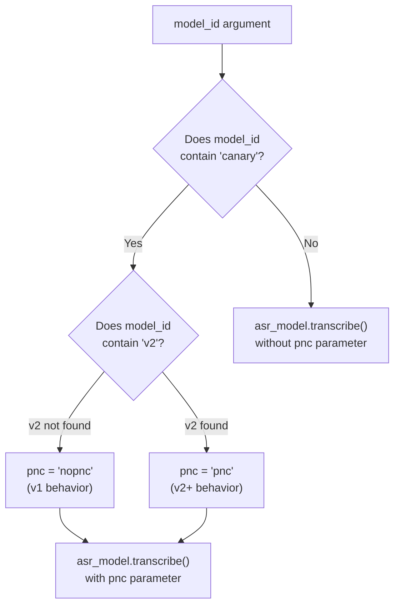

<!-- source: DeepWiki mcp.deepwiki.com · repo huggingface/open_asr_leaderboard · extra page Canary Models · fetched 2026-10-26 -->

# Canary Models

<details>
<summary>Relevant source files</summary>

The following files were used as context for generating this wiki page:

- [nemo_asr/run_canary.sh](nemo_asr/run_canary.sh)
- [nemo_asr/run_eval.py](nemo_asr/run_eval.py)

</details>


## Purpose and Scope

This document details the evaluation of NVIDIA Canary models within the Open ASR Leaderboard. Canary models are multilingual ASR models from NVIDIA that support code-switching and require special parameter handling during inference. This page covers model variants, the `pnc` parameter configuration, and the evaluation workflow specific to Canary models.

For general NeMo model evaluation, see [Standard NeMo Evaluation](#4.1.1). For multilingual evaluation across non-Canary models, see [Multilingual Evaluation](#4.1.2).

---

## Model Architecture Overview

Canary models are NVIDIA's family of multilingual speech recognition models that support multiple languages and code-switching scenarios. The evaluation system supports four model variants with different model sizes and capabilities.

### Supported Model Variants

| Model ID | Size | Version | Flash Variant | Notes |
|----------|------|---------|---------------|-------|
| `nvidia/canary-1b` | 1B params | v1 | No | Original Canary model |
| `nvidia/canary-1b-v2` | 1B params | v2 | No | Updated architecture |
| `nvidia/canary-1b-flash` | 1B params | v1 | Yes | Optimized for speed |
| `nvidia/canary-180m-flash` | 180M params | v1 | Yes | Lightweight variant |

**Sources:** [nemo_asr/run_canary.sh:5]()

---

## PNC Parameter Handling

A critical distinction in evaluating Canary models is the `pnc` (punctuation and capitalization) parameter, which controls whether the model outputs punctuated and capitalized transcriptions. The parameter value differs between model versions and must be set correctly for accurate evaluation.

### Version-Specific PNC Configuration



**Diagram: PNC Parameter Selection Logic**

The logic for determining the `pnc` parameter is implemented as follows:

- **v1 models** (canary-1b, canary-1b-flash, canary-180m-flash): Use `pnc='nopnc'` to disable automatic punctuation and capitalization
- **v2+ models** (canary-1b-v2): Use `pnc='pnc'` to enable punctuation and capitalization
- **Non-Canary models**: Do not pass the `pnc` parameter at all

This version detection occurs at inference time in [nemo_asr/run_eval.py:132-140]().

**Sources:** [nemo_asr/run_eval.py:132-140]()

---

## Evaluation Workflow

Canary models follow the standard NeMo evaluation pipeline with specialized parameter handling. The workflow orchestrates evaluation across all ESB benchmark datasets using the `run_canary.sh` script.

### Orchestration Flow

```mermaid
flowchart TB
    subgraph "run_canary.sh Orchestration"
        ModelList["MODEL_IDs array<br/>nvidia/canary-1b-v2"]
        BatchConfig["BATCH_SIZE=128<br/>DEVICE_ID=0"]
        
        subgraph "Dataset Iteration"
            AMI["run_eval.py<br/>--dataset=ami"]
            Earnings["run_eval.py<br/>--dataset=earnings22"]
            Giga["run_eval.py<br/>--dataset=gigaspeech"]
            LibriClean["run_eval.py<br/>--dataset=librispeech<br/>--split=test.clean"]
            LibriOther["run_eval.py<br/>--dataset=librispeech<br/>--split=test.other"]
            SPGi["run_eval.py<br/>--dataset=spgispeech"]
            TED["run_eval.py<br/>--dataset=tedlium"]
            Vox["run_eval.py<br/>--dataset=voxpopuli"]
        end
        
        Aggregate["eval_utils.score_results()<br/>Aggregate per-dataset manifests"]
        FinalScores["Final WER and RTFx scores"]
    end
    
    ModelList --> BatchConfig
    BatchConfig --> AMI
    AMI --> Earnings
    Earnings --> Giga
    Giga --> LibriClean
    LibriClean --> LibriOther
    LibriOther --> SPGi
    SPGi --> TED
    TED --> Vox
    Vox --> Aggregate
    Aggregate --> FinalScores
```



**Diagram: Canary Evaluation Orchestration**

The orchestration script [nemo_asr/run_canary.sh]() iterates through each model variant and evaluates it on all 8 ESB benchmark datasets. After completing all datasets for a model, it invokes `eval_utils.score_results()` to aggregate results.

**Sources:** [nemo_asr/run_canary.sh:11-92]()

---

## Inference Implementation

The actual transcription logic for Canary models is embedded within the standard NeMo evaluation script, with conditional parameter passing based on model version detection.

### Transcription Code Path

The transcription implementation distinguishes between Canary and non-Canary models:

**Canary Models:**
```python
if 'canary' in args.model_id:
    transcriptions = asr_model.transcribe(
        audio_files, 
        batch_size=args.batch_size, 
        verbose=False, 
        pnc=pnc,  # 'nopnc' for v1, 'pnc' for v2
        num_workers=1
    )
```

**Non-Canary Models:**
```python
else:
    transcriptions = asr_model.transcribe(
        audio_files, 
        batch_size=args.batch_size, 
        verbose=False, 
        num_workers=1
    )
```

This branching logic at [nemo_asr/run_eval.py:137-140]() ensures that only Canary models receive the `pnc` parameter, preventing errors when evaluating other NeMo model families.

**Sources:** [nemo_asr/run_eval.py:132-140]()

---

## Configuration Parameters

Canary model evaluation uses specific configuration values optimized for their architecture and computational requirements.

### Default Configuration

| Parameter | Value | Rationale |
|-----------|-------|-----------|
| `BATCH_SIZE` | 128 | High batch size for efficient GPU utilization with Canary's architecture |
| `DEVICE_ID` | 0 | Default to first GPU |
| `--dataset_path` | `"hf-audio/esb-datasets-test-only-sorted"` | Pre-sorted ESB datasets for optimal batching |
| `--max_eval_samples` | -1 | Evaluate entire dataset (no subsampling) |
| `num_workers` | 1 | Single worker for audio file processing |

The notably high batch size of 128 [nemo_asr/run_canary.sh:6]() is feasible because Canary models are optimized for throughput and can handle large batches efficiently on modern GPUs.

**Sources:** [nemo_asr/run_canary.sh:6-7](), [nemo_asr/run_canary.sh:15-22]()

---

## Audio Processing Pipeline

Canary models use the standard NeMo audio processing pipeline with duration-based sorting for optimal batching efficiency.

### Processing Stages

```mermaid
flowchart LR
    subgraph "Data Loading"
        LoadData["data_utils.load_data()<br/>Load ESB dataset"]
        PrepareData["data_utils.prepare_data()<br/>Normalize text"]
    end
    
    subgraph "Audio Caching"
        DownloadAudio["download_audio_files()<br/>Write to audio_cache/"]
        SortDuration["Sort by duration<br/>Descending order"]
    end
    
    subgraph "Inference"
        Warmup["4 batch warmup<br/>Stabilize timing"]
        Transcribe["asr_model.transcribe()<br/>With pnc parameter"]
        MeasureTime["Measure RTFx<br/>total_time / audio_length"]
    end
    
    subgraph "Post-Processing"
        Normalize["data_utils.normalizer()<br/>English text normalization"]
        WriteManifest["data_utils.write_manifest()<br/>Save JSONL results"]
    end
    
    LoadData --> PrepareData
    PrepareData --> DownloadAudio
    DownloadAudio --> SortDuration
    SortDuration --> Warmup
    Warmup --> Transcribe
    Transcribe --> MeasureTime
    MeasureTime --> Normalize
    Normalize --> WriteManifest
```



**Diagram: Canary Audio Processing Pipeline**

The pipeline follows the standard NeMo pattern with these key steps:
1. **Data Loading:** Streams data from HuggingFace ESB datasets [nemo_asr/run_eval.py:46]()
2. **Audio Caching:** Downloads and caches audio files to `audio_cache/{dataset}/{split}/` directory [nemo_asr/run_eval.py:22-28]()
3. **Duration Sorting:** Sorts files by duration in descending order to minimize padding waste [nemo_asr/run_eval.py:117-120]()
4. **Warmup:** Performs 4 batch warmup to stabilize GPU state [nemo_asr/run_eval.py:124-126]()
5. **Inference:** Transcribes with appropriate `pnc` parameter [nemo_asr/run_eval.py:137-140]()
6. **Normalization:** Applies English text normalizer to predictions [nemo_asr/run_eval.py:149]()

**Sources:** [nemo_asr/run_eval.py:46-149]()

---

## Model Loading

Canary models can be loaded from either HuggingFace Hub or local `.nemo` checkpoint files.

### Loading Strategy

The model loading logic at [nemo_asr/run_eval.py:38-44]() supports two paths:

**Local `.nemo` Files:**
```python
if args.model_id.endswith(".nemo"):
    asr_model = ASRModel.restore_from(args.model_id, map_location=device)
```

**HuggingFace Hub:**
```python
else:
    asr_model = ASRModel.from_pretrained(args.model_id, map_location=device)
```

For Canary models evaluated in the leaderboard, the standard approach is to use HuggingFace Hub identifiers like `nvidia/canary-1b-v2`. The model is automatically downloaded and cached on first use.

**Sources:** [nemo_asr/run_eval.py:38-44]()

---

## Decoding Strategy

Canary models use greedy batch decoding for consistent, deterministic results. The evaluation script enforces this strategy regardless of the model's default configuration.

### Decoding Configuration

At [nemo_asr/run_eval.py:96-98](), the script checks and overrides the decoding strategy:

```python
if asr_model.cfg.decoding.strategy != "beam":
    asr_model.cfg.decoding.strategy = "greedy_batch"
    asr_model.change_decoding_strategy(asr_model.cfg.decoding)
```

This ensures:
- **Deterministic outputs:** Greedy decoding produces identical results across runs
- **Batch efficiency:** `greedy_batch` mode processes multiple samples in parallel
- **Fair comparison:** All models use the same decoding strategy on the leaderboard

Beam search is disabled to maintain consistency across evaluations and enable faster batch processing.

**Sources:** [nemo_asr/run_eval.py:96-98]()

---

## Usage Example

To evaluate a Canary model variant:

### Single Model Evaluation

```bash
# Evaluate nvidia/canary-1b-v2 on LibriSpeech test.clean
python nemo_asr/run_eval.py \
    --model_id="nvidia/canary-1b-v2" \
    --dataset_path="hf-audio/esb-datasets-test-only-sorted" \
    --dataset="librispeech" \
    --split="test.clean" \
    --device=0 \
    --batch_size=128 \
    --max_eval_samples=-1
```

### Full Leaderboard Evaluation

To evaluate all datasets for multiple Canary variants:

```bash
# Edit MODEL_IDs array in run_canary.sh
# MODEL_IDs=("nvidia/canary-1b-v2" "nvidia/canary-1b" "nvidia/canary-180m-flash")

cd nemo_asr
bash run_canary.sh
```

The orchestration script will automatically:
1. Evaluate each model on all 8 ESB datasets
2. Apply correct `pnc` parameter based on model version
3. Aggregate results using `eval_utils.score_results()`
4. Generate final WER and RTFx scores for the leaderboard

**Sources:** [nemo_asr/run_canary.sh:1-94]()

---

## Output and Results

Evaluation results are stored in JSONL manifest files with per-sample metrics, then aggregated into final scores.

### Result Storage Structure

```
results/
└── nvidia_canary-1b-v2/
    ├── ami_test.json
    ├── earnings22_test.json
    ├── gigaspeech_test.json
    ├── librispeech_test.clean.json
    ├── librispeech_test.other.json
    ├── spgispeech_test.json
    ├── tedlium_test.json
    └── voxpopuli_test.json
```

Each manifest file contains per-sample predictions, references, WER, and RTFx values written by `data_utils.write_manifest()` at [nemo_asr/run_eval.py:154-163]().

The aggregation step at [nemo_asr/run_canary.sh:88-91]() computes average WER and RTFx across all datasets for final leaderboard ranking.

**Sources:** [nemo_asr/run_eval.py:154-163](), [nemo_asr/run_canary.sh:88-91]()

---

## Performance Characteristics

Canary models are designed for high-throughput multilingual ASR with efficient GPU utilization.

### Batch Size Optimization

The default batch size of 128 for Canary models is significantly higher than other NeMo models (which typically use 16-64). This is possible because:

1. **Architecture efficiency:** Canary's encoder-decoder design allows larger batches
2. **Memory optimization:** Flash variants use memory-efficient attention mechanisms
3. **GPU utilization:** High batch sizes maximize throughput for the leaderboard's RTFx metric

### Warmup Strategy

The evaluation includes a 4-batch warmup phase [nemo_asr/run_eval.py:124-126]() to:
- Initialize CUDA kernels
- Populate memory caches
- Stabilize GPU clock speeds
- Ensure accurate RTFx measurements

Only the second pass (full dataset) contributes to the final timing measurements [nemo_asr/run_eval.py:142-143]().

**Sources:** [nemo_asr/run_eval.py:124-144](), [nemo_asr/run_canary.sh:6]()

---

