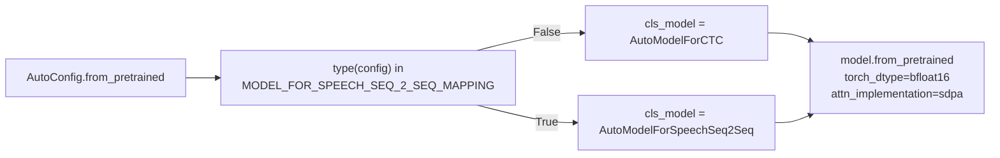
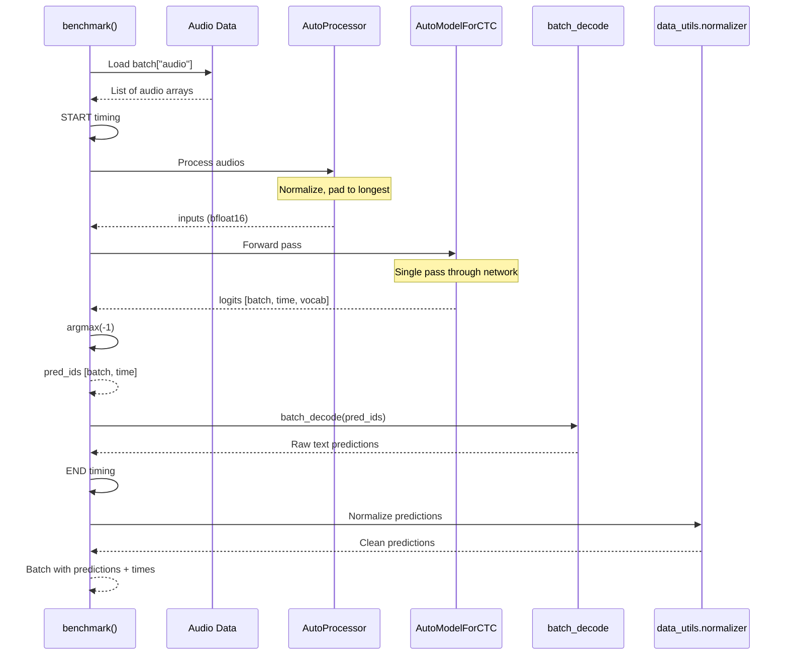
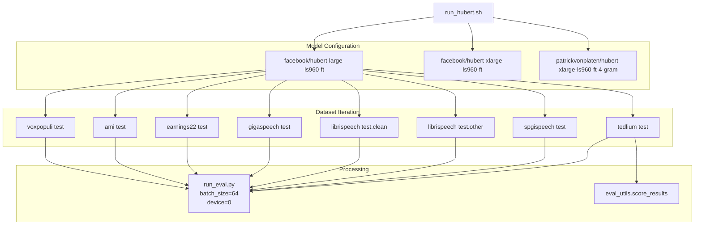
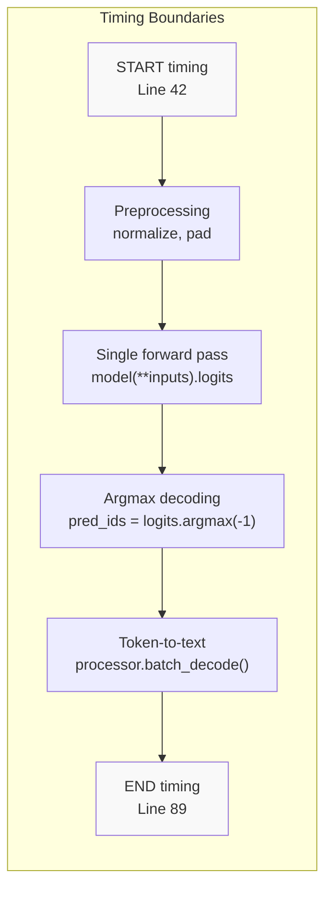

<!-- source: DeepWiki mcp.deepwiki.com · repo huggingface/open_asr_leaderboard · extra page HuBERT Models · fetched 2026-10-26 -->

# HuBERT Models

<details>
<summary>Relevant source files</summary>

The following files were used as context for generating this wiki page:

- [transformers/run_eval.py](transformers/run_eval.py)
- [transformers/run_hubert.sh](transformers/run_hubert.sh)

</details>


## Purpose and Scope

This document explains the evaluation of HuBERT (Hidden-Unit BERT) models within the Transformers framework. HuBERT models use Connectionist Temporal Classification (CTC) for speech recognition, requiring a different evaluation approach than encoder-decoder architectures like Whisper. This page covers the three supported HuBERT variants, their CTC-specific processing pipeline, and the batch evaluation configuration.

For evaluation of other Transformers-based models, see [Transformers Framework](#4.2). For Wav2Vec2 models (which also use CTC), see [Wav2Vec2 Models](#4.2.2).

## Supported Models

The repository evaluates three HuBERT model variants, all fine-tuned on the LibriSpeech 960-hour dataset:

| Model ID | Architecture | Parameters | Special Features |
|----------|--------------|------------|------------------|
| `facebook/hubert-large-ls960-ft` | HuBERT Large | ~300M | Base fine-tuned model |
| `facebook/hubert-xlarge-ls960-ft` | HuBERT XLarge | ~1B | Larger capacity variant |
| `patrickvonplaten/hubert-xlarge-ls960-ft-4-gram` | HuBERT XLarge | ~1B | With 4-gram language model |

All models are loaded via Hugging Face Hub and processed using the standard Transformers `AutoModelForCTC` class.

**Sources:** [transformers/run_hubert.sh:5]()

## Architecture Overview

HuBERT differs fundamentally from encoder-decoder ASR models in its decoding approach:

```mermaid
graph TB
    subgraph "HuBERT (CTC Architecture)"
        H_AUDIO["Audio Input<br/>16kHz waveform"]
        H_PROC["AutoProcessor<br/>Normalize mean=0, std=1"]
        H_MODEL["AutoModelForCTC<br/>Single forward pass"]
        H_LOGITS["Logits<br/>[batch, time, vocab]"]
        H_ARGMAX["argmax(-1)<br/>Greedy decoding"]
        H_TEXT["Text Output"]
    end
    
    subgraph "Whisper (Encoder-Decoder)"
        W_AUDIO["Audio Input<br/>16kHz waveform"]
        W_PROC["AutoProcessor<br/>Pad to 30s + log-mel"]
        W_MODEL["AutoModelForSpeechSeq2Seq<br/>Auto-regressive generation"]
        W_GEN["model.generate()<br/>Beam search/greedy"]
        W_TEXT["Text Output"]
    end
    
    H_AUDIO --> H_PROC
    H_PROC --> H_MODEL
    H_MODEL --> H_LOGITS
    H_LOGITS --> H_ARGMAX
    H_ARGMAX --> H_TEXT
    
    W_AUDIO --> W_PROC
    W_PROC --> W_MODEL
    W_MODEL --> W_GEN
    W_GEN --> W_TEXT
    
    style H_MODEL fill:#f9f9f9
    style W_MODEL fill:#f9f9f9
```



**Diagram: HuBERT CTC vs. Whisper Encoder-Decoder Processing**

The key architectural difference is that HuBERT uses CTC, which:
- Performs a single forward pass through the model
- Outputs frame-level token probabilities
- Uses greedy argmax decoding (no beam search in default pipeline)
- Has lower latency than auto-regressive generation

**Sources:** [transformers/run_eval.py:16](), [transformers/run_eval.py:71-78]()

## Evaluation Pipeline

### Model Detection and Loading

The evaluation script automatically detects HuBERT as a CTC model by checking if `model.can_generate()` returns `False`:



**Diagram: Model Class Selection Logic**

HuBERT models are loaded with:
- `torch_dtype=torch.bfloat16` for memory efficiency
- `attn_implementation="sdpa"` for scaled dot-product attention
- Moved to GPU device (typically `device=0`)

**Sources:** [transformers/run_eval.py:15-17]()

### CTC-Specific Preprocessing

When `model.can_generate()` returns `False`, the preprocessing differs from encoder-decoder models:

```mermaid
flowchart TD
    START["Audio batch"]
    CHECK{"model.can_generate()"}
    CTC_PREP["processor(audios)<br/>sampling_rate=16_000<br/>truncation=False<br/>padding='longest'<br/>return_attention_mask=True"]
    SEQ2SEQ_PREP["processor(audios)<br/>sampling_rate=16_000<br/>Pad to 30s<br/>Convert to log-mel"]
    NORM["Normalize to mean=0, std=1<br/>(CTC only)"]
    TO_DEVICE["inputs.to(device)<br/>Convert to bfloat16"]
    
    START --> CHECK
    CHECK -->|False (CTC)| CTC_PREP
    CHECK -->|True (Seq2Seq)| SEQ2SEQ_PREP
    CTC_PREP --> NORM
    NORM --> TO_DEVICE
    SEQ2SEQ_PREP --> TO_DEVICE
```

**Diagram: CTC vs. Encoder-Decoder Preprocessing**

CTC preprocessing features:
- No truncation - handles variable-length audio
- Padding to longest sample in batch
- Explicit attention mask computation
- Audio normalization to zero mean and unit variance

**Sources:** [transformers/run_eval.py:52-61]()

### Inference Execution

The CTC inference path is significantly simpler than encoder-decoder generation:

| Stage | CTC (HuBERT) | Encoder-Decoder (Whisper) |
|-------|--------------|---------------------------|
| **Forward Pass** | Single pass | Auto-regressive loop |
| **Code Path** | `model(**inputs).logits` | `model.generate(**inputs)` |
| **Output** | Raw logits `[batch, time, vocab]` | Token IDs `[batch, seq_len]` |
| **Decoding** | `logits.argmax(-1)` | Internal to `generate()` |
| **Context** | `torch.no_grad()` | Managed by `generate()` |

The actual inference code:

```python
# CTC path for HuBERT
with torch.no_grad():
    logits = model(**inputs).logits
    pred_ids = logits.argmax(-1)
```

versus encoder-decoder path:

```python
# Encoder-decoder path for Whisper
pred_ids = model.generate(**inputs, **gen_kwargs, min_new_tokens=min_new_tokens)
```

**Sources:** [transformers/run_eval.py:74-78](), [transformers/run_eval.py:71-73]()

### Batch Processing Flow

The complete batch processing pipeline for HuBERT:



**Diagram: HuBERT Batch Processing Sequence**

**Sources:** [transformers/run_eval.py:36-97]()

## Shell Script Configuration

The `run_hubert.sh` script orchestrates evaluation across all ESB benchmark datasets:



**Diagram: run_hubert.sh Orchestration Flow**

### Key Configuration Parameters

| Parameter | Value | Rationale |
|-----------|-------|-----------|
| `BATCH_SIZE` | 64 | High throughput for CTC's single-pass inference |
| `--device` | 0 | First GPU |
| `--dataset_path` | `hf-audio/esb-datasets-test-only-sorted` | Pre-sorted by duration for efficient batching |
| `--max_eval_samples` | -1 | Evaluate full dataset (no sampling) |

The batch size of 64 is significantly higher than typical encoder-decoder configurations (which use 8-16) because:
1. CTC requires only a single forward pass (no iterative generation)
2. HuBERT models have lower memory requirements than encoder-decoder architectures
3. Throughput is critical for leaderboard evaluation efficiency

**Sources:** [transformers/run_hubert.sh:6](), [transformers/run_hubert.sh:14-21]()

### Dataset Evaluation Loop

For each model, the script evaluates all 8 datasets sequentially:

```bash
for (( i=0; i<${num_models}; i++ )); do
    MODEL_ID=${MODEL_IDs[$i]}
    
    # Evaluate all 8 datasets
    python run_eval.py --model_id=${MODEL_ID} --dataset="voxpopuli" ...
    python run_eval.py --model_id=${MODEL_ID} --dataset="ami" ...
    # ... (6 more datasets)
    
    # Aggregate results
    cd ../normalizer && \
    python -c "import eval_utils; eval_utils.score_results('${RUNDIR}/results', '${MODEL_ID}')" && \
    cd $RUNDIR
done
```

**Sources:** [transformers/run_hubert.sh:10-92]()

## Performance Characteristics

### Timing Considerations

HuBERT's CTC architecture affects RTFx (Real-Time Factor) measurement:



**Diagram: Timing Measurement Boundaries**

All processing from audio input to text output is included in the timing measurement, ensuring fair comparison across architectures.

**Sources:** [transformers/run_eval.py:42](), [transformers/run_eval.py:89]()

### Normalization

HuBERT predictions are normalized using the English text normalizer:

```python
batch["predictions"] = [data_utils.normalizer(pred) for pred in pred_text]
batch["references"] = batch["norm_text"]
```

This applies:
- Lowercasing
- Punctuation removal
- Number normalization (e.g., "twenty-one" → "21")
- British-to-American spelling conversion (799 mappings)

**Sources:** [transformers/run_eval.py:95-96]()

## Model-Specific Features

### Language Model Integration

The `patrickvonplaten/hubert-xlarge-ls960-ft-4-gram` model includes a 4-gram language model for improved accuracy. This is handled transparently by the `AutoProcessor`, which automatically applies the language model during decoding.

### Memory Footprint

| Model | Parameters | bfloat16 Memory | Typical Batch=64 GPU Memory |
|-------|------------|-----------------|----------------------------|
| hubert-large | ~300M | ~600 MB | ~8-10 GB |
| hubert-xlarge | ~1B | ~2 GB | ~16-20 GB |

Both variants fit comfortably on a single 24GB GPU with batch_size=64.

### Torch Compile Support

While not enabled by default in `run_hubert.sh`, HuBERT models support `torch.compile` for additional speedup:

```bash
python run_eval.py \
    --model_id=facebook/hubert-large-ls960-ft \
    --torch_compile \
    --compile_mode=max-autotune \
    ...
```

When `torch_compile=True`, the forward pass is JIT-compiled, providing 1.5-2x inference speedup after warmup.

**Sources:** [transformers/run_eval.py:30-31]()

## Results Aggregation

After evaluating all datasets for a model, the script aggregates results:

```bash
RUNDIR=`pwd` && \
cd ../normalizer && \
python -c "import eval_utils; eval_utils.score_results('${RUNDIR}/results', '${MODEL_ID}')" && \
cd $RUNDIR
```

This calls `eval_utils.score_results()` which:
1. Reads all JSONL manifest files for the model
2. Computes aggregate WER across datasets
3. Computes aggregate RTFx
4. Generates leaderboard-ready metrics

**Sources:** [transformers/run_hubert.sh:87-90]()

## Usage Example

To evaluate a HuBERT model manually:

```bash
export PYTHONPATH="..":$PYTHONPATH

python run_eval.py \
    --model_id=facebook/hubert-large-ls960-ft \
    --dataset_path="hf-audio/esb-datasets-test-only-sorted" \
    --dataset="librispeech" \
    --split="test.clean" \
    --device=0 \
    --batch_size=64 \
    --max_eval_samples=-1
```

Or run the full benchmark suite:

```bash
cd transformers
bash run_hubert.sh
```

Results are written to `transformers/results/{model_id}/{dataset}/{split}.jsonl` with per-sample predictions, WER, and RTFx timing.

**Sources:** [transformers/run_hubert.sh:14-21](), [transformers/run_eval.py:138-148]()

---

