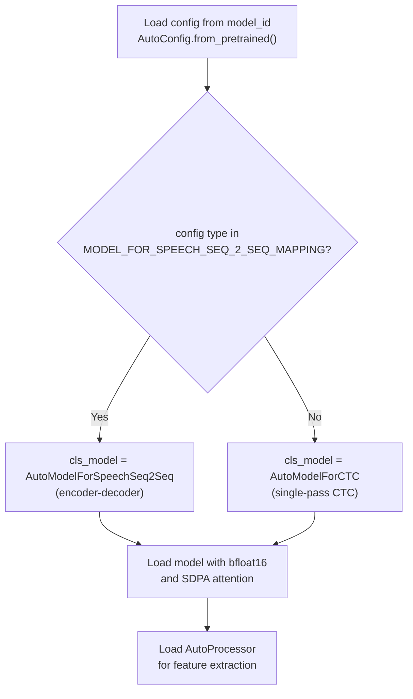
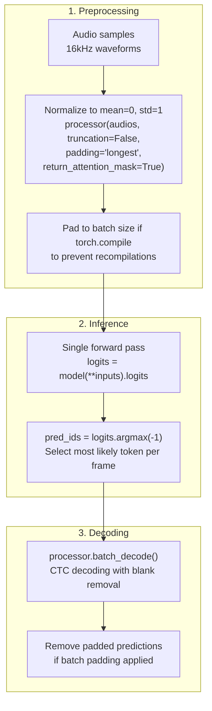
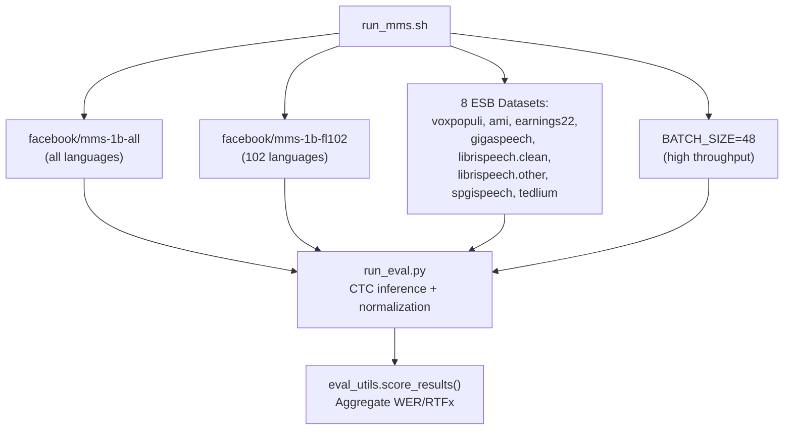
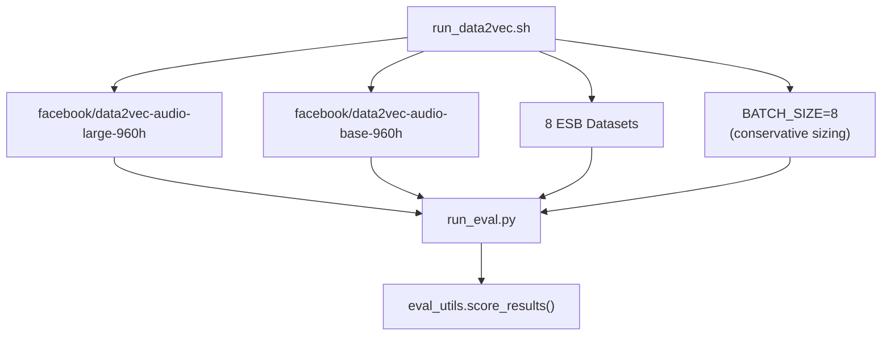
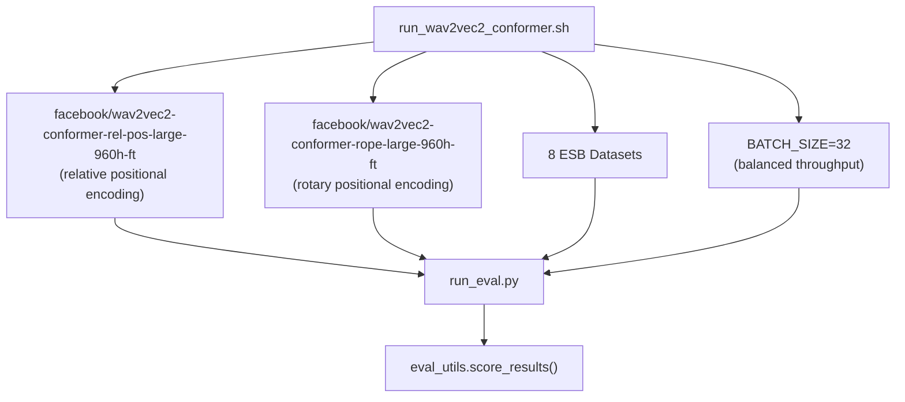
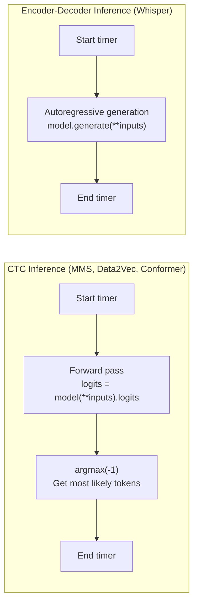
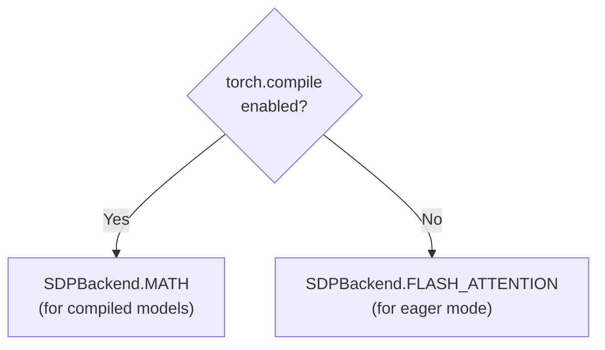
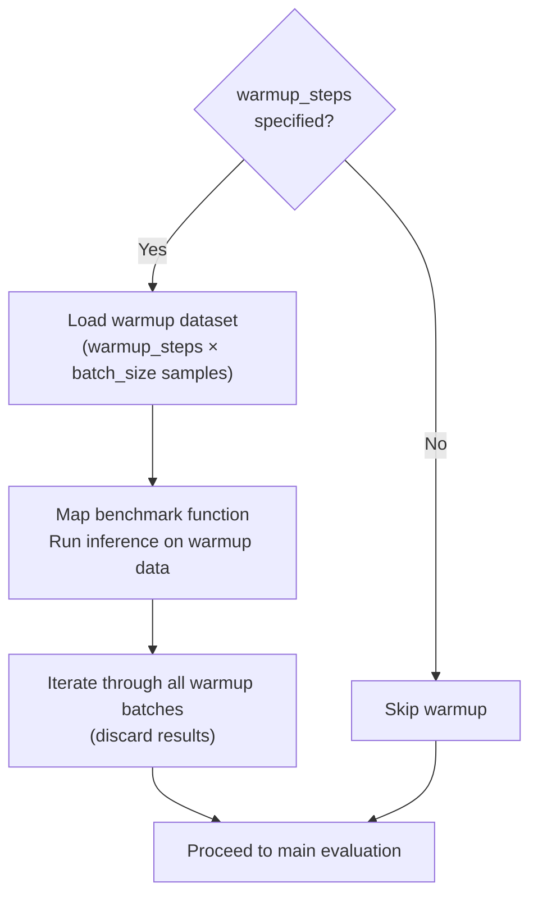
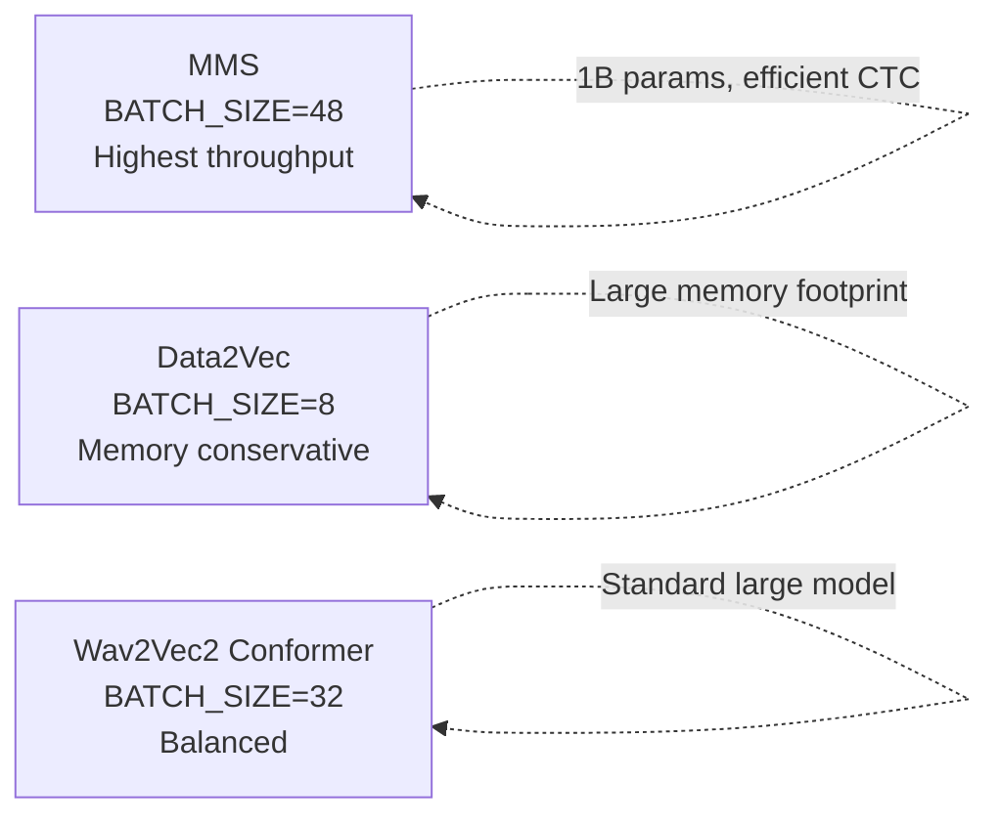

<!-- source: DeepWiki mcp.deepwiki.com · repo huggingface/open_asr_leaderboard · extra page MMS and Other Models · fetched 2026-10-26 -->

# MMS and Other Models

<details>
<summary>Relevant source files</summary>

The following files were used as context for generating this wiki page:

- [transformers/run_data2vec.sh](transformers/run_data2vec.sh)
- [transformers/run_eval.py](transformers/run_eval.py)
- [transformers/run_mms.sh](transformers/run_mms.sh)
- [transformers/run_wav2vec2_conformer.sh](transformers/run_wav2vec2_conformer.sh)

</details>


This document covers evaluation of MMS (Massively Multilingual Speech), Data2Vec, and Wav2Vec2 Conformer models within the Transformers framework. These models share a common evaluation pattern using CTC (Connectionist Temporal Classification) rather than encoder-decoder architectures.

For Whisper model evaluation, see [Whisper Models](#4.2.1). For standard Wav2Vec2 models, see [Wav2Vec2 Models](#4.2.2). For HuBERT models, see [HuBERT Models](#4.2.4).

## Overview

This section covers three distinct model families that use the shared Transformers evaluation script but differ in architecture and use cases:

| Model Family | Models | Batch Size | Architecture | Primary Use Case |
|--------------|--------|------------|--------------|------------------|
| **MMS** | `facebook/mms-1b-all`<br>`facebook/mms-1b-fl102` | 48 | CTC | Multilingual ASR across 1000+ languages |
| **Data2Vec** | `facebook/data2vec-audio-large-960h`<br>`facebook/data2vec-audio-base-960h` | 8 | CTC | Self-supervised learning research |
| **Wav2Vec2 Conformer** | `facebook/wav2vec2-conformer-rel-pos-large-960h-ft`<br>`facebook/wav2vec2-conformer-rope-large-960h-ft` | 32 | CTC | Enhanced positional encoding variants |

All three families are evaluated using [transformers/run_eval.py]() with family-specific shell scripts for orchestration.

Sources: [transformers/run_mms.sh](), [transformers/run_data2vec.sh](), [transformers/run_wav2vec2_conformer.sh]()

## Architecture Detection and Model Loading

The evaluation script automatically detects whether a model is CTC-based or encoder-decoder based and selects the appropriate model class:



**MMS, Data2Vec, and Wav2Vec2 Conformer Classification**: All three model families use `AutoModelForCTC` since they are not in the `MODEL_FOR_SPEECH_SEQ_2_SEQ_MAPPING`. This determines their preprocessing and inference pipelines.

Sources: [transformers/run_eval.py:14-19]()

## CTC Model Processing Pipeline

CTC models follow a distinct processing pipeline compared to encoder-decoder models:



**Key Difference from Encoder-Decoder**: CTC models use a single forward pass with argmax decoding [transformers/run_eval.py:76-78](), while encoder-decoder models use autoregressive generation with beam search. This makes CTC models significantly faster but potentially less accurate.

Sources: [transformers/run_eval.py:52-78]()

## Evaluation Scripts and Configuration

### MMS Models

MMS (Massively Multilingual Speech) models are designed for cross-lingual ASR with support for over 1000 languages:



**Batch Size Justification**: MMS uses `BATCH_SIZE=48` [transformers/run_mms.sh:6](), the highest among these model families, because the 1B parameter count and CTC architecture allows for efficient batch processing without memory overflow.

Sources: [transformers/run_mms.sh:1-92]()

### Data2Vec Models

Data2Vec models are self-supervised learning architectures that can be fine-tuned for ASR:



**Batch Size Rationale**: Data2Vec uses `BATCH_SIZE=8` [transformers/run_data2vec.sh:6](), the smallest among these families, likely due to higher memory consumption from the large model architecture or specific attention patterns.

Sources: [transformers/run_data2vec.sh:1-92]()

### Wav2Vec2 Conformer Models

Wav2Vec2 Conformer variants enhance standard Wav2Vec2 with advanced positional encodings:



**Positional Encoding Variants**: The two models differ in positional encoding strategies - relative positional encoding vs rotary positional encoding (RoPE). The evaluation framework treats them identically.

Sources: [transformers/run_wav2vec2_conformer.sh:1-92]()

## Preprocessing Differences

CTC models require different preprocessing compared to encoder-decoder models:

| Aspect | CTC Models (MMS, Data2Vec, Conformer) | Encoder-Decoder Models (Whisper) |
|--------|----------------------------------------|-----------------------------------|
| **Normalization** | Mean=0, std=1 normalization | Log-mel spectrogram conversion |
| **Truncation** | `truncation=False` | Implicit 30-second chunks |
| **Padding** | Dynamic "longest" padding | Fixed 30-second padding |
| **Attention Mask** | Explicit `return_attention_mask=True` | Handled by processor |
| **Sampling Rate** | Must be 16kHz | Must be 16kHz |

**Implementation**: The preprocessing logic branches based on `model.can_generate()` [transformers/run_eval.py:52-64](). CTC models return `False` and follow the normalization path.

Sources: [transformers/run_eval.py:52-64]()

## Inference and Timing

The inference phase differs significantly between CTC and encoder-decoder models:



**Timing Methodology**: Both approaches measure wall-clock time from preprocessing start to decoding end [transformers/run_eval.py:42-89](). This includes:
- Audio preprocessing
- Model forward pass(es)
- Token decoding

For RTFx calculation: `RTFx = sum(audio_length_s) / sum(transcription_time_s)` [transformers/run_eval.py:154]()

Sources: [transformers/run_eval.py:36-97]()

## SDPA Backend Selection

All models use Scaled Dot-Product Attention (SDPA) with backend selection based on compilation state:



**Rationale**: `SDPBackend.MATH` [transformers/run_eval.py:70]() is used with `torch.compile` because FLASH_ATTENTION is not compatible with compilation. In eager mode, FLASH_ATTENTION provides better performance.

Sources: [transformers/run_eval.py:4](), [transformers/run_eval.py:70]()

## Torch Compile Optimization

While optional, `torch.compile` can significantly improve inference speed for these CTC models:

**Configuration**:
- Mode: `max-autotune` (default) [transformers/run_eval.py:224]()
- Target: `model.forward` [transformers/run_eval.py:31]()
- Requirement: `fullgraph=True` [transformers/run_eval.py:31]()

**Static Batch Size Padding**: When using `torch.compile`, the batch size must remain constant to avoid recompilation. The script pads incomplete batches [transformers/run_eval.py:46-50]():

```python
if minibatch_size != args.batch_size and args.torch_compile:
    padding_size = args.batch_size - minibatch_size
    padding_audios = [audios[-1] for _ in range(padding_size)]
    audios.extend(padding_audios)
```

After inference, padded predictions are stripped [transformers/run_eval.py:82-83]().

Sources: [transformers/run_eval.py:30-34](), [transformers/run_eval.py:46-50](), [transformers/run_eval.py:82-83]()

## Warmup Procedure

All evaluation runs include optional warmup steps to ensure stable timing:



**Default Configuration**: `warmup_steps=10` [transformers/run_eval.py:230]() provides stable timing by allowing:
- JIT compilation to complete (if using `torch.compile`)
- CUDA kernels to initialize
- Caches to warm up

Sources: [transformers/run_eval.py:99-111](), [transformers/run_eval.py:228-232]()

## Text Normalization

All predictions are normalized using the English normalizer before WER calculation:

```python
batch["predictions"] = [data_utils.normalizer(pred) for pred in pred_text]
batch["references"] = batch["norm_text"]
```

**Normalization Applied**: The `data_utils.normalizer` function [transformers/run_eval.py:95]() applies:
- British to American spelling conversion (799 mappings)
- Contraction expansion ("don't" → "do not")
- Number normalization
- Punctuation removal

For multilingual models, see [Multilingual Evaluation](#4.1.2).

Sources: [transformers/run_eval.py:94-97]()

## Result Aggregation

After evaluating all datasets, results are aggregated using the shared scoring utility:

```bash
RUNDIR=`pwd` && \
cd ../normalizer && \
python -c "import eval_utils; eval_utils.score_results('${RUNDIR}/results', '${MODEL_ID}')" && \
cd $RUNDIR
```

**Process**:
1. Collect JSONL manifests from `results/` directory
2. Compute mean WER across all datasets
3. Compute mean RTFx across all datasets
4. Generate final leaderboard scores

This pattern is identical across all three shell scripts [transformers/run_mms.sh:87-90](), [transformers/run_data2vec.sh:87-90](), [transformers/run_wav2vec2_conformer.sh:87-90]().

Sources: [transformers/run_mms.sh:86-91](), [transformers/run_data2vec.sh:86-91](), [transformers/run_wav2vec2_conformer.sh:86-91]()

## Command-Line Interface

The evaluation script accepts comprehensive configuration via command-line arguments:

| Argument | Default | Purpose |
|----------|---------|---------|
| `--model_id` | Required | Model identifier from HuggingFace Hub |
| `--dataset_path` | `esb/datasets` | Dataset organization on Hub |
| `--dataset` | Required | Specific dataset name (e.g., `librispeech`) |
| `--split` | `test` | Dataset split to evaluate |
| `--device` | `-1` (CPU) | GPU device index (0 for first GPU) |
| `--batch_size` | `16` | Samples per batch |
| `--max_eval_samples` | `None` | Limit evaluation size (for testing) |
| `--streaming` | `False` | Stream dataset vs full download |
| `--torch_compile` | `False` | Enable JIT compilation |
| `--compile_mode` | `max-autotune` | Compilation optimization strategy |
| `--warmup_steps` | `10` | Number of warmup batches |
| `--max_new_tokens` | `None` | Only for encoder-decoder models |

**CTC-Specific Note**: The `--max_new_tokens` argument [transformers/run_eval.py:211-215]() raises an error if specified for CTC models since they don't use generation [transformers/run_eval.py:27-28]().

Sources: [transformers/run_eval.py:158-236]()

## Model-Specific Configurations

Each model family uses an optimized batch size based on empirical testing:



**Selection Guidelines**:
- **MMS (48)**: Optimized for throughput with 1B parameters but efficient CTC
- **Data2Vec (8)**: Conservative due to self-supervised architecture overhead
- **Conformer (32)**: Balanced for production-scale models

These values prevent OOM errors while maximizing GPU utilization.

Sources: [transformers/run_mms.sh:6](), [transformers/run_data2vec.sh:6](), [transformers/run_wav2vec2_conformer.sh:6]()

---

