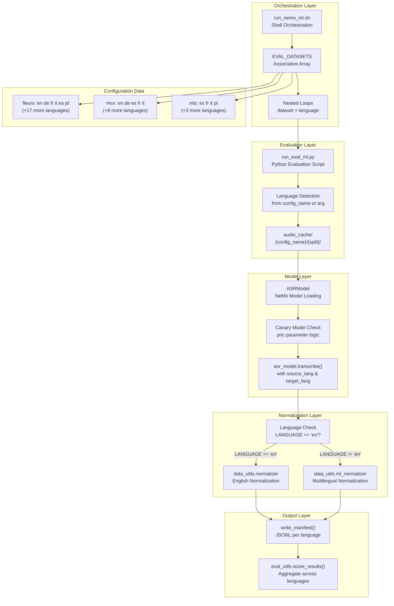
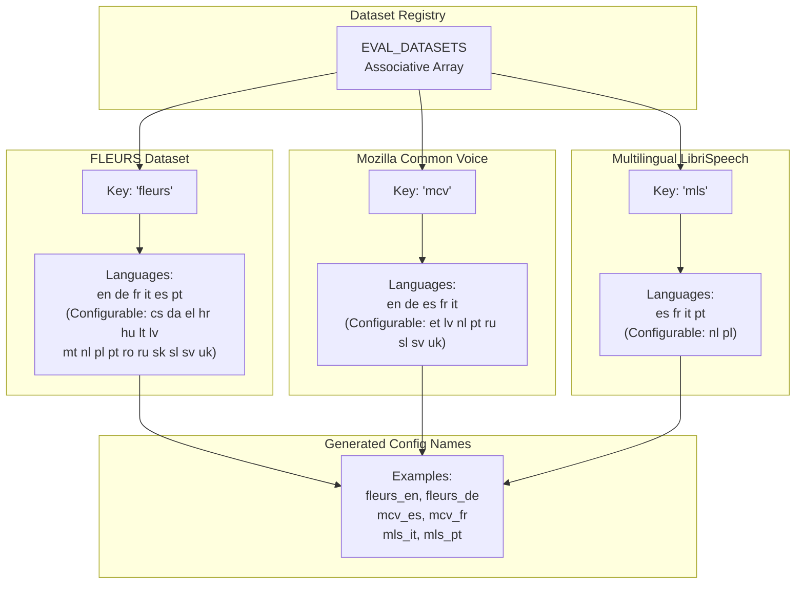
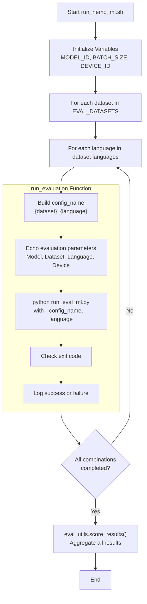
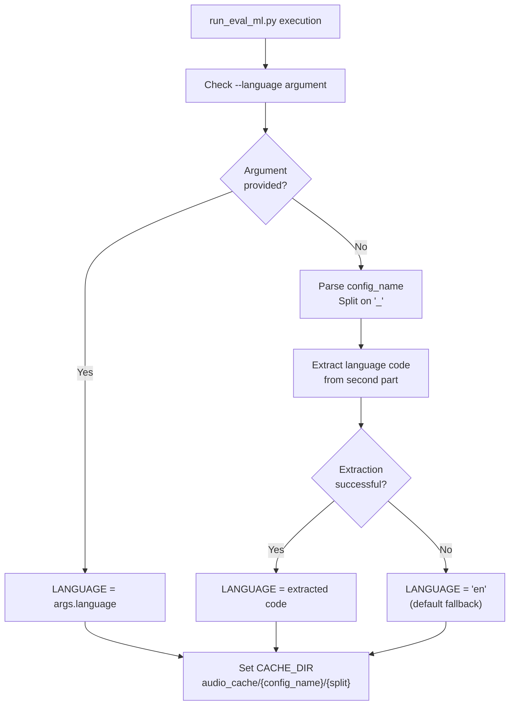
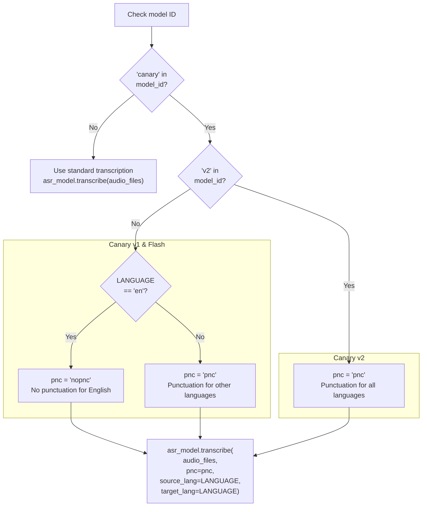
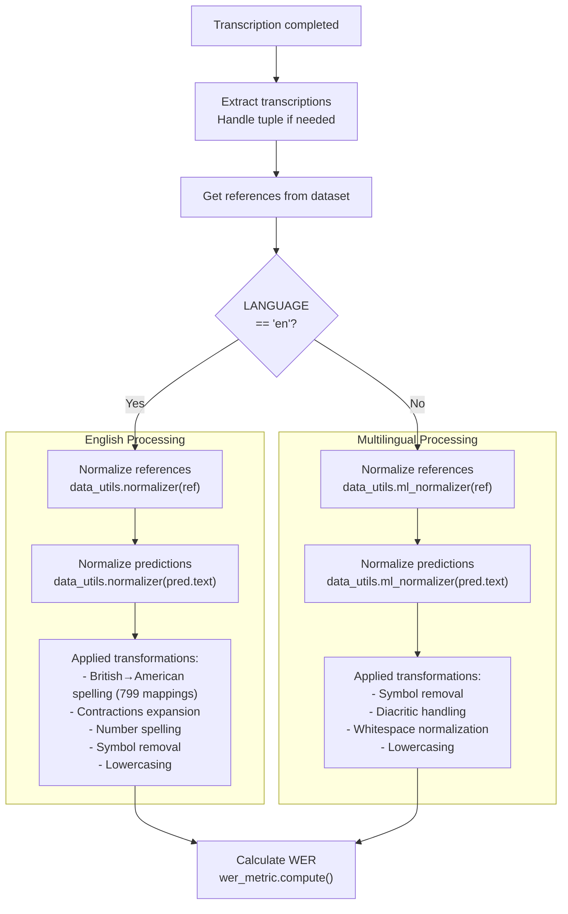
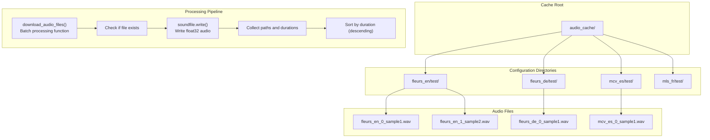
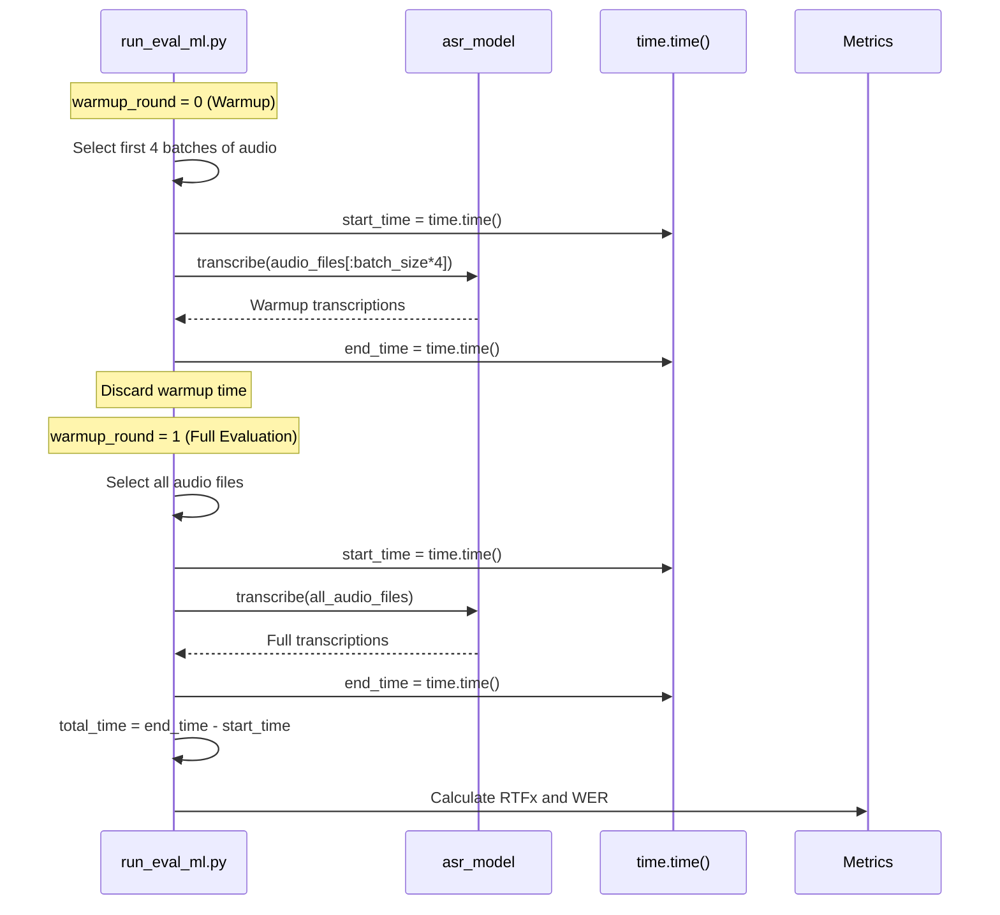
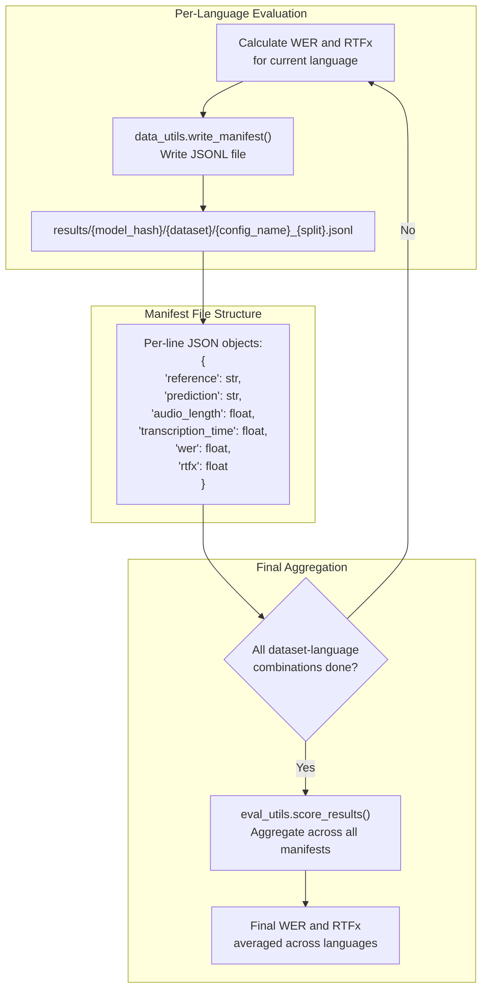

<!-- source: DeepWiki mcp.deepwiki.com · repo huggingface/open_asr_leaderboard · extra page Multilingual Evaluation · fetched 2026-10-26 -->

# Multilingual Evaluation

<details>
<summary>Relevant source files</summary>

The following files were used as context for generating this wiki page:

- [nemo_asr/run_eval_ml.py](nemo_asr/run_eval_ml.py)
- [nemo_asr/run_nemo_ml.sh](nemo_asr/run_nemo_ml.sh)
- [nemo_asr/run_parakeet.sh](nemo_asr/run_parakeet.sh)

</details>


## Purpose and Scope

This document describes the multilingual evaluation system for NeMo ASR models, which evaluates models across multiple languages using language-specific datasets and normalization rules. This system is specifically designed for multilingual ASR models that support transcription in languages beyond English.

For standard English-only evaluation of NeMo models, see [Standard NeMo Evaluation](#4.1.1). For other multilingual-capable frameworks like Whisper, see [Whisper Models](#4.2.1).

**Key Characteristics:**
- Evaluates models on `fleurs`, `mcv` (Mozilla Common Voice), and `mls` (Multilingual LibriSpeech) datasets
- Applies language-specific text normalization (English vs. multilingual)
- Handles model-specific parameters (e.g., Canary's `pnc` settings)
- Supports 20+ languages including German, French, Italian, Spanish, Portuguese, and others

---

## System Architecture

The multilingual evaluation system consists of two main components: an orchestration script that iterates through dataset-language combinations, and an evaluation script that performs language-aware transcription and normalization.

**Multilingual Evaluation Pipeline**



**Sources:** [nemo_asr/run_nemo_ml.sh:1-96](), [nemo_asr/run_eval_ml.py:1-264]()

---

## Dataset Configuration

The multilingual evaluation system uses an associative array to define which languages are evaluated for each dataset. This configuration allows flexible specification of dataset-language combinations.

**Dataset-Language Mapping**



| Dataset | Active Languages | Additional Supported Languages |
|---------|------------------|-------------------------------|
| **fleurs** | en, de, fr, it, es, pt | cs, da, el, hr, hu, lt, lv, mt, nl, pl, ro, ru, sk, sl, sv, uk |
| **mcv** | en, de, es, fr, it | et, lv, nl, pt, ru, sl, sv, uk |
| **mls** | es, fr, it, pt | nl, pl |

**Configuration Format:**
- Config names follow the pattern: `{dataset}_{language_code}`
- Example: `fleurs_de` for German FLEURS, `mcv_es` for Spanish Common Voice
- Languages use ISO 639-1 two-letter codes

**Sources:** [nemo_asr/run_nemo_ml.sh:19-26]()

---

## Orchestration Pattern

The shell script orchestrates evaluations by iterating through all configured dataset-language combinations and invoking the Python evaluation script for each.

**Orchestration Flow**



**Function: `run_evaluation()`**

The `run_evaluation` function encapsulates the invocation of a single evaluation run:

```
Parameters:
  - dataset: Dataset name (e.g., "fleurs", "mcv", "mls")
  - language: Two-letter language code (e.g., "de", "fr", "es")

Execution:
  1. Construct config_name = "{dataset}_{language}"
  2. Log evaluation parameters
  3. Invoke: python run_eval_ml.py \
       --model_id="$MODEL_ID" \
       --dataset="$DATASETS" \
       --config_name="$config_name" \
       --language="$language" \
       --split="test" \
       --device="$DEVICE_ID" \
       --batch_size="$BATCH_SIZE"
  4. Check exit code and log result
```

**Sources:** [nemo_asr/run_nemo_ml.sh:29-64](), [nemo_asr/run_nemo_ml.sh:74-86]()

---

## Language Detection and Processing

The evaluation script automatically detects the target language from the configuration name and applies language-specific processing throughout the pipeline.

**Language Detection Logic**



**Example Language Detection:**

| config_name | Explicit --language | Detected LANGUAGE |
|-------------|--------------------|--------------------|
| `fleurs_de` | None | `de` (extracted) |
| `mcv_es` | None | `es` (extracted) |
| `fleurs_fr` | `fr` | `fr` (from argument) |
| `invalid` | None | `en` (default fallback) |

**Sources:** [nemo_asr/run_eval_ml.py:26-35]()

---

## Model-Specific Transcription

Different multilingual models require different transcription parameters. The evaluation script handles model-specific logic, particularly for Canary models.

**Canary Model PNC Parameter Logic**



**Model Version Differences:**

| Model Version | Language | `pnc` Parameter | Rationale |
|--------------|----------|-----------------|-----------|
| Canary-1b (v1) | English | `'nopnc'` | English evaluation without punctuation |
| Canary-1b (v1) | Other languages | `'pnc'` | Non-English with punctuation |
| Canary-1b-v2 | All languages | `'pnc'` | Unified punctuation handling |
| Canary-1b-flash | English | `'nopnc'` | Same as v1 |
| Canary-1b-flash | Other languages | `'pnc'` | Same as v1 |
| Other NeMo models | All languages | N/A | Parameter not applicable |

**Sources:** [nemo_asr/run_eval_ml.py:150-159]()

---

## Language-Specific Normalization

The critical difference in multilingual evaluation is the use of language-aware text normalization. English text uses a comprehensive normalizer with abbreviation expansion, while other languages use a basic multilingual normalizer.

**Normalization Decision Tree**



**Normalization Comparison:**

| Feature | English Normalizer | Multilingual Normalizer |
|---------|-------------------|------------------------|
| **Function** | `data_utils.normalizer()` | `data_utils.ml_normalizer()` |
| **Underlying Class** | `EnglishTextNormalizer` | `BasicMultilingualTextNormalizer` |
| **Abbreviations** | ✓ 799 British→American mappings | ✗ Not applicable |
| **Contractions** | ✓ "don't" → "do not" | ✗ Language-dependent |
| **Number Spelling** | ✓ "2" → "two" | ✗ Language-dependent |
| **Symbol Removal** | ✓ Comprehensive | ✓ Basic |
| **Diacritics** | ✓ Remove (English) | ✓ Preserve or normalize |
| **Whitespace** | ✓ Normalize | ✓ Normalize |

**Sources:** [nemo_asr/run_eval_ml.py:170-175]()

---

## Audio Processing and Caching

The multilingual evaluation system uses the same audio caching strategy as standard evaluation but organizes files by language-specific configuration names.

**Audio Cache Structure**



**Cache Directory Pattern:**
- Path format: `audio_cache/{config_name}/{split}/`
- Example: `audio_cache/fleurs_de/test/`
- Filename format: `{config_name}_{index}_{original_basename}.wav`
- Example: `fleurs_de_0_sample1.wav`

**Audio Processing Steps:**

1. **Dataset Mapping** [nemo_asr/run_eval_ml.py:71-107]()
   - Map over dataset in batches
   - Process audio from `array` or `bytes` format
   - Generate unique filenames with config_name prefix

2. **File Writing** [nemo_asr/run_eval_ml.py:92-94]()
   - Check if file already exists (cache hit)
   - Write as float32 at native sample rate
   - Create directory structure if needed

3. **Duration Collection** [nemo_asr/run_eval_ml.py:98-101]()
   - Use dataset-provided duration if available
   - Otherwise calculate: `len(audio_array) / sample_rate`
   - Store for RTFx calculation

4. **Sorting** [nemo_asr/run_eval_ml.py:131-136]()
   - Sort samples by duration in descending order
   - Minimizes padding waste in batched inference
   - Improves GPU utilization

**Sources:** [nemo_asr/run_eval_ml.py:21-24](), [nemo_asr/run_eval_ml.py:71-107](), [nemo_asr/run_eval_ml.py:131-136]()

---

## Warmup and Timing

The evaluation script performs a warmup phase before measuring inference time, ensuring stable RTFx (Real-Time Factor) metrics.

**Warmup and Evaluation Sequence**



**Warmup Configuration:**

| Phase | Warmup Round | Audio Files | Time Recorded |
|-------|-------------|-------------|---------------|
| **Warmup** | 0 | First `batch_size * 4` samples | ✗ Discarded |
| **Full Evaluation** | 1 | All samples | ✓ Used for RTFx |

**RTFx Calculation:**
```
total_audio_length = sum(all_data["durations"])  # in seconds
rtfx = total_audio_length / total_time
avg_time_per_sample = total_time / len(audio_files)
```

The RTFx metric indicates how many times faster than real-time the model processes audio:
- RTFx = 10.0 means the model processes 10 seconds of audio in 1 second
- RTFx = 0.5 means the model processes 1 second of audio in 2 seconds

**Sources:** [nemo_asr/run_eval_ml.py:138-164](), [nemo_asr/run_eval_ml.py:177-199]()

---

## Command-Line Interface

The `run_eval_ml.py` script accepts several arguments to configure the evaluation process.

**Command-Line Arguments**

| Argument | Type | Required | Default | Description |
|----------|------|----------|---------|-------------|
| `--model_id` | str | ✓ | - | Model identifier (HuggingFace ID or .nemo path) |
| `--dataset` | str | ✗ | `"nithinraok/asr-leaderboard-datasets"` | HuggingFace dataset repository |
| `--config_name` | str | ✓ | - | Config in format `<dataset>_<lang>` (e.g., `fleurs_en`) |
| `--language` | str | ✗ | `None` | Explicit language code (extracted from config_name if not provided) |
| `--split` | str | ✗ | `"test"` | Dataset split to evaluate |
| `--device` | int | ✗ | `-1` | GPU device ID (-1 for CPU, 0+ for GPU) |
| `--batch_size` | int | ✗ | `32` | Number of samples per batch |
| `--max_eval_samples` | int | ✗ | `None` | Limit evaluation to N samples (for testing) |
| `--no-streaming` | flag | ✗ | `False` | Download full dataset instead of streaming |

**Usage Examples:**

```bash
# Evaluate Parakeet on German FLEURS
python run_eval_ml.py \
  --model_id="nvidia/parakeet-tdt-0.6b-v3" \
  --dataset="nithinraok/asr-leaderboard-datasets" \
  --config_name="fleurs_de" \
  --language="de" \
  --split="test" \
  --device=0 \
  --batch_size=64

# Evaluate Canary v2 on Spanish MLS
python run_eval_ml.py \
  --model_id="nvidia/canary-1b-v2" \
  --config_name="mls_es" \
  --device=0 \
  --batch_size=32

# Test run with limited samples
python run_eval_ml.py \
  --model_id="nvidia/parakeet-tdt-0.6b-v3" \
  --config_name="mcv_fr" \
  --device=0 \
  --batch_size=16 \
  --max_eval_samples=100
```

**Sources:** [nemo_asr/run_eval_ml.py:209-264]()

---

## Results Storage and Aggregation

The evaluation script writes per-language results to JSONL manifest files and then aggregates them across all languages for a final score.

**Result Storage Flow**



**Example Directory Structure:**

```
results/
└── nvidia_parakeet-tdt-0.6b-v3_abc123/
    ├── nithinraok_asr-leaderboard-datasets/
    │   ├── fleurs_en_test.jsonl
    │   ├── fleurs_de_test.jsonl
    │   ├── fleurs_fr_test.jsonl
    │   ├── mcv_en_test.jsonl
    │   ├── mcv_de_test.jsonl
    │   ├── mcv_es_test.jsonl
    │   ├── mls_es_test.jsonl
    │   ├── mls_fr_test.jsonl
    │   └── mls_it_test.jsonl
    └── aggregated_scores.json
```

**Aggregation Process:**

The `eval_utils.score_results()` function is called after all language evaluations complete:

```bash
cd ../normalizer
python -c "import eval_utils; eval_utils.score_results('${RUNDIR}/results', '${MODEL_ID}')"
```

This function:
1. Scans all JSONL manifest files for the given model
2. Computes average WER across all language-dataset combinations
3. Computes average RTFx across all language-dataset combinations
4. Writes aggregated scores to a summary file
5. Enables leaderboard comparison across models

**Sources:** [nemo_asr/run_eval_ml.py:180-206](), [nemo_asr/run_nemo_ml.sh:91-95]()

---

## Differences from Standard Evaluation

While multilingual evaluation follows the same core pipeline as standard English evaluation, several key differences exist:

| Aspect | Standard Evaluation ([4.1.1](#4.1.1)) | Multilingual Evaluation |
|--------|---------------------------------------|------------------------|
| **Script** | `run_eval.py` | `run_eval_ml.py` |
| **Datasets** | ESB benchmark (English only) | FLEURS, MCV, MLS (20+ languages) |
| **Config Names** | Simple dataset names | `{dataset}_{language}` format |
| **Language Detection** | Implicit (always English) | Explicit detection and tracking |
| **Normalization** | Always `data_utils.normalizer()` | Conditional: English vs. multilingual |
| **Model Parameters** | Standard transcription | Language-aware (e.g., Canary `pnc`, `source_lang`, `target_lang`) |
| **Cache Structure** | `audio_cache/{dataset}/{split}/` | `audio_cache/{config_name}/{split}/` |
| **Orchestration** | Iterate over datasets | Nested iteration: datasets × languages |
| **Results Aggregation** | Across English datasets | Across languages and datasets |

**When to Use Each:**

- **Standard Evaluation**: English-only models, ESB benchmark comparison, standard ASR models
- **Multilingual Evaluation**: Multilingual models (Canary, Parakeet multilingual variants), non-English languages, cross-lingual comparison

**Sources:** [nemo_asr/run_eval_ml.py:1-264](), [nemo_asr/run_nemo_ml.sh:1-96]()

---

## Summary

The multilingual evaluation system extends NeMo's ASR evaluation capabilities to support 20+ languages through:

1. **Flexible Configuration**: Associative array mapping datasets to language sets
2. **Automated Orchestration**: Shell script iterating through all dataset-language combinations
3. **Language-Aware Processing**: Conditional normalization based on language code
4. **Model-Specific Handling**: Special parameters for models like Canary
5. **Structured Caching**: Language-specific audio cache organization
6. **Cross-Lingual Aggregation**: Final scores averaged across all evaluated languages

This architecture enables fair comparison of multilingual ASR models by applying consistent evaluation protocols while respecting language-specific differences in text normalization and model configuration.

**Sources:** [nemo_asr/run_eval_ml.py:1-264](), [nemo_asr/run_nemo_ml.sh:1-96]()

---

