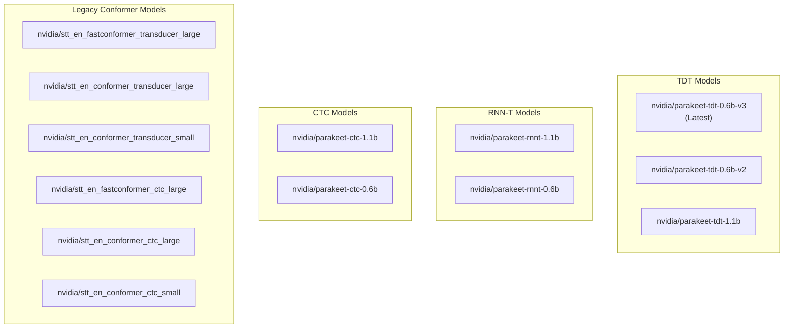
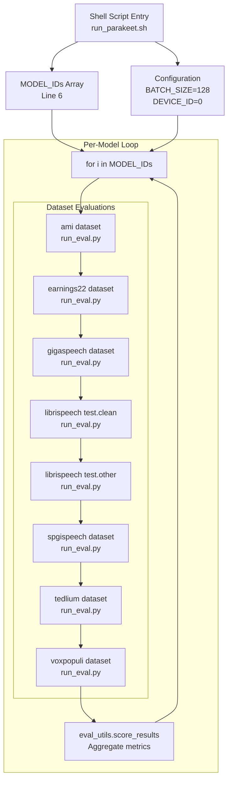
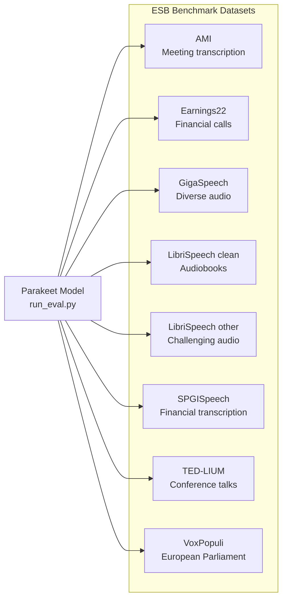
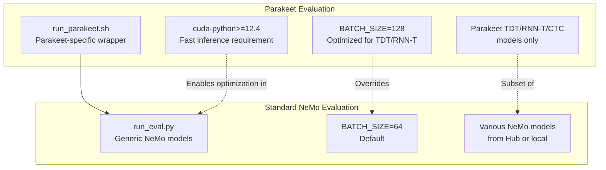

<!-- source: DeepWiki mcp.deepwiki.com · repo huggingface/open_asr_leaderboard · extra page Parakeet Models · fetched 2026-10-26 -->

# Parakeet Models

<details>
<summary>Relevant source files</summary>

The following files were used as context for generating this wiki page:

- [nemo_asr/run_nemo_ml.sh](nemo_asr/run_nemo_ml.sh)
- [nemo_asr/run_parakeet.sh](nemo_asr/run_parakeet.sh)
- [requirements/requirements_nemo.txt](requirements/requirements_nemo.txt)

</details>


This page documents the evaluation of NVIDIA Parakeet ASR models in the Open ASR Leaderboard. Parakeet is a family of English speech recognition models available in three architectural variants: TDT (Token-and-Duration Transducer), RNN-T (Recurrent Neural Network Transducer), and CTC (Connectionist Temporal Classification). These models range from 0.6B to 1.1B parameters and are optimized for production deployment with fast inference capabilities.

For evaluation of other NeMo model families, see [Standard NeMo Evaluation](#4.1.1), [Multilingual Evaluation](#4.1.2), [Canary Models](#4.1.3), and [SALM Models](#4.1.5). For information about the underlying evaluation infrastructure, see [Core Evaluation Pipeline](#2).

**Sources:** [nemo_asr/run_parakeet.sh:1-104]()

## Model Architecture Variants

Parakeet models are available in three decoder architectures, each with different performance characteristics:

| Architecture | Description | Model Sizes | Inference Speed |
|--------------|-------------|-------------|-----------------|
| **TDT** (Token-and-Duration Transducer) | Joint token and duration prediction with optimized decoding | 0.6B (v2, v3), 1.1B | Fastest with cuda-python≥12.4 |
| **RNN-T** (Recurrent Neural Network Transducer) | Traditional transducer with recurrent prediction network | 0.6B, 1.1B | Fast with cuda-python≥12.4 |
| **CTC** (Connectionist Temporal Classification) | Frame-wise classification with standard beam search | 0.6B, 1.1B | Standard speed |

The TDT and RNN-T architectures leverage `cuda-python>=12.4` for accelerated inference, as specified in [requirements/requirements_nemo.txt:6](). This dependency enables GPU-optimized decoding algorithms that significantly reduce real-time factor (RTFx) compared to pure Python implementations.

**Sources:** [nemo_asr/run_parakeet.sh:6-12](), [requirements/requirements_nemo.txt:6]()

## Supported Model Variants

The evaluation script supports the following Parakeet model identifiers:



**Diagram: Parakeet Model Family Hierarchy**

The default configuration evaluates the latest TDT variant (`nvidia/parakeet-tdt-0.6b-v3`), which offers the best balance of accuracy and inference speed for production deployments.

**Sources:** [nemo_asr/run_parakeet.sh:6-12]()

## Evaluation Script Architecture

The Parakeet evaluation workflow is implemented in [nemo_asr/run_parakeet.sh:1-104]() and follows the standard NeMo evaluation pattern with optimized batch sizing for transducer models.



**Diagram: Parakeet Evaluation Control Flow**

**Sources:** [nemo_asr/run_parakeet.sh:1-104]()

## Configuration Parameters

The evaluation script uses optimized parameters for Parakeet models:

| Parameter | Value | Rationale |
|-----------|-------|-----------|
| `BATCH_SIZE` | 128 | Larger than standard (64) due to efficient TDT/RNN-T memory usage |
| `DEVICE_ID` | 0 | Primary GPU device |
| `dataset_path` | `hf-audio/esb-datasets-test-only-sorted` | Pre-sorted ESB benchmark datasets |
| `split` | `test` (or `test.clean`/`test.other` for LibriSpeech) | Standard test splits |
| `max_eval_samples` | -1 | Evaluate all samples without truncation |

The batch size of 128 is configured in [nemo_asr/run_parakeet.sh:15]() and is larger than the default batch size used for other NeMo models. This optimization is possible because TDT and RNN-T decoders have lower memory requirements per sample compared to attention-based architectures.

**Sources:** [nemo_asr/run_parakeet.sh:15-16]()

## Dataset Coverage

Parakeet models are evaluated across all 8 datasets in the ESB (End-to-End Speech Benchmark) suite:



**Diagram: Parakeet Dataset Evaluation Coverage**

Each dataset evaluation follows the same pattern, invoking `run_eval.py` with dataset-specific parameters. LibriSpeech is unique in having two test splits (`test.clean` and `test.other`) that are evaluated separately to capture performance across different audio quality levels.

**Sources:** [nemo_asr/run_parakeet.sh:25-95]()

## Evaluation Invocation Pattern

Each dataset evaluation follows a consistent invocation pattern:

```bash
python run_eval.py \
    --model_id=${MODEL_ID} \
    --dataset_path="hf-audio/esb-datasets-test-only-sorted" \
    --dataset="<dataset_name>" \
    --split="<split_name>" \
    --device=${DEVICE_ID} \
    --batch_size=${BATCH_SIZE} \
    --max_eval_samples=-1
```

This pattern is repeated for each of the 8 dataset evaluations in [nemo_asr/run_parakeet.sh:25-95](). The `run_eval.py` script handles:

1. **Model Loading**: Instantiates the NeMo model from HuggingFace Hub or local `.nemo` file
2. **Audio Processing**: Loads and prepares audio using `data_utils.load_data` and `data_utils.prepare_data` (see [Data Utils](#3.2))
3. **Inference**: Performs batched transcription with timing measurement
4. **Normalization**: Applies English text normalization via `data_utils.normalizer` (see [Normalizer Module](#3.1))
5. **Metrics**: Calculates WER and RTFx
6. **Output**: Writes per-sample results to JSONL manifest in `results/` directory

For detailed information about this pipeline, see [Standard NeMo Evaluation](#4.1.1).

**Sources:** [nemo_asr/run_parakeet.sh:25-95]()

## Result Aggregation

After evaluating all datasets for a model, the script aggregates results using the shared `eval_utils.score_results` function:

```bash
RUNDIR=`pwd` && \
cd ../normalizer && \
python -c "import eval_utils; eval_utils.score_results('${RUNDIR}/results', '${MODEL_ID}')" && \
cd $RUNDIR
```

This aggregation step is implemented in [nemo_asr/run_parakeet.sh:98-101]() and executes the following operations:

1. Changes directory to `normalizer` module where `eval_utils` is located
2. Invokes `eval_utils.score_results` with the results directory and model ID
3. Reads all JSONL manifest files for the specified model
4. Computes aggregate metrics (mean WER, mean RTFx) across all datasets
5. Writes summary statistics to output

For details on the aggregation logic, see [Eval Utils](#3.3).

**Sources:** [nemo_asr/run_parakeet.sh:97-101]()

## Relationship to Standard NeMo Evaluation

The Parakeet evaluation script reuses the standard `run_eval.py` script documented in [Standard NeMo Evaluation](#4.1.1). The key differences are:



**Diagram: Parakeet vs Standard NeMo Evaluation Comparison**

The Parakeet wrapper provides:
- **Optimized Batch Size**: 128 instead of 64, taking advantage of TDT/RNN-T efficiency
- **Model Selection**: Pre-configured list of Parakeet variants
- **Dependency Management**: Ensures `cuda-python>=12.4` is installed for fast decoding
- **Convenience**: Single script to evaluate a model across all 8 ESB datasets

**Sources:** [nemo_asr/run_parakeet.sh:1-104]()

## Multilingual Parakeet Evaluation

While [nemo_asr/run_parakeet.sh:1-104]() focuses on English-only evaluation, Parakeet TDT models also support multilingual transcription. The multilingual evaluation is handled by a separate script [nemo_asr/run_nemo_ml.sh:1-96](), which:

- Uses the same `parakeet-tdt-0.6b-v3` model (configured in line 10)
- Evaluates on multilingual datasets: FLEURS, MCV (Multilingual Common Voice), and MLS (Multilingual LibriSpeech)
- Supports languages: English, German, French, Italian, Spanish, Portuguese
- Applies language-specific normalization via `data_utils.ml_normalizer`

For complete details on multilingual evaluation workflows, see [Multilingual Evaluation](#4.1.2).

**Sources:** [nemo_asr/run_nemo_ml.sh:10](), [nemo_asr/run_nemo_ml.sh:19-26]()

## Code Entity Map

The following table maps high-level concepts to specific code entities:

| Concept | File Path | Key Entities |
|---------|-----------|--------------|
| Parakeet evaluation orchestration | `nemo_asr/run_parakeet.sh` | Shell script with model loop |
| Model configuration | `nemo_asr/run_parakeet.sh:6-12` | `MODEL_IDs` array |
| Batch size configuration | `nemo_asr/run_parakeet.sh:15` | `BATCH_SIZE=128` |
| Dataset evaluation loop | `nemo_asr/run_parakeet.sh:25-95` | 8x `python run_eval.py` invocations |
| Result aggregation | `nemo_asr/run_parakeet.sh:98-101` | `eval_utils.score_results` call |
| Fast inference dependency | `requirements/requirements_nemo.txt:6` | `cuda-python>=12.4` requirement |
| Core evaluation logic | `nemo_asr/run_eval.py` | (Referenced but not shown; see [Standard NeMo Evaluation](#4.1.1)) |
| Text normalization | `normalizer/data_utils.py` | `normalizer` function (see [Normalizer Module](#3.1)) |
| Scoring function | `normalizer/eval_utils.py` | `score_results` function (see [Eval Utils](#3.3)) |

**Sources:** [nemo_asr/run_parakeet.sh:1-104](), [requirements/requirements_nemo.txt:6]()

## Performance Considerations

Parakeet models are designed for production deployment with several performance optimizations:

1. **Fast Decoding**: TDT and RNN-T architectures use `cuda-python>=12.4` for GPU-accelerated decoding algorithms, reducing RTFx by 2-3x compared to pure Python implementations.

2. **Large Batch Sizes**: The 128 batch size is feasible because transducer models have lower per-sample memory overhead than attention-based decoders, enabling higher GPU utilization.

3. **Pre-sorted Datasets**: The `hf-audio/esb-datasets-test-only-sorted` dataset path indicates that audio samples are sorted by duration. This reduces padding waste in batched inference (see [Data Processing](#2.2)).

4. **Warmup Skipping**: Unlike some evaluation scripts, the Parakeet script does not include explicit warmup runs, as TDT/RNN-T decoders have stable performance from the first inference.

**Sources:** [nemo_asr/run_parakeet.sh:15](), [nemo_asr/run_parakeet.sh:27](), [requirements/requirements_nemo.txt:6]()

## Usage Example

To evaluate a Parakeet model:

1. Ensure NeMo dependencies are installed: `pip install -r requirements/requirements_nemo.txt`
2. Modify the model list in [nemo_asr/run_parakeet.sh:6]() if needed
3. Execute: `cd nemo_asr && ./run_parakeet.sh`

The script will:
- Load each model from HuggingFace Hub (or local `.nemo` file if configured)
- Evaluate on all 8 ESB datasets sequentially
- Write per-dataset results to `nemo_asr/results/<model_id>/<dataset>.json`
- Aggregate final metrics and print summary statistics

For information on interpreting results, see [Result Interpretation](#6.3).

**Sources:** [nemo_asr/run_parakeet.sh:1-104]()

---

