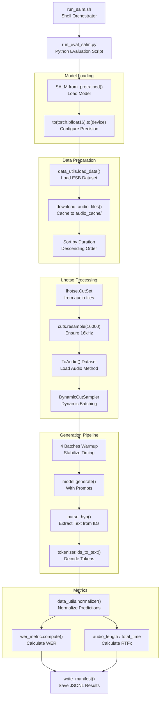

<!-- source: DeepWiki mcp.deepwiki.com · repo huggingface/open_asr_leaderboard · extra page SALM Models · fetched 2026-10-26 -->

# SALM Models

<details>
<summary>Relevant source files</summary>

The following files were used as context for generating this wiki page:

- [nemo_asr/run_eval_salm.py](nemo_asr/run_eval_salm.py)
- [nemo_asr/run_nemo_ml.sh](nemo_asr/run_nemo_ml.sh)
- [nemo_asr/run_parakeet.sh](nemo_asr/run_parakeet.sh)
- [nemo_asr/run_salm.sh](nemo_asr/run_salm.sh)

</details>


This document describes the evaluation system for Speech-Audio Language Models (SALM) within the NeMo framework. SALM models represent a newer generation of ASR models that combine speech understanding with language model capabilities, requiring specialized evaluation pipelines that use the generation API rather than traditional transcription methods.

For standard NeMo ASR model evaluation, see [Standard NeMo Evaluation](#4.1.1). For multilingual NeMo models, see [Multilingual Evaluation](#4.1.2).

**Sources:** [nemo_asr/run_eval_salm.py:1-261](), [nemo_asr/run_salm.sh:1-97]()

---

## Overview

SALM models differ from traditional ASR models in several key ways:

| Aspect | Traditional NeMo ASR | SALM Models |
|--------|---------------------|-------------|
| Model Class | `ASRModel` | `SALM` |
| Inference Method | `transcribe()` | `generate()` with prompts |
| Audio Processing | NeMo native | Lhotse-based |
| Input Format | Audio tensor | Prompted audio with chat template |
| Output Format | Text string | Generated token IDs decoded to text |

SALM models are loaded using `SALM.from_pretrained()` and process audio through a generation interface that accepts conversational prompts with embedded audio markers. The primary supported model is `nvidia/canary-qwen-2.5b`.

**Sources:** [nemo_asr/run_eval_salm.py:18-22](), [nemo_asr/run_eval_salm.py:91](), [nemo_asr/run_salm.sh:6-8]()

---

## Evaluation Architecture

### SALM Evaluation Pipeline



**Sources:** [nemo_asr/run_eval_salm.py:78-212](), [nemo_asr/run_salm.sh:13-96]()

---

## Model Loading and Configuration

The SALM model is loaded and configured with specific precision settings:

```python
model = SALM.from_pretrained(args.model_id).eval().to(torch.bfloat16).to(device)
```

Key configuration details:

- **Precision:** `torch.bfloat16` for memory efficiency
- **Device:** CUDA device specified via `args.device`
- **Float32 Matmul:** Set to `"medium"` precision for performance
- **Evaluation Mode:** `.eval()` disables dropout and batch norm training behavior

**Sources:** [nemo_asr/run_eval_salm.py:88-91]()

---

## Audio Processing with Lhotse

### Audio File Management

SALM evaluation uses a unique approach to audio file handling that differs from standard NeMo evaluation:

```mermaid
flowchart LR
    Dataset["HF Dataset<br/>Streaming"]
    
    subgraph "Audio Caching"
        ExtractAudio["Extract audio array<br/>or bytes"]
        WriteWAV["soundfile.write()<br/>to audio_cache/"]
        UniqueID["ID Sanitization<br/>Replace '/' with '_'"]
    end
    
    subgraph "Lhotse Processing"
        Recording["lhotse.Recording<br/>.from_file()"]
        CutCreation["recording.to_cut()<br/>Create Cut Object"]
        CutSet["lhotse.CutSet<br/>Collection of Cuts"]
        Resample["cuts.resample(16000)<br/>Standardize Sample Rate"]
    end
    
    subgraph "DataLoader Creation"
        ToAudio["ToAudio() Dataset<br/>Custom Dataset Class"]
        Sampler["DynamicCutSampler<br/>max_cuts=batch_size"]
        DataLoader["torch.utils.data.DataLoader<br/>batch_size=None"]
    end
    
    Dataset --> ExtractAudio
    ExtractAudio --> UniqueID
    UniqueID --> WriteWAV
    WriteWAV --> Recording
    Recording --> CutCreation
    CutCreation --> CutSet
    CutSet --> Resample
    Resample --> ToAudio
    ToAudio --> Sampler
    Sampler --> DataLoader
```



**Sources:** [nemo_asr/run_eval_salm.py:95-144](), [nemo_asr/run_eval_salm.py:35-43]()

### The ToAudio Dataset Class

A custom dataset class handles audio loading with lhotse:

| Method | Purpose | Implementation |
|--------|---------|----------------|
| `__getitem__` | Load audio from cuts | Converts MultiCuts to mono, loads audio with collation |
| Return Value | Dictionary | `{"cuts": CutSet, "audios": Tensor, "audio_lens": Tensor}` |

The class ensures that multi-channel recordings are downmixed to mono before processing.

**Sources:** [nemo_asr/run_eval_salm.py:28-32]()

### ID Sanitization for Lhotse Compatibility

A critical preprocessing step ensures unique audio file IDs:

```python
id = id.replace('/', '_').removesuffix('.wav')
```

This prevents collisions in datasets with hierarchical structures like `earnings22/test/4432298/281.wav` and `earnings22/test/4450488/281.wav`, where lhotse would otherwise use only the filename (`281.wav`) as the unique identifier.

**Sources:** [nemo_asr/run_eval_salm.py:108]()

---

## Transcription Process

### Generation Configuration

SALM models use the generation API with specific configuration:

| Parameter | Value | Purpose |
|-----------|-------|---------|
| `max_new_tokens` | 128 | Limit transcription length |
| `bos_token_id` | `model.text_bos_id` | Beginning of sequence token |
| `eos_token_id` | `torch.tensor([model.text_eos_id])` | End of sequence token |
| `pad_token_id` | `model.text_pad_id` | Padding token |

**Sources:** [nemo_asr/run_eval_salm.py:58-63]()

### Prompt Structure

The transcription uses a chat-based prompt template:

```python
prompts=[
    [
        {"role": "user", "slots": {"message": f"Transcribe the following: {model.audio_locator_tag}"}}
    ]
] * len(batch["cuts"])
```

The `audio_locator_tag` is a special marker where the model expects audio input to be inserted.

**Sources:** [nemo_asr/run_eval_salm.py:51-55]()

### Transcribe Function Flow

```mermaid
flowchart TD
    Input["Batch from DataLoader<br/>cuts, audios, audio_lens"]
    
    subgraph "Generate"
        BuildPrompt["Build Prompt List<br/>One per audio in batch"]
        MoveDevice["audios.to(device)<br/>audio_lens.to(device)"]
        Generate["model.generate()<br/>GenerationConfig"]
        GetAnswerIDs["answer_ids Tensor<br/>Generated Token IDs"]
    end
    
    subgraph "Parse"
        ParseLoop["For each answer_ids<br/>in batch"]
        ParseHyp["parse_hyp()<br/>Find EOS, truncate"]
        IDsToText["tokenizer.ids_to_text()<br/>Decode to string"]
        Strip["text.strip()<br/>Remove whitespace"]
    end
    
    Output["List of transcriptions"]
    
    Input --> BuildPrompt
    BuildPrompt --> MoveDevice
    MoveDevice --> Generate
    Generate --> GetAnswerIDs
    GetAnswerIDs --> ParseLoop
    ParseLoop --> ParseHyp
    ParseHyp --> IDsToText
    IDsToText --> Strip
    Strip --> Output
```

**Sources:** [nemo_asr/run_eval_salm.py:46-67](), [nemo_asr/run_eval_salm.py:70-75]()

---

## Warmup and Timing

The evaluation includes a warmup phase to ensure stable timing measurements:

| Phase | Data | Purpose |
|-------|------|---------|
| Warmup (iteration 0) | First `batch_size * 4` files | Stabilize GPU state, compile kernels |
| Measurement (iteration 1) | All audio files | Actual timing for RTFx calculation |

The loop structure:

```python
for _ in range(2): # warmup once and calculate rtf
    if _ == 0:
        audio_files = all_data["audio_filepaths"][:args.batch_size * 4]
    else:
        audio_files = all_data["audio_filepaths"]
```

Only the second iteration's timing is used for RTFx calculation.

**Sources:** [nemo_asr/run_eval_salm.py:168-180]()

---

## Sorting and Batching Strategy

To optimize GPU utilization, audio files are sorted by duration in descending order:

```python
sorted_indices = sorted(range(len(all_data["durations"])), key=lambda k: all_data["durations"][k], reverse=True)
all_data["audio_filepaths"] = [all_data["audio_filepaths"][i] for i in sorted_indices]
```

This ensures that:
- Longer files are batched together
- Padding waste is minimized within batches
- GPU memory is used efficiently with the `DynamicCutSampler`

**Sources:** [nemo_asr/run_eval_salm.py:161-164]()

---

## Shell Script Configuration

The orchestration script defines the model and batch configuration:

```bash
MODEL_IDs=(
    nvidia/canary-qwen-2.5b
)
BATCH_SIZE=192
DEVICE_ID=0
```

### Dataset Evaluation Loop

The script evaluates all 8 ESB datasets:

| Dataset | Split |
|---------|-------|
| ami | test |
| earnings22 | test |
| gigaspeech | test |
| librispeech | test.clean |
| librispeech | test.other |
| spgispeech | test |
| tedlium | test |
| voxpopuli | test |

Each dataset is evaluated with identical parameters, and results are aggregated using `eval_utils.score_results()` at the end.

**Sources:** [nemo_asr/run_salm.sh:6-96]()

---

## Results and Normalization

### Text Normalization

Transcriptions are normalized using the English normalizer:

```python
predictions = [data_utils.normalizer(pred) for pred in transcriptions]
```

The normalizer handles contractions, numbers, punctuation, and British-American spelling differences.

**Sources:** [nemo_asr/run_eval_salm.py:185]()

### Manifest Output

Results are written using the standard manifest format:

```python
manifest_path = data_utils.write_manifest(
    all_data["references"],
    predictions,
    args.model_id,
    args.dataset_path,
    args.dataset,
    args.split,
    audio_length=all_data["durations"],
    transcription_time=[avg_time] * len(all_data["audio_filepaths"]),
)
```

The manifest includes:
- Reference transcriptions
- Model predictions
- Audio durations
- Per-sample transcription time
- Model and dataset identifiers

**Sources:** [nemo_asr/run_eval_salm.py:190-199]()

### Metrics Calculation

| Metric | Calculation | Format |
|--------|-------------|--------|
| WER | `wer_metric.compute(references, predictions)` | Percentage, 2 decimal places |
| RTFx | `audio_length / total_time` | Float, 2 decimal places |

**Sources:** [nemo_asr/run_eval_salm.py:203-211]()

---

## Command-Line Arguments

The evaluation script accepts the following arguments:

| Argument | Type | Default | Description |
|----------|------|---------|-------------|
| `--model_id` | str | Required | Model identifier for SALM model |
| `--dataset_path` | str | `'esb/datasets'` | Dataset repository path |
| `--dataset` | str | Required | Dataset name (e.g., `'librispeech'`) |
| `--split` | str | `'test'` | Dataset split to evaluate |
| `--device` | int | `-1` | CUDA device ID (-1 for CPU) |
| `--batch_size` | int | `32` | Number of samples per batch |
| `--max_eval_samples` | int | `None` | Limit evaluation samples (for testing) |
| `--no-streaming` | flag | N/A | Disable streaming (download full dataset) |

**Sources:** [nemo_asr/run_eval_salm.py:215-258]()

---

## Key Differences from Standard NeMo Evaluation

| Aspect | Standard NeMo | SALM |
|--------|---------------|------|
| Audio Processing Library | NeMo native | Lhotse |
| Model Loading | `ASRModel.from_pretrained()` | `SALM.from_pretrained()` |
| Inference Method | `model.transcribe()` | `model.generate()` with prompts |
| Audio Format | Direct tensor input | Lhotse Cut objects |
| Batching | Standard DataLoader | `DynamicCutSampler` |
| Token Processing | Direct text output | Token IDs → parsing → decoding |
| Prompt Required | No | Yes (chat template) |

**Sources:** [nemo_asr/run_eval_salm.py:14-22](), [nemo_asr/run_eval_salm.py:46-67]()

---

