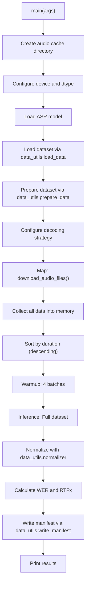
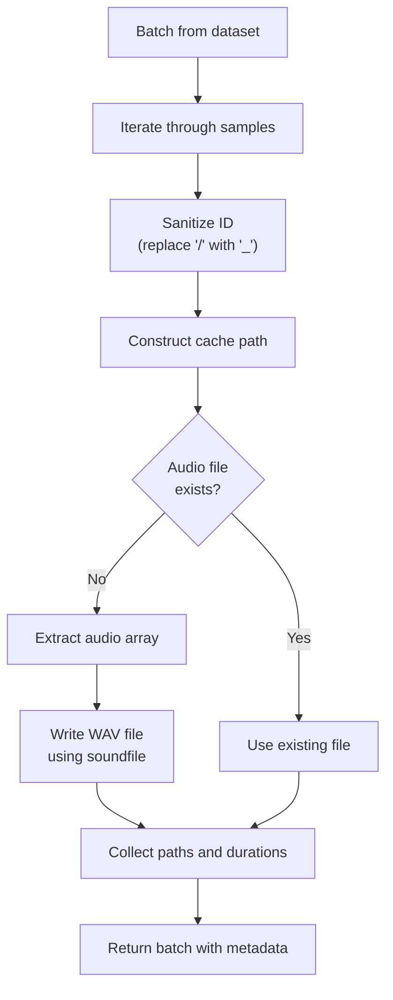
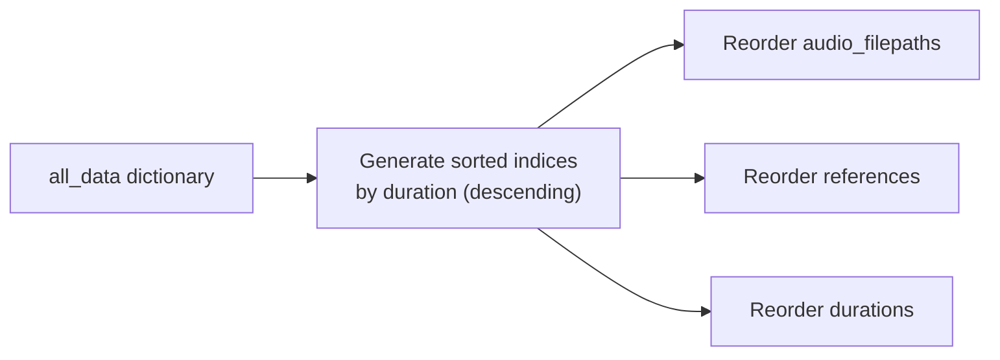
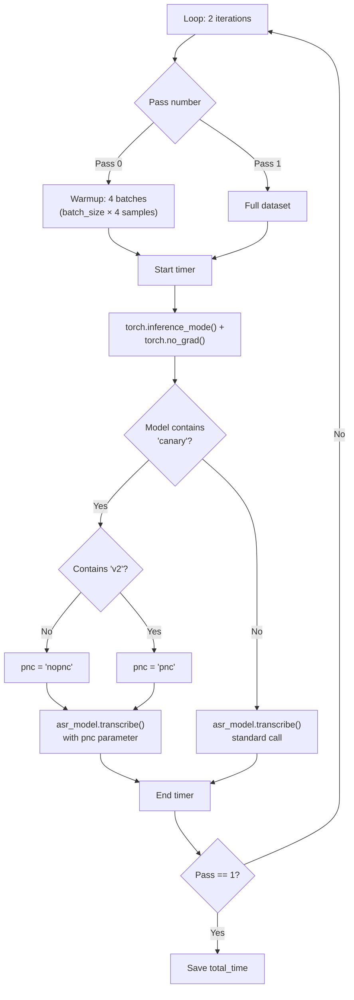
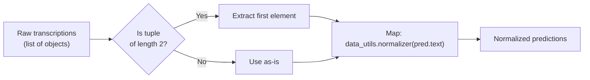
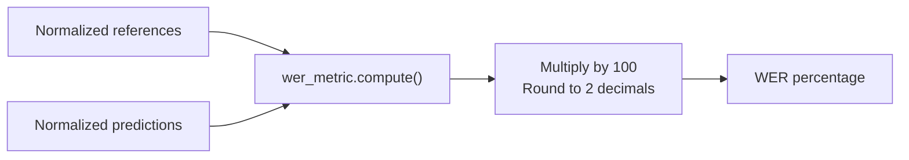
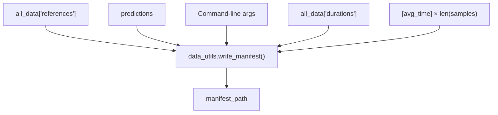

<!-- source: DeepWiki mcp.deepwiki.com · repo huggingface/open_asr_leaderboard · extra page Standard NeMo Evaluation · fetched 2026-10-26 -->

# Standard NeMo Evaluation

<details>
<summary>Relevant source files</summary>

The following files were used as context for generating this wiki page:

- [nemo_asr/run_eval.py](nemo_asr/run_eval.py)
- [requirements/requirements_nemo.txt](requirements/requirements_nemo.txt)

</details>


## Purpose and Scope

This document covers the standard NVIDIA NeMo ASR evaluation script ([nemo_asr/run_eval.py]()), which is the primary evaluation pathway for NeMo-based models. This script handles conventional ASR models that use greedy or beam search decoding strategies.

**For specialized evaluations, see:**
- Multilingual models with language-specific normalization: [Multilingual Evaluation](#4.1.2)
- Canary model variants with pnc parameter handling: [Canary Models](#4.1.3)
- Parakeet TDT and RNN-T models with optimized batching: [Parakeet Models](#4.1.4)
- SALM (Speech-Audio Language Models) using lhotse: [SALM Models](#4.1.5)

This evaluation script implements the standard 5-phase evaluation pipeline described in [Core Evaluation Pipeline](#2) and uses shared infrastructure from the [Normalizer Module](#3.1).

**Sources:** [nemo_asr/run_eval.py:1-226]()

---

## Script Architecture

The `run_eval.py` script follows a sequential execution pattern with distinct phases for audio preparation, model warmup, inference, and metric computation.

### Execution Flow



**Sources:** [nemo_asr/run_eval.py:20-177]()

---

## Model Loading

The script supports two model loading pathways: local `.nemo` checkpoint files and models from the HuggingFace Hub or NVIDIA NGC catalog.

### Model Loading Logic

| Source Type | Condition | Loading Method | Line Reference |
|-------------|-----------|----------------|----------------|
| Local checkpoint | `model_id` ends with `.nemo` | `ASRModel.restore_from()` | [nemo_asr/run_eval.py:38-39]() |
| Remote model | All other `model_id` values | `ASRModel.from_pretrained()` | [nemo_asr/run_eval.py:41]() |

The loaded model is then configured for inference:


**Device Configuration:**
- GPU (args.device >= 0): Uses `torch.bfloat16` for memory efficiency
- CPU (args.device == -1): Uses `torch.float32` for compatibility

**Sources:** [nemo_asr/run_eval.py:30-44]()

---

## Audio Caching and Processing

To avoid repeated downloads and enable duration-based sorting, the script implements a local audio caching system. This is critical for efficient batch processing and reproducible timing measurements.

### Cache Directory Structure

```
audio_cache/
└── {DATASET_NAME}/
    └── {SPLIT_NAME}/
        ├── {id1}.wav
        ├── {id2}.wav
        └── {id3}.wav
```

### Audio Download Function

The `download_audio_files` function (defined as a nested function at [nemo_asr/run_eval.py:48-88]()) processes audio data in batches:



**Key Implementation Details:**

1. **ID Sanitization** ([nemo_asr/run_eval.py:61]()): Replaces `/` with `_` to prevent filesystem issues with hierarchical dataset IDs (e.g., `earnings22/test/4432298/281.wav` → `earnings22_test_4432298_281.wav`)

2. **Audio Format Handling** ([nemo_asr/run_eval.py:65-74]()):
   - `array` key: Legacy datasets library (< 3.x)
   - `bytes` key: Modern datasets library (≥ 3.x) using BytesIO

3. **Sample Rate**: Fixed at 16000 Hz ([nemo_asr/run_eval.py:67]())

4. **Duration Calculation**: `len(audio_array) / sample_rate` ([nemo_asr/run_eval.py:81]())

**Sources:** [nemo_asr/run_eval.py:22-28](), [nemo_asr/run_eval.py:48-101]()

---

## Duration-Based Sorting

After caching all audio files, the script sorts samples by duration in descending order. This optimization minimizes padding waste during batched inference.

### Sorting Implementation



The sorting logic at [nemo_asr/run_eval.py:116-120]():

```python
sorted_indices = sorted(range(len(all_data["durations"])), 
                       key=lambda k: all_data["durations"][k], 
                       reverse=True)
```

**Rationale:** When batching audio, all samples in a batch must be padded to the length of the longest sample. By sorting in descending order and processing sequentially, consecutive batches contain samples of similar length, reducing total padding.

**Sources:** [nemo_asr/run_eval.py:105-121]()

---

## Warmup and Inference

The script performs a two-pass transcription: a warmup pass to stabilize GPU kernels and memory allocation, followed by the timed inference pass.

### Two-Pass Execution



### Warmup Configuration

| Parameter | Value | Purpose |
|-----------|-------|---------|
| Warmup batches | 4 | Stabilize GPU kernel compilation and memory allocation |
| Warmup samples | `batch_size × 4` | Representative of actual workload |
| Timing pass | Full dataset | Measure actual inference time |

### Special Handling: Canary Models

Canary models require a `pnc` (punctuation and capitalization) parameter ([nemo_asr/run_eval.py:132-138]()):
- **Canary v1**: `pnc='nopnc'` (disables punctuation/capitalization)
- **Canary v2+**: `pnc='pnc'` (enables punctuation/capitalization)

This distinction is important because v1 models were trained without punctuation, while v2 models include it.

**Sources:** [nemo_asr/run_eval.py:123-144]()

---

## Transcription Normalization

After inference, transcriptions undergo normalization using the English text normalizer from the shared `normalizer` module.

### Normalization Pipeline



**Tuple Handling** ([nemo_asr/run_eval.py:147-148]()): Some NeMo models return `(transcriptions, metadata)` tuples. The script extracts only the transcriptions.

**Normalization** ([nemo_asr/run_eval.py:149]()): Each transcription is normalized using `data_utils.normalizer()`, which applies:
- Lowercasing
- Punctuation removal
- Number expansion
- Contraction handling
- British-to-American spelling conversion

For details on the normalization process, see [Normalizer Module](#3.1).

**Sources:** [nemo_asr/run_eval.py:146-150]()

---

## Metrics Calculation

The script computes two key metrics: Word Error Rate (WER) and Real-Time Factor (RTFx).

### WER Calculation



**Implementation:** Uses the HuggingFace `evaluate` library ([nemo_asr/run_eval.py:17](), [nemo_asr/run_eval.py:167-168]()).

### RTFx Calculation

Real-Time Factor measures how many times faster (or slower) the model transcribes compared to real-time audio playback.

| Component | Calculation | Line Reference |
|-----------|-------------|----------------|
| Total audio length | `sum(all_data["durations"])` | [nemo_asr/run_eval.py:171]() |
| Total inference time | Measured during timed pass | [nemo_asr/run_eval.py:123-144]() |
| RTFx | `audio_length / total_time` | [nemo_asr/run_eval.py:172]() |

**Interpretation:**
- RTFx > 1: Model is faster than real-time (e.g., 5.0 means 5× faster)
- RTFx < 1: Model is slower than real-time (e.g., 0.5 means 2× slower)

**Average Time Per Sample** ([nemo_asr/run_eval.py:151]()): Used for manifest file, computed as `total_time / len(all_data["audio_filepaths"])`

**Sources:** [nemo_asr/run_eval.py:151-176]()

---

## Result Storage

Results are persisted to a JSONL manifest file using the shared `data_utils.write_manifest()` function.

### Manifest Structure

The manifest file contains per-sample results with the following fields:

| Field | Source | Description |
|-------|--------|-------------|
| `reference` | `all_data["references"]` | Normalized ground truth transcription |
| `prediction` | `predictions` | Normalized model transcription |
| `model_id` | `args.model_id` | Model identifier |
| `dataset_path` | `args.dataset_path` | Dataset repository path |
| `dataset` | `args.dataset` | Dataset name |
| `split` | `args.split` | Dataset split |
| `audio_length` | `all_data["durations"]` | Per-sample audio duration |
| `transcription_time` | `avg_time` repeated | Average time per sample |

### Write Manifest Call



**File Location:** The manifest is written to a structured path based on model and dataset identifiers. The exact path is determined by `data_utils.write_manifest()` (see [Data Utils](#3.2)).

**Output:** The function prints the absolute path to the manifest file ([nemo_asr/run_eval.py:165]()).

**Sources:** [nemo_asr/run_eval.py:154-165]()

---

## Command-Line Interface

The script accepts multiple arguments to configure evaluation behavior.

### Required Arguments

| Argument | Type | Description | Example |
|----------|------|-------------|---------|
| `--model_id` | str | Model identifier (HF Hub or .nemo path) | `nvidia/parakeet-tdt-1.1b` or `model.nemo` |
| `--dataset` | str | Dataset name from ESB benchmark | `librispeech_asr` |

### Optional Arguments

| Argument | Type | Default | Description |
|----------|------|---------|-------------|
| `--dataset_path` | str | `esb/datasets` | HuggingFace dataset repository |
| `--split` | str | `test` | Dataset split to evaluate |
| `--device` | int | `-1` | GPU device index (-1 for CPU) |
| `--batch_size` | int | `32` | Number of samples per batch |
| `--max_eval_samples` | int | `None` | Limit evaluation to N samples (for testing) |
| `--streaming` | bool | `True` | Stream dataset (set `--no-streaming` to download fully) |

### Example Usage

```bash
# Evaluate Parakeet model on LibriSpeech test-clean
python nemo_asr/run_eval.py \
    --model_id nvidia/parakeet-tdt-1.1b \
    --dataset librispeech_asr \
    --split test.clean \
    --device 0 \
    --batch_size 32

# Evaluate local .nemo file on AMI test set
python nemo_asr/run_eval.py \
    --model_id /path/to/model.nemo \
    --dataset ami \
    --split test \
    --device 0 \
    --batch_size 16

# Quick test with 64 samples
python nemo_asr/run_eval.py \
    --model_id nvidia/stt_en_conformer_ctc_small \
    --dataset librispeech_asr \
    --split validation \
    --device 0 \
    --max_eval_samples 64
```

**Sources:** [nemo_asr/run_eval.py:179-225]()

---

## Dependencies

The script requires specific NeMo installation with CUDA support for optimal performance.

### Key Dependencies

| Package | Purpose | Notes |
|---------|---------|-------|
| `nemo_toolkit[asr]` | Core NeMo ASR functionality | Installed from specific commit for stability |
| `cuda-python>=12.4` | Fast TDT and RNN-T inference | Required for optimal Parakeet performance |
| `torch` | Deep learning framework | Implicitly required by NeMo |
| `soundfile` | Audio I/O | WAV file reading/writing |
| `evaluate` | WER metric computation | HuggingFace library |

### Installation

```bash
pip install -r requirements/requirements_nemo.txt
```

**Note:** The requirements file pins NeMo to commit `6294bc7708ce67522b92f5e9b6917ea0b2e23429` for reproducibility. The `cuda-python` package is specifically required for fast inference with Transducer-based models (see [requirements/requirements_nemo.txt:6]()).

**Sources:** [requirements/requirements_nemo.txt:1-7]()

---

## Integration with Evaluation Pipeline

This script implements the standard evaluation pattern described in [Core Evaluation Pipeline](#2). The mapping between pipeline phases and code sections is:

| Pipeline Phase | Code Section | Line Reference |
|----------------|--------------|----------------|
| **Phase 1: Orchestration** | Shell script (external) | N/A |
| **Phase 2: Evaluation** | Model loading, dataset preparation, inference | [20-141]() |
| **Phase 3: Metrics** | Normalization, WER/RTFx calculation | [146-176]() |
| **Phase 4: Storage** | Manifest writing | [154-165]() |
| **Phase 5: Aggregation** | External (eval_utils) | N/A |

The script uses shared infrastructure components:
- **Data loading:** `data_utils.load_data()` ([nemo_asr/run_eval.py:46]())
- **Data preparation:** `data_utils.prepare_data()` ([nemo_asr/run_eval.py:95]())
- **Text normalization:** `data_utils.normalizer()` ([nemo_asr/run_eval.py:149]())
- **Manifest writing:** `data_utils.write_manifest()` ([nemo_asr/run_eval.py:154]())

**Sources:** [nemo_asr/run_eval.py:1-226]()

---

