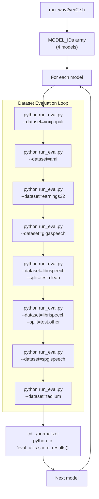
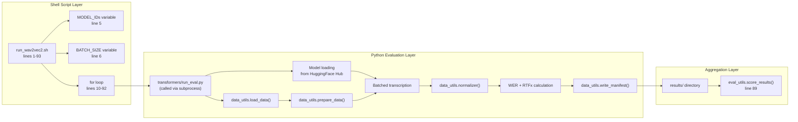

<!-- source: DeepWiki mcp.deepwiki.com · repo huggingface/open_asr_leaderboard · extra page Wav2Vec2 Models · fetched 2026-10-26 -->

# Wav2Vec2 Models

<details>
<summary>Relevant source files</summary>

The following files were used as context for generating this wiki page:

- [transformers/run_data2vec.sh](transformers/run_data2vec.sh)
- [transformers/run_mms.sh](transformers/run_mms.sh)
- [transformers/run_wav2vec2.sh](transformers/run_wav2vec2.sh)
- [transformers/run_wav2vec2_conformer.sh](transformers/run_wav2vec2_conformer.sh)

</details>


This page documents the evaluation of Facebook's Wav2Vec2 and Wav2Vec2-Conformer models using the Transformers framework. Wav2Vec2 is a self-supervised speech representation learning model that uses contrastive learning on masked audio inputs. The evaluation infrastructure supports both standard Wav2Vec2 architectures and Conformer-based variants.

For information about evaluating other Transformers-based models, see [Whisper Models](#4.2.1), [MMS and Other Models](#4.2.3), and [HuBERT Models](#4.2.4). For details on the underlying evaluation script, see [Transformers Framework](#4.2).

---

## Overview

The Wav2Vec2 evaluation system uses the shell script `run_wav2vec2.sh` to orchestrate evaluations across multiple model variants. All evaluations use the shared `run_eval.py` script from the Transformers framework, which implements the standard 5-phase evaluation pipeline documented in [Core Evaluation Pipeline](#2).

The system evaluates two categories of Wav2Vec2 models:
- **Standard Wav2Vec2**: Base and large architectures with various training configurations
- **Conformer Variants**: Large models using Conformer encoders with relative or rotary positional embeddings

Sources: [transformers/run_wav2vec2.sh:1-93](), [transformers/run_wav2vec2_conformer.sh:1-93]()

---

## Supported Models

### Standard Wav2Vec2 Models

The following models are evaluated via [transformers/run_wav2vec2.sh:5]():

| Model ID | Architecture | Training Data | Description |
|----------|-------------|---------------|-------------|
| `facebook/wav2vec2-base-960h` | Base (95M params) | LibriSpeech 960h | Standard base model fine-tuned on LibriSpeech |
| `facebook/wav2vec2-large-960h` | Large (317M params) | LibriSpeech 960h | Large model fine-tuned on LibriSpeech |
| `facebook/wav2vec2-large-960h-lv60-self` | Large (317M params) | LibriSpeech 960h + LibriVox 60k hours | Pre-trained on large unlabeled corpus |
| `facebook/wav2vec2-large-robust-ft-libri-960h` | Large (317M params) | LibriSpeech 960h | Robust variant with improved generalization |

All standard models use a batch size of **64** for evaluation [transformers/run_wav2vec2.sh:6]().

### Conformer Variants

The following Conformer-based models are evaluated via [transformers/run_wav2vec2_conformer.sh:5]():

| Model ID | Architecture | Positional Encoding | Batch Size |
|----------|-------------|---------------------|------------|
| `facebook/wav2vec2-conformer-rel-pos-large-960h-ft` | Large Conformer | Relative Position | 32 |
| `facebook/wav2vec2-conformer-rope-large-960h-ft` | Large Conformer | Rotary (RoPE) | 32 |

Conformer variants use a reduced batch size of **32** due to higher memory requirements [transformers/run_wav2vec2_conformer.sh:6]().

Sources: [transformers/run_wav2vec2.sh:5-6](), [transformers/run_wav2vec2_conformer.sh:5-6]()

---

## Evaluation Workflow

The evaluation workflow follows the standard pattern used across all Transformers-based models. The shell script orchestrates multiple evaluations by invoking `run_eval.py` for each model-dataset pair.

### Execution Flow



**Diagram: Wav2Vec2 Evaluation Orchestration**

Each `run_eval.py` invocation performs the complete evaluation pipeline:
1. Loads the model from HuggingFace Hub
2. Loads and prepares the dataset using `data_utils.load_data` and `data_utils.prepare_data`
3. Performs batched inference with timing measurements
4. Normalizes predictions and references using `data_utils.normalizer`
5. Calculates WER and RTFx metrics
6. Writes results to JSONL manifest in `results/` directory

After all datasets are evaluated for a model, the script aggregates results using `eval_utils.score_results` from the normalizer module [transformers/run_wav2vec2.sh:87-90]().

Sources: [transformers/run_wav2vec2.sh:10-92]()

---

## Configuration Parameters

### Common Parameters

All `run_eval.py` invocations use the following consistent parameters:

| Parameter | Value | Description |
|-----------|-------|-------------|
| `--model_id` | Model Hub ID | HuggingFace model identifier |
| `--dataset_path` | `hf-audio/esb-datasets-test-only-sorted` | Pre-sorted ESB benchmark datasets |
| `--dataset` | Dataset name | One of: voxpopuli, ami, earnings22, gigaspeech, librispeech, spgispeech, tedlium |
| `--split` | Dataset split | Usually `test`, except LibriSpeech uses `test.clean` and `test.other` |
| `--device` | `0` | GPU device index |
| `--batch_size` | 64 or 32 | Batch size for inference |
| `--max_eval_samples` | `-1` | Evaluate all samples (no limit) |

### Batch Size Tuning

The batch size differs between model types to optimize GPU memory usage:

- **Standard Wav2Vec2**: Batch size 64 [transformers/run_wav2vec2.sh:6]()
  - Base models are smaller and can handle larger batches
  - Large models still fit comfortably at batch size 64

- **Conformer Variants**: Batch size 32 [transformers/run_wav2vec2_conformer.sh:6]()
  - Conformer architecture has higher memory requirements
  - Reduced batch size prevents out-of-memory errors

### Python Path Configuration

Both scripts set `PYTHONPATH` to include the parent directory [transformers/run_wav2vec2.sh:3]():

```bash
export PYTHONPATH="..":$PYTHONPATH
```

This allows the `run_eval.py` script to import the `normalizer` module for text normalization and result aggregation.

Sources: [transformers/run_wav2vec2.sh:3-6](), [transformers/run_wav2vec2_conformer.sh:3-6]()

---

## Code Structure Mapping

The following diagram maps the execution flow to specific code entities:



**Diagram: Code Entity Mapping for Wav2Vec2 Evaluation**

Sources: [transformers/run_wav2vec2.sh:1-93]()

---

## Dataset Coverage

Each model is evaluated on all 8 datasets from the ESB benchmark suite. The evaluation order is:

1. **VoxPopuli** [transformers/run_wav2vec2.sh:14-21]()
   - European Parliament speeches
   - Multi-accent English
   
2. **AMI** [transformers/run_wav2vec2.sh:23-30]()
   - Meeting transcriptions
   - Multiple speakers, overlapping speech
   
3. **Earnings22** [transformers/run_wav2vec2.sh:32-39]()
   - Financial earnings calls
   - Corporate speech, specialized terminology
   
4. **GigaSpeech** [transformers/run_wav2vec2.sh:41-48]()
   - Diverse sources (audiobooks, YouTube, podcasts)
   - Wide variety of acoustic conditions
   
5. **LibriSpeech test.clean** [transformers/run_wav2vec2.sh:50-57]()
   - High-quality audiobook recordings
   - Clean acoustic conditions
   
6. **LibriSpeech test.other** [transformers/run_wav2vec2.sh:59-66]()
   - Challenging audiobook recordings
   - More difficult acoustic conditions
   
7. **SPGISpeech** [transformers/run_wav2vec2.sh:68-75]()
   - Financial earnings calls and presentations
   - Similar domain to Earnings22
   
8. **TED-LIUM** [transformers/run_wav2vec2.sh:77-84]()
   - TED talk recordings
   - Presentation-style speech

This comprehensive coverage ensures models are evaluated across diverse acoustic conditions, speaking styles, and domains.

Sources: [transformers/run_wav2vec2.sh:14-84]()

---

## Results Aggregation

After all datasets are evaluated for a model, the script aggregates results using the shared normalizer module:

```bash
RUNDIR=`pwd` && \
cd ../normalizer && \
python -c "import eval_utils; eval_utils.score_results('${RUNDIR}/results', '${MODEL_ID}')" && \
cd $RUNDIR
```

This process [transformers/run_wav2vec2.sh:87-90]():

1. Saves the current directory (`RUNDIR`)
2. Changes to the `normalizer` directory
3. Invokes `eval_utils.score_results()` with:
   - Path to results directory containing JSONL manifests
   - Model ID for filtering relevant result files
4. Returns to the original directory

The `score_results` function computes aggregated metrics across all datasets, including mean WER and RTFx values. For details on the aggregation methodology, see [Eval Utils](#3.3).

Sources: [transformers/run_wav2vec2.sh:87-90]()

---

## Comparison with Related Models

The Wav2Vec2 evaluation system shares the same infrastructure with other Transformers-based models:

| Model Type | Script | Batch Size | Key Differences |
|------------|--------|------------|-----------------|
| Wav2Vec2 | `run_wav2vec2.sh` | 64 | Standard self-supervised models |
| Wav2Vec2-Conformer | `run_wav2vec2_conformer.sh` | 32 | Conformer encoder, lower batch size |
| MMS | `run_mms.sh` | 48 | Massively multilingual variant |
| Data2Vec | `run_data2vec.sh` | 8 | Multi-modal self-supervised learning, smallest batch size |
| HuBERT | `run_hubert.sh` | Varies | Masked prediction approach |

The Data2Vec models use the smallest batch size (8) due to their multi-modal architecture, while standard Wav2Vec2 models use the largest batch size (64) for efficient evaluation [transformers/run_data2vec.sh:6]().

Sources: [transformers/run_wav2vec2.sh:6](), [transformers/run_wav2vec2_conformer.sh:6](), [transformers/run_mms.sh:6](), [transformers/run_data2vec.sh:6]()

---

## Running Evaluations

To evaluate all Wav2Vec2 models:

```bash
cd transformers
bash run_wav2vec2.sh
```

To evaluate only Conformer variants:

```bash
cd transformers
bash run_wav2vec2_conformer.sh
```

Both scripts automatically:
- Download models from HuggingFace Hub
- Process all 8 ESB datasets
- Generate JSONL manifest files in `results/`
- Aggregate metrics using the normalizer module

Results are stored in `transformers/results/` with filenames following the pattern:
```
{model_id}__{dataset}__{split}.json
```

For information on interpreting results, see [Result Interpretation](#6.3).

Sources: [transformers/run_wav2vec2.sh:1-93](), [transformers/run_wav2vec2_conformer.sh:1-93]()

---

