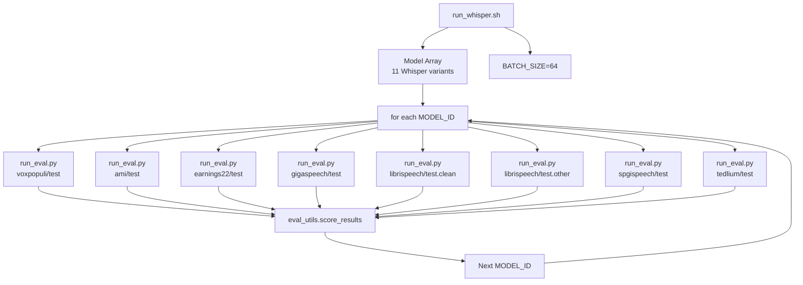
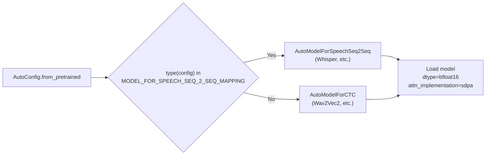
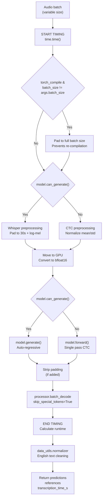
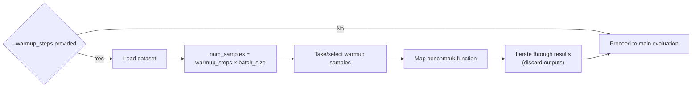
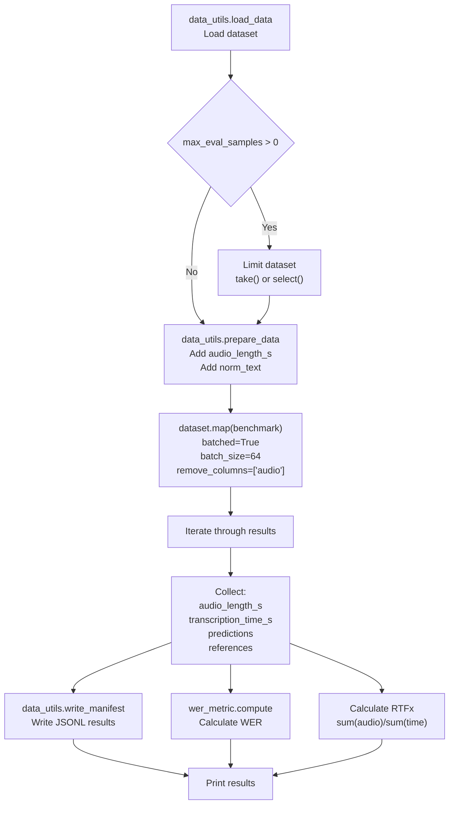

<!-- source: DeepWiki mcp.deepwiki.com · repo huggingface/open_asr_leaderboard · extra page Whisper Models · fetched 2026-10-26 -->

# Whisper Models

<details>
<summary>Relevant source files</summary>

The following files were used as context for generating this wiki page:

- [transformers/run_eval.py](transformers/run_eval.py)
- [transformers/run_whisper.sh](transformers/run_whisper.sh)

</details>


## Purpose and Scope

This page documents the evaluation of OpenAI Whisper model variants using the Transformers framework. It covers the orchestration script ([transformers/run_whisper.sh]()), the core evaluation logic ([transformers/run_eval.py]()), and model-specific optimizations for Whisper architectures including multilingual handling and torch.compile acceleration.

For evaluation of other Transformers-based models like Wav2Vec2 or MMS, see [4.2.2](#4.2.2) and [4.2.3](#4.2.3). For the general Transformers framework overview, see [4.2](#4.2). For alternative Whisper evaluation using CTranslate2 backend, see [4.5](#4.5).

---

## Supported Whisper Variants

The Whisper evaluation system supports multiple model variants across three categories: OpenAI official models, distil-whisper distilled variants, and community fine-tuned models.

| Model ID | Type | Description | Size |
|----------|------|-------------|------|
| `openai/whisper-tiny.en` | OpenAI | English-only, smallest variant | ~39M params |
| `openai/whisper-small.en` | OpenAI | English-only, small variant | ~244M params |
| `openai/whisper-base.en` | OpenAI | English-only, base variant | ~74M params |
| `openai/whisper-medium.en` | OpenAI | English-only, medium variant | ~769M params |
| `openai/whisper-large` | OpenAI | Multilingual, large v1 | ~1550M params |
| `openai/whisper-large-v2` | OpenAI | Multilingual, large v2 | ~1550M params |
| `openai/whisper-large-v3` | OpenAI | Multilingual, large v3 | ~1550M params |
| `distil-whisper/distil-medium.en` | Distil-Whisper | 2x faster than medium.en | ~394M params |
| `distil-whisper/distil-large-v2` | Distil-Whisper | 6x faster than large-v2 | ~756M params |
| `distil-whisper/distil-large-v3` | Distil-Whisper | 6x faster than large-v3 | ~756M params |
| `nyrahealth/CrisperWhisper` | Community | Medical domain fine-tune | Varies |

**Sources:** [transformers/run_whisper.sh:5]()

---

## Evaluation Orchestration

The shell script `run_whisper.sh` orchestrates Whisper model evaluation by iterating through all model variants and evaluating each across the 8 ESB benchmark datasets.



**Evaluation Parameters:**
- **Dataset Path:** `hf-audio/esb-datasets-test-only-sorted` - pre-sorted by audio duration for optimal batching
- **Batch Size:** 64 samples per batch (configurable via `BATCH_SIZE` variable)
- **Device:** GPU 0 (`--device=0`)
- **Samples:** Full dataset evaluation (`--max_eval_samples=-1`)

After evaluating all 8 datasets for a model, the script invokes `eval_utils.score_results()` to aggregate per-dataset manifests into a single model-level score.

**Sources:** [transformers/run_whisper.sh:1-93]()

---

## Core Evaluation Logic

### Model Initialization

The evaluation script dynamically determines the model class based on the configuration, distinguishing between encoder-decoder (Seq2Seq) and encoder-only (CTC) architectures.



All Whisper models are loaded with:
- **Precision:** `torch.bfloat16` for memory efficiency and speed
- **Attention:** SDPA (Scaled Dot-Product Attention) for optimized attention computation
- **Device:** Moved to specified GPU device

**Sources:** [transformers/run_eval.py:14-19]()

---

### Multilingual Whisper Configuration

For multilingual Whisper checkpoints (large, large-v2, large-v3), the generation configuration is automatically adjusted to force English transcription, which provides a definitive WER boost on English benchmarks.

```python
# From run_eval.py:21-26
if model.can_generate():
    gen_kwargs = {"max_new_tokens": args.max_new_tokens}
    if getattr(model.generation_config, "is_multilingual"):
        gen_kwargs["language"] = "en"
        gen_kwargs["task"] = "transcribe"
```

**Key Configuration:**
- **Language:** Set to `"en"` to force English output
- **Task:** Set to `"transcribe"` (as opposed to "translate")
- **Max New Tokens:** Configurable limit on generation length

This configuration ensures that multilingual models don't attempt to transcribe in other languages when evaluating English datasets.

**Sources:** [transformers/run_eval.py:21-28]()

---

### Torch.compile Optimization

When `--torch_compile` is enabled, the evaluation script applies two critical optimizations:

```mermaid
flowchart TD
    COMPILE{"--torch_compile flag"}
    FORWARD["torch.compile(model.forward)<br/>mode=max-autotune<br/>fullgraph=True"]
    GEN_CHECK{"model.can_generate()"}
    STATIC["generation_config.cache_implementation = 'static'"]
    DONE["Optimized model ready"]
    
    COMPILE -->|Enabled| FORWARD
    FORWARD --> GEN_CHECK
    GEN_CHECK -->|Yes<br/>(Whisper)| STATIC
    GEN_CHECK -->|No<br/>(CTC)| DONE
    STATIC --> DONE
```

**Optimization 1: JIT Compilation**
- Compiles `model.forward()` using PyTorch 2.x compilation
- **Mode:** `max-autotune` (default) for maximum optimization
- **Fullgraph:** `True` to compile the entire forward pass as a single graph

**Optimization 2: Static KV Cache**
- For autoregressive models (Whisper), enables static key-value cache
- Eliminates dynamic memory allocation during generation
- Requires fixed batch size to prevent re-compilation

**Sources:** [transformers/run_eval.py:30-34](), [transformers/run_eval.py:220-226]()

---

## The Benchmark Function

The `benchmark()` function implements the complete evaluation pipeline for a batch of audio samples, measuring both accuracy (via transcriptions) and speed (via timing).



**Key Implementation Details:**

**Padding for Torch.compile:** [transformers/run_eval.py:46-50]()
- When using `torch.compile`, variable batch sizes trigger re-compilation
- The function pads incomplete batches by repeating the last audio sample
- Padding is stripped from predictions after inference

**Preprocessing Branch:** [transformers/run_eval.py:52-64]()
- **Whisper path:** Standard 30-second padding and log-mel spectrogram conversion
- **CTC path:** Mean/std normalization with dynamic length handling

**Timing Methodology:** [transformers/run_eval.py:42, 89-92]()
- Timer starts before preprocessing, ends after decoding
- Captures end-to-end latency including all processing steps
- Per-sample time computed by dividing batch runtime by actual batch size

**SDPA Backend Selection:** [transformers/run_eval.py:70]()
- Uses `SDPBackend.MATH` when torch.compile is enabled (required for compilation)
- Uses `SDPBackend.FLASH_ATTENTION` otherwise (faster for non-compiled models)

**Sources:** [transformers/run_eval.py:36-97]()

---

## Warmup Phase

The evaluation includes an optional warmup phase to stabilize timing measurements, particularly important when using `torch.compile`.



**Purpose:**
- First batch with `torch.compile` triggers JIT compilation (slow)
- Subsequent batches benefit from compiled code (fast)
- Warmup ensures timing measurements reflect steady-state performance

**Default Configuration:**
- **Warmup Steps:** 10 batches (configurable via `--warmup_steps`)
- **Total Warmup Samples:** `10 × 64 = 640` samples with default settings
- **Generation Tokens:** Uses `max_new_tokens` to warm up the full generation path

**Sources:** [transformers/run_eval.py:99-111](), [transformers/run_eval.py:228-232]()

---

## Main Evaluation Loop

After warmup (if enabled), the script performs the full evaluation:



**Data Collection:**
The script collects four key arrays:
- `audio_length_s`: Duration of each audio sample in seconds
- `transcription_time_s`: Time taken to process each sample
- `predictions`: Normalized model transcriptions
- `references`: Normalized ground truth transcriptions

**Metrics Computation:**
- **WER:** Computed using HuggingFace `evaluate` library on normalized text
- **RTFx:** Real-Time Factor = `sum(audio_length_s) / sum(transcription_time_s)`
  - RTFx > 1.0 means faster than real-time
  - RTFx = 1.0 means real-time speed
  - RTFx < 1.0 means slower than real-time

**Sources:** [transformers/run_eval.py:113-155]()

---

## Command-Line Arguments

The evaluation script accepts the following arguments:

| Argument | Type | Default | Description |
|----------|------|---------|-------------|
| `--model_id` | str | Required | HuggingFace model identifier (e.g., `openai/whisper-large-v3`) |
| `--dataset_path` | str | `esb/datasets` | Dataset repository path |
| `--dataset` | str | Required | Dataset name (e.g., `librispeech`) |
| `--split` | str | `test` | Dataset split (e.g., `test.clean`, `validation`) |
| `--device` | int | -1 | GPU device index (-1 for CPU) |
| `--batch_size` | int | 16 | Number of samples per batch |
| `--max_eval_samples` | int | None | Limit evaluation to N samples (-1 for full dataset) |
| `--streaming` | bool | False | Stream dataset instead of downloading |
| `--max_new_tokens` | int | None | Max tokens to generate (for Whisper) |
| `--torch_compile` | bool | False | Enable JIT compilation |
| `--compile_mode` | str | `max-autotune` | Compilation mode (`default`, `reduce-overhead`, `max-autotune`) |
| `--warmup_steps` | int | 10 | Number of warmup batches before timing |

**Sources:** [transformers/run_eval.py:158-236]()

---

## Output Format

Each model evaluation produces:

1. **Per-Dataset Manifests:** JSONL files in `results/` directory containing:
   - Sample-level predictions and references
   - Per-sample audio length and transcription time
   - Model ID, dataset name, and split information

2. **Console Output:**
   ```
   Results saved at path: /path/to/results/openai--whisper-large-v3_librispeech_test.clean.jsonl
   WER: 2.73 % RTFx: 18.45
   ```

3. **Aggregated Scores:** After all datasets, `eval_utils.score_results()` combines manifests into model-level metrics for leaderboard submission.

**Sources:** [transformers/run_eval.py:138-155](), [transformers/run_whisper.sh:86-90]()

---

