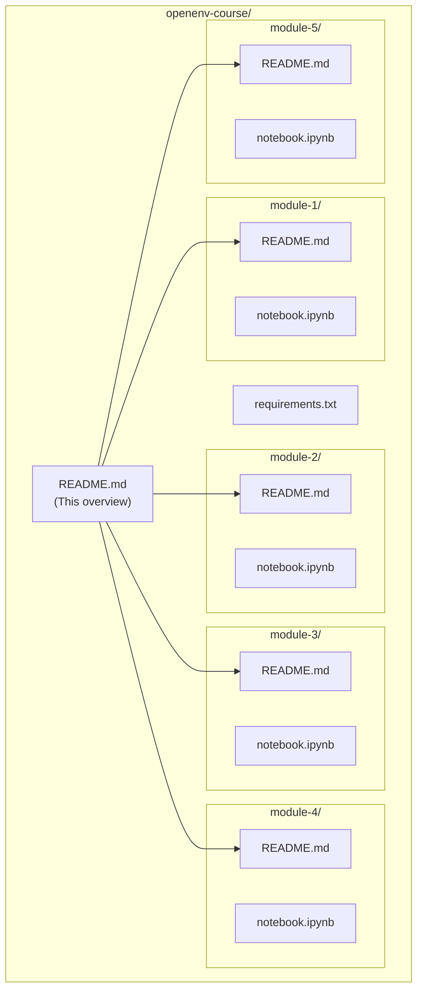
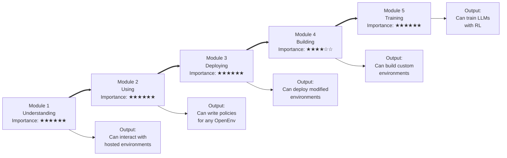
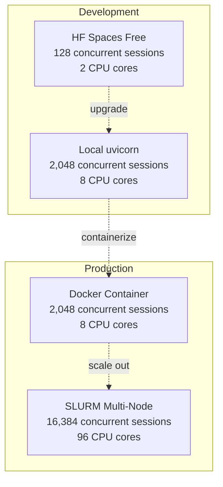

<!-- source: DeepWiki mcp.deepwiki.com · repo huggingface/openenv-course · page 1 OpenEnv Course Overview · fetched 2026-10-26 -->

# OpenEnv Course Overview

<details>
<summary>Relevant source files</summary>

The following files were used as context for generating this wiki page:

- [README.md](README.md)
- [requirements.txt](requirements.txt)

</details>


This document introduces the OpenEnv course repository at https://github.com/huggingface/openenv-course, a hands-on learning system for building and deploying reinforcement learning environments for large language model (LLM) training. The course is structured as five progressive modules that teach ML engineers, researchers, and hobbyists how to consume, deploy, build, and train with RL environments.

For details on the underlying architecture patterns (3-method interface, client-server model, WebSocket communication), see [System Architecture and Core Concepts](#1.1). For information about Python dependencies, framework integrations, and hardware requirements, see [Technology Stack and Dependencies](#1.2).

## Purpose and Target Audience

The OpenEnv course teaches the complete lifecycle of working with RL environments: from consuming hosted environments through typed clients, to deploying modifications, to building custom environments from scratch, to integrating them into LLM training pipelines using Group Relative Policy Optimization (GRPO).

**Target audience**: ML engineers, researchers, and hobbyists who want to train LLMs with reinforcement learning but lack experience with RL frameworks.

**Prerequisites**: Basic Python proficiency and familiarity with the Hugging Face ecosystem. No prior RL experience required.

Sources: [README.md:1-11]()

## Course Structure

Each of the five modules follows a consistent two-part structure:

| Component | Format | Purpose |
|-----------|--------|---------|
| `README.md` | Markdown document | Concepts, architecture, context |
| `notebook.ipynb` | Jupyter notebook | Hands-on code, runnable top-to-bottom |

All notebooks are designed to run in Google Colab without requiring local setup. The estimated time per module is 45-60 minutes.

Sources: [README.md:13-19]()

### Module Directory Structure



**Module Directory Structure**: Each module is a self-contained directory with conceptual material (`README.md`) and executable code (`notebook.ipynb`). The root `README.md` provides navigation and the root `requirements.txt` contains all dependencies for all five modules.

Sources: [README.md:21-29]()

## Five-Module Learning Progression

The course follows a deliberate pedagogical progression from consumption to creation to advanced integration:

### Module 1: Understanding OpenEnv

**What you learn**: The RL loop, limitations of Gymnasium for distributed environments, and the OpenEnv architecture.

**Key concepts**:
- The 3-method interface: `reset()`, `step()`, `state()`
- Client-server architecture and environments-as-microservices
- Hands-on interaction with three demo environments: `EchoEnv`, `OpenSpielEnv`, `TextArenaEnv`

**Notebook**: Interactive exploration of connecting to hosted environments, calling methods, and observing typed responses.

For detailed coverage of the interface and architecture, see [Module 1: Understanding OpenEnv](#2) and its sub-pages.

Sources: [README.md:25]()

### Module 2: Using Existing Environments

**What you learn**: How to consume environments from the Environment Hub, write policies, and run competitive evaluations.

**Key concepts**:
- `OpenSpielEnv` client providing unified interface for 6 games
- Type-safe models (`OpenSpielAction`, `OpenSpielObservation`) enabling IDE autocomplete
- Implementing the `select_action` interface for four policy types: Random, AlwaysStay, Smart, Learning
- Game-agnostic code that switches games by changing only `base_url`

**Notebook**: Writing and comparing policies across multiple OpenSpiel games (Catch, Tic-Tac-Toe, 2048, Kuhn Poker, Leduc Poker, Goofspiel).

For detailed coverage of policy development, see [Module 2: Policy Development with OpenSpiel](#3).

Sources: [README.md:26]()

### Module 3: Deploying Environments

**What you learn**: The clone-modify-deploy workflow using local development, Docker, and Hugging Face Spaces.

**Key concepts**:
- Local testing with `uvicorn` and hot-reloading
- Modifying existing environments (example: echo → reverse echo)
- The `openenv push` command and `openenv.yaml` configuration
- Environment variables: `WORKERS`, `MAX_CONCURRENT_ENVS`
- Three access methods: server (URL), repository (clone), registry (Docker image)

**Notebook**: Cloning EchoEnv, modifying server logic, testing locally, and deploying to HF Spaces.

For detailed coverage of deployment workflows, see [Module 3: Deployment Workflow](#4).

Sources: [README.md:27]()

### Module 4: Building Your Own Environment

**What you learn**: Creating production-ready custom environments from scratch using the 3-Component Pattern.

**Key concepts**:
- The `openenv init` scaffold command
- Implementing three components: `models.py`, `client.py`, `server/`
- The `Environment` abstract base class with `reset()` and `step()` methods
- The `EnvClient` base class with `_step_payload`, `_parse_result`, `_parse_state` methods
- `create_fastapi_app` for automatic endpoint generation
- Complete `WordGameEnvironment` example in ~100 lines of code

**Notebook**: Building WordGame from scaffold to deployment, implementing game logic, testing policies.

For detailed coverage of custom environment creation, see [Module 4: Building Custom Environments](#5).

Sources: [README.md:28]()

### Module 5: Training with OpenEnv + TRL

**What you learn**: Reinforcement learning for LLMs using Group Relative Policy Optimization (GRPO), integrated with TRL and OpenEnv.

**Key concepts**:
- GRPO algorithm and `GRPOTrainer` from TRL
- Implementing `rollout_func` for episode execution
- Multi-signal reward design (4 reward functions for Wordle: correct, greens, yellows, repetition)
- System prompt design and LLM output parsing
- `vLLM` colocate mode for GPU memory efficiency
- Training Qwen3-1.7B on Wordle task (90 minutes on A100 40GB)

**Notebook**: Complete training pipeline from TextArenaEnv setup through model evaluation to HF Hub upload.

For detailed coverage of LLM training, see [Module 5: LLM Training with GRPO](#6).

Sources: [README.md:29]()

## Module Progression and Importance Ratings



**Module Progression Diagram**: Shows the sequential learning path and the concrete capability gained at each stage. Modules 1, 2, 3, and 5 are rated highest importance (6.55 stars) as they represent core skills. Module 4 (4.55 stars) serves as a bridge between consumption and creation, teaching implementation details that may not be needed by all users.

Sources: [README.md:23-29]()

## Quick Start Example

The course begins with a quick start that demonstrates both environment types supported by OpenEnv:

```python
# Install core framework
pip install openenv-core

# Clone OpenEnv for typed clients
git clone https://github.com/meta-pytorch/OpenEnv.git
```

**Tool-based interface** (MCP-style, used by `EchoEnv`):

```python
from envs.echo_env import EchoEnv

with EchoEnv(base_url="https://openenv-echo-env.hf.space").sync() as env:
    env.reset()
    response = env.call_tool("echo_message", message="Hello, OpenEnv!")
    print(response)  # Hello, OpenEnv!
```

**Standard RL interface** (used by `OpenSpielEnv`, `TextArenaEnv`):

```python
from envs.openspiel_env import OpenSpielEnv
from envs.openspiel_env.models import OpenSpielAction

with OpenSpielEnv(base_url="https://openenv-openspiel-catch.hf.space").sync() as env:
    result = env.reset()
    result = env.step(OpenSpielAction(action_id=1, game_name="catch"))
    print(result.observation.legal_actions)
```

Every standard OpenEnv environment exposes the same 3-method interface: `reset()`, `step()`, `state()`.

Sources: [README.md:33-65]()

## Learning Outcomes by Phase

| Phase | Modules | Focus | Key Skills |
|-------|---------|-------|------------|
| **Consumption** | 1-2 | Understanding and using existing environments | Connect to hosted environments, write policies, understand typed models |
| **Deployment** | 3 | Modifying and deploying environments | Local testing with `uvicorn`, Docker containerization, HF Spaces deployment via `openenv push` |
| **Creation** | 4 | Building custom environments from scratch | Implement `Environment` ABC, extend `EnvClient`, use `create_fastapi_app` |
| **Integration** | 5 | LLM training with RL | Implement `rollout_func`, design reward functions, train with `GRPOTrainer` |

Sources: [README.md:23-29]()

## Core Dependencies Overview

The course uses a curated set of dependencies installed via `requirements.txt`:

| Category | Key Packages | Required For |
|----------|--------------|--------------|
| **Core Framework** | `openenv-core>=0.2.2` | All modules |
| **Server-Side** | `fastapi>=0.104.0`, `uvicorn>=0.24.0`, `fastmcp>=3.0.0`, `pydantic>=2.0.0` | Module 3 (local testing) |
| **LLM Training** | `trl>=0.17.0`, `transformers>=4.40.0`, `datasets>=2.18.0`, `accelerate>=0.28.0` | Module 5 |
| **Optional GPU** | `vllm`, `bitsandbytes` | Module 5 (requires CUDA + Linux) |
| **Utilities** | `huggingface-hub>=0.22.0`, `trackio` | Deployment and experiment tracking |

**GPU requirement**: Only Module 5 requires a GPU (A100 40GB recommended for the Wordle training example).

For complete dependency details and version rationale, see [Technology Stack and Dependencies](#1.2).

Sources: [requirements.txt:1-30]()

## Scaling and Production Considerations



**Scaling Options**: The course teaches deployment starting with HF Spaces (free tier, ideal for demos) and progressing to Docker containers. For production workloads beyond 2,048 concurrent sessions, multi-node deployments with load balancing are covered in the scaling appendix.

**Key environment variables**:
- `WORKERS`: Number of uvicorn worker processes (default: 4)
- `MAX_CONCURRENT_ENVS`: Maximum WebSocket sessions per worker (default: 100)

With 8 workers, a single container handles ~2,048 concurrent sessions for simple text environments.

**WebSocket advantage**: OpenEnv uses WebSocket (`/ws`) for persistent sessions. Each `step()` call is a lightweight frame (~0.1ms overhead) versus TCP handshake overhead (~10-50ms) with HTTP.

Sources: [README.md:75-126]()

## Repository Links and Resources

| Resource | URL/Location |
|----------|--------------|
| **Course Repository** | https://github.com/huggingface/openenv-course |
| **OpenEnv Core** | https://github.com/meta-pytorch/OpenEnv |
| **Environment Hub** | https://huggingface.co/collections/openenv/environment-hub |
| **TRL Documentation** | https://huggingface.co/docs/trl |
| **Scaling Experiments** | https://github.com/burtenshaw/openenv-scaling |

Sources: [README.md:67-71](), [README.md:119]()

## Validation and Quality Assurance

The course repository includes validation scripts to ensure code quality across all modules:

- `validate_notebooks.py`: Extracts and validates code cells from Jupyter notebooks, performs syntax checking, and conditionally executes cells
- `validate_snippets.py`: Extracts Python code blocks from markdown files, validates syntax, and reports errors

For details on the validation system, see [Development Tools and Quality Assurance](#7).

Sources: Inferred from table of contents section 7

## Navigation to Detailed Documentation

This overview provides a roadmap of the course structure. For in-depth technical documentation:

- **Architecture details**: See [System Architecture and Core Concepts](#1.1) for the 3-method interface, client-server model, and WebSocket communication patterns
- **Technology stack**: See [Technology Stack and Dependencies](#1.2) for dependency details and framework integrations
- **Module-specific guides**: See pages [Module 1: Understanding OpenEnv](#2) through [Module 5: LLM Training with GRPO](#6) for comprehensive module documentation
- **Development tools**: See [Development Tools and Quality Assurance](#7) for validation scripts and quality checks

---

