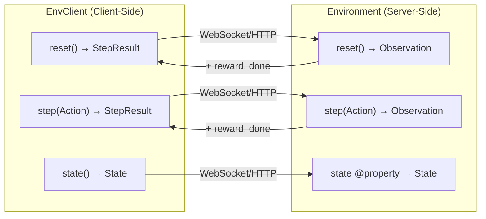
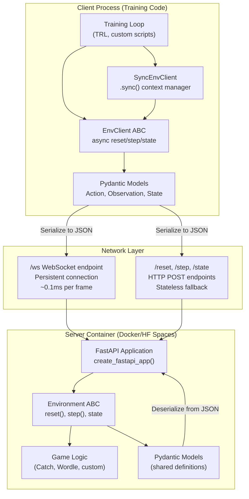
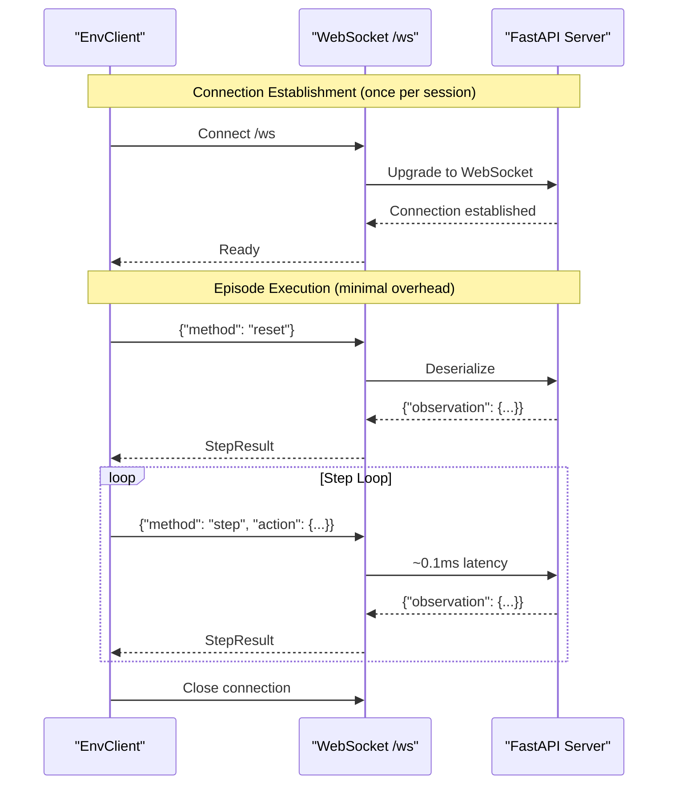
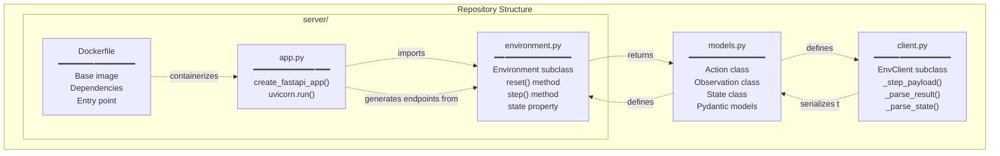
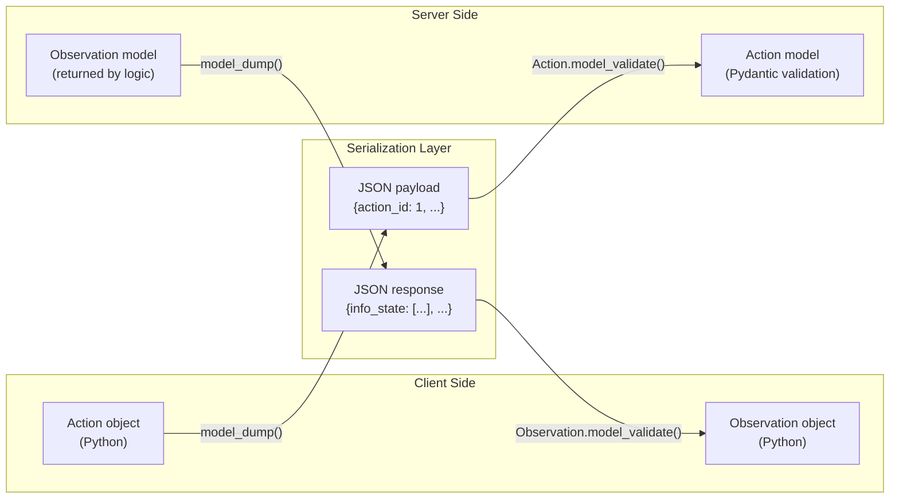
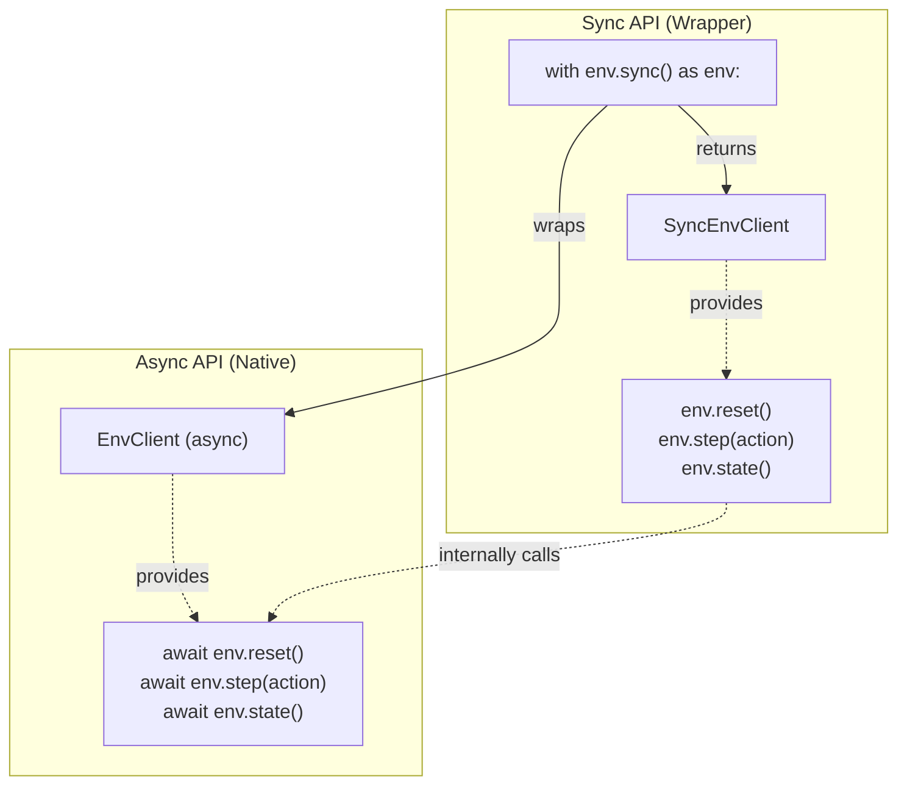

<!-- source: DeepWiki mcp.deepwiki.com · repo huggingface/openenv-course · page 1.1 System Architecture and Core Concepts · fetched 2026-10-26 -->

# System Architecture and Core Concepts

<details>
<summary>Relevant source files</summary>

The following files were used as context for generating this wiki page:

- [README.md](README.md)
- [module-1/README.md](module-1/README.md)

</details>


This document explains the foundational architecture patterns that underpin all OpenEnv environments: the 3-method interface contract, client-server separation, WebSocket-based communication, and the environments-as-microservices philosophy. These concepts form the basis for all five course modules.

For specific usage patterns of existing environments, see [#2](#2). For deployment mechanics, see [#4](#4). For creating custom environments from scratch, see [#5](#5).

## Overview: Environments as Microservices

OpenEnv treats RL environments as independently deployable microservices rather than in-process libraries. This architectural decision addresses production requirements that traditional frameworks like Gymnasium do not handle: process isolation, language-agnostic access, versioned deployments, and horizontal scalability.

The system separates concerns into two distinct runtime contexts:

| Context | Location | Responsibility | Language |
|---------|----------|----------------|----------|
| **Client** | Training/research code | Action selection, learning, orchestration | Python (extensible to others) |
| **Server** | Docker container | Environment logic, state management | Python (via FastAPI) |

Communication occurs over WebSocket for persistent connections or HTTP for stateless operations. All data types are defined using Pydantic models, providing compile-time type checking and runtime validation.

Sources: [README.md:34-45](), [module-1/README.md:34-44]()

## The 3-Method Interface Contract

Every OpenEnv environment exposes exactly three methods, forming a universal contract across all environment types:



**Method Semantics**

| Method | Server Contract | Client Return | Purpose |
|--------|----------------|---------------|---------|
| `reset()` | Returns `Observation` | `StepResult` (observation, reward=0, done=False) | Initialize new episode |
| `step(action)` | Accepts `Action`, returns `Observation` | `StepResult` (observation, reward, done) | Execute action, advance state |
| `state()` | Property returning `State` | `State` (episode_id, step_count, metadata) | Query episode metadata |

The client-side `EnvClient` automatically wraps server `Observation` objects into `StepResult` containers that include computed rewards and termination flags. This separation allows server-side environments to focus purely on environment dynamics while the client handles episode management.

Sources: [module-1/README.md:82-90](), [module-1/README.md:107-125]()

## Client-Server Architecture

### Component Diagram



Sources: [module-1/README.md:46-71](), [README.md:79-85]()

### Process Isolation

The client and server run in separate processes, communicating only through network protocols. This isolation provides:

- **Stability**: Environment crashes do not terminate training
- **Security**: Untrusted environment code runs in containers
- **Reproducibility**: Docker images guarantee consistent behavior
- **Scalability**: Deploy multiple containers behind load balancers

A single server container manages multiple concurrent environment instances using WebSocket session multiplexing. Each WebSocket connection receives its own server-side `Environment` instance with isolated state.

Sources: [module-1/README.md:21-31](), [README.md:83-84]()

## Communication Protocols

### WebSocket vs HTTP

OpenEnv defaults to WebSocket (`/ws`) for persistent sessions:



HTTP endpoints (`/reset`, `/step`, `/state`) provide stateless access for debugging and testing. Each HTTP request incurs TCP handshake overhead (~10-50ms) compared to WebSocket frames (~0.1ms).

Sources: [README.md:79-85](), [module-1/README.md:73-79]()

### Endpoint Mapping

The `create_fastapi_app` function automatically generates six endpoints from an `Environment` implementation:

| Endpoint | Protocol | Method | Purpose |
|----------|----------|--------|---------|
| `/ws` | WebSocket | N/A | Persistent session interface (default) |
| `/reset` | HTTP POST | `reset()` | Initialize episode (stateless) |
| `/step` | HTTP POST | `step(action)` | Execute action (stateless) |
| `/state` | HTTP GET | `state` | Query metadata (stateless) |
| `/health` | HTTP GET | N/A | Liveness check |
| `/docs` | HTTP GET | N/A | OpenAPI documentation |

The client automatically selects WebSocket when available, falling back to HTTP if the connection fails.

Sources: [module-1/README.md:73-79]()

## The 3-Component Pattern

Every OpenEnv environment follows a standardized file structure:



Sources: [module-1/README.md:93-105]()

### Component Responsibilities

**models.py**: Type-safe contracts shared between client and server. Defines the exact structure of actions, observations, and state using Pydantic models. These models provide:
- IDE autocomplete for field access
- Runtime validation of data types
- Automatic JSON serialization/deserialization

**client.py**: Network communication layer extending `EnvClient` ABC. Implements three serialization hooks:
- `_step_payload(action)`: Convert typed action to JSON dictionary
- `_parse_result(data)`: Convert JSON response to `StepResult`
- `_parse_state(data)`: Convert JSON response to `State`

**server/environment.py**: Core game/simulation logic extending `Environment` ABC. Implements:
- `reset()`: Initialize episode, return first observation
- `step(action)`: Process action, update state, return next observation
- `state` property: Return episode metadata

**server/app.py**: FastAPI application entry point. Calls `create_fastapi_app(Environment)` to auto-generate all endpoints and configures uvicorn for serving.

**server/Dockerfile**: Container definition specifying Python version, dependencies, and startup command. Enables deployment to any container runtime.

Sources: [module-1/README.md:93-125]()

## Type Safety with Pydantic

All data crossing the network boundary uses Pydantic models for validation:



Example type contract from OpenSpielEnv:

[envs/openspiel_env/models.py:1-30]() defines `OpenSpielAction` and `OpenSpielObservation` classes. The client uses these for type hints:

```python
# Type-safe interaction
result = env.step(OpenSpielAction(action_id=1, game_name="catch"))
print(result.observation.legal_actions)  # IDE autocompletes 'legal_actions'
```

Without type definitions, this would be:
```python
# Unsafe interaction (Gymnasium style)
result = env.step(1)
print(result[0][3])  # What is index 3? No IDE help.
```

Sources: [README.md:55-63](), [module-1/README.md:23-31]()

## Sync vs Async Client Usage

The `EnvClient` ABC provides async methods by default, but the `.sync()` context manager converts them to synchronous calls for notebook and script usage:



Usage patterns:

**Notebook/Script** (synchronous):
```python
with OpenSpielEnv(base_url="...").sync() as env:
    result = env.reset()
    result = env.step(action)
```

**Production/TRL** (asynchronous):
```python
env = OpenSpielEnv(base_url="...")
result = await env.reset()
result = await env.step(action)
```

The synchronous wrapper runs an event loop internally, converting async calls to blocking operations. This is implemented in the `SyncEnvClient` class returned by `.sync()`.

Sources: [module-1/README.md:119-123](), [README.md:50-63]()

## Scalability Characteristics

The WebSocket-based architecture enables high concurrency within single containers:

| Deployment | Max Concurrent Sessions | Infrastructure |
|------------|------------------------|----------------|
| HF Spaces (free) | 128 | 2 CPU cores, uvicorn default workers |
| Local uvicorn | 2,048 | 8 CPU cores, 8 workers, 256 sessions/worker |
| Docker container | 2,048 | Same as local uvicorn |
| SLURM multi-node | 16,384 | 96 cores, multiple containers + load balancer |

Configuration via environment variables:

| Variable | Default | Effect |
|----------|---------|--------|
| `WORKERS` | 4 | Number of uvicorn worker processes |
| `MAX_CONCURRENT_ENVS` | 100 | WebSocket sessions per worker |

Each worker process handles multiple WebSocket connections using async I/O. Each connection receives an isolated `Environment` instance with independent state.

For scaling beyond single containers, multiple instances can be deployed behind Envoy load balancers, distributing connections across replicas.

Sources: [README.md:86-126]()

## Environments vs Tools: MCP Interface

Some environments use a tool-based interface instead of the standard reset/step pattern. The EchoEnv example implements the Model Context Protocol (MCP):

```python
# Tool-based interface (EchoEnv)
env.reset()
response = env.call_tool("echo_message", message="Hello")

# Standard interface (OpenSpielEnv)
env.reset()
result = env.step(OpenSpielAction(action_id=1))
```

Tool-based environments expose `list_tools()` and `call_tool(name, **kwargs)` methods instead of `step(action)`. This pattern is used for environments that function as interactive utilities rather than episodic games.

Both interfaces share the same client-server architecture and WebSocket communication. The choice depends on the environment's semantics.

Sources: [module-1/README.md:127-129](), [README.md:47-53]()

## Key Design Principles

The architecture embodies five core principles:

1. **Isolation**: Environments run in containers, separated from training code
2. **Standardization**: Universal 3-method interface across all environments
3. **Type Safety**: Pydantic models catch errors before runtime
4. **Scalability**: WebSocket multiplexing + container orchestration
5. **Language Agnostic**: HTTP/WebSocket enables clients in any language

These principles distinguish OpenEnv from in-process frameworks like Gymnasium, trading slight network overhead (~0.1ms per step) for production-grade isolation, deployment, and scalability.

Sources: [module-1/README.md:34-44](), [README.md:79-85]()

---

