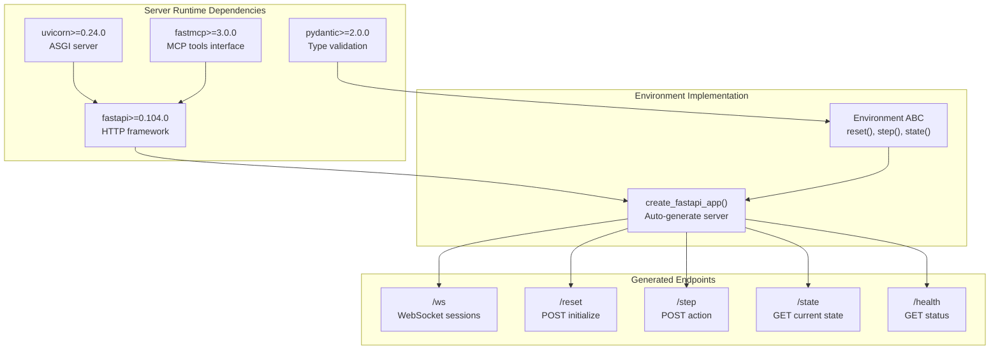
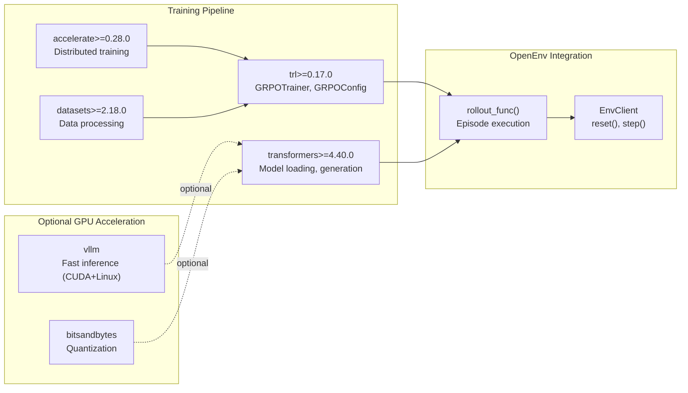
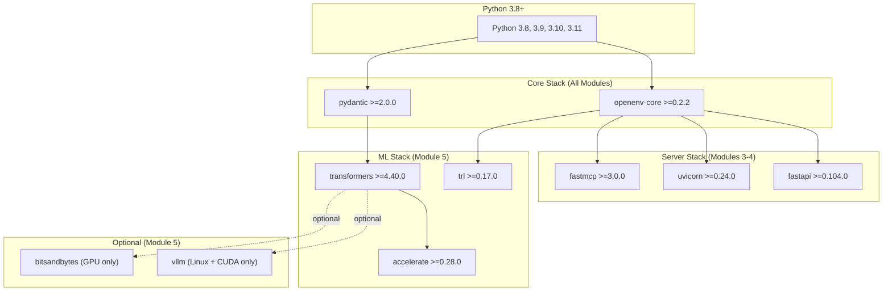

<!-- source: DeepWiki mcp.deepwiki.com · repo huggingface/openenv-course · page 1.2 Technology Stack and Dependencies · fetched 2026-10-26 -->

# Technology Stack and Dependencies

<details>
<summary>Relevant source files</summary>

The following files were used as context for generating this wiki page:

- [README.md](README.md)
- [requirements.txt](requirements.txt)

</details>


This page documents the Python packages, framework integrations, and hardware requirements for the OpenEnv course. It covers version constraints, dependency layers, and how different components interact across the five modules. For the architectural principles that these dependencies support, see [System Architecture and Core Concepts](#1.1). For deployment-specific configurations, see [Deployment to HF Spaces with openenv push](#4.3).

## Core Framework Layer

The `openenv-core` package (version 0.2.2+) provides the foundational abstractions that all modules build upon. This package contains the base classes and type definitions that enforce the 3-method interface across all environments.

| Package | Version | Primary Components | Used In |
|---------|---------|-------------------|---------|
| `openenv-core` | >=0.2.2 | `EnvClient`, `Environment` ABC, `create_fastapi_app` | All modules |
| `pydantic` | >=2.0.0 | Data validation, type-safe models | All modules |

The `EnvClient` base class (from `openenv-core`) provides the client-side interface. Custom environment clients like `EchoEnv`, `OpenSpielEnv`, and `TextArenaEnv` extend this class and implement three serialization methods:

- `_step_payload()` - Converts typed Action objects to JSON
- `_parse_result()` - Deserializes JSON to Observation objects
- `_parse_state()` - Deserializes JSON to State objects

The `Environment` ABC (from `openenv-core`) defines the server-side contract. Custom environments implement:

- `reset()` - Initialize episode state
- `step()` - Process actions and return observations
- `state()` - Return current episode state

The `create_fastapi_app()` function automatically generates FastAPI endpoints (`/reset`, `/step`, `/state`, `/ws`, `/health`) from an `Environment` instance.

**Sources:** [requirements.txt:8-9](), [README.md:34-35]()

## Web Stack Dependencies

The server-side environment runtime uses the FastAPI ecosystem for HTTP/WebSocket communication. These dependencies are required when running environments locally in Module 3 or building custom environments in Module 4.



**Dependency Breakdown**

| Package | Purpose | Key Features | Configuration |
|---------|---------|--------------|---------------|
| `fastapi` | Web framework | Auto-generated OpenAPI docs at `/docs`, async support | Used in `create_fastapi_app()` |
| `uvicorn` | ASGI server | Multi-worker support, WebSocket persistence | `WORKERS` env var (default: 4) |
| `fastmcp` | MCP protocol | Tool-based interface for EchoEnv | Used in tool-calling environments |
| `pydantic` | Validation | Runtime type checking, serialization | All Action/Observation/State models |

The `WORKERS` environment variable (Module 3) controls Uvicorn worker processes. Each worker can handle `MAX_CONCURRENT_ENVS` WebSocket sessions (default: 100).

**Sources:** [requirements.txt:11-15](), [README.md:91-96]()

## Machine Learning Stack

Module 5 introduces dependencies for LLM training using reinforcement learning. These packages integrate with OpenEnv through TRL's `GRPOTrainer` and the `rollout_func` interface.



**Core ML Dependencies**

| Package | Version | Module 5 Usage | Notes |
|---------|---------|----------------|-------|
| `trl` | >=0.17.0 | `GRPOTrainer`, `GRPOConfig` | Reinforcement learning for LLMs |
| `transformers` | >=4.40.0 | Model loading, `.generate()` | Qwen3-1.7B in training example |
| `datasets` | >=2.18.0 | Data loading, processing | Not heavily used in Module 5 |
| `accelerate` | >=0.28.0 | GPU memory management | Required for distributed training |

**Optional Dependencies**

- `vllm` - Fast inference server with colocated mode. Requires CUDA and Linux. Used in Module 5 for efficient LLM generation during rollouts. Uncomment in [requirements.txt:22]() for GPU environments.
- `bitsandbytes` - Model quantization for memory efficiency. Uncomment in [requirements.txt:23]() for 4-bit/8-bit quantization.

The `trackio` package provides experiment tracking for Module 5 training runs.

**Sources:** [requirements.txt:18-26](), [README.md:29]()

## Domain-Specific Framework Integrations

OpenEnv integrates with existing RL and text game frameworks through environment wrappers. These integrations are not direct dependencies but are accessed through hosted HF Spaces or locally deployed servers.

### OpenSpiel Integration (Module 2)

The `OpenSpielEnv` client provides a unified interface to 6 wrapped games:

- `catch` - Catch falling balls
- `tic_tac_toe` - Classic 3x3 grid game
- `2048` - Number sliding puzzle
- `breakthrough` - Chess-like board game
- `pig` - Dice rolling game
- `connect_four` - 7x6 grid connection game

**Type Models:** `OpenSpielAction`, `OpenSpielObservation`, `OpenSpielState`

The client is game-agnostic - switching games only requires changing the `base_url` parameter:

```python
# From Module 2 examples
from envs.openspiel_env import OpenSpielEnv

env = OpenSpielEnv(base_url="https://openenv-openspiel-catch.hf.space")
# or
env = OpenSpielEnv(base_url="https://openenv-openspiel-tic-tac-toe.hf.space")
```

**Sources:** [README.md:55-62]()

### TextArena Integration (Module 5)

The `TextArenaEnv` client wraps text-based games for LLM training. Module 5 uses the Wordle environment:

- Text-based observation format (game state as strings)
- Action parsing from LLM-generated text
- Multi-signal rewards (correct word, green letters, yellow letters, repetition penalty)

The integration demonstrates OpenEnv's flexibility - the same `reset()`/`step()`/`state()` interface works for both turn-based board games (OpenSpiel) and language-based puzzles (TextArena).

**Sources:** [README.md:29]()

## Hardware Requirements by Module

Different modules have different computational requirements, ranging from CPU-only development to GPU-intensive training.

| Module | Hardware | Memory | GPU Required | Typical Environment |
|--------|----------|--------|--------------|---------------------|
| 1: Understanding | CPU | 4GB | No | Local machine, Colab free |
| 2: Using Environments | CPU | 4GB | No | Local machine, Colab free |
| 3: Deploying | CPU | 8GB | No | Local Docker or HF Spaces |
| 4: Building Environments | CPU | 8GB | No | Local Docker or HF Spaces |
| 5: Training LLMs | GPU | 40GB VRAM | **Yes** | A100 40GB, 90 min training |

### Module 5 GPU Requirements

The GRPO training example requires:

- **GPU:** A100 40GB (or equivalent 40GB VRAM GPU)
- **Training time:** ~90 minutes for Wordle task
- **Memory optimization:** vLLM colocate mode shares GPU between trainer and inference server
- **Alternative:** Smaller GPUs with quantization (`bitsandbytes`) or smaller models

For production-scale training with multiple environments:

| Setup | Concurrent Sessions | Hardware |
|-------|---------------------|----------|
| Development | 100-128 | HF Spaces free tier (CPU) |
| Training (single GPU) | 2,048 | 1x A100 40GB + Uvicorn |
| Production training | 16,384 | Multi-node SLURM + Envoy |

**Sources:** [README.md:109-119](), [requirements.txt:6]()

## Dependency Installation Patterns

The course supports three installation scenarios based on which modules you're running.

### Minimal Installation (Modules 1-2)

```bash
# Client-side only - connect to hosted environments
pip install openenv-core
```

This installs only the `EnvClient` base class and type definitions. Sufficient for consuming hosted environments via HTTP/WebSocket.

### Full Development (Modules 3-4)

```bash
# Install all dependencies including server stack
pip install -r requirements.txt
```

Installs server-side dependencies (`fastapi`, `uvicorn`, `fastmcp`) for running environments locally and building custom environments.

### Training Setup (Module 5)

```bash
# Install base dependencies
pip install -r requirements.txt

# Uncomment and install GPU dependencies
pip install vllm bitsandbytes  # Requires CUDA + Linux
```

Adds ML training stack with optional GPU acceleration packages.

### Repository Access Pattern

All modules require cloning the OpenEnv repository to access typed environment clients:

```python
import sys, os
repo = os.path.abspath('OpenEnv')
sys.path.insert(0, repo)
sys.path.insert(0, os.path.join(repo, 'src'))

# Now typed clients are importable
from envs.echo_env import EchoEnv
from envs.openspiel_env import OpenSpielEnv
from envs.textarena_env import TextArenaEnv
```

This pattern appears in [README.md:42-45]() and is used throughout all module notebooks.

**Sources:** [README.md:34-39](), [requirements.txt:1-30]()

## Version Compatibility Matrix

The following table shows tested version combinations across Python environments:



**Minimum Versions**

All version constraints in [requirements.txt]() use `>=` to allow newer compatible versions. The specified versions are the minimum tested versions:

- `openenv-core>=0.2.2` - Introduces `create_fastapi_app()` improvements
- `pydantic>=2.0.0` - Required for Pydantic v2 model definitions
- `fastapi>=0.104.0` - WebSocket stability improvements
- `transformers>=4.40.0` - Supports Qwen3 model architecture
- `trl>=0.17.0` - Includes `GRPOTrainer` implementation

**Platform Constraints**

- `vllm` requires Linux and CUDA-compatible GPU
- `bitsandbytes` requires CUDA for quantization
- All other packages are cross-platform (Windows, macOS, Linux)

**Sources:** [requirements.txt:1-30]()

## Utility Dependencies

Additional packages support experiment tracking and Hub interactions:

| Package | Version | Purpose | Used In |
|---------|---------|---------|---------|
| `trackio` | Latest | Experiment logging | Module 5 training metrics |
| `huggingface-hub` | >=0.22.0 | Model/Space upload | `openenv push`, model saving |

The `huggingface-hub` package powers the `openenv push` command in Module 3, which uploads environment code to HF Spaces. It also handles model pushing in Module 5 after training completes.

**Sources:** [requirements.txt:26-29]()

---

