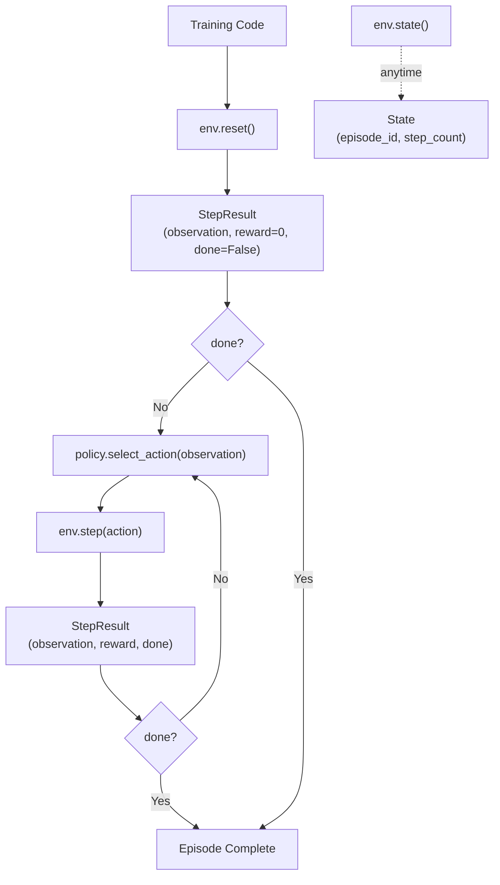
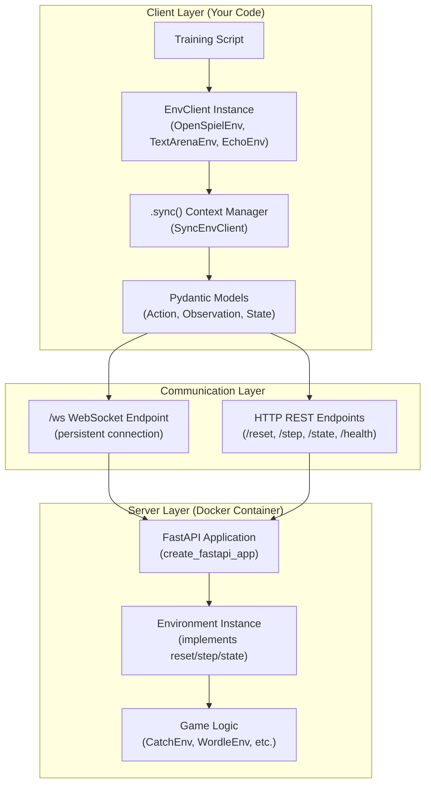
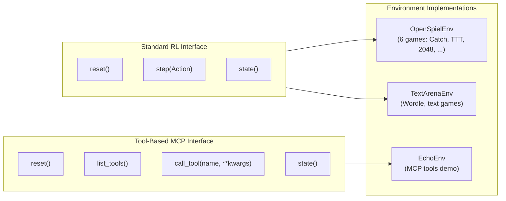
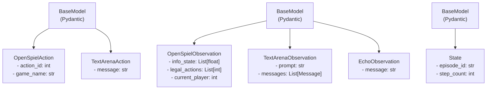

<!-- source: DeepWiki mcp.deepwiki.com · repo huggingface/openenv-course · page 2 Module 1: Understanding OpenEnv · fetched 2026-10-26 -->

# Module 1: Understanding OpenEnv

<details>
<summary>Relevant source files</summary>

The following files were used as context for generating this wiki page:

- [module-1/README.md](module-1/README.md)
- [module-1/notebook.ipynb](module-1/notebook.ipynb)

</details>


## Purpose and Scope

This module introduces the foundational concepts of OpenEnv: the 3-method interface (`reset()`, `step()`, `state()`), client-server architecture, and type-safe interaction patterns. You will learn how to connect to hosted environments and execute episodes using a consistent API that works across all environment types.

For details on the specific interface methods and their implementations, see [The 3-Method Interface](#2.1). For architectural principles and comparison with Gymnasium, see [Client-Server Architecture](#2.2). For the distinction between standard RL and tool-based environments, see [Environment Types](#2.3).

**Learning objectives:**
- Understand the universal 3-method interface shared by all OpenEnv environments
- Connect to and interact with three demo environments: EchoEnv, OpenSpielEnv, TextArenaEnv
- Recognize the client-server separation and communication patterns
- Work with type-safe Pydantic models for actions and observations
- Choose between sync and async execution patterns

---

## The Universal Interface: reset, step, state

Every OpenEnv environment exposes exactly three methods, regardless of the underlying game logic, deployment target, or complexity. This consistency enables you to write environment-agnostic code that works with any OpenEnv environment.

### Method Signatures

| Method | Purpose | Input | Output |
|--------|---------|-------|--------|
| `reset()` | Initialize a new episode | Optional kwargs | `StepResult` |
| `step(action)` | Execute one environment transition | Environment-specific `Action` | `StepResult` |
| `state()` | Query episode metadata | None | `State` |

### StepResult Structure

The `StepResult` object returned by both `reset()` and `step()` contains:

| Field | Type | Description |
|-------|------|-------------|
| `observation` | Environment-specific | Current game state visible to agent |
| `reward` | `float` | Scalar reward signal |
| `done` | `bool` | Episode termination indicator |
| `info` | `dict` | Additional diagnostic information |

### The Interaction Loop



**Diagram: Standard Episode Execution Flow**

Sources: [module-1/README.md:82-90](), [module-1/notebook.ipynb:104-127]()

### Example: OpenSpiel Catch

The notebook demonstrates the interface with the Catch game, where the environment manages a falling ball and paddle:

```python
# From notebook: connecting to hosted environment
with OpenSpielEnv(base_url=OPENSPIEL_URL).sync() as env:
    result = env.reset()  # Initialize episode
    
    while not result.done:
        # Select action from legal moves
        action_id = random.choice(result.observation.legal_actions)
        
        # Execute transition
        result = env.step(OpenSpielAction(
            action_id=action_id,
            game_name='catch'
        ))
        
    # Query metadata
    state = env.state()
```

The pattern is identical whether you're playing Catch, Wordle, or a custom environment. Only the `Action` and `Observation` types change.

Sources: [module-1/notebook.ipynb:94-127](), [module-1/README.md:82-90]()

---

## Client-Server Architecture

OpenEnv implements environments as **network-accessible microservices** rather than in-process Python objects. This architectural decision addresses limitations in Gymnasium for production LLM training.

### Architectural Diagram



**Diagram: Three-Layer Architecture from Client to Server**

Sources: [module-1/README.md:46-71](), [module-1/README.md:108-126]()

### Comparison with Gymnasium

| Aspect | Gymnasium | OpenEnv |
|--------|-----------|---------|
| **Process Model** | In-process (same Python interpreter) | Out-of-process (Docker container) |
| **Communication** | Function calls | WebSocket/HTTP |
| **Type Safety** | Runtime numpy arrays | Compile-time Pydantic models |
| **Isolation** | Shared memory (crashes affect training) | Process isolation (crashes contained) |
| **Deployment** | Manual environment setup | `openenv push` → HF Spaces |
| **Scalability** | Single machine | Kubernetes-ready microservices |
| **Language Support** | Python only | Any language (HTTP client) |

The microservices approach enables:
- **Isolation**: Environment crashes don't kill your training run
- **Standardization**: HTTP/WebSocket API works from any language
- **Versioning**: Docker images ensure reproducibility across machines
- **Scalability**: Deploy 128 concurrent sessions on HF Spaces Free tier, 16,384+ on SLURM clusters

Sources: [module-1/README.md:19-33](), [module-1/README.md:36-44]()

### Communication Protocol

By default, clients connect via WebSocket (`/ws`) for persistent, low-latency communication (~0.1ms per frame). The protocol is transparent to users:

```python
# User writes this
env.reset()

# Internally:
# 1. EnvClient serializes to JSON via Pydantic
# 2. Sends WebSocket message to /ws
# 3. FastAPI server deserializes
# 4. Calls environment.reset()
# 5. Serializes response
# 6. Returns via WebSocket
# 7. Client deserializes to typed Observation
```

HTTP endpoints (`/reset`, `/step`, `/state`) are also available for stateless interactions or debugging.

Sources: [module-1/README.md:73-79](), [module-1/README.md:56-58]()

---

## Environment Types and Interfaces

OpenEnv supports two interface paradigms: **standard RL environments** (reset/step/state) and **tool-based MCP environments** (list_tools/call_tool).

### Interface Type Comparison



**Diagram: Two Interface Paradigms in OpenEnv**

Sources: [module-1/README.md:127-128](), [module-1/notebook.ipynb:38-68]()

### Standard RL Environments

Environments like `OpenSpielEnv` and `TextArenaEnv` follow the classic RL pattern:

```python
# OpenSpiel Catch example
from envs.openspiel_env import OpenSpielEnv
from envs.openspiel_env.models import OpenSpielAction

with OpenSpielEnv(base_url=url).sync() as env:
    result = env.reset()
    # result.observation.legal_actions: [0, 1, 2]
    # result.observation.info_state: numpy array
    
    result = env.step(OpenSpielAction(action_id=1, game_name='catch'))
    # result.reward: float
    # result.done: bool
```

**Key characteristics:**
- Discrete action spaces with `legal_actions`
- Structured observations (info_state, current_player, etc.)
- Episode-based with clear termination (`done=True`)
- Suitable for game AI and competitive tasks

Sources: [module-1/notebook.ipynb:94-127](), [module-1/notebook.ipynb:99-100]()

### Tool-Based MCP Environments

`EchoEnv` implements the Model Context Protocol (MCP) interface:

```python
# Echo environment example
from envs.echo_env import EchoEnv

with EchoEnv(base_url=url).sync() as env:
    result = env.reset()
    
    # Discover available tools
    tools = env.list_tools()
    # Returns: [Tool(name='echo_message', description='...'), ...]
    
    # Invoke tools by name
    response = env.call_tool('echo_message', message='Hello')
    # Returns: tool execution result
```

**Key characteristics:**
- Dynamic tool discovery via `list_tools()`
- Tool invocation via `call_tool(name, **kwargs)`
- No predefined action space (tools define interface)
- Suitable for LLM agent tasks and function calling

Sources: [module-1/notebook.ipynb:38-68](), [module-1/notebook.ipynb:51-63]()

### Environment Type Matrix

| Environment | Type | Base Class | Action Type | Hosted URL |
|-------------|------|------------|-------------|------------|
| EchoEnv | MCP Tool-based | `MCPToolClient` | Tool name + kwargs | `https://openenv-echo-env.hf.space` |
| OpenSpielEnv | Standard RL | `EnvClient` | `OpenSpielAction` | `https://openenv-openspiel-catch.hf.space` |
| TextArenaEnv | Standard RL | `EnvClient` | `TextArenaAction` | `https://burtenshaw-textarena.hf.space` |

Sources: [module-1/notebook.ipynb:29](), [module-1/notebook.ipynb:102](), [module-1/notebook.ipynb:156]()

---

## Type Safety with Pydantic Models

OpenEnv enforces type safety using Pydantic models for all data exchanged between client and server. This provides compile-time error checking and IDE autocomplete.

### Type Hierarchy



**Diagram: Pydantic Model Inheritance for Type Safety**

Sources: [module-1/README.md:99](), [module-1/notebook.ipynb:100](), [module-1/notebook.ipynb:154]()

### Benefits of Type Safety

**1. IDE Autocomplete**

```python
result = env.step(action)
# Typing "result.observation." triggers autocomplete:
# - legal_actions
# - info_state
# - current_player
```

**2. Early Error Detection**

```python
# This fails at instantiation, not during training:
action = OpenSpielAction(action_id="invalid")  # Type error: str not int
```

**3. Serialization Guarantees**

Pydantic handles JSON serialization/deserialization automatically:

```python
# Client side
action = OpenSpielAction(action_id=2, game_name='catch')
# Pydantic serializes to: {"action_id": 2, "game_name": "catch"}

# Server side receives JSON, Pydantic deserializes to typed object
```

### Example: OpenSpielObservation

The `OpenSpielObservation` model from the Catch example:

```python
# Line 107-108: Accessing typed fields
print(f'Legal actions: {result.observation.legal_actions}')
print(f'Info state length: {len(result.observation.info_state)}')
```

The client receives a fully-typed `OpenSpielObservation` object, not a generic dictionary or numpy array. Your IDE knows the schema at development time.

Sources: [module-1/notebook.ipynb:107-108](), [module-1/README.md:25]()

---

## Sync vs Async Execution

OpenEnv clients are asynchronous by default (using `async/await`). For notebooks and simple scripts, the `.sync()` wrapper provides a synchronous interface.

### Pattern Comparison

**Synchronous (Notebooks, Scripts)**

```python
# Uses .sync() context manager
with OpenSpielEnv(base_url=url).sync() as env:
    result = env.reset()          # No await
    result = env.step(action)     # No await
    state = env.state()           # No await
```

**Asynchronous (Production, Training Loops)**

```python
# Direct async context manager
async with OpenSpielEnv(base_url=url) as env:
    result = await env.reset()    # Explicit await
    result = await env.step(action)
    state = await env.state()
```

### Implementation: SyncEnvClient

The `.sync()` method returns a `SyncEnvClient` wrapper that intercepts async method calls and executes them synchronously:

```python
# From comment in notebook line 40-42:
# MCP methods (list_tools, call_tool) are async; .sync() wraps them automatically
# via SyncEnvClient.__getattr__, so the same .sync() pattern works here.
```

The wrapper uses `asyncio.run()` internally to execute async methods in a synchronous context, making it suitable for interactive notebooks where `await` syntax is inconvenient.

### When to Use Each

| Context | Pattern | Reason |
|---------|---------|--------|
| Jupyter Notebooks | `.sync()` | Simpler syntax, no async cell magic required |
| Simple Scripts | `.sync()` | Avoid asyncio event loop boilerplate |
| Training Loops | `async with` | Native async enables concurrent environment execution |
| Production Services | `async with` | Better integration with async frameworks (FastAPI, etc.) |

Sources: [module-1/notebook.ipynb:181-196](), [module-1/notebook.ipynb:40-42](), [module-1/README.md:122]()

---

## Demo Environments

Module 1 provides three hosted environments that demonstrate different interface patterns and use cases.

### EchoEnv: Tool-Based MCP Interface

**Purpose:** Minimal MCP environment for learning tool discovery and invocation

**URL:** `https://openenv-echo-env.hf.space`

**Interface:**
- `reset()` → Initialize episode
- `list_tools()` → Discover available tools
- `call_tool(name, **kwargs)` → Execute tool by name
- `state()` → Query metadata

**Available Tools:**

| Tool Name | Parameters | Returns |
|-----------|------------|---------|
| `echo_message` | `message: str` | Echoes message back |
| `echo_with_length` | `message: str` | Returns message + length |

**Example interaction:**

```python
with EchoEnv(base_url='https://openenv-echo-env.hf.space').sync() as env:
    env.reset()
    
    tools = env.list_tools()
    # [Tool(name='echo_message', ...), Tool(name='echo_with_length', ...)]
    
    response = env.call_tool('echo_message', message='Hello, OpenEnv!')
    # Returns echoed message
```

Sources: [module-1/notebook.ipynb:25-68](), [module-1/notebook.ipynb:38-40]()

### OpenSpielEnv: Standard RL Games

**Purpose:** DeepMind OpenSpiel games with unified interface (6 games available: Catch, Tic-Tac-Toe, 2048, etc.)

**URL:** `https://openenv-openspiel-catch.hf.space` (Catch variant)

**Interface:**
- `reset()` → Start new game
- `step(OpenSpielAction)` → Execute action (0=left, 1=stay, 2=right for Catch)
- `state()` → Query episode metadata

**Observation Schema:**

| Field | Type | Description |
|-------|------|-------------|
| `info_state` | `List[float]` | Flattened game state representation |
| `legal_actions` | `List[int]` | Valid action IDs at current step |
| `current_player` | `int` | Active player (0 for single-player games) |

**Example: Playing Catch**

```python
with OpenSpielEnv(base_url=OPENSPIEL_URL).sync() as env:
    result = env.reset()
    
    while not result.done:
        action_id = random.choice(result.observation.legal_actions)
        result = env.step(OpenSpielAction(
            action_id=action_id,
            game_name='catch'
        ))
        print(f'Reward: {result.reward}, Done: {result.done}')
```

Sources: [module-1/notebook.ipynb:81-127](), [module-1/notebook.ipynb:99-100]()

### TextArenaEnv: Text-Based Games

**Purpose:** Text-based game environments (Wordle demonstration)

**URL:** `https://burtenshaw-textarena.hf.space`

**Interface:**
- `reset()` → Start new game (get initial prompt)
- `step(TextArenaAction)` → Submit guess/action
- `state()` → Query episode metadata

**Observation Schema:**

| Field | Type | Description |
|-------|------|-------------|
| `prompt` | `str` | Game instructions/current state |
| `messages` | `List[Message]` | Feedback history with categories |

**Example: Playing Wordle**

```python
with TextArenaEnv(base_url=TEXTARENA_URL).sync() as env:
    result = env.reset()
    print(result.observation.prompt)  # Game instructions
    
    result = env.step(TextArenaAction(message='[crane]'))
    for msg in result.observation.messages:
        print(f'[{msg.category}] {msg.content}')  # Feedback: greens, yellows
```

Sources: [module-1/notebook.ipynb:140-175](), [module-1/notebook.ipynb:153-154]()

---

## Summary

Module 1 establishes the foundational patterns used throughout the OpenEnv course:

**Core Concepts:**
- Every environment exposes `reset()`, `step()`, `state()`
- Environments run as isolated Docker containers, accessed via WebSocket/HTTP
- Pydantic models ensure type safety for actions, observations, and state
- `.sync()` wrapper enables synchronous usage in notebooks

**Environment Types:**
- Standard RL: `OpenSpielEnv`, `TextArenaEnv` (step-based interaction)
- Tool-based MCP: `EchoEnv` (tool discovery and invocation)

**Key Insight:**
The same client code pattern works across all environments. Only the `Action` and `Observation` types change. This consistency enables writing environment-agnostic training code that can swap between games by changing only the `base_url` parameter.

**Next Steps:**
- [Module 2](#3): Write policies for OpenSpiel games and run competitive evaluations
- [Module 3](#4): Deploy and modify existing environments using the clone-modify-deploy workflow
- [Module 4](#5): Build custom environments from scratch using the 3-component pattern

Sources: [module-1/notebook.ipynb:202-215](), [module-1/README.md:130-134]()

---

