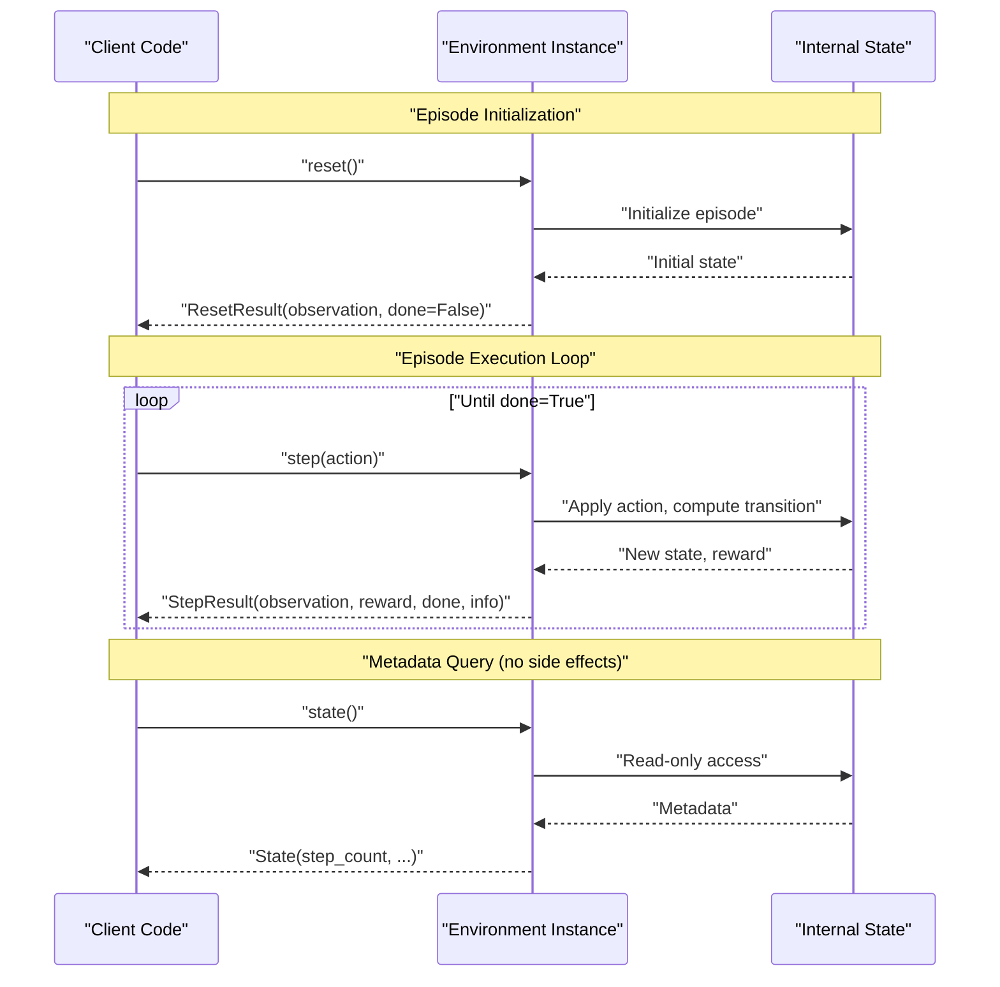
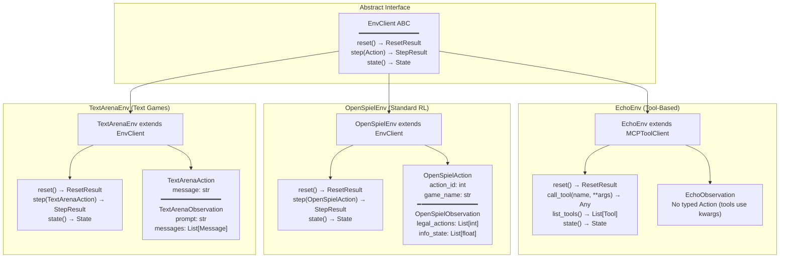
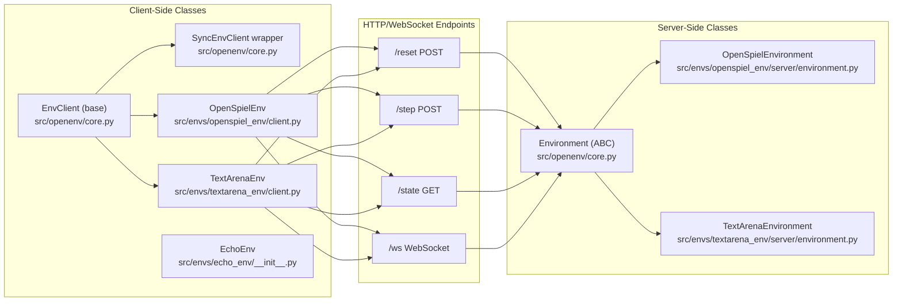

<!-- source: DeepWiki mcp.deepwiki.com · repo huggingface/openenv-course · page 2.1 The 3-Method Interface: reset(), step(), state() · fetched 2026-10-26 -->

# The 3-Method Interface: reset(), step(), state()

<details>
<summary>Relevant source files</summary>

The following files were used as context for generating this wiki page:

- [module-1/notebook.ipynb](module-1/notebook.ipynb)

</details>


## Purpose and Scope

This page documents the fundamental 3-method interface that all OpenEnv environments expose: `reset()`, `step()`, and `state()`. This interface provides a standardized API for interacting with any OpenEnv environment, regardless of its internal implementation or domain (RL games, tool-based agents, text games, etc.).

For information about the architectural principles that motivate this design, see [Client-Server Architecture and Microservices](#2.2). For details on environment-specific type models, see [Type-Safe Models: Action, Observation, State](#3.2). For implementing this interface in custom environments, see [Implementing Environment Logic](#5.2).

**Sources:** [module-1/notebook.ipynb:6-11]()

---

## The Core Interface

Every OpenEnv environment, whether hosted on HF Spaces or running locally, exposes exactly three methods for interaction:

| Method | Purpose | Returns |
|--------|---------|---------|
| `reset()` | Initialize a new episode, returning the starting observation | `ResetResult` containing `observation` and `done` flag |
| `step(action)` | Execute an action, advance the environment state | `StepResult` containing `observation`, `reward`, `done`, and optional `info` |
| `state()` | Query episode metadata without side effects | `State` containing `step_count` and other episode statistics |

This interface is **intentionally minimal**. By constraining all environment interactions to these three operations, OpenEnv achieves:

- **Consistency:** The same client code works across all environments
- **Type Safety:** Each environment defines typed action/observation models via Pydantic
- **Testability:** Simple interface means simple testing
- **Network Efficiency:** Stateful WebSocket connections minimize overhead

**Sources:** [module-1/notebook.ipynb:206-213]()

---

## Interface Flow Diagram



**Sources:** [module-1/notebook.ipynb:43-67](), [module-1/notebook.ipynb:104-126]()

---

## Method Details

### reset()

The `reset()` method initializes a new episode. It returns a `ResetResult` object containing:

- `observation`: Environment-specific typed observation (e.g., `OpenSpielObservation`, `TextArenaObservation`)
- `done`: Boolean flag, typically `False` after reset
- Additional environment-specific fields may be present

**Example from OpenSpielEnv:**

```python
from envs.openspiel_env import OpenSpielEnv

with OpenSpielEnv(base_url='https://openenv-openspiel-catch.hf.space').sync() as env:
    result = env.reset()
    # result.observation.legal_actions -> [0, 1, 2]
    # result.observation.info_state -> list of floats representing game state
    # result.done -> False
```

**Key Properties:**
- Idempotent: calling `reset()` multiple times is safe
- No parameters required (though some environments may accept optional configuration)
- Always returns a fresh episode state

**Sources:** [module-1/notebook.ipynb:43-48](), [module-1/notebook.ipynb:105-109]()

### step(action)

The `step()` method advances the environment by one timestep, executing the provided action. It returns a `StepResult` object containing:

- `observation`: New typed observation after action execution
- `reward`: Numeric reward signal (`float`)
- `done`: Boolean indicating episode termination
- `info`: Optional dictionary with auxiliary data

**Example from OpenSpielEnv:**

```python
from envs.openspiel_env.models import OpenSpielAction

with OpenSpielEnv(base_url=url).sync() as env:
    result = env.reset()
    
    # Execute action: move paddle right
    result = env.step(OpenSpielAction(action_id=2, game_name='catch'))
    # result.reward -> 0.0 (game continues)
    # result.done -> False (episode not finished)
    # result.observation.legal_actions -> [0, 1, 2]
```

**Key Properties:**
- Requires a typed action object (environment-specific Pydantic model)
- Stateful: modifies internal episode state
- May set `done=True` when episode terminates
- Reward semantics are environment-specific

**Sources:** [module-1/notebook.ipynb:117-122](), [module-1/notebook.ipynb:169-173]()

### state()

The `state()` method queries episode metadata **without side effects**. It returns a `State` object containing:

- `step_count`: Number of `step()` calls in current episode
- Additional environment-specific metadata

**Example:**

```python
with env.sync() as env:
    result = env.reset()
    result = env.step(action)
    result = env.step(action)
    
    state = env.state()
    # state.step_count -> 2
```

**Key Properties:**
- Read-only: does not modify episode state
- Can be called at any time (before/during/after episode)
- Useful for debugging and progress tracking
- No network overhead when using persistent WebSocket connections

**Sources:** [module-1/notebook.ipynb:66-67](), [module-1/notebook.ipynb:125-126]()

---

## Environment-Specific Implementations

While the interface is uniform, each environment type defines its own action and observation models. Here's how the three environments demonstrated in Module 1 implement the interface:



**Sources:** [module-1/notebook.ipynb:38-68](), [module-1/notebook.ipynb:99-127](), [module-1/notebook.ipynb:153-175]()

---

## Mapping Interface Methods to Code Entities

The following diagram shows how the abstract 3-method interface maps to concrete implementations in the codebase:



**Sources:** [module-1/notebook.ipynb:38-39](), [module-1/notebook.ipynb:99-100](), [module-1/notebook.ipynb:153-154]()

---

## Sync vs Async Patterns

OpenEnv clients are **async by default** because they perform network I/O. However, for notebooks, simple scripts, and initial learning, the `.sync()` wrapper provides a synchronous interface:

### Synchronous (Recommended for Course)

```python
# Using .sync() context manager
with EchoEnv(base_url=url).sync() as env:
    result = env.reset()  # No await needed
    result = env.step(action)
    state = env.state()
```

The `.sync()` method returns a `SyncEnvClient` wrapper that:
- Automatically converts all async methods to sync using `asyncio.run()`
- Maintains the same method signatures
- Simplifies code for learning and prototyping

### Asynchronous (Production Use)

```python
# Native async interface
async with EchoEnv(base_url=url) as env:
    result = await env.reset()
    result = await env.step(action)
    state = await env.state()
```

**When to use async:**
- Training loops with concurrent environment instances
- Production systems requiring high throughput
- Integration with async frameworks (FastAPI, aiohttp)

**Technical Details:**
- The `.sync()` wrapper is implemented in `SyncEnvClient.__getattr__`
- It wraps async methods using `asyncio.run()` or an existing event loop
- Persistent WebSocket connections work in both modes

**Sources:** [module-1/notebook.ipynb:181-196]()

---

## Return Type Structure

All three methods return structured objects with typed fields:

### ResetResult

Returned by `reset()`:

```python
@dataclass
class ResetResult:
    observation: ObservationType  # Environment-specific typed observation
    done: bool                     # Typically False after reset
```

### StepResult

Returned by `step()`:

```python
@dataclass
class StepResult:
    observation: ObservationType  # New observation after action
    reward: float                 # Numeric reward signal
    done: bool                    # Episode termination flag
    info: dict                    # Optional auxiliary data
```

### State

Returned by `state()`:

```python
@dataclass
class State:
    step_count: int              # Number of steps taken
    # Additional environment-specific fields
```

**Type Safety Advantages:**
- IDE autocomplete for all fields
- Runtime validation via Pydantic
- Early error detection (before network call)
- Self-documenting code

**Sources:** [module-1/notebook.ipynb:46-48](), [module-1/notebook.ipynb:117-122](), [module-1/notebook.ipynb:125-126]()

---

## Complete Usage Example

This example demonstrates the full episode lifecycle using all three methods:

```python
from envs.openspiel_env import OpenSpielEnv
from envs.openspiel_env.models import OpenSpielAction
import random

OPENSPIEL_URL = 'https://openenv-openspiel-catch.hf.space'

# 1. Connect using sync wrapper
with OpenSpielEnv(base_url=OPENSPIEL_URL).sync() as env:
    
    # 2. Initialize episode
    result = env.reset()
    print(f'Legal actions: {result.observation.legal_actions}')
    print(f'Done: {result.done}')
    
    # 3. Execute episode loop
    step_num = 0
    while not result.done:
        # Select random legal action
        action_id = random.choice(result.observation.legal_actions)
        
        # Take step
        result = env.step(OpenSpielAction(
            action_id=action_id,
            game_name='catch'
        ))
        
        step_num += 1
        print(f'Step {step_num}: reward={result.reward}, done={result.done}')
    
    # 4. Query final state
    state = env.state()
    print(f'Total steps: {state.step_count}')
    print(f'Final reward: {result.reward}')
```

**Execution Flow:**
1. `reset()` initializes episode → returns starting observation
2. Loop: `step(action)` until `done=True` → accumulates rewards
3. `state()` retrieves metadata → confirms step count

**Sources:** [module-1/notebook.ipynb:104-126]()

---

## Tool-Based Environments (MCP Pattern)

While most RL environments use `step(action)`, tool-based environments like `EchoEnv` expose a **Model Context Protocol (MCP)** interface instead:

### MCP Methods

```python
with EchoEnv(base_url=url).sync() as env:
    # Discovery: list available tools
    tools = env.list_tools()  # Returns list of Tool objects
    
    # Execution: call a specific tool
    result = env.call_tool('echo_message', message='Hello')
    
    # Still supports reset() and state()
    env.reset()
    state = env.state()
```

**Key Differences:**
- No `step()` method (uses `call_tool()` instead)
- Tools discovered dynamically via `list_tools()`
- Actions are tool invocations with keyword arguments
- Suitable for agent-based systems (LLM tool use)

For detailed MCP integration, see [Environment Types and Tool-Based Interfaces](#2.3).

**Sources:** [module-1/notebook.ipynb:43-68]()

---

## Summary Table

| Aspect | Details |
|--------|---------|
| **Core Methods** | `reset()`, `step(action)`, `state()` |
| **Access Modes** | Async (native) or Sync (via `.sync()` wrapper) |
| **Type Safety** | Pydantic models for actions, observations, states |
| **Network Protocol** | WebSocket (persistent) or HTTP (stateless) |
| **Consistency** | Same interface across all environment types |
| **Exceptions** | Tool-based environments use `call_tool()` instead of `step()` |

**Sources:** [module-1/notebook.ipynb:206-213]()

---

