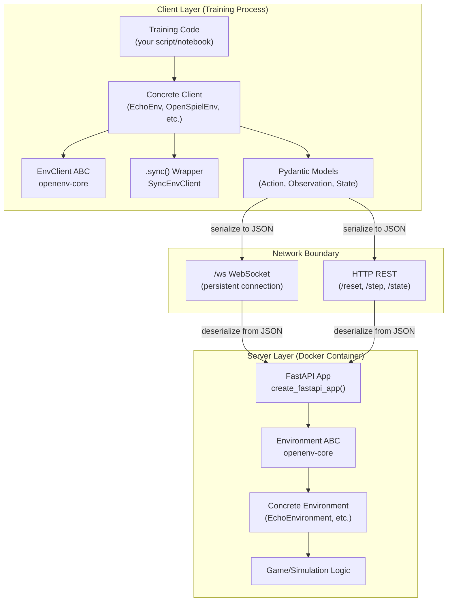
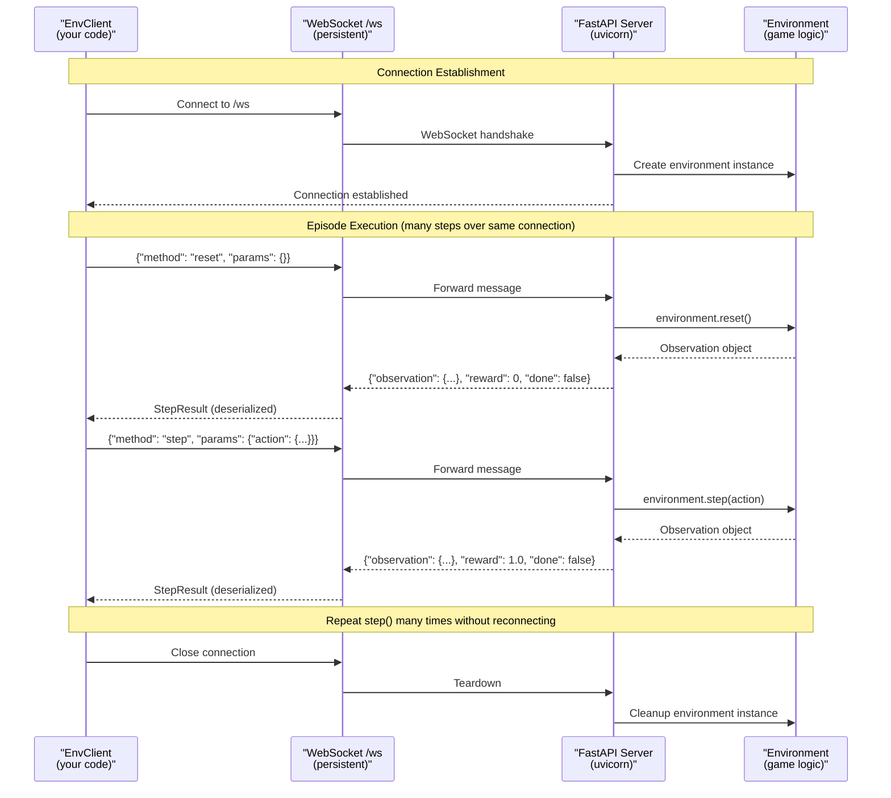
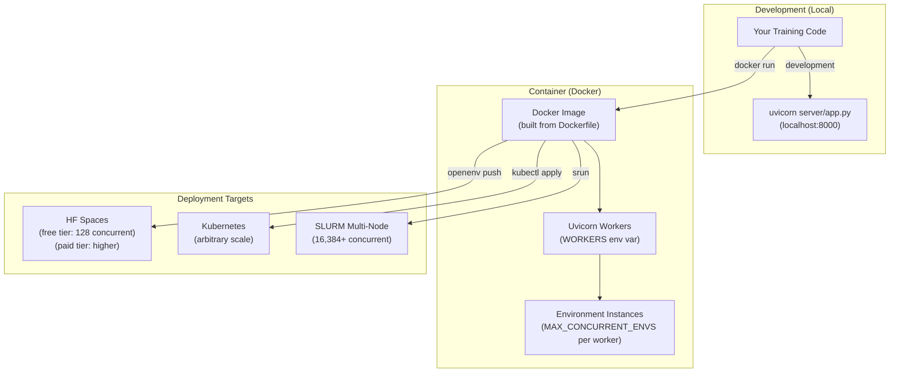

<!-- source: DeepWiki mcp.deepwiki.com · repo huggingface/openenv-course · page 2.2 Client-Server Architecture and Microservices · fetched 2026-10-26 -->

# Client-Server Architecture and Microservices

<details>
<summary>Relevant source files</summary>

The following files were used as context for generating this wiki page:

- [README.md](README.md)
- [module-1/README.md](module-1/README.md)

</details>


## Purpose and Scope

This document explains the architectural principles underlying OpenEnv's client-server design and microservices approach. It covers the separation of concerns between client and server components, the communication protocols used, and the rationale for choosing a distributed architecture over monolithic patterns like Gymnasium. For details on the specific 3-method interface (`reset()`, `step()`, `state()`), see [2.1](#2.1). For environment-specific implementations, see [2.3](#2.3).

**Sources:** [README.md:1-135](), [module-1/README.md:1-135]()

---

## The Microservices Philosophy

OpenEnv treats RL environments as **microservices** rather than in-process libraries. This architectural decision stems from production requirements that traditional monolithic RL frameworks like Gymnasium were not designed to address.

### Core Principle

**RL environments should be isolated services that communicate over standard protocols.**

This means:
- Environment logic runs in separate containers, not in the training process
- Communication happens via HTTP/WebSocket, not function calls
- Each environment instance is independently deployable and scalable
- Type contracts are enforced at API boundaries, not just within a single process

### Comparison with Gymnasium

| Architectural Aspect | Gymnasium (Monolithic) | OpenEnv (Microservices) |
|---------------------|------------------------|-------------------------|
| **Process Model** | Same process as training code | Separate containerized process |
| **Communication** | Direct Python function calls | WebSocket/HTTP API calls |
| **Type Safety** | Runtime errors (`obs[0][3]`) | Compile-time contracts (`obs.info_state`) |
| **Isolation** | Shared memory space (crashes propagate) | Process isolation (environment crashes don't affect training) |
| **Deployment** | "Works on my machine" | Containerized (Docker) |
| **Scaling** | Manual multi-processing | Kubernetes/container orchestration |
| **Language Support** | Python only | Any language with HTTP client |
| **Versioning** | Python package versions | Docker image tags |
| **Debugging** | Cryptic numpy/array errors | Typed API errors with clear messages |

**Sources:** [module-1/README.md:19-34]()

---

## Architectural Principles

OpenEnv's architecture is built on five foundational principles that enable production-grade RL systems.

### Isolation

Environments run in dedicated containers, providing:
- **Crash isolation**: An environment exception doesn't crash training
- **Resource isolation**: Memory limits per environment instance
- **Security isolation**: Untrusted environment code cannot access training infrastructure
- **Dependency isolation**: Each environment has its own Python dependencies

The containerization is defined in `server/Dockerfile` within each environment's directory structure.

### Standardization

All environments expose identical interfaces regardless of internal complexity:
- **Server-side**: The `Environment` ABC defines `reset()`, `step()`, and `state` property
- **Client-side**: The `EnvClient` ABC defines corresponding async methods
- **Protocol-level**: REST endpoints (`/reset`, `/step`, `/state`) and WebSocket (`/ws`)
- **Documentation**: Auto-generated OpenAPI docs at `/docs`

This standardization means client code works across all environments without modification (except for the `base_url`).

### Type Safety

Pydantic models enforce type contracts at API boundaries:
- **Action models**: Define what actions are valid (e.g., `OpenSpielAction`)
- **Observation models**: Define the structure of observations (e.g., `OpenSpielObservation`)
- **State models**: Define episode metadata
- **Serialization**: Automatic JSON serialization/deserialization
- **Validation**: Pydantic validates all data crossing the network boundary

Type safety eliminates an entire class of runtime errors common in Gymnasium code.

### Scalability

The client-server architecture enables horizontal scaling:
- **Single container**: Up to 2,048 concurrent sessions (8 workers × 256 sessions/worker)
- **Multi-container**: Load balancer distributes across multiple containers
- **Cloud deployment**: One-command deployment to HF Spaces, Kubernetes, or SLURM

Scaling is controlled by environment variables: `WORKERS` (number of uvicorn processes) and `MAX_CONCURRENT_ENVS` (sessions per worker).

**Sources:** [module-1/README.md:34-45](), [README.md:76-126]()

---

## Client-Server Separation

### Architecture Overview



**Diagram 1: Client-Server Component Mapping**

This diagram shows how code entities map across the network boundary. The client layer uses classes from `openenv-core` package, while the server layer runs inside Docker containers.

**Sources:** [module-1/README.md:46-79](), [module-1/README.md:93-129]()

### Component Responsibilities

#### Client-Side Components

| Component | Location | Responsibility |
|-----------|----------|----------------|
| `EnvClient` | `openenv-core` package | Abstract base class defining async methods |
| `SyncEnvClient` | `openenv-core` package | Synchronous wrapper via `.sync()` context manager |
| Concrete clients | `envs/*/client.py` | Environment-specific implementations |
| Type models | `envs/*/models.py` | Pydantic models for serialization |

Client implementations extend `EnvClient` and implement:
- `_step_payload(action)`: Serialize action to dict
- `_parse_result(response)`: Deserialize response to `StepResult`
- `_parse_state(response)`: Deserialize response to `State`

#### Server-Side Components

| Component | Location | Responsibility |
|-----------|----------|----------------|
| `Environment` | `openenv-core` package | Abstract base class for game logic |
| `create_fastapi_app()` | `openenv-core` package | Auto-generates FastAPI routes |
| Concrete environment | `envs/*/server/environment.py` | Game-specific logic |
| FastAPI app | `envs/*/server/app.py` | Application entry point |
| Dockerfile | `envs/*/server/Dockerfile` | Container definition |

Server implementations extend `Environment` and implement:
- `reset() -> Observation`: Initialize new episode
- `step(action: Action) -> Observation`: Process action, return new observation
- `state` property: Return episode metadata

**Sources:** [module-1/README.md:93-129]()

---

## Communication Layer

### WebSocket as Primary Protocol



**Diagram 2: WebSocket Communication Flow**

This diagram shows how a single WebSocket connection handles multiple RL steps with minimal overhead (~0.1ms per frame).

### Protocol Comparison

| Aspect | WebSocket (`/ws`) | HTTP REST |
|--------|-------------------|-----------|
| **Connection** | Persistent (one handshake) | New TCP handshake per request |
| **Latency per step** | ~0.1ms | ~10-50ms (handshake overhead) |
| **Use case** | Primary method for episodes | Fallback / stateless queries |
| **Session management** | Automatic (connection = session) | Manual (requires session IDs) |
| **Overhead** | Minimal after handshake | High for many small requests |
| **Endpoints** | Single `/ws` endpoint | `/reset`, `/step`, `/state`, `/health` |

The client automatically uses WebSocket by default. Users never see the protocol details—they just call `env.reset()` and `env.step()`.

**Sources:** [README.md:79-85]()

### HTTP Endpoints

In addition to WebSocket, every environment exposes HTTP endpoints:

| Endpoint | Method | Purpose |
|----------|--------|---------|
| `/ws` | WebSocket | Primary interaction protocol |
| `/reset` | POST | HTTP fallback for reset |
| `/step` | POST | HTTP fallback for step |
| `/state` | GET | Query episode metadata |
| `/health` | GET | Health check for orchestration |
| `/web` | GET | Human-playable web interface (optional) |
| `/docs` | GET | Auto-generated OpenAPI documentation |

These endpoints are auto-generated by `create_fastapi_app()` from `openenv-core`.

**Sources:** [module-1/README.md:46-79]()

---

## Containerization and Deployment

### The 3-Component Pattern

Every OpenEnv environment follows a standardized directory structure:

```
envs/my_env/
├── models.py              # Pydantic models (Action, Observation, State)
├── client.py              # EnvClient implementation
└── server/
    ├── environment.py     # Environment implementation
    ├── app.py             # FastAPI application
    └── Dockerfile         # Container definition
```

This structure enforces separation of concerns:
- **`models.py`**: Type contracts shared by client and server
- **`client.py`**: Network communication logic (client-side)
- **`server/environment.py`**: Game logic (server-side)
- **`server/app.py`**: Server initialization using `create_fastapi_app()`
- **`server/Dockerfile`**: Containerization instructions

**Sources:** [module-1/README.md:93-106]()

### Deployment Model



**Diagram 3: Deployment Architecture**

This shows the three deployment modes: local development, Docker containerization, and production deployment targets.

### Scaling Characteristics

| Deployment Target | Max Concurrent Sessions | Infrastructure | Sessions per Core |
|-------------------|------------------------|----------------|-------------------|
| **HF Spaces (free)** | 128 | 2 CPU cores | 64 |
| **Local Uvicorn** | 2,048 | 8 CPU cores | 256 |
| **Docker (local)** | 2,048 | 8 CPU cores | 256 |
| **SLURM Multi-Node** | 16,384 | 96 CPU cores | 171 |

The single-container maximum of ~2,048 is achieved with:
- `WORKERS=8` (Uvicorn processes)
- `MAX_CONCURRENT_ENVS=256` (WebSocket sessions per worker)
- Result: 8 × 256 = 2,048 concurrent environment instances

For higher scale, deploy multiple containers behind a load balancer (e.g., Envoy for WebSocket).

**Sources:** [README.md:87-126]()

---

## Benefits of the Microservices Approach

### For Development

1. **Rapid iteration**: Modify environment logic without restarting training
2. **Hot-reloading**: Uvicorn auto-reloads on file changes during development
3. **Debuggability**: FastAPI auto-generates `/docs` for testing endpoints
4. **Local testing**: Run environment locally, connect client remotely (or vice versa)

### For Production

1. **Fault tolerance**: Environment crashes don't kill training runs
2. **Resource limits**: Container memory/CPU limits prevent runaway processes
3. **Version control**: Docker image tags provide exact reproducibility
4. **Polyglot support**: Any language can connect (Python, Julia, Rust, etc.)

### For Deployment

1. **One-command deploy**: `openenv push` packages and deploys to HF Spaces
2. **Zero-config scaling**: Container orchestration handles load balancing
3. **Geographic distribution**: Deploy environments close to compute
4. **Cost efficiency**: Environments on cheap CPU, training on expensive GPU

**Sources:** [module-1/README.md:19-45](), [README.md:1-126]()

---

## Code Mapping Reference

### Client-Side Imports

```python
# Base classes from openenv-core
from openenv import EnvClient, SyncEnvClient

# Concrete environment clients
from envs.echo_env import EchoEnv
from envs.openspiel_env import OpenSpielEnv
from envs.textarena_env import TextArenaEnv

# Type models
from envs.openspiel_env.models import OpenSpielAction, OpenSpielObservation
```

### Server-Side Implementation

```python
# Base class from openenv-core
from openenv import Environment, create_fastapi_app

# Example environment implementation
class MyEnvironment(Environment):
    def reset(self) -> Observation:
        ...
    
    def step(self, action: Action) -> Observation:
        ...
    
    @property
    def state(self) -> State:
        ...

# App creation
app = create_fastapi_app(MyEnvironment)
```

The `create_fastapi_app()` function auto-generates all endpoints (`/ws`, `/reset`, `/step`, `/state`, `/health`, `/docs`) from the `Environment` implementation.

**Sources:** [module-1/README.md:107-126](), [README.md:41-63]()

---

## Summary

OpenEnv's client-server architecture enables production-grade RL systems through:

| Principle | Implementation | Benefit |
|-----------|---------------|---------|
| **Microservices** | Environments as containerized services | Isolation, scalability, polyglot |
| **Type Safety** | Pydantic models at API boundaries | Catch errors early, IDE support |
| **Standardization** | 3-method interface across all envs | Write once, run anywhere |
| **WebSocket** | Persistent connections for RL loops | ~0.1ms latency per step |
| **Containerization** | Docker + orchestration | Deploy anywhere, scale easily |

This architecture is consistent across all five modules: Module 1 introduces it, Module 2 uses it for policies, Module 3 teaches deployment, Module 4 shows how to build it, and Module 5 integrates it with LLM training.

**Sources:** [module-1/README.md:1-135](), [README.md:1-126]()

---

