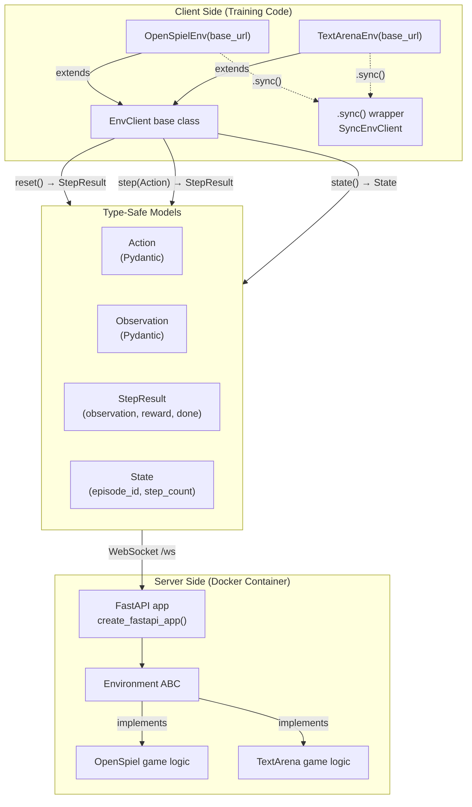
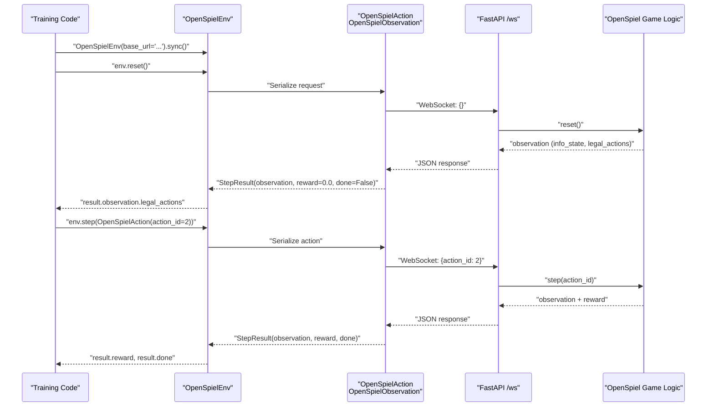
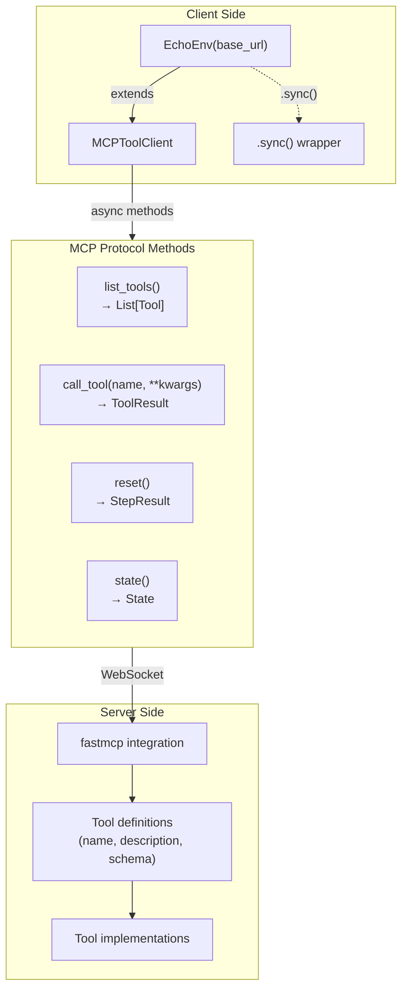
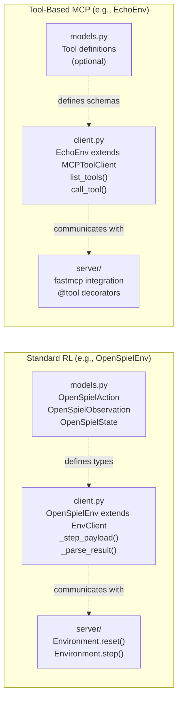

<!-- source: DeepWiki mcp.deepwiki.com · repo huggingface/openenv-course · page 2.3 Environment Types and Tool-Based Interfaces · fetched 2026-10-26 -->

# Environment Types and Tool-Based Interfaces

<details>
<summary>Relevant source files</summary>

The following files were used as context for generating this wiki page:

- [module-1/README.md](module-1/README.md)
- [module-1/notebook.ipynb](module-1/notebook.ipynb)

</details>


## Purpose and Scope

This document describes the two primary environment interface patterns available in OpenEnv: **Standard RL Environments** and **Tool-Based MCP Environments**. Standard RL environments expose the 3-method interface (`reset()`, `step()`, `state()`) and work with typed Action/Observation/State models, while tool-based environments implement the Model Context Protocol (MCP) interface with dynamic tool discovery and invocation.

For the foundational 3-method interface concepts, see [The 3-Method Interface: reset(), step(), state()](#2.1). For the architectural principles underlying both patterns, see [Client-Server Architecture and Microservices](#2.2).

---

## Environment Type Classification

OpenEnv supports two distinct interface patterns, each optimized for different use cases:

| Pattern | Interface Methods | Data Flow | Primary Use Case |
|---------|------------------|-----------|------------------|
| **Standard RL** | `reset()`, `step(action)`, `state()` | Typed models (Action → Observation) | Game-playing, RL training, episodic tasks |
| **Tool-Based MCP** | `list_tools()`, `call_tool(name, **kwargs)` | Dynamic tool discovery and invocation | LLM function calling, agentic systems, utility services |

Both patterns share the same client-server architecture and WebSocket/HTTP communication layer, but differ in how agents interact with the environment.

**Sources:** [module-1/README.md:127-128](), [module-1/notebook.ipynb:40-42]()

---

## Standard RL Environment Pattern

### Interface Contract

Standard RL environments implement the classic reinforcement learning loop interface. The server-side `Environment` class exposes three methods, and the client-side `EnvClient` mirrors them with async/sync wrappers.



**Sources:** [module-1/notebook.ipynb:99-127](), [module-1/README.md:109-114]()

---

### OpenSpielEnv Example

The `OpenSpielEnv` client provides access to 6 OpenSpiel games through a unified interface. Each game uses the same typed models but with game-specific observations.



**Key Classes and Methods:**

- **Client:** `OpenSpielEnv` extends `EnvClient` [module-1/notebook.ipynb:99]()
- **Action Model:** `OpenSpielAction(action_id, game_name)` [module-1/notebook.ipynb:117-120]()
- **Observation Model:** `OpenSpielObservation` with `legal_actions`, `info_state` fields [module-1/notebook.ipynb:107-108]()
- **Connection URL:** Game-specific base URLs like `https://openenv-openspiel-catch.hf.space` [module-1/notebook.ipynb:102]()

**Example Usage:**

[module-1/notebook.ipynb:104-127]() demonstrates the complete pattern:

```python
with OpenSpielEnv(base_url=OPENSPIEL_URL).sync() as env:
    result = env.reset()  # Returns StepResult with OpenSpielObservation
    
    while not result.done:
        action_id = random.choice(result.observation.legal_actions)
        result = env.step(OpenSpielAction(action_id=action_id, game_name='catch'))
        # result.reward, result.done are available immediately
```

**Sources:** [module-1/notebook.ipynb:94-127]()

---

### TextArenaEnv Example

The `TextArenaEnv` client wraps text-based games like Wordle. Actions are text messages, and observations include message history and prompts.

**Key Classes and Methods:**

- **Client:** `TextArenaEnv` extends `EnvClient` [module-1/notebook.ipynb:153]()
- **Action Model:** `TextArenaAction(message)` with text content [module-1/notebook.ipynb:169]()
- **Observation Model:** Contains `prompt` and `messages` list [module-1/notebook.ipynb:161-172]()
- **Connection URL:** `https://burtenshaw-textarena.hf.space` [module-1/notebook.ipynb:156]()

**Example Usage:**

[module-1/notebook.ipynb:158-175]() shows text-based interaction:

```python
with TextArenaEnv(base_url=TEXTARENA_URL).sync() as env:
    result = env.reset()
    print(result.observation.prompt)  # Game instructions
    
    result = env.step(TextArenaAction(message='[crane]'))
    for msg in result.observation.messages:  # Message history
        print(f'[{msg.category}] {msg.content}')
```

**Sources:** [module-1/notebook.ipynb:137-175]()

---

## Tool-Based MCP Environment Pattern

### Interface Contract

Tool-based environments implement the Model Context Protocol (MCP), designed for LLM function calling scenarios. Instead of a fixed action space, the environment exposes a dynamic set of tools that can be discovered at runtime.



**Sources:** [module-1/notebook.ipynb:38-43](), [module-1/README.md:127-128]()

---

### EchoEnv Example

The `EchoEnv` is the simplest tool-based environment, demonstrating the MCP pattern with two utility tools.

**Architecture Notes:**

- `EchoEnv` extends `MCPToolClient`, not the standard `EnvClient` [module-1/notebook.ipynb:40]()
- The `.sync()` wrapper works identically via `SyncEnvClient.__getattr__` [module-1/notebook.ipynb:41-42]()
- Tools are discovered dynamically via `list_tools()` [module-1/notebook.ipynb:52]()
- Tool invocation uses `call_tool(name, **kwargs)` [module-1/notebook.ipynb:59-63]()

**Available Tools:**

[module-1/notebook.ipynb:52-56]() shows tool discovery:

| Tool Name | Description | Parameters |
|-----------|-------------|------------|
| `echo_message` | Returns the input message unchanged | `message: str` |
| `echo_with_length` | Returns message with character count | `message: str` |

**Example Usage:**

[module-1/notebook.ipynb:43-68]() demonstrates the tool-based pattern:

```python
with EchoEnv(base_url='https://openenv-echo-env.hf.space').sync() as env:
    result = env.reset()  # Still supports reset() for consistency
    
    tools = env.list_tools()  # Discover available tools
    for tool in tools:
        print(f'{tool.name}: {tool.description}')
    
    response = env.call_tool('echo_message', message='Hello, OpenEnv!')
    response = env.call_tool('echo_with_length', message='OpenEnv')
    
    state = env.state()  # Still supports state() for metadata
```

**Sources:** [module-1/notebook.ipynb:33-68]()

---

## Pattern Comparison

### Architectural Differences

| Aspect | Standard RL | Tool-Based MCP |
|--------|-------------|----------------|
| **Base Class** | `EnvClient` | `MCPToolClient` |
| **Primary Methods** | `reset()`, `step(action)`, `state()` | `list_tools()`, `call_tool(name, **kwargs)` |
| **Action Type** | Fixed, typed (e.g., `OpenSpielAction`) | Dynamic, kwargs-based |
| **Observation Type** | Fixed, typed (e.g., `OpenSpielObservation`) | Variable, tool-dependent |
| **Type Safety** | Strong (Pydantic models) | Dynamic (JSON schema) |
| **Use Case** | Episodic RL tasks, game loops | LLM function calling, utilities |
| **Reward Signal** | Built into `StepResult` | Not applicable |
| **Episode Lifecycle** | Explicit (reset → step → done) | Implicit (stateless tool calls) |

**Sources:** [module-1/notebook.ipynb:38-175](), [module-1/README.md:127-128]()

---

### Code Structure Comparison

Both patterns follow the 3-component structure but with different implementations:



**Sources:** [module-1/README.md:98-105]()

---

## The .sync() Wrapper Pattern

Both environment types use the same synchronization pattern for notebook and script usage. OpenEnv clients are async by default; the `.sync()` wrapper converts them to synchronous interfaces.

### Implementation Details

The `SyncEnvClient` wrapper is returned by the `.sync()` method and provides synchronous access to async methods:

```python
# Async (default, for production)
async with OpenSpielEnv(base_url=url) as env:
    result = await env.reset()
    result = await env.step(action)

# Sync (notebooks, simple scripts)
with OpenSpielEnv(base_url=url).sync() as env:
    result = env.reset()  # No await needed
    result = env.step(action)  # No await needed
```

**Key Points:**

- Works identically for both `EnvClient` and `MCPToolClient` descendants [module-1/notebook.ipynb:41-42]()
- Uses `SyncEnvClient.__getattr__` for automatic wrapping [module-1/notebook.ipynb:42]()
- Demonstrated in all three environment examples [module-1/notebook.ipynb:43](), [module-1/notebook.ipynb:104](), [module-1/notebook.ipynb:158]()

**Sources:** [module-1/notebook.ipynb:181-196](), [module-1/README.md:122]()

---

## Choosing the Right Pattern

### Standard RL Pattern

**Use when:**
- Building game-playing agents
- Training RL models with episodic tasks
- Need explicit reward signals
- Want strong type safety with Pydantic models
- Working with finite action spaces

**Examples:** OpenSpiel games (Catch, Tic-Tac-Toe, 2048), TextArena games (Wordle), custom game environments

**Sources:** [module-1/notebook.ipynb:81-127]()

---

### Tool-Based MCP Pattern

**Use when:**
- Building LLM agents with function calling
- Need dynamic tool discovery
- Tools have variable signatures
- Environment provides utility functions rather than game states
- Working with agentic systems

**Examples:** Echo utilities, API wrappers, database interfaces, calculation tools

**Sources:** [module-1/notebook.ipynb:25-68]()

---

## Summary

OpenEnv provides two complementary interface patterns:

1. **Standard RL Environments** use `reset()`, `step(action)`, `state()` with typed Action/Observation models for game-playing and episodic RL tasks
2. **Tool-Based MCP Environments** use `list_tools()`, `call_tool(name, **kwargs)` for dynamic tool discovery and LLM function calling

Both patterns share the same client-server architecture, WebSocket communication, and `.sync()` wrapper for async/sync conversion. The choice depends on whether the environment represents an episodic RL task (Standard RL) or a collection of stateless utilities (Tool-Based MCP).

[module-1/notebook.ipynb:74]() summarizes: "Three methods. That's the entire API. Every OpenEnv environment works exactly like this." This applies to both patterns, which maintain consistency in their respective domains.

**Sources:** [module-1/notebook.ipynb:1-231](), [module-1/README.md:1-135]()

---

