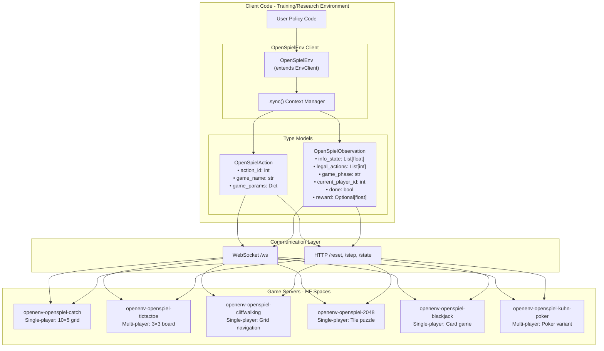
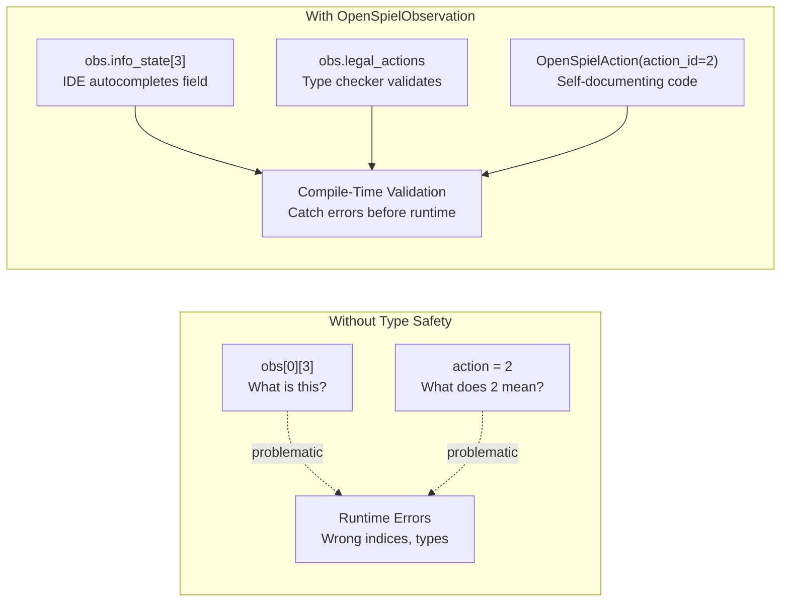
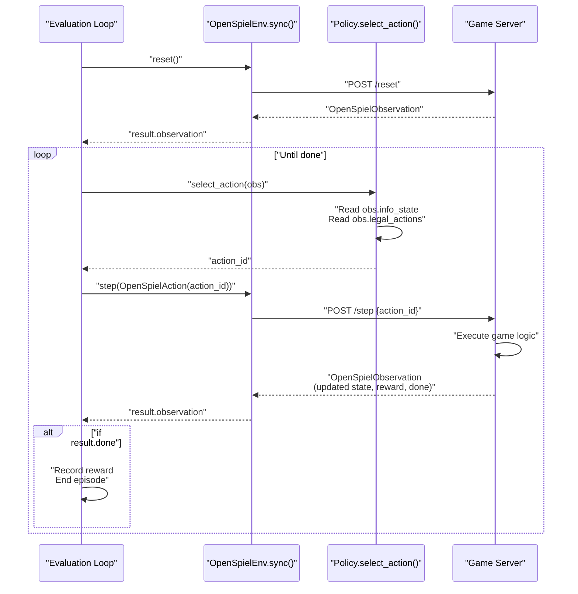
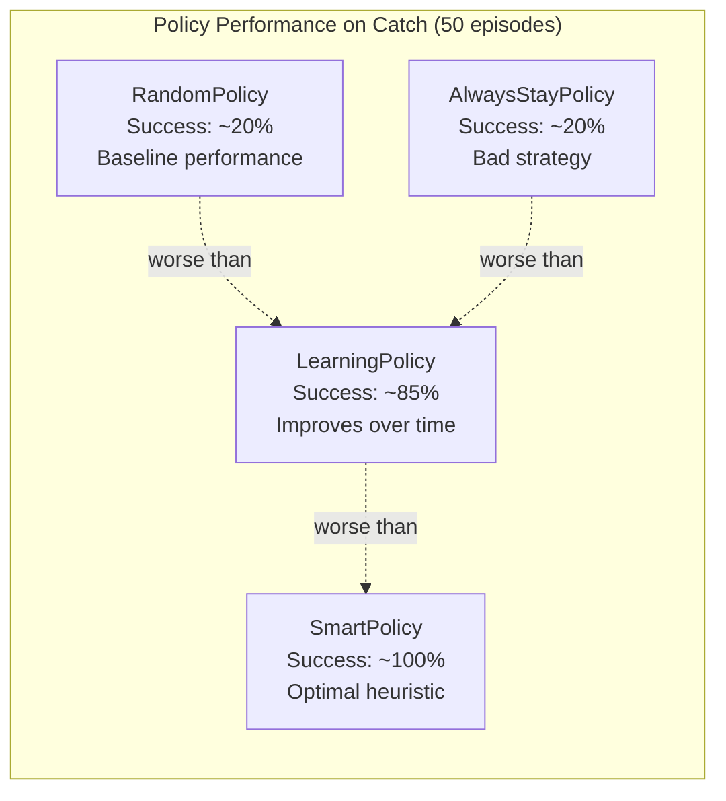
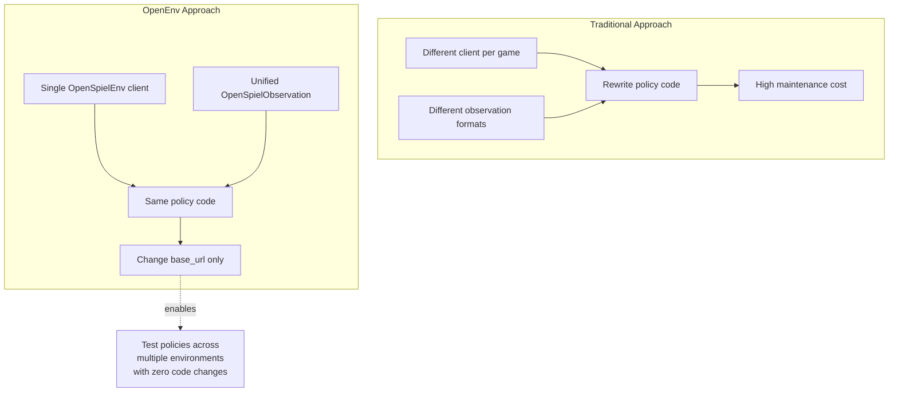

<!-- source: DeepWiki mcp.deepwiki.com · repo huggingface/openenv-course · page 3 Module 2: Policy Development with OpenSpiel · fetched 2026-10-26 -->

# Module 2: Policy Development with OpenSpiel

<details>
<summary>Relevant source files</summary>

The following files were used as context for generating this wiki page:

- [module-2/README.md](module-2/README.md)
- [module-2/notebook.ipynb](module-2/notebook.ipynb)

</details>


## Purpose and Scope

This module teaches how to use existing OpenEnv environments by writing policies that interact with the OpenSpiel integration. You will learn to connect to hosted environments, work with type-safe models, implement different policy strategies, and run competitive evaluations. The module focuses on the **client-side** experience: consuming environments through their unified interface without needing to understand server implementation details.

For understanding the underlying architecture concepts, see [Module 1: Understanding OpenEnv](#2). For deployment and server-side modification, see [Module 3: Deployment Workflow](#4). For training policies with reinforcement learning, see [Module 5: LLM Training with GRPO](#6).

---

## OpenSpielEnv Client and Game Hub

The `OpenSpielEnv` client provides a unified interface to six OpenSpiel games deployed as microservices on Hugging Face Spaces. Each game runs as an independent server, but all share identical client code, observation types, and action types.

### Supported Games

| Game Category | Game Name | URL Pattern | Description |
|---------------|-----------|-------------|-------------|
| Single-Player | Catch | `openenv-openspiel-catch.hf.space` | Catch a falling ball with a paddle |
| Single-Player | Cliff Walking | `openenv-openspiel-cliffwalking.hf.space` | Navigate grid avoiding cliffs |
| Single-Player | 2048 | `openenv-openspiel-2048.hf.space` | Tile-merging puzzle game |
| Single-Player | Blackjack | `openenv-openspiel-blackjack.hf.space` | Card game against dealer |
| Multi-Player | Tic-Tac-Toe | `openenv-openspiel-tictactoe.hf.space` | Classic 3×3 grid game |
| Multi-Player | Kuhn Poker | `openenv-openspiel-kuhn-poker.hf.space` | Simplified poker with imperfect information |

### Client Instantiation Pattern

```python
from envs.openspiel_env import OpenSpielEnv

# Connect to any game by changing only the base_url
env = OpenSpielEnv(base_url="https://openenv-openspiel-catch.hf.space")

# Use sync context manager for synchronous API
with env.sync() as sync_env:
    result = sync_env.reset()
    # ... interact with environment
```

**Sources:** [module-2/notebook.ipynb:39-50](), [module-2/README.md:99-106]()

### OpenSpielEnv Client Architecture Diagram



**Key Design Pattern:** All six games expose identical observation and action types. The only difference when switching games is the `base_url` parameter passed to `OpenSpielEnv`. This enables **game-agnostic policy code** where the same policy implementation can be tested across multiple environments.

**Sources:** [module-2/notebook.ipynb:39-50](), [module-2/README.md:44-54]()

---

## Type-Safe Models: Action and Observation

OpenSpiel environments use Pydantic models to define strongly-typed contracts for actions and observations. These models provide IDE autocomplete, type checking, and runtime validation.

### OpenSpielAction Model

The `OpenSpielAction` model specifies which action to take in the current game state:

| Field | Type | Description |
|-------|------|-------------|
| `action_id` | `int` | Integer index of the action to take |
| `game_name` | `str` | Name of the game (e.g., "catch", "tic_tac_toe") |
| `game_params` | `Dict[str, Any]` | Optional game configuration parameters |

**Usage Example:**
```python
from envs.openspiel_env.models import OpenSpielAction

# Create action to move right in Catch
action = OpenSpielAction(action_id=2, game_name="catch")

# Step the environment
result = env.step(action)
```

**Sources:** [module-2/notebook.ipynb:146-158](), [module-2/README.md:28-31]()

### OpenSpielObservation Model

The `OpenSpielObservation` model inherits from the base `Observation` class and adds game-specific fields:

| Field | Type | Inherited | Description |
|-------|------|-----------|-------------|
| `done` | `bool` | Yes | Whether episode has terminated |
| `reward` | `Optional[float]` | Yes | Reward signal from last action |
| `info_state` | `List[float]` | No | Game state as flattened vector |
| `legal_actions` | `List[int]` | No | Valid action IDs for current state |
| `game_phase` | `str` | No | Current phase (default: "playing") |
| `current_player_id` | `int` | No | Active player (0-indexed) |
| `opponent_last_action` | `Optional[int]` | No | Opponent's previous action (multi-player) |

**Key Fields for Policy Logic:**
- **`info_state`**: Contains the complete game state encoded as a float vector. For Catch, this is a 10×5=50 element flattened grid where 1.0 indicates ball/paddle position.
- **`legal_actions`**: Restricts policy to valid actions. All policies should select from this list to avoid invalid moves.

**Sources:** [module-2/notebook.ipynb:40-50](), [module-2/README.md:33-40]()

### Type Safety Benefits



**Sources:** [module-2/README.md:17-42]()

---

## Policy Interface Pattern

A policy in OpenEnv is any object that implements a `select_action` method taking an `OpenSpielObservation` and returning an action ID (integer).

### Policy Interface Contract

```python
def select_action(self, obs: OpenSpielObservation) -> int:
    """
    Select an action given the current observation.
    
    Args:
        obs: OpenSpielObservation containing game state
        
    Returns:
        action_id: Integer from obs.legal_actions
    """
    pass
```

This simple interface enables:
- **Stateless policies** (pure functions of observation)
- **Stateful policies** (maintain internal counters, learned weights)
- **Hybrid policies** (combine multiple strategies)

**Sources:** [module-2/notebook.ipynb:68-124](), [module-2/README.md:59-92]()

### Policy Execution Flow



**Sources:** [module-2/notebook.ipynb:148-165]()

---

## Four Policy Implementations

The module demonstrates four policies with increasing sophistication, tested on the Catch game.

### Catch Game Mechanics

**Objective:** Catch a falling ball with a paddle on a 10×5 grid.

- **State Representation:** 50-element vector (10 rows × 5 columns) where 1.0 marks ball/paddle positions
- **Action Space:** {0: LEFT, 1: STAY, 2: RIGHT}
- **Reward:** +1 if caught, 0 if missed

### Policy 1: RandomPolicy

**Strategy:** Pure random selection from legal actions (baseline).

```python
class RandomPolicy:
    name = "Random"
    
    def select_action(self, obs: OpenSpielObservation) -> int:
        return random.choice(obs.legal_actions)
```

**Expected Performance:** ~20% success rate (1/5 columns, pure luck)

**Sources:** [module-2/notebook.ipynb:68-73]()

### Policy 2: AlwaysStayPolicy

**Strategy:** Never moves, always selects action 1 (STAY).

```python
class AlwaysStayPolicy:
    name = "Always Stay"
    
    def select_action(self, obs: OpenSpielObservation) -> int:
        return 1  # STAY
```

**Expected Performance:** ~20% success rate (only catches if ball falls directly on paddle)

**Sources:** [module-2/notebook.ipynb:76-82]()

### Policy 3: SmartPolicy

**Strategy:** Heuristic that parses `info_state` to locate ball and paddle, then moves toward the ball.

**Implementation Logic:**
1. Parse `info_state` as 10×5 grid
2. Find ball column (first 1.0 in grid)
3. Find paddle column (1.0 in last row)
4. Compare positions and move accordingly

```python
class SmartPolicy:
    name = "Smart Heuristic"
    
    def select_action(self, obs: OpenSpielObservation) -> int:
        info_state = obs.info_state
        grid_width = 5
        
        # Find ball position
        ball_col = None
        for idx, val in enumerate(info_state):
            if abs(val - 1.0) < 0.01:
                ball_col = idx % grid_width
                break
        
        # Find paddle position in last row
        last_row = info_state[-grid_width:]
        paddle_col = last_row.index(1.0)
        
        # Move toward ball
        if ball_col is not None:
            if paddle_col < ball_col:
                return 2  # RIGHT
            elif paddle_col > ball_col:
                return 0  # LEFT
        return 1  # STAY
```

**Expected Performance:** ~100% success rate (optimal policy for Catch)

**Sources:** [module-2/notebook.ipynb:84-108]()

### Policy 4: LearningPolicy

**Strategy:** Epsilon-greedy that starts with random exploration and gradually exploits the smart heuristic.

**Implementation Details:**
- Epsilon starts at 1.0 (fully random)
- Decays linearly to 0.1 over 100 steps
- Uses `SmartPolicy` for exploitation

```python
class LearningPolicy:
    name = "Epsilon-Greedy"
    
    def __init__(self):
        self.steps = 0
        self._smart = SmartPolicy()
    
    def select_action(self, obs: OpenSpielObservation) -> int:
        self.steps += 1
        epsilon = max(0.1, 1.0 - self.steps / 100)
        if random.random() < epsilon:
            return random.choice(obs.legal_actions)
        return self._smart.select_action(obs)
```

**Expected Performance:** ~80-90% success rate (improves over episodes as epsilon decays)

**Sources:** [module-2/notebook.ipynb:111-124]()

### Policy Comparison Matrix

| Policy | Strategy | Statefulness | Expected Success Rate | Lines of Code |
|--------|----------|--------------|----------------------|---------------|
| RandomPolicy | Uniform random | Stateless | ~20% | 4 |
| AlwaysStayPolicy | Always action 1 | Stateless | ~20% | 3 |
| SmartPolicy | Heuristic parsing `info_state` | Stateless | ~100% | 18 |
| LearningPolicy | Epsilon-greedy with decay | Stateful (step counter) | ~80-90% | 10 |

**Sources:** [module-2/notebook.ipynb:68-127](), [module-2/README.md:59-91]()

---

## Running Episodes and Competitions

### Episode Execution Helper

The `run_episode` function encapsulates the standard RL interaction loop:

```python
def run_episode(env, policy, verbose=False):
    """Play one episode. Returns 1 if caught, 0 if missed."""
    result = env.reset()
    step = 0
    
    while not result.done:
        action_id = policy.select_action(result.observation)
        result = env.step(OpenSpielAction(action_id=action_id, game_name='catch'))
        step += 1
    
    caught = 1 if result.reward and result.reward > 0 else 0
    return caught
```

**Key Steps:**
1. `env.reset()` - Initialize new episode, get initial observation
2. Loop until `result.done` is `True`
3. Policy selects action from `result.observation`
4. `env.step(action)` - Execute action, receive next observation and reward
5. Return binary success indicator

**Sources:** [module-2/notebook.ipynb:148-165]()

### Policy Competition Protocol

Run multiple episodes per policy and compare success rates:

```python
NUM_EPISODES = 50
policies = [RandomPolicy(), AlwaysStayPolicy(), SmartPolicy(), LearningPolicy()]
results = {}

with OpenSpielEnv(base_url=CATCH_URL).sync() as env:
    for policy in policies:
        wins = sum(run_episode(env, policy) for _ in range(NUM_EPISODES))
        rate = wins / NUM_EPISODES * 100
        results[policy.name] = rate
        print(f"{policy.name:20s} — {rate:5.1f}% ({wins}/{NUM_EPISODES})")
```

**Output Format:**
```
Random               —  20.0% (10/50)
Always Stay          —  20.0% (10/50)
Smart Heuristic      — 100.0% (50/50)
Epsilon-Greedy       —  86.0% (43/50)
```

**Sources:** [module-2/notebook.ipynb:189-211]()

### Competition Results Diagram



**Sources:** [module-2/notebook.ipynb:217-222]()

---

## Game-Agnostic Code Pattern

The defining feature of the OpenSpiel integration is that **the same client code works across all six games** without modification. Only the `base_url` parameter changes.

### Switching from Catch to Tic-Tac-Toe

```python
# Catch (single-player)
CATCH_URL = "https://openenv-openspiel-catch.hf.space"
with OpenSpielEnv(base_url=CATCH_URL).sync() as env:
    result = env.reset()
    print(f"Legal actions: {result.observation.legal_actions}")
    print(f"Info state: {result.observation.info_state}")

# Tic-Tac-Toe (multi-player)
TTT_URL = "https://openenv-openspiel-tictactoe.hf.space"
with OpenSpielEnv(base_url=TTT_URL).sync() as env:
    result = env.reset()
    print(f"Legal actions: {result.observation.legal_actions}")
    print(f"Info state: {result.observation.info_state}")
```

**Key Observations:**
- Same `OpenSpielEnv` client class
- Same `OpenSpielObservation` type with identical fields
- Same `OpenSpielAction` type (only `game_name` parameter changes)
- Different game logic lives on the server

**Sources:** [module-2/notebook.ipynb:239-258](), [module-2/README.md:94-109]()

### Why This Matters



This pattern enables rapid experimentation: write a policy once, test it on all six games by iterating through URLs in a loop.

**Sources:** [module-2/README.md:94-114]()

---

## Access Methods for OpenSpiel Environments

Each OpenSpiel environment deployed to HF Spaces provides three access methods:

| Component | Purpose | Access Pattern | Use Case |
|-----------|---------|---------------|----------|
| **Server** | Running endpoint | `https://openenv-openspiel-catch.hf.space` | Connect and interact immediately |
| **Repository** | Installable client | `pip install git+https://huggingface.co/spaces/openenv/openenv-openspiel-catch` | Install locally for offline development |
| **Registry** | Docker image | `docker pull registry.hf.space/openenv/openenv-openspiel-catch:latest` | Deploy custom instances |

**Primary Pattern:** Most users connect directly to the hosted server URL. The repository and registry options support advanced use cases like local deployment or custom modifications.

**Sources:** [module-2/README.md:9-14]()

---

## Summary

This module demonstrates the OpenEnv philosophy: **write client code once, use it everywhere**. The `OpenSpielEnv` client provides a unified interface to six games, all sharing the same type-safe models (`OpenSpielAction`, `OpenSpielObservation`). Policies implement a simple `select_action(obs) -> int` interface and work across all games without modification.

**Key Takeaways:**
1. **Type Safety:** Pydantic models provide IDE autocomplete and catch errors at compile time
2. **Unified Interface:** Same client, same observation fields, different game URLs
3. **Policy Patterns:** Demonstrated four approaches from random baseline to learning policies
4. **Competition Framework:** Simple evaluation loop for comparing policies across multiple episodes
5. **Game Agnostic:** Change `base_url`, keep all policy code identical

**Next Steps:**
- [Module 3: Deployment Workflow](#4) — Learn to deploy and modify environments
- [Module 4: Building Custom Environments](#5) — Create custom games using the same patterns
- [Module 5: LLM Training with GRPO](#6) — Train language models using OpenEnv environments

**Sources:** [module-2/notebook.ipynb:1-291](), [module-2/README.md:1-115]()

---

