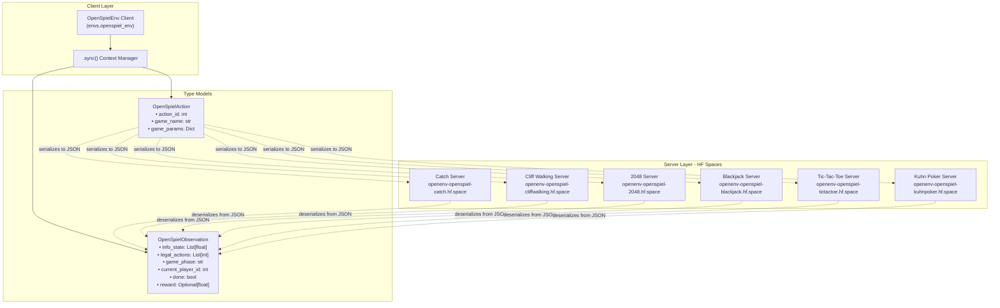
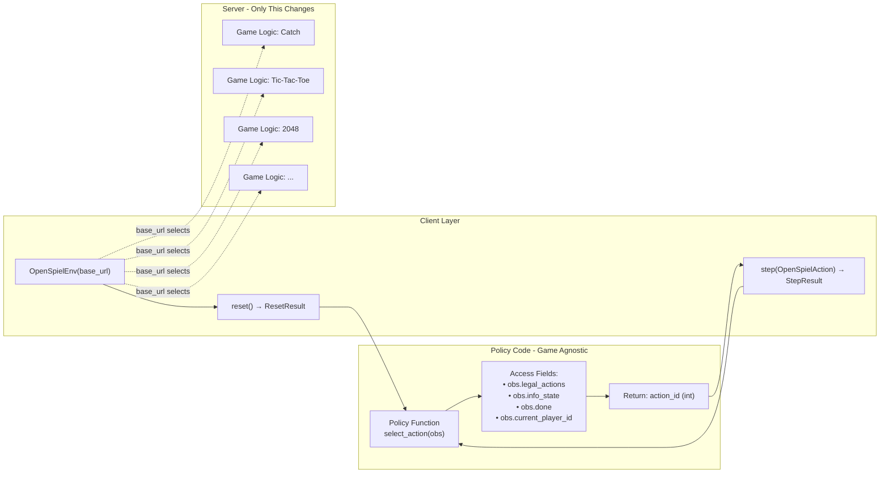
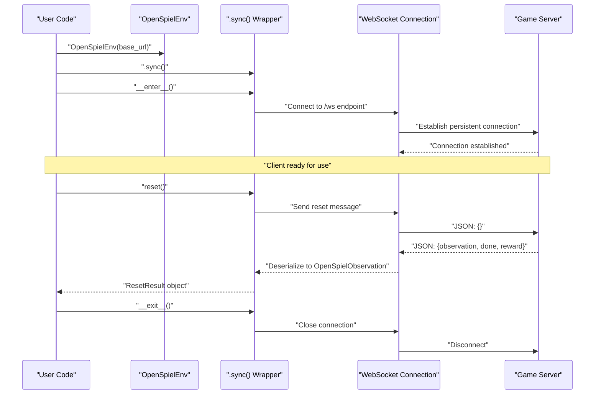
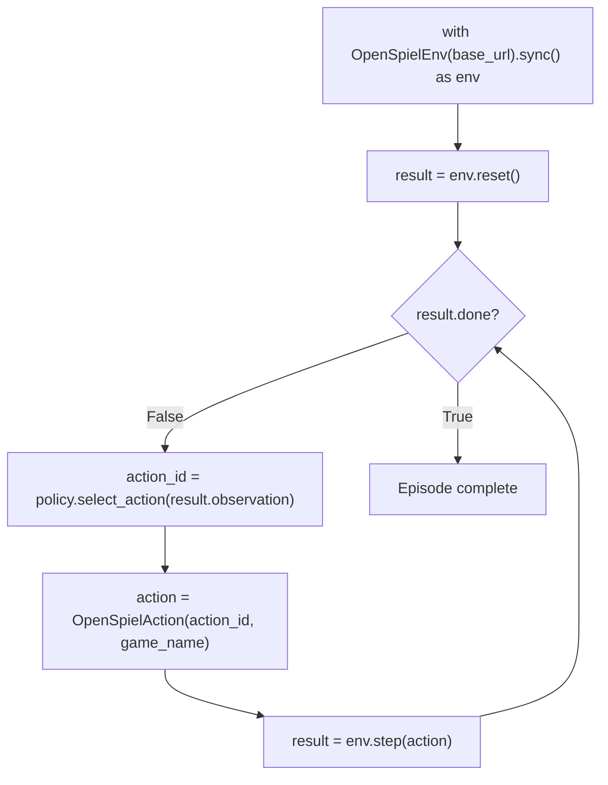
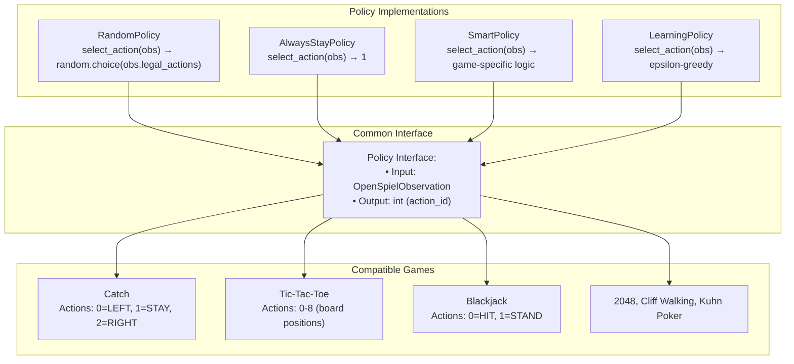
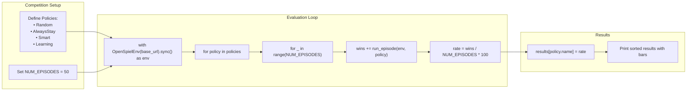

<!-- source: DeepWiki mcp.deepwiki.com · repo huggingface/openenv-course · page 3.1 OpenSpielEnv Client and Game Integration · fetched 2026-10-26 -->

# OpenSpielEnv Client and Game Integration

<details>
<summary>Relevant source files</summary>

The following files were used as context for generating this wiki page:

- [module-2/README.md](module-2/README.md)
- [module-2/notebook.ipynb](module-2/notebook.ipynb)

</details>


**Purpose and Scope**: This page documents the `OpenSpielEnv` client class and its integration with six OpenSpiel games. It explains how a single client provides a unified interface for all games, enabling game-agnostic policy code that can switch between games by changing only the `base_url` parameter. For information about the type-safe models used by this client, see [Type-Safe Models: Action, Observation, State](#3.2). For guidance on writing policies that work with this client, see [Writing Policies and Running Competitions](#3.3).

---

## The OpenSpielEnv Client Class

The `OpenSpielEnv` client is the primary interface for interacting with OpenSpiel game environments. It extends the `EnvClient` base class from `openenv-core` and provides a standardized way to connect to any of the six supported OpenSpiel games.

**Location**: The client is imported from `envs.openspiel_env` package.

**Basic Usage Pattern**:
```python
from envs.openspiel_env import OpenSpielEnv

with OpenSpielEnv(base_url=GAME_URL).sync() as env:
    result = env.reset()
    # interact with environment
```

The client uses the `.sync()` context manager to convert the underlying asynchronous WebSocket communication into a synchronous interface. This pattern is consistent across all OpenEnv environments.

**Sources**: [module-2/notebook.ipynb:39-51]()

---

## Unified Interface Across Six Games

OpenEnv wraps six games from DeepMind's OpenSpiel library, all accessible through the same `OpenSpielEnv` client. The games are categorized by player count and hosted on Hugging Face Spaces:

| Game | Type | Description | Base URL |
|------|------|-------------|----------|
| **Catch** | Single-Player | Catch falling ball on 10×5 grid | `https://openenv-openspiel-catch.hf.space` |
| **Cliff Walking** | Single-Player | Navigate grid avoiding cliffs | `https://openenv-openspiel-cliffwalking.hf.space` |
| **2048** | Single-Player | Tile merging puzzle | `https://openenv-openspiel-2048.hf.space` |
| **Blackjack** | Single-Player | Card game against dealer | `https://openenv-openspiel-blackjack.hf.space` |
| **Tic-Tac-Toe** | Multi-Player | Classic 3×3 grid game | `https://openenv-openspiel-tictactoe.hf.space` |
| **Kuhn Poker** | Multi-Player | Imperfect information poker | `https://openenv-openspiel-kuhnpoker.hf.space` |

Each game is deployed as a separate Space but uses identical action and observation models, enabling true game-agnostic policy development.

**Sources**: [module-2/README.md:46-54](), [module-2/notebook.ipynb:43, 239]()

---

## Architecture: Client-to-Game Integration



**Key Architectural Properties**:

1. **Single Client, Multiple Servers**: One `OpenSpielEnv` class connects to six different game servers
2. **Shared Type System**: `OpenSpielAction` and `OpenSpielObservation` models work across all games
3. **URL-Based Routing**: Game selection happens at instantiation via `base_url` parameter
4. **Protocol Consistency**: All games expose identical `/reset`, `/step`, and `/state` endpoints

**Sources**: [module-2/notebook.ipynb:39-51](), [module-2/README.md:4-14, 44-54]()

---

## Game-Agnostic Code Pattern

The core design principle of `OpenSpielEnv` is that **policy code should not depend on which game is being played**. The same observation fields and action structure work across all six games:



**Example from Catch to Tic-Tac-Toe**: The code structure remains identical when switching games:

```python
# Catch game
CATCH_URL = 'https://openenv-openspiel-catch.hf.space'
with OpenSpielEnv(base_url=CATCH_URL).sync() as env:
    result = env.reset()
    action_id = policy.select_action(result.observation)
    result = env.step(OpenSpielAction(action_id=action_id, game_name='catch'))

# Tic-Tac-Toe game - same structure
TTT_URL = 'https://openenv-openspiel-tictactoe.hf.space'
with OpenSpielEnv(base_url=TTT_URL).sync() as env:
    result = env.reset()
    action_id = policy.select_action(result.observation)
    result = env.step(OpenSpielAction(action_id=action_id, game_name='tic_tac_toe'))
```

Only three things change:
1. The `base_url` parameter (which server to connect to)
2. The `game_name` field in `OpenSpielAction` (for server-side routing)
3. The policy strategy (game-specific logic)

The observation format, client methods, and data flow remain identical.

**Sources**: [module-2/notebook.ipynb:239-258](), [module-2/README.md:94-109]()

---

## Client Instantiation and Connection

### Basic Instantiation

The `OpenSpielEnv` client requires only a `base_url` parameter pointing to the game server:

```python
from envs.openspiel_env import OpenSpielEnv

# Create client instance
env_async = OpenSpielEnv(base_url='https://openenv-openspiel-catch.hf.space')

# Convert to synchronous interface
env_sync = env_async.sync()

# Use as context manager (recommended)
with OpenSpielEnv(base_url='https://openenv-openspiel-catch.hf.space').sync() as env:
    # Client automatically connects and disconnects
    result = env.reset()
```

### Connection Pattern



### Sanity Check Pattern

A common pattern for verifying connection and inspecting game state:

```python
with OpenSpielEnv(base_url=CATCH_URL).sync() as env:
    result = env.reset()
    print(f'Legal actions: {result.observation.legal_actions}')
    print(f'Info state shape: {len(result.observation.info_state)} values')
    print(f'Game phase: {result.observation.game_phase}')
```

This pattern appears in [module-2/notebook.ipynb:46-50]() as the first interaction with every game.

**Sources**: [module-2/notebook.ipynb:39-51, 169-171, 241-246]()

---

## Type Models: Shared Contract Across Games

All six OpenSpiel games use identical Pydantic models for actions and observations, ensuring type safety and IDE autocomplete support.

### OpenSpielAction Model

Defined in `envs.openspiel_env.models`:

| Field | Type | Description |
|-------|------|-------------|
| `action_id` | `int` | Numeric identifier for the action to take |
| `game_name` | `str` | Game identifier (default: `"catch"`) |
| `game_params` | `Dict[str, Any]` | Optional game configuration parameters |

**Usage Example**:
```python
from envs.openspiel_env.models import OpenSpielAction

# Create action for Catch game
action = OpenSpielAction(action_id=2, game_name='catch')

# Create action for Tic-Tac-Toe
action = OpenSpielAction(action_id=4, game_name='tic_tac_toe')
```

### OpenSpielObservation Model

Defined in `envs.openspiel_env.models`:

| Field | Type | Description |
|-------|------|-------------|
| `info_state` | `List[float]` | Flattened game state as numeric vector |
| `legal_actions` | `List[int]` | Valid action IDs for current state |
| `game_phase` | `str` | Current phase (default: `"playing"`) |
| `current_player_id` | `int` | Active player identifier (default: `0`) |
| `opponent_last_action` | `Optional[int]` | Previous opponent move (multi-player games) |
| `done` | `bool` | Episode termination flag (inherited from `Observation`) |
| `reward` | `Optional[float]` | Step reward (inherited from `Observation`) |

**Key Properties**:

1. **info_state**: Game-specific representation (e.g., for Catch, a 10×5 grid flattened to 50 floats with ball=1.0, paddle=1.0, empty=0.0)
2. **legal_actions**: Always present, prevents illegal moves (e.g., `[0, 1, 2]` for Catch = LEFT, STAY, RIGHT)
3. **done**: Signals episode termination, checked in game loops
4. **reward**: Available after `step()`, used for policy evaluation

**Sources**: [module-2/README.md:23-40](), [module-2/notebook.ipynb:40, 48-50, 72-73]()

---

## Episode Execution Pattern

The standard pattern for running a complete episode works identically across all games:



**Concrete Implementation** from [module-2/notebook.ipynb:148-165]():

```python
def run_episode(env, policy, verbose=False):
    """Play one episode. Returns 1 if caught, 0 if missed."""
    result = env.reset()
    step = 0
    
    while not result.done:
        action_id = policy.select_action(result.observation)
        result = env.step(OpenSpielAction(action_id=action_id, game_name='catch'))
        step += 1
    
    caught = 1 if result.reward and result.reward > 0 else 0
    return caught
```

This function works for any OpenSpiel game by:
1. Using the standard `reset()` → `step()` loop
2. Reading `result.observation` (type-safe)
3. Checking `result.done` for termination
4. Extracting `result.reward` for scoring

**Sources**: [module-2/notebook.ipynb:148-165]()

---

## Multi-Game Policy Compatibility



**Policy Portability**:

| Policy Type | Catch Success Rate | Tic-Tac-Toe Applicability | Blackjack Applicability |
|-------------|-------------------|---------------------------|------------------------|
| RandomPolicy | ~20% | Valid (pure exploration) | Valid (baseline) |
| AlwaysStayPolicy | ~20% | Invalid (game-specific) | Invalid (game-specific) |
| SmartPolicy | ~100% | Requires new logic | Requires new logic |
| LearningPolicy | ~85% | Adaptable strategy | Adaptable strategy |

**Key Insight**: The `RandomPolicy` and `LearningPolicy` patterns are truly game-agnostic because they only depend on `obs.legal_actions`. The `SmartPolicy` demonstrates that while the *interface* is unified, optimal strategies remain game-specific.

**Sources**: [module-2/notebook.ipynb:68-127](), [module-2/README.md:59-92]()

---

## Switching Games: Minimal Code Changes

Switching from one OpenSpiel game to another requires exactly two changes:

1. **Change the `base_url`** parameter in `OpenSpielEnv()` instantiation
2. **Change the `game_name`** field in `OpenSpielAction` objects

**Example: Catch → Tic-Tac-Toe**:

```python
# Configuration for Catch
CATCH_URL = 'https://openenv-openspiel-catch.hf.space'
GAME_NAME = 'catch'

# Run on Catch
with OpenSpielEnv(base_url=CATCH_URL).sync() as env:
    result = env.reset()
    while not result.done:
        action_id = random.choice(result.observation.legal_actions)
        result = env.step(OpenSpielAction(action_id=action_id, game_name=GAME_NAME))

# Configuration for Tic-Tac-Toe - only these change
TTT_URL = 'https://openenv-openspiel-tictactoe.hf.space'
GAME_NAME = 'tic_tac_toe'

# Run on Tic-Tac-Toe - same code structure
with OpenSpielEnv(base_url=TTT_URL).sync() as env:
    result = env.reset()
    while not result.done:
        action_id = random.choice(result.observation.legal_actions)
        result = env.step(OpenSpielAction(action_id=action_id, game_name=GAME_NAME))
```

**What Stays Identical**:
- `OpenSpielEnv` client class
- `.sync()` context manager pattern
- `reset()` and `step()` method calls
- `result.observation.legal_actions` field access
- `result.done` termination check
- `OpenSpielAction` structure

**What Changes**:
- Server URL (deployment target)
- Game name string (server-side routing)
- Optimal policy logic (game-specific strategy)

This pattern appears in [module-2/notebook.ipynb:239-258]() where the notebook demonstrates switching from Catch to Tic-Tac-Toe with zero changes to the client code structure.

**Sources**: [module-2/notebook.ipynb:225-258](), [module-2/README.md:94-109]()

---

## Competition Evaluation Pattern

The `OpenSpielEnv` client enables systematic policy evaluation across multiple episodes:



**Implementation** from [module-2/notebook.ipynb:189-211]():

```python
NUM_EPISODES = 50
policies = [RandomPolicy(), AlwaysStayPolicy(), SmartPolicy(), LearningPolicy()]
results = {}

with OpenSpielEnv(base_url=CATCH_URL).sync() as env:
    for policy in policies:
        wins = sum(run_episode(env, policy) for _ in range(NUM_EPISODES))
        rate = wins / NUM_EPISODES * 100
        results[policy.name] = rate
        print(f"{policy.name:20s} — {rate:5.1f}% ({wins}/{NUM_EPISODES})")
```

**Expected Results for Catch**:
- Random: ~20% (baseline luck)
- AlwaysStay: ~20% (poor strategy)
- SmartHeuristic: ~100% (optimal play)
- Epsilon-Greedy: ~85% (learns over time)

This pattern demonstrates the client's ability to maintain a persistent connection across multiple episodes, reducing connection overhead compared to reconnecting for each episode.

**Sources**: [module-2/notebook.ipynb:183-222]()

---

## Summary

The `OpenSpielEnv` client provides:

1. **Unified Interface**: Single client class for six different games
2. **Type Safety**: Pydantic models (`OpenSpielAction`, `OpenSpielObservation`) enable IDE autocomplete and early error detection
3. **Game-Agnostic Code**: Policies written once work across all games (interface-wise)
4. **URL-Based Routing**: Switch games by changing `base_url` parameter
5. **Persistent Connections**: `.sync()` context manager maintains WebSocket connection across episodes
6. **Consistent API**: `reset()`, `step()`, and observation fields identical across all games

This design fulfills the OpenEnv principle: **"Same client interface across all games."** Policy code depends only on the observation structure, not on which game server it connects to.

**Sources**: [module-2/notebook.ipynb:264-274](), [module-2/README.md:1-115]()

---

