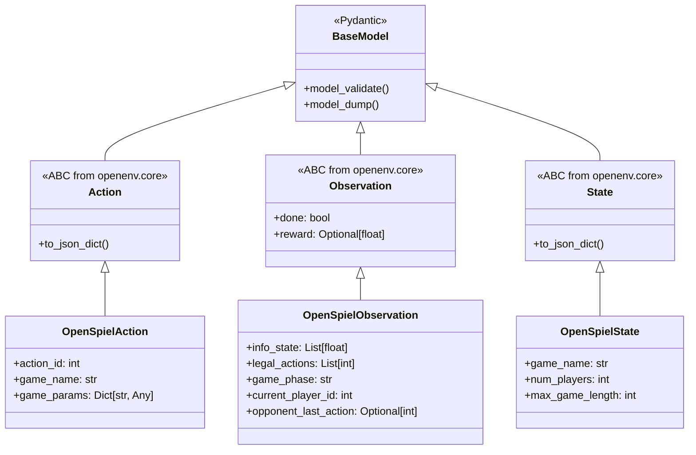
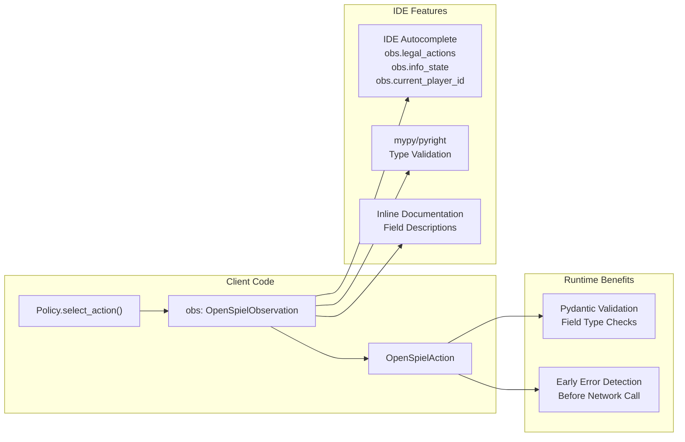
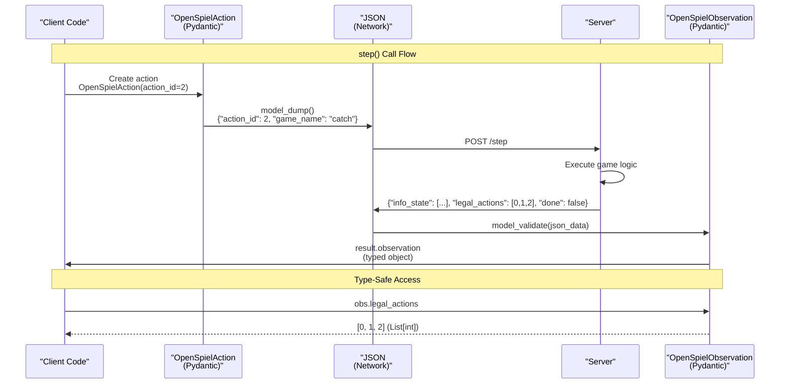
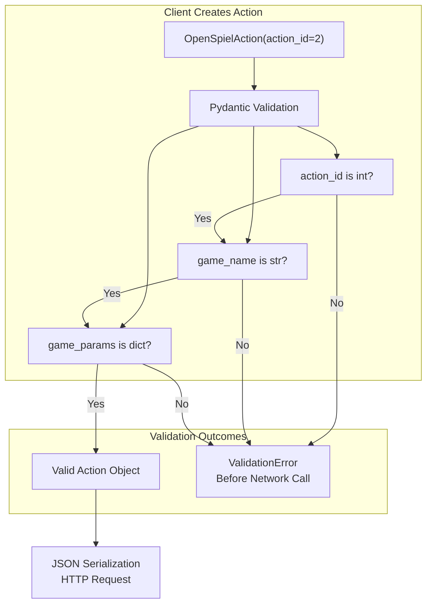

<!-- source: DeepWiki mcp.deepwiki.com · repo huggingface/openenv-course · page 3.2 Type-Safe Models: Action, Observation, State · fetched 2026-10-26 -->

# Type-Safe Models: Action, Observation, State

<details>
<summary>Relevant source files</summary>

The following files were used as context for generating this wiki page:

- [module-2/README.md](module-2/README.md)
- [module-2/notebook.ipynb](module-2/notebook.ipynb)

</details>


This document explains the Pydantic-based type system that ensures compile-time safety and IDE support across all OpenEnv interactions. These models define the contracts for actions sent to environments, observations received from them, and state queries.

For information about how these models integrate with client-side communication, see [Building the Client Interface](#5.3). For details on implementing custom models in new environments, see [The 3-Component Pattern](#5.1).

## Overview and Purpose

OpenEnv uses Pydantic models to define type-safe contracts between clients and servers. Instead of working with dictionaries or tuples where `obs[0][3]` has unknown meaning, you work with strongly-typed objects where `observation.legal_actions` is validated, documented, and autocompleted by your IDE.

Every environment defines three model types:

| Model Type | Purpose | Direction | Methods |
|------------|---------|-----------|---------|
| **Action** | Commands sent to environment | Client → Server | `step()` |
| **Observation** | Information received after actions | Server → Client | `reset()`, `step()` |
| **State** | Full environment snapshot | Server → Client | `state()` |

All three inherit from base classes in `openenv-core` and use Pydantic v2 for validation, serialization, and IDE integration.

Sources: [module-2/README.md:17-40]()

## Base Model Classes

### Inheritance Hierarchy



**Class Hierarchy Diagram: Pydantic Model Inheritance**

The base classes (`Action`, `Observation`, `State`) are abstract base classes defined in `openenv-core` that inherit from Pydantic's `BaseModel`. Concrete implementations like `OpenSpielAction` extend these with game-specific fields.

Sources: [module-2/README.md:23-40]()

### Core Fields

The `Observation` base class defines two universal fields that all observations inherit:

| Field | Type | Purpose | Set By |
|-------|------|---------|--------|
| `done` | `bool` | Episode termination flag | Server on every `reset()`/`step()` |
| `reward` | `Optional[float]` | Scalar reward signal | Server on `step()` only |

These fields are **inherited automatically** — concrete observation classes don't redeclare them. This ensures consistent semantics: every observation has `done` and `reward`, regardless of the environment type.

Sources: [module-2/README.md:34-35](), [module-2/notebook.ipynb:153-166]()

## OpenSpiel Model Implementations

### OpenSpielAction

```python
class OpenSpielAction(Action):
    action_id: int                              # Which action to take
    game_name: str = "catch"                   # Which game
    game_params: Dict[str, Any] = Field(default_factory=dict)  # Game config
```

The `action_id` field references an index in the `legal_actions` list from the previous observation. The `game_name` field determines which OpenSpiel game to execute (e.g., `"catch"`, `"tic_tac_toe"`, `"kuhn_poker"`). The `game_params` field allows runtime configuration but defaults to an empty dictionary.

**Example usage:**
```python
action = OpenSpielAction(action_id=2, game_name="catch")  # Move RIGHT
result = env.step(action)
```

Sources: [module-2/README.md:28-31](), [module-2/notebook.ipynb:158]()

### OpenSpielObservation

```python
class OpenSpielObservation(Observation):
    # done: bool and reward: Optional[float] are inherited from Observation
    info_state: List[float]      # Game state as a vector
    legal_actions: List[int]     # Valid actions this step
    game_phase: str = "playing"  # Current phase
    current_player_id: int = 0   # Whose turn
    opponent_last_action: Optional[int] = None
```

| Field | Type | Purpose | Example (Catch) |
|-------|------|---------|-----------------|
| `info_state` | `List[float]` | Vectorized game state | 50 floats: 10×5 grid flattened |
| `legal_actions` | `List[int]` | Valid action indices | `[0, 1, 2]` (LEFT, STAY, RIGHT) |
| `game_phase` | `str` | Current game stage | `"playing"` or `"game_over"` |
| `current_player_id` | `int` | Active player (0-indexed) | `0` (single-player game) |
| `opponent_last_action` | `Optional[int]` | Previous opponent move | `None` (single-player) |

The `info_state` field encodes game-specific information. In Catch, it's a flattened 10×5 grid where `1.0` indicates ball/paddle positions and `0.0` is empty space. In Tic-Tac-Toe, it's a 9-element vector representing the board state.

Sources: [module-2/README.md:33-40](), [module-2/notebook.ipynb:47-50]()

### Type Safety in Practice



**Type Safety Benefits Diagram**

When you access `obs.legal_actions`, your IDE knows it's a `List[int]` and provides autocomplete. If you try to pass a string where an integer is expected, Pydantic catches it before the network call.

Sources: [module-2/README.md:17-42](), [module-2/notebook.ipynb:72-73]()

## Serialization and Deserialization Flow

### Network Communication Pattern



**Serialization Flow Diagram: Pydantic Models Through Network Layer**

The serialization happens in two phases:
1. **Client → Server**: `OpenSpielAction` → `model_dump()` → JSON → HTTP payload
2. **Server → Client**: JSON response → `model_validate()` → `OpenSpielObservation`

Pydantic handles all validation automatically. If the server returns `"info_state": "invalid"` instead of a list, Pydantic raises a `ValidationError` before your code sees the data.

Sources: [module-2/README.md:17-42]()

### Implementation in EnvClient

The `EnvClient` base class in `openenv-core` handles serialization through three abstract methods that concrete clients must implement:

| Method | Purpose | Input | Output |
|--------|---------|-------|--------|
| `_step_payload()` | Serialize action to JSON | Typed action object | `Dict[str, Any]` |
| `_parse_result()` | Deserialize step response | JSON dict | Typed observation |
| `_parse_state()` | Deserialize state response | JSON dict | Typed state |

For `OpenSpielEnv`, these methods convert between `OpenSpielAction`/`OpenSpielObservation`/`OpenSpielState` objects and their JSON representations.

Sources: High-level diagrams (Diagram 5: Data Flow)

## Usage Patterns

### Policy Implementation with Typed Observations

```python
class SmartPolicy:
    """Moves paddle toward ball — optimal for Catch."""
    name = "Smart Heuristic"

    def select_action(self, obs: OpenSpielObservation) -> int:
        info_state = obs.info_state
        grid_width = 5

        # Find ball column (first 1.0 in the flattened grid)
        ball_col = None
        for idx, val in enumerate(info_state):
            if abs(val - 1.0) < 0.01:
                ball_col = idx % grid_width
                break

        # Paddle is in the last row
        last_row = info_state[-grid_width:]
        paddle_col = last_row.index(1.0)

        if ball_col is not None:
            if paddle_col < ball_col:
                return 2  # RIGHT
            elif paddle_col > ball_col:
                return 0  # LEFT
        return 1  # STAY
```

**Key observations:**
- The `obs` parameter has type hint `OpenSpielObservation`, enabling IDE autocomplete for `obs.info_state`
- Accessing `obs.legal_actions` works across all 6 OpenSpiel games because the type is consistent
- No dictionary key lookups — all access is through typed attributes

Sources: [module-2/notebook.ipynb:84-108]()

### Episode Execution with Typed Models

```python
def run_episode(env, policy, verbose=False):
    """Play one episode. Returns 1 if caught, 0 if missed."""
    result = env.reset()  # result.observation is OpenSpielObservation
    step = 0

    while not result.done:  # .done is inherited from Observation base class
        action_id = policy.select_action(result.observation)
        
        # Create typed action object
        action = OpenSpielAction(action_id=action_id, game_name='catch')
        
        # step() expects OpenSpielAction, returns result with OpenSpielObservation
        result = env.step(action)
        step += 1

    caught = 1 if result.reward and result.reward > 0 else 0
    return caught
```

**Type flow:**
1. `env.reset()` → returns object with `.observation: OpenSpielObservation`
2. `policy.select_action(observation)` → expects `OpenSpielObservation`, returns `int`
3. `OpenSpielAction(action_id=int)` → creates typed action
4. `env.step(action)` → expects `OpenSpielAction`, returns typed result

At every step, the types are known and validated.

Sources: [module-2/notebook.ipynb:145-166]()

### Game-Agnostic Code

```python
# Catch
with OpenSpielEnv(base_url="https://openenv-openspiel-catch.hf.space").sync() as env:
    result = env.reset()
    print(result.observation.legal_actions)  # [0, 1, 2]
    print(result.observation.info_state)     # 50-element list

# Tic-Tac-Toe — same client, same types, different URL
with OpenSpielEnv(base_url="https://openenv-openspiel-tictactoe.hf.space").sync() as env:
    result = env.reset()
    print(result.observation.legal_actions)  # [0, 1, 2, ..., 8]
    print(result.observation.info_state)     # 9-element list
```

Both games return `OpenSpielObservation` with identical fields. The `info_state` length differs (50 for Catch, 9 for Tic-Tac-Toe), but the **type is the same**. This enables writing policies that work across multiple games without code changes.

Sources: [module-2/notebook.ipynb:239-258](), [module-2/README.md:94-108]()

## Model Validation and Error Handling

### Pydantic Validation Rules



**Validation Flow Diagram**

If you attempt to create `OpenSpielAction(action_id="two")`, Pydantic raises a `ValidationError` immediately, before any network call. This catches bugs at the source.

Sources: [module-2/README.md:17-42]()

### Common Validation Scenarios

| Invalid Input | Error Type | When Caught |
|--------------|------------|-------------|
| `action_id="two"` (wrong type) | `ValidationError` | Action creation |
| `action_id=99` (out of range) | Game logic error | Server response |
| Missing required field | `ValidationError` | Action creation |
| Server returns invalid JSON | `ValidationError` | Response parsing |
| Server returns wrong field type | `ValidationError` | Response parsing |

Type errors are caught **before network transmission**. Logical errors (invalid action ID) are caught **by the server** and returned in the response.

Sources: [module-2/README.md:17-42]()

## Summary

The type-safe model system provides:

1. **Compile-time safety**: IDEs and type checkers catch errors before runtime
2. **Runtime validation**: Pydantic validates all data at object creation and deserialization
3. **Self-documenting code**: Field names and types serve as inline documentation
4. **Consistency across environments**: All environments use the same base classes (`Action`, `Observation`, `State`)
5. **Zero-cost abstraction**: Models compile to efficient code with no runtime overhead beyond validation

The key principle: **types are contracts**. When a function signature says `def select_action(self, obs: OpenSpielObservation) -> int`, you know exactly what goes in and what comes out. No documentation lookup required.

Sources: [module-2/README.md:17-42](), [module-2/notebook.ipynb:39-50](), High-level diagrams (Diagram 5: Data Flow)

---

