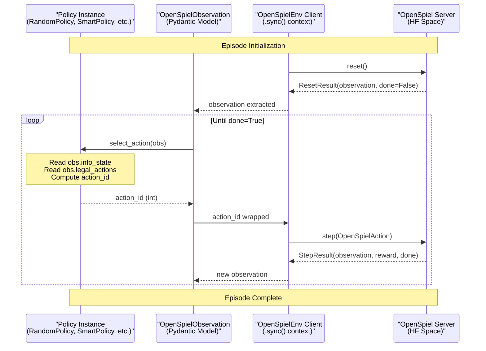
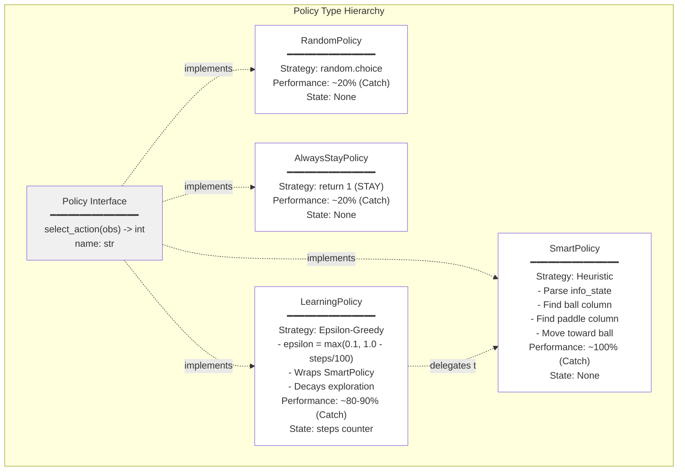
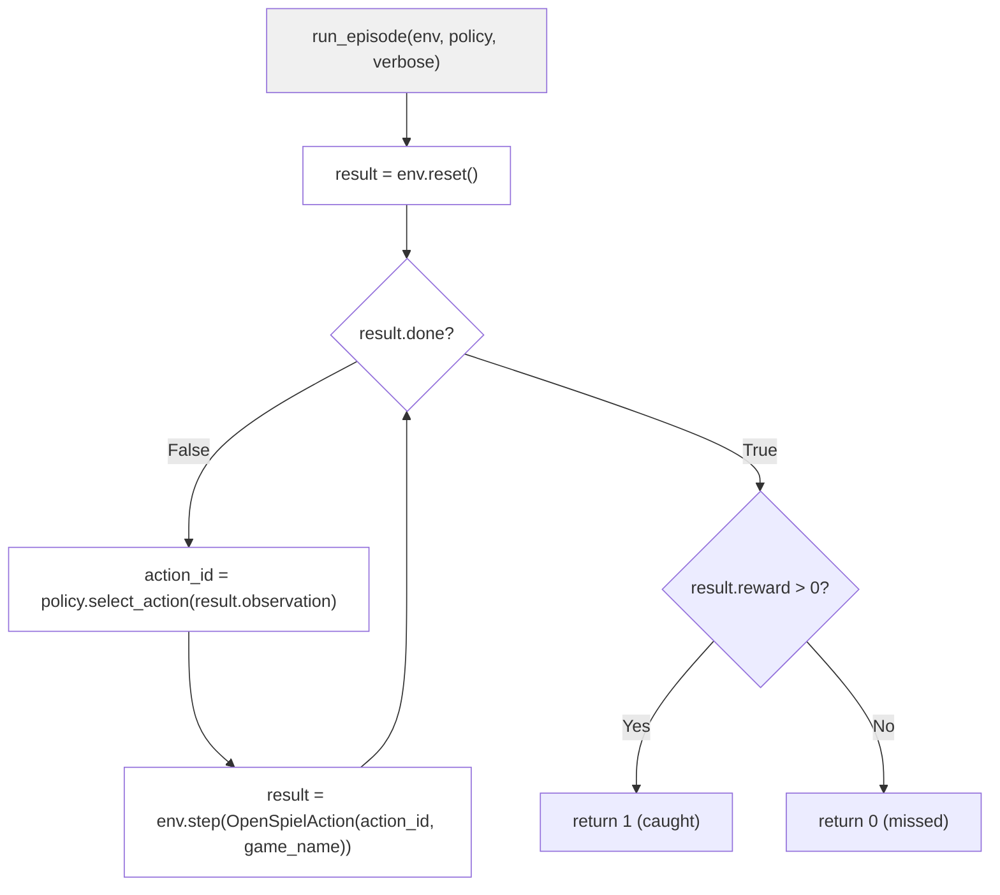
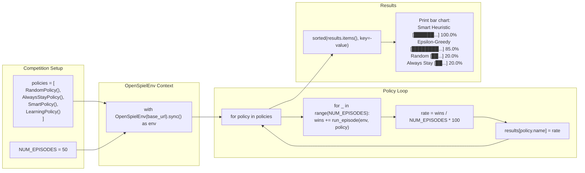
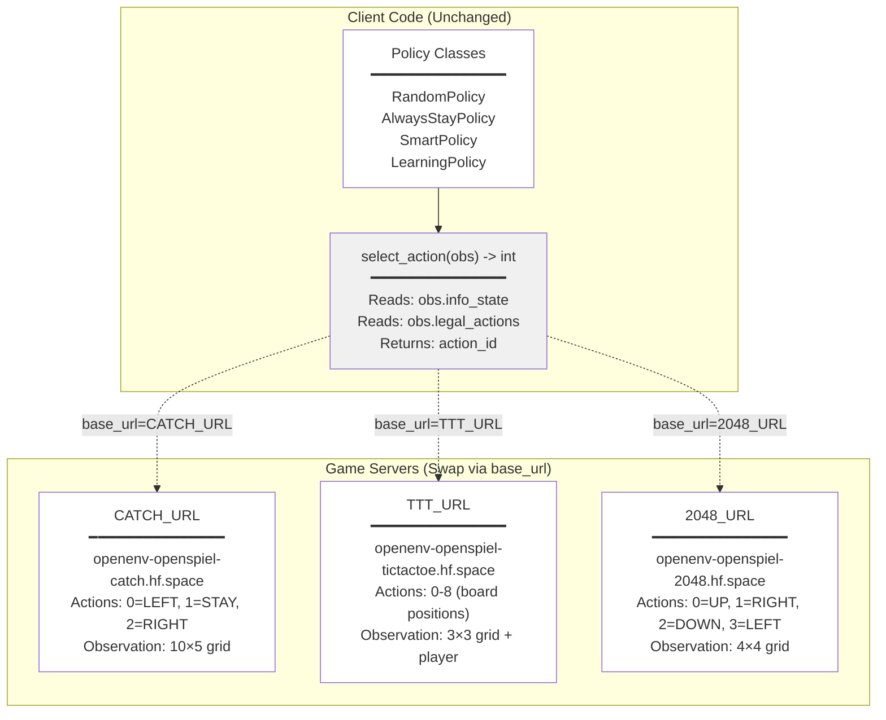

<!-- source: DeepWiki mcp.deepwiki.com · repo huggingface/openenv-course · page 3.3 Writing Policies and Running Competitions · fetched 2026-10-26 -->

# Writing Policies and Running Competitions

<details>
<summary>Relevant source files</summary>

The following files were used as context for generating this wiki page:

- [module-2/notebook.ipynb](module-2/notebook.ipynb)

</details>


## Purpose and Scope

This page documents how to implement policies for OpenSpiel environments and run competitive evaluations. It covers the `select_action` interface that all policies must implement, demonstrates four policy types with increasing sophistication, and shows how to run multi-episode competitions to compare performance. The same policy code works across all six OpenSpiel games due to the standardized observation format.

For information about the `OpenSpielEnv` client and how it provides a unified interface across games, see [3.1](#3.1). For details on the `OpenSpielObservation` and `OpenSpielAction` types used by policies, see [3.2](#3.2).

---

## The Policy Interface

All policies must implement a `select_action` method that takes an `OpenSpielObservation` and returns an integer action ID. This simple interface enables game-agnostic policy code that works across all OpenSpiel environments.

**Policy Contract:**

| Method | Signature | Return Type | Purpose |
|--------|-----------|-------------|---------|
| `select_action` | `(obs: OpenSpielObservation) -> int` | `int` | Select action ID from observation |
| `name` (attribute) | N/A | `str` | Human-readable policy identifier |

The policy reads relevant fields from the observation (`info_state`, `legal_actions`, `current_player_id`) and returns an action ID that must be in `obs.legal_actions`. The environment rejects illegal actions.

**Policy Execution Flow:**



**Sources:** [module-2/notebook.ipynb:62-128]()

---

## Four Policy Types

Module 2 demonstrates four policies with increasing sophistication, from purely random to epsilon-greedy learning. Each policy implements the same `select_action` interface but uses different strategies.

**Policy Type Comparison:**



### RandomPolicy

Pure random baseline that selects uniformly from `obs.legal_actions`. Achieves ~20% success rate on Catch (5 columns = 20% chance of correct position).

**Implementation:** [module-2/notebook.ipynb:68-73]()

```python
class RandomPolicy:
    """Pure random — baseline."""
    name = "Random"
    
    def select_action(self, obs: OpenSpielObservation) -> int:
        return random.choice(obs.legal_actions)
```

### AlwaysStayPolicy

Never moves the paddle, hoping the ball lands on it. Demonstrates a deterministic but poor strategy. Also achieves ~20% on Catch due to initial random ball placement.

**Implementation:** [module-2/notebook.ipynb:76-81]()

```python
class AlwaysStayPolicy:
    """Never moves — hopes ball lands on paddle."""
    name = "Always Stay"
    
    def select_action(self, obs: OpenSpielObservation) -> int:
        return 1  # STAY
```

### SmartPolicy

Optimal heuristic for Catch. Parses the `info_state` tensor to locate ball and paddle positions, then moves the paddle toward the ball. Achieves ~100% success rate.

**Key Logic:**
1. `info_state` is a flattened 10×5 grid where `1.0` indicates occupied cells
2. Find ball column: first `1.0` in grid, modulo 5 (grid width)
3. Find paddle column: location of `1.0` in last row
4. Return action: 0 (LEFT), 1 (STAY), or 2 (RIGHT)

**Implementation:** [module-2/notebook.ipynb:84-108]()

```python
class SmartPolicy:
    """Moves paddle toward ball — optimal for Catch."""
    name = "Smart Heuristic"
    
    def select_action(self, obs: OpenSpielObservation) -> int:
        info_state = obs.info_state
        grid_width = 5
        
        # Find ball column (first 1.0 in the flattened grid)
        ball_col = None
        for idx, val in enumerate(info_state):
            if abs(val - 1.0) < 0.01:
                ball_col = idx % grid_width
                break
        
        # Paddle is in the last row
        last_row = info_state[-grid_width:]
        paddle_col = last_row.index(1.0)
        
        if ball_col is not None:
            if paddle_col < ball_col:
                return 2  # RIGHT
            elif paddle_col > ball_col:
                return 0  # LEFT
        return 1  # STAY
```

### LearningPolicy (Epsilon-Greedy)

Demonstrates exploration-exploitation tradeoff. Starts with 100% random exploration (`epsilon=1.0`), decays linearly to 10% over 100 steps, then delegates to `SmartPolicy` for exploitation. Achieves ~80-90% success rate due to initial exploration phase.

**Epsilon Decay Formula:**
```
epsilon = max(0.1, 1.0 - steps / 100)
```

**Implementation:** [module-2/notebook.ipynb:111-124]()

```python
class LearningPolicy:
    """Epsilon-greedy — starts random, learns to be smart."""
    name = "Epsilon-Greedy"
    
    def __init__(self):
        self.steps = 0
        self._smart = SmartPolicy()
    
    def select_action(self, obs: OpenSpielObservation) -> int:
        self.steps += 1
        epsilon = max(0.1, 1.0 - self.steps / 100)
        if random.random() < epsilon:
            return random.choice(obs.legal_actions)
        return self._smart.select_action(obs)
```

**Sources:** [module-2/notebook.ipynb:62-128]()

---

## Running Episodes

The `run_episode` function executes a single episode from reset to termination. It follows the standard reset-step loop, using the policy's `select_action` method to choose actions.

**Episode Execution Pattern:**



**Implementation:** [module-2/notebook.ipynb:148-165]()

```python
def run_episode(env, policy, verbose=False):
    """Play one episode. Returns 1 if caught, 0 if missed."""
    result = env.reset()
    step = 0
    
    while not result.done:
        action_id = policy.select_action(result.observation)
        if verbose:
            name = {0: 'LEFT', 1: 'STAY', 2: 'RIGHT'}.get(action_id, str(action_id))
            print(f'  Step {step}: {name}')
        result = env.step(OpenSpielAction(action_id=action_id, game_name='catch'))
        step += 1
    
    caught = 1 if result.reward and result.reward > 0 else 0
    if verbose:
        status = 'Caught!' if caught else 'Missed'
        print(f'  Result: {status} (reward={result.reward})')
    return caught
```

**Return Value:** Returns `1` if the episode ended with positive reward (ball caught in Catch), `0` otherwise. This binary return simplifies aggregation across multiple episodes.

**Verbose Mode:** When `verbose=True`, prints action names and final result for debugging and demonstration purposes.

**Sources:** [module-2/notebook.ipynb:140-172]()

---

## Running Competitions

Competitive evaluation runs multiple episodes per policy and aggregates success rates. Module 2 demonstrates a 50-episode competition across all four policy types.

**Competition Evaluation Flow:**



**Implementation:** [module-2/notebook.ipynb:189-210]()

```python
NUM_EPISODES = 50

policies = [
    RandomPolicy(),
    AlwaysStayPolicy(),
    SmartPolicy(),
    LearningPolicy(),
]

results = {}

with OpenSpielEnv(base_url=CATCH_URL).sync() as env:
    for policy in policies:
        wins = sum(run_episode(env, policy) for _ in range(NUM_EPISODES))
        rate = wins / NUM_EPISODES * 100
        results[policy.name] = rate
        print(f"{policy.name:20s} — {rate:5.1f}% ({wins}/{NUM_EPISODES})")

print("\n--- Results ---")
for name, rate in sorted(results.items(), key=lambda x: -x[1]):
    bar = "█" * int(rate / 2)
    print(f"{name:20s} [{bar:<50}] {rate:.1f}%")
```

**Expected Results on Catch:**

| Policy | Success Rate | Explanation |
|--------|--------------|-------------|
| Smart Heuristic | ~100% | Optimal strategy for Catch |
| Epsilon-Greedy | ~80-90% | Starts random, converges to smart |
| Random | ~20% | 1/5 chance (5 columns) |
| Always Stay | ~20% | Same as random due to random ball spawn |

**Performance Optimization:** The competition reuses a single `env` instance within the `.sync()` context manager, avoiding connection overhead for each episode. This enables running 200 total episodes (50 per policy × 4 policies) efficiently.

**Sources:** [module-2/notebook.ipynb:183-222]()

---

## Game-Agnostic Code

The same policy implementations work across all six OpenSpiel games (Catch, Tic-Tac-Toe, 2048, Breakthrough, Y, Phantom Tic-Tac-Toe) because they all expose the standardized `OpenSpielObservation` format. Switching games requires only changing the `base_url` parameter.

**Multi-Game Execution:**



**Example: Switching from Catch to Tic-Tac-Toe**

[module-2/notebook.ipynb:234-257]()

```python
# Change only the base_url — policies remain identical
TTT_URL = "https://openenv-openspiel-tictactoe.hf.space"

with OpenSpielEnv(base_url=TTT_URL).sync() as env:
    result = env.reset()
    print(f"Game: Tic-Tac-Toe")
    print(f"Legal actions: {result.observation.legal_actions}")
    print(f"Info state: {result.observation.info_state}")
    print(f"Current player: {result.observation.current_player_id}")
    
    # Play randomly until game ends
    step = 0
    while not result.done:
        action_id = random.choice(result.observation.legal_actions)
        result = env.step(OpenSpielAction(action_id=action_id, game_name="tic_tac_toe"))
        step += 1
        print(f"Step {step}: action={action_id}, reward={result.reward}, done={result.done}")
    
    print(f"\nGame over! Final reward: {result.reward}")
```

**Key Difference:** Only the `game_name` parameter in `OpenSpielAction` changes from `"catch"` to `"tic_tac_toe"`. The observation format (`info_state`, `legal_actions`, `done`, etc.) remains consistent across all games.

**Why This Works:**
- All OpenSpiel games use the same `OpenSpielObservation` Pydantic model (see [3.2](#3.2))
- The `info_state` tensor varies in size and meaning but is always a `List[float]`
- Policies that read `legal_actions` without parsing `info_state` (e.g., `RandomPolicy`) work on any game
- Game-specific policies (e.g., `SmartPolicy` for Catch) must implement different heuristics per game

**Sources:** [module-2/notebook.ipynb:225-275]()

---

## Summary

**Policy Interface:**
- All policies implement `select_action(obs: OpenSpielObservation) -> int`
- Must return action ID from `obs.legal_actions`

**Policy Types:**
- `RandomPolicy`: Baseline, ~20% on Catch
- `AlwaysStayPolicy`: Deterministic poor strategy, ~20% on Catch
- `SmartPolicy`: Optimal heuristic, ~100% on Catch
- `LearningPolicy`: Epsilon-greedy exploration-exploitation, ~80-90% on Catch

**Competition Framework:**
- `run_episode(env, policy)` executes single episode, returns binary outcome
- Multi-episode evaluation aggregates win rates
- Single `.sync()` context reuses connection for efficiency

**Game Agnostic:**
- Same policies work across all 6 OpenSpiel games
- Only `base_url` and `game_name` change
- Enables rapid prototyping and cross-game evaluation

**Next Steps:** To deploy custom modifications to these environments, see [4.2](#4.2). To build entirely new environments from scratch, see [5.1](#5.1).

**Sources:** [module-2/notebook.ipynb:1-291]()

---

