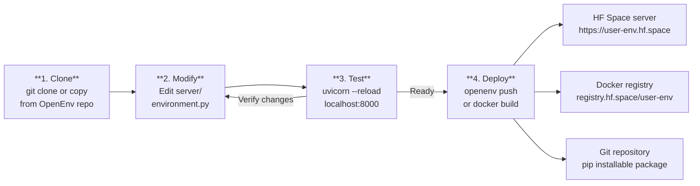
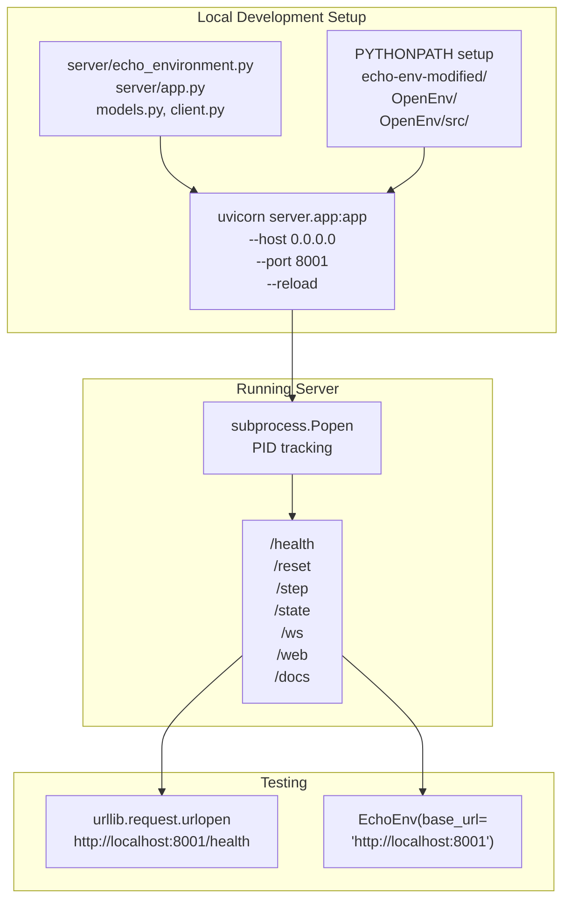
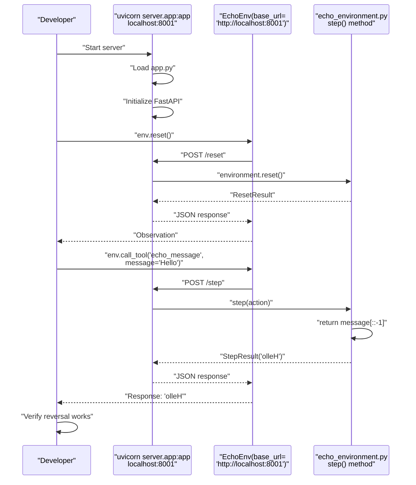
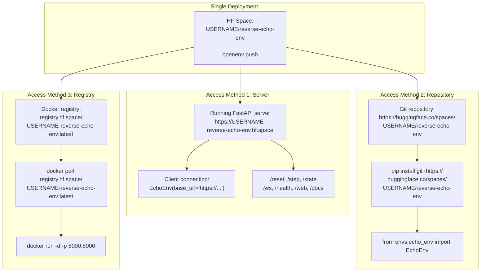
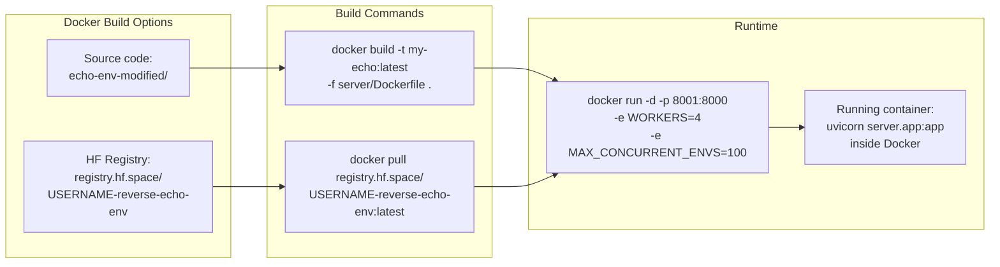
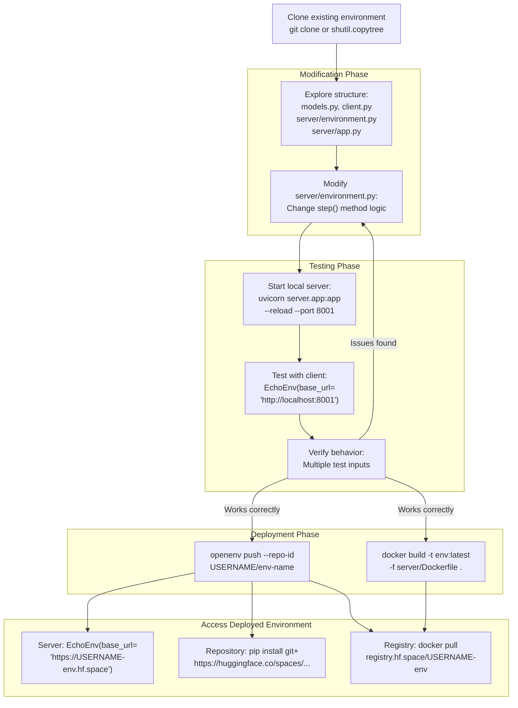

<!-- source: DeepWiki mcp.deepwiki.com · repo huggingface/openenv-course · page 4 Module 3: Deployment Workflow · fetched 2026-10-26 -->

# Module 3: Deployment Workflow

<details>
<summary>Relevant source files</summary>

The following files were used as context for generating this wiki page:

- [module-3/README.md](module-3/README.md)
- [module-3/notebook.ipynb](module-3/notebook.ipynb)

</details>


This module covers the complete workflow for deploying and modifying OpenEnv environments. It teaches how to clone existing environments, modify their logic, test changes locally with `uvicorn`, and deploy to Hugging Face Spaces or Docker containers. The focus is on practical deployment mechanics rather than creating environments from scratch (see [Module 4: Building Custom Environments](#5) for custom environment creation) or using existing environments (see [Module 2: Policy Development with OpenSpiel](#3) for environment usage patterns).

**Sources:** [module-3/notebook.ipynb:1-15](), [module-3/README.md:1-145]()

---

## The Clone-Modify-Deploy Workflow

Module 3 follows a four-step workflow that takes an existing environment from cloning to production deployment:



The workflow emphasizes rapid iteration through local testing before deployment. Each step uses specific tools: cloning uses `git` or file copying, modification targets `server/echo_environment.py`, testing uses `uvicorn` with hot-reloading, and deployment uses either `openenv push` or `docker build`.

**Sources:** [module-3/notebook.ipynb:7-14](), [module-3/README.md:122-131]()

---

## Local Development with Uvicorn

### Starting the Server

Local development uses `uvicorn` to run the FastAPI application defined in `server/app.py`. The server can be started in two ways:

**Method 1: Using uv (recommended)**
```bash
cd echo-env-modified
uv sync
uv run server
```

**Method 2: Direct uvicorn invocation**
```bash
uvicorn server.app:app --host 0.0.0.0 --port 8000 --reload
```

The `--reload` flag enables automatic restart on code changes, providing a fast iteration loop during development.

**Sources:** [module-3/README.md:15-36](), [module-3/notebook.ipynb:204-211]()

### Server Process Management



The notebook demonstrates programmatic server management for automated testing. The server runs as a subprocess with a configured `PYTHONPATH` that includes the environment directory, the OpenEnv repository, and its `src/` subdirectory to ensure all imports resolve correctly.

**Sources:** [module-3/notebook.ipynb:190-228]()

### Health Check Endpoint

After starting the server, verify it's running by checking the `/health` endpoint:

```bash
curl http://localhost:8000/health
# {"status": "healthy"}
```

The health endpoint is automatically generated by `create_fastapi_app()` and returns a JSON response indicating server readiness.

**Sources:** [module-3/README.md:38-41](), [module-3/notebook.ipynb:218-227]()

---

## Modifying Environment Logic

### The Echo Environment Example

The module uses the Echo environment as a teaching example. The original Echo environment returns messages verbatim through its `echo_message` MCP tool. The modification changes this behavior to return reversed strings instead.

**Directory structure:**
```
echo-env-modified/
├── __init__.py           # Package marker
├── models.py             # Pydantic type models
├── client.py             # EchoEnv client class
├── server/
│   ├── __init__.py       # Package marker
│   ├── app.py            # FastAPI application
│   ├── echo_environment.py  # Environment logic
│   └── Dockerfile        # Container definition
├── openenv.yaml          # Deployment manifest
└── README.md
```

**Sources:** [module-3/notebook.ipynb:92-108]()

### Code Modification Process

The modification targets the `step()` method in `server/echo_environment.py`. The specific change replaces:

```python
return message  # Original: echo back verbatim
```

with:

```python
return message[::-1]  # Modified: reverse the string
```

This one-line change transforms the Echo environment into a "Reverse Echo" environment. The modification is applied programmatically in the notebook:

[module-3/notebook.ipynb:154-171]()

The replacement uses Python's `str.replace()` with a count argument of `1` to ensure only the first occurrence in the `echo_message` tool is modified, leaving other potential uses of `return message` unchanged.

**Sources:** [module-3/notebook.ipynb:126-171]()

### Ensuring Package Structure

For `uvicorn` to import `server.app:app` correctly, both the root directory and the `server/` subdirectory must be proper Python packages with `__init__.py` files:

[module-3/notebook.ipynb:76-82]()

Without these files, relative imports in `app.py` will fail because Python cannot resolve the package structure.

**Sources:** [module-3/notebook.ipynb:76-85]()

---

## Testing Modified Environments

### Local Testing Flow



The testing sequence demonstrates the full request-response cycle through the local server. The client serializes actions to JSON, the server deserializes them, executes the modified logic, and returns typed results.

**Sources:** [module-3/notebook.ipynb:236-247]()

### Testing Multiple Inputs

The notebook tests the modified environment with multiple messages to verify the reversal logic:

[module-3/notebook.ipynb:243-246]()

Expected output:
```
Sent: Hello                -> Received: olleH
Sent: OpenEnv              -> Received: vnEnepO
Sent: Reverse this!        -> Received: !siht esreveR
```

**Sources:** [module-3/notebook.ipynb:236-247]()

### Server Cleanup

After testing, terminate the server process:

[module-3/notebook.ipynb:255-258]()

The `terminate()` method sends `SIGTERM` to the process, and `wait()` blocks until the process exits cleanly.

**Sources:** [module-3/notebook.ipynb:255-258]()

---

## Deployment to HF Spaces

### The openenv push Command

The `openenv push` command packages and deploys an environment to Hugging Face Spaces in a single operation:

```bash
cd echo-env-modified
openenv push --repo-id USERNAME/reverse-echo-env
```

This command performs several operations:
1. Reads `openenv.yaml` for metadata
2. Validates the environment structure
3. Creates or updates the HF Space
4. Pushes code to the Space repository
5. Triggers the Space build and deployment

**Sources:** [module-3/README.md:78-90](), [module-3/notebook.ipynb:265-277]()

### Deployment Endpoints

After deployment, the environment is accessible at three URLs:

| Endpoint | URL Pattern | Purpose |
|----------|-------------|---------|
| API | `https://USERNAME-reverse-echo-env.hf.space` | Base URL for client connections |
| Web UI | `https://USERNAME-reverse-echo-env.hf.space/web` | Interactive browser interface |
| API Docs | `https://USERNAME-reverse-echo-env.hf.space/docs` | FastAPI Swagger documentation |
| Health | `https://USERNAME-reverse-echo-env.hf.space/health` | Health check endpoint |

The API endpoint is used as the `base_url` parameter when instantiating clients:

```python
with EchoEnv(base_url="https://USERNAME-reverse-echo-env.hf.space").sync() as env:
    result = env.reset()
```

**Sources:** [module-3/notebook.ipynb:274-277](), [module-3/README.md:86-91]()

### The openenv.yaml Manifest

The `openenv.yaml` file controls Space configuration:

```yaml
name: my_env
version: "1.0.0"
description: My custom environment
```

This manifest is read by `openenv push` to set the Space name, version tags, and description displayed on the Space page.

**Sources:** [module-3/README.md:92-100]()

---

## Three Access Methods from a Space

Every deployed HF Space provides three distinct access methods, enabling different usage patterns:



This three-method access pattern means a single deployment provides immediate usage (server), local development (repository), and production deployment (registry) capabilities simultaneously.

**Sources:** [module-3/README.md:3-13]()

### Access Method Comparison

| Method | Use Case | Command | Latency | Setup Time |
|--------|----------|---------|---------|------------|
| **Server** | Quick testing, prototyping | `EchoEnv(base_url="https://...")` | Network latency (~50-200ms) | None |
| **Repository** | Local development, debugging | `pip install git+https://...` | Local (~0.1ms) | 1-2 minutes |
| **Registry** | Production, isolation | `docker pull registry.hf.space/...` | Local (~0.1ms) | 2-5 minutes |

The server method requires no setup but introduces network latency. The repository method provides fast local execution with full source access. The registry method offers isolation and reproducibility through containerization.

**Sources:** [module-3/README.md:132-139]()

---

## Docker Deployment

### Docker Deployment Options

Docker deployment provides an alternative to HF Spaces with greater control over infrastructure:



Docker deployment supports two workflows: building from source or pulling pre-built images from the HF registry. Both result in identical runtime behavior.

**Sources:** [module-3/README.md:49-74](), [module-3/notebook.ipynb:318-337]()

### Building from Source

To build a Docker image from local source code:

```bash
cd echo-env-modified
docker build -t my-echo-env:latest -f server/Dockerfile .
docker run -d -p 8001:8000 my-echo-env:latest
```

The `-f server/Dockerfile` flag specifies the Dockerfile location. The `-p 8001:8000` flag maps host port 8001 to container port 8000.

**Sources:** [module-3/README.md:59-65](), [module-3/notebook.ipynb:327-330]()

### Pulling from HF Registry

After deploying with `openenv push`, pull the image from the HF Docker registry:

```bash
docker pull registry.hf.space/USERNAME-reverse-echo-env:latest
docker run -d -p 8001:8000 registry.hf.space/USERNAME-reverse-echo-env:latest
```

The registry path follows the pattern `registry.hf.space/<username>-<space-name>:latest` where hyphens replace slashes in the Space name.

**Sources:** [module-3/README.md:53-57](), [module-3/notebook.ipynb:323-325]()

### Docker Environment Variables

Configure the containerized server using environment variables:

```bash
docker run -d -p 8000:8000 \
    -e WORKERS=4 \
    -e MAX_CONCURRENT_ENVS=100 \
    -e PORT=8000 \
    -e HOST=0.0.0.0 \
    my-echo-env:latest
```

**Sources:** [module-3/README.md:67-73]()

---

## Environment Configuration

### Environment Variables

Both HF Spaces and Docker containers accept configuration through environment variables:

| Variable | Default | Description | Impact |
|----------|---------|-------------|--------|
| `WORKERS` | 4 | Number of uvicorn worker processes | CPU utilization, throughput |
| `PORT` | 8000 | Server listening port | Network binding |
| `HOST` | 0.0.0.0 | Bind address | Network interface |
| `MAX_CONCURRENT_ENVS` | 100 | Maximum WebSocket sessions | Memory usage, scalability |

The `WORKERS` variable controls parallelism: more workers handle more concurrent requests but consume more memory. The `MAX_CONCURRENT_ENVS` variable limits WebSocket connections to prevent resource exhaustion.

**Sources:** [module-3/README.md:102-112]()

### HF Spaces Hardware Tiers

HF Spaces offers two hardware tiers for environment hosting:

| Tier | vCPU | RAM | Cost | Concurrent Sessions |
|------|------|-----|------|-------------------|
| CPU Basic (Free) | 2 | 16GB | Free | ~128 |
| CPU Upgrade | 8 | 32GB | $0.03/hr | ~512 |

The free tier is sufficient for development and demonstration. Production environments with high concurrent usage should use the CPU Upgrade tier or deploy to dedicated infrastructure.

**Sources:** [module-3/README.md:113-120]()

### Setting Variables in HF Spaces

Configure environment variables in HF Spaces through the web interface:

1. Navigate to Space Settings
2. Select "Variables" tab
3. Add key-value pairs
4. Restart the Space to apply changes

Variables set through the UI are injected into the container at runtime and override default values.

**Sources:** [module-3/README.md:102-112]()

---

## Workflow Summary Diagram



The complete workflow demonstrates the iterative nature of environment development: clone, modify, test locally with rapid iteration, then deploy once functionality is verified. The deployment creates three access methods simultaneously.

**Sources:** [module-3/notebook.ipynb:344-356](), [module-3/README.md:122-145]()

### Step-by-Step Summary

1. **Clone:** Copy an existing environment from the OpenEnv repository or HF Space
2. **Explore:** Examine the three-component structure (models, client, server)
3. **Modify:** Edit `server/environment.py` to change environment behavior
4. **Test Locally:** Run `uvicorn server.app:app --reload` and connect via client
5. **Iterate:** Make changes and test until behavior is correct
6. **Deploy:** Use `openenv push` to deploy to HF Spaces or `docker build` for containerization
7. **Access:** Use server endpoint, install from repository, or pull Docker image

The `--reload` flag in step 4 enables hot-reloading, eliminating the need to manually restart the server during iteration.

**Sources:** [module-3/notebook.ipynb:344-356]()

---

## Key Takeaways

The clone-modify-deploy workflow provides a low-friction path to creating custom environments:

- **Local iteration:** Use `uvicorn --reload` for instant feedback on code changes
- **One-line deployment:** `openenv push` handles all deployment complexity
- **Three access methods:** Every deployment provides server, repository, and registry access
- **Docker flexibility:** Build from source or pull pre-built images for production deployment
- **Configuration:** Environment variables control worker count, concurrency, and resource usage

The next module builds on this deployment knowledge to create environments from scratch using the three-component pattern. See [Module 4: Building Custom Environments](#5) for the complete environment creation process.

**Sources:** [module-3/README.md:140-145](), [module-3/notebook.ipynb:344-356]()

---

