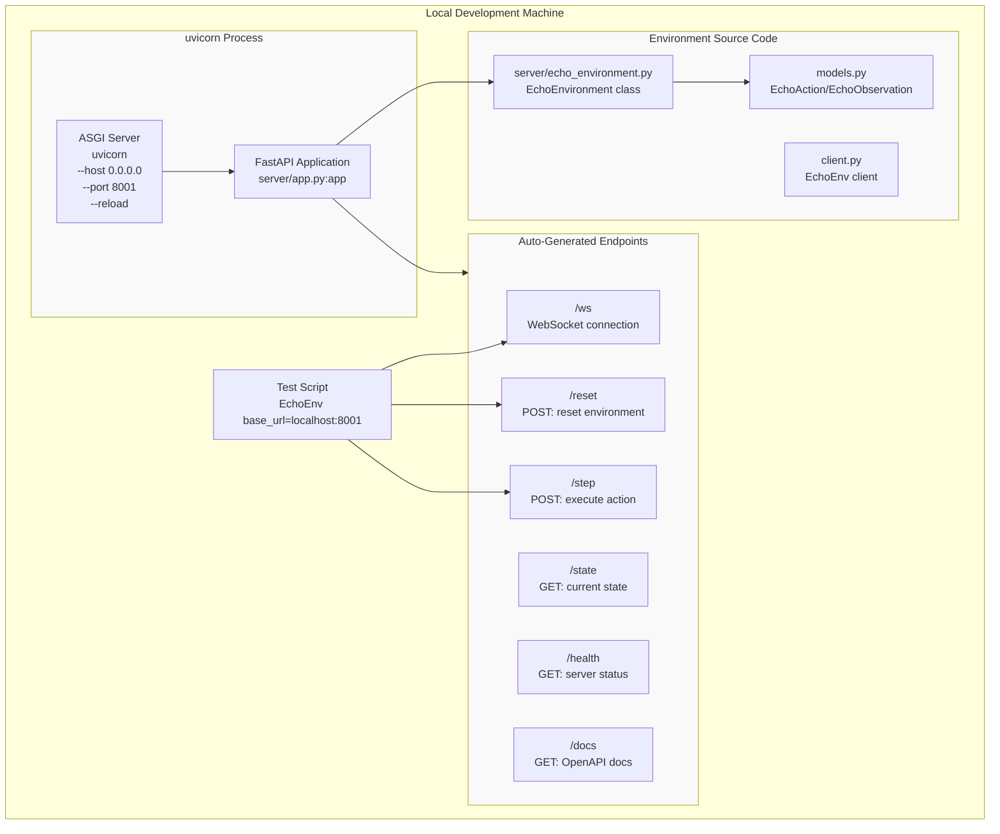
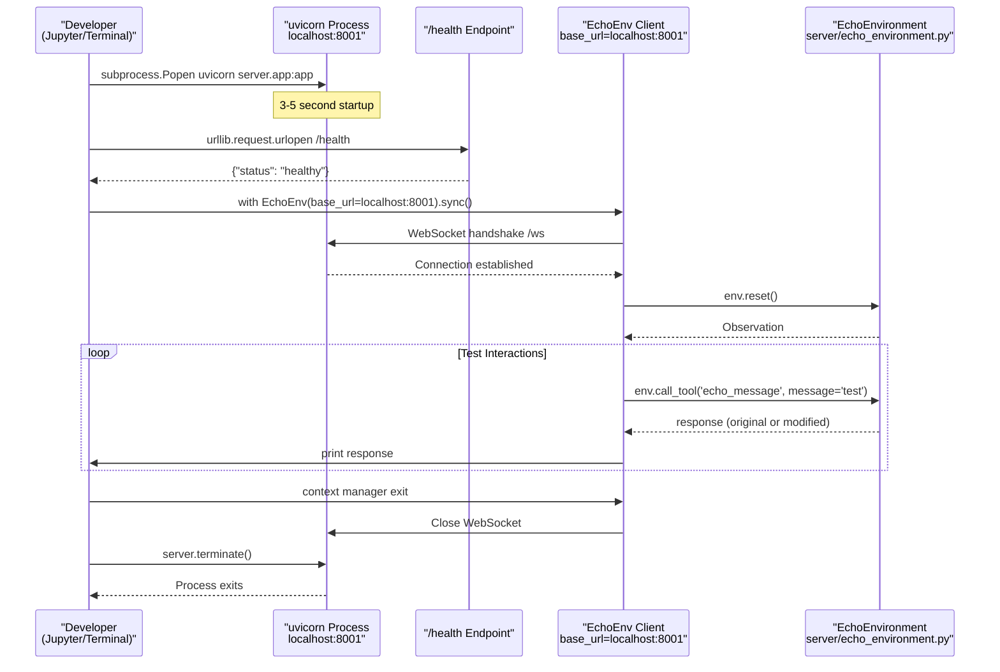

<!-- source: DeepWiki mcp.deepwiki.com · repo huggingface/openenv-course · page 4.1 Local Development and Testing · fetched 2026-10-26 -->

# Local Development and Testing

<details>
<summary>Relevant source files</summary>

The following files were used as context for generating this wiki page:

- [module-3/README.md](module-3/README.md)
- [module-3/notebook.ipynb](module-3/notebook.ipynb)

</details>


This document covers local environment execution and testing patterns before deployment. Local development with `uvicorn` enables rapid iteration through hot-reloading, immediate feedback, and full control over the server process without network latency or deployment overhead.

For modifying environment logic, see [Modifying Existing Environments](#4.2). For deployment to HF Spaces, see [Deployment to HF Spaces with openenv push](#4.3). For containerized local execution, see [Docker Deployment and Container Management](#4.4).

## Uvicorn Server Architecture

Every OpenEnv environment server is a FastAPI application that can be executed locally using `uvicorn`, an ASGI server. The server provides standardized endpoints for environment interaction, health monitoring, and documentation.



**Sources:** [module-3/notebook.ipynb:185-228](), [module-3/README.md:15-41]()

## Starting the Local Server

The `uvicorn` server runs the FastAPI application defined in `server/app.py`. The application is created by `create_fastapi_app` from `openenv-core`, which automatically generates all required endpoints from the environment implementation.

### Basic Server Command

```bash
# From environment root directory
uvicorn server.app:app --host 0.0.0.0 --port 8001
```

| Parameter | Value | Purpose |
|-----------|-------|---------|
| `server.app:app` | Module path | Import `app` object from `server/app.py` |
| `--host 0.0.0.0` | Bind address | Accept connections from any interface |
| `--port 8001` | Port number | Server listens on port 8001 |
| `--reload` | Flag (optional) | Auto-restart on code changes |

### Programmatic Server Startup

For testing within notebooks or scripts, `subprocess.Popen` enables background server execution:

[module-3/notebook.ipynb:190-215]()

The key considerations for programmatic startup:

1. **PYTHONPATH Configuration**: Ensure the server can import both the environment package and `openenv-core` dependencies
2. **Working Directory**: Set `cwd` to the environment root so relative imports resolve correctly
3. **Startup Delay**: Wait 3-5 seconds for the server to initialize before connecting clients
4. **Process Management**: Store the `Popen` object to terminate the server after testing

**Sources:** [module-3/notebook.ipynb:185-228](), [module-3/README.md:29-33]()

## Local Testing Workflow

The local development loop follows a consistent pattern: start server → verify health → execute test interactions → stop server. This pattern applies whether testing from notebooks, scripts, or interactive sessions.



**Sources:** [module-3/notebook.ipynb:218-228](), [module-3/notebook.ipynb:236-247]()

## Health Check Verification

The `/health` endpoint provides immediate feedback on server status. Always verify health before attempting client connections to avoid confusing error messages from connection failures.

### HTTP Health Check

[module-3/notebook.ipynb:218-227]()

The health check returns:
- **Status 200**: Server is running and accepting requests
- **Connection Error**: Server not started or wrong host/port
- **Status 5xx**: Server started but internal error

### Health Check Response Format

```json
{
  "status": "healthy"
}
```

**Sources:** [module-3/notebook.ipynb:218-227](), [module-3/README.md:38-41]()

## Client Testing Patterns

Once the server is healthy, connect using the environment's client class. The client abstracts WebSocket communication and provides type-safe methods for environment interaction.

### Synchronous Testing with .sync()

[module-3/notebook.ipynb:236-247]()

Key patterns:

| Pattern | Implementation | Purpose |
|---------|----------------|---------|
| Context manager | `with env.sync() as env:` | Auto-close WebSocket on exit |
| Local base_url | `base_url='http://localhost:8001'` | Connect to local server |
| Tool invocation | `env.call_tool('echo_message', ...)` | Call MCP tools (for tool-based envs) |
| Step invocation | `env.step(Action(...))` | Execute standard RL actions |

### Testing Multiple Messages

[module-3/notebook.ipynb:243-246]()

This pattern validates:
- Multiple sequential interactions work correctly
- State is maintained across calls
- Modified logic behaves as expected (e.g., reversal vs echo)

**Sources:** [module-3/notebook.ipynb:236-247](), [module-3/README.md:43-47]()

## Hot-Reloading for Rapid Iteration

The `--reload` flag enables automatic server restart when source files change. This eliminates the manual stop-edit-restart cycle, dramatically accelerating development.

### Enabling Hot-Reload

```bash
uvicorn server.app:app --host 0.0.0.0 --port 8001 --reload
```

Uvicorn watches:
- All `.py` files in the working directory and subdirectories
- Changes to `server/echo_environment.py`, `models.py`, `client.py`
- Changes to `server/app.py` itself

### Hot-Reload Workflow

| Step | Action | Server Behavior |
|------|--------|-----------------|
| 1. Start | `uvicorn ... --reload` | Server starts, watches files |
| 2. Edit | Modify `server/echo_environment.py` | Uvicorn detects change |
| 3. Auto-restart | (automatic) | Server gracefully restarts (~1-2 seconds) |
| 4. Test | Re-run client code | New logic executes |

**Limitations:**
- Client connections drop on restart (must reconnect)
- Syntax errors prevent restart (server remains down until fixed)
- In-memory state is lost on restart

**Sources:** [module-3/README.md:29-36]()

## Server Process Management

Proper process lifecycle management prevents orphaned uvicorn processes and resource leaks, especially in notebook environments where kernel restarts don't automatically clean up subprocesses.

### Process Lifecycle

```python
# Start
server = subprocess.Popen([...])
time.sleep(4)  # Wait for startup

try:
    # Testing code here
    pass
finally:
    # Always cleanup
    server.terminate()
    server.wait()
```

### Cleanup Commands

| Method | Behavior | Use When |
|--------|----------|----------|
| `server.terminate()` | Send SIGTERM (graceful) | Normal shutdown |
| `server.kill()` | Send SIGKILL (force) | Server hangs |
| `server.wait()` | Block until process exits | Ensure cleanup complete |

**Sources:** [module-3/notebook.ipynb:255-258](), [module-3/notebook.ipynb:204-215]()

## Directory Structure Requirements

The local server must resolve imports for both the environment package and its dependencies. The structure must support `uvicorn server.app:app` discovering the correct modules.

### Required Package Structure

```
echo-env-modified/
├── __init__.py              # Make directory a package
├── models.py                # Type definitions
├── client.py                # Client implementation
└── server/
    ├── __init__.py          # Make server/ a package
    ├── app.py               # FastAPI app: app = create_fastapi_app(...)
    ├── echo_environment.py  # Environment logic
    └── Dockerfile           # Container definition
```

The `__init__.py` files are critical for Python to treat directories as packages, enabling `uvicorn server.app:app` to use relative imports within `app.py`.

[module-3/notebook.ipynb:76-84]()

### PYTHONPATH Configuration

When the environment package isn't installed via `pip`, configure `PYTHONPATH` to include all necessary directories:

[module-3/notebook.ipynb:197-202]()

**Sources:** [module-3/notebook.ipynb:66-86](), [module-3/notebook.ipynb:197-202]()

## Testing Modified Environments

The local testing workflow validates modifications before deployment. The Echo environment modification example demonstrates the complete cycle: clone → modify → test locally → verify behavior change.

### Modification Testing Sequence

```mermaid
graph LR
    subgraph "Source"
        Original["Original Echo<br/>echo_environment.py<br/>return message"]
    end
    
    subgraph "Modification"
        Edit["Text Replacement<br/>content.replace<br/>return message → return message[::-1]"]
        Write["Write Modified File<br/>open(env_file, 'w')"]
    end
    
    subgraph "Local Server"
        Start["Start Uvicorn<br/>subprocess.Popen<br/>port 8001"]
        Health["Check /health<br/>urllib.request.urlopen"]
    end
    
    subgraph "Client Testing"
        Connect["EchoEnv<br/>base_url=localhost:8001"]
        Test["Loop test_messages<br/>Hello → olleH<br/>OpenEnv → vnEnepO"]
        Verify["Verify Reversal<br/>response == msg[::-1]"]
    end
    
    Original --> Edit
    Edit --> Write
    Write --> Start
    Start --> Health
    Health --> Connect
    Connect --> Test
    Test --> Verify
    
    style Edit fill:#f9f9f9
    style Test fill:#f9f9f9
```



### Verification Strategy

[module-3/notebook.ipynb:243-246]()

The test uses multiple messages to ensure:
1. **Correctness**: Output matches expected transformation (reversal)
2. **Consistency**: Behavior is identical across multiple calls
3. **Statelessness**: Each call is independent (no leaked state)

**Sources:** [module-3/notebook.ipynb:139-171](), [module-3/notebook.ipynb:236-247]()

## Debugging Local Servers

When the server fails to start or behaves unexpectedly, the stderr stream provides diagnostic information.

### Capturing Server Output

[module-3/notebook.ipynb:210-227]()

Common error patterns:

| Error Type | Stderr Content | Solution |
|------------|----------------|----------|
| Import error | `ModuleNotFoundError: No module named 'server'` | Add `__init__.py` files |
| Port conflict | `OSError: [Errno 48] Address already in use` | Change port or kill existing process |
| Syntax error | `SyntaxError: invalid syntax` | Fix Python syntax in modified files |
| Missing dependency | `ModuleNotFoundError: No module named 'openenv'` | Install `openenv-core` |

**Sources:** [module-3/notebook.ipynb:218-227]()

## Comparison: Local vs Remote Testing

| Aspect | Local (uvicorn) | Remote (HF Spaces) |
|--------|-----------------|---------------------|
| Startup time | 3-5 seconds | 30-60 seconds (cold start) |
| Iteration cycle | Edit → auto-reload (1-2s) | Edit → push → build (2-3 min) |
| Network latency | ~0.1ms (localhost) | 50-300ms (depends on region) |
| Cost | Free (local compute) | Free (CPU Basic) or paid |
| Isolation | None (system Python) | Docker container |
| Debugging | Direct stderr access | Space logs interface |
| Concurrent testing | Limited by local resources | 128+ concurrent sessions |

**Recommendation:** Always test locally with uvicorn before deploying. Only deploy to HF Spaces once local testing confirms correct behavior.

**Sources:** [module-3/README.md:15-41](), [module-3/README.md:133-139]()

## Summary

Local development with `uvicorn` provides the fastest iteration cycle for environment development:

1. **Start**: `uvicorn server.app:app --host 0.0.0.0 --port 8001 --reload`
2. **Verify**: `curl http://localhost:8001/health`
3. **Test**: Connect client with `base_url='http://localhost:8001'`
4. **Iterate**: Edit code → auto-reload → re-test
5. **Deploy**: Once local testing succeeds, use `openenv push` ([#4.3](#4.3))

The hot-reload feature eliminates manual restarts, enabling rapid experimentation without deployment overhead. All OpenEnv environments follow this pattern, whether tool-based (Echo) or standard RL (OpenSpiel).

**Sources:** [module-3/notebook.ipynb:1-372](), [module-3/README.md:1-145]()

---

