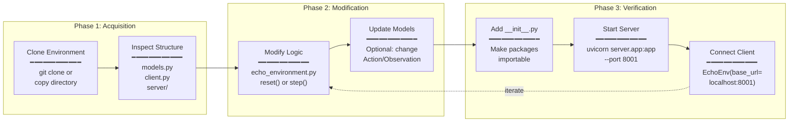
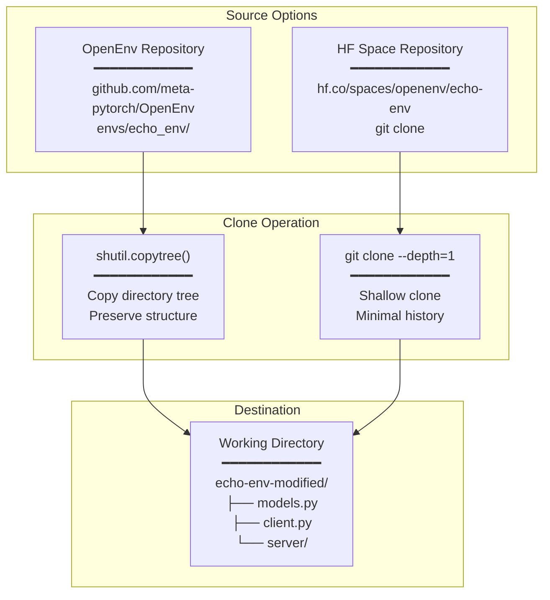
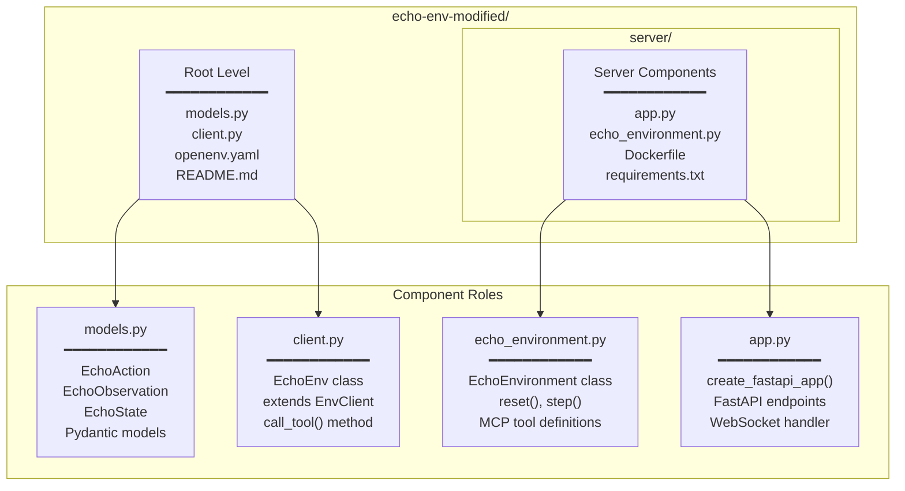
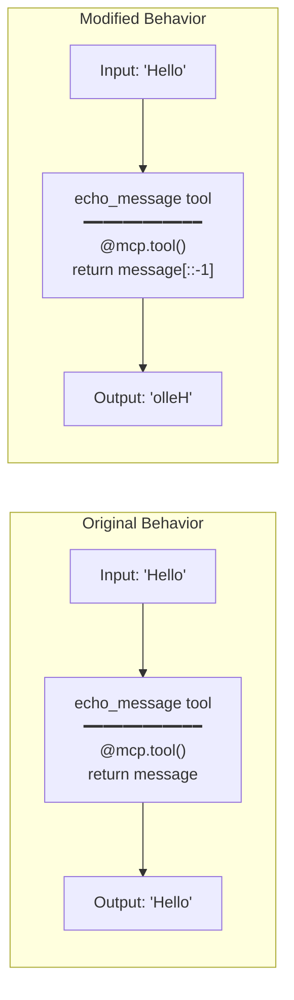
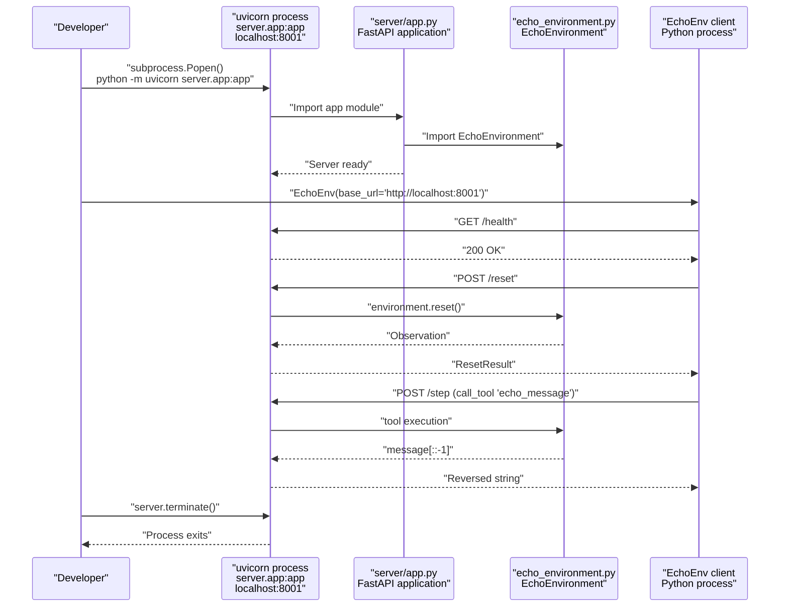
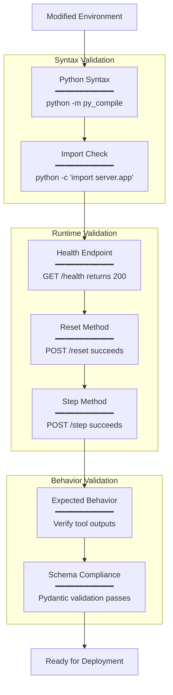

<!-- source: DeepWiki mcp.deepwiki.com · repo huggingface/openenv-course · page 4.2 Modifying Existing Environments · fetched 2026-10-26 -->

# Modifying Existing Environments

<details>
<summary>Relevant source files</summary>

The following files were used as context for generating this wiki page:

- [module-3/notebook.ipynb](module-3/notebook.ipynb)

</details>


This page documents the process of cloning, modifying, and locally testing existing OpenEnv environments. It focuses on the practical workflow of adapting an environment's behavior by changing server-side logic, using the Echo environment as a working example that transforms from echo functionality to reverse-echo functionality.

**Scope:** This page covers cloning repositories, understanding the 3-component structure, modifying `Environment` class methods, and local verification with `uvicorn`. For initial local setup without modifications, see [Local Development and Testing](#4.1). For deploying modified environments to production, see [Deployment to HF Spaces](#4.3) and [Docker Deployment](#4.4). For building environments from scratch, see [Building Custom Environments](#5).

---

## The Clone-Modify-Test Workflow

Modifying existing environments follows a consistent three-phase pattern that allows developers to iterate quickly without deploying to production until changes are verified.



**Workflow Characteristics:**

| Phase | Location | Duration | Risk |
|-------|----------|----------|------|
| Acquisition | Local filesystem | ~1 minute | None |
| Modification | Text editor | Variable | None (local only) |
| Verification | Local uvicorn | ~5 seconds startup | None (isolated) |

Sources: [module-3/notebook.ipynb:7-14](), [module-3/notebook.ipynb:28-50](), [module-3/notebook.ipynb:126-171]()

---

## Cloning an Environment

Environments can be cloned from the OpenEnv repository or from any deployed Hugging Face Space. The Echo environment serves as the reference example.



**Clone Implementation:**

The notebook demonstrates directory-based copying from the OpenEnv repository:

```python
# From module-3/notebook.ipynb:66-85
src = os.path.join(os.path.abspath('OpenEnv'), 'envs', 'echo_env')
dst = 'echo-env-modified'

if os.path.exists(dst):
    shutil.rmtree(dst)
shutil.copytree(src, dst)
```

**Post-Clone Setup:**

After cloning, `__init__.py` files must be created to make directories importable as Python packages. This is required because `server/app.py` uses relative imports that only work in proper packages:

```python
# From module-3/notebook.ipynb:76-84
for pkg_dir in [dst, os.path.join(dst, 'server')]:
    init_file = os.path.join(pkg_dir, '__init__.py')
    if not os.path.exists(init_file):
        open(init_file, 'w').close()
```

Sources: [module-3/notebook.ipynb:55-86]()

---

## Environment Structure Inspection

All OpenEnv environments follow the 3-Component Pattern documented in [The 3-Component Pattern](#5.1). Understanding this structure is essential before making modifications.



**File Listing Command:**

[module-3/notebook.ipynb:103-108]() demonstrates recursive file discovery:

```python
files = sorted(glob.glob('echo-env-modified/**/*', recursive=True))
for f in files:
    if os.path.isfile(f):
        print(f)
```

**Typical Output:**

```
echo-env-modified/__init__.py
echo-env-modified/client.py
echo-env-modified/models.py
echo-env-modified/openenv.yaml
echo-env-modified/README.md
echo-env-modified/server/__init__.py
echo-env-modified/server/Dockerfile
echo-env-modified/server/app.py
echo-env-modified/server/echo_environment.py
echo-env-modified/server/requirements.txt
```

Sources: [module-3/notebook.ipynb:92-120]()

---

## Modifying Environment Logic

Environment behavior is modified by changing the `Environment` class implementation in `server/echo_environment.py`. The Echo-to-ReverseEcho transformation demonstrates single-line modifications with immediate behavioral impact.

### The Echo Environment Implementation

The original Echo environment uses MCP (Model Context Protocol) tools defined with the `@mcp.tool()` decorator. The `echo_message` tool returns the input verbatim:



**Original Implementation:**

[module-3/notebook.ipynb:116-120]() shows reading the original file before modification. The `echo_message` tool contains:

```python
@mcp.tool()
async def echo_message(message: str) -> str:
    """Echo back a message."""
    return message  # Original behavior
```

### String Replacement Modification

The modification uses Python's `str.replace()` method to change a single return statement:

```python
# From module-3/notebook.ipynb:154-164
modified = content.replace(
    'return message',
    'return message[::-1]',
    1  # Replace only the first occurrence (in echo_message tool)
)

with open(env_file, 'w') as f:
    f.write(modified)
```

**Critical Parameters:**

| Parameter | Value | Purpose |
|-----------|-------|---------|
| `old` | `'return message'` | Exact string match in original code |
| `new` | `'return message[::-1]'` | Python slice notation for reverse |
| `count` | `1` | Prevent replacing other occurrences |

**Modified Result:**

```python
@mcp.tool()
async def echo_message(message: str) -> str:
    """Echo back a message."""
    return message[::-1]  # Now reverses the input
```

Sources: [module-3/notebook.ipynb:126-171]()

---

## Testing Modifications Locally

Local testing uses `uvicorn` to run the modified server and the standard client to verify behavior changes. This happens entirely on `localhost` before any deployment.



### Starting the Server

The server is started as a subprocess with proper `PYTHONPATH` configuration:

```python
# From module-3/notebook.ipynb:190-215
env = os.environ.copy()
env['PYTHONPATH'] = os.pathsep.join([
    os.path.abspath('echo-env-modified'),
    os.path.abspath('OpenEnv'),
    os.path.abspath('OpenEnv/src'),
] + env.get('PYTHONPATH', '').split(os.pathsep))

server = subprocess.Popen(
    [sys.executable, '-m', 'uvicorn', 'server.app:app',
     '--host', '0.0.0.0', '--port', '8001'],
    cwd='echo-env-modified',
    env=env,
    stdout=subprocess.PIPE,
    stderr=subprocess.PIPE,
)

time.sleep(4)  # Allow server startup
```

**Configuration Details:**

| Parameter | Value | Purpose |
|-----------|-------|---------|
| `module` | `server.app:app` | Import path to FastAPI app object |
| `--host` | `0.0.0.0` | Accept connections from any interface |
| `--port` | `8001` | Non-standard port (avoid conflicts) |
| `cwd` | `echo-env-modified` | Working directory for relative imports |
| `PYTHONPATH` | Multiple paths | Ensure all dependencies importable |

### Health Check Verification

Before testing, verify the server is responding:

```python
# From module-3/notebook.ipynb:218-227
import urllib.request
with urllib.request.urlopen('http://localhost:8001/health', timeout=5) as r:
    print(f'Health: {r.read().decode()}')
```

### Client Testing

Connect with the standard `EchoEnv` client, which remains unchanged despite server modifications:

```python
# From module-3/notebook.ipynb:236-247
from envs.echo_env import EchoEnv

with EchoEnv(base_url='http://localhost:8001').sync() as env:
    result = env.reset()
    
    test_messages = ['Hello', 'OpenEnv', 'Reverse this!']
    for msg in test_messages:
        response = env.call_tool('echo_message', message=msg)
        print(f'Sent: {msg:20s} -> Received: {response}')
```

**Expected Output:**

```
Sent: Hello                -> Received: olleH
Sent: OpenEnv              -> Received: vnEnepO
Sent: Reverse this!        -> Received: !siht esreveR
```

### Server Cleanup

After testing, terminate the server process:

```python
# From module-3/notebook.ipynb:255-258
server.terminate()
server.wait()
```

Sources: [module-3/notebook.ipynb:177-259]()

---

## Common Modification Patterns

This section documents typical modification scenarios encountered when adapting existing environments.

### Pattern 1: Tool Behavior Changes

**Use Case:** Modify MCP tool logic without changing signatures

**Example:** Echo → Reverse Echo

**Modified File:** `server/echo_environment.py`

**Changed Lines:** Single return statement in tool function

**Client Impact:** None (same interface)

### Pattern 2: State Management Changes

**Use Case:** Add persistent state tracking across steps

**Example:** Count total messages echoed

**Modified File:** `server/echo_environment.py`

**Implementation:**
```python
class EchoEnvironment(Environment):
    def reset(self):
        self.message_count = 0  # Add state variable
        return Observation(...)
    
    @mcp.tool()
    async def echo_message(self, message: str) -> str:
        self.message_count += 1  # Update state
        return f"{message} (#{self.message_count})"
```

**Client Impact:** None if `Observation` schema unchanged

### Pattern 3: Observation Schema Extension

**Use Case:** Add new fields to observations

**Example:** Include message length metadata

**Modified Files:** 
- `models.py` - Add field to `EchoObservation`
- `server/echo_environment.py` - Populate new field
- `client.py` - Optional: add convenience methods

**Implementation:**
```python
# models.py
class EchoObservation(BaseModel):
    message: str
    length: int  # New field

# echo_environment.py
@mcp.tool()
async def echo_message(self, message: str) -> dict:
    return {"message": message, "length": len(message)}
```

**Client Impact:** Breaking change unless field is optional

### Pattern 4: Adding New Tools

**Use Case:** Extend environment capabilities

**Example:** Add uppercase transformation tool

**Modified File:** `server/echo_environment.py`

**Implementation:**
```python
@mcp.tool()
async def uppercase_message(self, message: str) -> str:
    """Convert message to uppercase."""
    return message.upper()
```

**Client Impact:** None (new optional functionality)

### Modification Impact Matrix

| Component Changed | Client Code Impact | Deployment Required | Testing Scope |
|-------------------|-------------------|---------------------|---------------|
| Tool implementation | None | Yes | Tool behavior only |
| Tool signature | Breaking | Yes | Full integration |
| Internal state | None | Yes | State transitions |
| Observation schema | Breaking if non-optional | Yes | Serialization |
| New tool | None | Yes | New tool only |
| `reset()` logic | Depends on schema | Yes | Initialization |

Sources: [module-3/notebook.ipynb:126-171]()

---

## File Path Mapping

The following table maps logical components to filesystem locations for quick navigation during modifications:

| Component | File Path | Primary Classes/Functions | Modification Frequency |
|-----------|-----------|---------------------------|----------------------|
| Type definitions | `models.py` | `EchoAction`, `EchoObservation`, `EchoState` | Low |
| Client interface | `client.py` | `EchoEnv` class, `call_tool()` | Very Low |
| Environment logic | `server/echo_environment.py` | `EchoEnvironment`, MCP tools | High |
| Server app | `server/app.py` | `app` object, `create_fastapi_app()` | Very Low |
| Dependencies | `server/requirements.txt` | Python packages | Medium |
| Deployment config | `openenv.yaml` | `name`, `repo_id`, `type` | Medium |
| Container config | `server/Dockerfile` | Build instructions | Low |

**Typical Workflow:** Developers spend 90% of modification time in `server/echo_environment.py`, occasionally updating `models.py` when schemas change, and rarely touching other files.

Sources: [module-3/notebook.ipynb:98-120]()

---

## Verification Checklist

Before deploying modifications, verify the following:



**Automated Testing:**

While the notebook demonstrates manual testing, production workflows typically add:

1. **Unit tests** for modified methods
2. **Integration tests** for full episode execution
3. **Schema validation** using Pydantic model parsing
4. **Performance tests** if modifications affect latency

Sources: [module-3/notebook.ipynb:177-259]()

---

## Summary

Modifying existing OpenEnv environments follows the **clone → modify → test** workflow:

1. **Clone** the environment directory from OpenEnv repository or HF Space
2. **Add** `__init__.py` files to make directories importable
3. **Modify** `server/echo_environment.py` (or equivalent) to change behavior
4. **Start** local server with `uvicorn server.app:app --port 8001`
5. **Test** with standard client pointing to `localhost:8001`
6. **Iterate** until behavior is correct
7. **Deploy** using `openenv push` (see [Deployment to HF Spaces](#4.3))

The key insight is that **server-side modifications** (environment logic) do not require **client-side changes** as long as the API contract (models) remains compatible. This separation enables rapid iteration on game mechanics while maintaining interface stability.

For deploying verified modifications, proceed to [Deployment to HF Spaces](#4.3). For building environments from scratch rather than modifying existing ones, see [Building Custom Environments](#5).

Sources: [module-3/notebook.ipynb:1-372]()

---

