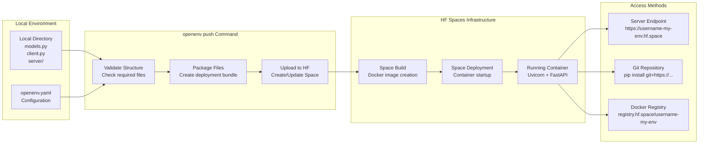
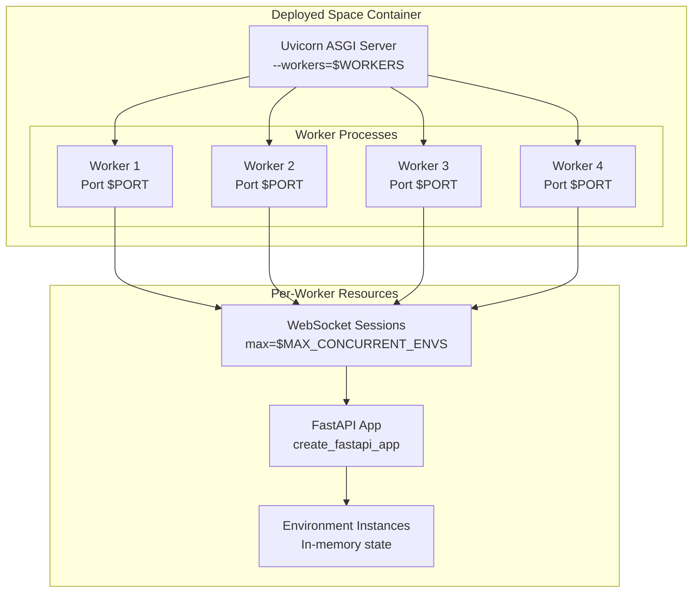
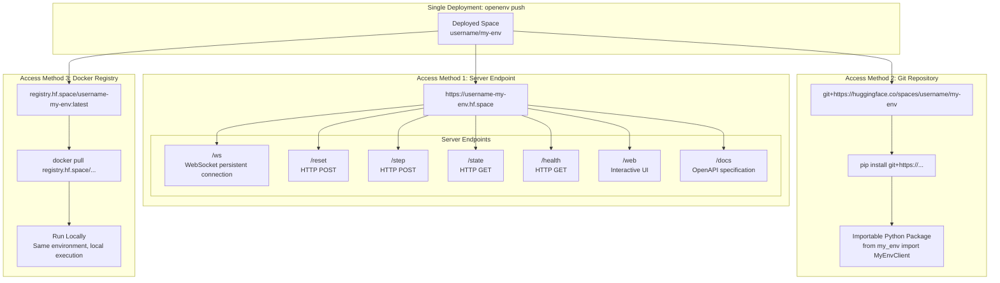
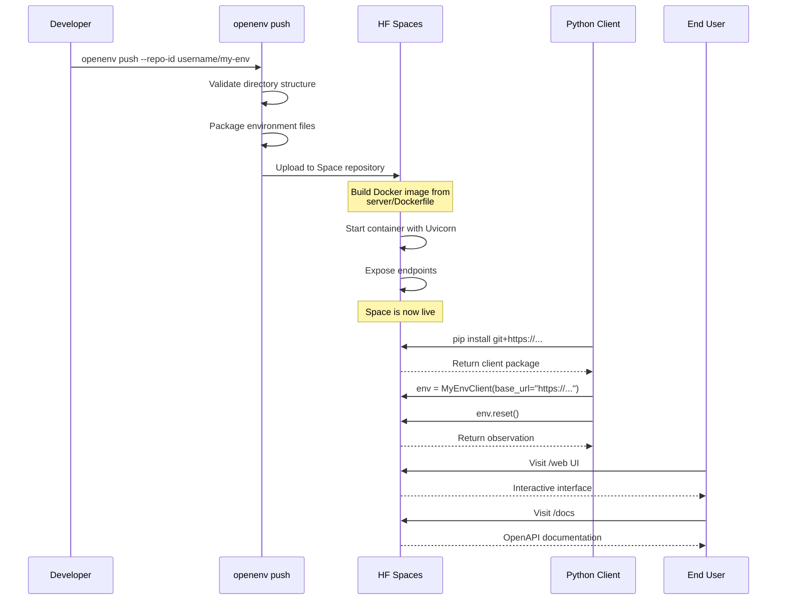

<!-- source: DeepWiki mcp.deepwiki.com · repo huggingface/openenv-course · page 4.3 Deployment to HF Spaces with openenv push · fetched 2026-10-26 -->

# Deployment to HF Spaces with openenv push

<details>
<summary>Relevant source files</summary>

The following files were used as context for generating this wiki page:

- [module-3/README.md](module-3/README.md)
- [module-3/notebook.ipynb](module-3/notebook.ipynb)

</details>


This document covers deployment of OpenEnv environments to Hugging Face Spaces using the `openenv push` command. It explains the deployment workflow, configuration options, environment variables, and the three access methods that each deployed Space provides (server endpoint, pip-installable package, and Docker registry).

For information about local development and testing before deployment, see [Local Development and Testing](#4.1). For Docker-based deployment alternatives, see [Docker Deployment and Container Management](#4.4).

## Purpose and Scope

The `openenv push` command provides a single-command deployment path from local environment code to a running, publicly accessible endpoint on Hugging Face Spaces. This page documents the command's usage, configuration requirements, post-deployment access patterns, and hardware tier options.

**Scope:**
- `openenv push` command syntax and authentication
- `openenv.yaml` manifest structure
- Environment variable configuration
- Three access methods provided by deployed Spaces
- Hardware tiers and concurrency limits
- Post-deployment verification and usage

**Out of scope:**
- Local development (covered in [4.1](#4.1))
- Environment modification workflow (covered in [4.2](#4.2))
- Docker build and run (covered in [4.4](#4.4))

Sources: [module-3/README.md:75-91](), [module-3/notebook.ipynb:262-278]()

## The openenv push Command

### Basic Usage

The `openenv push` command deploys an OpenEnv environment to Hugging Face Spaces:

```bash
cd my_env
openenv push --repo-id username/my-env
```

This single command:
1. Packages the environment code
2. Creates or updates a Hugging Face Space
3. Uploads the environment files
4. Triggers Space build and deployment
5. Exposes the environment at a public endpoint

Sources: [module-3/README.md:77-84]()

### Authentication Requirements

Deployment requires a Hugging Face account and authentication token:

| Requirement | Details |
|-------------|---------|
| **HF Account** | Free account at huggingface.co |
| **Access Token** | Created in Settings → Access Tokens |
| **Token Scope** | Must have `write` permission for Spaces |
| **Authentication** | Set via `huggingface-hub` CLI or environment variable |

The command will prompt for authentication if no token is found.

Sources: [module-3/notebook.ipynb:13]()

### Deployment Workflow Diagram



**Deployment Phases:**

1. **Validation**: Checks directory structure for required components
2. **Packaging**: Bundles code, dependencies, and configuration
3. **Upload**: Creates or updates Space repository
4. **Build**: HF Spaces builds Docker image from server/Dockerfile
5. **Deploy**: Container starts with Uvicorn + FastAPI
6. **Expose**: Three access methods become available

Sources: [module-3/notebook.ipynb:262-278](), [module-3/README.md:75-91]()

## Configuration Files

### The openenv.yaml Manifest

The `openenv.yaml` file controls Space metadata and settings:

```yaml
name: my_env
version: "1.0.0"
description: My custom environment
```

| Field | Type | Required | Description |
|-------|------|----------|-------------|
| `name` | string | Yes | Environment identifier |
| `version` | string | Yes | Semantic version string |
| `description` | string | No | Human-readable description |

The manifest must be placed in the environment's root directory alongside `models.py`, `client.py`, and `server/`.

Sources: [module-3/README.md:92-100]()

### Required Directory Structure

For successful deployment, the environment must follow this structure:

```
my_env/
├── openenv.yaml          # Deployment manifest
├── models.py             # Pydantic type definitions
├── client.py             # EnvClient implementation
└── server/
    ├── __init__.py       # Package marker
    ├── environment.py    # Environment ABC implementation
    ├── app.py            # FastAPI application
    └── Dockerfile        # Container definition
```

The `openenv push` command validates this structure before upload.

Sources: [module-3/notebook.ipynb:97-108]()

## Environment Variables

### Configuration Options

Environment variables control runtime behavior of the deployed Space. These are set in the Space's Settings → Variables section after deployment.

| Variable | Type | Default | Description |
|----------|------|---------|-------------|
| `WORKERS` | int | 4 | Number of Uvicorn worker processes |
| `PORT` | int | 8000 | HTTP server port |
| `HOST` | string | 0.0.0.0 | Server bind address |
| `MAX_CONCURRENT_ENVS` | int | 100 | Maximum WebSocket sessions per worker |

Sources: [module-3/README.md:102-112]()

### Worker and Concurrency Configuration



**Concurrency Calculation:**

Total concurrent sessions = `WORKERS × MAX_CONCURRENT_ENVS`

Example configurations:

| WORKERS | MAX_CONCURRENT_ENVS | Total Sessions | Use Case |
|---------|---------------------|----------------|----------|
| 4 | 100 | 400 | Default (development) |
| 8 | 256 | 2,048 | High throughput |
| 2 | 64 | 128 | Free tier limit |

Sources: [module-3/README.md:102-112](), [module-3/README.md:66-73]()

### Setting Environment Variables

Variables are configured post-deployment:

```bash
# After deployment, navigate to:
# https://huggingface.co/spaces/username/my-env/settings
# → Variables tab → Add variable
```

Variables take effect on next Space restart.

Sources: [module-3/README.md:102-112]()

## Three Access Methods

Every deployed Space provides three distinct access patterns:



Sources: [module-3/README.md:3-13]()

### Method 1: Server Endpoint

Direct HTTP/WebSocket access to the running environment:

```python
from my_env import MyEnvClient

with MyEnvClient(base_url="https://username-my-env.hf.space").sync() as env:
    result = env.reset()
    result = env.step(action)
```

**Available endpoints:**

| Endpoint | Method | Purpose |
|----------|--------|---------|
| `/ws` | WebSocket | Persistent connection for step/reset |
| `/reset` | POST | Initialize new episode |
| `/step` | POST | Execute action, return observation |
| `/state` | GET | Query current environment state |
| `/health` | GET | Server health check |
| `/web` | GET | Interactive web UI |
| `/docs` | GET | Auto-generated OpenAPI docs |

Sources: [module-3/README.md:86-91](), [module-3/notebook.ipynb:274-277]()

### Method 2: Pip-Installable Repository

The Space's Git repository is pip-installable:

```bash
pip install git+https://huggingface.co/spaces/username/my-env
```

This installs:
- `models.py` type definitions
- `client.py` environment client
- All dependencies from `pyproject.toml`

Usage after installation:

```python
from my_env import MyEnvClient, MyAction, MyObservation

env = MyEnvClient(base_url="https://username-my-env.hf.space")
```

Sources: [module-3/README.md:7-11](), [module-3/notebook.ipynb:305-312]()

### Method 3: Docker Registry

The built container image is available from the Space's registry:

```bash
docker pull registry.hf.space/username-my-env:latest
docker run -d -p 8000:8000 registry.hf.space/username-my-env:latest
```

This provides:
- Identical runtime environment as the Space
- Local execution without network latency
- Full control over resources and configuration

Connect to the local container:

```python
env = MyEnvClient(base_url="http://localhost:8000")
```

Sources: [module-3/README.md:53-57](), [module-3/notebook.ipynb:318-337]()

## Hardware Tiers and Scaling

### Available Hardware Tiers

Hugging Face Spaces offers two hardware tiers for OpenEnv environments:

| Tier | vCPU | RAM | Storage | Cost | Typical Concurrency |
|------|------|-----|---------|------|---------------------|
| **CPU Basic (Free)** | 2 | 16GB | 50GB | Free | ~128 sessions |
| **CPU Upgrade** | 8 | 32GB | 100GB | $0.03/hour | ~2,048 sessions |

Sources: [module-3/README.md:113-120]()

### Tier Selection

Hardware tier is configured in the Space settings:

```bash
# After deployment:
# https://huggingface.co/spaces/username/my-env/settings
# → Hardware tab → Select tier
```

**Free tier limitations:**
- Suitable for development and demonstrations
- Handles ~128 concurrent sessions with default configuration
- May sleep after inactivity (wakes on first request)

**Paid tier benefits:**
- Higher concurrency (2,048+ sessions)
- No sleep/wake cycles
- Guaranteed availability

Sources: [module-3/README.md:113-120]()

### Concurrency by Configuration

| Configuration | Free Tier (2 vCPU) | Paid Tier (8 vCPU) |
|---------------|--------------------|--------------------|
| WORKERS=2, MAX_CONCURRENT_ENVS=64 | 128 sessions ✓ | 128 sessions |
| WORKERS=4, MAX_CONCURRENT_ENVS=128 | 512 sessions ✗ | 512 sessions ✓ |
| WORKERS=8, MAX_CONCURRENT_ENVS=256 | 2,048 sessions ✗ | 2,048 sessions ✓ |

The free tier handles the default configuration (WORKERS=4, MAX_CONCURRENT_ENVS=100) adequately for development workloads.

Sources: [module-3/README.md:113-120]()

## Post-Deployment Usage

### Verifying Deployment

After `openenv push` completes, verify the deployment:

```bash
# Health check
curl https://username-my-env.hf.space/health
# Expected: {"status":"healthy"}

# OpenAPI documentation
curl https://username-my-env.hf.space/docs
# Returns interactive API explorer
```

Sources: [module-3/README.md:86-91]()

### Connecting from Python

Install the client package and connect:

```python
# Option 1: Install from Space repository
!pip install git+https://huggingface.co/spaces/username/my-env

from my_env import MyEnvClient

# Connect to deployed Space
with MyEnvClient(base_url="https://username-my-env.hf.space").sync() as env:
    result = env.reset()
    print(f"Observation: {result.observation}")
    
    result = env.step(action)
    print(f"Reward: {result.reward}")
```

Sources: [module-3/notebook.ipynb:305-312]()

### Web UI Access

Every deployed environment includes an auto-generated web interface:

```
https://username-my-env.hf.space/web
```

The web UI provides:
- Interactive environment controls
- Real-time observation display
- Action input forms
- Episode history

The UI is generated by `create_fastapi_app()` from the environment's type definitions.

Sources: [module-3/README.md:88]()

### API Documentation

OpenAPI documentation is automatically generated:

```
https://username-my-env.hf.space/docs
```

The documentation includes:
- All available endpoints
- Request/response schemas (from Pydantic models)
- Interactive "Try it out" functionality
- WebSocket connection examples

Sources: [module-3/README.md:89]()

## Complete Deployment Example

### From Local Code to Running Space

```bash
# 1. Navigate to environment directory
cd echo-env-modified

# 2. Verify structure
ls -la
# models.py
# client.py
# server/
# openenv.yaml

# 3. Deploy to HF Spaces
openenv push --repo-id myusername/reverse-echo-env

# Output:
# Validating environment structure... ✓
# Packaging files... ✓
# Uploading to HF Spaces... ✓
# Building Docker image... ✓
# Deploying... ✓
# 
# Your environment is live at:
#   Server:   https://myusername-reverse-echo-env.hf.space
#   Web UI:   https://myusername-reverse-echo-env.hf.space/web
#   Docs:     https://myusername-reverse-echo-env.hf.space/docs
```

Sources: [module-3/notebook.ipynb:268-272]()

### Post-Deployment Workflow



Sources: [module-3/notebook.ipynb:262-312](), [module-3/README.md:122-131]()

## Choosing Between Deployment Options

| Deployment Method | Setup Time | Iteration Speed | Resource Control | Cost | Best For |
|-------------------|------------|-----------------|------------------|------|----------|
| **Local Uvicorn** | Seconds | Instant (--reload) | Full | Free | Development |
| **Local Docker** | Minutes | Fast (rebuild) | Full | Free | Testing isolation |
| **HF Spaces (Free)** | 2-3 minutes | Medium (re-push) | Limited | Free | Demos, sharing |
| **HF Spaces (Paid)** | 2-3 minutes | Medium (re-push) | Limited | $0.03/hr | Production |

**Typical workflow progression:**
1. Develop locally with Uvicorn ([4.1](#4.1))
2. Test modifications ([4.2](#4.2))
3. Deploy to HF Spaces with `openenv push` (this page)
4. Scale with Docker if needed ([4.4](#4.4))

Sources: [module-3/README.md:133-139]()

## Summary

The `openenv push` command provides single-command deployment from local environment code to a publicly accessible Hugging Face Space. Each deployment creates three access methods (server endpoint, pip-installable repository, Docker registry) from a single codebase.

**Key concepts:**
- `openenv push --repo-id` deploys environment to HF Spaces
- `openenv.yaml` configures Space metadata
- Environment variables control runtime behavior (WORKERS, MAX_CONCURRENT_ENVS)
- Free tier supports ~128 concurrent sessions
- Deployed Spaces expose `/ws`, `/reset`, `/step`, `/state`, `/health`, `/web`, `/docs` endpoints

**Next steps:**
- For Docker-based deployment alternatives, see [4.4](#4.4)
- For building custom environments from scratch, see [Module 4](#5)
- For local development workflow, see [4.1](#4.1)

Sources: [module-3/README.md:75-144](), [module-3/notebook.ipynb:262-356]()

---

