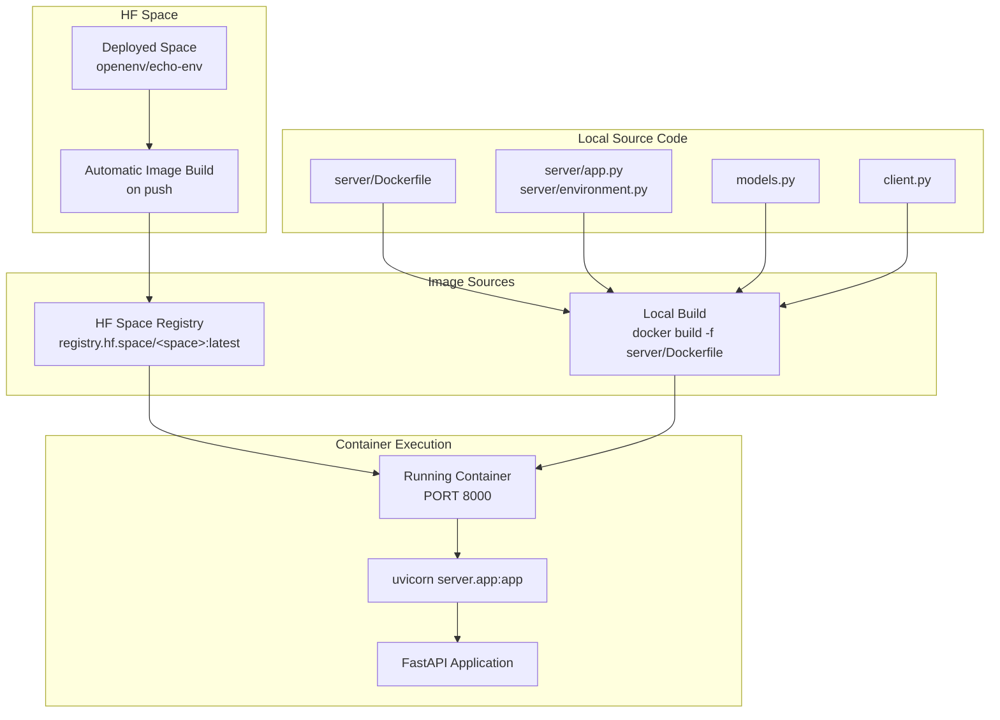
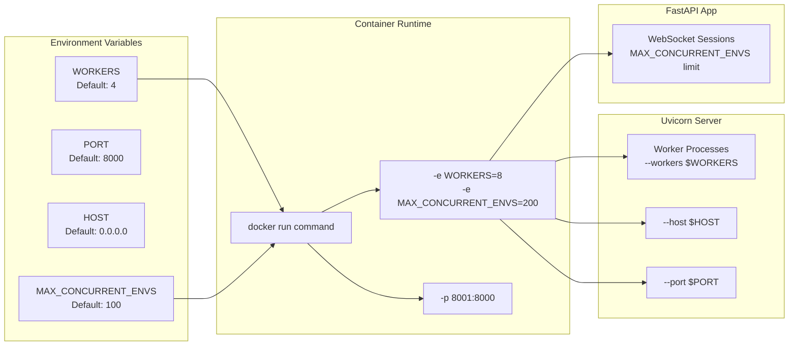
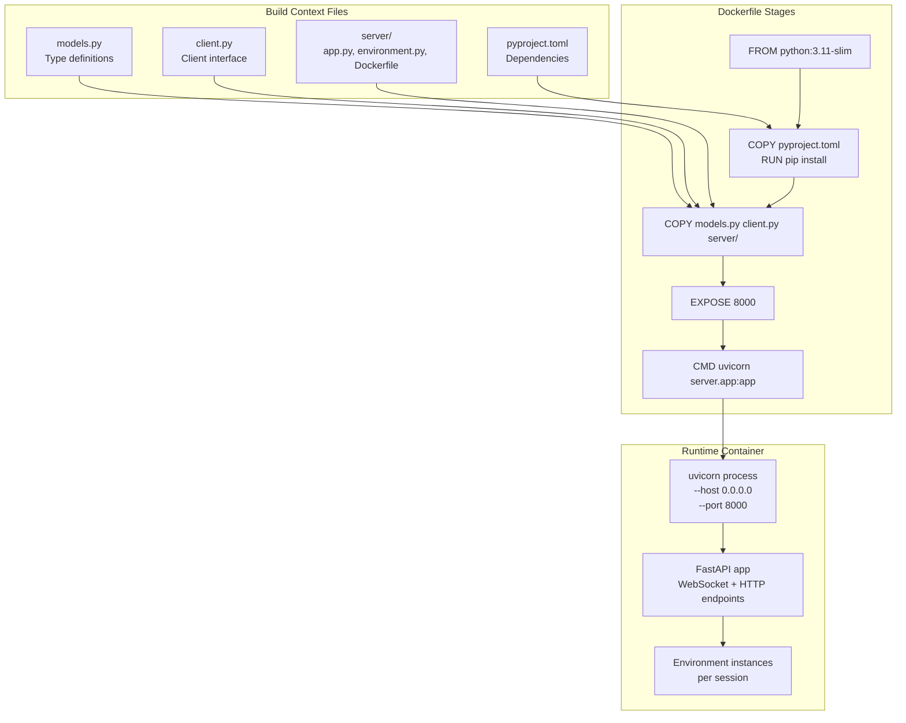
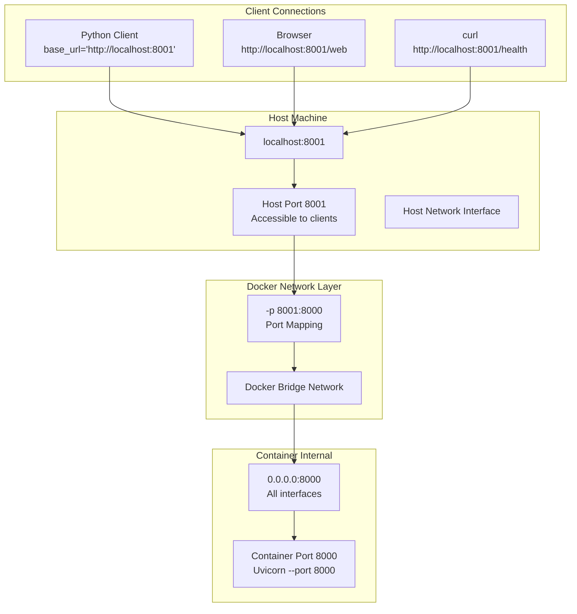
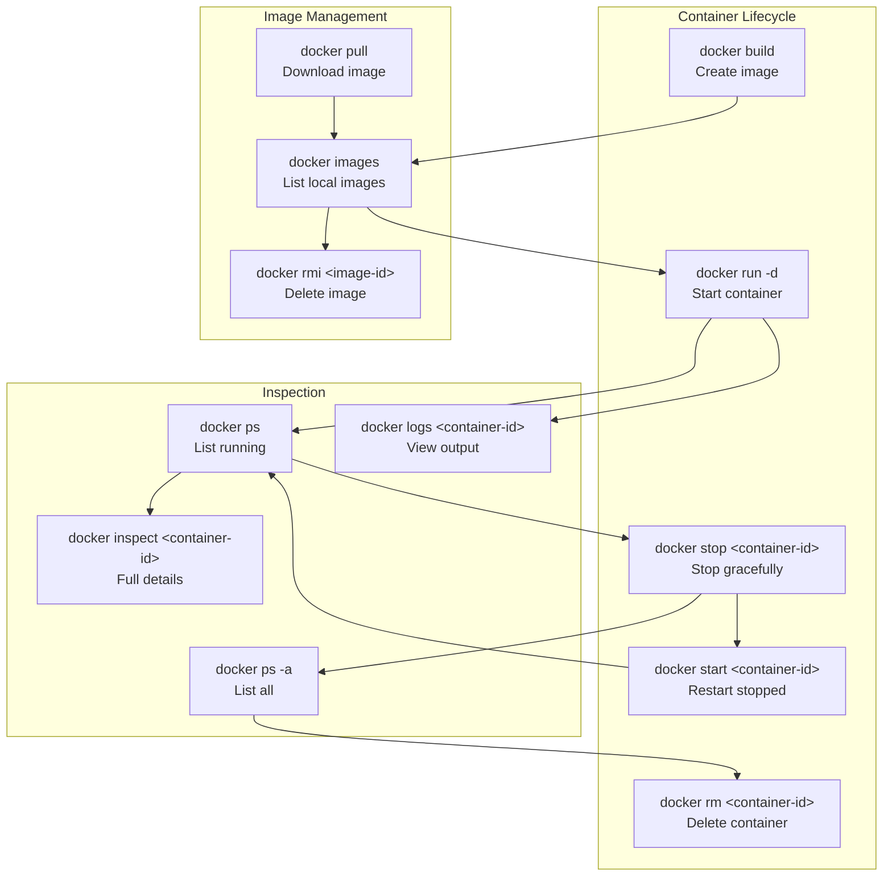
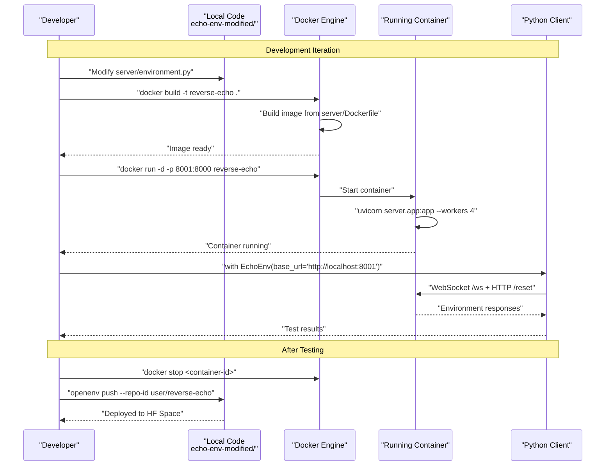

<!-- source: DeepWiki mcp.deepwiki.com · repo huggingface/openenv-course · page 4.4 Docker Deployment and Container Management · fetched 2026-10-26 -->

# Docker Deployment and Container Management

<details>
<summary>Relevant source files</summary>

The following files were used as context for generating this wiki page:

- [module-3/README.md](module-3/README.md)
- [module-3/notebook.ipynb](module-3/notebook.ipynb)

</details>


This page documents Docker-based deployment for OpenEnv environments, covering image sources, container execution, configuration, and the relationship to other deployment methods. Docker provides isolation, reproducibility, and portability for environment servers. For local development without containers, see [Local Development and Testing](#4.1). For deploying to cloud infrastructure, see [Deployment to HF Spaces with openenv push](#4.3).

## Purpose and Benefits

Docker containerization packages an OpenEnv environment server with all dependencies into a portable, reproducible unit. Every environment deployed to HF Spaces automatically provides a Docker image through the Space's registry at `registry.hf.space/<space-name>:latest`. Containers can run locally for development, on private infrastructure for production, or in orchestration systems like Kubernetes.

**Key benefits:**
- **Isolation**: Environment runs in its own filesystem and process space
- **Reproducibility**: Same container produces identical behavior across machines
- **Portability**: Move between local, cloud, and on-premise infrastructure
- **Scale**: Deploy multiple container replicas for high concurrency

Sources: [module-3/README.md:49-73](), [module-3/notebook.ipynb:318-338]()

## Docker Image Sources



**Diagram: Docker Image Sources and Container Execution Flow**

OpenEnv environments provide two Docker image sources:

| Source | Command | Use Case |
|--------|---------|----------|
| **HF Space Registry** | `docker pull registry.hf.space/openenv-echo-env:latest` | Use existing deployed environments without building |
| **Local Build** | `docker build -t my-env:latest -f server/Dockerfile .` | Test modifications before deploying |

The HF Space registry automatically builds and pushes images when environments are deployed via `openenv push`. Local builds use the `server/Dockerfile` included in each environment's structure.

Sources: [module-3/README.md:53-65](), [module-3/notebook.ipynb:322-331]()

## Pulling and Running from HF Registry

Every HF Space provides a Docker image at `registry.hf.space/<space-name>:latest`:

```bash
# Pull the official echo environment image
docker pull registry.hf.space/openenv-echo-env:latest

# Run with port mapping 8000 (container) -> 8001 (host)
docker run -d -p 8001:8000 registry.hf.space/openenv-echo-env:latest
```

The `-p 8001:8000` flag maps container port 8000 (where uvicorn listens) to host port 8001. Use any available host port; the container internal port is always 8000.

After starting the container, connect from Python using the host port:

```python
with EchoEnv(base_url="http://localhost:8001").sync() as env:
    result = env.reset()
```

Sources: [module-3/README.md:53-57](), [module-3/notebook.ipynb:323-326]()

## Building from Source

For modified environments or local testing before deployment:

```bash
# From the environment directory (e.g., echo-env-modified/)
docker build -t reverse-echo:latest -f server/Dockerfile .

# Run the locally built image
docker run -d -p 8001:8000 reverse-echo:latest
```

The `server/Dockerfile` path is required because it resides in the `server/` subdirectory, not the repository root. The build context (`.`) must be the environment root directory to include all required files: `models.py`, `client.py`, and the entire `server/` directory.

Sources: [module-3/notebook.ipynb:328-331](), [module-3/README.md:59-64]()

## Container Configuration



**Diagram: Container Configuration Through Environment Variables**

Configure containers using the `-e` flag to pass environment variables:

```bash
docker run -d -p 8001:8000 \
    -e WORKERS=8 \
    -e MAX_CONCURRENT_ENVS=200 \
    -e HOST=0.0.0.0 \
    -e PORT=8000 \
    reverse-echo:latest
```

| Variable | Default | Purpose | Impact |
|----------|---------|---------|--------|
| `WORKERS` | 4 | Number of uvicorn worker processes | Higher values increase concurrent request capacity but consume more memory |
| `PORT` | 8000 | Container internal port | Rarely changed; use `-p` for host port mapping instead |
| `HOST` | 0.0.0.0 | Network interface to bind | `0.0.0.0` allows external connections; `127.0.0.1` restricts to localhost |
| `MAX_CONCURRENT_ENVS` | 100 | Maximum simultaneous WebSocket sessions | Prevents resource exhaustion from too many active environments |

The `WORKERS` variable affects concurrency scaling. With 4 workers, a container can handle approximately 2,048 concurrent sessions. With 8 workers on a larger machine, this increases proportionally.

Sources: [module-3/README.md:67-73](), [module-3/README.md:103-111]()

## Dockerfile Structure and Build Process

Each OpenEnv environment includes a `server/Dockerfile` that defines the container image. The Dockerfile follows a standard pattern across all environments:



**Diagram: Dockerfile Build Process and Runtime Structure**

The Dockerfile must be invoked from the environment root directory (not from `server/`) because it requires access to `models.py`, `client.py`, and `server/` simultaneously. The build command `docker build -f server/Dockerfile .` specifies the Dockerfile location while using `.` as the build context.

Key aspects:
- Base image is typically `python:3.11-slim` for minimal size
- Dependencies installed from `pyproject.toml` or `requirements.txt`
- All three components (`models.py`, `client.py`, `server/`) copied into container
- Port 8000 exposed for HTTP/WebSocket traffic
- Entry point runs `uvicorn server.app:app` with configuration from environment variables

Sources: [module-3/README.md:59-64](), [module-3/notebook.ipynb:328-331]()

## Container Networking and Ports



**Diagram: Container Port Mapping and Network Access**

The `-p HOST_PORT:CONTAINER_PORT` syntax maps container internal port to host port:

```bash
# Map container port 8000 to host port 8001
docker run -d -p 8001:8000 reverse-echo:latest

# Map to same port number
docker run -d -p 8000:8000 reverse-echo:latest

# Bind to specific host interface
docker run -d -p 127.0.0.1:8001:8000 reverse-echo:latest  # Only localhost
```

The container internal port (8000) is controlled by the `PORT` environment variable but defaults to 8000. Clients connect to the host port, which Docker forwards to the container. Multiple containers from the same image can run simultaneously by mapping to different host ports:

```bash
docker run -d -p 8001:8000 reverse-echo:latest  # Instance 1
docker run -d -p 8002:8000 reverse-echo:latest  # Instance 2
docker run -d -p 8003:8000 reverse-echo:latest  # Instance 3
```

Sources: [module-3/notebook.ipynb:323-331](), [module-3/README.md:54-56]()

## Deployment Workflow Comparison

| Method | Setup Command | Restart After Changes | Concurrency | Use Case |
|--------|---------------|----------------------|-------------|----------|
| **Local Uvicorn** | `uvicorn server.app:app --reload` | Automatic with `--reload` | ~100 sessions (single worker) | Fast iteration during development |
| **Docker Local** | `docker build && docker run` | Rebuild image + restart container | ~2,048 sessions (configurable workers) | Testing containerized deployment locally |
| **HF Spaces** | `openenv push` | Automatic on git push | ~128 sessions (free tier) | Public deployment for sharing |

Docker sits between local uvicorn (fastest iteration) and HF Spaces (easiest sharing). It provides:
- Production-like environment locally
- Dependency isolation from host system
- Scalability testing with worker configuration
- Image portability for deployment elsewhere

Sources: [module-3/README.md:132-138](), [module-3/notebook.ipynb:177-182]()

## Container Management Commands



**Diagram: Docker Container and Image Management Commands**

Common container management operations:

```bash
# List running containers
docker ps

# Get container ID and view logs
docker logs <container-id>

# Stop a running container
docker stop <container-id>

# Remove stopped container
docker rm <container-id>

# View container resource usage
docker stats <container-id>

# Execute command inside running container
docker exec -it <container-id> bash
```

For troubleshooting startup issues:

```bash
# Run in foreground (non-detached) to see output
docker run -p 8001:8000 reverse-echo:latest

# Check container logs for errors
docker logs <container-id>

# Inspect container configuration
docker inspect <container-id>
```

Sources: [module-3/notebook.ipynb:186-228]()

## Integration with OpenEnv Workflow



**Diagram: Docker Integration in Development Workflow**

Docker deployment fits into the broader OpenEnv workflow at the testing stage:

1. **Develop locally** with `uvicorn --reload` for fast iteration
2. **Test in Docker** to verify containerized behavior matches local
3. **Deploy with `openenv push`** which automatically creates HF Space registry image
4. **Pull from registry** to run the deployed version locally or on other infrastructure

This workflow ensures that local development, Docker testing, and production deployment all use the same code and produce consistent behavior.

Sources: [module-3/notebook.ipynb:126-258](), [module-3/README.md:122-131]()

## Concurrency Scaling with Docker

| Configuration | Workers | Max Concurrent Sessions | Memory (approx) | Use Case |
|---------------|---------|------------------------|-----------------|----------|
| Single worker | 1 | ~512 | 512 MB | Testing |
| Default | 4 | ~2,048 | 2 GB | Development, demos |
| High concurrency | 8 | ~4,096 | 4 GB | Production load |
| Maximum (CPU Basic) | 4 | ~2,048 | 2 GB | HF Spaces free tier limit |

Increase concurrency by adding workers:

```bash
docker run -d -p 8001:8000 \
    -e WORKERS=8 \
    -e MAX_CONCURRENT_ENVS=4096 \
    --memory=4g \
    reverse-echo:latest
```

The `MAX_CONCURRENT_ENVS` variable sets a hard limit on WebSocket sessions to prevent resource exhaustion. Each worker handles approximately 512 concurrent sessions. Memory usage scales roughly linearly with workers, plus per-session overhead for environment state.

For production deployments requiring more than 4,096 concurrent sessions, use orchestration systems like Kubernetes to run multiple container replicas behind a load balancer.

Sources: [module-3/README.md:103-120]()

## Summary

Docker deployment provides:
- **Image sources**: Pull from `registry.hf.space/<space>:latest` or build from `server/Dockerfile`
- **Configuration**: Control workers and concurrency via environment variables
- **Port mapping**: Use `-p HOST:CONTAINER` to expose services
- **Integration**: Fits between local uvicorn (fast iteration) and HF Spaces (easy sharing)

Key commands:
```bash
# Pull and run from HF registry
docker pull registry.hf.space/openenv-echo-env:latest
docker run -d -p 8001:8000 registry.hf.space/openenv-echo-env:latest

# Build and run from source
docker build -t my-env:latest -f server/Dockerfile .
docker run -d -p 8001:8000 -e WORKERS=4 my-env:latest
```

Docker containers provide production-like testing locally while maintaining portability for deployment to any Docker-compatible infrastructure.

Sources: [module-3/README.md:49-73](), [module-3/notebook.ipynb:318-338]()

---

