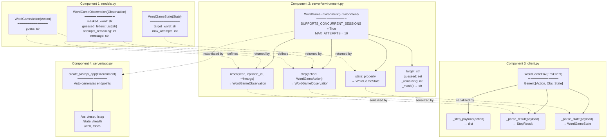
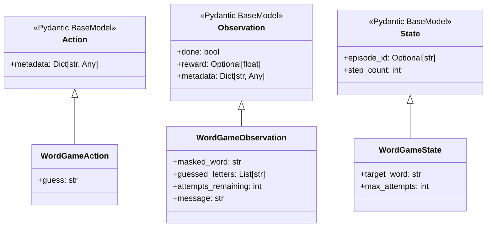
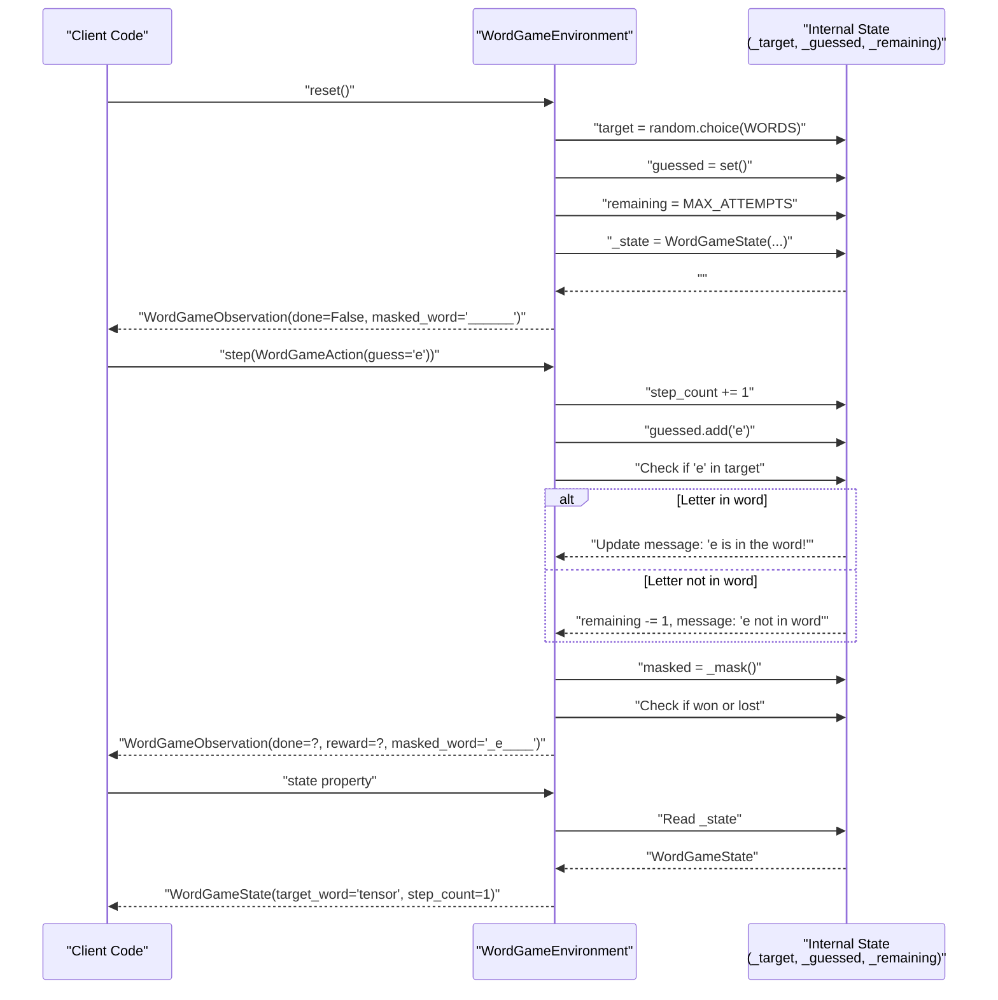
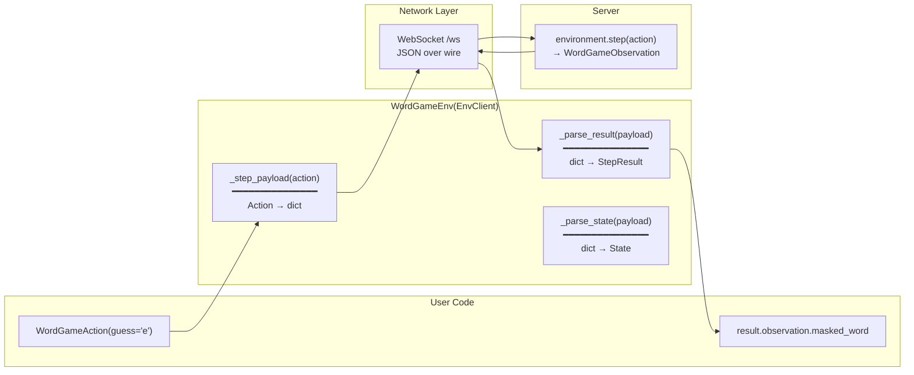
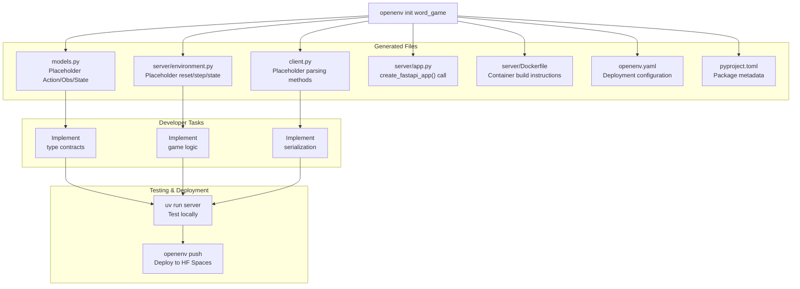
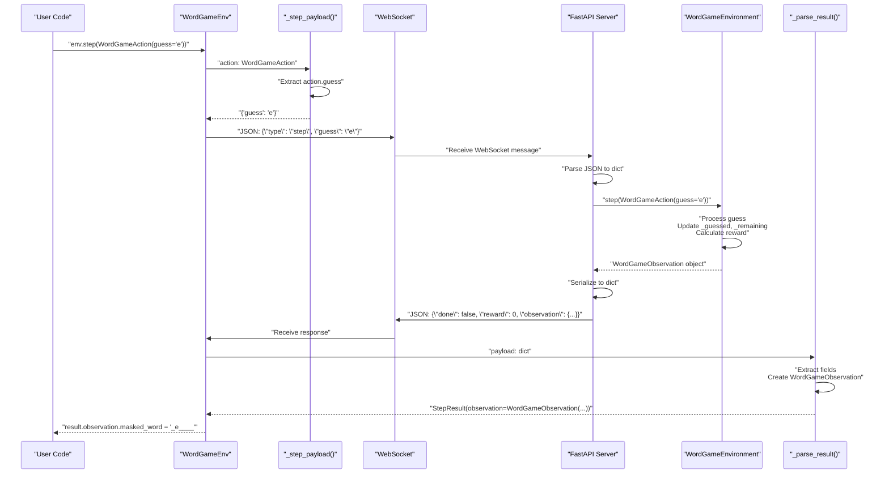

<!-- source: DeepWiki mcp.deepwiki.com · repo huggingface/openenv-course · page 5 Module 4: Building Custom Environments · fetched 2026-10-26 -->

# Module 4: Building Custom Environments

<details>
<summary>Relevant source files</summary>

The following files were used as context for generating this wiki page:

- [module-4/README.md](module-4/README.md)
- [module-4/notebook.ipynb](module-4/notebook.ipynb)

</details>


This module documents the process of creating production-ready OpenEnv environments from scratch using the 3-Component Pattern. Students implement type-safe data contracts, environment logic, and client interfaces, then deploy them as microservices. The module uses `WordGameEnvironment` as a complete working example, demonstrating that a custom environment requires approximately 100 lines of meaningful code.

For information about using existing environments, see [Module 2: Policy Development with OpenSpiel](#3). For deployment mechanics and the `openenv push` workflow, see [Module 3: Deployment Workflow](#4). For integrating custom environments into LLM training pipelines, see [Module 5: LLM Training with GRPO](#6).

## The 3-Component Pattern

Every OpenEnv environment follows a standardized three-component structure that separates concerns between type definitions, business logic, and network communication.



**Sources:** [module-4/README.md:3-17](), [module-4/notebook.ipynb:25-66]()

### Directory Structure

| Path | Purpose | Lines of Code |
|------|---------|---------------|
| `models.py` | Pydantic type definitions for Action, Observation, State | ~30 |
| `server/environment.py` | Game logic implementing `reset()`, `step()`, `state` | ~60 |
| `client.py` | `EnvClient` subclass with serialization methods | ~25 |
| `server/app.py` | FastAPI application factory invocation | ~3 |
| `server/Dockerfile` | Container build instructions | ~10 |
| `openenv.yaml` | Deployment manifest | ~10 |
| `pyproject.toml` | Package metadata | ~15 |

**Sources:** [module-4/README.md:3-17](), [module-4/notebook.ipynb:343-350]()

## Component 1: Type Contracts (models.py)

The type contract component defines three Pydantic models that inherit from base classes provided by `openenv.core.env_server`. These models serve as the API specification for the environment.



### WordGameAction

The action model defines what inputs the environment accepts. In the WordGame example, players submit single-letter guesses.

```python
class WordGameAction(Action):
    guess: str
```

**Sources:** [module-4/README.md:32-33](), [module-4/notebook.ipynb:41-45](), [module-4/notebook.ipynb:221-223]()

### WordGameObservation

The observation model defines what information players receive after each action. It inherits `done` and `reward` from the `Observation` base class.

```python
class WordGameObservation(Observation):
    # Inherited: done: bool, reward: Optional[float]
    masked_word: str           # e.g., "p_th_n"
    guessed_letters: List[str] # All letters tried so far
    attempts_remaining: int
    message: str               # Human-readable feedback
```

**Sources:** [module-4/README.md:35-40](), [module-4/notebook.ipynb:47-56](), [module-4/notebook.ipynb:226-234]()

### WordGameState

The state model contains episode metadata accessible via the `.state` property or `/state` endpoint. It inherits `episode_id` and `step_count` from the `State` base class.

```python
class WordGameState(State):
    # Inherited: episode_id: Optional[str], step_count: int
    target_word: str = ""
    max_attempts: int = 10
```

**Sources:** [module-4/README.md:42-45](), [module-4/notebook.ipynb:58-64](), [module-4/notebook.ipynb:236-243]()

### Type Safety Benefits

| Benefit | Implementation | Example |
|---------|---------------|---------|
| API Documentation | Models serve as self-documenting contracts | Reading `models.py` reveals complete interface |
| IDE Autocomplete | Typed attributes enable IntelliSense | `obs.masked_word` autocompletes in VS Code |
| Early Error Detection | Type checkers catch field name typos | mypy reports `obs.maskd_word` as error |
| Validation | Pydantic validates data at runtime | Passing `guess=123` raises `ValidationError` |

**Sources:** [module-4/README.md:48-51]()

## Component 2: Environment Logic (server/environment.py)

The environment component implements the `Environment` abstract base class from `openenv.core.env_server`. It contains three required elements: `reset()` method, `step()` method, and `state` property.



**Sources:** [module-4/README.md:53-137](), [module-4/notebook.ipynb:79-85]()

### Environment Class Definition

The environment class must set `SUPPORTS_CONCURRENT_SESSIONS` to indicate whether multiple clients can connect simultaneously.

[module-4/README.md:66-76]()

### reset() Method

The `reset()` method initializes a new episode. It accepts optional `seed`, `episode_id`, and additional keyword arguments. The method returns a `WordGameObservation` representing the initial state.

[module-4/README.md:77-94]()

Key implementation details:
- Selects random target word from `WORDS` list
- Initializes `_guessed` set to empty
- Resets `_remaining` attempts to `MAX_ATTEMPTS`
- Creates new `WordGameState` with UUID or provided `episode_id`
- Returns observation with masked word (all underscores)

**Sources:** [module-4/notebook.ipynb:84]()

### step() Method

The `step()` method processes one action and returns the resulting observation. It accepts a `WordGameAction` and optional `timeout_s` and keyword arguments.

[module-4/README.md:96-129]()

Implementation logic:
1. Normalize input: `letter = action.guess.lower().strip()`
2. Increment `_state.step_count`
3. Add letter to `_guessed` set
4. Check if letter exists in `_target`
5. If incorrect, decrement `_remaining`
6. Call `_mask()` to generate current masked word representation
7. Check win condition: `"_" not in masked`
8. Check loss condition: `_remaining <= 0`
9. Set reward: `1.0` for win, `0.0` otherwise
10. Return `WordGameObservation` with all fields populated

**Sources:** [module-4/notebook.ipynb:84]()

### state Property

The `state` property returns the current `WordGameState` object containing episode metadata.

```python
@property
def state(self) -> WordGameState:
    return self._state
```

**Sources:** [module-4/README.md:131-133]()

### Helper Methods

The `_mask()` helper method generates the masked word representation by revealing guessed letters and hiding others with underscores.

```python
def _mask(self) -> str:
    return "".join(c if c in self._guessed else "_" for c in self._target)
```

**Sources:** [module-4/README.md:135-136]()

## Component 3: Client Interface (client.py)

The client component extends `EnvClient` from `openenv.core.env_client` and implements three abstract methods that handle serialization and deserialization between typed Python objects and JSON payloads transmitted over WebSocket.



**Sources:** [module-4/README.md:139-176](), [module-4/notebook.ipynb:250-282]()

### WordGameEnv Class Definition

The client class uses Python generics to specify the types for Action, Observation, and State.

```python
class WordGameEnv(EnvClient[WordGameAction, WordGameObservation, WordGameState]):
    # Three methods to implement
```

**Sources:** [module-4/README.md:148](), [module-4/notebook.ipynb:256]()

### _step_payload() Method

Serializes a typed `WordGameAction` into a dictionary suitable for JSON transmission.

```python
def _step_payload(self, action: WordGameAction) -> dict:
    return {"guess": action.guess}
```

**Sources:** [module-4/README.md:149-150](), [module-4/notebook.ipynb:257-258]()

### _parse_result() Method

Deserializes the server's JSON response into a typed `StepResult` containing a `WordGameObservation`.

```python
def _parse_result(self, payload: dict) -> StepResult:
    obs_data = payload.get("observation", {})
    return StepResult(
        observation=WordGameObservation(
            done=payload.get("done", False),
            reward=payload.get("reward"),
            masked_word=obs_data.get("masked_word", ""),
            guessed_letters=obs_data.get("guessed_letters", []),
            attempts_remaining=obs_data.get("attempts_remaining", 0),
            message=obs_data.get("message", ""),
        ),
        reward=payload.get("reward"),
        done=payload.get("done", False),
    )
```

**Sources:** [module-4/README.md:152-165](), [module-4/notebook.ipynb:260-273]()

### _parse_state() Method

Deserializes the `/state` endpoint response into a typed `WordGameState`.

```python
def _parse_state(self, payload: dict) -> WordGameState:
    return WordGameState(
        episode_id=payload.get("episode_id"),
        step_count=payload.get("step_count", 0),
        target_word=payload.get("target_word", ""),
        max_attempts=payload.get("max_attempts", 6),
    )
```

**Sources:** [module-4/README.md:167-173](), [module-4/notebook.ipynb:275-281]()

### Client Usage Pattern

Users of the custom environment import the client and use it with the `.sync()` context manager for synchronous operation.

```python
from word_game import WordGameEnv, WordGameAction

with WordGameEnv(base_url="https://username-word-game.hf.space").sync() as env:
    result = env.reset()
    result = env.step(WordGameAction(guess="e"))
    print(result.observation.masked_word)
```

**Sources:** [module-4/notebook.ipynb:313]()

## Component 4: Server Setup (server/app.py)

The server application component uses `create_fastapi_app()` from `openenv.core.env_server` to automatically generate all required HTTP and WebSocket endpoints.

### create_fastapi_app() Invocation

The function takes the environment class as its argument and returns a FastAPI application instance with all endpoints configured.

```python
from openenv.core.env_server import create_fastapi_app
from environment import WordGameEnvironment

app = create_fastapi_app(WordGameEnvironment)
```

**Sources:** [module-4/README.md:182-187](), [module-4/notebook.ipynb:288-294]()

### Auto-Generated Endpoints

| Endpoint | Method | Purpose |
|----------|--------|---------|
| `/ws` | WebSocket | Persistent connection for `reset()`, `step()`, `state()` |
| `/reset` | POST | HTTP-based episode initialization |
| `/step` | POST | HTTP-based action submission |
| `/state` | GET | Retrieve current episode state |
| `/health` | GET | Health check for deployment platforms |
| `/web` | GET | Web-based UI for manual interaction |
| `/docs` | GET | Auto-generated OpenAPI documentation |

**Sources:** [module-4/README.md:189](), [module-4/notebook.ipynb:199]()

### Dockerfile Configuration

The Dockerfile specifies the containerization instructions for deployment.

```dockerfile
FROM python:3.11-slim

WORKDIR /app
COPY requirements.txt .
RUN pip install --no-cache-dir -r requirements.txt

COPY . .
CMD ["uvicorn", "server.app:app", "--host", "0.0.0.0", "--port", "8000"]
```

**Sources:** [module-4/README.md:191-202]()

## Scaffolding with openenv init

The `openenv init` CLI command generates the complete directory structure with placeholder implementations, allowing developers to focus on implementing game logic rather than boilerplate.



**Sources:** [module-4/README.md:204-222](), [module-4/notebook.ipynb:320-332]()

### Initialization Command

```bash
openenv init word_game
cd word_game
```

This creates the full directory structure with placeholder implementations for all three components.

### Development Workflow

1. **Edit models.py**: Define `WordGameAction`, `WordGameObservation`, `WordGameState`
2. **Edit server/environment.py**: Implement `reset()`, `step()`, `state` methods
3. **Edit client.py**: Implement `_step_payload()`, `_parse_result()`, `_parse_state()`
4. **Test locally**: `uv run server` starts uvicorn with hot-reloading
5. **Deploy**: `openenv push --repo-id user/word-game` packages and deploys to HF Spaces

**Sources:** [module-4/README.md:208-222](), [module-4/notebook.ipynb:303-306]()

## Complete Example: WordGame

The WordGame example demonstrates all three components working together to create a Hangman-style letter-guessing game.

### Game Rules

| Aspect | Implementation |
|--------|---------------|
| Objective | Guess all letters in a randomly selected word |
| Word List | 15 technical terms: "python", "neural", "tensor", etc. |
| Maximum Attempts | 10 incorrect guesses allowed |
| Action | Single letter guess per turn |
| Win Condition | All letters revealed (no underscores in masked word) |
| Loss Condition | Attempts remaining reaches 0 |
| Reward | 1.0 for win, 0.0 for loss or in-progress |

**Sources:** [module-4/notebook.ipynb:84]()

### Policy Implementations

The notebook demonstrates two policies that showcase the game mechanics.

#### RandomLetterPolicy

Selects random letters from the set of unused letters.

```python
class RandomLetterPolicy:
    name = "Random"
    
    def select_action(self, obs: WordGameObservation) -> WordGameAction:
        available = [c for c in string.ascii_lowercase 
                     if c not in obs.guessed_letters]
        return WordGameAction(guess=random.choice(available))
```

**Sources:** [module-4/notebook.ipynb:135-143]()

#### FrequencyPolicy

Guesses letters in order of English letter frequency (ETAOIN SHRDLU...).

```python
class FrequencyPolicy:
    name = "Frequency"
    FREQ_ORDER = "etaoinshrdlcumwfgypbvkjxqz"
    
    def select_action(self, obs: WordGameObservation) -> WordGameAction:
        for letter in self.FREQ_ORDER:
            if letter not in obs.guessed_letters:
                return WordGameAction(guess=letter)
        return WordGameAction(guess="a")  # fallback
```

**Sources:** [module-4/notebook.ipynb:146-155]()

### Policy Evaluation

The `evaluate()` function runs multiple episodes and computes win rate and average steps.

```python
def evaluate(env, policy, episodes=100):
    wins = 0
    total_steps = 0
    for _ in range(episodes):
        obs = env.reset()
        while not obs.done:
            action = policy.select_action(obs)
            obs = env.step(action)
        if obs.reward and obs.reward > 0:
            wins += 1
        total_steps += env.state.step_count
    return wins / episodes, total_steps / episodes
```

**Sources:** [module-4/notebook.ipynb:158-169]()

### Performance Comparison

| Policy | Win Rate | Avg Steps | Strategy |
|--------|----------|-----------|----------|
| Random | ~5-15% | ~8-10 | Unoptimized random selection |
| Frequency | ~40-60% | ~6-8 | Optimized by English letter frequency |

The FrequencyPolicy significantly outperforms RandomLetterPolicy by exploiting the statistical properties of English words. Increasing `MAX_ATTEMPTS` to 15 raises absolute win rates while preserving the relative performance gap.

**Sources:** [module-4/notebook.ipynb:174-176](), [module-4/notebook.ipynb:182]()

## Data Flow: Type-Safe Serialization

The following diagram illustrates how typed objects flow through the system, being serialized to JSON for network transmission and deserialized back to typed objects.



**Sources:** [module-4/README.md:139-176](), [module-4/notebook.ipynb:250-282]()

## Line Count Breakdown

The claim of "~100 lines of meaningful code" breaks down as follows:

| Component | File | Lines |
|-----------|------|-------|
| Type Definitions | `models.py` | 30 |
| Environment Logic | `server/environment.py` | 60 |
| Client Serialization | `client.py` | 25 |
| FastAPI Integration | `server/app.py` | 3 |
| **Total Meaningful Code** | | **118** |
| Deployment Config | `server/Dockerfile` | 10 |
| Deployment Config | `openenv.yaml` | 10 |
| Package Metadata | `pyproject.toml` | 15 |
| **Total Project Files** | | **153** |

Excluding boilerplate (imports, blank lines, comments), the core implementation requires approximately 100 lines distributed across the three components.

**Sources:** [module-4/README.md:19](), [module-4/notebook.ipynb:343-350]()

## Integration with Deployment Pipeline

After implementing the three components, the environment enters the deployment pipeline documented in Module 3.

### Local Testing

```bash
uvicorn word_game.server.app:app --reload
```

Starts the FastAPI server with hot-reloading on `http://localhost:8000`. The `/docs` endpoint provides interactive API documentation.

### Deployment to HF Spaces

```bash
openenv push --repo-id username/word-game
```

Packages the environment, builds the Docker container, and deploys to Hugging Face Spaces. For detailed deployment configuration, see [Module 3: Deployment Workflow](#4).

**Sources:** [module-4/README.md:218-222](), [module-4/notebook.ipynb:303-306]()

---

