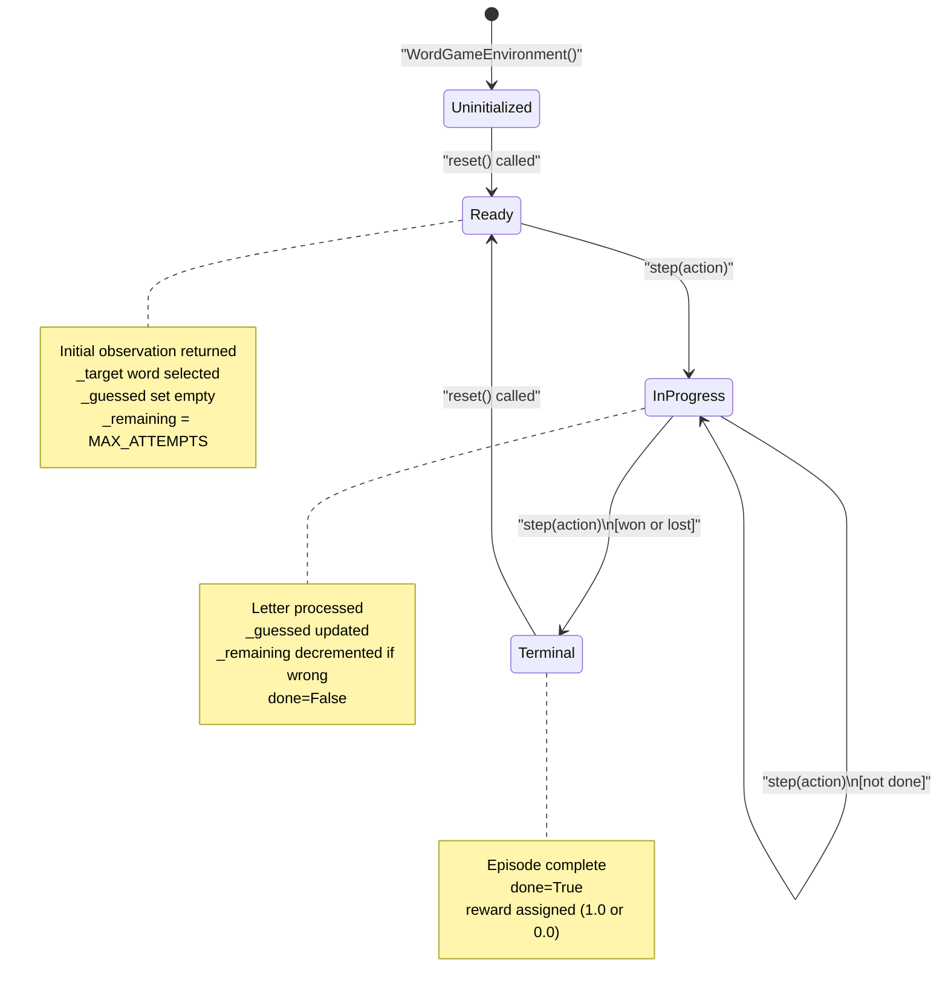
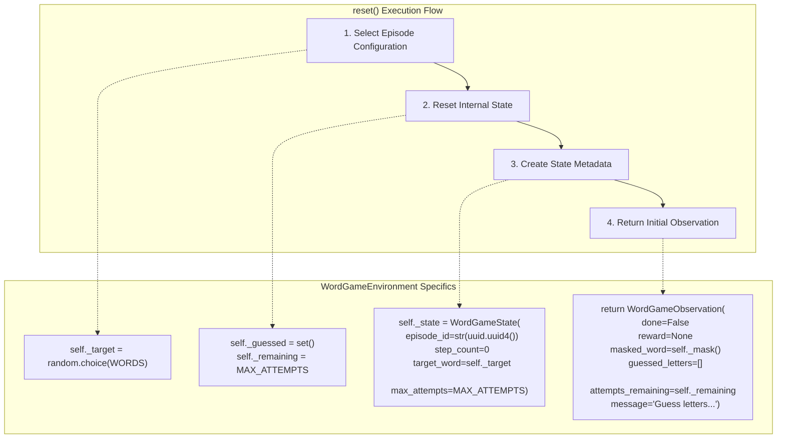
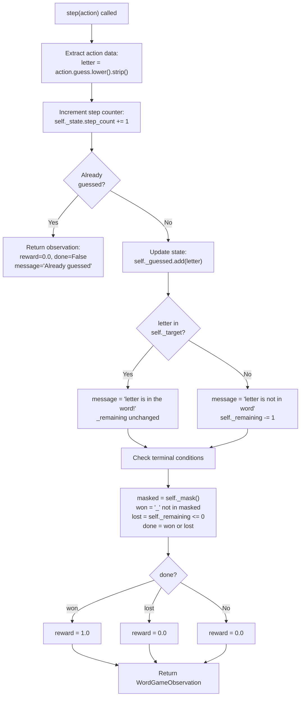
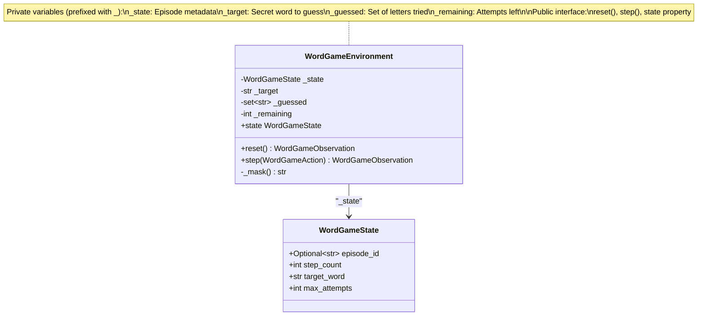
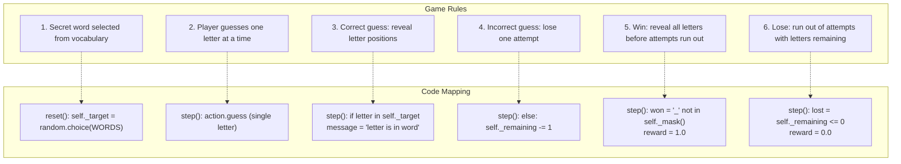

<!-- source: DeepWiki mcp.deepwiki.com · repo huggingface/openenv-course · page 5.2 Implementing Environment Logic · fetched 2026-10-26 -->

# Implementing Environment Logic

<details>
<summary>Relevant source files</summary>

The following files were used as context for generating this wiki page:

- [module-4/README.md](module-4/README.md)
- [module-4/notebook.ipynb](module-4/notebook.ipynb)

</details>


This document covers the implementation of custom environment logic in OpenEnv, focusing on the `Environment` abstract base class and its three required methods: `reset()`, `step()`, and the `state` property. This is the core game logic layer where environment rules, state transitions, and reward computation are defined.

For information about the overall structure of custom environments, see [The 3-Component Pattern](#5.1). For client-side implementation details, see [Building the Client Interface](#5.3). For server wiring and deployment, see [Server Setup and FastAPI Integration](#5.4).

## Environment ABC: The Core Contract

All OpenEnv environments extend the `Environment` abstract base class, which defines the standard three-method interface. This base class is provided by `openenv-core` and establishes the contract that both the server infrastructure and clients depend on.

### Class Definition and Required Methods

The `Environment` ABC requires implementations of three members:

| Member | Type | Purpose |
|--------|------|---------|
| `reset()` | Method | Initialize a new episode, return initial observation |
| `step()` | Method | Process an action, advance state, return observation |
| `state` | Property | Provide read-only access to current episode metadata |

The `WordGameEnvironment` demonstrates this pattern in [module-4/notebook.ipynb:84-85]():

```python
class WordGameEnvironment:
    """A letter-guessing game environment following the OpenEnv pattern."""
```

Sources: [module-4/notebook.ipynb:79-85](), [module-4/README.md:66-68]()

### Environment Lifecycle State Machine



Sources: [module-4/notebook.ipynb:84-117](), [module-4/README.md:77-129]()

## The reset() Method

The `reset()` method initializes a new episode. It selects initial conditions, resets internal state, and returns the first observation that the agent will see.

### Method Signature and Parameters

```python
def reset(self, seed=None, episode_id=None, **kwargs) -> WordGameObservation:
```

The base signature accepts:
- `seed`: Optional random seed for reproducibility
- `episode_id`: Optional episode identifier (auto-generated if not provided)
- `**kwargs`: Additional environment-specific parameters

### Implementation Pattern: WordGameEnvironment

The `WordGameEnvironment.reset()` implementation in [module-4/notebook.ipynb:96-117]() follows a standard four-step pattern:



Sources: [module-4/notebook.ipynb:96-117](), [module-4/README.md:77-94]()

### Episode Configuration Selection

The environment must decide the parameters for the new episode. In `WordGameEnvironment`, this means selecting a target word from a predefined vocabulary:

[module-4/notebook.ipynb:87-91]():
```python
WORDS = [
    "python", "neural", "tensor", "matrix", "vector",
    "kernel", "lambda", "signal", "binary", "cipher",
    "model", "layer", "epoch", "batch", "token",
]
```

The selection occurs in [module-4/notebook.ipynb:96]():
```python
self._target = random.choice(WORDS)
```

### State Initialization

All mutable internal state is reset. This includes:

| Internal Variable | Purpose | Initial Value |
|-------------------|---------|---------------|
| `self._target` | Target word to guess | Random from WORDS |
| `self._guessed` | Set of guessed letters | Empty set |
| `self._remaining` | Attempts remaining | MAX_ATTEMPTS (10) |
| `self._state` | Episode metadata | New WordGameState |

From [module-4/notebook.ipynb:97-106]():
```python
self._guessed = set()
self._remaining = 10
self._state = WordGameState(
    episode_id=str(uuid.uuid4()),
    step_count=0,
    target_word=self._target,
    max_attempts=10,
)
```

### Initial Observation Construction

The method returns an observation indicating the episode start. Critical fields:
- `done=False` (episode just started)
- `reward=None` (no action taken yet)
- `masked_word` showing all underscores
- Empty `guessed_letters` list
- Full `attempts_remaining` count

Sources: [module-4/notebook.ipynb:107-117](), [module-4/README.md:87-94]()

## The step() Method

The `step()` method is the core of environment logic. It processes an action, updates internal state, and returns an observation describing the result.

### Method Signature

```python
def step(self, action: WordGameAction, timeout_s=None, **kwargs) -> WordGameObservation:
```

Parameters:
- `action`: Typed action object (WordGameAction with `guess` field)
- `timeout_s`: Optional timeout for action execution
- `**kwargs`: Additional environment-specific parameters

### Processing Flow



Sources: [module-4/notebook.ipynb:119-151](), [module-4/README.md:96-129]()

### Action Processing

The first step extracts and normalizes the action data. From [module-4/notebook.ipynb:120-121]():

```python
letter = action.guess.lower().strip()
self._state.step_count += 1
```

This demonstrates two critical patterns:
1. **Input normalization**: Convert to lowercase and strip whitespace to handle user input variations
2. **Step tracking**: Increment the step counter for every `step()` call, regardless of validity

### Duplicate Detection

The implementation checks whether the letter was already guessed in [module-4/notebook.ipynb:124-134]():

```python
if letter in self._guessed:
    return WordGameObservation(
        done=False,
        reward=0.0,
        masked_word=self._mask(),
        guessed_letters=sorted(self._guessed),
        attempts_remaining=self._remaining,
        message=f"Already guessed '{letter}'. Try another.",
    )
```

This early return pattern prevents duplicate guesses from penalizing the player by consuming attempts.

### State Update and Correctness Check

For new guesses, the environment updates `_guessed` and checks correctness in [module-4/notebook.ipynb:136-142]():

```python
self._guessed.add(letter)

if letter in self._target:
    message = f"'{letter}' is in the word!"
else:
    self._remaining -= 1
    message = f"'{letter}' is not in the word."
```

Note that only incorrect guesses decrement `_remaining`.

### Terminal Condition Detection

The environment determines episode termination by checking two conditions in [module-4/notebook.ipynb:145-148]():

```python
masked = self._mask()
won = "_" not in masked
lost = self._remaining <= 0
done = won or lost
```

The `_mask()` helper method reveals guessed letters:

```python
def _mask(self) -> str:
    """Show guessed letters, hide the rest."""
    return "".join(c if c in self._guessed else "_" for c in self._target)
```

Sources: [module-4/notebook.ipynb:156-158](), [module-4/README.md:135-136]()

### Reward Assignment

Terminal episodes receive rewards based on outcome in [module-4/notebook.ipynb:150-157]():

| Outcome | Condition | Reward | Message |
|---------|-----------|--------|---------|
| Victory | `won=True` | 1.0 | "You got it! The word was '{target}'." |
| Defeat | `lost=True` | 0.0 | "Out of attempts. The word was '{target}'." |
| Ongoing | `done=False` | 0.0 | Correctness feedback |

This binary reward structure is typical for episodic games. More complex environments might provide shaped intermediate rewards.

Sources: [module-4/notebook.ipynb:150-157](), [module-4/README.md:113-121]()

## The state Property

The `state` property provides read-only access to episode metadata. It returns a `WordGameState` object (or subclass of the base `State` type) containing information about the current episode.

### Implementation

From [module-4/notebook.ipynb:159-161]():

```python
@property
def state(self) -> WordGameState:
    return self._state
```

### State Object Contents

The `WordGameState` dataclass defined in [module-4/notebook.ipynb:59-65]() contains:

| Field | Type | Purpose | Updated When |
|-------|------|---------|--------------|
| `episode_id` | Optional[str] | Unique episode identifier | Set in `reset()` |
| `step_count` | int | Number of steps taken | Incremented in each `step()` |
| `target_word` | str | The answer (for logging/debugging) | Set in `reset()` |
| `max_attempts` | int | Maximum allowed guesses | Set in `reset()` |

The Pydantic version in [module-4/notebook.ipynb:237-243]() inherits `episode_id` and `step_count` from the base `State` class, adding only environment-specific fields.

### Usage Pattern

Clients and server infrastructure use `state` to:
- Track episode progress (`step_count`)
- Log episode identifiers (`episode_id`)
- Debug environment behavior (`target_word`)
- Understand episode configuration (`max_attempts`)

The property is read-only to prevent external modification of internal state.

Sources: [module-4/notebook.ipynb:159-161](), [module-4/notebook.ipynb:59-65](), [module-4/README.md:131-133]()

## Internal State Management

Environments maintain private instance variables that track the episode state between `reset()` and `step()` calls. Understanding this state is critical for correct implementation.

### State Variables in WordGameEnvironment



Sources: [module-4/notebook.ipynb:84-95](), [module-4/README.md:71-76]()

### State Variable Roles

| Variable | Visibility | Mutability | Purpose |
|----------|-----------|------------|---------|
| `self._state` | Private | Mutable in reset/step | Episode metadata exposed via `state` property |
| `self._target` | Private | Set once per episode | The correct answer |
| `self._guessed` | Private | Accumulates during episode | Track attempted letters |
| `self._remaining` | Private | Decrements on wrong guesses | Count attempts left |

### Initialization Pattern

The `__init__` method creates placeholder state in [module-4/notebook.ipynb:91-95]():

```python
def __init__(self):
    self._state = WordGameState()
    self._target = ""
    self._guessed = set()
    self._remaining = 6
```

These values are immediately overwritten by the first `reset()` call. The initialization exists to:
1. Ensure all instance variables exist (avoid AttributeError)
2. Document the instance variables the class uses
3. Provide type hints for IDEs

### Concurrency Considerations

From [module-4/README.md:67]():

```python
class WordGameEnvironment(Environment):
    SUPPORTS_CONCURRENT_SESSIONS = True
```

When `SUPPORTS_CONCURRENT_SESSIONS = True`, the server creates a **new environment instance per client connection**. This means:
- Each client has isolated state (`_target`, `_guessed`, `_remaining`)
- No need for locks or thread-safe data structures
- Simple implementation with instance variables

If `SUPPORTS_CONCURRENT_SESSIONS = False`, all clients would share a single environment instance, requiring external session management.

Sources: [module-4/notebook.ipynb:91-95](), [module-4/README.md:66-75]()

## WordGameEnvironment Case Study

The complete `WordGameEnvironment` implementation demonstrates all concepts discussed above in a ~60-line class.

### Game Rules Implementation



Sources: [module-4/notebook.ipynb:84-158](), [module-4/README.md:53-137]()

### Complete Code Structure

The implementation spans [module-4/notebook.ipynb:84-158]() with this organization:

| Section | Lines | Purpose |
|---------|-------|---------|
| Class definition & constants | 84-90 | Class declaration, word vocabulary |
| `__init__` | 91-95 | Initialize instance variables |
| `reset()` | 96-117 | Start new episode |
| `step()` | 119-157 | Process guesses |
| `state` property | 159-161 | Expose metadata |
| `_mask()` helper | 163-165 | Mask unguessed letters |

### Vocabulary Design

The word list in [module-4/notebook.ipynb:87-91]() contains 15 technical terms:

```python
WORDS = [
    "python", "neural", "tensor", "matrix", "vector",
    "kernel", "lambda", "signal", "binary", "cipher",
    "model", "layer", "epoch", "batch", "token",
]
```

This vocabulary choice:
- Uses technical/ML terminology familiar to the course audience
- Ensures 6-letter words for consistent difficulty
- Provides varied letter distributions for interesting gameplay

### Difficulty Tuning

The `MAX_ATTEMPTS = 10` constant in [module-4/notebook.ipynb:96]() balances difficulty. With:
- 26 letters in alphabet
- 6-letter words
- 10 attempts allowed

Optimal play (frequency-based guessing) achieves ~60-80% win rates, while random guessing achieves ~10-20%.

Sources: [module-4/notebook.ipynb:84-165](), [module-4/README.md:53-137]()

## Common Implementation Patterns

Based on the `WordGameEnvironment` example, several patterns emerge for implementing custom environments.

### Pattern 1: Helper Methods for Complex Logic

The `_mask()` method in [module-4/notebook.ipynb:163-165]() extracts masking logic:

```python
def _mask(self) -> str:
    """Show guessed letters, hide the rest."""
    return "".join(c if c in self._guessed else "_" for c in self._target)
```

This pattern:
- Keeps `step()` and `reset()` methods readable
- Enables reuse (called in both methods)
- Uses private naming convention (`_mask` vs `mask`)

### Pattern 2: Early Returns for Edge Cases

The duplicate guess check in [module-4/notebook.ipynb:124-134]() uses early return:

```python
if letter in self._guessed:
    return WordGameObservation(...)
```

Benefits:
- Avoids deeply nested conditionals
- Makes the "happy path" more visible
- Reduces cognitive complexity

### Pattern 3: Separate Computation from Observation Construction

The terminal condition logic in [module-4/notebook.ipynb:145-157]() separates calculation from observation building:

```python
# Calculate terminal state
masked = self._mask()
won = "_" not in masked
lost = self._remaining <= 0
done = won or lost

# Assign reward based on outcome
if won:
    reward = 1.0
    message = f"You got it! The word was '{self._target}'."
elif lost:
    reward = 0.0
    message = f"Out of attempts. The word was '{self._target}'."
else:
    reward = 0.0

# Construct observation
return WordGameObservation(done=done, reward=reward, ...)
```

This three-phase structure (compute → decide → construct) improves testability and readability.

### Pattern 4: Metadata Enrichment

The `message` field in observations provides human-readable feedback:

```python
message=f"Guess letters in a {len(self._target)}-letter word!"
message=f"'{letter}' is in the word!"
message=f"Out of attempts. The word was '{self._target}'."
```

While not used by policies, this enriches debugging, logging, and UI rendering.

### Pattern 5: Deterministic Testing Support

The `reset(seed=None)` parameter enables reproducible episodes:

```python
def reset(self, seed=None, episode_id=None, **kwargs) -> WordGameObservation:
```

While the current implementation ignores `seed`, production environments should set `random.seed(seed)` when provided, enabling:
- Reproducible test cases
- Curriculum learning with fixed episode sequences
- Debugging specific episodes

Sources: [module-4/notebook.ipynb:84-165](), [module-4/README.md:53-137]()

---

