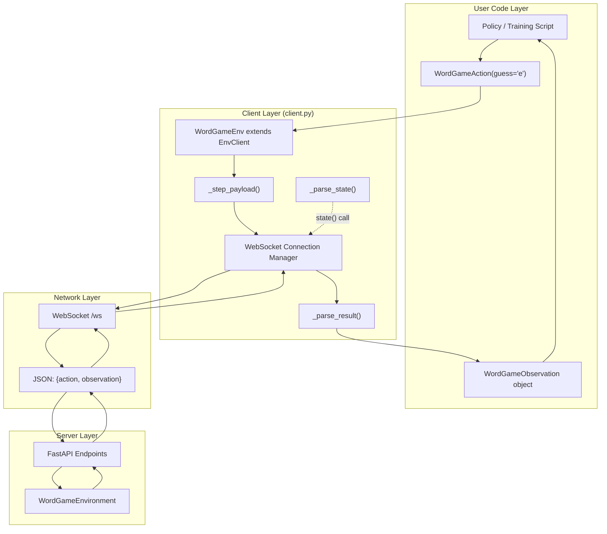
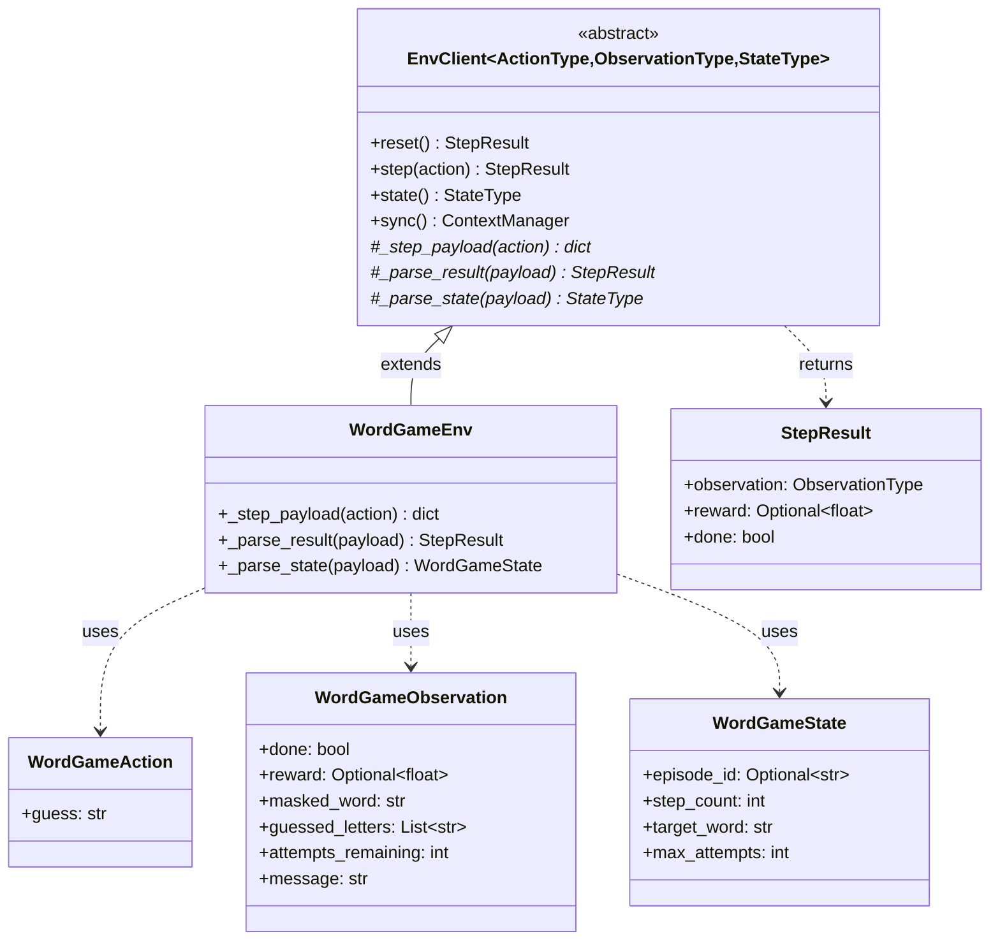
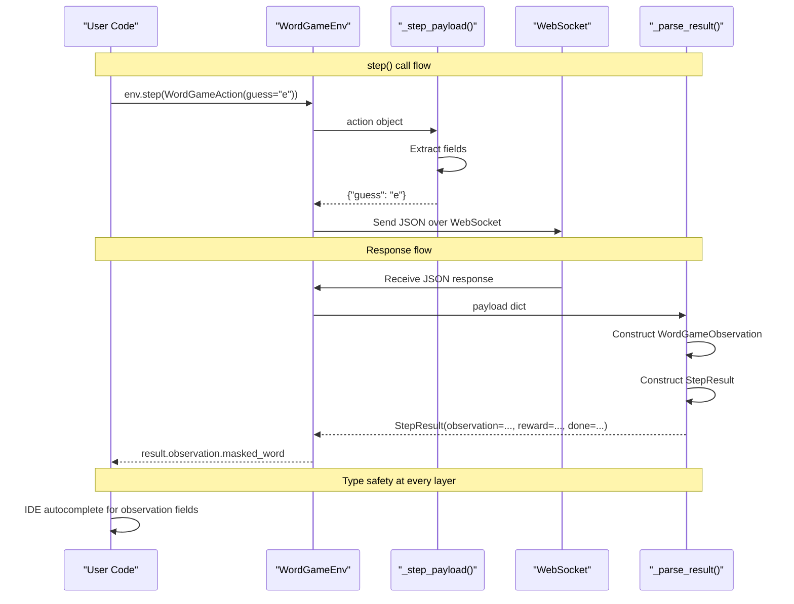

<!-- source: DeepWiki mcp.deepwiki.com · repo huggingface/openenv-course · page 5.3 Building the Client Interface · fetched 2026-10-26 -->

# Building the Client Interface

<details>
<summary>Relevant source files</summary>

The following files were used as context for generating this wiki page:

- [module-4/README.md](module-4/README.md)
- [module-4/notebook.ipynb](module-4/notebook.ipynb)

</details>


This document explains how to implement the client-side component of a custom OpenEnv environment. The client extends `EnvClient` to handle serialization of typed action objects to JSON and deserialization of JSON responses back into typed observation and state objects. This layer provides type safety and WebSocket communication abstraction for environment consumers.

For information about implementing the server-side environment logic, see [Implementing Environment Logic](#5.2). For the complete deployment workflow, see [Server Setup and FastAPI Integration](#5.4).

## Purpose and Role of the Client

The client serves as the network communication layer between user code (policies, training scripts) and the remote environment server. It translates between three representations:

| Layer | Representation | Example |
|-------|---------------|---------|
| User Code | Typed Pydantic objects | `WordGameAction(guess="e")` |
| Client (this component) | JSON dictionaries | `{"guess": "e"}` |
| Network | JSON bytes over WebSocket | Binary transmission |

The client abstracts all WebSocket communication, connection management, and protocol details. Users interact only with typed objects, never with raw JSON or network primitives.

**Sources:** [module-4/README.md:139-176](), [module-4/notebook.ipynb:249-285]()

## Client Architecture in the Environment Stack



**Diagram: Client position in the three-layer architecture**

The client sits between user code (which uses typed objects) and the network layer (which transmits JSON). The `EnvClient` base class manages WebSocket connections, while the three abstract methods handle type conversion.

**Sources:** [module-4/README.md:3-17](), [module-4/notebook.ipynb:249-285]()

## The EnvClient Base Class

`EnvClient` is a generic abstract base class parameterized by three types:

```python
EnvClient[ActionType, ObservationType, StateType]
```

This generic signature ensures type safety across all client methods. The IDE knows that `env.step()` accepts `ActionType` and returns `StepResult` containing `ObservationType`.

### Three Required Abstract Methods

| Method | Purpose | Input | Output |
|--------|---------|-------|--------|
| `_step_payload` | Serialize action to JSON | `ActionType` | `dict` |
| `_parse_result` | Deserialize step response | `dict` | `StepResult` |
| `_parse_state` | Deserialize state response | `dict` | `StateType` |

The base class provides:
- WebSocket connection management (`connect()`, `close()`)
- High-level API (`reset()`, `step()`, `state()`)
- Synchronous wrapper (`.sync()` context manager)
- Protocol handling (JSON encoding/decoding, message framing)

**Sources:** [module-4/README.md:139-176](), [module-4/notebook.ipynb:250-282]()

## Method 1: Implementing _step_payload

`_step_payload` serializes a typed action object into a JSON-serializable dictionary that will be sent to the server.

### WordGame Example

[module-4/README.md:149-150]()
```python
def _step_payload(self, action: WordGameAction) -> dict:
    return {"guess": action.guess}
```

[module-4/notebook.ipynb:257-258]()

### Pattern

Extract fields from the action object and construct a dictionary. The server's `step()` method will receive this dictionary and reconstruct the action server-side. For simple actions with few fields, this is a direct mapping:

```
WordGameAction(guess="e") → {"guess": "e"}
```

For complex actions with nested structures, you may need recursive serialization:

```python
def _step_payload(self, action: ComplexAction) -> dict:
    return {
        "primary": action.primary.dict(),  # Pydantic model serialization
        "alternatives": [a.dict() for a in action.alternatives],
        "metadata": action.metadata,
    }
```

**Sources:** [module-4/README.md:149-150](), [module-4/notebook.ipynb:257-258]()

## Method 2: Implementing _parse_result

`_parse_result` deserializes the JSON response from `step()` into a `StepResult` object containing the typed observation.

### StepResult Structure

The `StepResult` dataclass has three fields:
- `observation: ObservationType` - The environment's observation
- `reward: Optional[float]` - The reward signal
- `done: bool` - Episode termination flag

### WordGame Example

[module-4/README.md:152-165]()
[module-4/notebook.ipynb:260-273]()

```python
def _parse_result(self, payload: dict) -> StepResult:
    obs_data = payload.get("observation", {})
    return StepResult(
        observation=WordGameObservation(
            done=payload.get("done", False),
            reward=payload.get("reward"),
            masked_word=obs_data.get("masked_word", ""),
            guessed_letters=obs_data.get("guessed_letters", []),
            attempts_remaining=obs_data.get("attempts_remaining", 0),
            message=obs_data.get("message", ""),
        ),
        reward=payload.get("reward"),
        done=payload.get("done", False),
    )
```

### Response Payload Structure

The server returns a JSON object with this structure:

```json
{
  "done": true,
  "reward": 1.0,
  "observation": {
    "masked_word": "python",
    "guessed_letters": ["p", "y", "t", "h", "o", "n"],
    "attempts_remaining": 4,
    "message": "You got it! The word was 'python'."
  }
}
```

The observation fields may be nested under an `"observation"` key or at the top level, depending on the server implementation. The client must handle both cases.

**Sources:** [module-4/README.md:152-165](), [module-4/notebook.ipynb:260-273]()

## Method 3: Implementing _parse_state

`_parse_state` deserializes the response from the `state()` endpoint into the typed state object.

### WordGame Example

[module-4/README.md:167-173]()
[module-4/notebook.ipynb:275-281]()

```python
def _parse_state(self, payload: dict) -> WordGameState:
    return WordGameState(
        episode_id=payload.get("episode_id"),
        step_count=payload.get("step_count", 0),
        target_word=payload.get("target_word", ""),
        max_attempts=payload.get("max_attempts", 6),
    )
```

The state typically contains episode metadata: `episode_id`, `step_count`, and environment-specific information. The state object inherits `episode_id` and `step_count` from the `State` base class in `openenv-core`.

**Sources:** [module-4/README.md:167-173](), [module-4/notebook.ipynb:275-281]()

## Complete WordGame Client Implementation



**Diagram: WordGameEnv class hierarchy and type relationships**

The complete client implementation file structure:

[module-4/notebook.ipynb:250-282]()

```python
from openenv.core.env_client import EnvClient
from openenv.core.client_types import StepResult
from .models import WordGameAction, WordGameObservation, WordGameState

class WordGameEnv(EnvClient[WordGameAction, WordGameObservation, WordGameState]):
    def _step_payload(self, action: WordGameAction) -> dict:
        return {"guess": action.guess}

    def _parse_result(self, payload: dict) -> StepResult:
        obs_data = payload.get("observation", {})
        return StepResult(
            observation=WordGameObservation(
                done=payload.get("done", False),
                reward=payload.get("reward"),
                masked_word=obs_data.get("masked_word", ""),
                guessed_letters=obs_data.get("guessed_letters", []),
                attempts_remaining=obs_data.get("attempts_remaining", 0),
                message=obs_data.get("message", ""),
            ),
            reward=payload.get("reward"),
            done=payload.get("done", False),
        )

    def _parse_state(self, payload: dict) -> WordGameState:
        return WordGameState(
            episode_id=payload.get("episode_id"),
            step_count=payload.get("step_count", 0),
            target_word=payload.get("target_word", ""),
            max_attempts=payload.get("max_attempts", 6),
        )
```

This ~30 lines of code provides a fully functional, type-safe client that can connect to local servers or deployed HF Spaces.

**Sources:** [module-4/notebook.ipynb:250-282](), [module-4/README.md:143-174]()

## Usage Pattern

Once the client is implemented, users interact with it through a simple API:

### Synchronous Usage with Context Manager

[module-4/notebook.ipynb:313]()

```python
from word_game import WordGameEnv, WordGameAction

with WordGameEnv(base_url="https://username-word-game.hf.space").sync() as env:
    result = env.reset()
    print(result.observation.masked_word)  # IDE autocomplete works
    
    result = env.step(WordGameAction(guess="e"))
    print(result.observation.message)
    print(result.reward)
```

The `.sync()` context manager wraps the async client to provide a synchronous interface. This is the recommended pattern for policies and training loops that don't need async concurrency.

### Asynchronous Usage

```python
async with WordGameEnv(base_url="https://...") as env:
    result = await env.reset()
    result = await env.step(WordGameAction(guess="e"))
```

The base `EnvClient` is async-first. Use this pattern when you need to manage multiple concurrent environments.

**Sources:** [module-4/notebook.ipynb:313](), [module-4/README.md:176]()

## Data Flow Through the Client



**Diagram: Data transformation through client methods**

The client performs two critical transformations:
1. **Serialization** (`_step_payload`): Typed action → JSON dictionary
2. **Deserialization** (`_parse_result`, `_parse_state`): JSON dictionary → Typed objects

These transformations maintain type safety end-to-end. User code never touches JSON directly.

**Sources:** [module-4/README.md:139-176](), [module-4/notebook.ipynb:249-285]()

## Type Safety Benefits

The client implementation provides four levels of type safety:

| Level | Benefit | Example |
|-------|---------|---------|
| **Compile Time** | IDE autocomplete and type checking | `obs.masked_word` shows in autocomplete |
| **Runtime** | Pydantic validation catches malformed data | Invalid `guess: int` raises validation error |
| **Documentation** | Types serve as executable documentation | Reading `WordGameAction` shows valid actions |
| **Refactoring** | Type changes propagate through codebase | Rename `masked_word` → IDE updates all uses |

### Example: IDE Autocomplete

When a user types `result.observation.`, the IDE immediately suggests:
- `masked_word`
- `guessed_letters`
- `attempts_remaining`
- `message`
- `done`
- `reward`

This is only possible because the client returns a strongly-typed `WordGameObservation` object, not a generic dictionary.

**Sources:** [module-4/README.md:48-52]()

## Implementation Checklist

To implement a custom client:

1. **Define type parameters** in the class signature:
   ```python
   class MyEnv(EnvClient[MyAction, MyObservation, MyState]):
   ```

2. **Implement `_step_payload`**:
   - Extract fields from the action object
   - Return a JSON-serializable dictionary
   - Match the structure expected by the server

3. **Implement `_parse_result`**:
   - Extract fields from the payload dictionary
   - Construct the observation object
   - Wrap in `StepResult` with `reward` and `done`

4. **Implement `_parse_state`**:
   - Extract fields from the payload dictionary
   - Construct the state object
   - Include `episode_id` and `step_count`

5. **Test locally**:
   ```python
   env = MyEnv(base_url="http://localhost:8000")
   with env.sync() as e:
       result = e.reset()
       assert isinstance(result.observation, MyObservation)
   ```

The entire client implementation typically requires 20-30 lines of code for simple environments.

**Sources:** [module-4/README.md:139-176](), [module-4/notebook.ipynb:299-306]()

---

