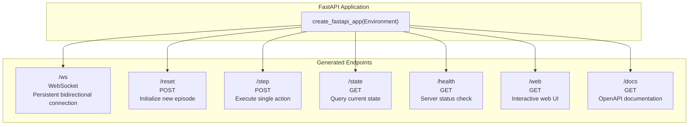
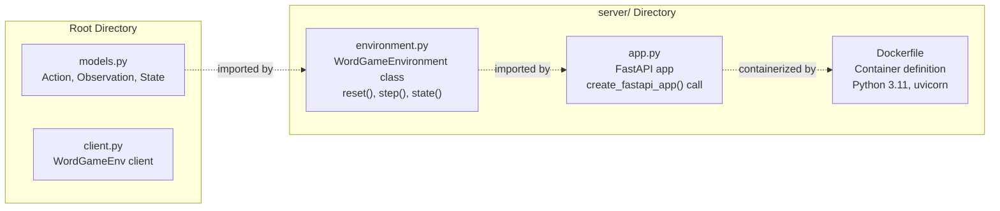
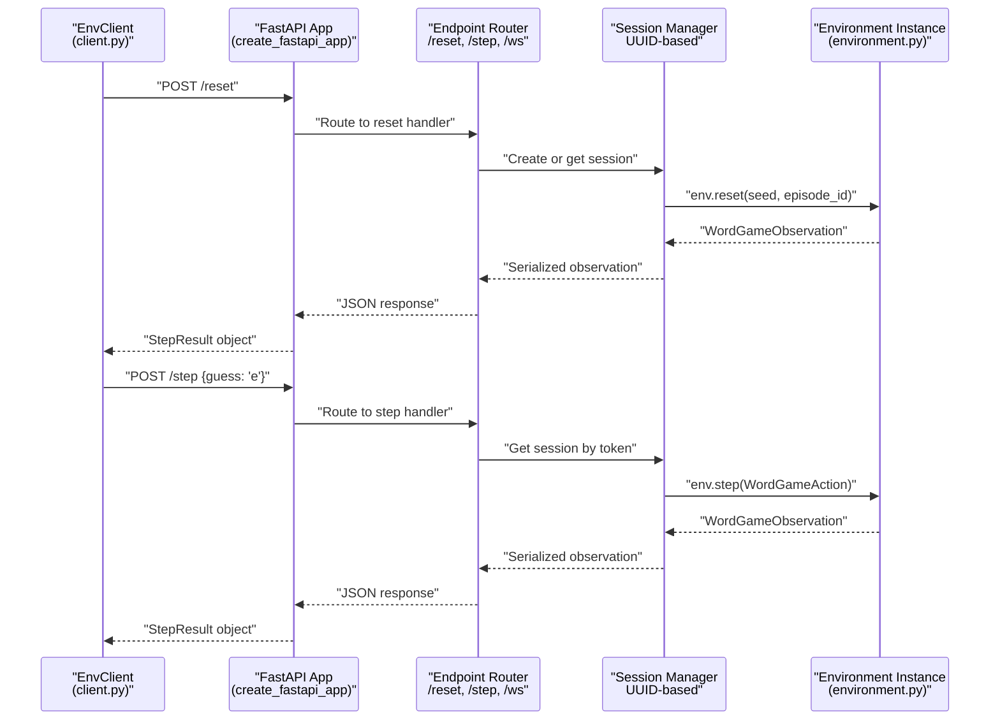
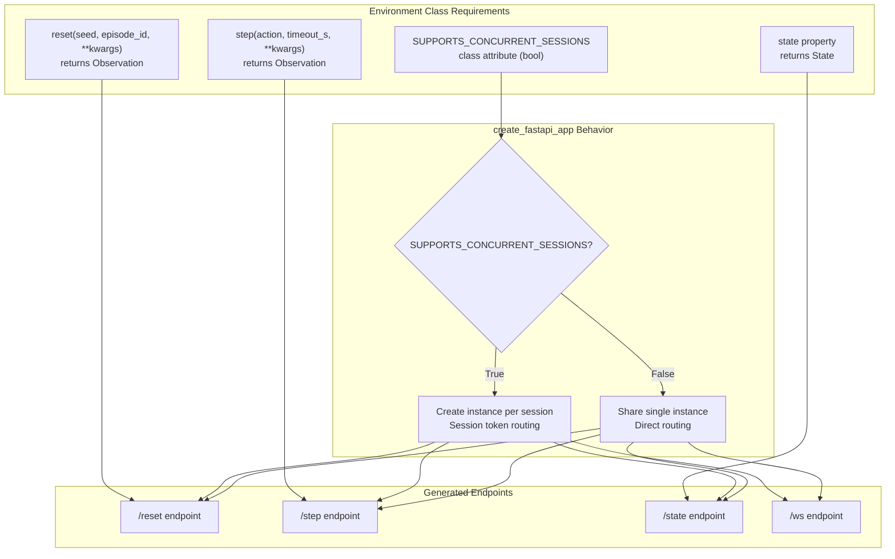

<!-- source: DeepWiki mcp.deepwiki.com · repo huggingface/openenv-course · page 5.4 Server Setup and FastAPI Integration · fetched 2026-10-26 -->

# Server Setup and FastAPI Integration

<details>
<summary>Relevant source files</summary>

The following files were used as context for generating this wiki page:

- [module-4/README.md](module-4/README.md)

</details>


This document explains how to create and configure the FastAPI server that exposes your OpenEnv environment over HTTP and WebSocket. It covers the `create_fastapi_app()` function, automatically generated endpoints, the minimal server application structure, and Docker containerization.

For implementing the environment logic itself, see [Implementing Environment Logic](#5.2). For building the client that connects to this server, see [Building the Client Interface](#5.3).

## Purpose and Scope

The server component transforms your environment implementation into a production-ready web service. The `create_fastapi_app()` function from `openenv-core` handles all boilerplate: endpoint creation, request routing, WebSocket management, session handling, and API documentation. This page documents how to wire up your environment class to FastAPI, configure the server, and deploy it in a Docker container.

## The create_fastapi_app Function

The core of server setup is a single function call that automatically generates a complete FastAPI application from your environment class. This function creates all necessary endpoints, handles WebSocket connections, manages concurrent sessions, and provides interactive documentation.

**Minimal Server Application**

The entire server application for WordGame consists of two lines of meaningful code:

[module-4/README.md:182-186]()

```python
from openenv.core.env_server import create_fastapi_app
from environment import WordGameEnvironment

app = create_fastapi_app(WordGameEnvironment)
```

The `create_fastapi_app()` function accepts an environment class (not an instance) and returns a fully configured FastAPI application. The function inspects the environment class to determine:
- Whether concurrent sessions are supported (`SUPPORTS_CONCURRENT_SESSIONS`)
- The type annotations for Action, Observation, and State models
- Session management requirements (persistent vs ephemeral)

**Sources:** [module-4/README.md:178-189]()

## Auto-Generated Endpoints

The `create_fastapi_app()` function creates seven endpoints automatically. These endpoints provide both HTTP and WebSocket interfaces, health monitoring, and documentation.



### Endpoint Specifications

| Endpoint | Method | Purpose | Use Case |
|----------|--------|---------|----------|
| `/ws` | WebSocket | Persistent low-latency connection | High-performance clients, training loops |
| `/reset` | POST | Initialize new episode | Stateless HTTP clients |
| `/step` | POST | Execute action and get observation | Stateless HTTP clients |
| `/state` | GET | Retrieve current episode state | Debugging, monitoring |
| `/health` | GET | Server health and capacity check | Load balancers, orchestration |
| `/web` | GET | Browser-based interactive UI | Manual testing, demos |
| `/docs` | GET | Auto-generated OpenAPI docs | API exploration, integration |

**WebSocket Protocol**

The `/ws` endpoint provides the highest performance interface. Clients establish a persistent connection and send JSON messages. Each message must include an `action` field specifying the operation:

```json
{"action": "reset", "seed": 42}
{"action": "step", "guess": "e"}
{"action": "state"}
```

The server responds with structured JSON containing the observation, reward, done flag, and state information.

**HTTP Endpoints**

The `/reset` and `/step` endpoints provide stateless alternatives. The server maintains session state server-side, identified by session tokens. This is less efficient than WebSocket but simpler for basic use cases.

**Sources:** [module-4/README.md:189]()

## Server Application Structure

The server component lives in a dedicated `server/` directory within your environment package. This directory contains the environment logic, FastAPI app, and deployment configuration.



**Directory Layout**

The standard structure separates concerns clearly:

```
word_game/
├── models.py              # Shared type definitions
├── client.py              # Client for external users
├── server/
│   ├── environment.py     # Environment implementation
│   ├── app.py             # FastAPI application
│   └── Dockerfile         # Container specification
```

The `server/` directory is self-contained and can be deployed independently. The `models.py` file is shared between server and client to ensure type consistency.

**Import Pattern**

The `server/app.py` file imports the environment class from the local `environment.py` file (not from the package root). This keeps the server component isolated and deployable:

[module-4/README.md:182-186]()

Note the relative import: `from environment import WordGameEnvironment`. This assumes `app.py` is running from within the `server/` directory, which is the standard deployment pattern.

**Sources:** [module-4/README.md:8-17](), [module-4/README.md:182-186]()

## Request Flow Through FastAPI

Understanding how requests flow from clients through FastAPI to your environment helps with debugging and optimization.



**Session Management**

When `SUPPORTS_CONCURRENT_SESSIONS = True`, the server creates a new environment instance for each WebSocket connection or HTTP session. Session tokens (UUIDs) identify which environment instance to route requests to. This allows multiple clients to interact with the server simultaneously without interference.

When `SUPPORTS_CONCURRENT_SESSIONS = False`, all clients share a single environment instance. This is appropriate for environments that inherently support multiple agents in the same episode (like multiplayer games).

**Serialization/Deserialization**

FastAPI automatically serializes Pydantic models to JSON and deserializes JSON to Pydantic models. The `WordGameAction`, `WordGameObservation`, and `WordGameState` models inherit from `pydantic.BaseModel`, which provides this functionality. The server never manually converts between JSON and Python objects.

**Sources:** [module-4/README.md:178-189]()

## Containerization with Docker

The Dockerfile packages the server application and its dependencies into a portable container. This ensures consistent behavior across development, testing, and production environments.

**Standard Dockerfile**

[module-4/README.md:193-202]()

```dockerfile
FROM python:3.11-slim

WORKDIR /app
COPY requirements.txt .
RUN pip install --no-cache-dir -r requirements.txt

COPY . .
CMD ["uvicorn", "server.app:app", "--host", "0.0.0.0", "--port", "8000"]
```

**Dockerfile Structure**

| Line | Purpose |
|------|---------|
| `FROM python:3.11-slim` | Base image with minimal Python installation |
| `WORKDIR /app` | Set working directory inside container |
| `COPY requirements.txt .` | Copy dependency list first (layer caching) |
| `RUN pip install` | Install dependencies in separate layer |
| `COPY . .` | Copy all application code |
| `CMD ["uvicorn"...]` | Start uvicorn ASGI server on container startup |

**Layer Caching Optimization**

The Dockerfile copies `requirements.txt` before copying the application code. This leverages Docker's layer caching: dependency installation (slow) only re-runs when `requirements.txt` changes, not when application code changes. This significantly speeds up iterative development.

**Uvicorn Configuration**

The CMD specifies `uvicorn server.app:app`, which means:
- Import the `app` object from the `server.app` module
- Bind to all network interfaces (`--host 0.0.0.0`)
- Listen on port 8000 (standard HTTP port for containerized apps)

**Sources:** [module-4/README.md:191-202]()

## Running the Server

The server can run locally for development or in a container for deployment. Both modes use uvicorn as the ASGI server.

**Local Development**

For rapid iteration during development, run uvicorn directly:

```bash
cd word_game
uvicorn server.app:app --reload
```

The `--reload` flag enables hot-reloading: uvicorn watches for file changes and automatically restarts the server. This is useful for testing changes to `environment.py` without manual restarts.

**Container Execution**

Build and run the Docker container:

```bash
docker build -t word-game server/
docker run -p 8000:8000 word-game
```

The `-p 8000:8000` flag maps container port 8000 to host port 8000, making the server accessible at `http://localhost:8000`.

**Configuration via Environment Variables**

Production deployments typically configure the server through environment variables:

```bash
docker run -p 8000:8000 \
  -e WORKERS=4 \
  -e MAX_CONCURRENT_ENVS=128 \
  word-game
```

| Variable | Purpose | Default |
|----------|---------|---------|
| `WORKERS` | Number of uvicorn worker processes | 1 |
| `MAX_CONCURRENT_ENVS` | Maximum simultaneous sessions | Unlimited |
| `PORT` | Server port (overrides default 8000) | 8000 |

Multiple workers enable parallel request handling on multi-core systems. The `MAX_CONCURRENT_ENVS` limit prevents resource exhaustion when many clients connect simultaneously.

**Accessing Documentation**

Once the server is running, access the interactive API documentation at:
- Swagger UI: `http://localhost:8000/docs`
- ReDoc: `http://localhost:8000/redoc`
- Web UI: `http://localhost:8000/web`

These interfaces are automatically generated by FastAPI based on your Pydantic models and provide interactive testing capabilities.

**Sources:** [module-4/README.md:219-221](), [module-4/README.md:193-202]()

## Integration with Environment Class

The `create_fastapi_app()` function relies on specific attributes and methods from your environment class. Understanding these requirements ensures smooth integration.



**Required Methods**

Your environment class must inherit from `openenv.core.env_server.Environment` and implement three methods:

1. `reset(seed=None, episode_id=None, **kwargs)` - Initialize new episode
2. `step(action, timeout_s=None, **kwargs)` - Execute action
3. `state` property - Return current state

These methods are called directly by the auto-generated endpoints. The method signatures must match exactly, including the keyword arguments, to ensure proper integration with the FastAPI request handlers.

**Type Annotations**

The `create_fastapi_app()` function uses type annotations from your environment class to generate correct OpenAPI documentation. If your `step()` method is annotated as `step(action: WordGameAction) -> WordGameObservation`, FastAPI will automatically validate requests and generate accurate API docs.

**Sources:** [module-4/README.md:53-136](), [module-4/README.md:178-189]()

---

