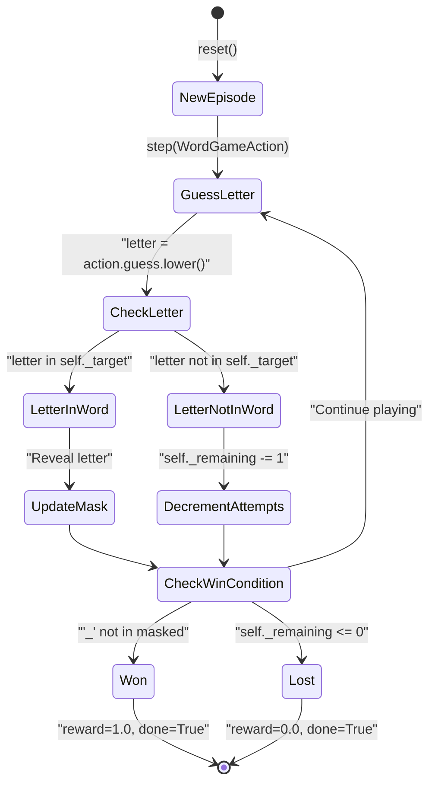
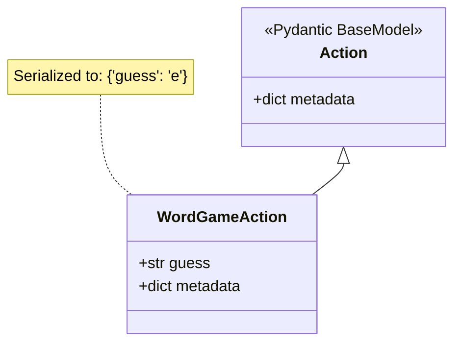
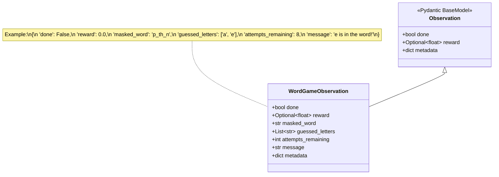
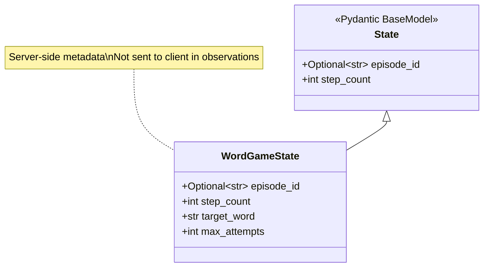
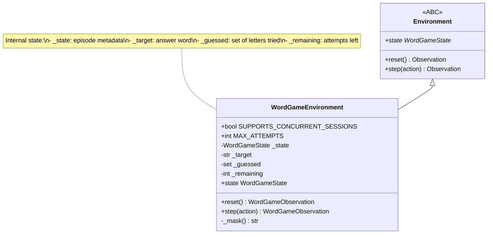
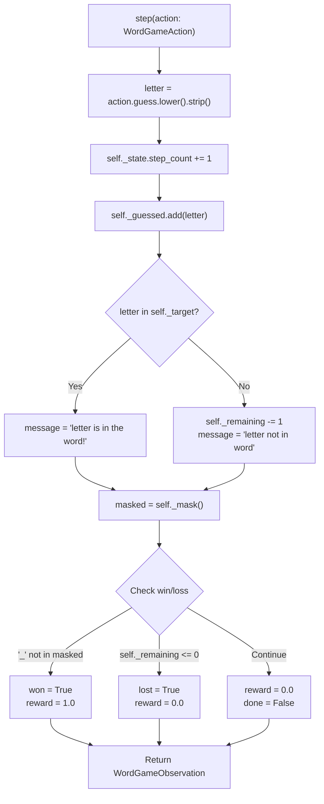
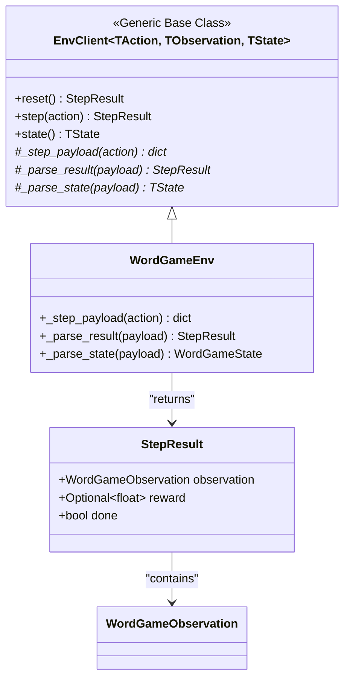
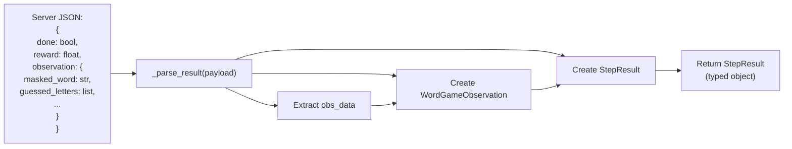
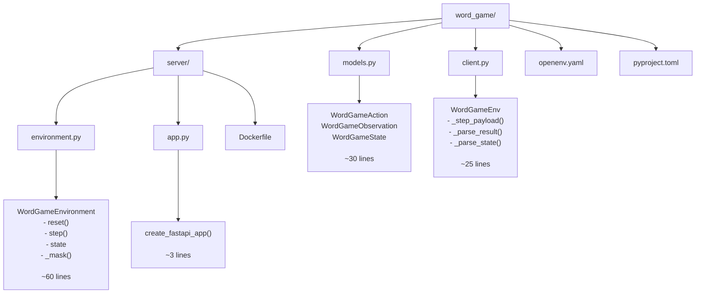
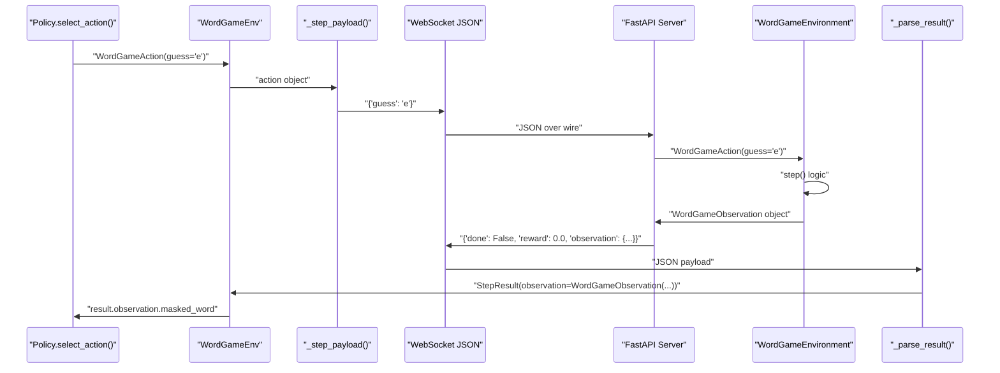

<!-- source: DeepWiki mcp.deepwiki.com · repo huggingface/openenv-course · page 5.5 WordGame Complete Example · fetched 2026-10-26 -->

# WordGame Complete Example

<details>
<summary>Relevant source files</summary>

The following files were used as context for generating this wiki page:

- [module-4/README.md](module-4/README.md)
- [module-4/notebook.ipynb](module-4/notebook.ipynb)

</details>


This page provides a complete walkthrough of implementing a letter-guessing game environment using the 3-Component Pattern. The WordGame serves as a reference implementation demonstrating all aspects of custom environment creation: type definitions, game logic, client implementation, and deployment configuration. The complete implementation totals approximately 100 lines of meaningful code.

For the conceptual foundations of the 3-Component Pattern, see [The 3-Component Pattern](#5.1). For general environment implementation details, see [Implementing Environment Logic](#5.2).

## Game Specification

WordGame is a Hangman-style letter-guessing game where players attempt to identify a hidden word by guessing individual letters. The game maintains a fixed vocabulary of technical terms and provides partial feedback after each guess.

### Game Rules and Mechanics



**Sources:** [module-4/notebook.ipynb:84-117]()

| Game Parameter | Value | Description |
|---------------|-------|-------------|
| Word list size | 15 words | Technical vocabulary: "python", "neural", "tensor", etc. |
| Max attempts | 10 | Default in `WordGameEnvironment.MAX_ATTEMPTS` |
| Win reward | 1.0 | Assigned when all letters revealed |
| Loss reward | 0.0 | Assigned when attempts exhausted |
| Step reward | 0.0 | No intermediate rewards |

**Sources:** [module-4/notebook.ipynb:84](), [module-4/README.md:63-64]()

## Type Definitions: models.py

The type system defines three Pydantic models that inherit from `openenv-core` base classes. These models establish the contract between client and server.

### Action Model



The `WordGameAction` class extends the base `Action` class with a single field for the guessed letter. The `metadata` field is inherited from the base class.

**Sources:** [module-4/README.md:32-33](), [module-4/notebook.ipynb:216-224]()

### Observation Model



The `WordGameObservation` extends `Observation` with game-specific fields. The `done` and `reward` fields are inherited but documented here for clarity.

**Sources:** [module-4/README.md:35-40](), [module-4/notebook.ipynb:226-234]()

| Field | Type | Purpose |
|-------|------|---------|
| `masked_word` | `str` | Current word state with unguessed letters as `_` |
| `guessed_letters` | `List[str]` | All letters attempted so far (sorted) |
| `attempts_remaining` | `int` | Number of incorrect guesses allowed |
| `message` | `str` | Human-readable feedback about last action |

### State Model



The `WordGameState` tracks episode-level metadata. The `target_word` is kept server-side to prevent cheating.

**Sources:** [module-4/README.md:42-45](), [module-4/notebook.ipynb:237-243]()

## Environment Implementation: server/environment.py

The `WordGameEnvironment` class implements the `Environment` abstract base class from `openenv-core`. It manages internal game state and implements the three required methods.

### Class Structure and Internal State



**Sources:** [module-4/README.md:66-76](), [module-4/notebook.ipynb:84-117]()

| Internal Field | Type | Purpose |
|---------------|------|---------|
| `_state` | `WordGameState` | Episode metadata (ID, step count, config) |
| `_target` | `str` | The secret word to be guessed |
| `_guessed` | `set[str]` | Set of letters already guessed |
| `_remaining` | `int` | Attempts remaining before game over |

### reset() Method

The `reset()` method initializes a new episode by selecting a random word from the vocabulary and clearing game state.

**Implementation logic:**
1. Select random word: `self._target = random.choice(WORDS)`
2. Clear guessed letters: `self._guessed = set()`
3. Reset attempt counter: `self._remaining = self.MAX_ATTEMPTS`
4. Create new state with UUID: `episode_id=episode_id or str(uuid.uuid4())`
5. Return initial observation with masked word

**Sources:** [module-4/README.md:77-94](), [module-4/notebook.ipynb:84-117]()

### step() Method

The `step()` method processes a letter guess and updates game state according to game rules.



**Sources:** [module-4/README.md:96-129](), [module-4/notebook.ipynb:84-117]()

### Helper Method: _mask()

The `_mask()` method generates the masked representation of the target word, showing only guessed letters:

```python
def _mask(self) -> str:
    return "".join(c if c in self._guessed else "_" for c in self._target)
```

For example, if `self._target = "python"` and `self._guessed = {'p', 'n'}`, the result is `"p___n_"`.

**Sources:** [module-4/README.md:135-136](), [module-4/notebook.ipynb:84-117]()

## Client Implementation: client.py

The `WordGameEnv` client extends `EnvClient` and implements three abstract methods for serialization and deserialization between typed objects and JSON payloads.

### Client Class Structure



**Sources:** [module-4/README.md:148-174](), [module-4/notebook.ipynb:250-282]()

### Serialization: _step_payload()

Converts a `WordGameAction` object to a JSON-serializable dictionary:

```python
def _step_payload(self, action: WordGameAction) -> dict:
    return {"guess": action.guess}
```

This method is called internally by `EnvClient.step()` before sending data over WebSocket.

**Sources:** [module-4/README.md:149-150](), [module-4/notebook.ipynb:257-258]()

### Deserialization: _parse_result()

Parses the JSON response from the server into typed `StepResult` and `WordGameObservation` objects:



The implementation extracts nested `observation` data and constructs typed objects with proper field mapping.

**Sources:** [module-4/README.md:152-165](), [module-4/notebook.ipynb:260-273]()

### State Parsing: _parse_state()

Converts server state JSON to `WordGameState` object:

```python
def _parse_state(self, payload: dict) -> WordGameState:
    return WordGameState(
        episode_id=payload.get("episode_id"),
        step_count=payload.get("step_count", 0),
        target_word=payload.get("target_word", ""),
        max_attempts=payload.get("max_attempts", 6),
    )
```

**Sources:** [module-4/README.md:167-173](), [module-4/notebook.ipynb:275-281]()

## Server Application: server/app.py

The FastAPI application is created using `create_fastapi_app()` from `openenv-core`, which automatically generates all required endpoints.

```python
from openenv.core.env_server import create_fastapi_app
from environment import WordGameEnvironment

app = create_fastapi_app(WordGameEnvironment)
```

This single function call creates the following endpoints:

| Endpoint | Method | Purpose |
|----------|--------|---------|
| `/ws` | WebSocket | Primary communication channel |
| `/reset` | POST | HTTP fallback for reset |
| `/step` | POST | HTTP fallback for step |
| `/state` | GET | Query episode state |
| `/health` | GET | Health check |
| `/web` | GET | Web UI |
| `/docs` | GET | OpenAPI documentation |

**Sources:** [module-4/README.md:182-189](), [module-4/notebook.ipynb:288-294]()

## Policy Implementations

The notebook demonstrates two policies for testing the environment: a random baseline and a frequency-based smart policy.

### RandomLetterPolicy

Selects unused letters uniformly at random from the remaining alphabet:

```python
class RandomLetterPolicy:
    name = "Random"
    
    def select_action(self, obs: WordGameObservation) -> WordGameAction:
        available = [c for c in string.ascii_lowercase if c not in obs.guessed_letters]
        return WordGameAction(guess=random.choice(available))
```

**Sources:** [module-4/notebook.ipynb:137-143]()

### FrequencyPolicy

Guesses letters in order of English language frequency (ETAOIN SHRDLU...):

```python
class FrequencyPolicy:
    name = "Frequency"
    FREQ_ORDER = "etaoinshrdlcumwfgypbvkjxqz"
    
    def select_action(self, obs: WordGameObservation) -> WordGameAction:
        for letter in self.FREQ_ORDER:
            if letter not in obs.guessed_letters:
                return WordGameAction(guess=letter)
        return WordGameAction(guess="a")  # fallback
```

**Sources:** [module-4/notebook.ipynb:146-155]()

### Policy Evaluation

The `evaluate()` function runs multiple episodes and computes win rate and average steps:

```python
def evaluate(env, policy, episodes=100):
    wins = 0
    total_steps = 0
    for _ in range(episodes):
        obs = env.reset()
        while not obs.done:
            action = policy.select_action(obs)
            obs = env.step(action)
        if obs.reward and obs.reward > 0:
            wins += 1
        total_steps += env.state.step_count
    return wins / episodes, total_steps / episodes
```

Typical results show FrequencyPolicy significantly outperforms RandomLetterPolicy due to the technical vocabulary and structured letter guessing.

**Sources:** [module-4/notebook.ipynb:158-176]()

## Complete File Structure

The WordGame environment follows the standardized directory layout required by OpenEnv:



**Sources:** [module-4/README.md:7-17](), [module-4/notebook.ipynb:343-349]()

## Line Count Breakdown

The WordGame implementation achieves production-ready functionality in approximately 100 lines of meaningful code:

| File | Purpose | Lines | Key Components |
|------|---------|-------|----------------|
| `models.py` | Type contracts | ~30 | `WordGameAction`, `WordGameObservation`, `WordGameState` |
| `server/environment.py` | Game logic | ~60 | `reset()`, `step()`, `state`, `_mask()` |
| `client.py` | HTTP/WebSocket client | ~25 | `_step_payload()`, `_parse_result()`, `_parse_state()` |
| `server/app.py` | FastAPI wiring | ~3 | `create_fastapi_app()` call |
| **Total** | **Complete environment** | **~118** | **All components** |

This breakdown excludes boilerplate (imports, docstrings, whitespace) and focuses on functional code.

**Sources:** [module-4/notebook.ipynb:343-349](), [module-4/README.md:19]()

## Data Flow: Type Safety End-to-End

The complete data flow demonstrates how types ensure correctness from policy code through serialization, network transmission, and back:



The type system guarantees:
1. **Compile-time safety:** IDEs autocomplete `observation.masked_word`
2. **Runtime validation:** Pydantic validates all JSON payloads
3. **API documentation:** Types serve as executable documentation

**Sources:** [module-4/README.md:48-51](), [module-4/notebook.ipynb:210-307]()

## Scaffolding with openenv init

Instead of manually creating files, the `openenv init` command scaffolds the complete structure:

```bash
openenv init word_game
cd word_game
# Edit models.py, server/environment.py, client.py
uv run server           # Test locally at http://localhost:8000
openenv push            # Deploy to HF Spaces
```

The scaffolded structure contains:
- Placeholder Pydantic models in `models.py`
- Stub methods in `server/environment.py`
- Client template in `client.py`
- Complete `server/app.py` with `create_fastapi_app()`
- `Dockerfile` for containerization
- `openenv.yaml` configuration manifest

Developers fill in the three key areas (types, game logic, client parsing) while the infrastructure code remains standardized.

**Sources:** [module-4/README.md:204-222](), [module-4/notebook.ipynb:320-333]()

---

