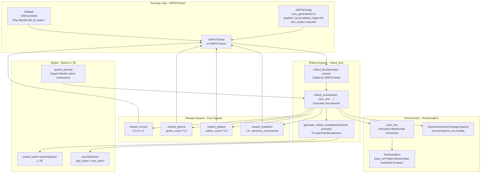
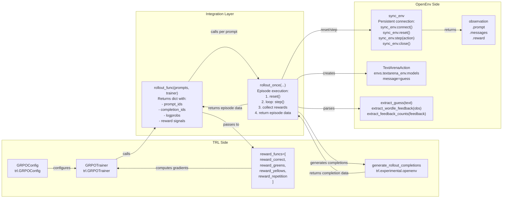
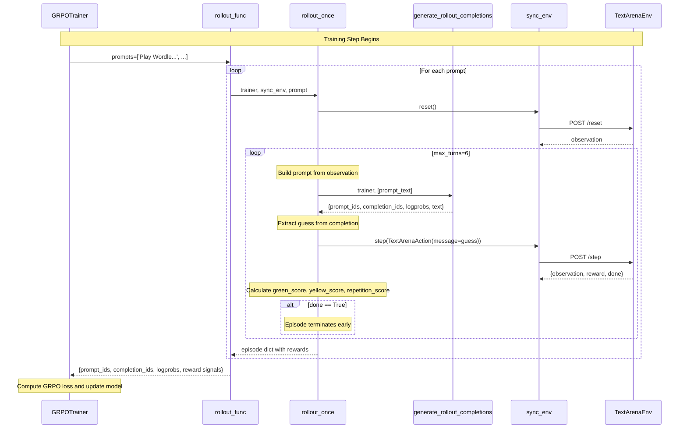

<!-- source: DeepWiki mcp.deepwiki.com · repo huggingface/openenv-course · page 6 Module 5: LLM Training with GRPO · fetched 2026-10-26 -->

# Module 5: LLM Training with GRPO

<details>
<summary>Relevant source files</summary>

The following files were used as context for generating this wiki page:

- [module-5/README.md](module-5/README.md)
- [module-5/notebook.ipynb](module-5/notebook.ipynb)

</details>


This module demonstrates training Large Language Models (LLMs) using reinforcement learning with Group Relative Policy Optimization (GRPO). The module integrates OpenEnv environments with TRL's `GRPOTrainer`, showing how to fine-tune Qwen3-1.7B to play Wordle through environment interaction, multi-signal reward design, and vLLM-accelerated generation. The complete training pipeline runs in approximately 90 minutes on an A100 40GB GPU.

For detailed information on the GRPO algorithm and TRL integration, see [6.1](#6.1). For rollout function implementation details, see [6.2](#6.2). For reward function design, see [6.3](#6.3). For system prompt strategies, see [6.4](#6.4). For training configuration and optimization, see [6.5](#6.5). For the complete Wordle case study, see [6.6](#6.6).

---

## GRPO Training Pipeline Architecture

The GRPO training pipeline connects four major components: the environment (TextArenaEnv), the model (Qwen3-1.7B), the trainer (GRPOTrainer), and the rollout function that orchestrates their interaction.



Sources: [module-5/notebook.ipynb:50-67](), [module-5/notebook.ipynb:197-318](), [module-5/notebook.ipynb:332-353](), [module-5/notebook.ipynb:384-416](), [module-5/notebook.ipynb:426-445]()

---

## TRL-OpenEnv Integration Points

The integration between TRL and OpenEnv occurs through specific code entities that handle rollout execution, reward collection, and episode data formatting.



Sources: [module-5/notebook.ipynb:426-445](), [module-5/notebook.ipynb:197-318](), [module-5/notebook.ipynb:50-67](), [module-5/README.md:17-35]()

---

## Environment Setup and Connection Management

The TextArenaEnv environment is initialized with a persistent WebSocket connection that remains open throughout training, eliminating per-episode reconnection overhead.

**Connection Strategy:**

| Connection Type | Use Case | Code Pattern |
|----------------|----------|--------------|
| Context Manager | Quick verification, evaluation | `with TextArenaEnv(base_url).sync() as env:` |
| Persistent | Training (1000+ episodes) | `sync_env = env.sync(); sync_env.connect()` |

**Implementation:**

[module-5/notebook.ipynb:50-67]() shows both patterns:

```python
# Verification (context manager)
with TextArenaEnv(base_url=textarena_url).sync() as _check:
    result = _check.reset()
    
# Training (persistent connection)
env = TextArenaEnv(base_url=textarena_url)
sync_env = env.sync()
sync_env.connect()  # Single WebSocket for all rollouts
```

The persistent connection is used in `rollout_once` at [module-5/notebook.ipynb:208-277]() and closed after training at [module-5/notebook.ipynb:500-501]().

**Environment Response Structure:**

The environment returns observations containing:
- `observation.prompt` - Base game description
- `observation.messages` - History of guesses and feedback
- `result.reward` - Binary win/loss signal (0.0 or 1.0)
- `result.done` - Episode termination flag

Sources: [module-5/notebook.ipynb:50-67](), [module-5/README.md:42-54]()

---

## Rollout Function Execution Flow

The rollout function implements a two-level structure: `rollout_func` handles batch processing for TRL, while `rollout_once` executes individual episodes.



Sources: [module-5/notebook.ipynb:197-318](), [module-5/README.md:92-123]()

---

## Episode Data Collection

Each episode collects sequences of token IDs, log probabilities, and reward signals that TRL uses for gradient computation.

**Data Structures:**

[module-5/notebook.ipynb:213-220]() initializes collection lists:

```python
prompt_ids = []           # Token IDs for prompts
completion_ids = []       # Token IDs for completions
logprobs = []             # Log probabilities for each token
green_scores = []         # Per-turn green letter rewards
yellow_scores = []        # Per-turn yellow letter rewards
repetition_scores = []    # Per-turn repetition penalties
correct_scores = []       # Per-turn correctness signals
```

**Turn-by-Turn Collection:**

[module-5/notebook.ipynb:222-267]() executes the episode loop:

1. Build prompt from game state with `make_user_prompt()`
2. Generate completion via `generate_rollout_completions()`
3. Extract guess with `extract_guess()`
4. Execute action via `sync_env.step()`
5. Compute reward signals from feedback
6. Append to collection lists

**Return Format:**

[module-5/notebook.ipynb:269-277]() returns the episode dictionary:

```python
{
    'prompt_ids': prompt_ids,
    'completion_ids': completion_ids,
    'logprobs': logprobs,
    'correct_reward': correct_scores[-1],
    'green_reward': green_scores[-1],
    'yellow_reward': yellow_scores[-1],
    'repetition_reward': repetition_scores[-1],
}
```

Sources: [module-5/notebook.ipynb:208-277]()

---

## Multi-Signal Reward System

Four reward functions provide complementary training signals beyond binary win/loss.

**Reward Function Definitions:**

| Function | Signal | Range | Implementation |
|----------|--------|-------|----------------|
| `reward_correct` | Episode success | `{0.0, 1.0}` | [module-5/notebook.ipynb:336-338]() |
| `reward_greens` | Correct letters in correct positions | `[0.0, 1.0]` | [module-5/notebook.ipynb:340-342]() |
| `reward_yellows` | Correct letters in wrong positions | `[0.0, 1.0]` | [module-5/notebook.ipynb:344-346]() |
| `reward_repetition` | Penalize repeated guesses | `[0.0, 1.0]` | [module-5/notebook.ipynb:348-350]() |

**Gradient Shaping:**

The multi-signal approach addresses sparse reward problems:

- **Binary signal alone**: Only rewards winning episodes, provides no gradient for near-misses
- **Green/yellow signals**: Provide intermediate feedback when model is close but incorrect
- **Repetition penalty**: Discourages wasteful repeated guesses

**Computation Details:**

[module-5/notebook.ipynb:250-267]() computes rewards per turn:

```python
# Extract feedback colors
feedback = extract_wordle_feedback(observation)
green_count, yellow_count = extract_feedback_counts(feedback)

# Normalize to [0, 1]
green_score = green_count / 5.0
yellow_score = yellow_count / 5.0

# Repetition penalty
repetition_score = max(0.0, 1.0 - previous_occurrences)
```

Sources: [module-5/notebook.ipynb:332-353](), [module-5/notebook.ipynb:250-267](), [module-5/README.md:79-91]()

---

## System Prompt Design

The system prompt at [module-5/notebook.ipynb:104-138]() defines the model's strategic behavior through structured instructions.

**Prompt Structure:**

```
1. GAME RULES (lines 107-116)
   - 5-letter words
   - 6 attempts
   - Color feedback system
   
2. RESPONSE FORMAT (lines 117-120)
   - Only [word] in brackets
   - Enforces parseable output
   
3. STRATEGIC APPROACH (lines 122-135)
   - Opening strategy: vowel-rich words
   - Mid-game: use feedback to constrain search
   - Explicit instruction: do not repeat guesses
```

**Prompt Application:**

[module-5/notebook.ipynb:154-163]() implements `make_user_prompt()`:

```python
def make_user_prompt(prompt_text, messages):
    history = format_history(messages)
    return (
        f"Game prompt:\n{prompt_section}\n\n"
        f"Conversation so far:\n{history_section}\n\n"
        "Reply with your next guess enclosed in square brackets."
    )
```

This function converts the environment's observation into a structured prompt that includes both the game rules and the turn-by-turn feedback history.

Sources: [module-5/notebook.ipynb:104-138](), [module-5/notebook.ipynb:154-163](), [module-5/README.md:55-77]()

---

## GRPO Training Configuration

The `GRPOConfig` at [module-5/notebook.ipynb:384-416]() configures training hyperparameters and vLLM acceleration.

**Key Parameters:**

| Parameter | Value | Purpose |
|-----------|-------|---------|
| `num_train_epochs` | `1` | Single pass through dataset |
| `learning_rate` | `5e-6` | Conservative LR for RL fine-tuning |
| `gradient_accumulation_steps` | `64` | Effective batch size = 64 |
| `per_device_train_batch_size` | `1` | Memory constraint |
| `num_generations` | `2` | Group size for GRPO comparison |
| `max_completion_length` | `8` | Wordle guesses are short |
| `max_prompt_length` | `1400` | Accommodate game history |

**vLLM Colocate Mode:**

[module-5/notebook.ipynb:401-403]() enables GPU-efficient generation:

```python
use_vllm=True,
vllm_mode="colocate",              # Generation + training on same GPU
vllm_gpu_memory_utilization=0.1,   # Reserve 10% for vLLM
```

This configuration shares the GPU between the training process and vLLM's generation engine, eliminating the need for a separate inference GPU.

**Memory Optimization:**

[module-5/notebook.ipynb:409-410]():

```python
gradient_checkpointing=True,
gradient_checkpointing_kwargs={"use_reentrant": False},
```

Gradient checkpointing trades computation for memory, enabling larger models on constrained GPUs.

Sources: [module-5/notebook.ipynb:384-416](), [module-5/README.md:125-148]()

---

## Training Execution and Metrics

The training process at [module-5/notebook.ipynb:426-485]() creates the trainer, executes training, and reports metrics.

**Trainer Initialization:**

[module-5/notebook.ipynb:431-445]():

```python
trainer = GRPOTrainer(
    model=model_name,                # "Qwen/Qwen3-1.7B"
    processing_class=tokenizer,
    reward_funcs=[                   # Four reward signals
        reward_correct,
        reward_greens,
        reward_yellows,
        reward_repetition,
    ],
    train_dataset=dataset,           # 1000 prompts
    args=grpo_config,
    rollout_func=rollout_func,       # OpenEnv integration
)
```

**Training Loop:**

[module-5/notebook.ipynb:468-469]():

```python
trainer_stats = trainer.train()  # ~90 minutes on A100
```

**Performance Metrics:**

[module-5/notebook.ipynb:454-484]() captures GPU metrics:

```python
# Before training
gpu_stats = torch.cuda.get_device_properties(0)
start_gpu_memory = round(torch.cuda.max_memory_reserved() / 1024 / 1024 / 1024, 3)

# After training
used_memory = round(torch.cuda.max_memory_reserved() / 1024 / 1024 / 1024, 3)
training_time = round(trainer_stats.metrics['train_runtime']/60, 1)
```

**Expected Results:**

- **Training time**: ~90 minutes
- **Peak memory**: ~37 GB (92% of 40 GB A100)
- **Memory for training**: ~32 GB (excluding model loading)

Sources: [module-5/notebook.ipynb:426-485](), [module-5/README.md:149-154]()

---

## Model Evaluation

The evaluation function at [module-5/notebook.ipynb:531-569]() tests the trained model on live Wordle games.

**Evaluation Setup:**

[module-5/notebook.ipynb:525-528]() loads the fine-tuned model:

```python
fine_tuned_model = AutoModelForCausalLM.from_pretrained(
    output_dir, torch_dtype='auto', device_map='auto'
)
```

**Game Execution:**

The `play_wordle` function at [module-5/notebook.ipynb:531-563]() mirrors the rollout logic but uses standard generation instead of `generate_rollout_completions`:

1. Reset environment
2. For each turn:
   - Build prompt with `make_user_prompt()`
   - Generate with `model.generate(max_new_tokens=512)`
   - Extract guess with `extract_guess()`
   - Step environment
   - Print feedback
3. Display final result

**Evaluation Context:**

[module-5/notebook.ipynb:566-569]() uses a fresh context manager per game:

```python
eval_env = TextArenaEnv(base_url=textarena_url)
with eval_env.sync() as eval_sync:
    play_wordle(eval_sync, fine_tuned_model, tokenizer)
```

This separates evaluation from the persistent training connection.

Sources: [module-5/notebook.ipynb:516-570]()

---

## Hardware Requirements and Scaling

**Minimum Requirements:**

| Resource | Specification | Notes |
|----------|--------------|-------|
| GPU | A100 40GB | Required for vLLM colocate mode |
| VRAM | ~37GB peak | 92% utilization of 40GB |
| Training Time | ~90 minutes | Qwen3-1.7B, 1 epoch, 1000 prompts |
| Platform | Colab Pro+ or equivalent | Free Colab insufficient |

**Memory Breakdown:**

Based on [module-5/notebook.ipynb:478-484]():

- Model parameters: ~5 GB (Qwen3-1.7B in 16-bit)
- Optimizer states: ~15 GB (AdamW)
- vLLM KV cache: ~4 GB (10% allocation)
- Gradient checkpointing: ~8 GB
- Activations: ~5 GB

**Scaling Considerations:**

For larger models or datasets:
- Increase `gradient_accumulation_steps` for effective larger batches
- Use `vllm_gpu_memory_utilization=0.05` for smaller vLLM footprint
- Consider multi-GPU training with DeepSpeed
- Deploy custom environment instances to avoid HF Spaces concurrency limits

Sources: [module-5/notebook.ipynb:454-484](), [module-5/README.md:149-154]()

---

## Integration with Module 4 Environments

The training pipeline is environment-agnostic. Any environment built in Module 4 can replace TextArenaEnv with minimal code changes.

**Required Modifications:**

1. **Import environment client** (line 51): Replace `TextArenaEnv` with your custom client
2. **Update action model** (line 203): Replace `TextArenaAction` with your action type
3. **Modify reward extraction** (lines 251, 260): Replace Wordle-specific parsing with your reward logic
4. **Adjust system prompt** (lines 104-138): Describe your environment's rules

**Preserved Components:**

- `rollout_func` structure remains identical
- `GRPOTrainer` configuration unchanged
- `generate_rollout_completions` interface consistent
- Episode data collection pattern reusable

The `rollout_func` interface at [module-5/notebook.ipynb:280-315]() is the universal integration point between TRL and any OpenEnv environment.

Sources: [module-5/notebook.ipynb:50-67](), [module-5/notebook.ipynb:208-277](), [module-5/README.md:169-172]()

---

## Next Steps

**Sub-Pages:**

- [6.1](#6.1) - Detailed GRPO algorithm explanation and comparison with PPO
- [6.2](#6.2) - Rollout function patterns and async handling
- [6.3](#6.3) - Reward shaping strategies and multi-objective optimization
- [6.4](#6.4) - System prompt engineering for RL tasks
- [6.5](#6.5) - Training configuration, hyperparameter tuning, and debugging
- [6.6](#6.6) - Complete Wordle training walkthrough with analysis

**Extensions:**

- Train on custom Module 4 environments
- Experiment with larger models (Qwen3-8B, Llama-3-8B)
- Implement curriculum learning with progressive difficulty
- Deploy multi-container environments for higher throughput
- Explore other RL algorithms in TRL (DPO, RLOO)

Sources: [module-5/README.md:173-178](), [module-5/notebook.ipynb:576-592]()

---

