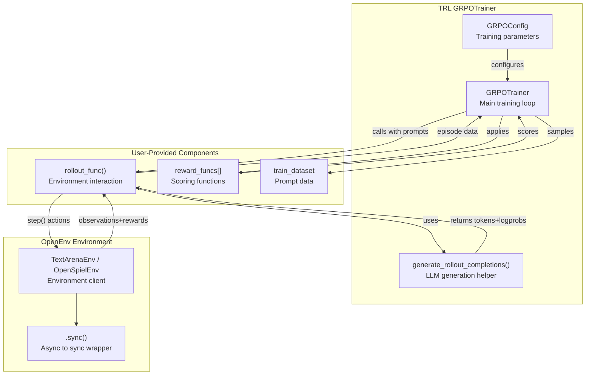
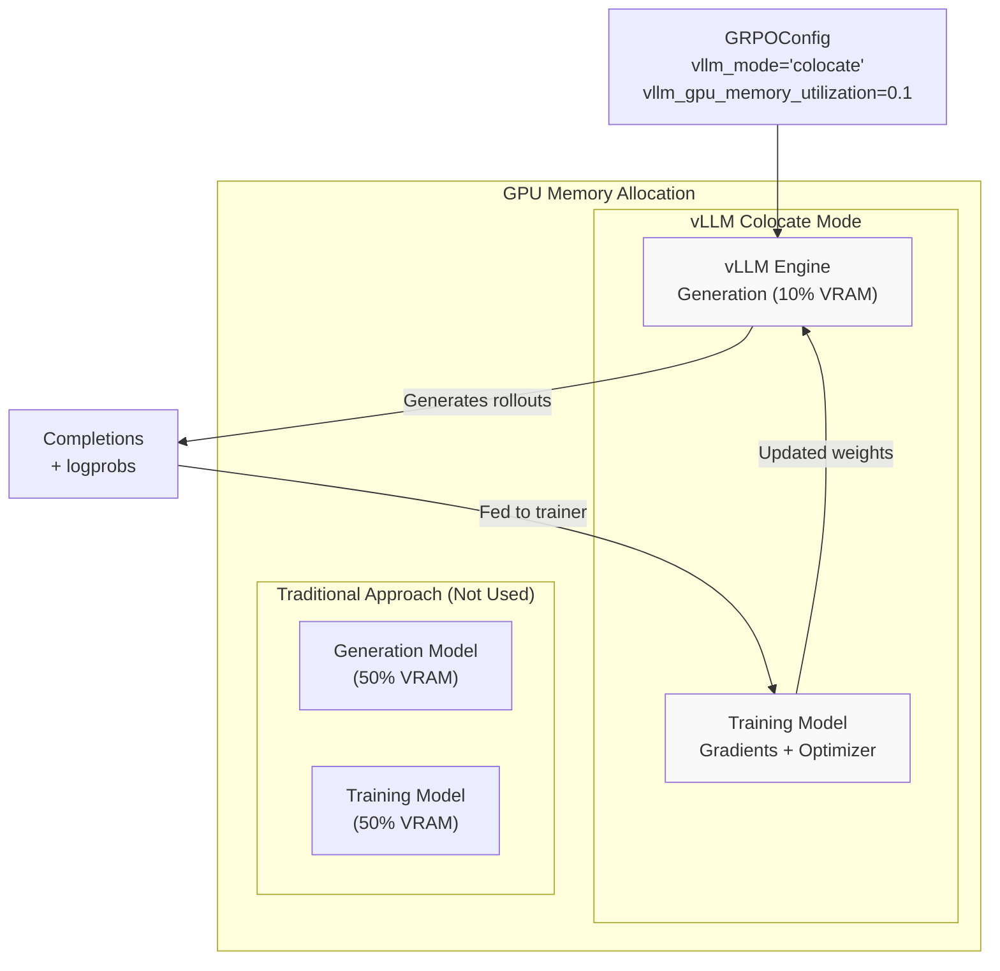
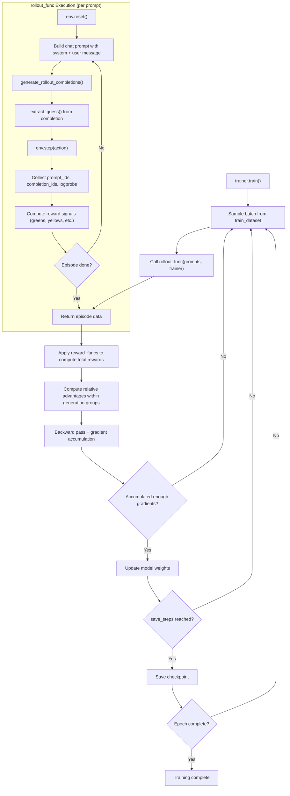

<!-- source: DeepWiki mcp.deepwiki.com · repo huggingface/openenv-course · page 6.1 GRPO Algorithm and TRL Integration · fetched 2026-10-26 -->

# GRPO Algorithm and TRL Integration

<details>
<summary>Relevant source files</summary>

The following files were used as context for generating this wiki page:

- [module-5/README.md](module-5/README.md)
- [module-5/notebook.ipynb](module-5/notebook.ipynb)

</details>


## Purpose and Scope

This page documents the Group Relative Policy Optimization (GRPO) algorithm and its integration with the TRL (Transformers Reinforcement Learning) library for training language models with OpenEnv environments. It covers the `GRPOTrainer` class, the `rollout_func` interface contract, vLLM colocate mode for memory efficiency, and the configuration parameters required for training.

For implementing environment interactions within the rollout function, see [Rollout Functions and Environment Interaction](#6.2). For designing reward signals, see [Multi-Signal Reward Design](#6.3). For complete training examples, see [Wordle Training Case Study](#6.6).

**Sources:** [module-5/README.md:1-178](), [module-5/notebook.ipynb:1-610]()

---

## GRPO Algorithm Fundamentals

Group Relative Policy Optimization is a reinforcement learning algorithm designed for fine-tuning large language models. Unlike PPO (Proximal Policy Optimization), GRPO eliminates the need for a separate value model by using relative ranking within a group of completions as the baseline.

### Core Mechanism

The algorithm operates on groups of completions:

1. Generate multiple completions for the same prompt (controlled by `num_generations` parameter)
2. Score each completion using one or more reward functions
3. Compute relative advantages within each group
4. Update the policy using the relative ranking as the baseline

This group-based approach provides several advantages for LLM training:
- **No value model required** — reduces memory footprint and training complexity
- **Stable gradients** — within-group comparisons are less noisy than absolute reward predictions
- **Multi-reward support** — naturally handles multiple reward signals simultaneously

### Comparison with PPO

| Aspect | GRPO | PPO |
|--------|------|-----|
| Baseline computation | Relative ranking within generation group | Learned value model |
| Model components | Policy model only | Policy model + value model |
| Memory efficiency | High (single model) | Lower (two models) |
| Training stability | Within-group comparisons reduce variance | Requires careful value model tuning |
| Implementation complexity | Simpler (no value head) | More complex (dual optimization) |

**Sources:** [module-5/README.md:3-11]()

---

## TRL GRPOTrainer Architecture

The `GRPOTrainer` class in TRL provides native OpenEnv integration through the `rollout_func` interface. This architecture separates concerns: TRL manages model optimization, while the rollout function handles environment interaction.

### GRPOTrainer Class Structure



**Diagram: GRPOTrainer Component Architecture**

### Trainer Initialization

The trainer is instantiated with five key components:

[module-5/notebook.ipynb:433-445]()

```python
trainer = GRPOTrainer(
    model=model_name,                    # Model identifier or path
    processing_class=tokenizer,          # Tokenizer for text processing
    reward_funcs=[                       # List of reward functions
        reward_correct,
        reward_greens,
        reward_yellows,
        reward_repetition,
    ],
    train_dataset=dataset,               # Dataset of prompts
    args=grpo_config,                    # GRPOConfig instance
    rollout_func=rollout_func,          # Environment interaction function
)
```

| Parameter | Type | Purpose |
|-----------|------|---------|
| `model` | `str` or model object | Base model to fine-tune (e.g., "Qwen/Qwen3-1.7B") |
| `processing_class` | Tokenizer | Handles tokenization and chat templates |
| `reward_funcs` | `List[Callable]` | Functions that compute rewards from completions |
| `train_dataset` | `Dataset` | Contains prompts for episode generation |
| `args` | `GRPOConfig` | Training hyperparameters and optimization settings |
| `rollout_func` | `Callable` | User-defined function for environment interaction |

**Sources:** [module-5/notebook.ipynb:426-446](), [module-5/README.md:26-35]()

---

## The rollout_func Interface Contract

The `rollout_func` is the integration point between TRL and OpenEnv. It defines how the model interacts with the environment during training. The trainer calls this function repeatedly, passing batches of prompts and expecting structured episode data in return.

### Function Signature and Contract

```mermaid
sequenceDiagram
    participant GRPOTrainer
    participant rollout_func
    participant generate_rollout_completions
    participant TextArenaEnv
    
    Note over GRPOTrainer,TextArenaEnv: Training Step Begin
    
    GRPOTrainer->>rollout_func: rollout_func(prompts, trainer)
    
    loop For each prompt
        rollout_func->>TextArenaEnv: reset()
        TextArenaEnv-->>rollout_func: ResetResult with observation
        
        loop Episode turns (max 6 for Wordle)
            rollout_func->>generate_rollout_completions: generate_rollout_completions(trainer, [prompt_text])
            generate_rollout_completions-->>rollout_func: {prompt_ids, completion_ids, logprobs, text}
            
            rollout_func->>rollout_func: extract_guess(completion_text)
            rollout_func->>TextArenaEnv: step(TextArenaAction)
            TextArenaEnv-->>rollout_func: StepResult with observation, reward, done
            
            rollout_func->>rollout_func: Compute reward signals
            
            alt Episode done
                break Episode complete
            end
        end
    end
    
    rollout_func-->>GRPOTrainer: {prompt_ids, completion_ids, logprobs, rewards}
    
    Note over GRPOTrainer,TextArenaEnv: GRPOTrainer computes advantages and updates policy
```

**Diagram: rollout_func Execution Flow**

### Input Parameters

[module-5/notebook.ipynb:280-281]()

The function receives two arguments:
- `prompts`: List of string prompts from the dataset
- `trainer`: Reference to the `GRPOTrainer` instance (used for model generation)

### Return Format

The function must return a dictionary with token-level data and reward signals:

[module-5/notebook.ipynb:307-315]()

```python
return {
    'prompt_ids': episode_prompt_ids,          # List[List[int]] - token IDs for each prompt
    'completion_ids': episode_completion_ids,  # List[List[int]] - token IDs for each completion
    'logprobs': episode_logprobs,              # List[List[float]] - log probabilities
    'correct_reward': correctness_rewards,     # List[float] - reward signal 1
    'green_reward': green_rewards,             # List[float] - reward signal 2
    'yellow_reward': yellow_rewards,           # List[float] - reward signal 3
    'repetition_reward': repetition_rewards,   # List[float] - reward signal 4
}
```

### Key Requirements

1. **Token-level tracking**: Must collect `prompt_ids`, `completion_ids`, and `logprobs` for every generated token
2. **Batch processing**: Process all prompts in the input list
3. **Reward keys**: Return reward signals that match the keys expected by `reward_funcs`
4. **Episode completion**: Handle terminal conditions (`result.done`) appropriately

**Sources:** [module-5/notebook.ipynb:280-318](), [module-5/README.md:92-123]()

---

## generate_rollout_completions Helper

TRL provides `generate_rollout_completions()` to simplify LLM generation within the rollout function. This function handles tokenization, generation, and logprob collection automatically.

### Function Usage

[module-5/notebook.ipynb:239-245]()

```python
from trl.experimental.openenv import generate_rollout_completions

rollout_outputs = generate_rollout_completions(trainer, [prompt_text])[0]
prompt_ids.extend(rollout_outputs['prompt_ids'])
completion_ids.extend(rollout_outputs['completion_ids'])
logprobs.extend(rollout_outputs['logprobs'])
completion_text = rollout_outputs.get('text') or tokenizer.decode(...)
```

### Return Structure

The helper returns a list of dictionaries, one per prompt:

| Key | Type | Description |
|-----|------|-------------|
| `prompt_ids` | `List[int]` | Token IDs of the input prompt |
| `completion_ids` | `List[int]` | Token IDs of the generated completion |
| `logprobs` | `List[float]` | Log probability for each generated token |
| `text` | `str` (optional) | Decoded completion text |

### Integration Pattern

The typical pattern within `rollout_once()`:

```mermaid
graph LR
    A["Observation from env"] --> B["format_game_state()"]
    B --> C["Build chat messages"]
    C --> D["apply_chat_template()"]
    D --> E["generate_rollout_completions()"]
    E --> F["Extract tokens + logprobs"]
    F --> G["Decode to text"]
    G --> H["extract_guess()"]
    H --> I["env.step()"]
    I --> J["New observation"]
```



**Diagram: Generation and Action Extraction Pipeline**

This helper ensures that all token-level data required by GRPO is captured correctly without manual generation code.

**Sources:** [module-5/notebook.ipynb:205-206](), [module-5/notebook.ipynb:239-245]()

---

## vLLM Colocate Mode

The `vllm_mode="colocate"` configuration enables both generation and training to share a single GPU, critical for memory-constrained environments like A100 40GB.

### Memory Optimization Strategy



**Diagram: vLLM Colocate Memory Layout**

### Configuration Parameters

[module-5/notebook.ipynb:401-403]()

```python
use_vllm=True,                           # Enable vLLM for generation
vllm_mode="colocate",                    # Share GPU between generation and training
vllm_gpu_memory_utilization=0.1,        # Reserve only 10% VRAM for generation
```

| Parameter | Value | Impact |
|-----------|-------|--------|
| `use_vllm` | `True` | Enables vLLM-accelerated generation |
| `vllm_mode` | `"colocate"` | Single-GPU mode (vs. separate generation server) |
| `vllm_gpu_memory_utilization` | `0.1` | Limits vLLM to 10% of VRAM (~4GB on A100) |

### Memory Efficiency Gains

On an A100 40GB:
- **Peak memory usage**: ~37GB [module-5/notebook.ipynb:479-484]()
- **Training memory**: ~37GB - baseline (mostly gradient states and optimizer)
- **Generation memory**: ~4GB (10% utilization)
- **Remaining headroom**: ~3GB

Without colocate mode, two separate models would require ~80GB total, exceeding single-GPU capacity.

**Sources:** [module-5/notebook.ipynb:401-403](), [module-5/README.md:145-148](), [module-5/notebook.ipynb:454-485]()

---

## GRPOConfig Parameters

The `GRPOConfig` class controls training behavior, optimization settings, and resource allocation. Understanding these parameters is essential for effective training.

### Complete Configuration Example

[module-5/notebook.ipynb:390-416]()

```python
from trl import GRPOConfig

grpo_config = GRPOConfig(
    num_train_epochs=1,
    learning_rate=5e-6,
    gradient_accumulation_steps=64,
    per_device_train_batch_size=1,
    warmup_steps=20,
    num_generations=2,
    max_completion_length=8,
    max_prompt_length=1400,
    use_vllm=True,
    vllm_mode="colocate",
    vllm_gpu_memory_utilization=0.1,
    output_dir=output_dir,
    report_to="trackio",
    trackio_space_id=output_dir,
    logging_steps=1,
    save_steps=10,
    gradient_checkpointing=True,
    gradient_checkpointing_kwargs={"use_reentrant": False},
    push_to_hub=True,
)
```

### Parameter Categories

#### Training Loop Parameters

| Parameter | Value | Purpose |
|-----------|-------|---------|
| `num_train_epochs` | `1` | Number of passes through dataset |
| `learning_rate` | `5e-6` | Optimizer learning rate (conservative for fine-tuning) |
| `warmup_steps` | `20` | Linear warmup steps for learning rate |
| `gradient_accumulation_steps` | `64` | Accumulate gradients over 64 steps (effective batch size = 64) |
| `per_device_train_batch_size` | `1` | Actual batch size per GPU per step |

#### Generation Parameters

| Parameter | Value | Purpose |
|-----------|-------|---------|
| `num_generations` | `2` | Generate 2 completions per prompt for relative ranking |
| `max_completion_length` | `8` | Maximum tokens per completion (Wordle guesses are short) |
| `max_prompt_length` | `1400` | Maximum prompt length in tokens |

#### Memory Optimization Parameters

| Parameter | Value | Purpose |
|-----------|-------|---------|
| `use_vllm` | `True` | Use vLLM for efficient generation |
| `vllm_mode` | `"colocate"` | Share GPU between generation and training |
| `vllm_gpu_memory_utilization` | `0.1` | Limit vLLM to 10% VRAM |
| `gradient_checkpointing` | `True` | Trade compute for memory during backward pass |
| `gradient_checkpointing_kwargs` | `{"use_reentrant": False}` | Use non-reentrant checkpointing (more stable) |

#### Logging and Saving Parameters

| Parameter | Value | Purpose |
|-----------|-------|---------|
| `output_dir` | `"wordle-grpo-Qwen3-1.7B"` | Local directory for checkpoints |
| `report_to` | `"trackio"` | Experiment tracking backend |
| `trackio_space_id` | Same as `output_dir` | TrackIO project identifier |
| `logging_steps` | `1` | Log metrics every step |
| `save_steps` | `10` | Save checkpoint every 10 steps |
| `push_to_hub` | `True` | Upload final model to Hugging Face Hub |

### Hardware Requirements

Based on configuration:
- **GPU**: A100 40GB (minimum)
- **Training time**: ~90 minutes for 1 epoch with 1000 prompts [module-5/notebook.ipynb:11]()
- **Peak memory**: ~37GB [module-5/notebook.ipynb:479-484]()

**Sources:** [module-5/notebook.ipynb:390-416](), [module-5/README.md:127-148](), [module-5/notebook.ipynb:454-485]()

---

## Training Execution Flow

The training process orchestrates model updates, environment interactions, and reward computation in a tight loop.

### Complete Training Flow



**Diagram: Complete GRPO Training Loop**

### Key Execution Details

1. **Persistent Environment Connection**: The Wordle training uses a persistent sync client [module-5/notebook.ipynb:61-67]() to avoid reconnecting for each episode:

```python
sync_env = env.sync()
sync_env.connect()  # Single persistent WebSocket connection
```

This connection is reused across all rollouts [module-5/notebook.ipynb:293](), significantly improving throughput.

2. **Batch Size vs. Effective Batch Size**: 
   - `per_device_train_batch_size=1`: Process one prompt at a time
   - `gradient_accumulation_steps=64`: Accumulate 64 gradients before optimizer step
   - Effective batch size: 64

3. **Generation Groups**: With `num_generations=2`, each prompt generates 2 completions. GRPO compares these 2 completions to compute relative advantages.

4. **Checkpoint Management**: The trainer saves checkpoints every `save_steps=10` iterations, allowing resume if training is interrupted.

**Sources:** [module-5/notebook.ipynb:61-67](), [module-5/notebook.ipynb:293](), [module-5/notebook.ipynb:468-485](), [module-5/README.md:19-35]()

---

## Integration with OpenEnv Type System

GRPO training maintains type safety through OpenEnv's Pydantic models, even during high-throughput training loops.

### Type-Safe Action and Observation Flow

```mermaid
graph LR
    subgraph "Python Types (rollout_func)"
        CompletionText["completion_text: str"]
        Guess["guess: str"]
        Action["TextArenaAction(message=guess)"]
    end
    
    subgraph "Network Layer"
        JSON["JSON payload<br/>{message: 'crane'}"]
    end
    
    subgraph "Environment Server"
        ServerAction["TextArenaAction model"]
        GameLogic["Wordle game logic"]
        ServerObs["TextArenaObservation model"]
    end
    
    subgraph "Client Response"
        ClientObs["result.observation"]
        Messages["observation.messages"]
        Reward["result.reward"]
    end
    
    CompletionText -->|"extract_guess()"| Guess
    Guess --> Action
    Action -->|"serialize()"| JSON
    JSON -->|"WebSocket /ws"| ServerAction
    ServerAction --> GameLogic
    GameLogic --> ServerObs
    ServerObs -->|"JSON response"| ClientObs
    ClientObs --> Messages
    ClientObs --> Reward
```



**Diagram: Type-Safe Data Flow in GRPO Training**

### Model Classes Used

[module-5/notebook.ipynb:203-204]()

From `envs.textarena_env.models`:
- `TextArenaAction`: Wraps the `message` field containing the guess
- `TextArenaObservation`: Contains `prompt`, `messages`, and other game state

The type system ensures:
- **IDE autocomplete**: `observation.messages` is type-hinted
- **Runtime validation**: Pydantic validates action structure before sending
- **Error detection**: Invalid actions raise `ValidationError` before network call

**Sources:** [module-5/notebook.ipynb:203-204](), [module-5/notebook.ipynb:248](), [module-5/notebook.ipynb:558]()

---

## Summary

GRPO enables LLM training through environment interaction by:

1. **Eliminating value models**: Uses within-group relative ranking as baseline
2. **Standardizing environment integration**: The `rollout_func` interface separates training logic from environment interaction
3. **Optimizing memory**: vLLM colocate mode enables single-GPU training of 1.7B models on A100 40GB
4. **Supporting multi-reward signals**: Multiple reward functions provide richer gradient information

The key abstraction is the `rollout_func`, which receives prompts and returns token-level data plus reward signals. TRL handles all optimization details, while OpenEnv provides type-safe environment communication.

For implementing custom rollout functions, proceed to [Rollout Functions and Environment Interaction](#6.2). For designing effective reward signals, see [Multi-Signal Reward Design](#6.3).

**Sources:** [module-5/README.md:1-178](), [module-5/notebook.ipynb:1-610]()

---

