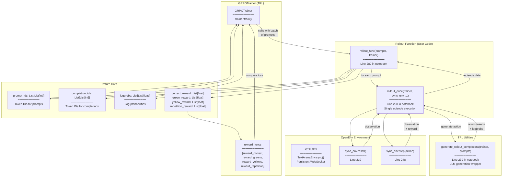
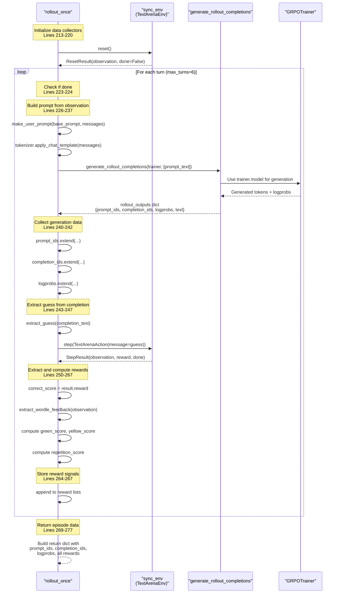
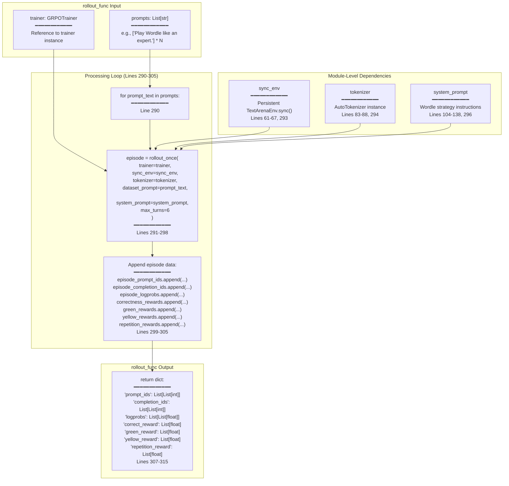
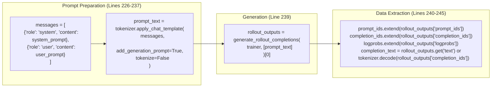
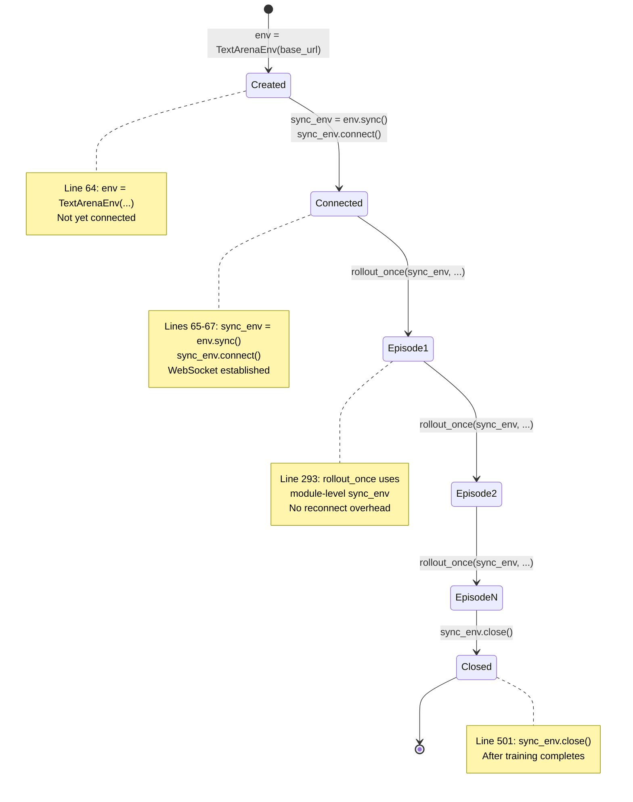
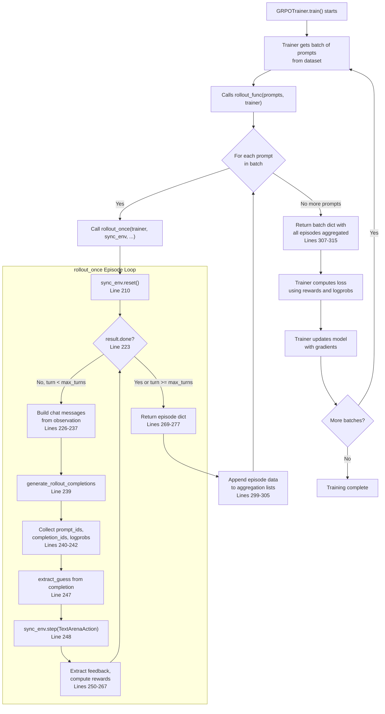

<!-- source: DeepWiki mcp.deepwiki.com · repo huggingface/openenv-course · page 6.2 Rollout Functions and Environment Interaction · fetched 2026-10-26 -->

# Rollout Functions and Environment Interaction

<details>
<summary>Relevant source files</summary>

The following files were used as context for generating this wiki page:

- [module-5/README.md](module-5/README.md)
- [module-5/notebook.ipynb](module-5/notebook.ipynb)

</details>


## Purpose and Scope

This page documents the **rollout function** architecture that bridges `GRPOTrainer` from TRL and OpenEnv environments during reinforcement learning training. The rollout function is the integration point where LLM generation meets environment interaction, executing episodes and collecting the data needed for policy optimization.

**Scope:**
- The `rollout_func` interface contract expected by `GRPOTrainer`
- Implementation of `rollout_once` for single episode execution
- The `generate_rollout_completions` utility from TRL
- Data collection patterns (prompt_ids, completion_ids, logprobs, rewards)
- Persistent WebSocket connection management for training throughput

**Related pages:**
- For GRPO algorithm mechanics and TRL configuration, see [GRPO Algorithm and TRL Integration](#6.1)
- For reward function design and multi-signal rewards, see [Multi-Signal Reward Design](#6.3)
- For system prompt engineering and state formatting, see [System Prompts and LLM Strategy](#6.4)
- For complete training workflow, see [Wordle Training Case Study](#6.6)

Sources: [module-5/notebook.ipynb:1-610](), [module-5/README.md:1-178]()

---

## The Rollout Function Interface Contract

`GRPOTrainer` expects a rollout function with a specific signature and return format. This function is called during training to generate episodes and collect training data.

### Function Signature

```python
def rollout_func(prompts: list[str], trainer=None) -> dict
```

**Inputs:**
- `prompts`: List of prompt strings from the training dataset
- `trainer`: Reference to the `GRPOTrainer` instance (needed for `generate_rollout_completions`)

**Output dictionary structure:**
- `prompt_ids`: List of lists of token IDs for prompts (one list per episode)
- `completion_ids`: List of lists of token IDs for completions (one list per episode)
- `logprobs`: List of lists of log probabilities for generated tokens (one list per episode)
- `{reward_name}_reward`: List of reward values (one per episode) for each reward function

### Interface Diagram



**Key interface requirements:**
1. All reward keys must end with `_reward` suffix
2. Reward keys must match the names of functions passed to `reward_funcs` parameter
3. Lists must be parallel (same length, corresponding by index)
4. Each episode produces one reward value per reward function

Sources: [module-5/notebook.ipynb:280-318](), [module-5/README.md:16-35]()

---

## Episode Execution with rollout_once

The `rollout_once` function executes a single episode from reset to termination, collecting all data needed for training.

### Implementation Structure

The function at [module-5/notebook.ipynb:208-277]() implements the following pattern:

| Phase | Operations | Lines |
|-------|-----------|-------|
| **Initialization** | Reset environment, initialize data collectors | 210-220 |
| **Episode Loop** | Generate action → Step environment → Collect data | 222-268 |
| **Termination** | Return aggregated episode data | 269-277 |

### Episode Flow Diagram



### Data Collection Pattern

The function maintains separate lists for each type of data:

```python
# Line 213-220: Initialize collectors
prompt_ids = []           # Token IDs for all prompts in episode
completion_ids = []       # Token IDs for all completions in episode
logprobs = []            # Log probabilities for all generated tokens
green_scores = []        # Per-turn green letter rewards
yellow_scores = []       # Per-turn yellow letter rewards
repetition_scores = []   # Per-turn repetition penalties
correct_scores = []      # Per-turn correctness rewards
```

After each turn [module-5/notebook.ipynb:240-267]():
1. Extend token lists with generation output
2. Extract feedback from environment observation
3. Compute reward signals
4. Append rewards to per-turn lists

Final return [module-5/notebook.ipynb:269-277]() uses the last reward from each list (terminal reward):
```python
return {
    'prompt_ids': prompt_ids,           # All tokens
    'completion_ids': completion_ids,   # All tokens
    'logprobs': logprobs,              # All tokens
    'correct_reward': correct_scores[-1],      # Terminal only
    'green_reward': green_scores[-1],          # Terminal only
    'yellow_reward': yellow_scores[-1],        # Terminal only
    'repetition_reward': repetition_scores[-1], # Terminal only
}
```

**Why terminal rewards only?** The GRPO algorithm optimizes based on episode outcomes. While the function collects per-turn rewards, only the final values are returned because GRPO treats the entire episode as a single trajectory.

Sources: [module-5/notebook.ipynb:208-277]()

---

## Batch Processing with rollout_func

The `rollout_func` wrapper [module-5/notebook.ipynb:280-318]() processes multiple prompts in parallel batches, calling `rollout_once` for each and aggregating results.

### Implementation Pattern



### Key Design Decisions

**1. Module-level environment reuse** [module-5/notebook.ipynb:293]()

```python
def rollout_func(prompts, trainer=None):
    # ...
    episode = rollout_once(
        trainer=trainer,
        sync_env=sync_env,     # Module-level persistent connection
        # ...
    )
```

The `sync_env` variable is defined at module scope [module-5/notebook.ipynb:61-67]() and reused across all episodes. This avoids reconnecting the WebSocket for every episode, which would be a major throughput bottleneck.

**2. Closure over configuration**

The function closes over `tokenizer` [module-5/notebook.ipynb:294]() and `system_prompt` [module-5/notebook.ipynb:296](), which are also module-level variables. This keeps the `rollout_func` signature clean while allowing configuration.

**3. Parallel aggregation**

Results are aggregated into parallel lists [module-5/notebook.ipynb:282-288]():
```python
episode_prompt_ids = []        # One entry per prompt
episode_completion_ids = []    # One entry per prompt
episode_logprobs = []          # One entry per prompt
correctness_rewards = []       # One entry per prompt
green_rewards = []             # One entry per prompt
yellow_rewards = []            # One entry per prompt
repetition_rewards = []        # One entry per prompt
```

Each list has length equal to `len(prompts)`, with corresponding indices representing the same episode.

Sources: [module-5/notebook.ipynb:280-318]()

---

## generate_rollout_completions Utility

The `generate_rollout_completions` function [module-5/notebook.ipynb:239]() is a TRL utility that wraps LLM generation during rollout execution.

### Function Interface

```python
from trl.experimental.openenv import generate_rollout_completions

rollout_outputs = generate_rollout_completions(
    trainer,      # GRPOTrainer instance
    [prompt_text] # List of prompt strings (usually length 1 during rollout)
)[0]  # Returns list, index into first element
```

### Output Structure

The returned dictionary contains:

| Key | Type | Description | Line Reference |
|-----|------|-------------|----------------|
| `prompt_ids` | `List[int]` | Token IDs for the prompt | 240 |
| `completion_ids` | `List[int]` | Token IDs for the generated completion | 241 |
| `logprobs` | `List[float]` | Log probabilities for each generated token | 242 |
| `text` | `str` (optional) | Decoded completion text | 243 |

### Usage Pattern



### Why This Utility Exists

`generate_rollout_completions` handles several concerns:
1. **Model access**: Uses the trainer's underlying model (which may be wrapped by vLLM in colocate mode)
2. **Token extraction**: Returns not just text but token IDs and logprobs needed for training
3. **Batching**: Can handle multiple prompts efficiently (though typically called with single prompts during episode execution)
4. **Compatibility**: Abstracts over different generation backends (standard transformers vs vLLM)

**Important:** The function must be called with the `trainer` argument to access the correct model state during training. Direct model.generate() calls would not work during training steps.

Sources: [module-5/notebook.ipynb:239-245](), [module-5/README.md:111-112]()

---

## Persistent Environment Connection Pattern

Training throughput depends critically on reusing WebSocket connections across episodes rather than reconnecting for each episode.

### Connection Lifecycle



### Implementation Comparison

**❌ Inefficient: Per-Episode Context Manager**

```python
# This pattern opens/closes WebSocket for EVERY episode
def rollout_once_bad(trainer, env_url, ...):
    with TextArenaEnv(base_url=env_url).sync() as sync_env:
        result = sync_env.reset()
        for turn in range(max_turns):
            # ... episode logic
        return episode_data

# Called 1000+ times during training - creates 1000+ connections!
```

**✅ Efficient: Persistent Connection**

The notebook uses persistent connection pattern [module-5/notebook.ipynb:61-67]():

```python
# Create environment once at module level
env = TextArenaEnv(base_url=textarena_url)
sync_env = env.sync()
sync_env.connect()  # Single WebSocket connection
print('Persistent training connection established.')

# Use in rollout_func
def rollout_func(prompts, trainer=None):
    for prompt_text in prompts:
        episode = rollout_once(
            trainer=trainer,
            sync_env=sync_env,  # Reuse same connection
            # ...
        )
```

Then close after training completes [module-5/notebook.ipynb:501]():

```python
# Close the persistent environment connection before saving
sync_env.close()
```

### Why This Matters

**Throughput impact:**
- WebSocket handshake + TLS: ~10-50ms overhead
- Episode execution: ~100-500ms per episode
- With 1000 episodes: 10-50 seconds wasted vs ~100ms with persistent connection

**Resource impact:**
- Each connection consumes server resources (memory, file descriptors)
- Persistent connection: 1 server slot for entire training run
- Per-episode connection: 1000+ server slots (likely to hit concurrency limits)

### Context Manager vs Manual Connection

The `.sync()` method returns a synchronous wrapper that can be used in two ways:

**Context manager** (for short-lived operations) [module-5/notebook.ipynb:56-59]():
```python
# Automatically connects on enter, closes on exit
with TextArenaEnv(base_url=textarena_url).sync() as _check:
    result = _check.reset()
    print(f'Connected to: {textarena_url}')
```

**Manual connection** (for long-lived operations like training):
```python
sync_env = env.sync()
sync_env.connect()  # Explicit connect
# ... use sync_env for many episodes
sync_env.close()    # Explicit close when done
```

Sources: [module-5/notebook.ipynb:56-67](), [module-5/notebook.ipynb:293](), [module-5/notebook.ipynb:501]()

---

## Data Collection and Return Format

The rollout function must return data in a specific format that `GRPOTrainer` expects for policy optimization.

### Required Fields

| Field | Type | Description | Used For |
|-------|------|-------------|----------|
| `prompt_ids` | `List[List[int]]` | Token IDs for prompts | Policy gradient computation |
| `completion_ids` | `List[List[int]]` | Token IDs for completions | Policy gradient computation |
| `logprobs` | `List[List[float]]` | Log probabilities of generated tokens | Policy gradient computation |
| `{name}_reward` | `List[float]` | Reward values for each episode | Loss computation |

### Reward Key Convention

Reward keys must:
1. End with `_reward` suffix
2. Match the function names in `reward_funcs` parameter when creating `GRPOTrainer`

Example from [module-5/notebook.ipynb:433-445]():

```python
trainer = GRPOTrainer(
    model=model_name,
    reward_funcs=[
        reward_correct,      # Looks for "correct_reward" key
        reward_greens,       # Looks for "greens_reward" key  
        reward_yellows,      # Looks for "yellows_reward" key
        reward_repetition,   # Looks for "repetition_reward" key
    ],
    rollout_func=rollout_func,  # Must return matching keys
    # ...
)
```

The rollout function returns [module-5/notebook.ipynb:307-315]():

```python
return {
    'prompt_ids': episode_prompt_ids,
    'completion_ids': episode_completion_ids,
    'logprobs': episode_logprobs,
    'correct_reward': correctness_rewards,      # Matches reward_correct
    'green_reward': green_rewards,              # Matches reward_greens
    'yellow_reward': yellow_rewards,            # Matches reward_yellows
    'repetition_reward': repetition_rewards,    # Matches reward_repetition
}
```

### Token ID Structure

The token ID lists have nested structure reflecting multi-turn episodes:

```python
# For a batch of 2 episodes, where first episode had 3 turns and second had 2 turns:
prompt_ids = [
    [tok1, tok2, ..., tokN,   # Episode 1, Turn 1 prompt
     tok1, tok2, ..., tokM,   # Episode 1, Turn 2 prompt  
     tok1, tok2, ..., tokK],  # Episode 1, Turn 3 prompt
    [tok1, tok2, ..., tokP,   # Episode 2, Turn 1 prompt
     tok1, tok2, ..., tokQ]   # Episode 2, Turn 2 prompt
]

completion_ids = [
    [tok1, tok2, ..., tok8,   # Episode 1, Turn 1 completion
     tok1, tok2, ..., tok8,   # Episode 1, Turn 2 completion
     tok1, tok2, ..., tok8],  # Episode 1, Turn 3 completion
    [tok1, tok2, ..., tok8,   # Episode 2, Turn 1 completion
     tok1, tok2, ..., tok8]   # Episode 2, Turn 2 completion
]

logprobs = [
    [-0.1, -0.2, ..., -0.05,  # Episode 1, Turn 1 logprobs (one per completion token)
     -0.15, -0.1, ..., -0.08, # Episode 1, Turn 2 logprobs
     -0.12, -0.18, ..., -0.06],  # Episode 1, Turn 3 logprobs
    [-0.11, -0.19, ..., -0.07,  # Episode 2, Turn 1 logprobs
     -0.13, -0.17, ..., -0.09]  # Episode 2, Turn 2 logprobs
]
```

The outer list is parallel to the `prompts` input (one entry per episode). The inner structure depends on how many turns each episode takes.

### Reward Value Structure

Rewards are simpler - one scalar per episode:

```python
correct_reward = [1.0, 0.0]      # Episode 1 won, Episode 2 lost
green_reward = [1.0, 0.6]        # Episode 1 perfect, Episode 2 partial
yellow_reward = [0.0, 0.4]       # Episode 1 none, Episode 2 some
repetition_reward = [0.8, 0.5]   # Episode 1 low repetition, Episode 2 moderate
```

Sources: [module-5/notebook.ipynb:269-277](), [module-5/notebook.ipynb:307-315](), [module-5/notebook.ipynb:433-445]()

---

## Complete Implementation Walkthrough

### Step-by-Step Execution Flow



### Code Entity Mapping

| Concept | Code Entity | Location |
|---------|-------------|----------|
| **Episode execution** | `rollout_once(trainer, sync_env, tokenizer, dataset_prompt, system_prompt, max_turns)` | [module-5/notebook.ipynb:208]() |
| **Batch processing** | `rollout_func(prompts, trainer=None)` | [module-5/notebook.ipynb:280]() |
| **LLM generation** | `generate_rollout_completions(trainer, [prompt_text])` | [module-5/notebook.ipynb:239]() |
| **Environment reset** | `sync_env.reset()` | [module-5/notebook.ipynb:210]() |
| **Environment step** | `sync_env.step(TextArenaAction(message=guess))` | [module-5/notebook.ipynb:248]() |
| **Prompt building** | `make_user_prompt(prompt_text, messages)` | [module-5/notebook.ipynb:154]() |
| **Chat formatting** | `tokenizer.apply_chat_template(messages, ...)` | [module-5/notebook.ipynb:232]() |
| **Guess extraction** | `extract_guess(completion_text)` | [module-5/notebook.ipynb:247]() |
| **Feedback parsing** | `extract_wordle_feedback(observation)` | [module-5/notebook.ipynb:251]() |
| **Feedback counting** | `extract_feedback_counts(feedback)` | [module-5/notebook.ipynb:260]() |
| **Data collection** | Lists at [module-5/notebook.ipynb:213-220]() | Initialized at episode start |
| **Episode return** | Dictionary at [module-5/notebook.ipynb:269-277]() | Returned from `rollout_once` |
| **Batch return** | Dictionary at [module-5/notebook.ipynb:307-315]() | Returned from `rollout_func` |
| **Persistent connection** | `sync_env` at module level | [module-5/notebook.ipynb:61-67]() |
| **Trainer integration** | `GRPOTrainer(..., rollout_func=rollout_func)` | [module-5/notebook.ipynb:433-445]() |

### Critical Implementation Details

**1. Token accumulation across turns** [module-5/notebook.ipynb:240-242]()

```python
# Each turn extends (not replaces) the lists
prompt_ids.extend(rollout_outputs['prompt_ids'])
completion_ids.extend(rollout_outputs['completion_ids'])
logprobs.extend(rollout_outputs['logprobs'])
```

This builds a flat sequence of all tokens from all turns in the episode, which GRPO uses for policy gradient computation.

**2. Terminal reward extraction** [module-5/notebook.ipynb:273-276]()

```python
# Only return the last reward from each list
'correct_reward': correct_scores[-1] if correct_scores else 0.0,
'green_reward': green_scores[-1] if green_scores else 0.0,
'yellow_reward': yellow_scores[-1] if yellow_scores else 0.0,
'repetition_reward': repetition_scores[-1] if repetition_scores else 0.0,
```

The function tracks rewards at every turn but returns only the terminal reward because GRPO treats the episode as a whole.

**3. Fallback text decoding** [module-5/notebook.ipynb:243-245]()

```python
completion_text = rollout_outputs.get('text') or tokenizer.decode(
    rollout_outputs['completion_ids'], skip_special_tokens=True
)
```

`generate_rollout_completions` may or may not include decoded text, so the code falls back to decoding from token IDs if needed.

**4. Guess count tracking** [module-5/notebook.ipynb:253-255]()

```python
previous_occurrences = guess_counts[guess]
repetition_score = max(0.0, 1.0 - previous_occurrences)
guess_counts[guess] += 1
```

A `defaultdict(int)` tracks how many times each guess has been used in the episode, enabling the repetition penalty.

Sources: [module-5/notebook.ipynb:208-318]()

---

