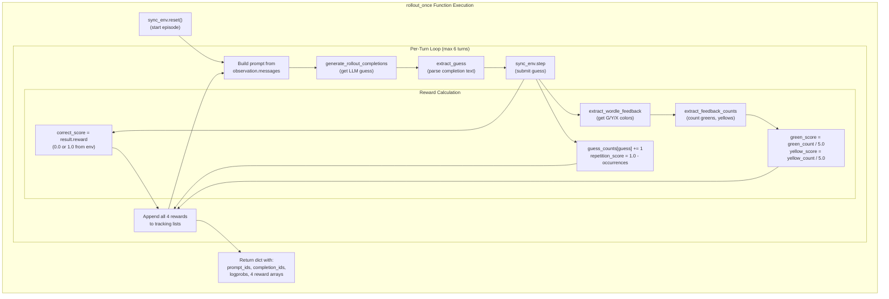
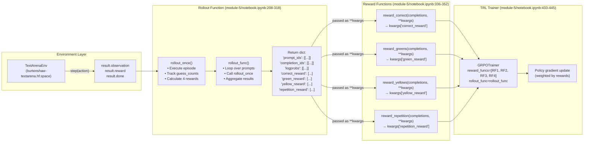
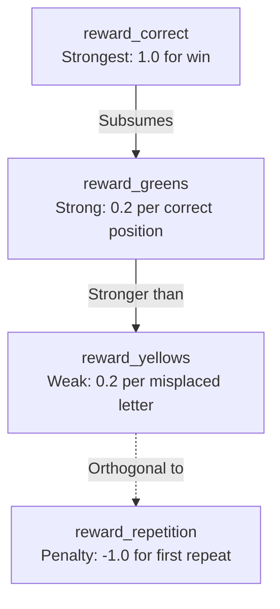

<!-- source: DeepWiki mcp.deepwiki.com · repo huggingface/openenv-course · page 6.3 Multi-Signal Reward Design · fetched 2026-10-26 -->

# Multi-Signal Reward Design

<details>
<summary>Relevant source files</summary>

The following files were used as context for generating this wiki page:

- [module-5/README.md](module-5/README.md)
- [module-5/notebook.ipynb](module-5/notebook.ipynb)

</details>


## Purpose and Scope

This page documents the multi-signal reward design pattern used in GRPO training with OpenEnv environments. It explains why multiple reward functions provide richer learning signals than binary win/loss outcomes, details the four reward functions used in the Wordle training example, and shows how rewards flow from environment observations through the rollout function to the GRPOTrainer.

For the broader GRPO training context and rollout function mechanics, see [GRPO Algorithm and TRL Integration](#6.1) and [Rollout Functions and Environment Interaction](#6.2). For system prompt design and LLM strategy, see [System Prompts and LLM Strategy](#6.4).

---

## The Sparse Reward Problem

Standard reinforcement learning environments often provide binary outcomes: the agent either wins (reward = 1.0) or loses (reward = 0.0). For complex tasks like Wordle, where the model must make 6 sequential decisions to reach a win state, this creates a **sparse reward problem**. The model receives no learning signal from failed episodes, making gradient updates inefficient.

Multi-signal reward design solves this by extracting multiple reward components from each episode:
- **Task completion reward**: Binary win/loss (sparse)
- **Progress rewards**: Intermediate signals that measure partial success (dense)
- **Penalty rewards**: Discourage unwanted behaviors (dense)

This approach provides gradient information even when the model doesn't achieve the primary objective, accelerating learning.

**Sources:** [module-5/README.md:79-90](), [module-5/notebook.ipynb:325-353]()

---

## Wordle Reward Functions: The Four Signals

The Wordle training pipeline defines four reward functions that measure different aspects of model performance:

| Reward Function | Signal Type | Range | Purpose |
|----------------|-------------|-------|---------|
| `reward_correct` | Task Completion | 0.0 or 1.0 | Binary win signal when model solves the puzzle |
| `reward_greens` | Progress (Strong) | 0.0 to 1.0 | Proportion of letters in correct positions (green feedback) |
| `reward_yellows` | Progress (Weak) | 0.0 to 1.0 | Proportion of letters in wrong positions (yellow feedback) |
| `reward_repetition` | Penalty | 0.0 to 1.0 | Penalizes guessing the same word multiple times |

The functions are implemented as simple extractors that retrieve pre-calculated values from the rollout data:

[module-5/notebook.ipynb:336-352]()

```python
def reward_correct(completions, **kwargs):
    rewards = kwargs.get("correct_reward")
    return [float(r) for r in rewards] if rewards else [0.0] * len(completions)

def reward_greens(completions, **kwargs):
    rewards = kwargs.get("green_reward")
    return [float(r) for r in rewards] if rewards else [0.0] * len(completions)

def reward_yellows(completions, **kwargs):
    rewards = kwargs.get("yellow_reward")
    return [float(r) for r in rewards] if rewards else [0.0] * len(completions)

def reward_repetition(completions, **kwargs):
    rewards = kwargs.get("repetition_reward")
    return [float(r) for r in rewards] if rewards else [0.0] * len(completions)
```

These functions follow the TRL reward function interface: they accept `completions` (generated text) and `**kwargs` (additional data from rollout), and return a list of floats. The actual reward computation happens during episode execution.

**Sources:** [module-5/notebook.ipynb:336-352](), [module-5/README.md:79-90]()

---

## Reward Calculation During Rollout

### Episode-Level Reward Tracking

The `rollout_once` function executes a single Wordle episode and calculates all four reward signals at each turn. Rewards are accumulated in lists and returned for the trainer to use:



**Diagram: Reward Calculation Flow in rollout_once**

The key calculation logic appears at [module-5/notebook.ipynb:247-267]():

```python
guess = extract_guess(completion_text)
result = sync_env.step(TextArenaAction(message=guess))
observation = result.observation
correct_score = float(result.reward or 0.0)  # Binary from environment
feedback = extract_wordle_feedback(observation)

previous_occurrences = guess_counts[guess]
repetition_score = max(0.0, 1.0 - previous_occurrences)
guess_counts[guess] += 1

if not feedback:
    green_score, yellow_score = 0.0, 0.0
else:
    green_count, yellow_count = extract_feedback_counts(feedback)
    green_score = green_count / 5.0  # Normalize to [0, 1]
    yellow_score = yellow_count / 5.0

repetition_scores.append(repetition_score)
green_scores.append(green_score)
yellow_scores.append(yellow_score)
correct_scores.append(correct_score)
```

### Reward Components Breakdown

**1. Correct Reward (Binary Task Completion)**

Extracted directly from the environment's `result.reward` field. The TextArena Wordle environment returns 1.0 when the model guesses the correct word, 0.0 otherwise.

**2. Green Reward (Position-Correct Letters)**

Wordle provides feedback in the format "GYGXX" where G = green (correct position), Y = yellow (wrong position), X = gray (not in word). The green reward counts how many G's appear and normalizes by dividing by 5 (the word length):

```
green_count = feedback.count('G')
green_score = green_count / 5.0
```

This produces values in [0.0, 1.0] where 1.0 means all 5 letters are in correct positions.

**3. Yellow Reward (Position-Incorrect Letters)**

Similarly counts Y's in the feedback:

```
yellow_count = feedback.count('Y')
yellow_score = yellow_count / 5.0
```

Yellow letters indicate the model is finding correct letters but placing them incorrectly, a weaker signal than green.

**4. Repetition Penalty**

Tracks how many times each guess has been used via `guess_counts[guess]`. The penalty decreases linearly:

```python
repetition_score = max(0.0, 1.0 - previous_occurrences)
```

First occurrence: 1.0 (no penalty)
Second occurrence: 0.0 (full penalty)
Third+ occurrence: 0.0 (capped)

The simplified version at [module-5/notebook.ipynb:253-255]() differs slightly from the `scale_repetition_score` helper function at [module-5/notebook.ipynb:177-181](), but both implement a linear decay strategy.

**Sources:** [module-5/notebook.ipynb:247-267](), [module-5/notebook.ipynb:177-184]()

---

## Reward Flow Architecture

### From Environment to Trainer

The following diagram shows how reward data flows through the system, connecting code entities across the rollout function, reward functions, and GRPOTrainer:



**Diagram: End-to-End Reward Data Flow**

### Reward Function Call Convention

The GRPOTrainer calls each reward function with two arguments:
1. `completions`: List of generated text strings (though the Wordle reward functions ignore this)
2. `**kwargs`: Dictionary containing the return value from `rollout_func`

This interface allows reward functions to access arbitrary data computed during rollout. In the Wordle example, the rollout function pre-calculates all rewards and stores them in the return dictionary with keys `correct_reward`, `green_reward`, `yellow_reward`, and `repetition_reward`.

The trainer instantiation at [module-5/notebook.ipynb:433-445]() wires everything together:

```python
trainer = GRPOTrainer(
    model=model_name,
    processing_class=tokenizer,
    reward_funcs=[
        reward_correct,
        reward_greens,
        reward_yellows,
        reward_repetition,
    ],
    train_dataset=dataset,
    args=grpo_config,
    rollout_func=rollout_func,
)
```

**Sources:** [module-5/notebook.ipynb:208-318](), [module-5/notebook.ipynb:336-352](), [module-5/notebook.ipynb:433-445]()

---

## Reward Shaping Principles

### Normalization Strategy

All four reward signals are normalized to the [0.0, 1.0] range:

| Signal | Normalization Method | Raw Range | Normalized |
|--------|---------------------|-----------|------------|
| Correct | Direct from environment | {0, 1} | [0.0, 1.0] |
| Greens | Divide by word length | {0, 1, 2, 3, 4, 5} | [0.0, 0.2, 0.4, 0.6, 0.8, 1.0] |
| Yellows | Divide by word length | {0, 1, 2, 3, 4, 5} | [0.0, 0.2, 0.4, 0.6, 0.8, 1.0] |
| Repetition | Linear decay | {0, 1, 2, ...} | [1.0, 0.0, 0.0, ...] |

Normalization ensures all signals have comparable magnitudes, preventing any single reward from dominating the gradient updates.

### Progressive Signal Hierarchy

The reward signals form a natural hierarchy of feedback strength:



**Diagram: Reward Signal Hierarchy**

- **Correct** subsumes all other signals (if correct = 1.0, greens = 1.0 by definition)
- **Greens** provide stronger feedback than **yellows** (correct position > wrong position)
- **Repetition** penalizes independently of task performance

This hierarchy allows the model to learn incrementally: first avoid repetitions, then maximize yellows (find correct letters), then maximize greens (place letters correctly), finally achieve correct (solve the puzzle).

### Temporal Credit Assignment

The `rollout_once` function returns the **final turn's rewards** for each signal:

[module-5/notebook.ipynb:269-277]()

```python
return {
    'prompt_ids': prompt_ids,
    'completion_ids': completion_ids,
    'logprobs': logprobs,
    'correct_reward': correct_scores[-1] if correct_scores else 0.0,
    'green_reward': green_scores[-1] if green_scores else 0.0,
    'yellow_reward': yellow_scores[-1] if yellow_scores else 0.0,
    'repetition_reward': repetition_scores[-1] if repetition_scores else 0.0,
}
```

This design assigns credit to the **entire episode trajectory** based on the outcome of the last action. Alternative strategies (e.g., summing rewards across all turns, or returning per-turn rewards) are possible but would require modifications to both `rollout_once` and the reward function interface.

**Sources:** [module-5/notebook.ipynb:269-277](), [module-5/README.md:79-90]()

---

## Implementation Details

### Feedback Parsing Utilities

The reward calculation relies on utility functions from `envs.textarena_env.rewards`:

**`extract_wordle_feedback(observation)`**

Parses the observation's message history to find the most recent Wordle feedback string (e.g., "GYGXX"). Implementation not shown in the notebook but imported at [module-5/notebook.ipynb:204]().

**`extract_feedback_counts(feedback)`**

Counts the number of green and yellow letters in a feedback string:

```python
green_count = feedback.count('G')
yellow_count = feedback.count('Y')
return green_count, yellow_count
```

Imported at [module-5/notebook.ipynb:204]().

**`extract_guess(completion_text)`**

Extracts the guess from the LLM's completion text by finding content within square brackets:

```python
# Example: "[crane]" → "crane"
```

Used at [module-5/notebook.ipynb:247]() and imported at [module-5/notebook.ipynb:204]().

### Repetition Tracking with `guess_counts`

The repetition penalty uses a `defaultdict(int)` to track guess frequency:

[module-5/notebook.ipynb:220]()

```python
guess_counts = defaultdict(int)
```

For each guess:

[module-5/notebook.ipynb:253-255]()

```python
previous_occurrences = guess_counts[guess]
repetition_score = max(0.0, 1.0 - previous_occurrences)
guess_counts[guess] += 1
```

This creates a per-episode memory that accumulates across turns. The score decays linearly:
- First use: `previous_occurrences = 0`, `score = 1.0`
- Second use: `previous_occurrences = 1`, `score = 0.0`
- Third+ use: `previous_occurrences ≥ 2`, `score = 0.0` (capped by `max`)

An alternative implementation `scale_repetition_score` exists at [module-5/notebook.ipynb:177-181]() with a more general formulation:

```python
def scale_repetition_score(previous_occurrences, max_occurrences):
    """Scale repetition penalty: 1.0 = novel guess, 0.0 = fully repeated."""
    if max_occurrences == 0:
        return 0.0
    return (max_occurrences - previous_occurrences) / max_occurrences
```

This allows configurable maximum occurrences, but the notebook uses the simpler linear decay.

### Reward Aggregation Pattern

The `rollout_func` aggregates rewards from multiple episodes:

[module-5/notebook.ipynb:280-315]()

```python
def rollout_func(prompts, trainer=None):
    """Rollout function called by GRPOTrainer. Uses the module-level sync_env."""
    episode_prompt_ids = []
    episode_completion_ids = []
    episode_logprobs = []
    correctness_rewards = []
    green_rewards = []
    yellow_rewards = []
    repetition_rewards = []

    for prompt_text in prompts:
        episode = rollout_once(...)
        episode_prompt_ids.append(episode['prompt_ids'])
        episode_completion_ids.append(episode['completion_ids'])
        episode_logprobs.append(episode['logprobs'])
        correctness_rewards.append(episode['correct_reward'])
        green_rewards.append(episode['green_reward'])
        yellow_rewards.append(episode['yellow_reward'])
        repetition_rewards.append(episode['repetition_reward'])

    return {
        'prompt_ids': episode_prompt_ids,
        'completion_ids': episode_completion_ids,
        'logprobs': episode_logprobs,
        'correct_reward': correctness_rewards,
        'green_reward': green_rewards,
        'yellow_reward': yellow_rewards,
        'repetition_reward': repetition_rewards,
    }
```

This converts per-episode rewards into batched lists that the reward functions can index into.

**Sources:** [module-5/notebook.ipynb:177-184](), [module-5/notebook.ipynb:202-318]()

---

## Design Trade-offs and Alternatives

### Current Design: Pre-Calculated Rewards

The Wordle implementation calculates all rewards during `rollout_once` and stores them in the return dictionary. The reward functions then simply extract these pre-calculated values.

**Advantages:**
- Reward calculation has full access to episode state (observation history, guess_counts)
- Efficient: compute once, use multiple times
- Debugging: can inspect reward values before they reach the trainer

**Disadvantages:**
- Tight coupling between rollout_func and reward functions (must agree on key names)
- Reward functions can't inspect `completions` (though Wordle doesn't need this)

### Alternative: Reward Functions Calculate Directly

An alternative pattern would pass raw observations/feedback to reward functions:

```python
def rollout_once(...):
    # Store feedback history instead of pre-calculating rewards
    return {
        'prompt_ids': ...,
        'completion_ids': ...,
        'logprobs': ...,
        'feedbacks': [feedback1, feedback2, ...],  # Raw observation data
    }

def reward_greens(completions, **kwargs):
    feedbacks = kwargs['feedbacks']
    final_feedback = feedbacks[-1]
    green_count = final_feedback.count('G')
    return [green_count / 5.0] * len(completions)
```

This decouples reward logic from rollout execution but loses access to stateful information like `guess_counts`.

### Weighting Multiple Rewards

The GRPOTrainer combines multiple reward signals, but the relative weighting is implicit. The current design treats all four signals equally. To emphasize certain signals, you could:

1. **Scale during calculation**: Multiply `green_score` by a weight factor
2. **Modify reward functions**: Return scaled values
3. **Configure GRPOConfig**: TRL may support reward weighting (check TRL documentation)

The equal-weight approach works because the signals are already normalized and hierarchical (correct subsumes greens, greens subsume yellows).

**Sources:** [module-5/notebook.ipynb:208-318](), [module-5/notebook.ipynb:336-352]()

---

## Extending to Custom Environments

To adapt this multi-signal pattern to your own environment:

### 1. Identify Extractable Signals

For any environment, consider:
- **Task completion**: Binary win/loss (if applicable)
- **Progress metrics**: Measurable steps toward completion
- **Quality metrics**: How well actions satisfy task requirements
- **Penalty metrics**: Behaviors to discourage

Example: A code generation environment might use:
- `reward_correct`: Code passes all tests
- `reward_partial_tests`: Proportion of passing tests
- `reward_syntax`: Valid syntax vs. syntax errors
- `reward_length`: Penalize excessively long solutions

### 2. Calculate During Rollout

Add tracking variables in `rollout_once`:

```python
def rollout_once(...):
    test_pass_counts = []
    syntax_valid_scores = []
    length_penalties = []
    
    for turn in range(max_turns):
        # ... environment interaction ...
        result = env.step(action)
        
        # Extract environment-specific metrics
        test_pass_count = extract_test_results(result.observation)
        syntax_valid = check_syntax(completion)
        length_penalty = calculate_length_penalty(completion)
        
        test_pass_counts.append(test_pass_count)
        syntax_valid_scores.append(syntax_valid)
        length_penalties.append(length_penalty)
    
    return {
        'prompt_ids': ...,
        'completion_ids': ...,
        'logprobs': ...,
        'test_reward': test_pass_counts[-1],
        'syntax_reward': syntax_valid_scores[-1],
        'length_reward': length_penalties[-1],
    }
```

### 3. Define Reward Functions

Create one function per signal:

```python
def reward_tests(completions, **kwargs):
    return kwargs.get('test_reward', [0.0] * len(completions))

def reward_syntax(completions, **kwargs):
    return kwargs.get('syntax_reward', [0.0] * len(completions))

def reward_length(completions, **kwargs):
    return kwargs.get('length_reward', [0.0] * len(completions))
```

### 4. Register with Trainer

```python
trainer = GRPOTrainer(
    reward_funcs=[reward_tests, reward_syntax, reward_length],
    rollout_func=rollout_func,
    ...
)
```

The key is ensuring reward functions can extract what `rollout_once` computes, using the `**kwargs` pass-through mechanism.

**Sources:** [module-5/notebook.ipynb:208-318](), [module-5/notebook.ipynb:336-352](), [module-5/notebook.ipynb:433-445]()

---

## Summary

Multi-signal reward design transforms sparse binary outcomes into rich gradient information by:

1. **Extracting multiple signals** from environment observations (correctness, progress, penalties)
2. **Normalizing to [0, 1]** for comparable magnitudes across signals
3. **Creating a hierarchy** where stronger signals (greens) subsume weaker ones (yellows)
4. **Pre-calculating in rollout** for efficiency and stateful tracking
5. **Passing via kwargs** to reward functions that the trainer calls

The Wordle example demonstrates this pattern with four signals (`reward_correct`, `reward_greens`, `reward_yellows`, `reward_repetition`), but the architecture generalizes to any OpenEnv environment. The key insight: even when the model fails the primary task, intermediate signals guide learning toward success.

**Sources:** [module-5/notebook.ipynb:1-610](), [module-5/README.md:79-90]()

---

