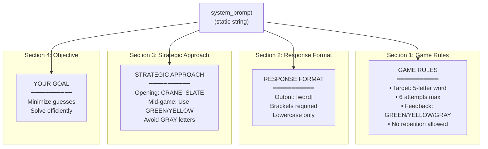
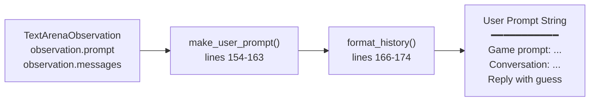
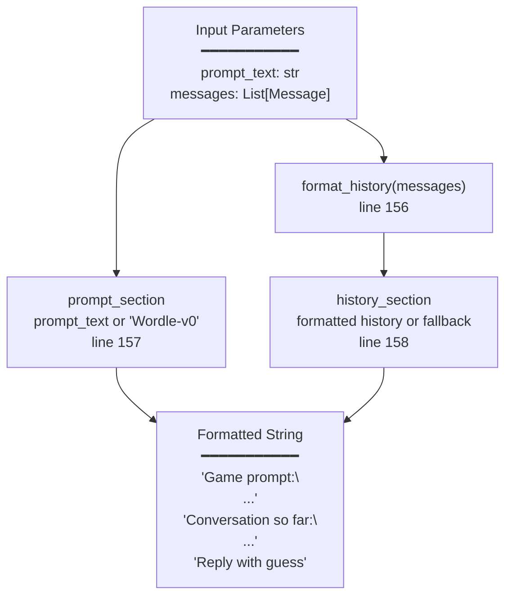
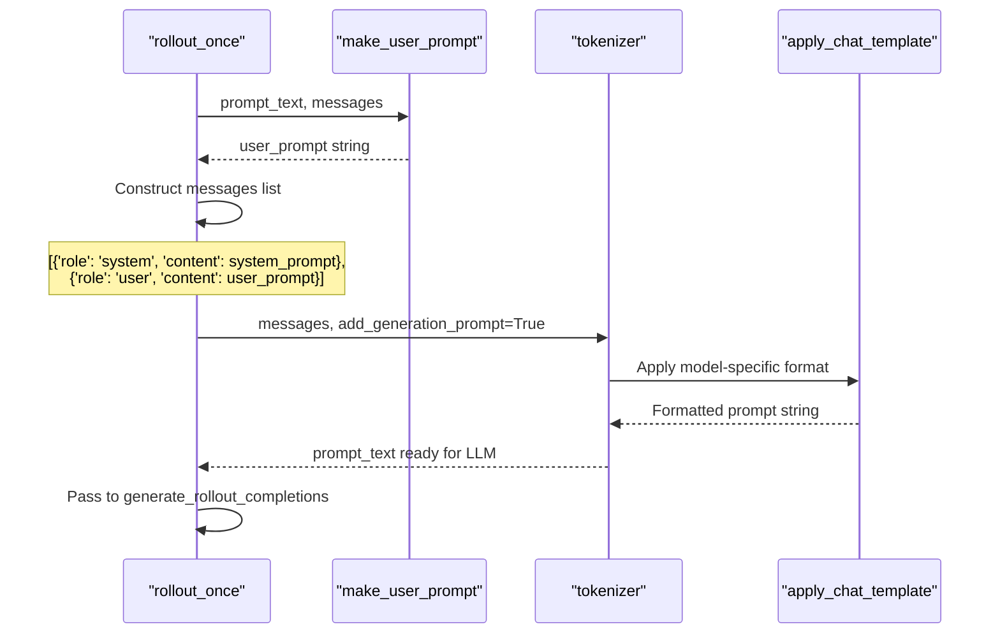
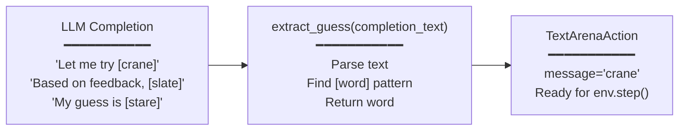
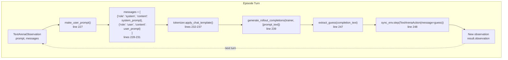
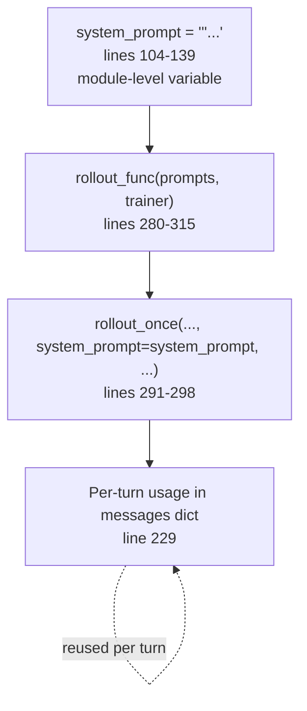
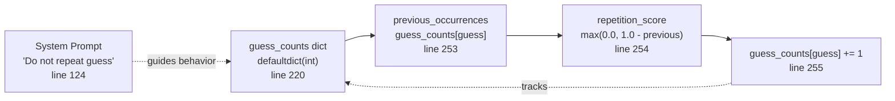

<!-- source: DeepWiki mcp.deepwiki.com · repo huggingface/openenv-course · page 6.4 System Prompts and LLM Strategy · fetched 2026-10-26 -->

# System Prompts and LLM Strategy

<details>
<summary>Relevant source files</summary>

The following files were used as context for generating this wiki page:

- [module-5/notebook.ipynb](module-5/notebook.ipynb)

</details>


This document describes the system prompt design and LLM interaction strategy used in Module 5's Wordle training example. It covers how game state is formatted into prompts, how strategic instructions guide model behavior, and how LLM outputs are parsed back into environment actions.

For the broader training loop context, see [Rollout Functions and Environment Interaction](#6.2). For reward signal design, see [Multi-Signal Reward Design](#6.3). For complete training configuration, see [Training Configuration and Optimization](#6.5).

## Overview: Prompt Engineering for RL Environments

The system prompt serves as the interface between the LLM's natural language capabilities and the structured environment. In OpenEnv's training pipeline, prompts perform three critical functions:

1. **Task specification**: Define game rules and objectives
2. **Strategy guidance**: Provide domain-specific heuristics
3. **Format enforcement**: Ensure outputs can be parsed into `Action` objects

The Wordle training example demonstrates a complete prompt engineering strategy that transforms environment observations into effective LLM inputs and parses LLM completions into valid game actions.

**Sources:** [module-5/notebook.ipynb:95-185]()

## System Prompt Architecture

### The System Prompt Structure

The system prompt is a static string defined once and reused across all episodes. It contains four sections:



**Diagram: System Prompt Components**

The system prompt remains constant across training. It is defined at [module-5/notebook.ipynb:104-139]() and includes:

| Section | Purpose | Example Content |
|---------|---------|-----------------|
| **Game Rules** | Establish constraints | "5-letter English word", "6 attempts", feedback colors |
| **Response Format** | Enable parsing | "respond with [guess]", brackets required |
| **Strategic Approach** | Provide heuristics | "Start with CRANE, SLATE", "Use GREEN in position" |
| **Objective** | Define success metric | "Solve in as few guesses as possible" |

**Sources:** [module-5/notebook.ipynb:104-139]()

### User Prompt Construction

While the system prompt is static, the user prompt is dynamically constructed from environment state:



**Diagram: User Prompt Construction Pipeline**

The `make_user_prompt` function at [module-5/notebook.ipynb:154-163]() builds the user prompt by:

1. **Extracting prompt text**: Uses `observation.prompt` or falls back to dataset prompt
2. **Formatting message history**: Calls `format_history(observation.messages)`
3. **Assembling sections**: Combines prompt text, history, and action request

**Sources:** [module-5/notebook.ipynb:154-163]()

## Prompt Construction Functions

### make_user_prompt: Assembling Game State



**Diagram: make_user_prompt Function Flow**

The function provides fallback values to handle edge cases:
- If `prompt_text` is empty, use `"Wordle-v0"`
- If message history is empty, use `"[PROMPT] Awaiting first feedback."`

This ensures the LLM always receives well-formed context, even on the first turn.

**Sources:** [module-5/notebook.ipynb:154-163]()

### format_history: Message List to String

The `format_history` function at [module-5/notebook.ipynb:166-174]() converts the `observation.messages` list into a tagged conversation format:

```python
# Input: List[Message] from observation.messages
# Output: String like:
#   "[FEEDBACK] Not a valid word."
#   "[FEEDBACK] crane: 🟨🟨⬜⬜🟩"
```

Each message is formatted with its category tag:
- Category from `message.category` (e.g., "FEEDBACK", "PROMPT")
- Content from `message.content`
- Empty messages are skipped

The tags help the LLM distinguish between different types of game feedback.

**Sources:** [module-5/notebook.ipynb:166-174]()

## Chat Template Application

The system and user prompts are combined using the tokenizer's chat template:



**Diagram: Chat Template Application Sequence**

The chat template application at [module-5/notebook.ipynb:232-237]() performs model-specific formatting:

| Parameter | Value | Purpose |
|-----------|-------|---------|
| `messages` | `[{'role': 'system', ...}, {'role': 'user', ...}]` | Structured conversation |
| `add_generation_prompt` | `True` | Append assistant turn prefix |
| `tokenize` | `False` | Return string, not tokens |
| `enable_thinking` | `False` | Disable reasoning tokens |

The output is a single string formatted according to the model's expected prompt structure (e.g., ChatML, Llama format).

**Sources:** [module-5/notebook.ipynb:232-237]()

## Strategy Elements in System Prompt

### Opening Strategy Heuristics

The system prompt at [module-5/notebook.ipynb:126-129]() provides explicit starting word recommendations:

```
### Opening Strategy
- Start with words rich in common vowels (A, E, I, O, U) and consonants (R, S, T, L, N)
- Optimal starters: CRANE, SLATE, STARE, AROSE, IRATE
```

These heuristics guide the LLM toward information-maximizing first guesses without requiring the model to discover optimal Wordle theory through trial and error.

**Sources:** [module-5/notebook.ipynb:126-129]()

### Mid-Game Strategy Rules

The mid-game section at [module-5/notebook.ipynb:130-134]() translates Wordle feedback into action rules:

```
### Mid-Game Strategy
- Use confirmed GREEN letters in their correct positions
- Place YELLOW letters in different positions than where they appeared
- Eliminate GRAY letters from consideration
```

This provides a logical framework for interpreting the color-coded feedback that appears in `observation.messages`.

**Sources:** [module-5/notebook.ipynb:130-134]()

### Format Enforcement

The response format section at [module-5/notebook.ipynb:118-121]() enforces parseable output:

```
## RESPONSE FORMAT

Only respond with your next guess in square brackets, e.g., [crane].
```

This instruction ensures the LLM output can be reliably parsed by `extract_guess()`.

**Sources:** [module-5/notebook.ipynb:118-121]()

## Output Parsing: extract_guess

The `extract_guess` function (imported from `envs.textarena_env.rewards`) extracts the word from LLM completions:



**Diagram: Output Parsing to Action**

The parsing occurs at [module-5/notebook.ipynb:247-248]():

```python
guess = extract_guess(completion_text)
result = sync_env.step(TextArenaAction(message=guess))
```

The function looks for the `[word]` pattern and extracts the word, enabling the conversion from natural language completion to structured `TextArenaAction`.

**Sources:** [module-5/notebook.ipynb:247-248]()

## Integration with Training Loop

### Prompt-to-Action Flow in rollout_once



**Diagram: Prompt Flow in Episode Turn**

This cycle repeats up to `max_turns=6` times per episode, as defined in the `rollout_once` function at [module-5/notebook.ipynb:208-278]().

**Sources:** [module-5/notebook.ipynb:208-278]()

### System Prompt Usage Across Episodes

The `system_prompt` variable is defined at module scope and reused:



**Diagram: System Prompt Lifecycle**

The system prompt is defined once and passed through the call stack:
1. Module-level definition at [module-5/notebook.ipynb:104-139]()
2. Passed to `rollout_once` at [module-5/notebook.ipynb:296]()
3. Used in messages dict at [module-5/notebook.ipynb:229]()

**Sources:** [module-5/notebook.ipynb:104-139,229,280-315]()

## Repetition Penalty Integration

While not part of the prompt itself, the system prompt explicitly instructs "Do not repeat the same guess twice" at [module-5/notebook.ipynb:124](). This is enforced via the repetition reward signal:



**Diagram: Repetition Tracking and Penalty**

The instruction in the prompt is reinforced by the `repetition_reward` signal (see [Multi-Signal Reward Design](#6.3)), creating alignment between prompt guidance and reward structure.

**Sources:** [module-5/notebook.ipynb:124,220,253-255]()

## Evaluation Mode Prompting

The same prompt construction functions are reused for evaluation at [module-5/notebook.ipynb:531-569]():

```python
def play_wordle(sync_env, model, tokenizer, max_turns=6):
    # ... reset environment ...
    user_prompt = make_user_prompt(observation.prompt, observation.messages)
    messages = [
        {'role': 'system', 'content': system_prompt},
        {'role': 'user', 'content': user_prompt},
    ]
    prompt_text = tokenizer.apply_chat_template(messages, ...)
    # ... generate with model.generate() ...
```

The identical prompt construction ensures training and inference use consistent formatting, preventing train-test mismatch.

**Sources:** [module-5/notebook.ipynb:531-569]()

## Summary: Prompt Engineering Strategy

| Component | Location | Purpose |
|-----------|----------|---------|
| `system_prompt` | [module-5/notebook.ipynb:104-139]() | Static task specification and strategy |
| `make_user_prompt` | [module-5/notebook.ipynb:154-163]() | Dynamic game state formatting |
| `format_history` | [module-5/notebook.ipynb:166-174]() | Message list to string conversion |
| `apply_chat_template` | [module-5/notebook.ipynb:232-237]() | Model-specific formatting |
| `extract_guess` | [module-5/notebook.ipynb:247]() | LLM output to action parsing |

The prompt engineering strategy bridges the gap between the LLM's text generation capabilities and the structured `TextArenaAction` objects required by the environment. The system prompt provides domain knowledge (Wordle strategy), the user prompt provides current state, and output parsing converts completions back to actions.

This pattern generalizes to other OpenEnv environments: define a system prompt with task rules and strategies, format observations into user prompts, and parse LLM outputs into environment-specific action types.

**Sources:** [module-5/notebook.ipynb:104-315]()

---

