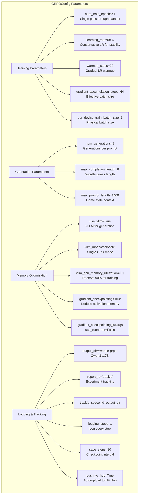
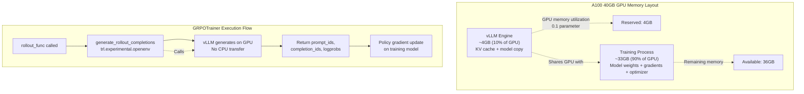
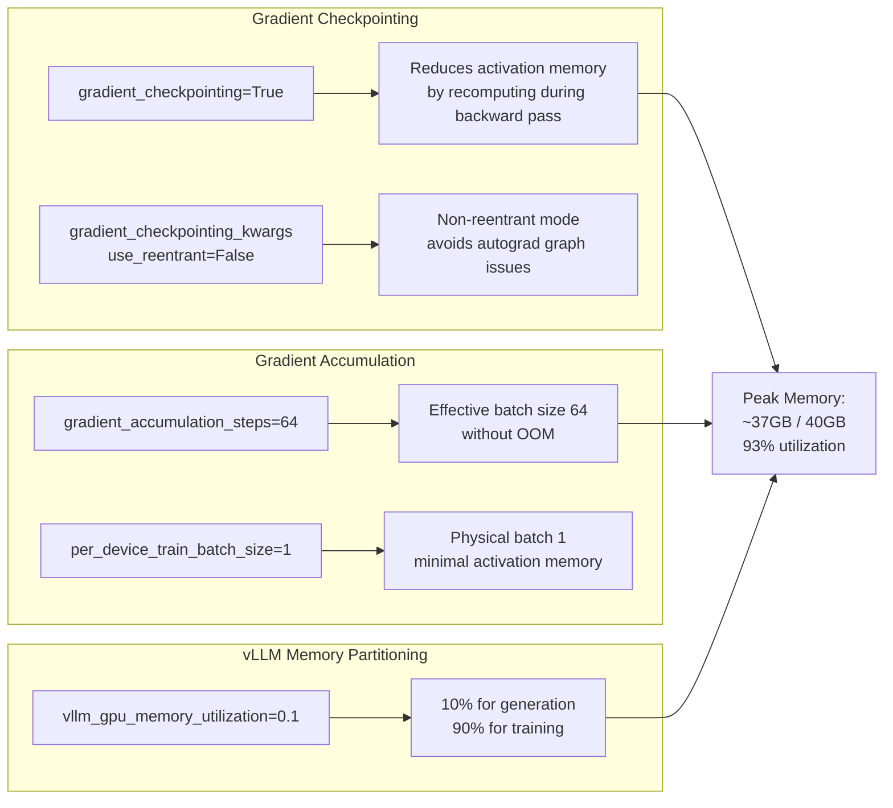
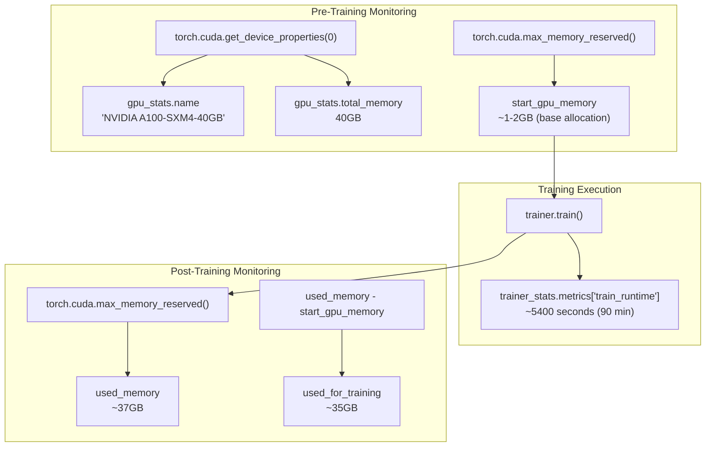
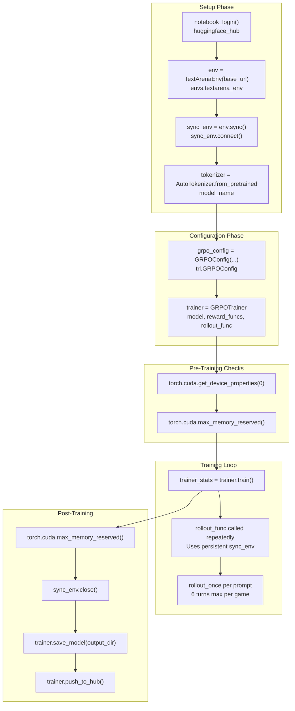

<!-- source: DeepWiki mcp.deepwiki.com · repo huggingface/openenv-course · page 6.5 Training Configuration and Optimization · fetched 2026-10-26 -->

# Training Configuration and Optimization

<details>
<summary>Relevant source files</summary>

The following files were used as context for generating this wiki page:

- [module-5/README.md](module-5/README.md)
- [module-5/notebook.ipynb](module-5/notebook.ipynb)

</details>


This document covers the technical configuration of GRPO training for LLMs using TRL and OpenEnv. It focuses on `GRPOConfig` parameters, vLLM integration for memory-efficient generation, gradient accumulation strategies, hardware requirements, and training execution monitoring.

For information about the GRPO algorithm itself, see [GRPO Algorithm and TRL Integration](#6.1). For environment interaction during training, see [Rollout Functions and Environment Interaction](#6.2). For the complete Wordle training implementation, see [Wordle Training Case Study](#6.6).

## GRPOConfig Parameter Overview

The `GRPOConfig` class controls all aspects of GRPO training. The configuration in the Wordle training example balances memory efficiency, training stability, and task-specific constraints.

**Configuration Diagram: GRPOConfig Parameter Groups**



**Sources:** [module-5/notebook.ipynb:388-416]()

### Training Hyperparameters

| Parameter | Value | Purpose |
|-----------|-------|---------|
| `num_train_epochs` | 1 | Single epoch through 1,000-prompt dataset |
| `learning_rate` | 5e-6 | Conservative rate prevents instability |
| `warmup_steps` | 20 | Linear warmup for first 20 steps |
| `gradient_accumulation_steps` | 64 | Effective batch size = 64 |
| `per_device_train_batch_size` | 1 | Physical batch size per GPU |

The effective batch size is `per_device_train_batch_size * gradient_accumulation_steps = 64`. This allows stable training without OOM on 40GB A100.

**Sources:** [module-5/notebook.ipynb:392-397](), [module-5/README.md:128-132]()

### Generation Parameters

| Parameter | Value | Task-Specific Rationale |
|-----------|-------|------------------------|
| `num_generations` | 2 | Generate 2 completions per prompt for group comparison |
| `max_completion_length` | 8 | Wordle guesses are ~7 tokens: `[crane]` |
| `max_prompt_length` | 1400 | System prompt + game history fits within context |

The `max_completion_length=8` is optimized for Wordle guesses which follow the format `[word]` (6 characters + brackets ≈ 7-8 tokens). Longer sequences waste GPU cycles.

**Sources:** [module-5/notebook.ipynb:398-400](), [module-5/README.md:147]()

## vLLM Integration and Colocate Mode

vLLM provides high-throughput LLM inference by using PagedAttention and continuous batching. The `colocate` mode runs vLLM's generation engine on the same GPU as the training process, eliminating CPU-GPU data transfer overhead.

**vLLM Colocate Architecture Diagram**



**Sources:** [module-5/notebook.ipynb:401-403](), [module-5/README.md:136-139](), [module-5/README.md:145-148]()

### vLLM Configuration Parameters

```python
use_vllm=True                      # Enable vLLM for generation
vllm_mode="colocate"               # Run on same GPU as training
vllm_gpu_memory_utilization=0.1   # Allocate 10% of GPU to vLLM
```

The `vllm_gpu_memory_utilization=0.1` parameter reserves 10% of GPU memory (~4GB on A100 40GB) for the vLLM KV cache and model copy. The remaining 90% is available for training model weights, gradients, optimizer states, and activations.

**Why Colocate?**
- **No CPU-GPU transfer:** Tokens stay on GPU between generation and training
- **Simplified deployment:** Single process, single GPU
- **Memory efficiency:** Shared memory pool reduces overhead
- **Sufficient for Wordle:** Short completions (8 tokens) don't need heavy KV cache

For tasks with longer completions (e.g., code generation), consider `vllm_mode="separate"` with dedicated inference GPUs.

**Sources:** [module-5/notebook.ipynb:401-403](), [module-5/README.md:145-146]()

## Memory Optimization Techniques

The training configuration uses three memory optimization strategies to fit Qwen3-1.7B training on a single A100 40GB.

**Memory Optimization Strategy Diagram**



**Sources:** [module-5/notebook.ipynb:409-410](), [module-5/notebook.ipynb:395-396](), [module-5/notebook.ipynb:401-403]()

### Gradient Checkpointing

```python
gradient_checkpointing=True
gradient_checkpointing_kwargs={"use_reentrant": False}
```

Gradient checkpointing trades compute for memory by:
1. **Forward pass:** Save only checkpoint activations (not all intermediate activations)
2. **Backward pass:** Recompute intermediate activations as needed

The `use_reentrant=False` setting uses PyTorch's newer non-reentrant checkpointing, which avoids issues with autograd graph construction and supports more operations.

**Memory Savings:** ~40% reduction in activation memory for transformer models.

**Sources:** [module-5/notebook.ipynb:409-410]()

### Gradient Accumulation

```python
gradient_accumulation_steps=64
per_device_train_batch_size=1
```

Gradient accumulation accumulates gradients over 64 micro-batches before updating weights. This provides the stability of a large batch size without the memory cost.

**Effective batch size:** `1 * 64 = 64`  
**Memory cost:** Only stores activations for 1 sample at a time  
**Training stability:** Equivalent to batch size 64 for gradient variance reduction

**Sources:** [module-5/notebook.ipynb:395-396]()

## Hardware Requirements and Resource Monitoring

The Wordle GRPO training requires an A100 40GB GPU. The notebook includes GPU memory monitoring before and after training.

**GPU Resource Monitoring Code Flow**



**Sources:** [module-5/notebook.ipynb:454-485]()

### GPU Memory Breakdown

The memory monitoring code at [module-5/notebook.ipynb:454-485]() reports:

| Metric | Value | Percentage |
|--------|-------|------------|
| Total GPU memory | 40GB | 100% |
| Baseline memory (before training) | ~1-2GB | 5% |
| Peak memory (during training) | ~37GB | 93% |
| Memory for training | ~35GB | 88% |

**Memory Allocation Breakdown:**
- **Model weights:** ~3.4GB (1.7B parameters × 2 bytes/param for float16)
- **Gradients:** ~3.4GB (same size as weights)
- **Optimizer states:** ~13.6GB (Adam stores 2 states per parameter)
- **Activations:** ~10GB (with gradient checkpointing)
- **vLLM KV cache:** ~4GB (10% of GPU)

**Sources:** [module-5/notebook.ipynb:478-484](), [module-5/README.md:150-154]()

### Training Time

```python
trainer_stats = trainer.train()
training_time = trainer_stats.metrics['train_runtime'] / 60  # Convert to minutes
# Result: ~90 minutes on A100 40GB
```

**Training throughput:**
- **Dataset size:** 1,000 prompts
- **Generations per prompt:** 2
- **Total episodes:** 2,000 Wordle games
- **Training time:** ~90 minutes
- **Throughput:** ~22 episodes/minute

**Sources:** [module-5/notebook.ipynb:468-469](), [module-5/notebook.ipynb:482](), [module-5/README.md:152]()

## Experiment Tracking and Logging

The configuration enables comprehensive experiment tracking using `trackio` and automatic model uploading to Hugging Face Hub.

### Logging Configuration

```python
report_to="trackio"               # Log to trackio experiment tracker
trackio_space_id=output_dir       # Use output_dir as space identifier
logging_steps=1                   # Log every training step
save_steps=10                     # Save checkpoint every 10 steps
push_to_hub=True                  # Auto-upload to HF Hub after training
```

**Sources:** [module-5/notebook.ipynb:405-411]()

### Tracked Metrics

The `GRPOTrainer` logs the following metrics at each step:

| Metric Category | Logged Values |
|----------------|---------------|
| **Rewards** | `correct_reward`, `green_reward`, `yellow_reward`, `repetition_reward` (per reward function) |
| **Training** | `loss`, `learning_rate`, `grad_norm` |
| **Generation** | `prompt_length`, `completion_length` |
| **Performance** | `step_time`, `samples_per_second` |

These metrics are logged to `trackio` with `logging_steps=1`, providing granular visibility into training dynamics.

**Sources:** [module-5/notebook.ipynb:407-408]()

### Model Persistence

```python
trainer.save_model(output_dir)           # Save to local directory
trainer.push_to_hub()                    # Upload to HF Hub
```

The `push_to_hub=True` configuration at [module-5/notebook.ipynb:411]() automatically pushes the trained model to Hugging Face Hub after training completes. The model is saved to the repository specified by `output_dir="wordle-grpo-Qwen3-1.7B"`.

**Sources:** [module-5/notebook.ipynb:503-505](), [module-5/notebook.ipynb:411]()

## Training Execution and Error Handling

The training execution follows a specific sequence to ensure proper resource management and error handling.

**Training Execution Flow with Code Entities**



**Sources:** [module-5/notebook.ipynb:29-67](), [module-5/notebook.ipynb:388-445](), [module-5/notebook.ipynb:454-505]()

### Persistent Environment Connection

The environment connection pattern is critical for training throughput:

```python
# Create environment client
env = TextArenaEnv(base_url=textarena_url)

# Create persistent sync wrapper
sync_env = env.sync()
sync_env.connect()  # Single WebSocket connection for entire training

# Training uses this persistent connection
trainer.train()     # rollout_func uses sync_env

# Close after training
sync_env.close()
```

**Why persistent connection?**
- **Performance:** Opening/closing WebSocket per episode adds ~100ms overhead
- **Throughput:** 2,000 episodes × 100ms = 3.3 minutes wasted
- **Stability:** Reduces connection errors during long training runs

The comment at [module-5/notebook.ipynb:61-63]() explicitly notes: "A single WebSocket connection is reused across all rollouts instead of opening/closing one per episode, which matters at training throughput."

**Sources:** [module-5/notebook.ipynb:51-67](), [module-5/notebook.ipynb:293]()

### Error Recovery

The training configuration does not implement explicit error recovery, but the design minimizes failure points:

1. **Pre-training validation:** Environment connection test at [module-5/notebook.ipynb:56-59]()
2. **Gradient checkpointing:** Non-reentrant mode prevents autograd errors
3. **Regular checkpoints:** `save_steps=10` minimizes data loss on crash
4. **Persistent connection:** Single connection reduces network failures

**Sources:** [module-5/notebook.ipynb:56-59](), [module-5/notebook.ipynb:409-410](), [module-5/notebook.ipynb:408]()

## Configuration Trade-offs and Alternatives

The Wordle training configuration makes specific trade-offs optimized for the task. Alternative configurations may be better for different scenarios.

### Task-Specific Configurations

| Task Type | `max_completion_length` | `gradient_accumulation_steps` | `vllm_gpu_memory_utilization` |
|-----------|------------------------|------------------------------|------------------------------|
| **Wordle** (short guesses) | 8 | 64 | 0.1 |
| **Code generation** (long programs) | 512 | 8 | 0.4 |
| **Reasoning** (chain-of-thought) | 256 | 16 | 0.3 |
| **Dialog** (multi-turn) | 128 | 32 | 0.2 |

**Rationale:**
- **Longer completions** require more vLLM KV cache → increase `vllm_gpu_memory_utilization`
- **Longer completions** consume more GPU memory → decrease `gradient_accumulation_steps`
- **Shorter completions** allow larger effective batch sizes for stability

**Sources:** [module-5/notebook.ipynb:398-403]()

### Model Size Scaling

For larger models (e.g., Qwen3-8B), adjust configuration:

```python
# Qwen3-8B (8B parameters)
grpo_config = GRPOConfig(
    gradient_accumulation_steps=128,          # Increase for stability
    per_device_train_batch_size=1,           # Keep at 1 to fit in memory
    vllm_gpu_memory_utilization=0.05,        # Reduce vLLM allocation
    gradient_checkpointing=True,             # Essential for 8B model
    max_completion_length=8,                 # Keep same for Wordle
)
```

**Expected memory:** ~75GB → requires A100 80GB or multi-GPU training.

**Sources:** [module-5/README.md:165-167]()

### Multi-GPU Training

For multi-GPU setups, modify batch size configuration:

```python
# 2x A100 40GB
grpo_config = GRPOConfig(
    per_device_train_batch_size=2,           # 2 per GPU
    gradient_accumulation_steps=16,          # Effective batch = 2*2*16 = 64
    # vLLM runs on GPU 0 only in colocate mode
)
```

**Note:** vLLM colocate mode only uses GPU 0. For multi-GPU generation, use `vllm_mode="separate"` with dedicated inference GPUs.

**Sources:** [module-5/notebook.ipynb:395-396]()

## Summary of Configuration Parameters

**Complete GRPOConfig for Wordle Training**

```python
grpo_config = GRPOConfig(
    # Training hyperparameters
    num_train_epochs=1,                              # Single epoch
    learning_rate=5e-6,                              # Conservative LR
    gradient_accumulation_steps=64,                  # Effective batch 64
    per_device_train_batch_size=1,                   # Physical batch 1
    warmup_steps=20,                                 # LR warmup
    
    # Generation parameters
    num_generations=2,                               # 2 completions per prompt
    max_completion_length=8,                         # Wordle guess length
    max_prompt_length=1400,                          # Game state context
    
    # Memory optimization
    use_vllm=True,                                   # Enable vLLM
    vllm_mode="colocate",                            # Single GPU
    vllm_gpu_memory_utilization=0.1,                 # 10% for vLLM
    gradient_checkpointing=True,                     # Reduce activations
    gradient_checkpointing_kwargs={"use_reentrant": False},
    
    # Logging and persistence
    output_dir="wordle-grpo-Qwen3-1.7B",            # Output directory
    report_to="trackio",                             # Experiment tracking
    trackio_space_id=output_dir,                     # Trackio space
    logging_steps=1,                                 # Log every step
    save_steps=10,                                   # Checkpoint interval
    push_to_hub=True,                                # Auto-upload
)
```

**Hardware Requirements:**
- **GPU:** A100 40GB (Colab Pro or equivalent)
- **Training time:** ~90 minutes
- **Peak memory:** ~37GB (93% of 40GB)
- **Throughput:** ~22 episodes/minute

**Sources:** [module-5/notebook.ipynb:388-416](), [module-5/notebook.ipynb:478-484]()

---

