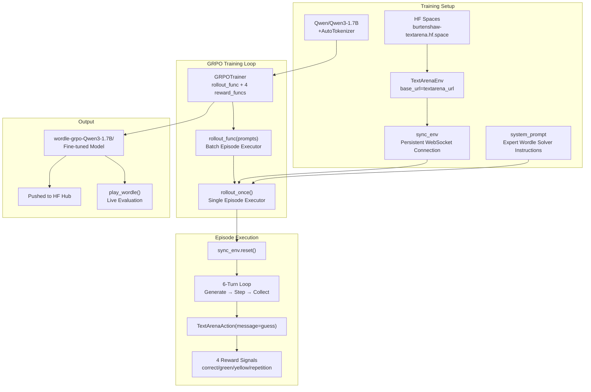
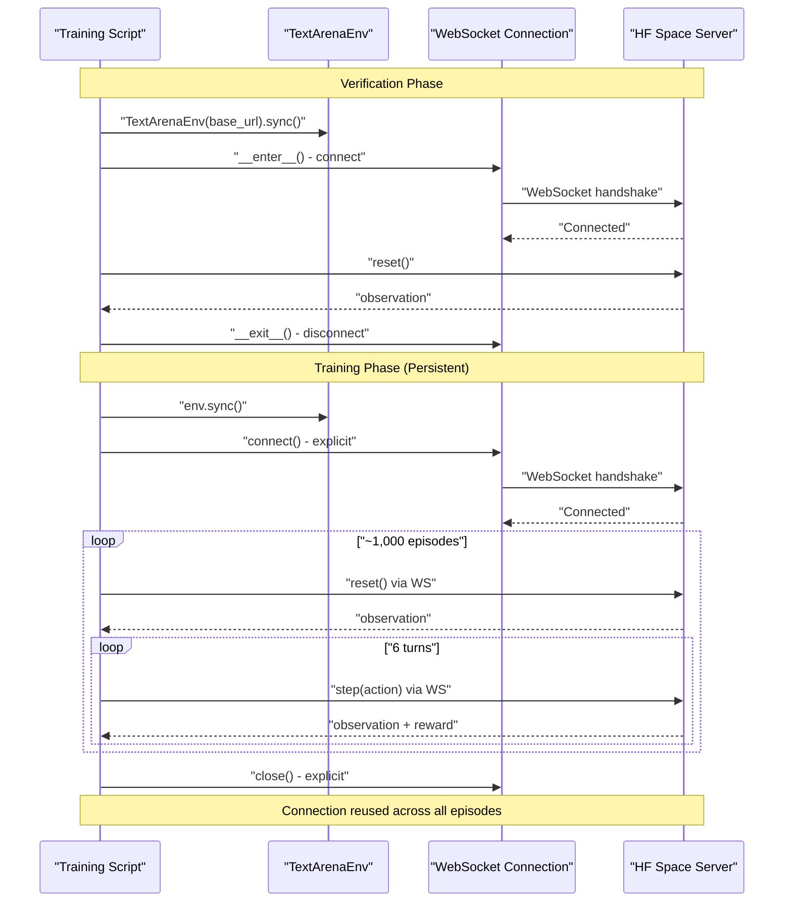
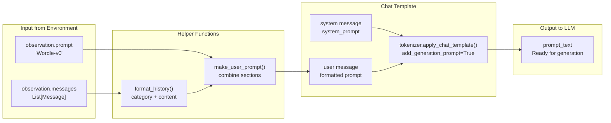
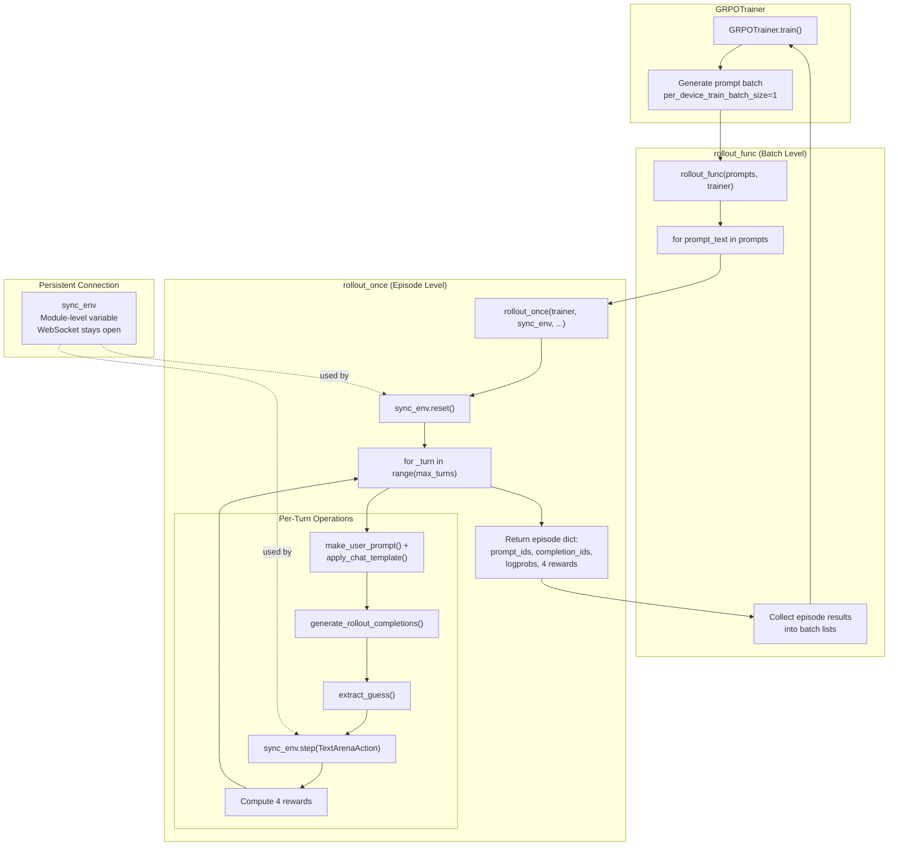
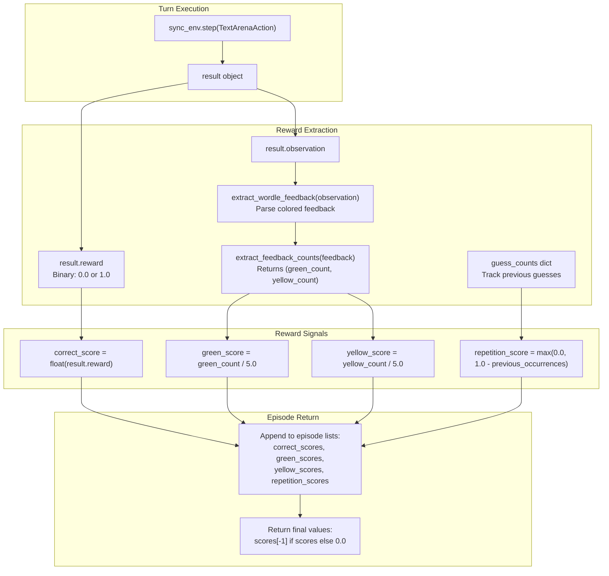
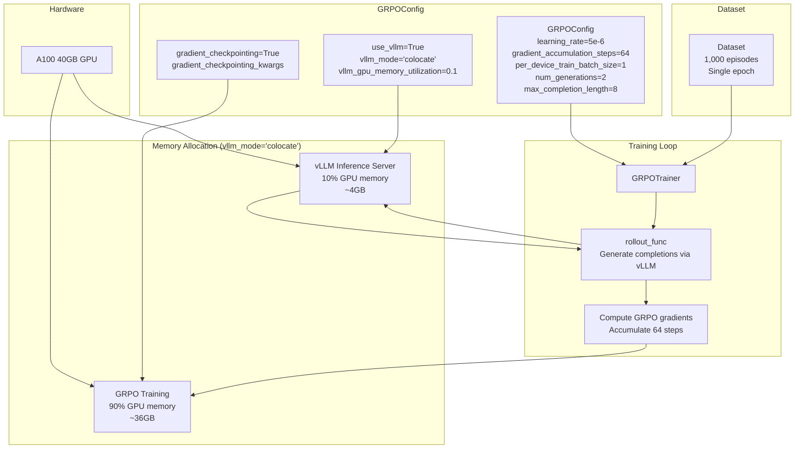
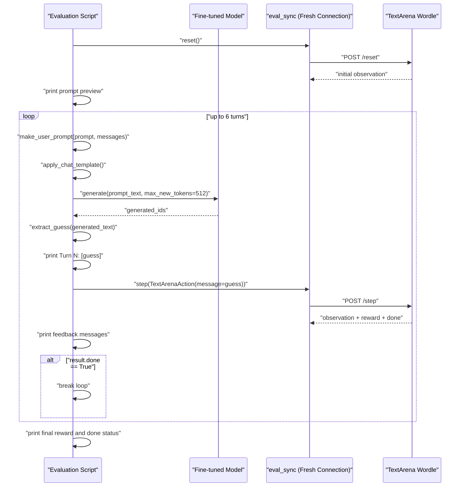
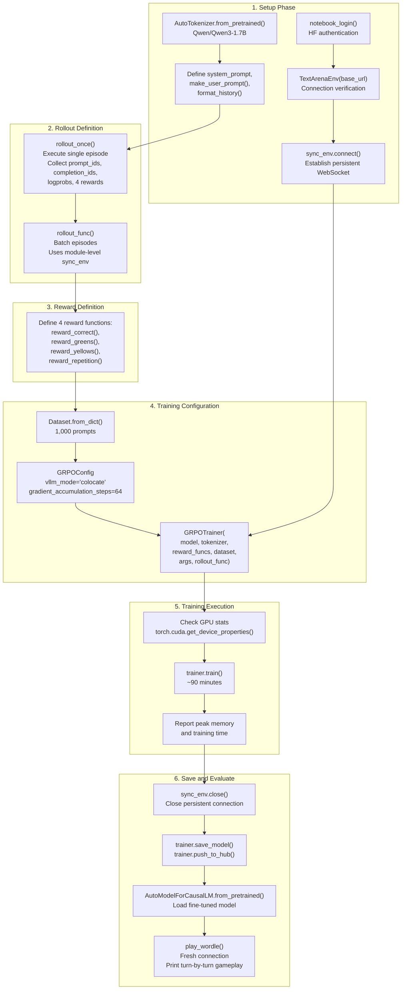

<!-- source: DeepWiki mcp.deepwiki.com · repo huggingface/openenv-course · page 6.6 Wordle Training Case Study · fetched 2026-10-26 -->

# Wordle Training Case Study

<details>
<summary>Relevant source files</summary>

The following files were used as context for generating this wiki page:

- [module-5/notebook.ipynb](module-5/notebook.ipynb)

</details>


## Purpose and Scope

This page provides a complete walkthrough of training a language model to play Wordle using the GRPO algorithm and OpenEnv. The example trains Qwen/Qwen3-1.7B on the TextArena Wordle environment over approximately 90 minutes on an A100 GPU, demonstrating all concepts from Module 5 in a single executable implementation.

For the theoretical foundations of GRPO and rollout functions, see [GRPO Algorithm and TRL Integration](#6.1). For general multi-signal reward design principles, see [Multi-Signal Reward Design](#6.3). For training configuration details, see [Training Configuration and Optimization](#6.5).

**Sources:** [module-5/notebook.ipynb:1-14]()

## Overview

The Wordle training case study implements a complete RL training pipeline where a language model learns to play Wordle by:

1. Connecting to a hosted TextArena Wordle environment via WebSocket
2. Maintaining a persistent connection across all training episodes for efficiency
3. Executing rollouts that play full 6-turn Wordle games
4. Collecting four reward signals per turn (correct guess, green letters, yellow letters, repetition penalty)
5. Training with GRPO using TRL's `GRPOTrainer` with vLLM colocate mode
6. Evaluating the trained model on live Wordle games

The key architectural pattern is the **persistent connection strategy**: a single `sync_env` connection is established at module level and reused across all training episodes, avoiding per-episode connection overhead.

**Sources:** [module-5/notebook.ipynb:38-67](), [module-5/notebook.ipynb:576-591]()



**Sources:** [module-5/notebook.ipynb:38-67](), [module-5/notebook.ipynb:280-318](), [module-5/notebook.ipynb:422-445]()

## Environment Setup and Connection Management

### TextArenaEnv Instantiation

The training script connects to a hosted TextArena Wordle environment on HF Spaces. The environment URL is configurable, and for production use, duplicating the Space to your own account is recommended to avoid concurrency limits.

```python
textarena_url = 'https://burtenshaw-textarena.hf.space'
env = TextArenaEnv(base_url=textarena_url)
```

**Sources:** [module-5/notebook.ipynb:51-53]()

### Persistent Connection Pattern

The critical optimization for training throughput is establishing a **persistent WebSocket connection** that remains open across all training episodes. This is implemented using the `.sync()` context manager and explicit `connect()` call:

```python
env = TextArenaEnv(base_url=textarena_url)
sync_env = env.sync()
sync_env.connect()
print('Persistent training connection established.')
```

This `sync_env` object is then used as a module-level variable in the rollout functions, avoiding connection setup/teardown overhead for each of the ~1,000 training episodes. The connection remains active until explicitly closed with `sync_env.close()` before model saving.

**Sources:** [module-5/notebook.ipynb:61-67](), [module-5/notebook.ipynb:500-501]()

### Verification Pattern

Before establishing the persistent connection, the script verifies connectivity using a temporary context-managed connection:

```python
with TextArenaEnv(base_url=textarena_url).sync() as _check:
    result = _check.reset()
    print(f'Connected to: {textarena_url}')
    print(f'Prompt preview: {str(result.observation.prompt)[:100]}...')
```

This pattern confirms the environment is accessible before committing to the long-running training process.

**Sources:** [module-5/notebook.ipynb:56-59]()



**Sources:** [module-5/notebook.ipynb:56-67](), [module-5/notebook.ipynb:500-501]()

## System Prompt and Helper Functions

### System Prompt Design

The `system_prompt` variable contains comprehensive instructions for the LLM, including game rules, response format requirements, and strategic guidance:

| Component | Content | Purpose |
|-----------|---------|---------|
| **Game Rules** | 5-letter word, 6 attempts, color-coded feedback (GREEN/YELLOW/GRAY), no word reuse | Establishes constraints |
| **Response Format** | `[crane]` - guess in brackets | Enables reliable parsing via `extract_guess()` |
| **Opening Strategy** | Start with CRANE, SLATE, STARE, AROSE, IRATE | Guides initial behavior |
| **Mid-Game Strategy** | Use GREEN letters in position, move YELLOW letters, eliminate GRAY letters | Provides logical reasoning framework |
| **Goal** | Solve in as few guesses as possible | Defines optimization objective |

The prompt explicitly instructs "Do not repeat the same guess twice", which aligns with the repetition penalty reward signal.

**Sources:** [module-5/notebook.ipynb:104-138]()

### Prompt Formatting Functions

#### `make_user_prompt(prompt_text, messages)`

Constructs the user prompt by combining the environment's initial prompt with the conversation history:

```python
def make_user_prompt(prompt_text, messages):
    """Build a structured prompt from game state and message history."""
    history = format_history(messages)
    prompt_section = prompt_text.strip() if prompt_text.strip() else "Wordle-v0"
    history_section = history if history else "[PROMPT] Awaiting first feedback."
    return (
        f"Game prompt:\n{prompt_section}\n\n"
        f"Conversation so far:\n{history_section}\n\n"
        "Reply with your next guess enclosed in square brackets."
    )
```

This function is called at each turn to provide the LLM with the current game state.

**Sources:** [module-5/notebook.ipynb:154-163]()

#### `format_history(messages)`

Formats the message history from the environment's `observation.messages` list into a readable string:

```python
def format_history(messages):
    """Format message history with category tags."""
    lines = []
    for message in messages:
        tag = message.category or "MESSAGE"
        content = message.content.strip()
        if content:
            lines.append(f"[{tag}] {content}")
    return "\n".join(lines)
```

The category tags (e.g., `[FEEDBACK]`, `[PROMPT]`) provide structure for the LLM to understand the message type.

**Sources:** [module-5/notebook.ipynb:166-174]()

#### `scale_repetition_score(previous_occurrences, max_occurrences)`

Computes the repetition penalty scale factor (not actively used in the final implementation, but demonstrates the scaling concept):

```python
def scale_repetition_score(previous_occurrences, max_occurrences):
    """Scale repetition penalty: 1.0 = novel guess, 0.0 = fully repeated."""
    if max_occurrences == 0:
        return 0.0
    return (max_occurrences - previous_occurrences) / max_occurrences
```

The actual implementation in `rollout_once` uses a simpler calculation: `max(0.0, 1.0 - previous_occurrences)`.

**Sources:** [module-5/notebook.ipynb:177-181](), [module-5/notebook.ipynb:254]()



**Sources:** [module-5/notebook.ipynb:154-181](), [module-5/notebook.ipynb:228-237]()

## Rollout Function Architecture

### `rollout_once()`: Single Episode Executor

The `rollout_once()` function executes one complete Wordle game (up to 6 turns) and returns collected data for GRPO training:

**Function Signature:**
```python
def rollout_once(trainer, sync_env, tokenizer, dataset_prompt, system_prompt, max_turns):
```

**Key Implementation Details:**

| Step | Code Location | Description |
|------|---------------|-------------|
| **Reset Environment** | Line 210 | `result = sync_env.reset()` starts a new episode |
| **Turn Loop** | Lines 222-267 | Iterates up to `max_turns=6`, breaks if `result.done` |
| **Prompt Construction** | Lines 226-237 | Builds messages list with system and user prompts, applies chat template |
| **Generation** | Line 239 | Calls `generate_rollout_completions(trainer, [prompt_text])` |
| **Data Collection** | Lines 240-242 | Extends `prompt_ids`, `completion_ids`, `logprobs` lists |
| **Guess Extraction** | Line 247 | `guess = extract_guess(completion_text)` parses LLM output |
| **Environment Step** | Line 248 | `result = sync_env.step(TextArenaAction(message=guess))` |
| **Reward Computation** | Lines 250-267 | Computes all four reward signals |

**Reward Signal Extraction:**

```python
correct_score = float(result.reward or 0.0)  # From environment
feedback = extract_wordle_feedback(observation)  # Parse colored feedback
green_count, yellow_count = extract_feedback_counts(feedback)
green_score = green_count / 5.0  # Normalized to [0, 1]
yellow_score = yellow_count / 5.0
repetition_score = max(0.0, 1.0 - previous_occurrences)  # Penalty for repeats
```

**Return Value:**
The function returns a dictionary with keys:
- `prompt_ids`, `completion_ids`, `logprobs`: Lists of token IDs and log probabilities
- `correct_reward`, `green_reward`, `yellow_reward`, `repetition_reward`: Final reward values (from last turn)

**Sources:** [module-5/notebook.ipynb:208-277]()

### `rollout_func()`: Batch Episode Interface

The `rollout_func()` is the interface between `GRPOTrainer` and the environment. It receives a batch of prompts and executes one episode per prompt:

```python
def rollout_func(prompts, trainer=None):
    """Rollout function called by GRPOTrainer. Uses the module-level sync_env."""
    episode_prompt_ids = []
    episode_completion_ids = []
    episode_logprobs = []
    correctness_rewards = []
    green_rewards = []
    yellow_rewards = []
    repetition_rewards = []
    
    for prompt_text in prompts:
        episode = rollout_once(
            trainer=trainer,
            sync_env=sync_env,  # Module-level persistent connection
            tokenizer=tokenizer,
            dataset_prompt=prompt_text,
            system_prompt=system_prompt,
            max_turns=6,
        )
        episode_prompt_ids.append(episode['prompt_ids'])
        # ... collect other outputs
    
    return {
        'prompt_ids': episode_prompt_ids,
        'completion_ids': episode_completion_ids,
        'logprobs': episode_logprobs,
        'correct_reward': correctness_rewards,
        'green_reward': green_rewards,
        'yellow_reward': yellow_rewards,
        'repetition_reward': repetition_rewards,
    }
```

The critical detail is that `sync_env` is a **module-level variable**, not passed as a parameter or created per call. This ensures the persistent WebSocket connection is maintained across the entire training run.

**Sources:** [module-5/notebook.ipynb:280-315]()



**Sources:** [module-5/notebook.ipynb:208-318]()

## Multi-Signal Reward System

### Reward Function Implementations

Four reward functions are defined, each extracting a specific signal from the rollout data:

#### `reward_correct(completions, **kwargs)`

Returns the binary correctness signal from the environment (1.0 if the word was guessed correctly, 0.0 otherwise):

```python
def reward_correct(completions, **kwargs):
    rewards = kwargs.get("correct_reward")
    return [float(r) for r in rewards] if rewards else [0.0] * len(completions)
```

**Sources:** [module-5/notebook.ipynb:336-338]()

#### `reward_greens(completions, **kwargs)`

Returns the proportion of letters that are correct and in the correct position (GREEN feedback):

```python
def reward_greens(completions, **kwargs):
    rewards = kwargs.get("green_reward")
    return [float(r) for r in rewards] if rewards else [0.0] * len(completions)
```

Values range from 0.0 (no green letters) to 1.0 (all 5 letters green, which equals solving the puzzle).

**Sources:** [module-5/notebook.ipynb:340-342]()

#### `reward_yellows(completions, **kwargs)`

Returns the proportion of letters that are correct but in the wrong position (YELLOW feedback):

```python
def reward_yellows(completions, **kwargs):
    rewards = kwargs.get("yellow_reward")
    return [float(r) for r in rewards] if rewards else [0.0] * len(completions)
```

Values range from 0.0 to 1.0 (theoretically up to 5/5, though having all yellows is rare).

**Sources:** [module-5/notebook.ipynb:344-346]()

#### `reward_repetition(completions, **kwargs)`

Returns a penalty for repeating previous guesses:

```python
def reward_repetition(completions, **kwargs):
    rewards = kwargs.get("repetition_reward")
    return [float(r) for r in rewards] if rewards else [0.0] * len(completions)
```

Computed in `rollout_once` as `max(0.0, 1.0 - previous_occurrences)`, where:
- First occurrence: 1.0 (no penalty)
- Second occurrence: 0.0 (full penalty)
- Further occurrences: 0.0

**Sources:** [module-5/notebook.ipynb:348-350](), [module-5/notebook.ipynb:253-255]()

### Reward Computation in Rollout

The rewards are computed during the episode execution in `rollout_once()`:

| Reward Type | Computation Source | Normalization |
|-------------|-------------------|---------------|
| **Correct** | `result.reward` from environment | Already 0.0 or 1.0 |
| **Green** | `extract_feedback_counts(feedback)` → `green_count / 5.0` | Divided by word length |
| **Yellow** | `extract_feedback_counts(feedback)` → `yellow_count / 5.0` | Divided by word length |
| **Repetition** | Track `guess_counts[guess]` → `max(0.0, 1.0 - previous_occurrences)` | Clipped to [0, 1] |

Only the **final turn's rewards** are returned from `rollout_once()`, which are then collected in `rollout_func()` and passed to `GRPOTrainer`.

**Sources:** [module-5/notebook.ipynb:250-267]()



**Sources:** [module-5/notebook.ipynb:248-276](), [module-5/notebook.ipynb:336-350]()

### Reward Function Registration

The four reward functions are passed as a list to `GRPOTrainer`:

```python
trainer = GRPOTrainer(
    model=model_name,
    processing_class=tokenizer,
    reward_funcs=[
        reward_correct,
        reward_greens,
        reward_yellows,
        reward_repetition,
    ],
    train_dataset=dataset,
    args=grpo_config,
    rollout_func=rollout_func,
)
```

The trainer calls each function with the rollout results and combines their outputs during gradient computation.

**Sources:** [module-5/notebook.ipynb:433-445]()

## Training Configuration

### Model and Tokenizer Setup

The training uses Qwen/Qwen3-1.7B with a standard tokenizer configuration:

```python
model_name = "Qwen/Qwen3-1.7B"
tokenizer = AutoTokenizer.from_pretrained(model_name)
tokenizer.pad_token = tokenizer.eos_token
```

Setting `pad_token = eos_token` is a common pattern for decoder-only models that don't have a dedicated padding token.

**Sources:** [module-5/notebook.ipynb:83-88]()

### Dataset Construction

A simple dataset with 1,000 identical prompts is created:

```python
dataset_size = 1000
dataset = Dataset.from_dict({"prompt": ["Play Wordle like an expert."] * dataset_size})
```

The prompt text is used as the `dataset_prompt` parameter in `rollout_once()`, though it's typically overridden by the environment's own prompt.

**Sources:** [module-5/notebook.ipynb:368-372]()

### GRPOConfig Parameters

The training configuration is defined using `GRPOConfig`:

| Parameter | Value | Purpose |
|-----------|-------|---------|
| `num_train_epochs` | 1 | Single pass through dataset |
| `learning_rate` | 5e-6 | Conservative learning rate |
| `gradient_accumulation_steps` | 64 | Accumulate gradients before update |
| `per_device_train_batch_size` | 1 | Single episode per device batch |
| `warmup_steps` | 20 | Linear warmup for first 20 steps |
| `num_generations` | 2 | Generate 2 completions per prompt for GRPO group |
| `max_completion_length` | 8 | Short completions (guess is ~7 tokens) |
| `max_prompt_length` | 1400 | Accommodate full game history |
| `use_vllm` | True | Enable vLLM for fast generation |
| `vllm_mode` | "colocate" | Run vLLM and training on same GPU |
| `vllm_gpu_memory_utilization` | 0.1 | Reserve 10% of GPU for vLLM |
| `gradient_checkpointing` | True | Reduce memory usage |
| `gradient_checkpointing_kwargs` | `{"use_reentrant": False}` | PyTorch 2.x compatibility |
| `output_dir` | "wordle-grpo-Qwen3-1.7B" | Save location |
| `report_to` | "trackio" | Experiment tracking backend |
| `logging_steps` | 1 | Log every step |
| `save_steps` | 10 | Save checkpoint every 10 steps |
| `push_to_hub` | True | Push final model to HF Hub |

**Sources:** [module-5/notebook.ipynb:388-416]()

### vLLM Colocate Mode

The `vllm_mode="colocate"` setting is critical for single-GPU training. It runs both the vLLM inference server (for fast generation during rollouts) and the training process on the same GPU, with memory split controlled by `vllm_gpu_memory_utilization=0.1` (10% for vLLM, 90% for training).

**Sources:** [module-5/notebook.ipynb:402-403]()

### Hardware Requirements and Training Time

The training requires an **A100 40GB GPU** and takes approximately **90 minutes** to complete:

```python
# Training time measurement
trainer_stats = trainer.train()
print(f"Training time: {round(trainer_stats.metrics['train_runtime']/60, 1)} minutes")
```

Memory usage statistics are collected before and after training to verify GPU utilization:

```python
gpu_stats = torch.cuda.get_device_properties(0)
start_gpu_memory = round(torch.cuda.max_memory_reserved() / 1024 / 1024 / 1024, 3)
max_memory = round(gpu_stats.total_memory / 1024 / 1024 / 1024, 3)
# ... after training ...
used_memory = round(torch.cuda.max_memory_reserved() / 1024 / 1024 / 1024, 3)
```

**Sources:** [module-5/notebook.ipynb:454-484]()



**Sources:** [module-5/notebook.ipynb:388-416](), [module-5/notebook.ipynb:454-484]()

## Training Execution and Model Evaluation

### GRPOTrainer Initialization

The trainer is instantiated with all components assembled:

```python
trainer = GRPOTrainer(
    model=model_name,
    processing_class=tokenizer,
    reward_funcs=[
        reward_correct,
        reward_greens,
        reward_yellows,
        reward_repetition,
    ],
    train_dataset=dataset,
    args=grpo_config,
    rollout_func=rollout_func,
)
```

The `processing_class` parameter accepts the tokenizer (terminology from recent TRL versions).

**Sources:** [module-5/notebook.ipynb:433-445]()

### Training Execution

Training is initiated with a single call:

```python
trainer_stats = trainer.train()
```

The training loop executes for approximately 90 minutes, with metrics logged every step and checkpoints saved every 10 steps. The persistent `sync_env` connection remains active throughout this entire period.

**Sources:** [module-5/notebook.ipynb:468-469]()

### Memory and Performance Metrics

Post-training, the script reports:

- **Training runtime**: Converted from seconds to minutes
- **Peak GPU memory**: Total reserved memory in GB
- **Memory for training**: Delta between start and peak

Example output format:
```
Training time: 90.0 minutes
Peak memory: 38.5 GB (96.2% of 40.0 GB)
Memory for training: 35.2 GB
```

**Sources:** [module-5/notebook.ipynb:478-484]()

### Model Saving and Hub Push

After training completes, the persistent connection is closed and the model is saved:

```python
sync_env.close()  # Important: close connection before saving
trainer.save_model(output_dir)
trainer.push_to_hub()
```

Closing `sync_env` before saving prevents issues with serialization or resource cleanup.

**Sources:** [module-5/notebook.ipynb:500-505]()

### Evaluation Function: `play_wordle()`

The evaluation function demonstrates the trained model playing a live Wordle game:

```python
def play_wordle(sync_env, model, tokenizer, max_turns=6):
    """Play one Wordle game and print each turn."""
    result = sync_env.reset()
    observation = result.observation
    print(f'Prompt: {observation.prompt[:100]}...')
    
    for turn in range(max_turns):
        if result.done:
            break
        
        # Build prompt with current game state
        user_prompt = make_user_prompt(observation.prompt, observation.messages)
        messages = [
            {'role': 'system', 'content': system_prompt},
            {'role': 'user', 'content': user_prompt},
        ]
        prompt_text = tokenizer.apply_chat_template(messages, ...)
        
        # Generate guess using fine-tuned model
        model_inputs = tokenizer([prompt_text], return_tensors='pt').to(model.device)
        generated_ids = model.generate(**model_inputs, max_new_tokens=512)
        output_ids = generated_ids[0][len(model_inputs.input_ids[0]):]
        generated_text = tokenizer.decode(output_ids, skip_special_tokens=True)
        guess = extract_guess(generated_text)
        
        # Step environment and print feedback
        print(f'\nTurn {turn + 1}: {guess}')
        result = sync_env.step(TextArenaAction(message=guess))
        observation = result.observation
        for msg in observation.messages:
            print(f'  [{msg.category}] {msg.content}')
    
    print(f'\nResult: reward={result.reward}, done={result.done}')
```

**Key differences from training rollout**:
- Uses `model.generate()` directly instead of `generate_rollout_completions()`
- Prints turn-by-turn output for human observation
- Uses a **fresh connection** per evaluation game (context-managed `with eval_env.sync()`)

**Sources:** [module-5/notebook.ipynb:531-563]()

### Evaluation Execution Pattern

The evaluation is run with a fresh connection, not reusing the training `sync_env`:

```python
eval_env = TextArenaEnv(base_url=textarena_url)
with eval_env.sync() as eval_sync:
    play_wordle(eval_sync, fine_tuned_model, tokenizer)
```

This pattern demonstrates that evaluation should use independent connections to avoid state contamination.

**Sources:** [module-5/notebook.ipynb:567-569]()



**Sources:** [module-5/notebook.ipynb:531-569]()

## Complete Training Flow

The following diagram shows the end-to-end data flow from environment setup to model evaluation:



**Sources:** [module-5/notebook.ipynb:1-610]()

### Summary of Key Components

| Component | File Location | Purpose |
|-----------|---------------|---------|
| `TextArenaEnv` | [envs/textarena_env]() | Client for TextArena environments |
| `TextArenaAction` | [envs/textarena_env/models.py]() | Action model for text-based interaction |
| `extract_wordle_feedback()` | [envs/textarena_env/rewards.py]() | Parse colored feedback from messages |
| `extract_feedback_counts()` | [envs/textarena_env/rewards.py]() | Count green/yellow letters |
| `extract_guess()` | [envs/textarena_env/rewards.py]() | Parse `[guess]` from LLM output |
| `generate_rollout_completions()` | TRL library | vLLM-accelerated generation |
| `GRPOTrainer` | TRL library | GRPO training implementation |
| `GRPOConfig` | TRL library | Training configuration dataclass |
| Notebook | [module-5/notebook.ipynb]() | Complete executable training example |

**Sources:** [module-5/notebook.ipynb:51](), [module-5/notebook.ipynb:203-204](), [module-5/notebook.ipynb:205](), [module-5/notebook.ipynb:431-432]()

---

