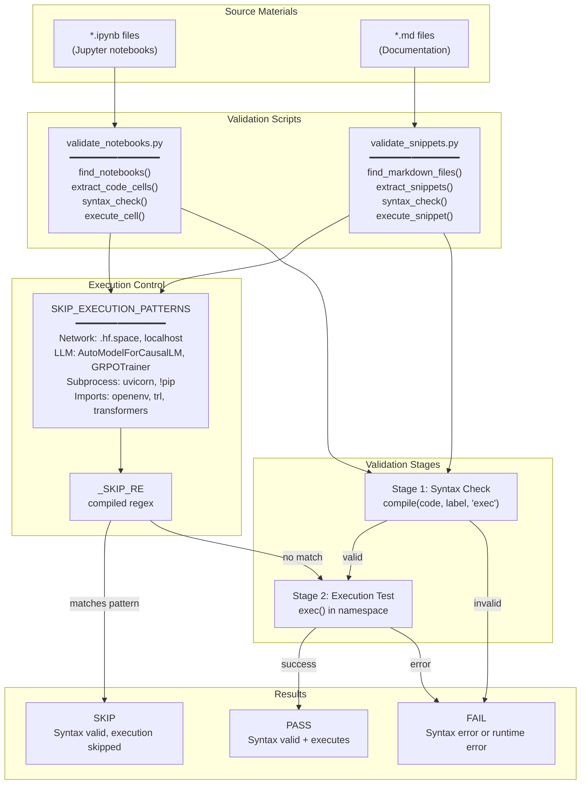
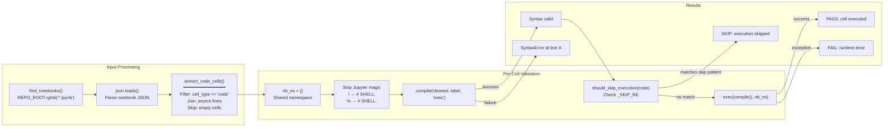
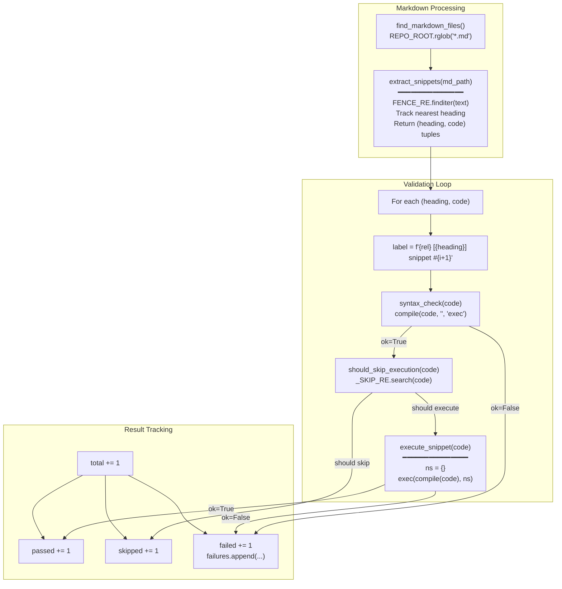
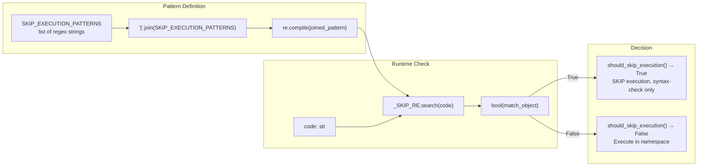
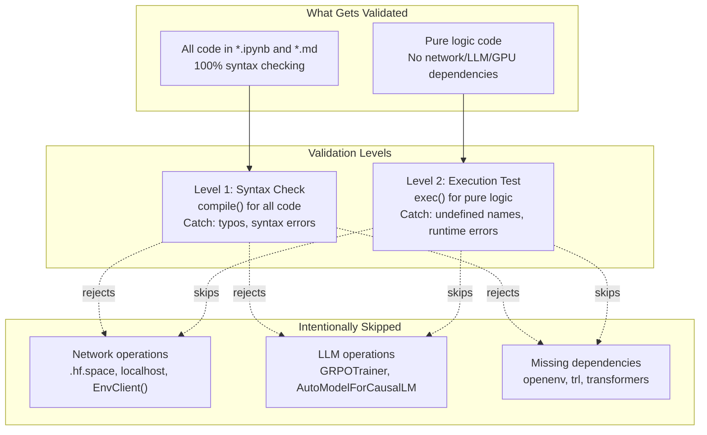

<!-- source: DeepWiki mcp.deepwiki.com · repo huggingface/openenv-course · page 7 Development Tools and Quality Assurance · fetched 2026-10-26 -->

# Development Tools and Quality Assurance

<details>
<summary>Relevant source files</summary>

The following files were used as context for generating this wiki page:

- [scripts/validate_notebooks.py](scripts/validate_notebooks.py)
- [scripts/validate_snippets.py](scripts/validate_snippets.py)

</details>


This document covers the automated validation infrastructure that ensures code quality across all course materials in the OpenEnv repository. The system validates both Jupyter notebooks (Modules 1-5) and Markdown documentation files, performing syntax checking and selective execution testing to catch errors before they reach students.

For information about the broader course structure and modules, see [OpenEnv Course Overview](#1). For details on the specific environments and implementations being validated, see the individual module pages ([Module 1](#2), [Module 2](#3), [Module 3](#4), [Module 4](#5), [Module 5](#6)).

## Overview of Validation System

The OpenEnv course employs two complementary validation scripts that run as part of the development workflow. Both scripts follow the same general pattern: extract code, syntax-check all code, and selectively execute code that doesn't require external dependencies (network, GPU, LLMs).

### Validation System Architecture



**Sources:** [scripts/validate_notebooks.py:1-211](), [scripts/validate_snippets.py:1-194]()

### Validation Workflow Summary

| Stage | Action | Applied To | Failure Behavior |
|-------|--------|------------|------------------|
| **1. Discovery** | Find all `*.ipynb` or `*.md` files | Entire repository | Skip empty files |
| **2. Extraction** | Extract code cells or `python` fenced blocks | All discovered files | Continue if no code |
| **3. Syntax Check** | Compile code with `compile(code, label, 'exec')` | All extracted code | Mark as FAIL, continue |
| **4. Skip Detection** | Match against `SKIP_EXECUTION_PATTERNS` | All syntactically valid code | Mark as SKIP, continue |
| **5. Execution** | Run `exec()` in isolated/shared namespace | Non-skipped code | Mark as FAIL, continue |
| **6. Reporting** | Print results and failure details | All code blocks | Exit with code 1 if failures |

**Sources:** [scripts/validate_notebooks.py:144-211](), [scripts/validate_snippets.py:132-194]()

## Notebook Validation System

The notebook validation system validates all Jupyter notebooks in the repository, extracting code cells and performing both syntax and execution checks. Notebooks are validated with a **shared namespace per notebook**, allowing cells to reference variables and functions defined in earlier cells—mirroring the Jupyter execution model.

### Code Cell Extraction and Processing



**Sources:** [scripts/validate_notebooks.py:85-99](), [scripts/validate_notebooks.py:105-137](), [scripts/validate_notebooks.py:144-194]()

### Key Implementation Details

The notebook validator maintains a **shared namespace** (`nb_ns = {}`) that persists across cells within a single notebook. This allows later cells to reference variables defined in earlier cells:

- **Cell extraction**: [scripts/validate_notebooks.py:89-98]() parses the notebook JSON and filters for cells with `cell_type == "code"` and non-empty source
- **Jupyter magic handling**: [scripts/validate_notebooks.py:107-114]() and [scripts/validate_notebooks.py:124-131]() strip lines starting with `!` or `%` by converting them to comments (`# SHELL: ...`) before compilation
- **Syntax checking**: [scripts/validate_notebooks.py:105-119]() uses `compile(cleaned, label, "exec")` to validate Python syntax without execution
- **Execution**: [scripts/validate_notebooks.py:122-136]() runs `exec(compile(cleaned, label, "exec"), ns)` in the shared namespace
- **Namespace persistence**: [scripts/validate_notebooks.py:164]() initializes one namespace per notebook, reused for all cells

### Example Output Format

```
============================================================
Notebook: notebooks/module1_introduction.ipynb
============================================================
  PASS  cell[0]
  PASS  cell[1]
  SKIP  cell[2]
  FAIL  cell[3]: SyntaxError at line 5: invalid syntax

==================================================================
Results: 42 cells | 25 PASS | 12 SKIP | 5 FAIL
==================================================================
```

**Sources:** [scripts/validate_notebooks.py:152-197]()

## Markdown Snippet Validation

The snippet validation system extracts Python code blocks from Markdown files and validates them independently. Unlike notebook validation, each snippet is executed in an **isolated namespace**, as Markdown code blocks are typically self-contained examples.

### Snippet Extraction Pattern

The system uses a regular expression to extract fenced code blocks with Python syntax:

```python
FENCE_RE = re.compile(r"```python\n(.*?)```", re.DOTALL)
```

Each extracted snippet is associated with the nearest preceding heading for context in error messages.

**Sources:** [scripts/validate_snippets.py:74](), [scripts/validate_snippets.py:85-103]()

### Markdown Validation Architecture



**Sources:** [scripts/validate_snippets.py:81-103](), [scripts/validate_snippets.py:110-124](), [scripts/validate_snippets.py:132-189]()

### Differences from Notebook Validation

| Aspect | Notebook Validation | Snippet Validation |
|--------|--------------------|--------------------|
| **Source Pattern** | `*.ipynb` JSON structure | `*.md` with `FENCE_RE` regex |
| **Namespace** | Shared per notebook (`nb_ns`) | Isolated per snippet (`ns = {}`) |
| **Cell Context** | Cells can reference earlier cells | Each snippet is independent |
| **Label Format** | `cell[{index}]` | `[{heading}] snippet #{i+1}` |
| **Magic Handling** | Strip `!` and `%` lines | No special handling needed |

**Sources:** [scripts/validate_notebooks.py:164](), [scripts/validate_snippets.py:119]()

## Skip Patterns and Execution Control

Both validation scripts use the same pattern-matching approach to determine which code blocks should be syntax-checked only (not executed). This prevents validation from requiring network access, GPU resources, or external dependencies.

### Skip Pattern Categories

The `SKIP_EXECUTION_PATTERNS` list is organized into several categories:

#### 1. Shell and Network Operations
```python
r"!pip",
r"!git", 
r"!find",
r"subprocess",
r"uvicorn",
```

These patterns match shell commands and subprocess invocations that would have side effects or require external resources.

**Sources:** [scripts/validate_notebooks.py:30-38]()

#### 2. Live Environment Connections
```python
r"\.hf\.space",
r"localhost:\d+",
r"EnvClient\(",
r"TextArenaEnv\(",
r"OpenSpielEnv\(",
r"EchoEnv\(",
```

These patterns detect connections to hosted environments or local servers, which wouldn't be available during validation.

**Sources:** [scripts/validate_notebooks.py:39-45]()

#### 3. LLM and GPU Operations
```python
r"AutoModelForCausalLM",
r"AutoTokenizer",
r"GRPOTrainer",
r"GRPOConfig",
r"from_pretrained",
r"torch\.cuda",
r"generate_rollout_completions",
```

These patterns identify machine learning operations that require GPU resources or large model downloads.

**Sources:** [scripts/validate_notebooks.py:47-54]()

#### 4. Package Imports
```python
r"from envs\.",
r"from openenv",
r"from trl",
r"from transformers",
r"from datasets",
r"from huggingface_hub",
```

These patterns skip code that imports packages that may not be installed in the validation environment.

**Sources:** [scripts/validate_notebooks.py:55-61]()

#### 5. File System Mutations
```python
r'os\.makedirs',
r'open\(.+, *["\']w["\']',
r'open\(env_file',
r"shutil\.",
r"echo-env-modified",
r"word_game/",
```

These patterns prevent code from creating directories, writing files, or modifying the repository structure during validation.

**Sources:** [scripts/validate_notebooks.py:62-68]()

### Skip Pattern Compilation and Usage



**Sources:** [scripts/validate_notebooks.py:77](), [scripts/validate_notebooks.py:101-102](), [scripts/validate_snippets.py:72](), [scripts/validate_snippets.py:106-107]()

The compiled regex (`_SKIP_RE`) is created once at module load time:

```python
_SKIP_RE = re.compile("|".join(SKIP_EXECUTION_PATTERNS))
```

Then used by `should_skip_execution()`:

```python
def should_skip_execution(code: str) -> bool:
    return bool(_SKIP_RE.search(code))
```

**Sources:** [scripts/validate_notebooks.py:77-78](), [scripts/validate_notebooks.py:101-102]()

## Validation Results and Reporting

Both scripts produce structured output with summary statistics and detailed failure information.

### Result Classification

Each code block is classified into one of three categories:

| Status | Meaning | Count Increment | Includes in Failures List |
|--------|---------|----------------|---------------------------|
| **PASS** | Syntax valid + executed successfully | `passed += 1` | No |
| **SKIP** | Syntax valid, execution skipped by pattern | `skipped += 1` | No |
| **FAIL** | Syntax error or runtime exception | `failed += 1` | Yes |

**Sources:** [scripts/validate_notebooks.py:147-150](), [scripts/validate_snippets.py:135-138]()

### Failure Tracking Structure

Failures are tracked as tuples with four elements:

```python
failures.append((label, kind, error_message, code))
```

Where:
- `label`: Identifies the source (e.g., `"module1.ipynb cell[5]"` or `"README.md [Setup] snippet #2"`)
- `kind`: Either `"SYNTAX"` or `"RUNTIME"`
- `error_message`: Full error text or traceback
- `code`: The actual code that failed

**Sources:** [scripts/validate_notebooks.py:174](), [scripts/validate_notebooks.py:190](), [scripts/validate_snippets.py:154](), [scripts/validate_snippets.py:171]()

### Final Report Format

The validation scripts produce a summary followed by detailed failure information:

```
======================================================================
Results: 127 cells | 78 PASS | 42 SKIP | 7 FAIL
======================================================================

Failed cells:

--- SYNTAX: notebooks/module2_policy.ipynb cell[12] ---
SyntaxError at line 8: invalid syntax

--- RUNTIME: notebooks/module5_training.ipynb cell[45] ---
Traceback (most recent call last):
  File "cell[45]", line 3, in <module>
    result = undefined_function()
NameError: name 'undefined_function' is not defined
```

**Sources:** [scripts/validate_notebooks.py:195-206](), [scripts/validate_snippets.py:177-188]()

### Exit Codes

Both scripts return exit code based on validation results:

```python
return 1 if failed else 0
```

This allows them to be used in CI/CD pipelines where non-zero exit codes indicate failure.

**Sources:** [scripts/validate_notebooks.py:207](), [scripts/validate_snippets.py:189]()

## Integration with Development Workflow

These validation scripts serve as pre-commit and CI checks to ensure code quality across all course materials. They can be run manually during development or automatically as part of a continuous integration pipeline.

### Running Validation Scripts

```bash
# Validate all notebooks
python scripts/validate_notebooks.py

# Validate all markdown snippets
python scripts/validate_snippets.py
```

**Sources:** [scripts/validate_notebooks.py:5-6](), [scripts/validate_snippets.py:5-6]()

### Validation Strategy Summary



**Sources:** [scripts/validate_notebooks.py:30-75](), [scripts/validate_snippets.py:31-70]()

This validation approach ensures that:
1. All code has valid Python syntax (no typos, missing colons, etc.)
2. Pure logic code executes without errors (no undefined variables)
3. Code requiring external resources is syntax-checked but not executed
4. Students receive working, tested code examples throughout the course

**Sources:** [scripts/validate_notebooks.py:1-16](), [scripts/validate_snippets.py:1-18]()

---

