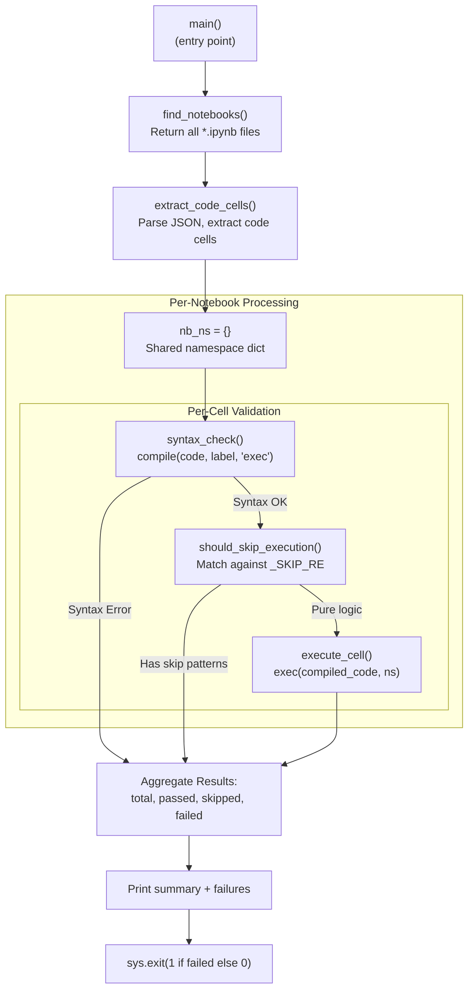
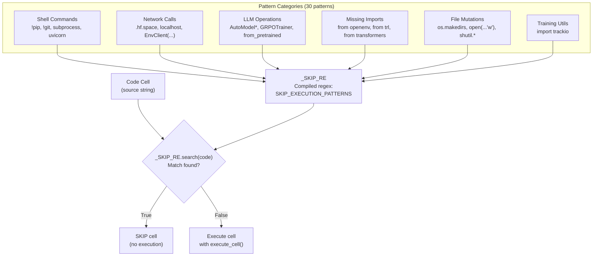
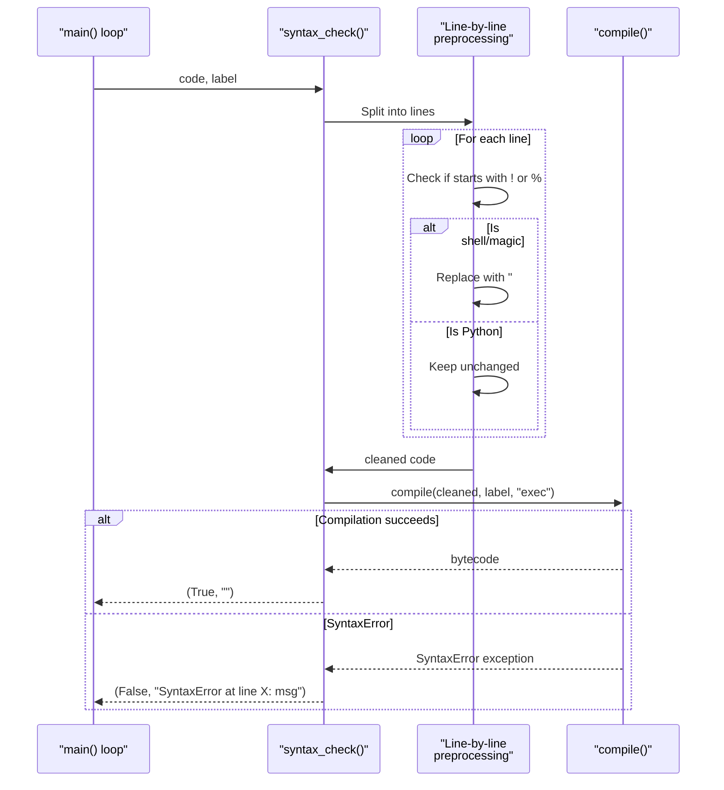
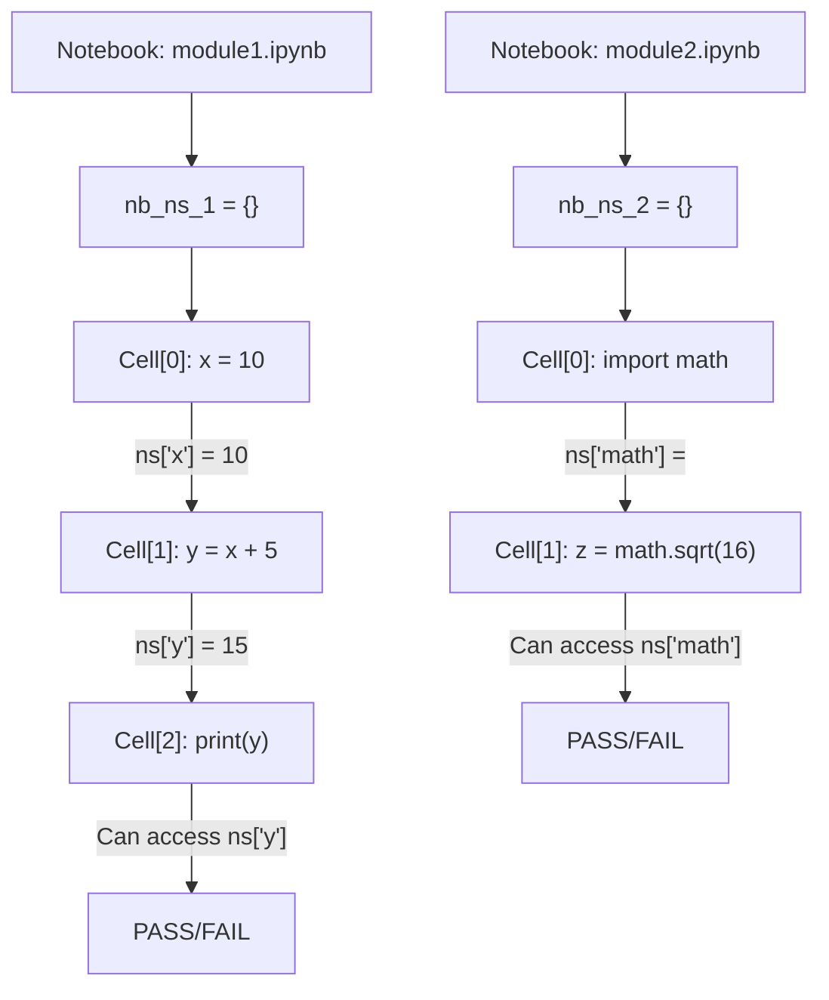

<!-- source: DeepWiki mcp.deepwiki.com · repo huggingface/openenv-course · page 7.1 Notebook Validation System · fetched 2026-10-26 -->

# Notebook Validation System

<details>
<summary>Relevant source files</summary>

The following files were used as context for generating this wiki page:

- [scripts/validate_notebooks.py](scripts/validate_notebooks.py)

</details>


This document describes the notebook validation infrastructure in `scripts/validate_notebooks.py`, which ensures code quality across all Jupyter notebooks in the course materials. The system performs syntax checking and conditional execution of code cells to catch errors before students encounter them.

For validation of Python code blocks in markdown files, see [Markdown Snippet Validation](#7.2).

**Sources:** [scripts/validate_notebooks.py:1-16]()

## Purpose and Scope

The notebook validation system serves as a quality assurance layer for the course's Jupyter notebooks. It performs two primary functions:

1. **Syntax Validation:** Compiles all code cells to detect Python syntax errors
2. **Conditional Execution:** Executes "pure logic" cells (those without network calls, LLM operations, or external dependencies) to catch runtime errors

The system maintains a shared namespace per notebook, allowing later cells to reference variables and functions defined in earlier cells, mimicking the actual notebook execution environment.

**Sources:** [scripts/validate_notebooks.py:1-16]()

## System Architecture



**Diagram: Validation Workflow** - This diagram shows the complete validation pipeline, from finding notebooks through `find_notebooks()` to reporting results. Each notebook maintains a shared namespace (`nb_ns`) that persists across cells within that notebook.

**Sources:** [scripts/validate_notebooks.py:144-211]()

## Code Cell Extraction

The `extract_code_cells()` function parses Jupyter notebook JSON to extract executable code:

| Function | Input | Output | Purpose |
|----------|-------|--------|---------|
| `find_notebooks()` | None | `List[Path]` | Recursively finds all `*.ipynb` files via `REPO_ROOT.rglob()` |
| `extract_code_cells()` | `nb_path: Path` | `List[Tuple[int, str]]` | Parses notebook JSON, returns `(cell_index, source_code)` tuples for code cells only |

The extraction process:

1. Reads notebook as JSON using `json.loads(nb_path.read_text(encoding="utf-8"))`
2. Iterates through `nb["cells"]` array
3. Filters for cells where `cell["cell_type"] == "code"`
4. Joins source lines into a single string: `"".join(cell["source"])`
5. Skips empty cells (after stripping whitespace)

**Sources:** [scripts/validate_notebooks.py:85-98]()

## Skip Patterns for Execution



**Diagram: Skip Pattern System** - The `_SKIP_RE` pattern matches 30+ patterns that indicate a cell requires external resources (network, GPU, file system state) that aren't available during validation.

### Pattern Categories

The `SKIP_EXECUTION_PATTERNS` list defines regex patterns organized into logical categories:

**Shell and Network Operations** [scripts/validate_notebooks.py:30-42]()
- `!pip`, `!git`, `!find`, `!cat` - Shell commands that modify environment
- `subprocess` - Process spawning
- `uvicorn` - Server execution
- `notebook_login` - Hugging Face authentication
- `.hf.space`, `localhost:\d+` - Live service URLs

**Environment Client Connections** [scripts/validate_notebooks.py:42-45]()
- `EnvClient(`, `TextArenaEnv(`, `OpenSpielEnv(`, `EchoEnv(` - Client instantiation patterns that require running servers

**LLM and GPU Operations** [scripts/validate_notebooks.py:46-54]()
- `AutoModelForCausalLM`, `AutoTokenizer` - Model loading
- `GRPOTrainer`, `GRPOConfig` - Training configuration
- `from_pretrained` - Model/tokenizer initialization
- `torch.cuda` - GPU operations
- `generate_rollout_completions` - LLM generation functions

**Import Statements** [scripts/validate_notebooks.py:55-61]()
- `from envs.`, `from openenv`, `from trl`, `from transformers`, `from datasets`, `from huggingface_hub` - Imports of packages not available in validation environment

**File System Mutations** [scripts/validate_notebooks.py:62-68]()
- `os.makedirs`, `open(..., 'w')` - Directory and file creation
- `shutil.*` - File operations
- `echo-env-modified`, `word_game/` - Paths to cloned/created project directories

**Cleanup Operations** [scripts/validate_notebooks.py:69-72]()
- `server.terminate`, `server.wait`, `server.pid` - Server teardown depending on skipped setup

**Sources:** [scripts/validate_notebooks.py:30-78]()

## Syntax Validation

The `syntax_check()` function validates Python syntax while accommodating Jupyter-specific constructs:



**Diagram: Syntax Check Sequence** - Shows how Jupyter magic commands and shell commands are stripped before compilation to prevent false syntax errors.

### Implementation Details

The preprocessing logic [scripts/validate_notebooks.py:106-114]():

1. **Line-by-line processing:** Splits code into individual lines
2. **Magic/shell detection:** Checks if stripped line starts with `!` or `%`
3. **Comment conversion:** Replaces magic/shell lines with `# SHELL: {original_line}`
4. **Compilation:** Passes cleaned code to `compile(cleaned, label, "exec")`

This approach allows validation of notebooks containing:
- Jupyter magic commands (`%matplotlib inline`, `%load_ext`)
- Shell commands (`!pip install`, `!git clone`)
- IPython-specific syntax that would fail standard Python compilation

**Sources:** [scripts/validate_notebooks.py:105-120]()

## Execution with Shared Namespaces

The validation system maintains state continuity within each notebook through shared namespace dictionaries:

| Concept | Implementation | Purpose |
|---------|---------------|---------|
| **Namespace per notebook** | `nb_ns = {}` created for each `.ipynb` file | Isolates variables between different notebooks |
| **Persistent state** | Same `nb_ns` dict passed to all cells in sequence | Later cells can access earlier definitions |
| **Execution function** | `execute_cell(code, ns, label)` | Executes compiled code in the provided namespace via `exec()` |

### Execution Workflow



**Diagram: Namespace Isolation and Continuity** - Each notebook gets its own namespace (`nb_ns_1`, `nb_ns_2`), but cells within a notebook share their namespace to simulate sequential execution.

The `execute_cell()` function [scripts/validate_notebooks.py:122-137]():

1. **Preprocesses code:** Strips magic/shell commands (same as syntax check)
2. **Compiles code:** Creates bytecode with `compile(cleaned, label, "exec")`
3. **Executes in namespace:** Runs `exec(compiled_code, ns)` where `ns` is the shared dict
4. **Catches exceptions:** Returns `(False, traceback)` on any runtime error
5. **Returns success:** Returns `(True, "")` if execution completes

**Sources:** [scripts/validate_notebooks.py:122-137](), [scripts/validate_notebooks.py:164]()

## Error Reporting

The validation system provides structured reporting at three levels:

### Real-Time Cell Status

During validation, each cell prints its status immediately [scripts/validate_notebooks.py:175-193]():

```
FAIL  cell[5]: SyntaxError at line 3: invalid syntax
SKIP  cell[6]
PASS  cell[7]
FAIL  cell[8]
      File "<cell[8]>", line 2, in <module>
      NameError: name 'undefined_var' is not defined
```

### Summary Statistics

After processing all notebooks [scripts/validate_notebooks.py:195-198]():

```
======================================================================
Results: 245 cells | 178 PASS | 52 SKIP | 15 FAIL
======================================================================
```

### Detailed Failure Listing

For failed cells, the system prints [scripts/validate_notebooks.py:200-206]():

- **Label:** Full identifier like `module1/notebook.ipynb cell[12]`
- **Kind:** Either `SYNTAX` or `RUNTIME`
- **Error message:** Full traceback for runtime errors, or `SyntaxError` details
- **Code snippet:** (stored but not printed by default)

### Exit Code

The script returns an exit code suitable for CI/CD integration [scripts/validate_notebooks.py:207]():

- `0` if all cells pass or are skipped
- `1` if any cell fails syntax or execution checks

**Sources:** [scripts/validate_notebooks.py:195-211]()

## Integration with CI/CD

The validation script is designed for automated testing environments:

| Feature | Implementation | Benefit |
|---------|---------------|---------|
| **Zero dependencies** | Uses only Python stdlib (`json`, `re`, `sys`, `traceback`, `pathlib`) | Runs without installing course dependencies |
| **Repository discovery** | `REPO_ROOT = Path(__file__).parent.parent` | Automatically finds notebooks relative to script location |
| **Exit code signaling** | `sys.exit(1 if failed else 0)` | CI systems detect failures via non-zero exit |
| **Batch processing** | Validates all notebooks in single run | Efficient for pre-commit hooks or GitHub Actions |

The skip patterns ensure the script can validate course content without requiring:
- Running environment servers (OpenSpiel, TextArena, Echo)
- GPU access for LLM operations
- Network connectivity to Hugging Face Spaces
- Heavy dependencies (transformers, TRL, PyTorch)

This allows validation to run quickly in resource-constrained CI environments while still catching the majority of code errors students might encounter.

**Sources:** [scripts/validate_notebooks.py:28](), [scripts/validate_notebooks.py:30-75](), [scripts/validate_notebooks.py:144-211]()

---

