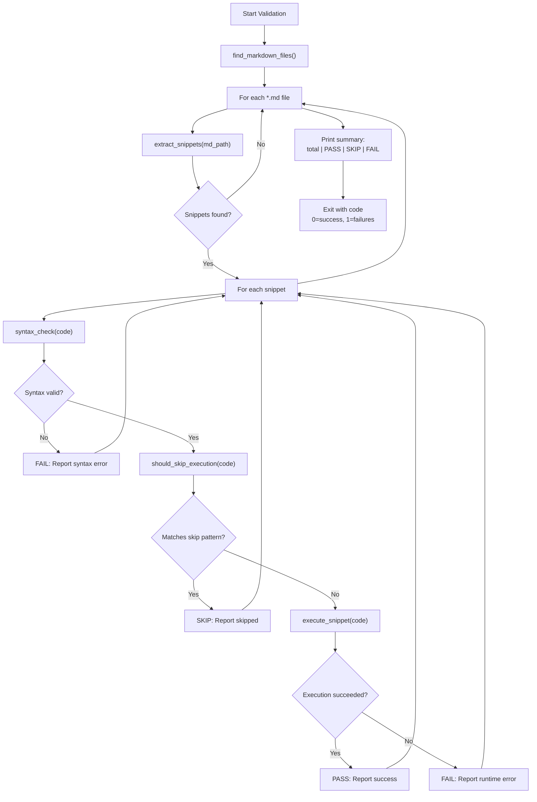
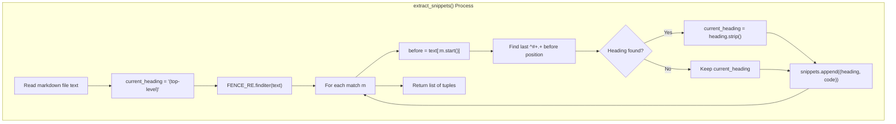
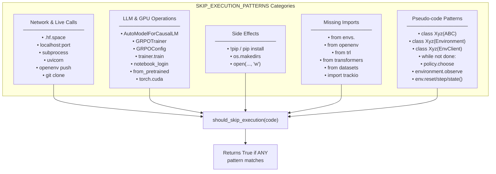
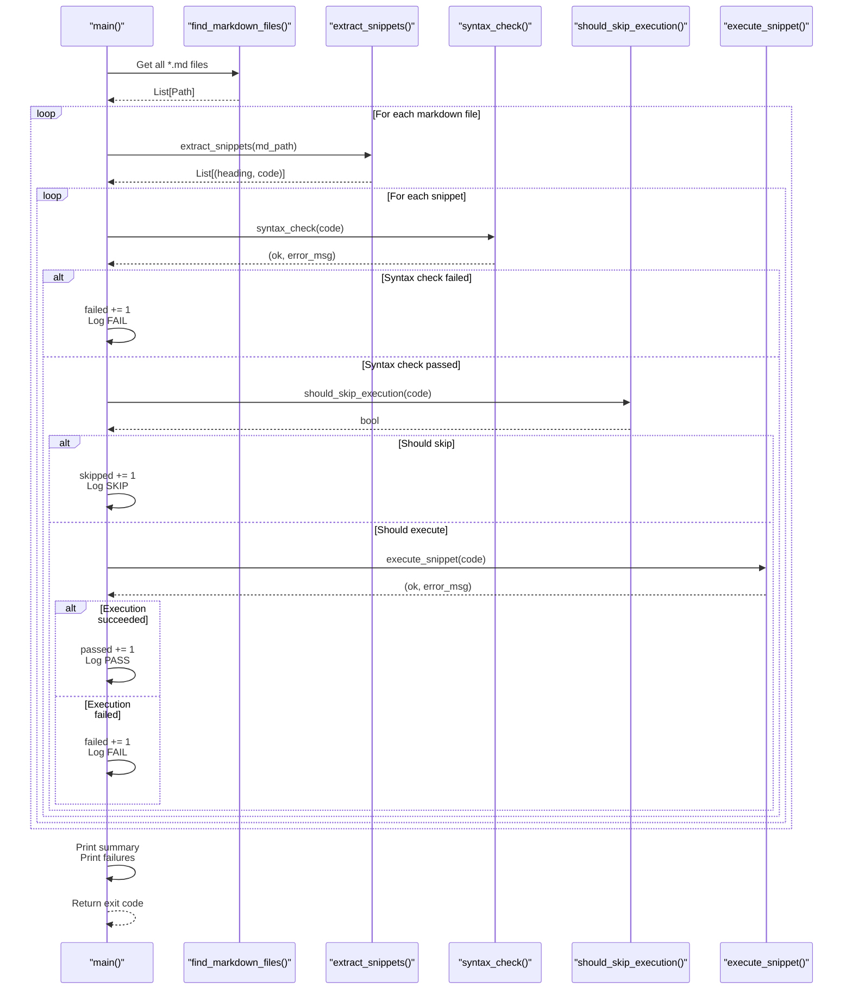
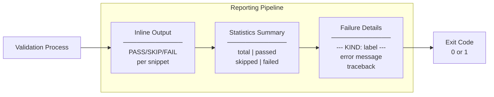

<!-- source: DeepWiki mcp.deepwiki.com · repo huggingface/openenv-course · page 7.2 Markdown Snippet Validation · fetched 2026-10-26 -->

# Markdown Snippet Validation

<details>
<summary>Relevant source files</summary>

The following files were used as context for generating this wiki page:

- [scripts/validate_snippets.py](scripts/validate_snippets.py)

</details>


## Purpose and Scope

This document describes the markdown snippet validation system implemented in `scripts/validate_snippets.py`, which ensures code quality for Python examples embedded in markdown documentation files throughout the OpenEnv course. The validator extracts fenced code blocks from markdown files, performs syntax checking on all blocks, and conditionally executes blocks that contain pure logic without side effects.

For information about validating Jupyter notebooks (which uses a different approach with shared namespaces and cell-by-cell execution), see [Notebook Validation System](#7.1).

**Sources:** [scripts/validate_snippets.py:1-18]()

## System Overview

The markdown snippet validator provides automated quality assurance for code examples in documentation by:

1. **Discovering** all `*.md` files in the repository (excluding `.git`)
2. **Extracting** every ````python` fenced code block using regex pattern matching
3. **Syntax-checking** every block by compiling it as Python code
4. **Selectively executing** blocks that contain safe, deterministic logic
5. **Reporting** pass/skip/fail status for each snippet with context

Unlike notebook validation which maintains shared state across cells within a notebook, snippet validation treats each markdown code block as an **isolated unit** with its own namespace.

**Sources:** [scripts/validate_snippets.py:1-18]()



**Sources:** [scripts/validate_snippets.py:132-193]()

## Code Block Extraction

The extraction process identifies Python code blocks in markdown files and associates them with their contextual headings to provide meaningful error messages.

### Extraction Pattern

Code blocks are extracted using the `FENCE_RE` regex pattern which matches standard markdown fenced code blocks:

```python
FENCE_RE = re.compile(r"```python\n(.*?)```", re.DOTALL)
```

This pattern captures everything between ` ```python` and ` ``` ` markers, with the `re.DOTALL` flag allowing multiline content.

**Sources:** [scripts/validate_snippets.py:74]()

### Heading Context Tracking

The `extract_snippets()` function tracks the most recent heading (lines starting with `#`) before each code block to provide context in error messages:

| Component | Description |
|-----------|-------------|
| **Input** | Path to markdown file |
| **Output** | List of `(heading_context, code_str)` tuples |
| **Algorithm** | Scan for `^#+.+` patterns before each `FENCE_RE` match |
| **Default** | `"(top-level)"` if no heading precedes the block |

The function performs a two-pass approach:
1. First pass: Use `FENCE_RE.finditer()` to find all code block positions
2. For each block: Search backwards through the text to find the last heading before that position

**Sources:** [scripts/validate_snippets.py:85-103]()



**Sources:** [scripts/validate_snippets.py:85-103]()

## Two-Phase Validation Strategy

The validator employs a two-phase approach: all blocks must pass syntax checking, but only "safe" blocks are executed.

### Phase 1: Syntax Checking

The `syntax_check()` function validates that code can be parsed as valid Python:

**Sources:** [scripts/validate_snippets.py:110-115]()

| Aspect | Implementation |
|--------|----------------|
| **Function** | `syntax_check(code: str) -> tuple[bool, str]` |
| **Method** | `compile(code, "<snippet>", "exec")` |
| **Success** | Returns `(True, "")` |
| **Failure** | Returns `(False, "SyntaxError at line {lineno}: {msg}")` |
| **Applied To** | **All** code blocks without exception |

Syntax checking catches:
- Indentation errors
- Invalid syntax (missing colons, parentheses, etc.)
- Invalid Python keywords or constructs
- Unicode/encoding issues

**Sources:** [scripts/validate_snippets.py:110-115]()

### Phase 2: Conditional Execution

The `execute_snippet()` function runs code blocks in an isolated namespace:

**Sources:** [scripts/validate_snippets.py:118-124]()

| Aspect | Implementation |
|--------|----------------|
| **Function** | `execute_snippet(code: str) -> tuple[bool, str]` |
| **Namespace** | Fresh empty dict `ns = {}` for each block |
| **Method** | `exec(compile(code, "<snippet>", "exec"), ns)` |
| **Isolation** | No shared state between blocks |
| **Success** | Returns `(True, "")` |
| **Failure** | Returns `(False, traceback.format_exc(limit=5))` |

Execution is **skipped** for blocks matching any pattern in `SKIP_EXECUTION_PATTERNS` (see next section).

**Sources:** [scripts/validate_snippets.py:118-124]()

## Skip Execution Patterns

The `SKIP_EXECUTION_PATTERNS` list defines regex patterns for code that should only be syntax-checked, not executed. The `should_skip_execution()` function checks if code matches any pattern.

**Sources:** [scripts/validate_snippets.py:31-72](), [scripts/validate_snippets.py:106-107]()

### Pattern Categories



**Sources:** [scripts/validate_snippets.py:31-72]()

### Pattern Details

| Category | Patterns | Rationale |
|----------|----------|-----------|
| **Network/Live** | `.hf.space`, `localhost:\d+`, `subprocess`, `uvicorn`, `openenv push`, `git clone` | Require external services; cannot run in CI |
| **LLM/GPU** | `AutoModelForCausalLM`, `GRPOTrainer`, `from_pretrained`, `torch.cuda` | Require GPU hardware and large models |
| **Side Effects** | `!pip`, `pip install`, `os.makedirs`, `open(..., 'w')` | Would mutate the filesystem or environment |
| **Missing Imports** | `from envs.`, `from openenv`, `from trl`, `from transformers`, `from datasets` | Dependencies not installed during validation |
| **Pseudo-code** | `class Xyz(ABC)`, `while not done:`, `policy.choose`, `env.reset()` | Illustrative code with undefined variables |

The combined pattern `_SKIP_RE` is compiled as:

```python
_SKIP_RE = re.compile("|".join(SKIP_EXECUTION_PATTERNS))
```

This creates a single regex that matches if **any** of the individual patterns appears in the code string.

**Sources:** [scripts/validate_snippets.py:72]()

## Validation Workflow

The main validation loop processes each markdown file and its snippets sequentially, accumulating statistics and failure details.

### Main Loop Structure



**Sources:** [scripts/validate_snippets.py:132-193]()

### Statistics Tracking

The validator maintains four counters:

| Counter | Meaning | Incremented When |
|---------|---------|------------------|
| `total` | All snippets processed | Every snippet encountered |
| `passed` | Successful execution | Syntax valid + execution succeeded |
| `skipped` | Execution skipped | Syntax valid + matches skip pattern |
| `failed` | Validation failed | Syntax error OR runtime error |

The `failures` list stores tuples of `(label, kind, error, code)` where:
- `label`: Formatted as `{file_path} [{heading}] snippet #{i+1}`
- `kind`: Either `"SYNTAX"` or `"RUNTIME"`
- `error`: Error message or traceback
- `code`: The failing code snippet

**Sources:** [scripts/validate_snippets.py:134-138](), [scripts/validate_snippets.py:154](), [scripts/validate_snippets.py:171]()

### Exit Code Behavior

The validator exits with:
- **Code 0**: All snippets passed or were skipped (no failures)
- **Code 1**: One or more snippets failed syntax or execution checks

This allows integration with CI/CD pipelines that check exit codes.

**Sources:** [scripts/validate_snippets.py:189]()

## Error Reporting

The validator provides two levels of error reporting: inline during validation and a summary at the end.

### Inline Reporting

As each snippet is validated, one of four outcomes is printed:

```
  PASS  {file} [{heading}] snippet #{n}
  SKIP  {file} [{heading}] snippet #{n}
  FAIL  {file} [{heading}] snippet #{n}
        {first 4 lines of error}
```

The `label` format includes:
- Relative file path from repository root
- Contextual heading from markdown
- Sequential snippet number within that file

**Sources:** [scripts/validate_snippets.py:148](), [scripts/validate_snippets.py:155-157](), [scripts/validate_snippets.py:162](), [scripts/validate_snippets.py:168](), [scripts/validate_snippets.py:172-175]()

### Summary Reporting

After all files are processed, the validator prints:

1. **Statistics Summary**: A formatted table showing counts
   ```
   Results: {total} snippets | {passed} PASS | {skipped} SKIP | {failed} FAIL
   ```

2. **Detailed Failures**: For each failed snippet, prints:
   - Kind of failure (SYNTAX or RUNTIME)
   - Full label with file and context
   - Complete error message or traceback

**Sources:** [scripts/validate_snippets.py:178-188]()



**Sources:** [scripts/validate_snippets.py:148-188]()

## Comparison with Notebook Validation

The snippet validator differs from the notebook validator (see [Notebook Validation System](#7.1)) in several key ways:

| Aspect | Snippet Validation | Notebook Validation |
|--------|-------------------|---------------------|
| **Input Format** | Markdown `*.md` files | Jupyter `*.ipynb` files |
| **Extraction** | Regex pattern `FENCE_RE` | JSON parsing of notebook cells |
| **State Model** | Isolated namespace per snippet | Shared namespace per notebook |
| **Skip Logic** | Pattern-based (`SKIP_EXECUTION_PATTERNS`) | Magic comment-based (`# SKIP`, `# SKIP_START/END`) |
| **Context** | Heading association | Cell sequence number |
| **Purpose** | Documentation examples | Interactive tutorial code |

Both validators share the two-phase strategy of syntax checking followed by conditional execution, but adapt their execution models to the different contexts in which code appears.

**Sources:** [scripts/validate_snippets.py:1-193]()

## Usage

The validator is invoked from the repository root:

```bash
python scripts/validate_snippets.py
```

It automatically discovers all markdown files, validates them, and exits with an appropriate code for CI integration.

**Sources:** [scripts/validate_snippets.py:1-6]()