# Page: OpenEnv Course Overview

# OpenEnv Course Overview

<details>
<summary>Relevant source files</summary>

The following files were used as context for generating this wiki page:

- [README.md](README.md)
- [requirements.txt](requirements.txt)

</details>


This document introduces the OpenEnv course repository at https://github.com/huggingface/openenv-course, a hands-on learning system for building and deploying reinforcement learning environments for large language model (LLM) training. The course is structured as five progressive modules that teach ML engineers, researchers, and hobbyists how to consume, deploy, build, and train with RL environments.

For details on the underlying architecture patterns (3-method interface, client-server model, WebSocket communication), see [System Architecture and Core Concepts](#1.1). For information about Python dependencies, framework integrations, and hardware requirements, see [Technology Stack and Dependencies](#1.2).

## Purpose and Target Audience

The OpenEnv course teaches the complete lifecycle of working with RL environments: from consuming hosted environments through typed clients, to deploying modifications, to building custom environments from scratch, to integrating them into LLM training pipelines using Group Relative Policy Optimization (GRPO).

**Target audience**: ML engineers, researchers, and hobbyists who want to train LLMs with reinforcement learning but lack experience with RL frameworks.

**Prerequisites**: Basic Python proficiency and familiarity with the Hugging Face ecosystem. No prior RL experience required.

Sources: [README.md:1-11]()

## Course Structure

Each of the five modules follows a consistent two-part structure:

| Component | Format | Purpose |
|-----------|--------|---------|
| `README.md` | Markdown document | Concepts, architecture, context |
| `notebook.ipynb` | Jupyter notebook | Hands-on code, runnable top-to-bottom |

All notebooks are designed to run in Google Colab without requiring local setup. The estimated time per module is 45-60 minutes.

Sources: [README.md:13-19]()

### Module Directory Structure

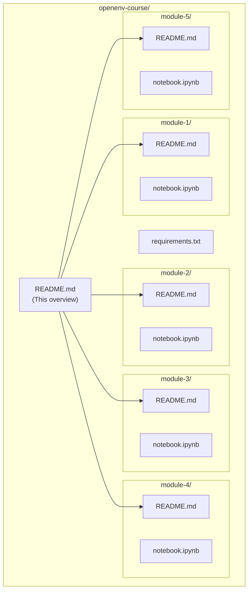

**Module Directory Structure**: Each module is a self-contained directory with conceptual material (`README.md`) and executable code (`notebook.ipynb`). The root `README.md` provides navigation and the root `requirements.txt` contains all dependencies for all five modules.

Sources: [README.md:21-29]()

## Five-Module Learning Progression

The course follows a deliberate pedagogical progression from consumption to creation to advanced integration:

### Module 1: Understanding OpenEnv

**What you learn**: The RL loop, limitations of Gymnasium for distributed environments, and the OpenEnv architecture.

**Key concepts**:
- The 3-method interface: `reset()`, `step()`, `state()`
- Client-server architecture and environments-as-microservices
- Hands-on interaction with three demo environments: `EchoEnv`, `OpenSpielEnv`, `TextArenaEnv`

**Notebook**: Interactive exploration of connecting to hosted environments, calling methods, and observing typed responses.

For detailed coverage of the interface and architecture, see [Module 1: Understanding OpenEnv](#2) and its sub-pages.

Sources: [README.md:25]()

### Module 2: Using Existing Environments

**What you learn**: How to consume environments from the Environment Hub, write policies, and run competitive evaluations.

**Key concepts**:
- `OpenSpielEnv` client providing unified interface for 6 games
- Type-safe models (`OpenSpielAction`, `OpenSpielObservation`) enabling IDE autocomplete
- Implementing the `select_action` interface for four policy types: Random, AlwaysStay, Smart, Learning
- Game-agnostic code that switches games by changing only `base_url`

**Notebook**: Writing and comparing policies across multiple OpenSpiel games (Catch, Tic-Tac-Toe, 2048, Kuhn Poker, Leduc Poker, Goofspiel).

For detailed coverage of policy development, see [Module 2: Policy Development with OpenSpiel](#3).

Sources: [README.md:26]()

### Module 3: Deploying Environments

**What you learn**: The clone-modify-deploy workflow using local development, Docker, and Hugging Face Spaces.

**Key concepts**:
- Local testing with `uvicorn` and hot-reloading
- Modifying existing environments (example: echo → reverse echo)
- The `openenv push` command and `openenv.yaml` configuration
- Environment variables: `WORKERS`, `MAX_CONCURRENT_ENVS`
- Three access methods: server (URL), repository (clone), registry (Docker image)

**Notebook**: Cloning EchoEnv, modifying server logic, testing locally, and deploying to HF Spaces.

For detailed coverage of deployment workflows, see [Module 3: Deployment Workflow](#4).

Sources: [README.md:27]()

### Module 4: Building Your Own Environment

**What you learn**: Creating production-ready custom environments from scratch using the 3-Component Pattern.

**Key concepts**:
- The `openenv init` scaffold command
- Implementing three components: `models.py`, `client.py`, `server/`
- The `Environment` abstract base class with `reset()` and `step()` methods
- The `EnvClient` base class with `_step_payload`, `_parse_result`, `_parse_state` methods
- `create_fastapi_app` for automatic endpoint generation
- Complete `WordGameEnvironment` example in ~100 lines of code

**Notebook**: Building WordGame from scaffold to deployment, implementing game logic, testing policies.

For detailed coverage of custom environment creation, see [Module 4: Building Custom Environments](#5).

Sources: [README.md:28]()

### Module 5: Training with OpenEnv + TRL

**What you learn**: Reinforcement learning for LLMs using Group Relative Policy Optimization (GRPO), integrated with TRL and OpenEnv.

**Key concepts**:
- GRPO algorithm and `GRPOTrainer` from TRL
- Implementing `rollout_func` for episode execution
- Multi-signal reward design (4 reward functions for Wordle: correct, greens, yellows, repetition)
- System prompt design and LLM output parsing
- `vLLM` colocate mode for GPU memory efficiency
- Training Qwen3-1.7B on Wordle task (90 minutes on A100 40GB)

**Notebook**: Complete training pipeline from TextArenaEnv setup through model evaluation to HF Hub upload.

For detailed coverage of LLM training, see [Module 5: LLM Training with GRPO](#6).

Sources: [README.md:29]()

## Module Progression and Importance Ratings

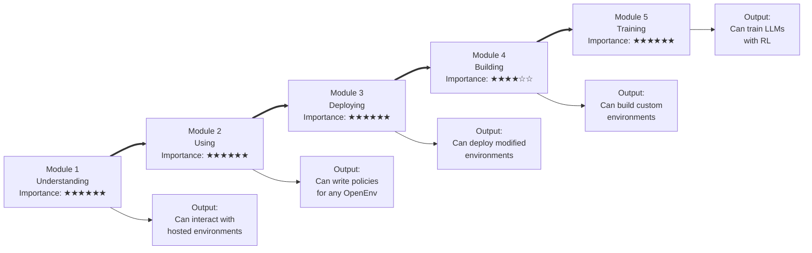

**Module Progression Diagram**: Shows the sequential learning path and the concrete capability gained at each stage. Modules 1, 2, 3, and 5 are rated highest importance (6.55 stars) as they represent core skills. Module 4 (4.55 stars) serves as a bridge between consumption and creation, teaching implementation details that may not be needed by all users.

Sources: [README.md:23-29]()

## Quick Start Example

The course begins with a quick start that demonstrates both environment types supported by OpenEnv:

```python
# Install core framework
pip install openenv-core

# Clone OpenEnv for typed clients
git clone https://github.com/meta-pytorch/OpenEnv.git
```

**Tool-based interface** (MCP-style, used by `EchoEnv`):

```python
from envs.echo_env import EchoEnv

with EchoEnv(base_url="https://openenv-echo-env.hf.space").sync() as env:
    env.reset()
    response = env.call_tool("echo_message", message="Hello, OpenEnv!")
    print(response)  # Hello, OpenEnv!
```

**Standard RL interface** (used by `OpenSpielEnv`, `TextArenaEnv`):

```python
from envs.openspiel_env import OpenSpielEnv
from envs.openspiel_env.models import OpenSpielAction

with OpenSpielEnv(base_url="https://openenv-openspiel-catch.hf.space").sync() as env:
    result = env.reset()
    result = env.step(OpenSpielAction(action_id=1, game_name="catch"))
    print(result.observation.legal_actions)
```

Every standard OpenEnv environment exposes the same 3-method interface: `reset()`, `step()`, `state()`.

Sources: [README.md:33-65]()

## Learning Outcomes by Phase

| Phase | Modules | Focus | Key Skills |
|-------|---------|-------|------------|
| **Consumption** | 1-2 | Understanding and using existing environments | Connect to hosted environments, write policies, understand typed models |
| **Deployment** | 3 | Modifying and deploying environments | Local testing with `uvicorn`, Docker containerization, HF Spaces deployment via `openenv push` |
| **Creation** | 4 | Building custom environments from scratch | Implement `Environment` ABC, extend `EnvClient`, use `create_fastapi_app` |
| **Integration** | 5 | LLM training with RL | Implement `rollout_func`, design reward functions, train with `GRPOTrainer` |

Sources: [README.md:23-29]()

## Core Dependencies Overview

The course uses a curated set of dependencies installed via `requirements.txt`:

| Category | Key Packages | Required For |
|----------|--------------|--------------|
| **Core Framework** | `openenv-core>=0.2.2` | All modules |
| **Server-Side** | `fastapi>=0.104.0`, `uvicorn>=0.24.0`, `fastmcp>=3.0.0`, `pydantic>=2.0.0` | Module 3 (local testing) |
| **LLM Training** | `trl>=0.17.0`, `transformers>=4.40.0`, `datasets>=2.18.0`, `accelerate>=0.28.0` | Module 5 |
| **Optional GPU** | `vllm`, `bitsandbytes` | Module 5 (requires CUDA + Linux) |
| **Utilities** | `huggingface-hub>=0.22.0`, `trackio` | Deployment and experiment tracking |

**GPU requirement**: Only Module 5 requires a GPU (A100 40GB recommended for the Wordle training example).

For complete dependency details and version rationale, see [Technology Stack and Dependencies](#1.2).

Sources: [requirements.txt:1-30]()

## Scaling and Production Considerations

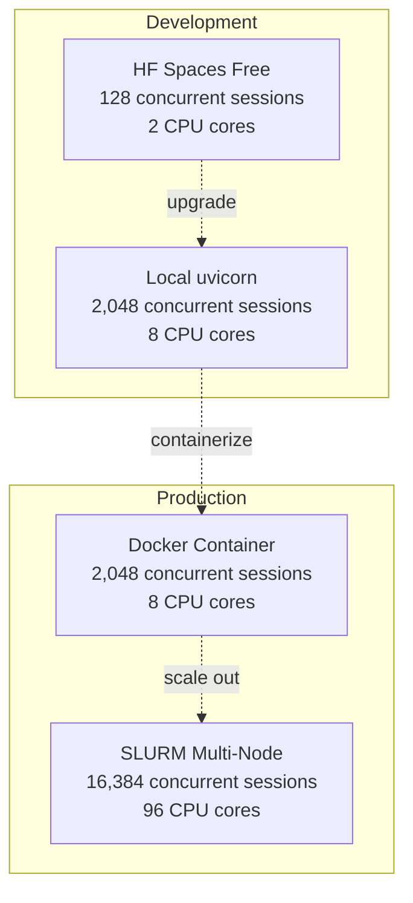

**Scaling Options**: The course teaches deployment starting with HF Spaces (free tier, ideal for demos) and progressing to Docker containers. For production workloads beyond 2,048 concurrent sessions, multi-node deployments with load balancing are covered in the scaling appendix.

**Key environment variables**:
- `WORKERS`: Number of uvicorn worker processes (default: 4)
- `MAX_CONCURRENT_ENVS`: Maximum WebSocket sessions per worker (default: 100)

With 8 workers, a single container handles ~2,048 concurrent sessions for simple text environments.

**WebSocket advantage**: OpenEnv uses WebSocket (`/ws`) for persistent sessions. Each `step()` call is a lightweight frame (~0.1ms overhead) versus TCP handshake overhead (~10-50ms) with HTTP.

Sources: [README.md:75-126]()

## Repository Links and Resources

| Resource | URL/Location |
|----------|--------------|
| **Course Repository** | https://github.com/huggingface/openenv-course |
| **OpenEnv Core** | https://github.com/meta-pytorch/OpenEnv |
| **Environment Hub** | https://huggingface.co/collections/openenv/environment-hub |
| **TRL Documentation** | https://huggingface.co/docs/trl |
| **Scaling Experiments** | https://github.com/burtenshaw/openenv-scaling |

Sources: [README.md:67-71](), [README.md:119]()

## Validation and Quality Assurance

The course repository includes validation scripts to ensure code quality across all modules:

- `validate_notebooks.py`: Extracts and validates code cells from Jupyter notebooks, performs syntax checking, and conditionally executes cells
- `validate_snippets.py`: Extracts Python code blocks from markdown files, validates syntax, and reports errors

For details on the validation system, see [Development Tools and Quality Assurance](#7).

Sources: Inferred from table of contents section 7

## Navigation to Detailed Documentation

This overview provides a roadmap of the course structure. For in-depth technical documentation:

- **Architecture details**: See [System Architecture and Core Concepts](#1.1) for the 3-method interface, client-server model, and WebSocket communication patterns
- **Technology stack**: See [Technology Stack and Dependencies](#1.2) for dependency details and framework integrations
- **Module-specific guides**: See pages [Module 1: Understanding OpenEnv](#2) through [Module 5: LLM Training with GRPO](#6) for comprehensive module documentation
- **Development tools**: See [Development Tools and Quality Assurance](#7) for validation scripts and quality checks

---

# Page: System Architecture and Core Concepts

# System Architecture and Core Concepts

<details>
<summary>Relevant source files</summary>

The following files were used as context for generating this wiki page:

- [README.md](README.md)
- [module-1/README.md](module-1/README.md)

</details>


This document explains the foundational architecture patterns that underpin all OpenEnv environments: the 3-method interface contract, client-server separation, WebSocket-based communication, and the environments-as-microservices philosophy. These concepts form the basis for all five course modules.

For specific usage patterns of existing environments, see [#2](#2). For deployment mechanics, see [#4](#4). For creating custom environments from scratch, see [#5](#5).

## Overview: Environments as Microservices

OpenEnv treats RL environments as independently deployable microservices rather than in-process libraries. This architectural decision addresses production requirements that traditional frameworks like Gymnasium do not handle: process isolation, language-agnostic access, versioned deployments, and horizontal scalability.

The system separates concerns into two distinct runtime contexts:

| Context | Location | Responsibility | Language |
|---------|----------|----------------|----------|
| **Client** | Training/research code | Action selection, learning, orchestration | Python (extensible to others) |
| **Server** | Docker container | Environment logic, state management | Python (via FastAPI) |

Communication occurs over WebSocket for persistent connections or HTTP for stateless operations. All data types are defined using Pydantic models, providing compile-time type checking and runtime validation.

Sources: [README.md:34-45](), [module-1/README.md:34-44]()

## The 3-Method Interface Contract

Every OpenEnv environment exposes exactly three methods, forming a universal contract across all environment types:

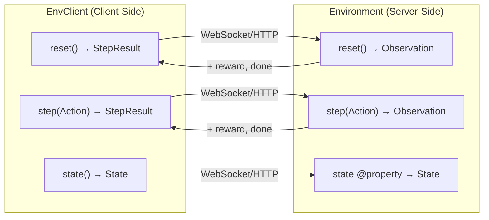

**Method Semantics**

| Method | Server Contract | Client Return | Purpose |
|--------|----------------|---------------|---------|
| `reset()` | Returns `Observation` | `StepResult` (observation, reward=0, done=False) | Initialize new episode |
| `step(action)` | Accepts `Action`, returns `Observation` | `StepResult` (observation, reward, done) | Execute action, advance state |
| `state()` | Property returning `State` | `State` (episode_id, step_count, metadata) | Query episode metadata |

The client-side `EnvClient` automatically wraps server `Observation` objects into `StepResult` containers that include computed rewards and termination flags. This separation allows server-side environments to focus purely on environment dynamics while the client handles episode management.

Sources: [module-1/README.md:82-90](), [module-1/README.md:107-125]()

## Client-Server Architecture

### Component Diagram

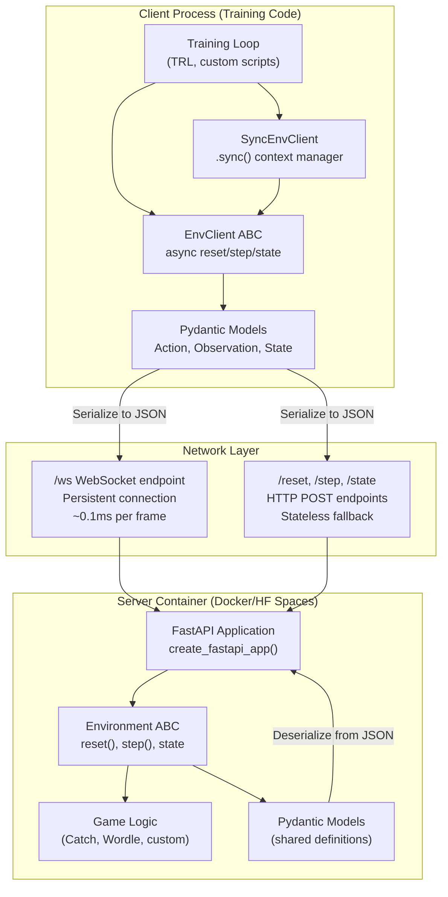

Sources: [module-1/README.md:46-71](), [README.md:79-85]()

### Process Isolation

The client and server run in separate processes, communicating only through network protocols. This isolation provides:

- **Stability**: Environment crashes do not terminate training
- **Security**: Untrusted environment code runs in containers
- **Reproducibility**: Docker images guarantee consistent behavior
- **Scalability**: Deploy multiple containers behind load balancers

A single server container manages multiple concurrent environment instances using WebSocket session multiplexing. Each WebSocket connection receives its own server-side `Environment` instance with isolated state.

Sources: [module-1/README.md:21-31](), [README.md:83-84]()

## Communication Protocols

### WebSocket vs HTTP

OpenEnv defaults to WebSocket (`/ws`) for persistent sessions:

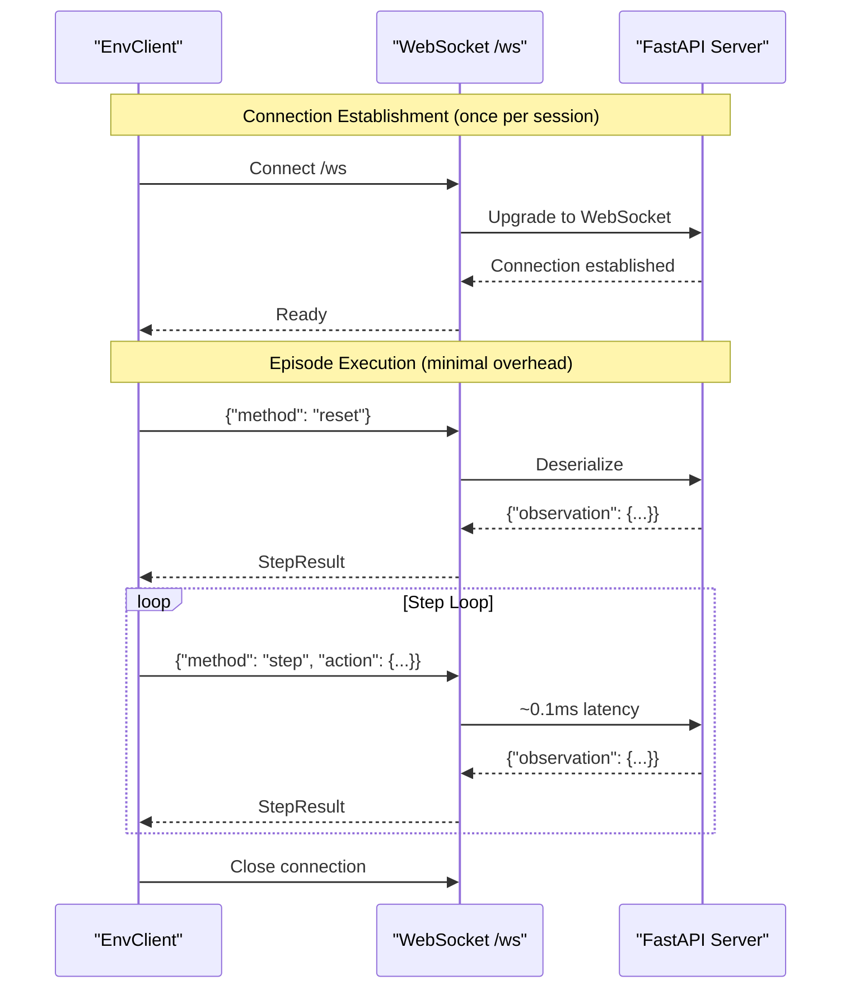

HTTP endpoints (`/reset`, `/step`, `/state`) provide stateless access for debugging and testing. Each HTTP request incurs TCP handshake overhead (~10-50ms) compared to WebSocket frames (~0.1ms).

Sources: [README.md:79-85](), [module-1/README.md:73-79]()

### Endpoint Mapping

The `create_fastapi_app` function automatically generates six endpoints from an `Environment` implementation:

| Endpoint | Protocol | Method | Purpose |
|----------|----------|--------|---------|
| `/ws` | WebSocket | N/A | Persistent session interface (default) |
| `/reset` | HTTP POST | `reset()` | Initialize episode (stateless) |
| `/step` | HTTP POST | `step(action)` | Execute action (stateless) |
| `/state` | HTTP GET | `state` | Query metadata (stateless) |
| `/health` | HTTP GET | N/A | Liveness check |
| `/docs` | HTTP GET | N/A | OpenAPI documentation |

The client automatically selects WebSocket when available, falling back to HTTP if the connection fails.

Sources: [module-1/README.md:73-79]()

## The 3-Component Pattern

Every OpenEnv environment follows a standardized file structure:

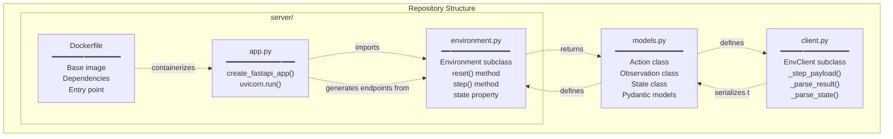

Sources: [module-1/README.md:93-105]()

### Component Responsibilities

**models.py**: Type-safe contracts shared between client and server. Defines the exact structure of actions, observations, and state using Pydantic models. These models provide:
- IDE autocomplete for field access
- Runtime validation of data types
- Automatic JSON serialization/deserialization

**client.py**: Network communication layer extending `EnvClient` ABC. Implements three serialization hooks:
- `_step_payload(action)`: Convert typed action to JSON dictionary
- `_parse_result(data)`: Convert JSON response to `StepResult`
- `_parse_state(data)`: Convert JSON response to `State`

**server/environment.py**: Core game/simulation logic extending `Environment` ABC. Implements:
- `reset()`: Initialize episode, return first observation
- `step(action)`: Process action, update state, return next observation
- `state` property: Return episode metadata

**server/app.py**: FastAPI application entry point. Calls `create_fastapi_app(Environment)` to auto-generate all endpoints and configures uvicorn for serving.

**server/Dockerfile**: Container definition specifying Python version, dependencies, and startup command. Enables deployment to any container runtime.

Sources: [module-1/README.md:93-125]()

## Type Safety with Pydantic

All data crossing the network boundary uses Pydantic models for validation:

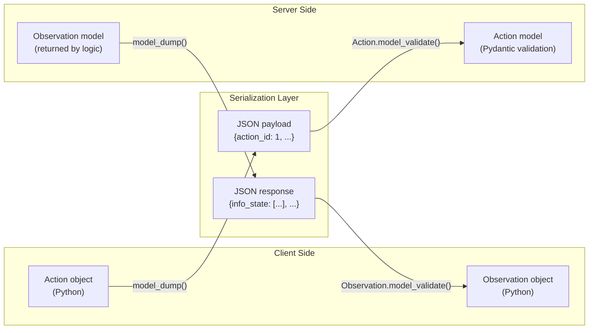

Example type contract from OpenSpielEnv:

[envs/openspiel_env/models.py:1-30]() defines `OpenSpielAction` and `OpenSpielObservation` classes. The client uses these for type hints:

```python
# Type-safe interaction
result = env.step(OpenSpielAction(action_id=1, game_name="catch"))
print(result.observation.legal_actions)  # IDE autocompletes 'legal_actions'
```

Without type definitions, this would be:
```python
# Unsafe interaction (Gymnasium style)
result = env.step(1)
print(result[0][3])  # What is index 3? No IDE help.
```

Sources: [README.md:55-63](), [module-1/README.md:23-31]()

## Sync vs Async Client Usage

The `EnvClient` ABC provides async methods by default, but the `.sync()` context manager converts them to synchronous calls for notebook and script usage:

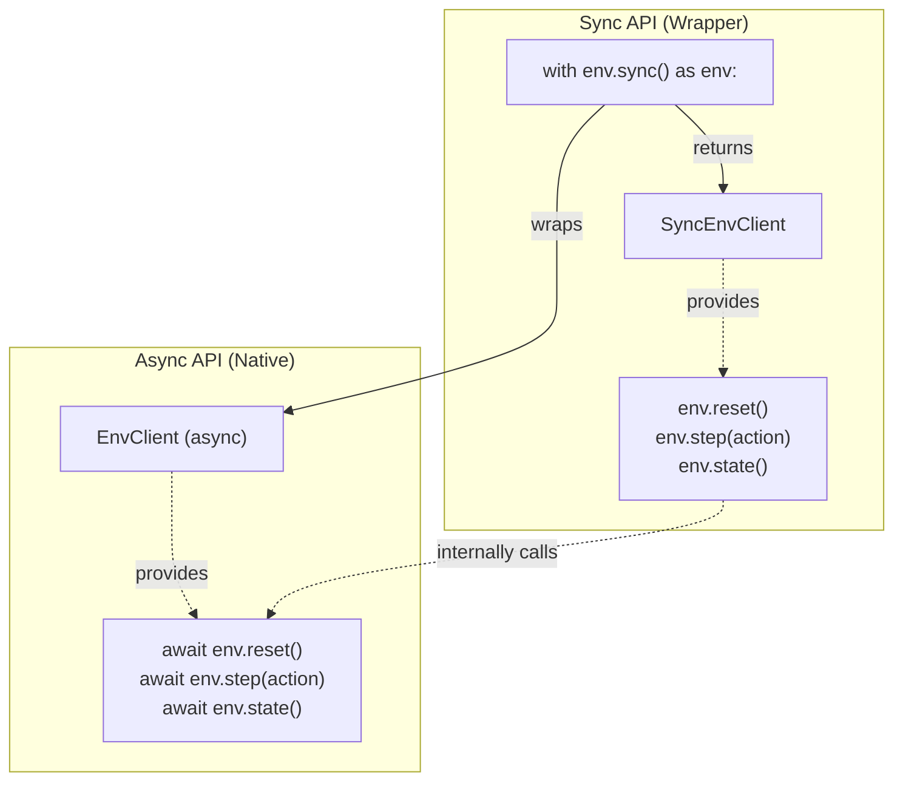

Usage patterns:

**Notebook/Script** (synchronous):
```python
with OpenSpielEnv(base_url="...").sync() as env:
    result = env.reset()
    result = env.step(action)
```

**Production/TRL** (asynchronous):
```python
env = OpenSpielEnv(base_url="...")
result = await env.reset()
result = await env.step(action)
```

The synchronous wrapper runs an event loop internally, converting async calls to blocking operations. This is implemented in the `SyncEnvClient` class returned by `.sync()`.

Sources: [module-1/README.md:119-123](), [README.md:50-63]()

## Scalability Characteristics

The WebSocket-based architecture enables high concurrency within single containers:

| Deployment | Max Concurrent Sessions | Infrastructure |
|------------|------------------------|----------------|
| HF Spaces (free) | 128 | 2 CPU cores, uvicorn default workers |
| Local uvicorn | 2,048 | 8 CPU cores, 8 workers, 256 sessions/worker |
| Docker container | 2,048 | Same as local uvicorn |
| SLURM multi-node | 16,384 | 96 cores, multiple containers + load balancer |

Configuration via environment variables:

| Variable | Default | Effect |
|----------|---------|--------|
| `WORKERS` | 4 | Number of uvicorn worker processes |
| `MAX_CONCURRENT_ENVS` | 100 | WebSocket sessions per worker |

Each worker process handles multiple WebSocket connections using async I/O. Each connection receives an isolated `Environment` instance with independent state.

For scaling beyond single containers, multiple instances can be deployed behind Envoy load balancers, distributing connections across replicas.

Sources: [README.md:86-126]()

## Environments vs Tools: MCP Interface

Some environments use a tool-based interface instead of the standard reset/step pattern. The EchoEnv example implements the Model Context Protocol (MCP):

```python
# Tool-based interface (EchoEnv)
env.reset()
response = env.call_tool("echo_message", message="Hello")

# Standard interface (OpenSpielEnv)
env.reset()
result = env.step(OpenSpielAction(action_id=1))
```

Tool-based environments expose `list_tools()` and `call_tool(name, **kwargs)` methods instead of `step(action)`. This pattern is used for environments that function as interactive utilities rather than episodic games.

Both interfaces share the same client-server architecture and WebSocket communication. The choice depends on the environment's semantics.

Sources: [module-1/README.md:127-129](), [README.md:47-53]()

## Key Design Principles

The architecture embodies five core principles:

1. **Isolation**: Environments run in containers, separated from training code
2. **Standardization**: Universal 3-method interface across all environments
3. **Type Safety**: Pydantic models catch errors before runtime
4. **Scalability**: WebSocket multiplexing + container orchestration
5. **Language Agnostic**: HTTP/WebSocket enables clients in any language

These principles distinguish OpenEnv from in-process frameworks like Gymnasium, trading slight network overhead (~0.1ms per step) for production-grade isolation, deployment, and scalability.

Sources: [module-1/README.md:34-44](), [README.md:79-85]()

---

# Page: Technology Stack and Dependencies

# Technology Stack and Dependencies

<details>
<summary>Relevant source files</summary>

The following files were used as context for generating this wiki page:

- [README.md](README.md)
- [requirements.txt](requirements.txt)

</details>


This page documents the Python packages, framework integrations, and hardware requirements for the OpenEnv course. It covers version constraints, dependency layers, and how different components interact across the five modules. For the architectural principles that these dependencies support, see [System Architecture and Core Concepts](#1.1). For deployment-specific configurations, see [Deployment to HF Spaces with openenv push](#4.3).

## Core Framework Layer

The `openenv-core` package (version 0.2.2+) provides the foundational abstractions that all modules build upon. This package contains the base classes and type definitions that enforce the 3-method interface across all environments.

| Package | Version | Primary Components | Used In |
|---------|---------|-------------------|---------|
| `openenv-core` | >=0.2.2 | `EnvClient`, `Environment` ABC, `create_fastapi_app` | All modules |
| `pydantic` | >=2.0.0 | Data validation, type-safe models | All modules |

The `EnvClient` base class (from `openenv-core`) provides the client-side interface. Custom environment clients like `EchoEnv`, `OpenSpielEnv`, and `TextArenaEnv` extend this class and implement three serialization methods:

- `_step_payload()` - Converts typed Action objects to JSON
- `_parse_result()` - Deserializes JSON to Observation objects
- `_parse_state()` - Deserializes JSON to State objects

The `Environment` ABC (from `openenv-core`) defines the server-side contract. Custom environments implement:

- `reset()` - Initialize episode state
- `step()` - Process actions and return observations
- `state()` - Return current episode state

The `create_fastapi_app()` function automatically generates FastAPI endpoints (`/reset`, `/step`, `/state`, `/ws`, `/health`) from an `Environment` instance.

**Sources:** [requirements.txt:8-9](), [README.md:34-35]()

## Web Stack Dependencies

The server-side environment runtime uses the FastAPI ecosystem for HTTP/WebSocket communication. These dependencies are required when running environments locally in Module 3 or building custom environments in Module 4.

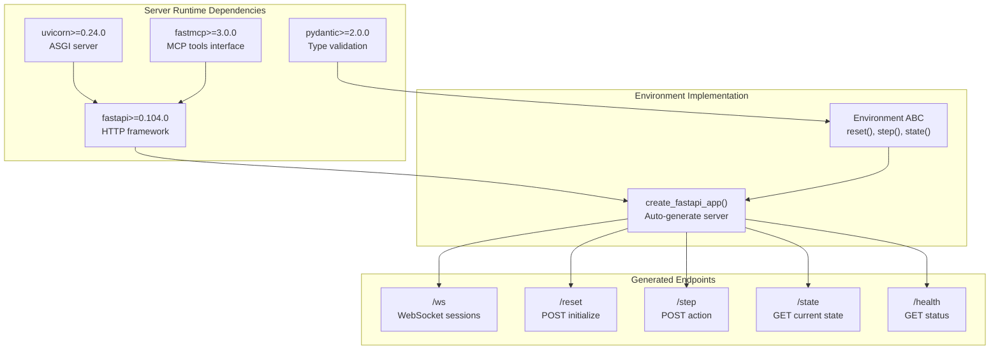

**Dependency Breakdown**

| Package | Purpose | Key Features | Configuration |
|---------|---------|--------------|---------------|
| `fastapi` | Web framework | Auto-generated OpenAPI docs at `/docs`, async support | Used in `create_fastapi_app()` |
| `uvicorn` | ASGI server | Multi-worker support, WebSocket persistence | `WORKERS` env var (default: 4) |
| `fastmcp` | MCP protocol | Tool-based interface for EchoEnv | Used in tool-calling environments |
| `pydantic` | Validation | Runtime type checking, serialization | All Action/Observation/State models |

The `WORKERS` environment variable (Module 3) controls Uvicorn worker processes. Each worker can handle `MAX_CONCURRENT_ENVS` WebSocket sessions (default: 100).

**Sources:** [requirements.txt:11-15](), [README.md:91-96]()

## Machine Learning Stack

Module 5 introduces dependencies for LLM training using reinforcement learning. These packages integrate with OpenEnv through TRL's `GRPOTrainer` and the `rollout_func` interface.

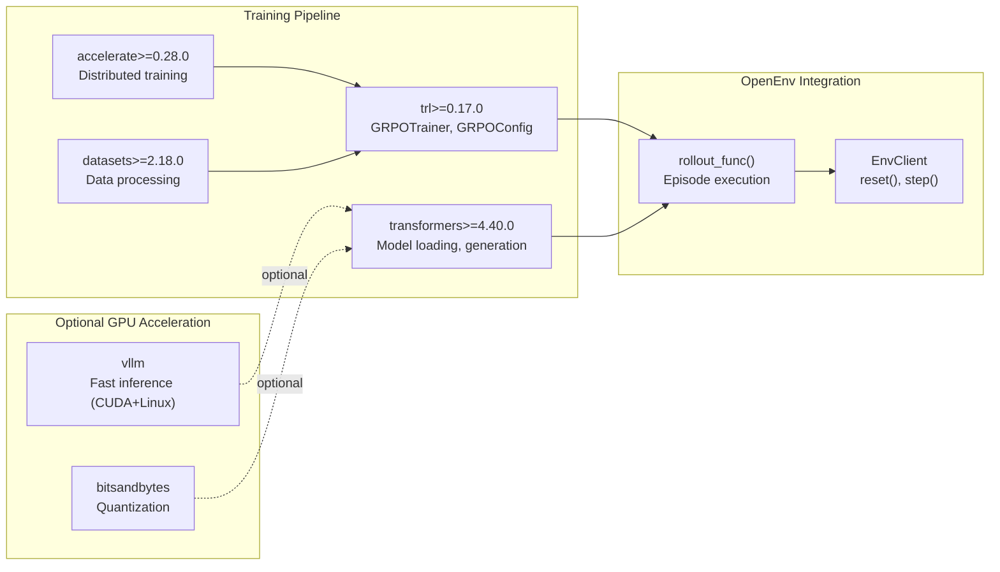

**Core ML Dependencies**

| Package | Version | Module 5 Usage | Notes |
|---------|---------|----------------|-------|
| `trl` | >=0.17.0 | `GRPOTrainer`, `GRPOConfig` | Reinforcement learning for LLMs |
| `transformers` | >=4.40.0 | Model loading, `.generate()` | Qwen3-1.7B in training example |
| `datasets` | >=2.18.0 | Data loading, processing | Not heavily used in Module 5 |
| `accelerate` | >=0.28.0 | GPU memory management | Required for distributed training |

**Optional Dependencies**

- `vllm` - Fast inference server with colocated mode. Requires CUDA and Linux. Used in Module 5 for efficient LLM generation during rollouts. Uncomment in [requirements.txt:22]() for GPU environments.
- `bitsandbytes` - Model quantization for memory efficiency. Uncomment in [requirements.txt:23]() for 4-bit/8-bit quantization.

The `trackio` package provides experiment tracking for Module 5 training runs.

**Sources:** [requirements.txt:18-26](), [README.md:29]()

## Domain-Specific Framework Integrations

OpenEnv integrates with existing RL and text game frameworks through environment wrappers. These integrations are not direct dependencies but are accessed through hosted HF Spaces or locally deployed servers.

### OpenSpiel Integration (Module 2)

The `OpenSpielEnv` client provides a unified interface to 6 wrapped games:

- `catch` - Catch falling balls
- `tic_tac_toe` - Classic 3x3 grid game
- `2048` - Number sliding puzzle
- `breakthrough` - Chess-like board game
- `pig` - Dice rolling game
- `connect_four` - 7x6 grid connection game

**Type Models:** `OpenSpielAction`, `OpenSpielObservation`, `OpenSpielState`

The client is game-agnostic - switching games only requires changing the `base_url` parameter:

```python
# From Module 2 examples
from envs.openspiel_env import OpenSpielEnv

env = OpenSpielEnv(base_url="https://openenv-openspiel-catch.hf.space")
# or
env = OpenSpielEnv(base_url="https://openenv-openspiel-tic-tac-toe.hf.space")
```

**Sources:** [README.md:55-62]()

### TextArena Integration (Module 5)

The `TextArenaEnv` client wraps text-based games for LLM training. Module 5 uses the Wordle environment:

- Text-based observation format (game state as strings)
- Action parsing from LLM-generated text
- Multi-signal rewards (correct word, green letters, yellow letters, repetition penalty)

The integration demonstrates OpenEnv's flexibility - the same `reset()`/`step()`/`state()` interface works for both turn-based board games (OpenSpiel) and language-based puzzles (TextArena).

**Sources:** [README.md:29]()

## Hardware Requirements by Module

Different modules have different computational requirements, ranging from CPU-only development to GPU-intensive training.

| Module | Hardware | Memory | GPU Required | Typical Environment |
|--------|----------|--------|--------------|---------------------|
| 1: Understanding | CPU | 4GB | No | Local machine, Colab free |
| 2: Using Environments | CPU | 4GB | No | Local machine, Colab free |
| 3: Deploying | CPU | 8GB | No | Local Docker or HF Spaces |
| 4: Building Environments | CPU | 8GB | No | Local Docker or HF Spaces |
| 5: Training LLMs | GPU | 40GB VRAM | **Yes** | A100 40GB, 90 min training |

### Module 5 GPU Requirements

The GRPO training example requires:

- **GPU:** A100 40GB (or equivalent 40GB VRAM GPU)
- **Training time:** ~90 minutes for Wordle task
- **Memory optimization:** vLLM colocate mode shares GPU between trainer and inference server
- **Alternative:** Smaller GPUs with quantization (`bitsandbytes`) or smaller models

For production-scale training with multiple environments:

| Setup | Concurrent Sessions | Hardware |
|-------|---------------------|----------|
| Development | 100-128 | HF Spaces free tier (CPU) |
| Training (single GPU) | 2,048 | 1x A100 40GB + Uvicorn |
| Production training | 16,384 | Multi-node SLURM + Envoy |

**Sources:** [README.md:109-119](), [requirements.txt:6]()

## Dependency Installation Patterns

The course supports three installation scenarios based on which modules you're running.

### Minimal Installation (Modules 1-2)

```bash
# Client-side only - connect to hosted environments
pip install openenv-core
```

This installs only the `EnvClient` base class and type definitions. Sufficient for consuming hosted environments via HTTP/WebSocket.

### Full Development (Modules 3-4)

```bash
# Install all dependencies including server stack
pip install -r requirements.txt
```

Installs server-side dependencies (`fastapi`, `uvicorn`, `fastmcp`) for running environments locally and building custom environments.

### Training Setup (Module 5)

```bash
# Install base dependencies
pip install -r requirements.txt

# Uncomment and install GPU dependencies
pip install vllm bitsandbytes  # Requires CUDA + Linux
```

Adds ML training stack with optional GPU acceleration packages.

### Repository Access Pattern

All modules require cloning the OpenEnv repository to access typed environment clients:

```python
import sys, os
repo = os.path.abspath('OpenEnv')
sys.path.insert(0, repo)
sys.path.insert(0, os.path.join(repo, 'src'))

# Now typed clients are importable
from envs.echo_env import EchoEnv
from envs.openspiel_env import OpenSpielEnv
from envs.textarena_env import TextArenaEnv
```

This pattern appears in [README.md:42-45]() and is used throughout all module notebooks.

**Sources:** [README.md:34-39](), [requirements.txt:1-30]()

## Version Compatibility Matrix

The following table shows tested version combinations across Python environments:

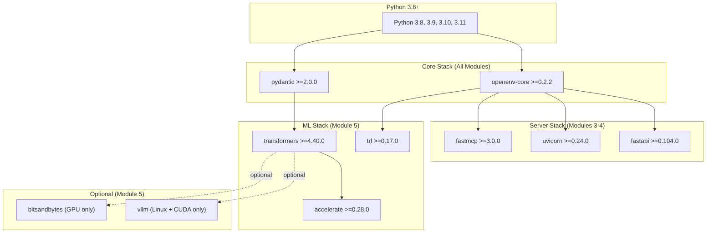

**Minimum Versions**

All version constraints in [requirements.txt]() use `>=` to allow newer compatible versions. The specified versions are the minimum tested versions:

- `openenv-core>=0.2.2` - Introduces `create_fastapi_app()` improvements
- `pydantic>=2.0.0` - Required for Pydantic v2 model definitions
- `fastapi>=0.104.0` - WebSocket stability improvements
- `transformers>=4.40.0` - Supports Qwen3 model architecture
- `trl>=0.17.0` - Includes `GRPOTrainer` implementation

**Platform Constraints**

- `vllm` requires Linux and CUDA-compatible GPU
- `bitsandbytes` requires CUDA for quantization
- All other packages are cross-platform (Windows, macOS, Linux)

**Sources:** [requirements.txt:1-30]()

## Utility Dependencies

Additional packages support experiment tracking and Hub interactions:

| Package | Version | Purpose | Used In |
|---------|---------|---------|---------|
| `trackio` | Latest | Experiment logging | Module 5 training metrics |
| `huggingface-hub` | >=0.22.0 | Model/Space upload | `openenv push`, model saving |

The `huggingface-hub` package powers the `openenv push` command in Module 3, which uploads environment code to HF Spaces. It also handles model pushing in Module 5 after training completes.

**Sources:** [requirements.txt:26-29]()

---

# Page: Module 1: Understanding OpenEnv

# Module 1: Understanding OpenEnv

<details>
<summary>Relevant source files</summary>

The following files were used as context for generating this wiki page:

- [module-1/README.md](module-1/README.md)
- [module-1/notebook.ipynb](module-1/notebook.ipynb)

</details>


## Purpose and Scope

This module introduces the foundational concepts of OpenEnv: the 3-method interface (`reset()`, `step()`, `state()`), client-server architecture, and type-safe interaction patterns. You will learn how to connect to hosted environments and execute episodes using a consistent API that works across all environment types.

For details on the specific interface methods and their implementations, see [The 3-Method Interface](#2.1). For architectural principles and comparison with Gymnasium, see [Client-Server Architecture](#2.2). For the distinction between standard RL and tool-based environments, see [Environment Types](#2.3).

**Learning objectives:**
- Understand the universal 3-method interface shared by all OpenEnv environments
- Connect to and interact with three demo environments: EchoEnv, OpenSpielEnv, TextArenaEnv
- Recognize the client-server separation and communication patterns
- Work with type-safe Pydantic models for actions and observations
- Choose between sync and async execution patterns

---

## The Universal Interface: reset, step, state

Every OpenEnv environment exposes exactly three methods, regardless of the underlying game logic, deployment target, or complexity. This consistency enables you to write environment-agnostic code that works with any OpenEnv environment.

### Method Signatures

| Method | Purpose | Input | Output |
|--------|---------|-------|--------|
| `reset()` | Initialize a new episode | Optional kwargs | `StepResult` |
| `step(action)` | Execute one environment transition | Environment-specific `Action` | `StepResult` |
| `state()` | Query episode metadata | None | `State` |

### StepResult Structure

The `StepResult` object returned by both `reset()` and `step()` contains:

| Field | Type | Description |
|-------|------|-------------|
| `observation` | Environment-specific | Current game state visible to agent |
| `reward` | `float` | Scalar reward signal |
| `done` | `bool` | Episode termination indicator |
| `info` | `dict` | Additional diagnostic information |

### The Interaction Loop

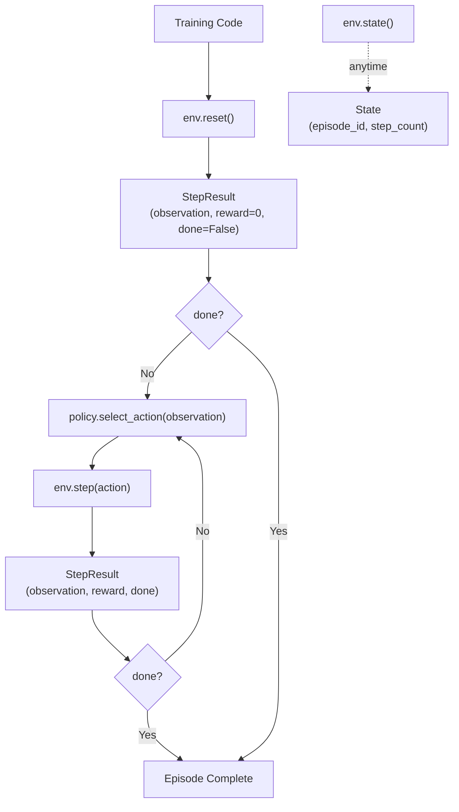

**Diagram: Standard Episode Execution Flow**

Sources: [module-1/README.md:82-90](), [module-1/notebook.ipynb:104-127]()

### Example: OpenSpiel Catch

The notebook demonstrates the interface with the Catch game, where the environment manages a falling ball and paddle:

```python
# From notebook: connecting to hosted environment
with OpenSpielEnv(base_url=OPENSPIEL_URL).sync() as env:
    result = env.reset()  # Initialize episode
    
    while not result.done:
        # Select action from legal moves
        action_id = random.choice(result.observation.legal_actions)
        
        # Execute transition
        result = env.step(OpenSpielAction(
            action_id=action_id,
            game_name='catch'
        ))
        
    # Query metadata
    state = env.state()
```

The pattern is identical whether you're playing Catch, Wordle, or a custom environment. Only the `Action` and `Observation` types change.

Sources: [module-1/notebook.ipynb:94-127](), [module-1/README.md:82-90]()

---

## Client-Server Architecture

OpenEnv implements environments as **network-accessible microservices** rather than in-process Python objects. This architectural decision addresses limitations in Gymnasium for production LLM training.

### Architectural Diagram

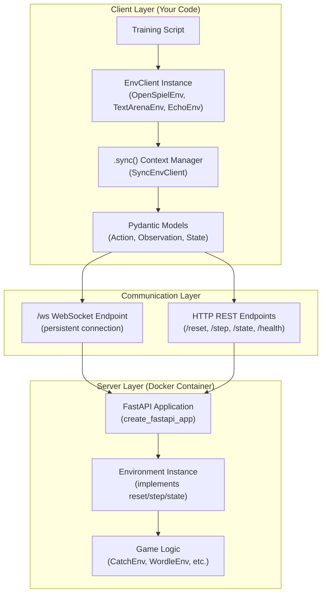

**Diagram: Three-Layer Architecture from Client to Server**

Sources: [module-1/README.md:46-71](), [module-1/README.md:108-126]()

### Comparison with Gymnasium

| Aspect | Gymnasium | OpenEnv |
|--------|-----------|---------|
| **Process Model** | In-process (same Python interpreter) | Out-of-process (Docker container) |
| **Communication** | Function calls | WebSocket/HTTP |
| **Type Safety** | Runtime numpy arrays | Compile-time Pydantic models |
| **Isolation** | Shared memory (crashes affect training) | Process isolation (crashes contained) |
| **Deployment** | Manual environment setup | `openenv push` → HF Spaces |
| **Scalability** | Single machine | Kubernetes-ready microservices |
| **Language Support** | Python only | Any language (HTTP client) |

The microservices approach enables:
- **Isolation**: Environment crashes don't kill your training run
- **Standardization**: HTTP/WebSocket API works from any language
- **Versioning**: Docker images ensure reproducibility across machines
- **Scalability**: Deploy 128 concurrent sessions on HF Spaces Free tier, 16,384+ on SLURM clusters

Sources: [module-1/README.md:19-33](), [module-1/README.md:36-44]()

### Communication Protocol

By default, clients connect via WebSocket (`/ws`) for persistent, low-latency communication (~0.1ms per frame). The protocol is transparent to users:

```python
# User writes this
env.reset()

# Internally:
# 1. EnvClient serializes to JSON via Pydantic
# 2. Sends WebSocket message to /ws
# 3. FastAPI server deserializes
# 4. Calls environment.reset()
# 5. Serializes response
# 6. Returns via WebSocket
# 7. Client deserializes to typed Observation
```

HTTP endpoints (`/reset`, `/step`, `/state`) are also available for stateless interactions or debugging.

Sources: [module-1/README.md:73-79](), [module-1/README.md:56-58]()

---

## Environment Types and Interfaces

OpenEnv supports two interface paradigms: **standard RL environments** (reset/step/state) and **tool-based MCP environments** (list_tools/call_tool).

### Interface Type Comparison

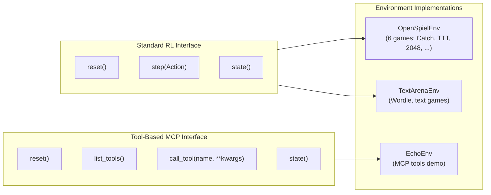

**Diagram: Two Interface Paradigms in OpenEnv**

Sources: [module-1/README.md:127-128](), [module-1/notebook.ipynb:38-68]()

### Standard RL Environments

Environments like `OpenSpielEnv` and `TextArenaEnv` follow the classic RL pattern:

```python
# OpenSpiel Catch example
from envs.openspiel_env import OpenSpielEnv
from envs.openspiel_env.models import OpenSpielAction

with OpenSpielEnv(base_url=url).sync() as env:
    result = env.reset()
    # result.observation.legal_actions: [0, 1, 2]
    # result.observation.info_state: numpy array
    
    result = env.step(OpenSpielAction(action_id=1, game_name='catch'))
    # result.reward: float
    # result.done: bool
```

**Key characteristics:**
- Discrete action spaces with `legal_actions`
- Structured observations (info_state, current_player, etc.)
- Episode-based with clear termination (`done=True`)
- Suitable for game AI and competitive tasks

Sources: [module-1/notebook.ipynb:94-127](), [module-1/notebook.ipynb:99-100]()

### Tool-Based MCP Environments

`EchoEnv` implements the Model Context Protocol (MCP) interface:

```python
# Echo environment example
from envs.echo_env import EchoEnv

with EchoEnv(base_url=url).sync() as env:
    result = env.reset()
    
    # Discover available tools
    tools = env.list_tools()
    # Returns: [Tool(name='echo_message', description='...'), ...]
    
    # Invoke tools by name
    response = env.call_tool('echo_message', message='Hello')
    # Returns: tool execution result
```

**Key characteristics:**
- Dynamic tool discovery via `list_tools()`
- Tool invocation via `call_tool(name, **kwargs)`
- No predefined action space (tools define interface)
- Suitable for LLM agent tasks and function calling

Sources: [module-1/notebook.ipynb:38-68](), [module-1/notebook.ipynb:51-63]()

### Environment Type Matrix

| Environment | Type | Base Class | Action Type | Hosted URL |
|-------------|------|------------|-------------|------------|
| EchoEnv | MCP Tool-based | `MCPToolClient` | Tool name + kwargs | `https://openenv-echo-env.hf.space` |
| OpenSpielEnv | Standard RL | `EnvClient` | `OpenSpielAction` | `https://openenv-openspiel-catch.hf.space` |
| TextArenaEnv | Standard RL | `EnvClient` | `TextArenaAction` | `https://burtenshaw-textarena.hf.space` |

Sources: [module-1/notebook.ipynb:29](), [module-1/notebook.ipynb:102](), [module-1/notebook.ipynb:156]()

---

## Type Safety with Pydantic Models

OpenEnv enforces type safety using Pydantic models for all data exchanged between client and server. This provides compile-time error checking and IDE autocomplete.

### Type Hierarchy

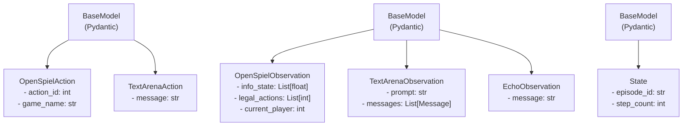

**Diagram: Pydantic Model Inheritance for Type Safety**

Sources: [module-1/README.md:99](), [module-1/notebook.ipynb:100](), [module-1/notebook.ipynb:154]()

### Benefits of Type Safety

**1. IDE Autocomplete**

```python
result = env.step(action)
# Typing "result.observation." triggers autocomplete:
# - legal_actions
# - info_state
# - current_player
```

**2. Early Error Detection**

```python
# This fails at instantiation, not during training:
action = OpenSpielAction(action_id="invalid")  # Type error: str not int
```

**3. Serialization Guarantees**

Pydantic handles JSON serialization/deserialization automatically:

```python
# Client side
action = OpenSpielAction(action_id=2, game_name='catch')
# Pydantic serializes to: {"action_id": 2, "game_name": "catch"}

# Server side receives JSON, Pydantic deserializes to typed object
```

### Example: OpenSpielObservation

The `OpenSpielObservation` model from the Catch example:

```python
# Line 107-108: Accessing typed fields
print(f'Legal actions: {result.observation.legal_actions}')
print(f'Info state length: {len(result.observation.info_state)}')
```

The client receives a fully-typed `OpenSpielObservation` object, not a generic dictionary or numpy array. Your IDE knows the schema at development time.

Sources: [module-1/notebook.ipynb:107-108](), [module-1/README.md:25]()

---

## Sync vs Async Execution

OpenEnv clients are asynchronous by default (using `async/await`). For notebooks and simple scripts, the `.sync()` wrapper provides a synchronous interface.

### Pattern Comparison

**Synchronous (Notebooks, Scripts)**

```python
# Uses .sync() context manager
with OpenSpielEnv(base_url=url).sync() as env:
    result = env.reset()          # No await
    result = env.step(action)     # No await
    state = env.state()           # No await
```

**Asynchronous (Production, Training Loops)**

```python
# Direct async context manager
async with OpenSpielEnv(base_url=url) as env:
    result = await env.reset()    # Explicit await
    result = await env.step(action)
    state = await env.state()
```

### Implementation: SyncEnvClient

The `.sync()` method returns a `SyncEnvClient` wrapper that intercepts async method calls and executes them synchronously:

```python
# From comment in notebook line 40-42:
# MCP methods (list_tools, call_tool) are async; .sync() wraps them automatically
# via SyncEnvClient.__getattr__, so the same .sync() pattern works here.
```

The wrapper uses `asyncio.run()` internally to execute async methods in a synchronous context, making it suitable for interactive notebooks where `await` syntax is inconvenient.

### When to Use Each

| Context | Pattern | Reason |
|---------|---------|--------|
| Jupyter Notebooks | `.sync()` | Simpler syntax, no async cell magic required |
| Simple Scripts | `.sync()` | Avoid asyncio event loop boilerplate |
| Training Loops | `async with` | Native async enables concurrent environment execution |
| Production Services | `async with` | Better integration with async frameworks (FastAPI, etc.) |

Sources: [module-1/notebook.ipynb:181-196](), [module-1/notebook.ipynb:40-42](), [module-1/README.md:122]()

---

## Demo Environments

Module 1 provides three hosted environments that demonstrate different interface patterns and use cases.

### EchoEnv: Tool-Based MCP Interface

**Purpose:** Minimal MCP environment for learning tool discovery and invocation

**URL:** `https://openenv-echo-env.hf.space`

**Interface:**
- `reset()` → Initialize episode
- `list_tools()` → Discover available tools
- `call_tool(name, **kwargs)` → Execute tool by name
- `state()` → Query metadata

**Available Tools:**

| Tool Name | Parameters | Returns |
|-----------|------------|---------|
| `echo_message` | `message: str` | Echoes message back |
| `echo_with_length` | `message: str` | Returns message + length |

**Example interaction:**

```python
with EchoEnv(base_url='https://openenv-echo-env.hf.space').sync() as env:
    env.reset()
    
    tools = env.list_tools()
    # [Tool(name='echo_message', ...), Tool(name='echo_with_length', ...)]
    
    response = env.call_tool('echo_message', message='Hello, OpenEnv!')
    # Returns echoed message
```

Sources: [module-1/notebook.ipynb:25-68](), [module-1/notebook.ipynb:38-40]()

### OpenSpielEnv: Standard RL Games

**Purpose:** DeepMind OpenSpiel games with unified interface (6 games available: Catch, Tic-Tac-Toe, 2048, etc.)

**URL:** `https://openenv-openspiel-catch.hf.space` (Catch variant)

**Interface:**
- `reset()` → Start new game
- `step(OpenSpielAction)` → Execute action (0=left, 1=stay, 2=right for Catch)
- `state()` → Query episode metadata

**Observation Schema:**

| Field | Type | Description |
|-------|------|-------------|
| `info_state` | `List[float]` | Flattened game state representation |
| `legal_actions` | `List[int]` | Valid action IDs at current step |
| `current_player` | `int` | Active player (0 for single-player games) |

**Example: Playing Catch**

```python
with OpenSpielEnv(base_url=OPENSPIEL_URL).sync() as env:
    result = env.reset()
    
    while not result.done:
        action_id = random.choice(result.observation.legal_actions)
        result = env.step(OpenSpielAction(
            action_id=action_id,
            game_name='catch'
        ))
        print(f'Reward: {result.reward}, Done: {result.done}')
```

Sources: [module-1/notebook.ipynb:81-127](), [module-1/notebook.ipynb:99-100]()

### TextArenaEnv: Text-Based Games

**Purpose:** Text-based game environments (Wordle demonstration)

**URL:** `https://burtenshaw-textarena.hf.space`

**Interface:**
- `reset()` → Start new game (get initial prompt)
- `step(TextArenaAction)` → Submit guess/action
- `state()` → Query episode metadata

**Observation Schema:**

| Field | Type | Description |
|-------|------|-------------|
| `prompt` | `str` | Game instructions/current state |
| `messages` | `List[Message]` | Feedback history with categories |

**Example: Playing Wordle**

```python
with TextArenaEnv(base_url=TEXTARENA_URL).sync() as env:
    result = env.reset()
    print(result.observation.prompt)  # Game instructions
    
    result = env.step(TextArenaAction(message='[crane]'))
    for msg in result.observation.messages:
        print(f'[{msg.category}] {msg.content}')  # Feedback: greens, yellows
```

Sources: [module-1/notebook.ipynb:140-175](), [module-1/notebook.ipynb:153-154]()

---

## Summary

Module 1 establishes the foundational patterns used throughout the OpenEnv course:

**Core Concepts:**
- Every environment exposes `reset()`, `step()`, `state()`
- Environments run as isolated Docker containers, accessed via WebSocket/HTTP
- Pydantic models ensure type safety for actions, observations, and state
- `.sync()` wrapper enables synchronous usage in notebooks

**Environment Types:**
- Standard RL: `OpenSpielEnv`, `TextArenaEnv` (step-based interaction)
- Tool-based MCP: `EchoEnv` (tool discovery and invocation)

**Key Insight:**
The same client code pattern works across all environments. Only the `Action` and `Observation` types change. This consistency enables writing environment-agnostic training code that can swap between games by changing only the `base_url` parameter.

**Next Steps:**
- [Module 2](#3): Write policies for OpenSpiel games and run competitive evaluations
- [Module 3](#4): Deploy and modify existing environments using the clone-modify-deploy workflow
- [Module 4](#5): Build custom environments from scratch using the 3-component pattern

Sources: [module-1/notebook.ipynb:202-215](), [module-1/README.md:130-134]()

---

# Page: The 3-Method Interface: reset(), step(), state()

# The 3-Method Interface: reset(), step(), state()

<details>
<summary>Relevant source files</summary>

The following files were used as context for generating this wiki page:

- [module-1/notebook.ipynb](module-1/notebook.ipynb)

</details>


## Purpose and Scope

This page documents the fundamental 3-method interface that all OpenEnv environments expose: `reset()`, `step()`, and `state()`. This interface provides a standardized API for interacting with any OpenEnv environment, regardless of its internal implementation or domain (RL games, tool-based agents, text games, etc.).

For information about the architectural principles that motivate this design, see [Client-Server Architecture and Microservices](#2.2). For details on environment-specific type models, see [Type-Safe Models: Action, Observation, State](#3.2). For implementing this interface in custom environments, see [Implementing Environment Logic](#5.2).

**Sources:** [module-1/notebook.ipynb:6-11]()

---

## The Core Interface

Every OpenEnv environment, whether hosted on HF Spaces or running locally, exposes exactly three methods for interaction:

| Method | Purpose | Returns |
|--------|---------|---------|
| `reset()` | Initialize a new episode, returning the starting observation | `ResetResult` containing `observation` and `done` flag |
| `step(action)` | Execute an action, advance the environment state | `StepResult` containing `observation`, `reward`, `done`, and optional `info` |
| `state()` | Query episode metadata without side effects | `State` containing `step_count` and other episode statistics |

This interface is **intentionally minimal**. By constraining all environment interactions to these three operations, OpenEnv achieves:

- **Consistency:** The same client code works across all environments
- **Type Safety:** Each environment defines typed action/observation models via Pydantic
- **Testability:** Simple interface means simple testing
- **Network Efficiency:** Stateful WebSocket connections minimize overhead

**Sources:** [module-1/notebook.ipynb:206-213]()

---

## Interface Flow Diagram

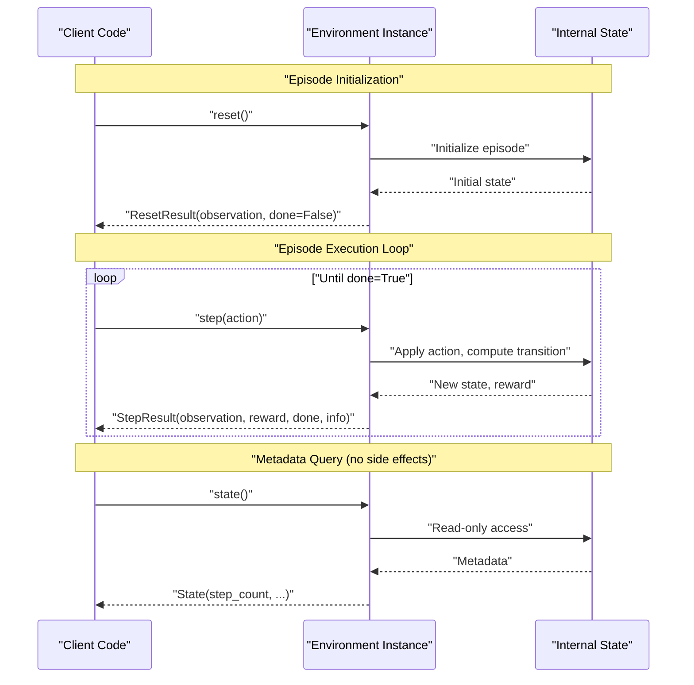

**Sources:** [module-1/notebook.ipynb:43-67](), [module-1/notebook.ipynb:104-126]()

---

## Method Details

### reset()

The `reset()` method initializes a new episode. It returns a `ResetResult` object containing:

- `observation`: Environment-specific typed observation (e.g., `OpenSpielObservation`, `TextArenaObservation`)
- `done`: Boolean flag, typically `False` after reset
- Additional environment-specific fields may be present

**Example from OpenSpielEnv:**

```python
from envs.openspiel_env import OpenSpielEnv

with OpenSpielEnv(base_url='https://openenv-openspiel-catch.hf.space').sync() as env:
    result = env.reset()
    # result.observation.legal_actions -> [0, 1, 2]
    # result.observation.info_state -> list of floats representing game state
    # result.done -> False
```

**Key Properties:**
- Idempotent: calling `reset()` multiple times is safe
- No parameters required (though some environments may accept optional configuration)
- Always returns a fresh episode state

**Sources:** [module-1/notebook.ipynb:43-48](), [module-1/notebook.ipynb:105-109]()

### step(action)

The `step()` method advances the environment by one timestep, executing the provided action. It returns a `StepResult` object containing:

- `observation`: New typed observation after action execution
- `reward`: Numeric reward signal (`float`)
- `done`: Boolean indicating episode termination
- `info`: Optional dictionary with auxiliary data

**Example from OpenSpielEnv:**

```python
from envs.openspiel_env.models import OpenSpielAction

with OpenSpielEnv(base_url=url).sync() as env:
    result = env.reset()
    
    # Execute action: move paddle right
    result = env.step(OpenSpielAction(action_id=2, game_name='catch'))
    # result.reward -> 0.0 (game continues)
    # result.done -> False (episode not finished)
    # result.observation.legal_actions -> [0, 1, 2]
```

**Key Properties:**
- Requires a typed action object (environment-specific Pydantic model)
- Stateful: modifies internal episode state
- May set `done=True` when episode terminates
- Reward semantics are environment-specific

**Sources:** [module-1/notebook.ipynb:117-122](), [module-1/notebook.ipynb:169-173]()

### state()

The `state()` method queries episode metadata **without side effects**. It returns a `State` object containing:

- `step_count`: Number of `step()` calls in current episode
- Additional environment-specific metadata

**Example:**

```python
with env.sync() as env:
    result = env.reset()
    result = env.step(action)
    result = env.step(action)
    
    state = env.state()
    # state.step_count -> 2
```

**Key Properties:**
- Read-only: does not modify episode state
- Can be called at any time (before/during/after episode)
- Useful for debugging and progress tracking
- No network overhead when using persistent WebSocket connections

**Sources:** [module-1/notebook.ipynb:66-67](), [module-1/notebook.ipynb:125-126]()

---

## Environment-Specific Implementations

While the interface is uniform, each environment type defines its own action and observation models. Here's how the three environments demonstrated in Module 1 implement the interface:

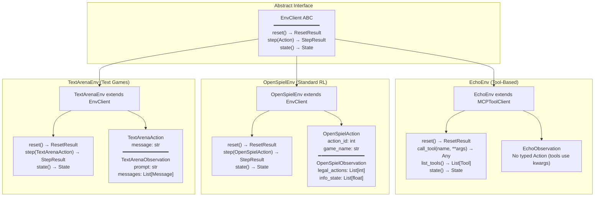

**Sources:** [module-1/notebook.ipynb:38-68](), [module-1/notebook.ipynb:99-127](), [module-1/notebook.ipynb:153-175]()

---

## Mapping Interface Methods to Code Entities

The following diagram shows how the abstract 3-method interface maps to concrete implementations in the codebase:

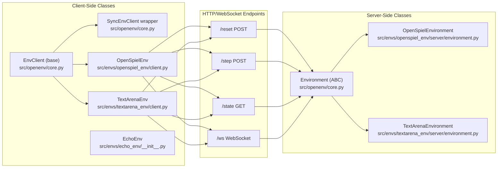

**Sources:** [module-1/notebook.ipynb:38-39](), [module-1/notebook.ipynb:99-100](), [module-1/notebook.ipynb:153-154]()

---

## Sync vs Async Patterns

OpenEnv clients are **async by default** because they perform network I/O. However, for notebooks, simple scripts, and initial learning, the `.sync()` wrapper provides a synchronous interface:

### Synchronous (Recommended for Course)

```python
# Using .sync() context manager
with EchoEnv(base_url=url).sync() as env:
    result = env.reset()  # No await needed
    result = env.step(action)
    state = env.state()
```

The `.sync()` method returns a `SyncEnvClient` wrapper that:
- Automatically converts all async methods to sync using `asyncio.run()`
- Maintains the same method signatures
- Simplifies code for learning and prototyping

### Asynchronous (Production Use)

```python
# Native async interface
async with EchoEnv(base_url=url) as env:
    result = await env.reset()
    result = await env.step(action)
    state = await env.state()
```

**When to use async:**
- Training loops with concurrent environment instances
- Production systems requiring high throughput
- Integration with async frameworks (FastAPI, aiohttp)

**Technical Details:**
- The `.sync()` wrapper is implemented in `SyncEnvClient.__getattr__`
- It wraps async methods using `asyncio.run()` or an existing event loop
- Persistent WebSocket connections work in both modes

**Sources:** [module-1/notebook.ipynb:181-196]()

---

## Return Type Structure

All three methods return structured objects with typed fields:

### ResetResult

Returned by `reset()`:

```python
@dataclass
class ResetResult:
    observation: ObservationType  # Environment-specific typed observation
    done: bool                     # Typically False after reset
```

### StepResult

Returned by `step()`:

```python
@dataclass
class StepResult:
    observation: ObservationType  # New observation after action
    reward: float                 # Numeric reward signal
    done: bool                    # Episode termination flag
    info: dict                    # Optional auxiliary data
```

### State

Returned by `state()`:

```python
@dataclass
class State:
    step_count: int              # Number of steps taken
    # Additional environment-specific fields
```

**Type Safety Advantages:**
- IDE autocomplete for all fields
- Runtime validation via Pydantic
- Early error detection (before network call)
- Self-documenting code

**Sources:** [module-1/notebook.ipynb:46-48](), [module-1/notebook.ipynb:117-122](), [module-1/notebook.ipynb:125-126]()

---

## Complete Usage Example

This example demonstrates the full episode lifecycle using all three methods:

```python
from envs.openspiel_env import OpenSpielEnv
from envs.openspiel_env.models import OpenSpielAction
import random

OPENSPIEL_URL = 'https://openenv-openspiel-catch.hf.space'

# 1. Connect using sync wrapper
with OpenSpielEnv(base_url=OPENSPIEL_URL).sync() as env:
    
    # 2. Initialize episode
    result = env.reset()
    print(f'Legal actions: {result.observation.legal_actions}')
    print(f'Done: {result.done}')
    
    # 3. Execute episode loop
    step_num = 0
    while not result.done:
        # Select random legal action
        action_id = random.choice(result.observation.legal_actions)
        
        # Take step
        result = env.step(OpenSpielAction(
            action_id=action_id,
            game_name='catch'
        ))
        
        step_num += 1
        print(f'Step {step_num}: reward={result.reward}, done={result.done}')
    
    # 4. Query final state
    state = env.state()
    print(f'Total steps: {state.step_count}')
    print(f'Final reward: {result.reward}')
```

**Execution Flow:**
1. `reset()` initializes episode → returns starting observation
2. Loop: `step(action)` until `done=True` → accumulates rewards
3. `state()` retrieves metadata → confirms step count

**Sources:** [module-1/notebook.ipynb:104-126]()

---

## Tool-Based Environments (MCP Pattern)

While most RL environments use `step(action)`, tool-based environments like `EchoEnv` expose a **Model Context Protocol (MCP)** interface instead:

### MCP Methods

```python
with EchoEnv(base_url=url).sync() as env:
    # Discovery: list available tools
    tools = env.list_tools()  # Returns list of Tool objects
    
    # Execution: call a specific tool
    result = env.call_tool('echo_message', message='Hello')
    
    # Still supports reset() and state()
    env.reset()
    state = env.state()
```

**Key Differences:**
- No `step()` method (uses `call_tool()` instead)
- Tools discovered dynamically via `list_tools()`
- Actions are tool invocations with keyword arguments
- Suitable for agent-based systems (LLM tool use)

For detailed MCP integration, see [Environment Types and Tool-Based Interfaces](#2.3).

**Sources:** [module-1/notebook.ipynb:43-68]()

---

## Summary Table

| Aspect | Details |
|--------|---------|
| **Core Methods** | `reset()`, `step(action)`, `state()` |
| **Access Modes** | Async (native) or Sync (via `.sync()` wrapper) |
| **Type Safety** | Pydantic models for actions, observations, states |
| **Network Protocol** | WebSocket (persistent) or HTTP (stateless) |
| **Consistency** | Same interface across all environment types |
| **Exceptions** | Tool-based environments use `call_tool()` instead of `step()` |

**Sources:** [module-1/notebook.ipynb:206-213]()

---

# Page: Client-Server Architecture and Microservices

# Client-Server Architecture and Microservices

<details>
<summary>Relevant source files</summary>

The following files were used as context for generating this wiki page:

- [README.md](README.md)
- [module-1/README.md](module-1/README.md)

</details>


## Purpose and Scope

This document explains the architectural principles underlying OpenEnv's client-server design and microservices approach. It covers the separation of concerns between client and server components, the communication protocols used, and the rationale for choosing a distributed architecture over monolithic patterns like Gymnasium. For details on the specific 3-method interface (`reset()`, `step()`, `state()`), see [2.1](#2.1). For environment-specific implementations, see [2.3](#2.3).

**Sources:** [README.md:1-135](), [module-1/README.md:1-135]()

---

## The Microservices Philosophy

OpenEnv treats RL environments as **microservices** rather than in-process libraries. This architectural decision stems from production requirements that traditional monolithic RL frameworks like Gymnasium were not designed to address.

### Core Principle

**RL environments should be isolated services that communicate over standard protocols.**

This means:
- Environment logic runs in separate containers, not in the training process
- Communication happens via HTTP/WebSocket, not function calls
- Each environment instance is independently deployable and scalable
- Type contracts are enforced at API boundaries, not just within a single process

### Comparison with Gymnasium

| Architectural Aspect | Gymnasium (Monolithic) | OpenEnv (Microservices) |
|---------------------|------------------------|-------------------------|
| **Process Model** | Same process as training code | Separate containerized process |
| **Communication** | Direct Python function calls | WebSocket/HTTP API calls |
| **Type Safety** | Runtime errors (`obs[0][3]`) | Compile-time contracts (`obs.info_state`) |
| **Isolation** | Shared memory space (crashes propagate) | Process isolation (environment crashes don't affect training) |
| **Deployment** | "Works on my machine" | Containerized (Docker) |
| **Scaling** | Manual multi-processing | Kubernetes/container orchestration |
| **Language Support** | Python only | Any language with HTTP client |
| **Versioning** | Python package versions | Docker image tags |
| **Debugging** | Cryptic numpy/array errors | Typed API errors with clear messages |

**Sources:** [module-1/README.md:19-34]()

---

## Architectural Principles

OpenEnv's architecture is built on five foundational principles that enable production-grade RL systems.

### Isolation

Environments run in dedicated containers, providing:
- **Crash isolation**: An environment exception doesn't crash training
- **Resource isolation**: Memory limits per environment instance
- **Security isolation**: Untrusted environment code cannot access training infrastructure
- **Dependency isolation**: Each environment has its own Python dependencies

The containerization is defined in `server/Dockerfile` within each environment's directory structure.

### Standardization

All environments expose identical interfaces regardless of internal complexity:
- **Server-side**: The `Environment` ABC defines `reset()`, `step()`, and `state` property
- **Client-side**: The `EnvClient` ABC defines corresponding async methods
- **Protocol-level**: REST endpoints (`/reset`, `/step`, `/state`) and WebSocket (`/ws`)
- **Documentation**: Auto-generated OpenAPI docs at `/docs`

This standardization means client code works across all environments without modification (except for the `base_url`).

### Type Safety

Pydantic models enforce type contracts at API boundaries:
- **Action models**: Define what actions are valid (e.g., `OpenSpielAction`)
- **Observation models**: Define the structure of observations (e.g., `OpenSpielObservation`)
- **State models**: Define episode metadata
- **Serialization**: Automatic JSON serialization/deserialization
- **Validation**: Pydantic validates all data crossing the network boundary

Type safety eliminates an entire class of runtime errors common in Gymnasium code.

### Scalability

The client-server architecture enables horizontal scaling:
- **Single container**: Up to 2,048 concurrent sessions (8 workers × 256 sessions/worker)
- **Multi-container**: Load balancer distributes across multiple containers
- **Cloud deployment**: One-command deployment to HF Spaces, Kubernetes, or SLURM

Scaling is controlled by environment variables: `WORKERS` (number of uvicorn processes) and `MAX_CONCURRENT_ENVS` (sessions per worker).

**Sources:** [module-1/README.md:34-45](), [README.md:76-126]()

---

## Client-Server Separation

### Architecture Overview

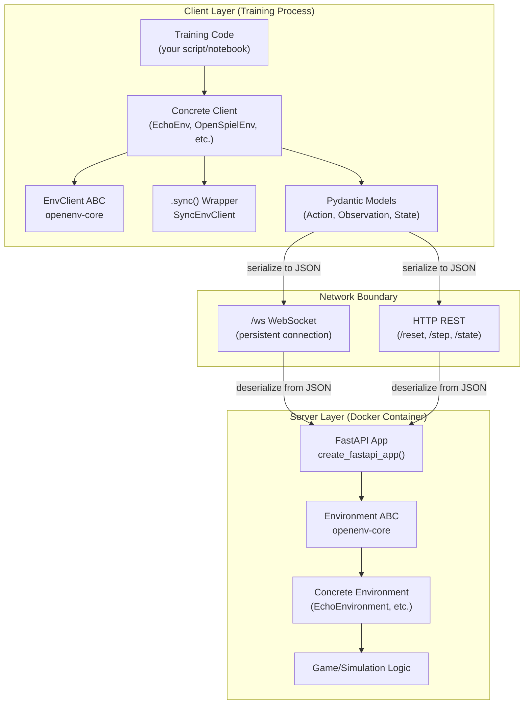

**Diagram 1: Client-Server Component Mapping**

This diagram shows how code entities map across the network boundary. The client layer uses classes from `openenv-core` package, while the server layer runs inside Docker containers.

**Sources:** [module-1/README.md:46-79](), [module-1/README.md:93-129]()

### Component Responsibilities

#### Client-Side Components

| Component | Location | Responsibility |
|-----------|----------|----------------|
| `EnvClient` | `openenv-core` package | Abstract base class defining async methods |
| `SyncEnvClient` | `openenv-core` package | Synchronous wrapper via `.sync()` context manager |
| Concrete clients | `envs/*/client.py` | Environment-specific implementations |
| Type models | `envs/*/models.py` | Pydantic models for serialization |

Client implementations extend `EnvClient` and implement:
- `_step_payload(action)`: Serialize action to dict
- `_parse_result(response)`: Deserialize response to `StepResult`
- `_parse_state(response)`: Deserialize response to `State`

#### Server-Side Components

| Component | Location | Responsibility |
|-----------|----------|----------------|
| `Environment` | `openenv-core` package | Abstract base class for game logic |
| `create_fastapi_app()` | `openenv-core` package | Auto-generates FastAPI routes |
| Concrete environment | `envs/*/server/environment.py` | Game-specific logic |
| FastAPI app | `envs/*/server/app.py` | Application entry point |
| Dockerfile | `envs/*/server/Dockerfile` | Container definition |

Server implementations extend `Environment` and implement:
- `reset() -> Observation`: Initialize new episode
- `step(action: Action) -> Observation`: Process action, return new observation
- `state` property: Return episode metadata

**Sources:** [module-1/README.md:93-129]()

---

## Communication Layer

### WebSocket as Primary Protocol

```mermaid
sequenceDiagram
    participant Client as "EnvClient<br/>(your code)"
    participant WS as "WebSocket /ws<br/>(persistent)"
    participant Server as "FastAPI Server<br/>(uvicorn)"
    participant Env as "Environment<br/>(game logic)"
    
    Note over Client,Env: Connection Establishment
    Client->>WS: Connect to /ws
    WS->>Server: WebSocket handshake
    Server->>Env: Create environment instance
    Server-->>Client: Connection established
    
    Note over Client,Env: Episode Execution (many steps over same connection)
    Client->>WS: {"method": "reset", "params": {}}
    WS->>Server: Forward message
    Server->>Env: environment.reset()
    Env-->>Server: Observation object
    Server-->>WS: {"observation": {...}, "reward": 0, "done": false}
    WS-->>Client: StepResult (deserialized)
    
    Client->>WS: {"method": "step", "params": {"action": {...}}}
    WS->>Server: Forward message
    Server->>Env: environment.step(action)
    Env-->>Server: Observation object
    Server-->>WS: {"observation": {...}, "reward": 1.0, "done": false}
    WS-->>Client: StepResult (deserialized)
    
    Note over Client,Env: Repeat step() many times without reconnecting
    
    Client->>WS: Close connection
    WS->>Server: Teardown
    Server->>Env: Cleanup environment instance
```

**Diagram 2: WebSocket Communication Flow**

This diagram shows how a single WebSocket connection handles multiple RL steps with minimal overhead (~0.1ms per frame).

### Protocol Comparison

| Aspect | WebSocket (`/ws`) | HTTP REST |
|--------|-------------------|-----------|
| **Connection** | Persistent (one handshake) | New TCP handshake per request |
| **Latency per step** | ~0.1ms | ~10-50ms (handshake overhead) |
| **Use case** | Primary method for episodes | Fallback / stateless queries |
| **Session management** | Automatic (connection = session) | Manual (requires session IDs) |
| **Overhead** | Minimal after handshake | High for many small requests |
| **Endpoints** | Single `/ws` endpoint | `/reset`, `/step`, `/state`, `/health` |

The client automatically uses WebSocket by default. Users never see the protocol details—they just call `env.reset()` and `env.step()`.

**Sources:** [README.md:79-85]()

### HTTP Endpoints

In addition to WebSocket, every environment exposes HTTP endpoints:

| Endpoint | Method | Purpose |
|----------|--------|---------|
| `/ws` | WebSocket | Primary interaction protocol |
| `/reset` | POST | HTTP fallback for reset |
| `/step` | POST | HTTP fallback for step |
| `/state` | GET | Query episode metadata |
| `/health` | GET | Health check for orchestration |
| `/web` | GET | Human-playable web interface (optional) |
| `/docs` | GET | Auto-generated OpenAPI documentation |

These endpoints are auto-generated by `create_fastapi_app()` from `openenv-core`.

**Sources:** [module-1/README.md:46-79]()

---

## Containerization and Deployment

### The 3-Component Pattern

Every OpenEnv environment follows a standardized directory structure:

```
envs/my_env/
├── models.py              # Pydantic models (Action, Observation, State)
├── client.py              # EnvClient implementation
└── server/
    ├── environment.py     # Environment implementation
    ├── app.py             # FastAPI application
    └── Dockerfile         # Container definition
```

This structure enforces separation of concerns:
- **`models.py`**: Type contracts shared by client and server
- **`client.py`**: Network communication logic (client-side)
- **`server/environment.py`**: Game logic (server-side)
- **`server/app.py`**: Server initialization using `create_fastapi_app()`
- **`server/Dockerfile`**: Containerization instructions

**Sources:** [module-1/README.md:93-106]()

### Deployment Model

```mermaid
graph TB
    subgraph Development["Development (Local)"]
        LocalCode["Your Training Code"]
        LocalEnv["uvicorn server/app.py<br/>(localhost:8000)"]
    end
    
    subgraph Container["Container (Docker)"]
        DockerImage["Docker Image<br/>(built from Dockerfile)"]
        UvicornWorkers["Uvicorn Workers<br/>(WORKERS env var)"]
        EnvInstances["Environment Instances<br/>(MAX_CONCURRENT_ENVS per worker)"]
    end
    
    subgraph Deployment["Deployment Targets"]
        HFSpaces["HF Spaces<br/>(free tier: 128 concurrent)<br/>(paid tier: higher)"]
        K8s["Kubernetes<br/>(arbitrary scale)"]
        SLURM["SLURM Multi-Node<br/>(16,384+ concurrent)"]
    end
    
    LocalCode -->|"development"| LocalEnv
    LocalCode -->|"docker run"| DockerImage
    
    DockerImage --> UvicornWorkers
    UvicornWorkers --> EnvInstances
    
    DockerImage -->|"openenv push"| HFSpaces
    DockerImage -->|"kubectl apply"| K8s
    DockerImage -->|"srun"| SLURM
```

**Diagram 3: Deployment Architecture**

This shows the three deployment modes: local development, Docker containerization, and production deployment targets.

### Scaling Characteristics

| Deployment Target | Max Concurrent Sessions | Infrastructure | Sessions per Core |
|-------------------|------------------------|----------------|-------------------|
| **HF Spaces (free)** | 128 | 2 CPU cores | 64 |
| **Local Uvicorn** | 2,048 | 8 CPU cores | 256 |
| **Docker (local)** | 2,048 | 8 CPU cores | 256 |
| **SLURM Multi-Node** | 16,384 | 96 CPU cores | 171 |

The single-container maximum of ~2,048 is achieved with:
- `WORKERS=8` (Uvicorn processes)
- `MAX_CONCURRENT_ENVS=256` (WebSocket sessions per worker)
- Result: 8 × 256 = 2,048 concurrent environment instances

For higher scale, deploy multiple containers behind a load balancer (e.g., Envoy for WebSocket).

**Sources:** [README.md:87-126]()

---

## Benefits of the Microservices Approach

### For Development

1. **Rapid iteration**: Modify environment logic without restarting training
2. **Hot-reloading**: Uvicorn auto-reloads on file changes during development
3. **Debuggability**: FastAPI auto-generates `/docs` for testing endpoints
4. **Local testing**: Run environment locally, connect client remotely (or vice versa)

### For Production

1. **Fault tolerance**: Environment crashes don't kill training runs
2. **Resource limits**: Container memory/CPU limits prevent runaway processes
3. **Version control**: Docker image tags provide exact reproducibility
4. **Polyglot support**: Any language can connect (Python, Julia, Rust, etc.)

### For Deployment

1. **One-command deploy**: `openenv push` packages and deploys to HF Spaces
2. **Zero-config scaling**: Container orchestration handles load balancing
3. **Geographic distribution**: Deploy environments close to compute
4. **Cost efficiency**: Environments on cheap CPU, training on expensive GPU

**Sources:** [module-1/README.md:19-45](), [README.md:1-126]()

---

## Code Mapping Reference

### Client-Side Imports

```python
# Base classes from openenv-core
from openenv import EnvClient, SyncEnvClient

# Concrete environment clients
from envs.echo_env import EchoEnv
from envs.openspiel_env import OpenSpielEnv
from envs.textarena_env import TextArenaEnv

# Type models
from envs.openspiel_env.models import OpenSpielAction, OpenSpielObservation
```

### Server-Side Implementation

```python
# Base class from openenv-core
from openenv import Environment, create_fastapi_app

# Example environment implementation
class MyEnvironment(Environment):
    def reset(self) -> Observation:
        ...
    
    def step(self, action: Action) -> Observation:
        ...
    
    @property
    def state(self) -> State:
        ...

# App creation
app = create_fastapi_app(MyEnvironment)
```

The `create_fastapi_app()` function auto-generates all endpoints (`/ws`, `/reset`, `/step`, `/state`, `/health`, `/docs`) from the `Environment` implementation.

**Sources:** [module-1/README.md:107-126](), [README.md:41-63]()

---

## Summary

OpenEnv's client-server architecture enables production-grade RL systems through:

| Principle | Implementation | Benefit |
|-----------|---------------|---------|
| **Microservices** | Environments as containerized services | Isolation, scalability, polyglot |
| **Type Safety** | Pydantic models at API boundaries | Catch errors early, IDE support |
| **Standardization** | 3-method interface across all envs | Write once, run anywhere |
| **WebSocket** | Persistent connections for RL loops | ~0.1ms latency per step |
| **Containerization** | Docker + orchestration | Deploy anywhere, scale easily |

This architecture is consistent across all five modules: Module 1 introduces it, Module 2 uses it for policies, Module 3 teaches deployment, Module 4 shows how to build it, and Module 5 integrates it with LLM training.

**Sources:** [module-1/README.md:1-135](), [README.md:1-126]()

---

# Page: Environment Types and Tool-Based Interfaces

# Environment Types and Tool-Based Interfaces

<details>
<summary>Relevant source files</summary>

The following files were used as context for generating this wiki page:

- [module-1/README.md](module-1/README.md)
- [module-1/notebook.ipynb](module-1/notebook.ipynb)

</details>


## Purpose and Scope

This document describes the two primary environment interface patterns available in OpenEnv: **Standard RL Environments** and **Tool-Based MCP Environments**. Standard RL environments expose the 3-method interface (`reset()`, `step()`, `state()`) and work with typed Action/Observation/State models, while tool-based environments implement the Model Context Protocol (MCP) interface with dynamic tool discovery and invocation.

For the foundational 3-method interface concepts, see [The 3-Method Interface: reset(), step(), state()](#2.1). For the architectural principles underlying both patterns, see [Client-Server Architecture and Microservices](#2.2).

---

## Environment Type Classification

OpenEnv supports two distinct interface patterns, each optimized for different use cases:

| Pattern | Interface Methods | Data Flow | Primary Use Case |
|---------|------------------|-----------|------------------|
| **Standard RL** | `reset()`, `step(action)`, `state()` | Typed models (Action → Observation) | Game-playing, RL training, episodic tasks |
| **Tool-Based MCP** | `list_tools()`, `call_tool(name, **kwargs)` | Dynamic tool discovery and invocation | LLM function calling, agentic systems, utility services |

Both patterns share the same client-server architecture and WebSocket/HTTP communication layer, but differ in how agents interact with the environment.

**Sources:** [module-1/README.md:127-128](), [module-1/notebook.ipynb:40-42]()

---

## Standard RL Environment Pattern

### Interface Contract

Standard RL environments implement the classic reinforcement learning loop interface. The server-side `Environment` class exposes three methods, and the client-side `EnvClient` mirrors them with async/sync wrappers.

```mermaid
graph TB
    subgraph ClientSide["Client Side (Training Code)"]
        EnvClient["EnvClient base class"]
        OpenSpielEnv["OpenSpielEnv(base_url)"]
        TextArenaEnv["TextArenaEnv(base_url)"]
        
        SyncWrapper[".sync() wrapper<br/>SyncEnvClient"]
    end
    
    subgraph TypeSystem["Type-Safe Models"]
        Action["Action<br/>(Pydantic)"]
        Observation["Observation<br/>(Pydantic)"]
        StepResult["StepResult<br/>(observation, reward, done)"]
        State["State<br/>(episode_id, step_count)"]
    end
    
    subgraph ServerSide["Server Side (Docker Container)"]
        EnvironmentABC["Environment ABC"]
        OpenSpielLogic["OpenSpiel game logic"]
        TextArenaLogic["TextArena game logic"]
        
        FastAPI["FastAPI app<br/>create_fastapi_app()"]
    end
    
    OpenSpielEnv -->|"extends"| EnvClient
    TextArenaEnv -->|"extends"| EnvClient
    
    EnvClient -->|"reset() → StepResult"| TypeSystem
    EnvClient -->|"step(Action) → StepResult"| TypeSystem
    EnvClient -->|"state() → State"| TypeSystem
    
    OpenSpielEnv -.->|".sync()"| SyncWrapper
    TextArenaEnv -.->|".sync()"| SyncWrapper
    
    TypeSystem -->|"WebSocket /ws"| FastAPI
    
    FastAPI --> EnvironmentABC
    EnvironmentABC -->|"implements"| OpenSpielLogic
    EnvironmentABC -->|"implements"| TextArenaLogic
```

**Sources:** [module-1/notebook.ipynb:99-127](), [module-1/README.md:109-114]()

---

### OpenSpielEnv Example

The `OpenSpielEnv` client provides access to 6 OpenSpiel games through a unified interface. Each game uses the same typed models but with game-specific observations.

```mermaid
sequenceDiagram
    participant Code as "Training Code"
    participant Client as "OpenSpielEnv"
    participant Models as "OpenSpielAction<br/>OpenSpielObservation"
    participant Server as "FastAPI /ws"
    participant Game as "OpenSpiel Game Logic"
    
    Code->>Client: "OpenSpielEnv(base_url='...').sync()"
    Code->>Client: "env.reset()"
    Client->>Models: "Serialize request"
    Models->>Server: "WebSocket: {}"
    Server->>Game: "reset()"
    Game-->>Server: "observation (info_state, legal_actions)"
    Server-->>Models: "JSON response"
    Models-->>Client: "StepResult(observation, reward=0.0, done=False)"
    Client-->>Code: "result.observation.legal_actions"
    
    Code->>Client: "env.step(OpenSpielAction(action_id=2))"
    Client->>Models: "Serialize action"
    Models->>Server: "WebSocket: {action_id: 2}"
    Server->>Game: "step(action_id)"
    Game-->>Server: "observation + reward"
    Server-->>Models: "JSON response"
    Models-->>Client: "StepResult(observation, reward, done)"
    Client-->>Code: "result.reward, result.done"
```

**Key Classes and Methods:**

- **Client:** `OpenSpielEnv` extends `EnvClient` [module-1/notebook.ipynb:99]()
- **Action Model:** `OpenSpielAction(action_id, game_name)` [module-1/notebook.ipynb:117-120]()
- **Observation Model:** `OpenSpielObservation` with `legal_actions`, `info_state` fields [module-1/notebook.ipynb:107-108]()
- **Connection URL:** Game-specific base URLs like `https://openenv-openspiel-catch.hf.space` [module-1/notebook.ipynb:102]()

**Example Usage:**

[module-1/notebook.ipynb:104-127]() demonstrates the complete pattern:

```python
with OpenSpielEnv(base_url=OPENSPIEL_URL).sync() as env:
    result = env.reset()  # Returns StepResult with OpenSpielObservation
    
    while not result.done:
        action_id = random.choice(result.observation.legal_actions)
        result = env.step(OpenSpielAction(action_id=action_id, game_name='catch'))
        # result.reward, result.done are available immediately
```

**Sources:** [module-1/notebook.ipynb:94-127]()

---

### TextArenaEnv Example

The `TextArenaEnv` client wraps text-based games like Wordle. Actions are text messages, and observations include message history and prompts.

**Key Classes and Methods:**

- **Client:** `TextArenaEnv` extends `EnvClient` [module-1/notebook.ipynb:153]()
- **Action Model:** `TextArenaAction(message)` with text content [module-1/notebook.ipynb:169]()
- **Observation Model:** Contains `prompt` and `messages` list [module-1/notebook.ipynb:161-172]()
- **Connection URL:** `https://burtenshaw-textarena.hf.space` [module-1/notebook.ipynb:156]()

**Example Usage:**

[module-1/notebook.ipynb:158-175]() shows text-based interaction:

```python
with TextArenaEnv(base_url=TEXTARENA_URL).sync() as env:
    result = env.reset()
    print(result.observation.prompt)  # Game instructions
    
    result = env.step(TextArenaAction(message='[crane]'))
    for msg in result.observation.messages:  # Message history
        print(f'[{msg.category}] {msg.content}')
```

**Sources:** [module-1/notebook.ipynb:137-175]()

---

## Tool-Based MCP Environment Pattern

### Interface Contract

Tool-based environments implement the Model Context Protocol (MCP), designed for LLM function calling scenarios. Instead of a fixed action space, the environment exposes a dynamic set of tools that can be discovered at runtime.

```mermaid
graph TB
    subgraph ClientSide["Client Side"]
        MCPToolClient["MCPToolClient"]
        EchoEnv["EchoEnv(base_url)"]
        
        SyncWrapper[".sync() wrapper"]
    end
    
    subgraph MCPInterface["MCP Protocol Methods"]
        ListTools["list_tools()<br/>→ List[Tool]"]
        CallTool["call_tool(name, **kwargs)<br/>→ ToolResult"]
        Reset["reset()<br/>→ StepResult"]
        State["state()<br/>→ State"]
    end
    
    subgraph ServerSide["Server Side"]
        FastMCP["fastmcp integration"]
        ToolDefs["Tool definitions<br/>(name, description, schema)"]
        ToolImpl["Tool implementations"]
    end
    
    EchoEnv -->|"extends"| MCPToolClient
    
    EchoEnv -.->|".sync()"| SyncWrapper
    
    MCPToolClient -->|"async methods"| MCPInterface
    
    MCPInterface -->|"WebSocket"| FastMCP
    
    FastMCP --> ToolDefs
    ToolDefs --> ToolImpl
```

**Sources:** [module-1/notebook.ipynb:38-43](), [module-1/README.md:127-128]()

---

### EchoEnv Example

The `EchoEnv` is the simplest tool-based environment, demonstrating the MCP pattern with two utility tools.

**Architecture Notes:**

- `EchoEnv` extends `MCPToolClient`, not the standard `EnvClient` [module-1/notebook.ipynb:40]()
- The `.sync()` wrapper works identically via `SyncEnvClient.__getattr__` [module-1/notebook.ipynb:41-42]()
- Tools are discovered dynamically via `list_tools()` [module-1/notebook.ipynb:52]()
- Tool invocation uses `call_tool(name, **kwargs)` [module-1/notebook.ipynb:59-63]()

**Available Tools:**

[module-1/notebook.ipynb:52-56]() shows tool discovery:

| Tool Name | Description | Parameters |
|-----------|-------------|------------|
| `echo_message` | Returns the input message unchanged | `message: str` |
| `echo_with_length` | Returns message with character count | `message: str` |

**Example Usage:**

[module-1/notebook.ipynb:43-68]() demonstrates the tool-based pattern:

```python
with EchoEnv(base_url='https://openenv-echo-env.hf.space').sync() as env:
    result = env.reset()  # Still supports reset() for consistency
    
    tools = env.list_tools()  # Discover available tools
    for tool in tools:
        print(f'{tool.name}: {tool.description}')
    
    response = env.call_tool('echo_message', message='Hello, OpenEnv!')
    response = env.call_tool('echo_with_length', message='OpenEnv')
    
    state = env.state()  # Still supports state() for metadata
```

**Sources:** [module-1/notebook.ipynb:33-68]()

---

## Pattern Comparison

### Architectural Differences

| Aspect | Standard RL | Tool-Based MCP |
|--------|-------------|----------------|
| **Base Class** | `EnvClient` | `MCPToolClient` |
| **Primary Methods** | `reset()`, `step(action)`, `state()` | `list_tools()`, `call_tool(name, **kwargs)` |
| **Action Type** | Fixed, typed (e.g., `OpenSpielAction`) | Dynamic, kwargs-based |
| **Observation Type** | Fixed, typed (e.g., `OpenSpielObservation`) | Variable, tool-dependent |
| **Type Safety** | Strong (Pydantic models) | Dynamic (JSON schema) |
| **Use Case** | Episodic RL tasks, game loops | LLM function calling, utilities |
| **Reward Signal** | Built into `StepResult` | Not applicable |
| **Episode Lifecycle** | Explicit (reset → step → done) | Implicit (stateless tool calls) |

**Sources:** [module-1/notebook.ipynb:38-175](), [module-1/README.md:127-128]()

---

### Code Structure Comparison

Both patterns follow the 3-component structure but with different implementations:

```mermaid
graph LR
    subgraph StandardRL["Standard RL (e.g., OpenSpielEnv)"]
        RLModels["models.py<br/>OpenSpielAction<br/>OpenSpielObservation<br/>OpenSpielState"]
        RLClient["client.py<br/>OpenSpielEnv extends EnvClient<br/>_step_payload()<br/>_parse_result()"]
        RLServer["server/<br/>Environment.reset()<br/>Environment.step()"]
    end
    
    subgraph ToolBased["Tool-Based MCP (e.g., EchoEnv)"]
        MCPModels["models.py<br/>Tool definitions<br/>(optional)"]
        MCPClient["client.py<br/>EchoEnv extends MCPToolClient<br/>list_tools()<br/>call_tool()"]
        MCPServer["server/<br/>fastmcp integration<br/>@tool decorators"]
    end
    
    RLModels -.->|"defines types"| RLClient
    RLClient -.->|"communicates with"| RLServer
    
    MCPModels -.->|"defines schemas"| MCPClient
    MCPClient -.->|"communicates with"| MCPServer
```

**Sources:** [module-1/README.md:98-105]()

---

## The .sync() Wrapper Pattern

Both environment types use the same synchronization pattern for notebook and script usage. OpenEnv clients are async by default; the `.sync()` wrapper converts them to synchronous interfaces.

### Implementation Details

The `SyncEnvClient` wrapper is returned by the `.sync()` method and provides synchronous access to async methods:

```python
# Async (default, for production)
async with OpenSpielEnv(base_url=url) as env:
    result = await env.reset()
    result = await env.step(action)

# Sync (notebooks, simple scripts)
with OpenSpielEnv(base_url=url).sync() as env:
    result = env.reset()  # No await needed
    result = env.step(action)  # No await needed
```

**Key Points:**

- Works identically for both `EnvClient` and `MCPToolClient` descendants [module-1/notebook.ipynb:41-42]()
- Uses `SyncEnvClient.__getattr__` for automatic wrapping [module-1/notebook.ipynb:42]()
- Demonstrated in all three environment examples [module-1/notebook.ipynb:43](), [module-1/notebook.ipynb:104](), [module-1/notebook.ipynb:158]()

**Sources:** [module-1/notebook.ipynb:181-196](), [module-1/README.md:122]()

---

## Choosing the Right Pattern

### Standard RL Pattern

**Use when:**
- Building game-playing agents
- Training RL models with episodic tasks
- Need explicit reward signals
- Want strong type safety with Pydantic models
- Working with finite action spaces

**Examples:** OpenSpiel games (Catch, Tic-Tac-Toe, 2048), TextArena games (Wordle), custom game environments

**Sources:** [module-1/notebook.ipynb:81-127]()

---

### Tool-Based MCP Pattern

**Use when:**
- Building LLM agents with function calling
- Need dynamic tool discovery
- Tools have variable signatures
- Environment provides utility functions rather than game states
- Working with agentic systems

**Examples:** Echo utilities, API wrappers, database interfaces, calculation tools

**Sources:** [module-1/notebook.ipynb:25-68]()

---

## Summary

OpenEnv provides two complementary interface patterns:

1. **Standard RL Environments** use `reset()`, `step(action)`, `state()` with typed Action/Observation models for game-playing and episodic RL tasks
2. **Tool-Based MCP Environments** use `list_tools()`, `call_tool(name, **kwargs)` for dynamic tool discovery and LLM function calling

Both patterns share the same client-server architecture, WebSocket communication, and `.sync()` wrapper for async/sync conversion. The choice depends on whether the environment represents an episodic RL task (Standard RL) or a collection of stateless utilities (Tool-Based MCP).

[module-1/notebook.ipynb:74]() summarizes: "Three methods. That's the entire API. Every OpenEnv environment works exactly like this." This applies to both patterns, which maintain consistency in their respective domains.

**Sources:** [module-1/notebook.ipynb:1-231](), [module-1/README.md:1-135]()

---

# Page: Module 2: Policy Development with OpenSpiel

# Module 2: Policy Development with OpenSpiel

<details>
<summary>Relevant source files</summary>

The following files were used as context for generating this wiki page:

- [module-2/README.md](module-2/README.md)
- [module-2/notebook.ipynb](module-2/notebook.ipynb)

</details>


## Purpose and Scope

This module teaches how to use existing OpenEnv environments by writing policies that interact with the OpenSpiel integration. You will learn to connect to hosted environments, work with type-safe models, implement different policy strategies, and run competitive evaluations. The module focuses on the **client-side** experience: consuming environments through their unified interface without needing to understand server implementation details.

For understanding the underlying architecture concepts, see [Module 1: Understanding OpenEnv](#2). For deployment and server-side modification, see [Module 3: Deployment Workflow](#4). For training policies with reinforcement learning, see [Module 5: LLM Training with GRPO](#6).

---

## OpenSpielEnv Client and Game Hub

The `OpenSpielEnv` client provides a unified interface to six OpenSpiel games deployed as microservices on Hugging Face Spaces. Each game runs as an independent server, but all share identical client code, observation types, and action types.

### Supported Games

| Game Category | Game Name | URL Pattern | Description |
|---------------|-----------|-------------|-------------|
| Single-Player | Catch | `openenv-openspiel-catch.hf.space` | Catch a falling ball with a paddle |
| Single-Player | Cliff Walking | `openenv-openspiel-cliffwalking.hf.space` | Navigate grid avoiding cliffs |
| Single-Player | 2048 | `openenv-openspiel-2048.hf.space` | Tile-merging puzzle game |
| Single-Player | Blackjack | `openenv-openspiel-blackjack.hf.space` | Card game against dealer |
| Multi-Player | Tic-Tac-Toe | `openenv-openspiel-tictactoe.hf.space` | Classic 3×3 grid game |
| Multi-Player | Kuhn Poker | `openenv-openspiel-kuhn-poker.hf.space` | Simplified poker with imperfect information |

### Client Instantiation Pattern

```python
from envs.openspiel_env import OpenSpielEnv

# Connect to any game by changing only the base_url
env = OpenSpielEnv(base_url="https://openenv-openspiel-catch.hf.space")

# Use sync context manager for synchronous API
with env.sync() as sync_env:
    result = sync_env.reset()
    # ... interact with environment
```

**Sources:** [module-2/notebook.ipynb:39-50](), [module-2/README.md:99-106]()

### OpenSpielEnv Client Architecture Diagram

```mermaid
graph TB
    subgraph "Client Code - Training/Research Environment"
        UserCode["User Policy Code"]
        
        subgraph "OpenSpielEnv Client"
            Client["OpenSpielEnv<br/>(extends EnvClient)"]
            SyncWrapper[".sync() Context Manager"]
        end
        
        subgraph "Type Models"
            Action["OpenSpielAction<br/>• action_id: int<br/>• game_name: str<br/>• game_params: Dict"]
            Obs["OpenSpielObservation<br/>• info_state: List[float]<br/>• legal_actions: List[int]<br/>• game_phase: str<br/>• current_player_id: int<br/>• done: bool<br/>• reward: Optional[float]"]
        end
    end
    
    subgraph "Communication Layer"
        WS["WebSocket /ws"]
        HTTP["HTTP /reset, /step, /state"]
    end
    
    subgraph "Game Servers - HF Spaces"
        Catch["openenv-openspiel-catch<br/>Single-player: 10×5 grid"]
        TTT["openenv-openspiel-tictactoe<br/>Multi-player: 3×3 board"]
        Cliff["openenv-openspiel-cliffwalking<br/>Single-player: Grid navigation"]
        TwentyFortyEight["openenv-openspiel-2048<br/>Single-player: Tile puzzle"]
        Blackjack["openenv-openspiel-blackjack<br/>Single-player: Card game"]
        Kuhn["openenv-openspiel-kuhn-poker<br/>Multi-player: Poker variant"]
    end
    
    UserCode --> Client
    Client --> SyncWrapper
    SyncWrapper --> Action
    SyncWrapper --> Obs
    
    Action --> WS
    Obs --> WS
    Action --> HTTP
    Obs --> HTTP
    
    WS --> Catch
    WS --> TTT
    WS --> Cliff
    WS --> TwentyFortyEight
    WS --> Blackjack
    WS --> Kuhn
    
    HTTP --> Catch
    HTTP --> TTT
    HTTP --> Cliff
    HTTP --> TwentyFortyEight
    HTTP --> Blackjack
    HTTP --> Kuhn
```

**Key Design Pattern:** All six games expose identical observation and action types. The only difference when switching games is the `base_url` parameter passed to `OpenSpielEnv`. This enables **game-agnostic policy code** where the same policy implementation can be tested across multiple environments.

**Sources:** [module-2/notebook.ipynb:39-50](), [module-2/README.md:44-54]()

---

## Type-Safe Models: Action and Observation

OpenSpiel environments use Pydantic models to define strongly-typed contracts for actions and observations. These models provide IDE autocomplete, type checking, and runtime validation.

### OpenSpielAction Model

The `OpenSpielAction` model specifies which action to take in the current game state:

| Field | Type | Description |
|-------|------|-------------|
| `action_id` | `int` | Integer index of the action to take |
| `game_name` | `str` | Name of the game (e.g., "catch", "tic_tac_toe") |
| `game_params` | `Dict[str, Any]` | Optional game configuration parameters |

**Usage Example:**
```python
from envs.openspiel_env.models import OpenSpielAction

# Create action to move right in Catch
action = OpenSpielAction(action_id=2, game_name="catch")

# Step the environment
result = env.step(action)
```

**Sources:** [module-2/notebook.ipynb:146-158](), [module-2/README.md:28-31]()

### OpenSpielObservation Model

The `OpenSpielObservation` model inherits from the base `Observation` class and adds game-specific fields:

| Field | Type | Inherited | Description |
|-------|------|-----------|-------------|
| `done` | `bool` | Yes | Whether episode has terminated |
| `reward` | `Optional[float]` | Yes | Reward signal from last action |
| `info_state` | `List[float]` | No | Game state as flattened vector |
| `legal_actions` | `List[int]` | No | Valid action IDs for current state |
| `game_phase` | `str` | No | Current phase (default: "playing") |
| `current_player_id` | `int` | No | Active player (0-indexed) |
| `opponent_last_action` | `Optional[int]` | No | Opponent's previous action (multi-player) |

**Key Fields for Policy Logic:**
- **`info_state`**: Contains the complete game state encoded as a float vector. For Catch, this is a 10×5=50 element flattened grid where 1.0 indicates ball/paddle position.
- **`legal_actions`**: Restricts policy to valid actions. All policies should select from this list to avoid invalid moves.

**Sources:** [module-2/notebook.ipynb:40-50](), [module-2/README.md:33-40]()

### Type Safety Benefits

```mermaid
graph LR
    subgraph "Without Type Safety"
        NT1["obs[0][3]<br/>What is this?"]
        NT2["action = 2<br/>What does 2 mean?"]
        NT3["Runtime Errors<br/>Wrong indices, types"]
    end
    
    subgraph "With OpenSpielObservation"
        T1["obs.info_state[3]<br/>IDE autocompletes field"]
        T2["obs.legal_actions<br/>Type checker validates"]
        T3["OpenSpielAction(action_id=2)<br/>Self-documenting code"]
        T4["Compile-Time Validation<br/>Catch errors before runtime"]
    end
    
    NT1 -.problematic.-> NT3
    NT2 -.problematic.-> NT3
    
    T1 --> T4
    T2 --> T4
    T3 --> T4
```

**Sources:** [module-2/README.md:17-42]()

---

## Policy Interface Pattern

A policy in OpenEnv is any object that implements a `select_action` method taking an `OpenSpielObservation` and returning an action ID (integer).

### Policy Interface Contract

```python
def select_action(self, obs: OpenSpielObservation) -> int:
    """
    Select an action given the current observation.
    
    Args:
        obs: OpenSpielObservation containing game state
        
    Returns:
        action_id: Integer from obs.legal_actions
    """
    pass
```

This simple interface enables:
- **Stateless policies** (pure functions of observation)
- **Stateful policies** (maintain internal counters, learned weights)
- **Hybrid policies** (combine multiple strategies)

**Sources:** [module-2/notebook.ipynb:68-124](), [module-2/README.md:59-92]()

### Policy Execution Flow

```mermaid
sequenceDiagram
    participant Eval as "Evaluation Loop"
    participant Env as "OpenSpielEnv.sync()"
    participant Policy as "Policy.select_action()"
    participant Server as "Game Server"
    
    Eval->>Env: "reset()"
    Env->>Server: "POST /reset"
    Server-->>Env: "OpenSpielObservation"
    Env-->>Eval: "result.observation"
    
    loop "Until done"
        Eval->>Policy: "select_action(obs)"
        Policy->>Policy: "Read obs.info_state<br/>Read obs.legal_actions"
        Policy-->>Eval: "action_id"
        
        Eval->>Env: "step(OpenSpielAction(action_id))"
        Env->>Server: "POST /step {action_id}"
        Server->>Server: "Execute game logic"
        Server-->>Env: "OpenSpielObservation<br/>(updated state, reward, done)"
        Env-->>Eval: "result.observation"
        
        alt "if result.done"
            Eval->>Eval: "Record reward<br/>End episode"
        end
    end
```

**Sources:** [module-2/notebook.ipynb:148-165]()

---

## Four Policy Implementations

The module demonstrates four policies with increasing sophistication, tested on the Catch game.

### Catch Game Mechanics

**Objective:** Catch a falling ball with a paddle on a 10×5 grid.

- **State Representation:** 50-element vector (10 rows × 5 columns) where 1.0 marks ball/paddle positions
- **Action Space:** {0: LEFT, 1: STAY, 2: RIGHT}
- **Reward:** +1 if caught, 0 if missed

### Policy 1: RandomPolicy

**Strategy:** Pure random selection from legal actions (baseline).

```python
class RandomPolicy:
    name = "Random"
    
    def select_action(self, obs: OpenSpielObservation) -> int:
        return random.choice(obs.legal_actions)
```

**Expected Performance:** ~20% success rate (1/5 columns, pure luck)

**Sources:** [module-2/notebook.ipynb:68-73]()

### Policy 2: AlwaysStayPolicy

**Strategy:** Never moves, always selects action 1 (STAY).

```python
class AlwaysStayPolicy:
    name = "Always Stay"
    
    def select_action(self, obs: OpenSpielObservation) -> int:
        return 1  # STAY
```

**Expected Performance:** ~20% success rate (only catches if ball falls directly on paddle)

**Sources:** [module-2/notebook.ipynb:76-82]()

### Policy 3: SmartPolicy

**Strategy:** Heuristic that parses `info_state` to locate ball and paddle, then moves toward the ball.

**Implementation Logic:**
1. Parse `info_state` as 10×5 grid
2. Find ball column (first 1.0 in grid)
3. Find paddle column (1.0 in last row)
4. Compare positions and move accordingly

```python
class SmartPolicy:
    name = "Smart Heuristic"
    
    def select_action(self, obs: OpenSpielObservation) -> int:
        info_state = obs.info_state
        grid_width = 5
        
        # Find ball position
        ball_col = None
        for idx, val in enumerate(info_state):
            if abs(val - 1.0) < 0.01:
                ball_col = idx % grid_width
                break
        
        # Find paddle position in last row
        last_row = info_state[-grid_width:]
        paddle_col = last_row.index(1.0)
        
        # Move toward ball
        if ball_col is not None:
            if paddle_col < ball_col:
                return 2  # RIGHT
            elif paddle_col > ball_col:
                return 0  # LEFT
        return 1  # STAY
```

**Expected Performance:** ~100% success rate (optimal policy for Catch)

**Sources:** [module-2/notebook.ipynb:84-108]()

### Policy 4: LearningPolicy

**Strategy:** Epsilon-greedy that starts with random exploration and gradually exploits the smart heuristic.

**Implementation Details:**
- Epsilon starts at 1.0 (fully random)
- Decays linearly to 0.1 over 100 steps
- Uses `SmartPolicy` for exploitation

```python
class LearningPolicy:
    name = "Epsilon-Greedy"
    
    def __init__(self):
        self.steps = 0
        self._smart = SmartPolicy()
    
    def select_action(self, obs: OpenSpielObservation) -> int:
        self.steps += 1
        epsilon = max(0.1, 1.0 - self.steps / 100)
        if random.random() < epsilon:
            return random.choice(obs.legal_actions)
        return self._smart.select_action(obs)
```

**Expected Performance:** ~80-90% success rate (improves over episodes as epsilon decays)

**Sources:** [module-2/notebook.ipynb:111-124]()

### Policy Comparison Matrix

| Policy | Strategy | Statefulness | Expected Success Rate | Lines of Code |
|--------|----------|--------------|----------------------|---------------|
| RandomPolicy | Uniform random | Stateless | ~20% | 4 |
| AlwaysStayPolicy | Always action 1 | Stateless | ~20% | 3 |
| SmartPolicy | Heuristic parsing `info_state` | Stateless | ~100% | 18 |
| LearningPolicy | Epsilon-greedy with decay | Stateful (step counter) | ~80-90% | 10 |

**Sources:** [module-2/notebook.ipynb:68-127](), [module-2/README.md:59-91]()

---

## Running Episodes and Competitions

### Episode Execution Helper

The `run_episode` function encapsulates the standard RL interaction loop:

```python
def run_episode(env, policy, verbose=False):
    """Play one episode. Returns 1 if caught, 0 if missed."""
    result = env.reset()
    step = 0
    
    while not result.done:
        action_id = policy.select_action(result.observation)
        result = env.step(OpenSpielAction(action_id=action_id, game_name='catch'))
        step += 1
    
    caught = 1 if result.reward and result.reward > 0 else 0
    return caught
```

**Key Steps:**
1. `env.reset()` - Initialize new episode, get initial observation
2. Loop until `result.done` is `True`
3. Policy selects action from `result.observation`
4. `env.step(action)` - Execute action, receive next observation and reward
5. Return binary success indicator

**Sources:** [module-2/notebook.ipynb:148-165]()

### Policy Competition Protocol

Run multiple episodes per policy and compare success rates:

```python
NUM_EPISODES = 50
policies = [RandomPolicy(), AlwaysStayPolicy(), SmartPolicy(), LearningPolicy()]
results = {}

with OpenSpielEnv(base_url=CATCH_URL).sync() as env:
    for policy in policies:
        wins = sum(run_episode(env, policy) for _ in range(NUM_EPISODES))
        rate = wins / NUM_EPISODES * 100
        results[policy.name] = rate
        print(f"{policy.name:20s} — {rate:5.1f}% ({wins}/{NUM_EPISODES})")
```

**Output Format:**
```
Random               —  20.0% (10/50)
Always Stay          —  20.0% (10/50)
Smart Heuristic      — 100.0% (50/50)
Epsilon-Greedy       —  86.0% (43/50)
```

**Sources:** [module-2/notebook.ipynb:189-211]()

### Competition Results Diagram

```mermaid
graph LR
    subgraph "Policy Performance on Catch (50 episodes)"
        Random["RandomPolicy<br/>Success: ~20%<br/>Baseline performance"]
        Stay["AlwaysStayPolicy<br/>Success: ~20%<br/>Bad strategy"]
        Smart["SmartPolicy<br/>Success: ~100%<br/>Optimal heuristic"]
        Learning["LearningPolicy<br/>Success: ~85%<br/>Improves over time"]
    end
    
    Random -.worse than.-> Learning
    Stay -.worse than.-> Learning
    Learning -.worse than.-> Smart
```

**Sources:** [module-2/notebook.ipynb:217-222]()

---

## Game-Agnostic Code Pattern

The defining feature of the OpenSpiel integration is that **the same client code works across all six games** without modification. Only the `base_url` parameter changes.

### Switching from Catch to Tic-Tac-Toe

```python
# Catch (single-player)
CATCH_URL = "https://openenv-openspiel-catch.hf.space"
with OpenSpielEnv(base_url=CATCH_URL).sync() as env:
    result = env.reset()
    print(f"Legal actions: {result.observation.legal_actions}")
    print(f"Info state: {result.observation.info_state}")

# Tic-Tac-Toe (multi-player)
TTT_URL = "https://openenv-openspiel-tictactoe.hf.space"
with OpenSpielEnv(base_url=TTT_URL).sync() as env:
    result = env.reset()
    print(f"Legal actions: {result.observation.legal_actions}")
    print(f"Info state: {result.observation.info_state}")
```

**Key Observations:**
- Same `OpenSpielEnv` client class
- Same `OpenSpielObservation` type with identical fields
- Same `OpenSpielAction` type (only `game_name` parameter changes)
- Different game logic lives on the server

**Sources:** [module-2/notebook.ipynb:239-258](), [module-2/README.md:94-109]()

### Why This Matters

```mermaid
graph TB
    subgraph "Traditional Approach"
        T1["Different client per game"]
        T2["Different observation formats"]
        T3["Rewrite policy code"]
        T4["High maintenance cost"]
    end
    
    subgraph "OpenEnv Approach"
        O1["Single OpenSpielEnv client"]
        O2["Unified OpenSpielObservation"]
        O3["Same policy code"]
        O4["Change base_url only"]
    end
    
    T1 --> T3
    T2 --> T3
    T3 --> T4
    
    O1 --> O3
    O2 --> O3
    O3 --> O4
    
    O4 -.enables.-> Benefit["Test policies across<br/>multiple environments<br/>with zero code changes"]
```

This pattern enables rapid experimentation: write a policy once, test it on all six games by iterating through URLs in a loop.

**Sources:** [module-2/README.md:94-114]()

---

## Access Methods for OpenSpiel Environments

Each OpenSpiel environment deployed to HF Spaces provides three access methods:

| Component | Purpose | Access Pattern | Use Case |
|-----------|---------|---------------|----------|
| **Server** | Running endpoint | `https://openenv-openspiel-catch.hf.space` | Connect and interact immediately |
| **Repository** | Installable client | `pip install git+https://huggingface.co/spaces/openenv/openenv-openspiel-catch` | Install locally for offline development |
| **Registry** | Docker image | `docker pull registry.hf.space/openenv/openenv-openspiel-catch:latest` | Deploy custom instances |

**Primary Pattern:** Most users connect directly to the hosted server URL. The repository and registry options support advanced use cases like local deployment or custom modifications.

**Sources:** [module-2/README.md:9-14]()

---

## Summary

This module demonstrates the OpenEnv philosophy: **write client code once, use it everywhere**. The `OpenSpielEnv` client provides a unified interface to six games, all sharing the same type-safe models (`OpenSpielAction`, `OpenSpielObservation`). Policies implement a simple `select_action(obs) -> int` interface and work across all games without modification.

**Key Takeaways:**
1. **Type Safety:** Pydantic models provide IDE autocomplete and catch errors at compile time
2. **Unified Interface:** Same client, same observation fields, different game URLs
3. **Policy Patterns:** Demonstrated four approaches from random baseline to learning policies
4. **Competition Framework:** Simple evaluation loop for comparing policies across multiple episodes
5. **Game Agnostic:** Change `base_url`, keep all policy code identical

**Next Steps:**
- [Module 3: Deployment Workflow](#4) — Learn to deploy and modify environments
- [Module 4: Building Custom Environments](#5) — Create custom games using the same patterns
- [Module 5: LLM Training with GRPO](#6) — Train language models using OpenEnv environments

**Sources:** [module-2/notebook.ipynb:1-291](), [module-2/README.md:1-115]()

---

# Page: OpenSpielEnv Client and Game Integration

# OpenSpielEnv Client and Game Integration

<details>
<summary>Relevant source files</summary>

The following files were used as context for generating this wiki page:

- [module-2/README.md](module-2/README.md)
- [module-2/notebook.ipynb](module-2/notebook.ipynb)

</details>


**Purpose and Scope**: This page documents the `OpenSpielEnv` client class and its integration with six OpenSpiel games. It explains how a single client provides a unified interface for all games, enabling game-agnostic policy code that can switch between games by changing only the `base_url` parameter. For information about the type-safe models used by this client, see [Type-Safe Models: Action, Observation, State](#3.2). For guidance on writing policies that work with this client, see [Writing Policies and Running Competitions](#3.3).

---

## The OpenSpielEnv Client Class

The `OpenSpielEnv` client is the primary interface for interacting with OpenSpiel game environments. It extends the `EnvClient` base class from `openenv-core` and provides a standardized way to connect to any of the six supported OpenSpiel games.

**Location**: The client is imported from `envs.openspiel_env` package.

**Basic Usage Pattern**:
```python
from envs.openspiel_env import OpenSpielEnv

with OpenSpielEnv(base_url=GAME_URL).sync() as env:
    result = env.reset()
    # interact with environment
```

The client uses the `.sync()` context manager to convert the underlying asynchronous WebSocket communication into a synchronous interface. This pattern is consistent across all OpenEnv environments.

**Sources**: [module-2/notebook.ipynb:39-51]()

---

## Unified Interface Across Six Games

OpenEnv wraps six games from DeepMind's OpenSpiel library, all accessible through the same `OpenSpielEnv` client. The games are categorized by player count and hosted on Hugging Face Spaces:

| Game | Type | Description | Base URL |
|------|------|-------------|----------|
| **Catch** | Single-Player | Catch falling ball on 10×5 grid | `https://openenv-openspiel-catch.hf.space` |
| **Cliff Walking** | Single-Player | Navigate grid avoiding cliffs | `https://openenv-openspiel-cliffwalking.hf.space` |
| **2048** | Single-Player | Tile merging puzzle | `https://openenv-openspiel-2048.hf.space` |
| **Blackjack** | Single-Player | Card game against dealer | `https://openenv-openspiel-blackjack.hf.space` |
| **Tic-Tac-Toe** | Multi-Player | Classic 3×3 grid game | `https://openenv-openspiel-tictactoe.hf.space` |
| **Kuhn Poker** | Multi-Player | Imperfect information poker | `https://openenv-openspiel-kuhnpoker.hf.space` |

Each game is deployed as a separate Space but uses identical action and observation models, enabling true game-agnostic policy development.

**Sources**: [module-2/README.md:46-54](), [module-2/notebook.ipynb:43, 239]()

---

## Architecture: Client-to-Game Integration

```mermaid
graph TB
    subgraph "Client Layer"
        Client["OpenSpielEnv Client<br/>(envs.openspiel_env)"]
        Sync[".sync() Context Manager"]
    end
    
    subgraph "Type Models"
        Action["OpenSpielAction<br/>• action_id: int<br/>• game_name: str<br/>• game_params: Dict"]
        Obs["OpenSpielObservation<br/>• info_state: List[float]<br/>• legal_actions: List[int]<br/>• game_phase: str<br/>• current_player_id: int<br/>• done: bool<br/>• reward: Optional[float]"]
    end
    
    subgraph "Server Layer - HF Spaces"
        Catch["Catch Server<br/>openenv-openspiel-catch.hf.space"]
        Cliff["Cliff Walking Server<br/>openenv-openspiel-cliffwalking.hf.space"]
        T2048["2048 Server<br/>openenv-openspiel-2048.hf.space"]
        BJ["Blackjack Server<br/>openenv-openspiel-blackjack.hf.space"]
        TTT["Tic-Tac-Toe Server<br/>openenv-openspiel-tictactoe.hf.space"]
        Kuhn["Kuhn Poker Server<br/>openenv-openspiel-kuhnpoker.hf.space"]
    end
    
    Client --> Sync
    Sync --> Action
    Sync --> Obs
    
    Action -.serializes to JSON.-> Catch
    Action -.serializes to JSON.-> Cliff
    Action -.serializes to JSON.-> T2048
    Action -.serializes to JSON.-> BJ
    Action -.serializes to JSON.-> TTT
    Action -.serializes to JSON.-> Kuhn
    
    Catch -.deserializes from JSON.-> Obs
    Cliff -.deserializes from JSON.-> Obs
    T2048 -.deserializes from JSON.-> Obs
    BJ -.deserializes from JSON.-> Obs
    TTT -.deserializes from JSON.-> Obs
    Kuhn -.deserializes from JSON.-> Obs
```

**Key Architectural Properties**:

1. **Single Client, Multiple Servers**: One `OpenSpielEnv` class connects to six different game servers
2. **Shared Type System**: `OpenSpielAction` and `OpenSpielObservation` models work across all games
3. **URL-Based Routing**: Game selection happens at instantiation via `base_url` parameter
4. **Protocol Consistency**: All games expose identical `/reset`, `/step`, and `/state` endpoints

**Sources**: [module-2/notebook.ipynb:39-51](), [module-2/README.md:4-14, 44-54]()

---

## Game-Agnostic Code Pattern

The core design principle of `OpenSpielEnv` is that **policy code should not depend on which game is being played**. The same observation fields and action structure work across all six games:

```mermaid
flowchart LR
    subgraph "Policy Code - Game Agnostic"
        Policy["Policy Function<br/>select_action(obs)"]
        ReadFields["Access Fields:<br/>• obs.legal_actions<br/>• obs.info_state<br/>• obs.done<br/>• obs.current_player_id"]
        ReturnAction["Return: action_id (int)"]
    end
    
    subgraph "Client Layer"
        Client["OpenSpielEnv(base_url)"]
        Reset["reset() → ResetResult"]
        Step["step(OpenSpielAction) → StepResult"]
    end
    
    subgraph "Server - Only This Changes"
        Game1["Game Logic: Catch"]
        Game2["Game Logic: Tic-Tac-Toe"]
        Game3["Game Logic: 2048"]
        GameN["Game Logic: ..."]
    end
    
    Policy --> ReadFields
    ReadFields --> ReturnAction
    ReturnAction --> Step
    
    Client --> Reset
    Reset --> Policy
    Step --> Policy
    
    Client -.base_url selects.-> Game1
    Client -.base_url selects.-> Game2
    Client -.base_url selects.-> Game3
    Client -.base_url selects.-> GameN
```

**Example from Catch to Tic-Tac-Toe**: The code structure remains identical when switching games:

```python
# Catch game
CATCH_URL = 'https://openenv-openspiel-catch.hf.space'
with OpenSpielEnv(base_url=CATCH_URL).sync() as env:
    result = env.reset()
    action_id = policy.select_action(result.observation)
    result = env.step(OpenSpielAction(action_id=action_id, game_name='catch'))

# Tic-Tac-Toe game - same structure
TTT_URL = 'https://openenv-openspiel-tictactoe.hf.space'
with OpenSpielEnv(base_url=TTT_URL).sync() as env:
    result = env.reset()
    action_id = policy.select_action(result.observation)
    result = env.step(OpenSpielAction(action_id=action_id, game_name='tic_tac_toe'))
```

Only three things change:
1. The `base_url` parameter (which server to connect to)
2. The `game_name` field in `OpenSpielAction` (for server-side routing)
3. The policy strategy (game-specific logic)

The observation format, client methods, and data flow remain identical.

**Sources**: [module-2/notebook.ipynb:239-258](), [module-2/README.md:94-109]()

---

## Client Instantiation and Connection

### Basic Instantiation

The `OpenSpielEnv` client requires only a `base_url` parameter pointing to the game server:

```python
from envs.openspiel_env import OpenSpielEnv

# Create client instance
env_async = OpenSpielEnv(base_url='https://openenv-openspiel-catch.hf.space')

# Convert to synchronous interface
env_sync = env_async.sync()

# Use as context manager (recommended)
with OpenSpielEnv(base_url='https://openenv-openspiel-catch.hf.space').sync() as env:
    # Client automatically connects and disconnects
    result = env.reset()
```

### Connection Pattern

```mermaid
sequenceDiagram
    participant Code as "User Code"
    participant Client as "OpenSpielEnv"
    participant Sync as ".sync() Wrapper"
    participant WS as "WebSocket Connection"
    participant Server as "Game Server"
    
    Code->>Client: "OpenSpielEnv(base_url)"
    Code->>Sync: ".sync()"
    Code->>Sync: "__enter__()"
    Sync->>WS: "Connect to /ws endpoint"
    WS->>Server: "Establish persistent connection"
    Server-->>WS: "Connection established"
    
    Note over Code,Server: "Client ready for use"
    
    Code->>Sync: "reset()"
    Sync->>WS: "Send reset message"
    WS->>Server: "JSON: {}"
    Server-->>WS: "JSON: {observation, done, reward}"
    WS-->>Sync: "Deserialize to OpenSpielObservation"
    Sync-->>Code: "ResetResult object"
    
    Code->>Sync: "__exit__()"
    Sync->>WS: "Close connection"
    WS->>Server: "Disconnect"
```

### Sanity Check Pattern

A common pattern for verifying connection and inspecting game state:

```python
with OpenSpielEnv(base_url=CATCH_URL).sync() as env:
    result = env.reset()
    print(f'Legal actions: {result.observation.legal_actions}')
    print(f'Info state shape: {len(result.observation.info_state)} values')
    print(f'Game phase: {result.observation.game_phase}')
```

This pattern appears in [module-2/notebook.ipynb:46-50]() as the first interaction with every game.

**Sources**: [module-2/notebook.ipynb:39-51, 169-171, 241-246]()

---

## Type Models: Shared Contract Across Games

All six OpenSpiel games use identical Pydantic models for actions and observations, ensuring type safety and IDE autocomplete support.

### OpenSpielAction Model

Defined in `envs.openspiel_env.models`:

| Field | Type | Description |
|-------|------|-------------|
| `action_id` | `int` | Numeric identifier for the action to take |
| `game_name` | `str` | Game identifier (default: `"catch"`) |
| `game_params` | `Dict[str, Any]` | Optional game configuration parameters |

**Usage Example**:
```python
from envs.openspiel_env.models import OpenSpielAction

# Create action for Catch game
action = OpenSpielAction(action_id=2, game_name='catch')

# Create action for Tic-Tac-Toe
action = OpenSpielAction(action_id=4, game_name='tic_tac_toe')
```

### OpenSpielObservation Model

Defined in `envs.openspiel_env.models`:

| Field | Type | Description |
|-------|------|-------------|
| `info_state` | `List[float]` | Flattened game state as numeric vector |
| `legal_actions` | `List[int]` | Valid action IDs for current state |
| `game_phase` | `str` | Current phase (default: `"playing"`) |
| `current_player_id` | `int` | Active player identifier (default: `0`) |
| `opponent_last_action` | `Optional[int]` | Previous opponent move (multi-player games) |
| `done` | `bool` | Episode termination flag (inherited from `Observation`) |
| `reward` | `Optional[float]` | Step reward (inherited from `Observation`) |

**Key Properties**:

1. **info_state**: Game-specific representation (e.g., for Catch, a 10×5 grid flattened to 50 floats with ball=1.0, paddle=1.0, empty=0.0)
2. **legal_actions**: Always present, prevents illegal moves (e.g., `[0, 1, 2]` for Catch = LEFT, STAY, RIGHT)
3. **done**: Signals episode termination, checked in game loops
4. **reward**: Available after `step()`, used for policy evaluation

**Sources**: [module-2/README.md:23-40](), [module-2/notebook.ipynb:40, 48-50, 72-73]()

---

## Episode Execution Pattern

The standard pattern for running a complete episode works identically across all games:

```mermaid
flowchart TD
    Start["with OpenSpielEnv(base_url).sync() as env"]
    Reset["result = env.reset()"]
    CheckDone{"result.done?"}
    SelectAction["action_id = policy.select_action(result.observation)"]
    CreateAction["action = OpenSpielAction(action_id, game_name)"]
    Step["result = env.step(action)"]
    End["Episode complete"]
    
    Start --> Reset
    Reset --> CheckDone
    CheckDone -->|"False"| SelectAction
    SelectAction --> CreateAction
    CreateAction --> Step
    Step --> CheckDone
    CheckDone -->|"True"| End
```

**Concrete Implementation** from [module-2/notebook.ipynb:148-165]():

```python
def run_episode(env, policy, verbose=False):
    """Play one episode. Returns 1 if caught, 0 if missed."""
    result = env.reset()
    step = 0
    
    while not result.done:
        action_id = policy.select_action(result.observation)
        result = env.step(OpenSpielAction(action_id=action_id, game_name='catch'))
        step += 1
    
    caught = 1 if result.reward and result.reward > 0 else 0
    return caught
```

This function works for any OpenSpiel game by:
1. Using the standard `reset()` → `step()` loop
2. Reading `result.observation` (type-safe)
3. Checking `result.done` for termination
4. Extracting `result.reward` for scoring

**Sources**: [module-2/notebook.ipynb:148-165]()

---

## Multi-Game Policy Compatibility

```mermaid
graph TB
    subgraph "Policy Implementations"
        Random["RandomPolicy<br/>select_action(obs) → random.choice(obs.legal_actions)"]
        Stay["AlwaysStayPolicy<br/>select_action(obs) → 1"]
        Smart["SmartPolicy<br/>select_action(obs) → game-specific logic"]
        Learning["LearningPolicy<br/>select_action(obs) → epsilon-greedy"]
    end
    
    subgraph "Common Interface"
        Interface["Policy Interface:<br/>• Input: OpenSpielObservation<br/>• Output: int (action_id)"]
    end
    
    subgraph "Compatible Games"
        Catch["Catch<br/>Actions: 0=LEFT, 1=STAY, 2=RIGHT"]
        TTT["Tic-Tac-Toe<br/>Actions: 0-8 (board positions)"]
        BJ["Blackjack<br/>Actions: 0=HIT, 1=STAND"]
        Others["2048, Cliff Walking, Kuhn Poker"]
    end
    
    Random --> Interface
    Stay --> Interface
    Smart --> Interface
    Learning --> Interface
    
    Interface --> Catch
    Interface --> TTT
    Interface --> BJ
    Interface --> Others
```

**Policy Portability**:

| Policy Type | Catch Success Rate | Tic-Tac-Toe Applicability | Blackjack Applicability |
|-------------|-------------------|---------------------------|------------------------|
| RandomPolicy | ~20% | Valid (pure exploration) | Valid (baseline) |
| AlwaysStayPolicy | ~20% | Invalid (game-specific) | Invalid (game-specific) |
| SmartPolicy | ~100% | Requires new logic | Requires new logic |
| LearningPolicy | ~85% | Adaptable strategy | Adaptable strategy |

**Key Insight**: The `RandomPolicy` and `LearningPolicy` patterns are truly game-agnostic because they only depend on `obs.legal_actions`. The `SmartPolicy` demonstrates that while the *interface* is unified, optimal strategies remain game-specific.

**Sources**: [module-2/notebook.ipynb:68-127](), [module-2/README.md:59-92]()

---

## Switching Games: Minimal Code Changes

Switching from one OpenSpiel game to another requires exactly two changes:

1. **Change the `base_url`** parameter in `OpenSpielEnv()` instantiation
2. **Change the `game_name`** field in `OpenSpielAction` objects

**Example: Catch → Tic-Tac-Toe**:

```python
# Configuration for Catch
CATCH_URL = 'https://openenv-openspiel-catch.hf.space'
GAME_NAME = 'catch'

# Run on Catch
with OpenSpielEnv(base_url=CATCH_URL).sync() as env:
    result = env.reset()
    while not result.done:
        action_id = random.choice(result.observation.legal_actions)
        result = env.step(OpenSpielAction(action_id=action_id, game_name=GAME_NAME))

# Configuration for Tic-Tac-Toe - only these change
TTT_URL = 'https://openenv-openspiel-tictactoe.hf.space'
GAME_NAME = 'tic_tac_toe'

# Run on Tic-Tac-Toe - same code structure
with OpenSpielEnv(base_url=TTT_URL).sync() as env:
    result = env.reset()
    while not result.done:
        action_id = random.choice(result.observation.legal_actions)
        result = env.step(OpenSpielAction(action_id=action_id, game_name=GAME_NAME))
```

**What Stays Identical**:
- `OpenSpielEnv` client class
- `.sync()` context manager pattern
- `reset()` and `step()` method calls
- `result.observation.legal_actions` field access
- `result.done` termination check
- `OpenSpielAction` structure

**What Changes**:
- Server URL (deployment target)
- Game name string (server-side routing)
- Optimal policy logic (game-specific strategy)

This pattern appears in [module-2/notebook.ipynb:239-258]() where the notebook demonstrates switching from Catch to Tic-Tac-Toe with zero changes to the client code structure.

**Sources**: [module-2/notebook.ipynb:225-258](), [module-2/README.md:94-109]()

---

## Competition Evaluation Pattern

The `OpenSpielEnv` client enables systematic policy evaluation across multiple episodes:

```mermaid
flowchart LR
    subgraph "Competition Setup"
        Policies["Define Policies:<br/>• Random<br/>• AlwaysStay<br/>• Smart<br/>• Learning"]
        NumEps["Set NUM_EPISODES = 50"]
    end
    
    subgraph "Evaluation Loop"
        Connect["with OpenSpielEnv(base_url).sync() as env"]
        ForPolicy["for policy in policies"]
        ForEpisode["for _ in range(NUM_EPISODES)"]
        RunEp["wins += run_episode(env, policy)"]
        CalcRate["rate = wins / NUM_EPISODES * 100"]
    end
    
    subgraph "Results"
        Store["results[policy.name] = rate"]
        Display["Print sorted results with bars"]
    end
    
    Policies --> Connect
    NumEps --> Connect
    Connect --> ForPolicy
    ForPolicy --> ForEpisode
    ForEpisode --> RunEp
    RunEp --> CalcRate
    CalcRate --> Store
    Store --> Display
```

**Implementation** from [module-2/notebook.ipynb:189-211]():

```python
NUM_EPISODES = 50
policies = [RandomPolicy(), AlwaysStayPolicy(), SmartPolicy(), LearningPolicy()]
results = {}

with OpenSpielEnv(base_url=CATCH_URL).sync() as env:
    for policy in policies:
        wins = sum(run_episode(env, policy) for _ in range(NUM_EPISODES))
        rate = wins / NUM_EPISODES * 100
        results[policy.name] = rate
        print(f"{policy.name:20s} — {rate:5.1f}% ({wins}/{NUM_EPISODES})")
```

**Expected Results for Catch**:
- Random: ~20% (baseline luck)
- AlwaysStay: ~20% (poor strategy)
- SmartHeuristic: ~100% (optimal play)
- Epsilon-Greedy: ~85% (learns over time)

This pattern demonstrates the client's ability to maintain a persistent connection across multiple episodes, reducing connection overhead compared to reconnecting for each episode.

**Sources**: [module-2/notebook.ipynb:183-222]()

---

## Summary

The `OpenSpielEnv` client provides:

1. **Unified Interface**: Single client class for six different games
2. **Type Safety**: Pydantic models (`OpenSpielAction`, `OpenSpielObservation`) enable IDE autocomplete and early error detection
3. **Game-Agnostic Code**: Policies written once work across all games (interface-wise)
4. **URL-Based Routing**: Switch games by changing `base_url` parameter
5. **Persistent Connections**: `.sync()` context manager maintains WebSocket connection across episodes
6. **Consistent API**: `reset()`, `step()`, and observation fields identical across all games

This design fulfills the OpenEnv principle: **"Same client interface across all games."** Policy code depends only on the observation structure, not on which game server it connects to.

**Sources**: [module-2/notebook.ipynb:264-274](), [module-2/README.md:1-115]()

---

# Page: Type-Safe Models: Action, Observation, State

# Type-Safe Models: Action, Observation, State

<details>
<summary>Relevant source files</summary>

The following files were used as context for generating this wiki page:

- [module-2/README.md](module-2/README.md)
- [module-2/notebook.ipynb](module-2/notebook.ipynb)

</details>


This document explains the Pydantic-based type system that ensures compile-time safety and IDE support across all OpenEnv interactions. These models define the contracts for actions sent to environments, observations received from them, and state queries.

For information about how these models integrate with client-side communication, see [Building the Client Interface](#5.3). For details on implementing custom models in new environments, see [The 3-Component Pattern](#5.1).

## Overview and Purpose

OpenEnv uses Pydantic models to define type-safe contracts between clients and servers. Instead of working with dictionaries or tuples where `obs[0][3]` has unknown meaning, you work with strongly-typed objects where `observation.legal_actions` is validated, documented, and autocompleted by your IDE.

Every environment defines three model types:

| Model Type | Purpose | Direction | Methods |
|------------|---------|-----------|---------|
| **Action** | Commands sent to environment | Client → Server | `step()` |
| **Observation** | Information received after actions | Server → Client | `reset()`, `step()` |
| **State** | Full environment snapshot | Server → Client | `state()` |

All three inherit from base classes in `openenv-core` and use Pydantic v2 for validation, serialization, and IDE integration.

Sources: [module-2/README.md:17-40]()

## Base Model Classes

### Inheritance Hierarchy

```mermaid
classDiagram
    class BaseModel {
        <<Pydantic>>
        +model_validate()
        +model_dump()
    }
    
    class Action {
        <<ABC from openenv.core>>
        +to_json_dict()
    }
    
    class Observation {
        <<ABC from openenv.core>>
        +done: bool
        +reward: Optional[float]
    }
    
    class State {
        <<ABC from openenv.core>>
        +to_json_dict()
    }
    
    class OpenSpielAction {
        +action_id: int
        +game_name: str
        +game_params: Dict[str, Any]
    }
    
    class OpenSpielObservation {
        +info_state: List[float]
        +legal_actions: List[int]
        +game_phase: str
        +current_player_id: int
        +opponent_last_action: Optional[int]
    }
    
    class OpenSpielState {
        +game_name: str
        +num_players: int
        +max_game_length: int
    }
    
    BaseModel <|-- Action
    BaseModel <|-- Observation
    BaseModel <|-- State
    
    Action <|-- OpenSpielAction
    Observation <|-- OpenSpielObservation
    State <|-- OpenSpielState
```

**Class Hierarchy Diagram: Pydantic Model Inheritance**

The base classes (`Action`, `Observation`, `State`) are abstract base classes defined in `openenv-core` that inherit from Pydantic's `BaseModel`. Concrete implementations like `OpenSpielAction` extend these with game-specific fields.

Sources: [module-2/README.md:23-40]()

### Core Fields

The `Observation` base class defines two universal fields that all observations inherit:

| Field | Type | Purpose | Set By |
|-------|------|---------|--------|
| `done` | `bool` | Episode termination flag | Server on every `reset()`/`step()` |
| `reward` | `Optional[float]` | Scalar reward signal | Server on `step()` only |

These fields are **inherited automatically** — concrete observation classes don't redeclare them. This ensures consistent semantics: every observation has `done` and `reward`, regardless of the environment type.

Sources: [module-2/README.md:34-35](), [module-2/notebook.ipynb:153-166]()

## OpenSpiel Model Implementations

### OpenSpielAction

```python
class OpenSpielAction(Action):
    action_id: int                              # Which action to take
    game_name: str = "catch"                   # Which game
    game_params: Dict[str, Any] = Field(default_factory=dict)  # Game config
```

The `action_id` field references an index in the `legal_actions` list from the previous observation. The `game_name` field determines which OpenSpiel game to execute (e.g., `"catch"`, `"tic_tac_toe"`, `"kuhn_poker"`). The `game_params` field allows runtime configuration but defaults to an empty dictionary.

**Example usage:**
```python
action = OpenSpielAction(action_id=2, game_name="catch")  # Move RIGHT
result = env.step(action)
```

Sources: [module-2/README.md:28-31](), [module-2/notebook.ipynb:158]()

### OpenSpielObservation

```python
class OpenSpielObservation(Observation):
    # done: bool and reward: Optional[float] are inherited from Observation
    info_state: List[float]      # Game state as a vector
    legal_actions: List[int]     # Valid actions this step
    game_phase: str = "playing"  # Current phase
    current_player_id: int = 0   # Whose turn
    opponent_last_action: Optional[int] = None
```

| Field | Type | Purpose | Example (Catch) |
|-------|------|---------|-----------------|
| `info_state` | `List[float]` | Vectorized game state | 50 floats: 10×5 grid flattened |
| `legal_actions` | `List[int]` | Valid action indices | `[0, 1, 2]` (LEFT, STAY, RIGHT) |
| `game_phase` | `str` | Current game stage | `"playing"` or `"game_over"` |
| `current_player_id` | `int` | Active player (0-indexed) | `0` (single-player game) |
| `opponent_last_action` | `Optional[int]` | Previous opponent move | `None` (single-player) |

The `info_state` field encodes game-specific information. In Catch, it's a flattened 10×5 grid where `1.0` indicates ball/paddle positions and `0.0` is empty space. In Tic-Tac-Toe, it's a 9-element vector representing the board state.

Sources: [module-2/README.md:33-40](), [module-2/notebook.ipynb:47-50]()

### Type Safety in Practice

```mermaid
graph LR
    subgraph "Client Code"
        Policy["Policy.select_action()"]
        TypedObs["obs: OpenSpielObservation"]
        TypedAction["OpenSpielAction"]
    end
    
    subgraph "IDE Features"
        Autocomplete["IDE Autocomplete<br/>obs.legal_actions<br/>obs.info_state<br/>obs.current_player_id"]
        TypeCheck["mypy/pyright<br/>Type Validation"]
        Docs["Inline Documentation<br/>Field Descriptions"]
    end
    
    subgraph "Runtime Benefits"
        Validation["Pydantic Validation<br/>Field Type Checks"]
        Errors["Early Error Detection<br/>Before Network Call"]
    end
    
    Policy --> TypedObs
    TypedObs --> TypedAction
    
    TypedObs --> Autocomplete
    TypedObs --> TypeCheck
    TypedObs --> Docs
    
    TypedAction --> Validation
    TypedAction --> Errors
```

**Type Safety Benefits Diagram**

When you access `obs.legal_actions`, your IDE knows it's a `List[int]` and provides autocomplete. If you try to pass a string where an integer is expected, Pydantic catches it before the network call.

Sources: [module-2/README.md:17-42](), [module-2/notebook.ipynb:72-73]()

## Serialization and Deserialization Flow

### Network Communication Pattern

```mermaid
sequenceDiagram
    participant Client as "Client Code"
    participant Action as "OpenSpielAction<br/>(Pydantic)"
    participant JSON as "JSON<br/>(Network)"
    participant Server as "Server"
    participant Obs as "OpenSpielObservation<br/>(Pydantic)"
    
    Note over Client,Obs: step() Call Flow
    
    Client->>Action: Create action<br/>OpenSpielAction(action_id=2)
    Action->>JSON: model_dump()<br/>{"action_id": 2, "game_name": "catch"}
    JSON->>Server: POST /step
    Server->>Server: Execute game logic
    Server->>JSON: {"info_state": [...], "legal_actions": [0,1,2], "done": false}
    JSON->>Obs: model_validate(json_data)
    Obs->>Client: result.observation<br/>(typed object)
    
    Note over Client,Obs: Type-Safe Access
    Client->>Obs: obs.legal_actions
    Obs-->>Client: [0, 1, 2] (List[int])
```

**Serialization Flow Diagram: Pydantic Models Through Network Layer**

The serialization happens in two phases:
1. **Client → Server**: `OpenSpielAction` → `model_dump()` → JSON → HTTP payload
2. **Server → Client**: JSON response → `model_validate()` → `OpenSpielObservation`

Pydantic handles all validation automatically. If the server returns `"info_state": "invalid"` instead of a list, Pydantic raises a `ValidationError` before your code sees the data.

Sources: [module-2/README.md:17-42]()

### Implementation in EnvClient

The `EnvClient` base class in `openenv-core` handles serialization through three abstract methods that concrete clients must implement:

| Method | Purpose | Input | Output |
|--------|---------|-------|--------|
| `_step_payload()` | Serialize action to JSON | Typed action object | `Dict[str, Any]` |
| `_parse_result()` | Deserialize step response | JSON dict | Typed observation |
| `_parse_state()` | Deserialize state response | JSON dict | Typed state |

For `OpenSpielEnv`, these methods convert between `OpenSpielAction`/`OpenSpielObservation`/`OpenSpielState` objects and their JSON representations.

Sources: High-level diagrams (Diagram 5: Data Flow)

## Usage Patterns

### Policy Implementation with Typed Observations

```python
class SmartPolicy:
    """Moves paddle toward ball — optimal for Catch."""
    name = "Smart Heuristic"

    def select_action(self, obs: OpenSpielObservation) -> int:
        info_state = obs.info_state
        grid_width = 5

        # Find ball column (first 1.0 in the flattened grid)
        ball_col = None
        for idx, val in enumerate(info_state):
            if abs(val - 1.0) < 0.01:
                ball_col = idx % grid_width
                break

        # Paddle is in the last row
        last_row = info_state[-grid_width:]
        paddle_col = last_row.index(1.0)

        if ball_col is not None:
            if paddle_col < ball_col:
                return 2  # RIGHT
            elif paddle_col > ball_col:
                return 0  # LEFT
        return 1  # STAY
```

**Key observations:**
- The `obs` parameter has type hint `OpenSpielObservation`, enabling IDE autocomplete for `obs.info_state`
- Accessing `obs.legal_actions` works across all 6 OpenSpiel games because the type is consistent
- No dictionary key lookups — all access is through typed attributes

Sources: [module-2/notebook.ipynb:84-108]()

### Episode Execution with Typed Models

```python
def run_episode(env, policy, verbose=False):
    """Play one episode. Returns 1 if caught, 0 if missed."""
    result = env.reset()  # result.observation is OpenSpielObservation
    step = 0

    while not result.done:  # .done is inherited from Observation base class
        action_id = policy.select_action(result.observation)
        
        # Create typed action object
        action = OpenSpielAction(action_id=action_id, game_name='catch')
        
        # step() expects OpenSpielAction, returns result with OpenSpielObservation
        result = env.step(action)
        step += 1

    caught = 1 if result.reward and result.reward > 0 else 0
    return caught
```

**Type flow:**
1. `env.reset()` → returns object with `.observation: OpenSpielObservation`
2. `policy.select_action(observation)` → expects `OpenSpielObservation`, returns `int`
3. `OpenSpielAction(action_id=int)` → creates typed action
4. `env.step(action)` → expects `OpenSpielAction`, returns typed result

At every step, the types are known and validated.

Sources: [module-2/notebook.ipynb:145-166]()

### Game-Agnostic Code

```python
# Catch
with OpenSpielEnv(base_url="https://openenv-openspiel-catch.hf.space").sync() as env:
    result = env.reset()
    print(result.observation.legal_actions)  # [0, 1, 2]
    print(result.observation.info_state)     # 50-element list

# Tic-Tac-Toe — same client, same types, different URL
with OpenSpielEnv(base_url="https://openenv-openspiel-tictactoe.hf.space").sync() as env:
    result = env.reset()
    print(result.observation.legal_actions)  # [0, 1, 2, ..., 8]
    print(result.observation.info_state)     # 9-element list
```

Both games return `OpenSpielObservation` with identical fields. The `info_state` length differs (50 for Catch, 9 for Tic-Tac-Toe), but the **type is the same**. This enables writing policies that work across multiple games without code changes.

Sources: [module-2/notebook.ipynb:239-258](), [module-2/README.md:94-108]()

## Model Validation and Error Handling

### Pydantic Validation Rules

```mermaid
graph TB
    subgraph "Client Creates Action"
        Create["OpenSpielAction(action_id=2)"]
        Validate["Pydantic Validation"]
        Check1["action_id is int?"]
        Check2["game_name is str?"]
        Check3["game_params is dict?"]
    end
    
    subgraph "Validation Outcomes"
        Success["Valid Action Object"]
        Fail["ValidationError<br/>Before Network Call"]
    end
    
    Create --> Validate
    Validate --> Check1
    Validate --> Check2
    Validate --> Check3
    
    Check1 -->|Yes| Check2
    Check2 -->|Yes| Check3
    Check3 -->|Yes| Success
    
    Check1 -->|No| Fail
    Check2 -->|No| Fail
    Check3 -->|No| Fail
    
    Success --> Network["JSON Serialization<br/>HTTP Request"]
```

**Validation Flow Diagram**

If you attempt to create `OpenSpielAction(action_id="two")`, Pydantic raises a `ValidationError` immediately, before any network call. This catches bugs at the source.

Sources: [module-2/README.md:17-42]()

### Common Validation Scenarios

| Invalid Input | Error Type | When Caught |
|--------------|------------|-------------|
| `action_id="two"` (wrong type) | `ValidationError` | Action creation |
| `action_id=99` (out of range) | Game logic error | Server response |
| Missing required field | `ValidationError` | Action creation |
| Server returns invalid JSON | `ValidationError` | Response parsing |
| Server returns wrong field type | `ValidationError` | Response parsing |

Type errors are caught **before network transmission**. Logical errors (invalid action ID) are caught **by the server** and returned in the response.

Sources: [module-2/README.md:17-42]()

## Summary

The type-safe model system provides:

1. **Compile-time safety**: IDEs and type checkers catch errors before runtime
2. **Runtime validation**: Pydantic validates all data at object creation and deserialization
3. **Self-documenting code**: Field names and types serve as inline documentation
4. **Consistency across environments**: All environments use the same base classes (`Action`, `Observation`, `State`)
5. **Zero-cost abstraction**: Models compile to efficient code with no runtime overhead beyond validation

The key principle: **types are contracts**. When a function signature says `def select_action(self, obs: OpenSpielObservation) -> int`, you know exactly what goes in and what comes out. No documentation lookup required.

Sources: [module-2/README.md:17-42](), [module-2/notebook.ipynb:39-50](), High-level diagrams (Diagram 5: Data Flow)

---

# Page: Writing Policies and Running Competitions

# Writing Policies and Running Competitions

<details>
<summary>Relevant source files</summary>

The following files were used as context for generating this wiki page:

- [module-2/notebook.ipynb](module-2/notebook.ipynb)

</details>


## Purpose and Scope

This page documents how to implement policies for OpenSpiel environments and run competitive evaluations. It covers the `select_action` interface that all policies must implement, demonstrates four policy types with increasing sophistication, and shows how to run multi-episode competitions to compare performance. The same policy code works across all six OpenSpiel games due to the standardized observation format.

For information about the `OpenSpielEnv` client and how it provides a unified interface across games, see [3.1](#3.1). For details on the `OpenSpielObservation` and `OpenSpielAction` types used by policies, see [3.2](#3.2).

---

## The Policy Interface

All policies must implement a `select_action` method that takes an `OpenSpielObservation` and returns an integer action ID. This simple interface enables game-agnostic policy code that works across all OpenSpiel environments.

**Policy Contract:**

| Method | Signature | Return Type | Purpose |
|--------|-----------|-------------|---------|
| `select_action` | `(obs: OpenSpielObservation) -> int` | `int` | Select action ID from observation |
| `name` (attribute) | N/A | `str` | Human-readable policy identifier |

The policy reads relevant fields from the observation (`info_state`, `legal_actions`, `current_player_id`) and returns an action ID that must be in `obs.legal_actions`. The environment rejects illegal actions.

**Policy Execution Flow:**

```mermaid
sequenceDiagram
    participant Policy as "Policy Instance<br/>(RandomPolicy, SmartPolicy, etc.)"
    participant Obs as "OpenSpielObservation<br/>(Pydantic Model)"
    participant Env as "OpenSpielEnv Client<br/>(.sync() context)"
    participant Server as "OpenSpiel Server<br/>(HF Space)"

    Note over Policy,Server: Episode Initialization
    Env->>Server: reset()
    Server-->>Env: ResetResult(observation, done=False)
    Env-->>Obs: observation extracted
    
    loop Until done=True
        Obs->>Policy: select_action(obs)
        Note over Policy: Read obs.info_state<br/>Read obs.legal_actions<br/>Compute action_id
        Policy-->>Obs: action_id (int)
        Obs->>Env: action_id wrapped
        Env->>Server: step(OpenSpielAction)
        Server-->>Env: StepResult(observation, reward, done)
        Env-->>Obs: new observation
    end
    
    Note over Policy,Server: Episode Complete
```

**Sources:** [module-2/notebook.ipynb:62-128]()

---

## Four Policy Types

Module 2 demonstrates four policies with increasing sophistication, from purely random to epsilon-greedy learning. Each policy implements the same `select_action` interface but uses different strategies.

**Policy Type Comparison:**

```mermaid
graph TB
    subgraph "Policy Type Hierarchy"
        Base["Policy Interface<br/>━━━━━━━━━━━━━━━<br/>select_action(obs) -> int<br/>name: str"]
        
        Random["RandomPolicy<br/>━━━━━━━━━━━━━━━<br/>Strategy: random.choice<br/>Performance: ~20% (Catch)<br/>State: None"]
        
        AlwaysStay["AlwaysStayPolicy<br/>━━━━━━━━━━━━━━━<br/>Strategy: return 1 (STAY)<br/>Performance: ~20% (Catch)<br/>State: None"]
        
        Smart["SmartPolicy<br/>━━━━━━━━━━━━━━━<br/>Strategy: Heuristic<br/>- Parse info_state<br/>- Find ball column<br/>- Find paddle column<br/>- Move toward ball<br/>Performance: ~100% (Catch)<br/>State: None"]
        
        Learning["LearningPolicy<br/>━━━━━━━━━━━━━━━<br/>Strategy: Epsilon-Greedy<br/>- epsilon = max(0.1, 1.0 - steps/100)<br/>- Wraps SmartPolicy<br/>- Decays exploration<br/>Performance: ~80-90% (Catch)<br/>State: steps counter"]
    end
    
    Base -.implements.-> Random
    Base -.implements.-> AlwaysStay
    Base -.implements.-> Smart
    Base -.implements.-> Learning
    
    Learning -.delegates to.-> Smart
    
    style Base fill:#f0f0f0
    style Random fill:#fff
    style AlwaysStay fill:#fff
    style Smart fill:#fff
    style Learning fill:#fff
```

### RandomPolicy

Pure random baseline that selects uniformly from `obs.legal_actions`. Achieves ~20% success rate on Catch (5 columns = 20% chance of correct position).

**Implementation:** [module-2/notebook.ipynb:68-73]()

```python
class RandomPolicy:
    """Pure random — baseline."""
    name = "Random"
    
    def select_action(self, obs: OpenSpielObservation) -> int:
        return random.choice(obs.legal_actions)
```

### AlwaysStayPolicy

Never moves the paddle, hoping the ball lands on it. Demonstrates a deterministic but poor strategy. Also achieves ~20% on Catch due to initial random ball placement.

**Implementation:** [module-2/notebook.ipynb:76-81]()

```python
class AlwaysStayPolicy:
    """Never moves — hopes ball lands on paddle."""
    name = "Always Stay"
    
    def select_action(self, obs: OpenSpielObservation) -> int:
        return 1  # STAY
```

### SmartPolicy

Optimal heuristic for Catch. Parses the `info_state` tensor to locate ball and paddle positions, then moves the paddle toward the ball. Achieves ~100% success rate.

**Key Logic:**
1. `info_state` is a flattened 10×5 grid where `1.0` indicates occupied cells
2. Find ball column: first `1.0` in grid, modulo 5 (grid width)
3. Find paddle column: location of `1.0` in last row
4. Return action: 0 (LEFT), 1 (STAY), or 2 (RIGHT)

**Implementation:** [module-2/notebook.ipynb:84-108]()

```python
class SmartPolicy:
    """Moves paddle toward ball — optimal for Catch."""
    name = "Smart Heuristic"
    
    def select_action(self, obs: OpenSpielObservation) -> int:
        info_state = obs.info_state
        grid_width = 5
        
        # Find ball column (first 1.0 in the flattened grid)
        ball_col = None
        for idx, val in enumerate(info_state):
            if abs(val - 1.0) < 0.01:
                ball_col = idx % grid_width
                break
        
        # Paddle is in the last row
        last_row = info_state[-grid_width:]
        paddle_col = last_row.index(1.0)
        
        if ball_col is not None:
            if paddle_col < ball_col:
                return 2  # RIGHT
            elif paddle_col > ball_col:
                return 0  # LEFT
        return 1  # STAY
```

### LearningPolicy (Epsilon-Greedy)

Demonstrates exploration-exploitation tradeoff. Starts with 100% random exploration (`epsilon=1.0`), decays linearly to 10% over 100 steps, then delegates to `SmartPolicy` for exploitation. Achieves ~80-90% success rate due to initial exploration phase.

**Epsilon Decay Formula:**
```
epsilon = max(0.1, 1.0 - steps / 100)
```

**Implementation:** [module-2/notebook.ipynb:111-124]()

```python
class LearningPolicy:
    """Epsilon-greedy — starts random, learns to be smart."""
    name = "Epsilon-Greedy"
    
    def __init__(self):
        self.steps = 0
        self._smart = SmartPolicy()
    
    def select_action(self, obs: OpenSpielObservation) -> int:
        self.steps += 1
        epsilon = max(0.1, 1.0 - self.steps / 100)
        if random.random() < epsilon:
            return random.choice(obs.legal_actions)
        return self._smart.select_action(obs)
```

**Sources:** [module-2/notebook.ipynb:62-128]()

---

## Running Episodes

The `run_episode` function executes a single episode from reset to termination. It follows the standard reset-step loop, using the policy's `select_action` method to choose actions.

**Episode Execution Pattern:**

```mermaid
flowchart TB
    Start["run_episode(env, policy, verbose)"]
    Reset["result = env.reset()"]
    CheckDone{"result.done?"}
    SelectAction["action_id = policy.select_action(result.observation)"]
    Step["result = env.step(OpenSpielAction(action_id, game_name))"]
    CalcReward{"result.reward > 0?"}
    ReturnWin["return 1 (caught)"]
    ReturnLoss["return 0 (missed)"]
    
    Start --> Reset
    Reset --> CheckDone
    CheckDone -->|False| SelectAction
    SelectAction --> Step
    Step --> CheckDone
    CheckDone -->|True| CalcReward
    CalcReward -->|Yes| ReturnWin
    CalcReward -->|No| ReturnLoss
    
    style Start fill:#f0f0f0
    style Reset fill:#fff
    style CheckDone fill:#fff
    style SelectAction fill:#fff
    style Step fill:#fff
```

**Implementation:** [module-2/notebook.ipynb:148-165]()

```python
def run_episode(env, policy, verbose=False):
    """Play one episode. Returns 1 if caught, 0 if missed."""
    result = env.reset()
    step = 0
    
    while not result.done:
        action_id = policy.select_action(result.observation)
        if verbose:
            name = {0: 'LEFT', 1: 'STAY', 2: 'RIGHT'}.get(action_id, str(action_id))
            print(f'  Step {step}: {name}')
        result = env.step(OpenSpielAction(action_id=action_id, game_name='catch'))
        step += 1
    
    caught = 1 if result.reward and result.reward > 0 else 0
    if verbose:
        status = 'Caught!' if caught else 'Missed'
        print(f'  Result: {status} (reward={result.reward})')
    return caught
```

**Return Value:** Returns `1` if the episode ended with positive reward (ball caught in Catch), `0` otherwise. This binary return simplifies aggregation across multiple episodes.

**Verbose Mode:** When `verbose=True`, prints action names and final result for debugging and demonstration purposes.

**Sources:** [module-2/notebook.ipynb:140-172]()

---

## Running Competitions

Competitive evaluation runs multiple episodes per policy and aggregates success rates. Module 2 demonstrates a 50-episode competition across all four policy types.

**Competition Evaluation Flow:**

```mermaid
flowchart LR
    subgraph "Competition Setup"
        Policies["policies = [<br/>RandomPolicy(),<br/>AlwaysStayPolicy(),<br/>SmartPolicy(),<br/>LearningPolicy()<br/>]"]
        Config["NUM_EPISODES = 50"]
    end
    
    subgraph "OpenSpielEnv Context"
        EnvContext["with OpenSpielEnv(base_url).sync() as env"]
    end
    
    subgraph "Policy Loop"
        ForPolicy["for policy in policies"]
        EpisodeLoop["for _ in range(NUM_EPISODES):<br/>wins += run_episode(env, policy)"]
        CalcRate["rate = wins / NUM_EPISODES * 100"]
        Store["results[policy.name] = rate"]
    end
    
    subgraph "Results"
        Sort["sorted(results.items(), key=-value)"]
        Display["Print bar chart:<br/>Smart Heuristic [██████...] 100.0%<br/>Epsilon-Greedy [████████...] 85.0%<br/>Random [██...] 20.0%<br/>Always Stay [██...] 20.0%"]
    end
    
    Policies --> EnvContext
    Config --> EnvContext
    EnvContext --> ForPolicy
    ForPolicy --> EpisodeLoop
    EpisodeLoop --> CalcRate
    CalcRate --> Store
    Store --> ForPolicy
    ForPolicy --> Sort
    Sort --> Display
```

**Implementation:** [module-2/notebook.ipynb:189-210]()

```python
NUM_EPISODES = 50

policies = [
    RandomPolicy(),
    AlwaysStayPolicy(),
    SmartPolicy(),
    LearningPolicy(),
]

results = {}

with OpenSpielEnv(base_url=CATCH_URL).sync() as env:
    for policy in policies:
        wins = sum(run_episode(env, policy) for _ in range(NUM_EPISODES))
        rate = wins / NUM_EPISODES * 100
        results[policy.name] = rate
        print(f"{policy.name:20s} — {rate:5.1f}% ({wins}/{NUM_EPISODES})")

print("\n--- Results ---")
for name, rate in sorted(results.items(), key=lambda x: -x[1]):
    bar = "█" * int(rate / 2)
    print(f"{name:20s} [{bar:<50}] {rate:.1f}%")
```

**Expected Results on Catch:**

| Policy | Success Rate | Explanation |
|--------|--------------|-------------|
| Smart Heuristic | ~100% | Optimal strategy for Catch |
| Epsilon-Greedy | ~80-90% | Starts random, converges to smart |
| Random | ~20% | 1/5 chance (5 columns) |
| Always Stay | ~20% | Same as random due to random ball spawn |

**Performance Optimization:** The competition reuses a single `env` instance within the `.sync()` context manager, avoiding connection overhead for each episode. This enables running 200 total episodes (50 per policy × 4 policies) efficiently.

**Sources:** [module-2/notebook.ipynb:183-222]()

---

## Game-Agnostic Code

The same policy implementations work across all six OpenSpiel games (Catch, Tic-Tac-Toe, 2048, Breakthrough, Y, Phantom Tic-Tac-Toe) because they all expose the standardized `OpenSpielObservation` format. Switching games requires only changing the `base_url` parameter.

**Multi-Game Execution:**

```mermaid
graph TB
    subgraph "Client Code (Unchanged)"
        Policy["Policy Classes<br/>━━━━━━━━━━━━━━━<br/>RandomPolicy<br/>AlwaysStayPolicy<br/>SmartPolicy<br/>LearningPolicy"]
        
        Interface["select_action(obs) -> int<br/>━━━━━━━━━━━━━━━<br/>Reads: obs.info_state<br/>Reads: obs.legal_actions<br/>Returns: action_id"]
    end
    
    subgraph "Game Servers (Swap via base_url)"
        Catch["CATCH_URL<br/>━━━━━━━━━━━━━━━<br/>openenv-openspiel-catch.hf.space<br/>Actions: 0=LEFT, 1=STAY, 2=RIGHT<br/>Observation: 10×5 grid"]
        
        TTT["TTT_URL<br/>━━━━━━━━━━━━━━━<br/>openenv-openspiel-tictactoe.hf.space<br/>Actions: 0-8 (board positions)<br/>Observation: 3×3 grid + player"]
        
        Game2048["2048_URL<br/>━━━━━━━━━━━━━━━<br/>openenv-openspiel-2048.hf.space<br/>Actions: 0=UP, 1=RIGHT, 2=DOWN, 3=LEFT<br/>Observation: 4×4 grid"]
    end
    
    Policy --> Interface
    Interface -.base_url=CATCH_URL.-> Catch
    Interface -.base_url=TTT_URL.-> TTT
    Interface -.base_url=2048_URL.-> Game2048
    
    style Policy fill:#fff
    style Interface fill:#f0f0f0
    style Catch fill:#fff
    style TTT fill:#fff
    style Game2048 fill:#fff
```

**Example: Switching from Catch to Tic-Tac-Toe**

[module-2/notebook.ipynb:234-257]()

```python
# Change only the base_url — policies remain identical
TTT_URL = "https://openenv-openspiel-tictactoe.hf.space"

with OpenSpielEnv(base_url=TTT_URL).sync() as env:
    result = env.reset()
    print(f"Game: Tic-Tac-Toe")
    print(f"Legal actions: {result.observation.legal_actions}")
    print(f"Info state: {result.observation.info_state}")
    print(f"Current player: {result.observation.current_player_id}")
    
    # Play randomly until game ends
    step = 0
    while not result.done:
        action_id = random.choice(result.observation.legal_actions)
        result = env.step(OpenSpielAction(action_id=action_id, game_name="tic_tac_toe"))
        step += 1
        print(f"Step {step}: action={action_id}, reward={result.reward}, done={result.done}")
    
    print(f"\nGame over! Final reward: {result.reward}")
```

**Key Difference:** Only the `game_name` parameter in `OpenSpielAction` changes from `"catch"` to `"tic_tac_toe"`. The observation format (`info_state`, `legal_actions`, `done`, etc.) remains consistent across all games.

**Why This Works:**
- All OpenSpiel games use the same `OpenSpielObservation` Pydantic model (see [3.2](#3.2))
- The `info_state` tensor varies in size and meaning but is always a `List[float]`
- Policies that read `legal_actions` without parsing `info_state` (e.g., `RandomPolicy`) work on any game
- Game-specific policies (e.g., `SmartPolicy` for Catch) must implement different heuristics per game

**Sources:** [module-2/notebook.ipynb:225-275]()

---

## Summary

**Policy Interface:**
- All policies implement `select_action(obs: OpenSpielObservation) -> int`
- Must return action ID from `obs.legal_actions`

**Policy Types:**
- `RandomPolicy`: Baseline, ~20% on Catch
- `AlwaysStayPolicy`: Deterministic poor strategy, ~20% on Catch
- `SmartPolicy`: Optimal heuristic, ~100% on Catch
- `LearningPolicy`: Epsilon-greedy exploration-exploitation, ~80-90% on Catch

**Competition Framework:**
- `run_episode(env, policy)` executes single episode, returns binary outcome
- Multi-episode evaluation aggregates win rates
- Single `.sync()` context reuses connection for efficiency

**Game Agnostic:**
- Same policies work across all 6 OpenSpiel games
- Only `base_url` and `game_name` change
- Enables rapid prototyping and cross-game evaluation

**Next Steps:** To deploy custom modifications to these environments, see [4.2](#4.2). To build entirely new environments from scratch, see [5.1](#5.1).

**Sources:** [module-2/notebook.ipynb:1-291]()

---

# Page: Module 3: Deployment Workflow

# Module 3: Deployment Workflow

<details>
<summary>Relevant source files</summary>

The following files were used as context for generating this wiki page:

- [module-3/README.md](module-3/README.md)
- [module-3/notebook.ipynb](module-3/notebook.ipynb)

</details>


This module covers the complete workflow for deploying and modifying OpenEnv environments. It teaches how to clone existing environments, modify their logic, test changes locally with `uvicorn`, and deploy to Hugging Face Spaces or Docker containers. The focus is on practical deployment mechanics rather than creating environments from scratch (see [Module 4: Building Custom Environments](#5) for custom environment creation) or using existing environments (see [Module 2: Policy Development with OpenSpiel](#3) for environment usage patterns).

**Sources:** [module-3/notebook.ipynb:1-15](), [module-3/README.md:1-145]()

---

## The Clone-Modify-Deploy Workflow

Module 3 follows a four-step workflow that takes an existing environment from cloning to production deployment:

```mermaid
graph LR
    Clone["**1. Clone**<br/>git clone or copy<br/>from OpenEnv repo"]
    Modify["**2. Modify**<br/>Edit server/<br/>environment.py"]
    Test["**3. Test**<br/>uvicorn --reload<br/>localhost:8000"]
    Deploy["**4. Deploy**<br/>openenv push<br/>or docker build"]
    
    Clone --> Modify
    Modify --> Test
    Test --> |"Verify changes"| Modify
    Test --> |"Ready"| Deploy
    
    Deploy --> Server["HF Space server<br/>https://user-env.hf.space"]
    Deploy --> Registry["Docker registry<br/>registry.hf.space/user-env"]
    Deploy --> Repo["Git repository<br/>pip installable package"]
```

The workflow emphasizes rapid iteration through local testing before deployment. Each step uses specific tools: cloning uses `git` or file copying, modification targets `server/echo_environment.py`, testing uses `uvicorn` with hot-reloading, and deployment uses either `openenv push` or `docker build`.

**Sources:** [module-3/notebook.ipynb:7-14](), [module-3/README.md:122-131]()

---

## Local Development with Uvicorn

### Starting the Server

Local development uses `uvicorn` to run the FastAPI application defined in `server/app.py`. The server can be started in two ways:

**Method 1: Using uv (recommended)**
```bash
cd echo-env-modified
uv sync
uv run server
```

**Method 2: Direct uvicorn invocation**
```bash
uvicorn server.app:app --host 0.0.0.0 --port 8000 --reload
```

The `--reload` flag enables automatic restart on code changes, providing a fast iteration loop during development.

**Sources:** [module-3/README.md:15-36](), [module-3/notebook.ipynb:204-211]()

### Server Process Management

```mermaid
graph TB
    subgraph "Local Development Setup"
        Code["server/echo_environment.py<br/>server/app.py<br/>models.py, client.py"]
        Uvicorn["uvicorn server.app:app<br/>--host 0.0.0.0<br/>--port 8001<br/>--reload"]
        PYTHONPATH["PYTHONPATH setup<br/>echo-env-modified/<br/>OpenEnv/<br/>OpenEnv/src/"]
    end
    
    subgraph "Running Server"
        Process["subprocess.Popen<br/>PID tracking"]
        Endpoints["/health<br/>/reset<br/>/step<br/>/state<br/>/ws<br/>/web<br/>/docs"]
    end
    
    subgraph "Testing"
        HealthCheck["urllib.request.urlopen<br/>http://localhost:8001/health"]
        Client["EchoEnv(base_url=<br/>'http://localhost:8001')"]
    end
    
    Code --> Uvicorn
    PYTHONPATH --> Uvicorn
    Uvicorn --> Process
    Process --> Endpoints
    Endpoints --> HealthCheck
    Endpoints --> Client
```

The notebook demonstrates programmatic server management for automated testing. The server runs as a subprocess with a configured `PYTHONPATH` that includes the environment directory, the OpenEnv repository, and its `src/` subdirectory to ensure all imports resolve correctly.

**Sources:** [module-3/notebook.ipynb:190-228]()

### Health Check Endpoint

After starting the server, verify it's running by checking the `/health` endpoint:

```bash
curl http://localhost:8000/health
# {"status": "healthy"}
```

The health endpoint is automatically generated by `create_fastapi_app()` and returns a JSON response indicating server readiness.

**Sources:** [module-3/README.md:38-41](), [module-3/notebook.ipynb:218-227]()

---

## Modifying Environment Logic

### The Echo Environment Example

The module uses the Echo environment as a teaching example. The original Echo environment returns messages verbatim through its `echo_message` MCP tool. The modification changes this behavior to return reversed strings instead.

**Directory structure:**
```
echo-env-modified/
├── __init__.py           # Package marker
├── models.py             # Pydantic type models
├── client.py             # EchoEnv client class
├── server/
│   ├── __init__.py       # Package marker
│   ├── app.py            # FastAPI application
│   ├── echo_environment.py  # Environment logic
│   └── Dockerfile        # Container definition
├── openenv.yaml          # Deployment manifest
└── README.md
```

**Sources:** [module-3/notebook.ipynb:92-108]()

### Code Modification Process

The modification targets the `step()` method in `server/echo_environment.py`. The specific change replaces:

```python
return message  # Original: echo back verbatim
```

with:

```python
return message[::-1]  # Modified: reverse the string
```

This one-line change transforms the Echo environment into a "Reverse Echo" environment. The modification is applied programmatically in the notebook:

[module-3/notebook.ipynb:154-171]()

The replacement uses Python's `str.replace()` with a count argument of `1` to ensure only the first occurrence in the `echo_message` tool is modified, leaving other potential uses of `return message` unchanged.

**Sources:** [module-3/notebook.ipynb:126-171]()

### Ensuring Package Structure

For `uvicorn` to import `server.app:app` correctly, both the root directory and the `server/` subdirectory must be proper Python packages with `__init__.py` files:

[module-3/notebook.ipynb:76-82]()

Without these files, relative imports in `app.py` will fail because Python cannot resolve the package structure.

**Sources:** [module-3/notebook.ipynb:76-85]()

---

## Testing Modified Environments

### Local Testing Flow

```mermaid
sequenceDiagram
    participant Dev as "Developer"
    participant Uvicorn as "uvicorn server.app:app<br/>localhost:8001"
    participant Client as "EchoEnv(base_url=<br/>'http://localhost:8001')"
    participant Env as "echo_environment.py<br/>step() method"
    
    Dev->>Uvicorn: "Start server"
    Uvicorn->>Uvicorn: "Load app.py"
    Uvicorn->>Uvicorn: "Initialize FastAPI"
    
    Dev->>Client: "env.reset()"
    Client->>Uvicorn: "POST /reset"
    Uvicorn->>Env: "environment.reset()"
    Env-->>Uvicorn: "ResetResult"
    Uvicorn-->>Client: "JSON response"
    Client-->>Dev: "Observation"
    
    Dev->>Client: "env.call_tool('echo_message',<br/>message='Hello')"
    Client->>Uvicorn: "POST /step"
    Uvicorn->>Env: "step(action)"
    Env->>Env: "return message[::-1]"
    Env-->>Uvicorn: "StepResult('olleH')"
    Uvicorn-->>Client: "JSON response"
    Client-->>Dev: "Response: 'olleH'"
    
    Dev->>Dev: "Verify reversal works"
```

The testing sequence demonstrates the full request-response cycle through the local server. The client serializes actions to JSON, the server deserializes them, executes the modified logic, and returns typed results.

**Sources:** [module-3/notebook.ipynb:236-247]()

### Testing Multiple Inputs

The notebook tests the modified environment with multiple messages to verify the reversal logic:

[module-3/notebook.ipynb:243-246]()

Expected output:
```
Sent: Hello                -> Received: olleH
Sent: OpenEnv              -> Received: vnEnepO
Sent: Reverse this!        -> Received: !siht esreveR
```

**Sources:** [module-3/notebook.ipynb:236-247]()

### Server Cleanup

After testing, terminate the server process:

[module-3/notebook.ipynb:255-258]()

The `terminate()` method sends `SIGTERM` to the process, and `wait()` blocks until the process exits cleanly.

**Sources:** [module-3/notebook.ipynb:255-258]()

---

## Deployment to HF Spaces

### The openenv push Command

The `openenv push` command packages and deploys an environment to Hugging Face Spaces in a single operation:

```bash
cd echo-env-modified
openenv push --repo-id USERNAME/reverse-echo-env
```

This command performs several operations:
1. Reads `openenv.yaml` for metadata
2. Validates the environment structure
3. Creates or updates the HF Space
4. Pushes code to the Space repository
5. Triggers the Space build and deployment

**Sources:** [module-3/README.md:78-90](), [module-3/notebook.ipynb:265-277]()

### Deployment Endpoints

After deployment, the environment is accessible at three URLs:

| Endpoint | URL Pattern | Purpose |
|----------|-------------|---------|
| API | `https://USERNAME-reverse-echo-env.hf.space` | Base URL for client connections |
| Web UI | `https://USERNAME-reverse-echo-env.hf.space/web` | Interactive browser interface |
| API Docs | `https://USERNAME-reverse-echo-env.hf.space/docs` | FastAPI Swagger documentation |
| Health | `https://USERNAME-reverse-echo-env.hf.space/health` | Health check endpoint |

The API endpoint is used as the `base_url` parameter when instantiating clients:

```python
with EchoEnv(base_url="https://USERNAME-reverse-echo-env.hf.space").sync() as env:
    result = env.reset()
```

**Sources:** [module-3/notebook.ipynb:274-277](), [module-3/README.md:86-91]()

### The openenv.yaml Manifest

The `openenv.yaml` file controls Space configuration:

```yaml
name: my_env
version: "1.0.0"
description: My custom environment
```

This manifest is read by `openenv push` to set the Space name, version tags, and description displayed on the Space page.

**Sources:** [module-3/README.md:92-100]()

---

## Three Access Methods from a Space

Every deployed HF Space provides three distinct access methods, enabling different usage patterns:

```mermaid
graph TB
    subgraph "Single Deployment"
        Space["HF Space:<br/>USERNAME/reverse-echo-env<br/><br/>openenv push"]
    end
    
    subgraph "Access Method 1: Server"
        Server["Running FastAPI server<br/>https://USERNAME-reverse-echo-env.hf.space"]
        Connect["Client connection:<br/>EchoEnv(base_url='https://...')"]
        Endpoints["/reset, /step, /state<br/>/ws, /health, /web, /docs"]
    end
    
    subgraph "Access Method 2: Repository"
        Repo["Git repository:<br/>https://huggingface.co/spaces/<br/>USERNAME/reverse-echo-env"]
        PipInstall["pip install git+https://<br/>huggingface.co/spaces/<br/>USERNAME/reverse-echo-env"]
        Import["from envs.echo_env import EchoEnv"]
    end
    
    subgraph "Access Method 3: Registry"
        Registry["Docker registry:<br/>registry.hf.space/<br/>USERNAME-reverse-echo-env:latest"]
        Pull["docker pull registry.hf.space/<br/>USERNAME-reverse-echo-env:latest"]
        Run["docker run -d -p 8000:8000"]
    end
    
    Space --> Server
    Space --> Repo
    Space --> Registry
    
    Server --> Connect
    Server --> Endpoints
    
    Repo --> PipInstall
    PipInstall --> Import
    
    Registry --> Pull
    Pull --> Run
```

This three-method access pattern means a single deployment provides immediate usage (server), local development (repository), and production deployment (registry) capabilities simultaneously.

**Sources:** [module-3/README.md:3-13]()

### Access Method Comparison

| Method | Use Case | Command | Latency | Setup Time |
|--------|----------|---------|---------|------------|
| **Server** | Quick testing, prototyping | `EchoEnv(base_url="https://...")` | Network latency (~50-200ms) | None |
| **Repository** | Local development, debugging | `pip install git+https://...` | Local (~0.1ms) | 1-2 minutes |
| **Registry** | Production, isolation | `docker pull registry.hf.space/...` | Local (~0.1ms) | 2-5 minutes |

The server method requires no setup but introduces network latency. The repository method provides fast local execution with full source access. The registry method offers isolation and reproducibility through containerization.

**Sources:** [module-3/README.md:132-139]()

---

## Docker Deployment

### Docker Deployment Options

Docker deployment provides an alternative to HF Spaces with greater control over infrastructure:

```mermaid
graph LR
    subgraph "Docker Build Options"
        Source["Source code:<br/>echo-env-modified/"]
        Registry["HF Registry:<br/>registry.hf.space/<br/>USERNAME-reverse-echo-env"]
    end
    
    subgraph "Build Commands"
        BuildLocal["docker build -t my-echo:latest<br/>-f server/Dockerfile ."]
        PullRemote["docker pull registry.hf.space/<br/>USERNAME-reverse-echo-env:latest"]
    end
    
    subgraph "Runtime"
        RunLocal["docker run -d -p 8001:8000<br/>-e WORKERS=4<br/>-e MAX_CONCURRENT_ENVS=100"]
        Container["Running container:<br/>uvicorn server.app:app<br/>inside Docker"]
    end
    
    Source --> BuildLocal
    Registry --> PullRemote
    
    BuildLocal --> RunLocal
    PullRemote --> RunLocal
    
    RunLocal --> Container
```

Docker deployment supports two workflows: building from source or pulling pre-built images from the HF registry. Both result in identical runtime behavior.

**Sources:** [module-3/README.md:49-74](), [module-3/notebook.ipynb:318-337]()

### Building from Source

To build a Docker image from local source code:

```bash
cd echo-env-modified
docker build -t my-echo-env:latest -f server/Dockerfile .
docker run -d -p 8001:8000 my-echo-env:latest
```

The `-f server/Dockerfile` flag specifies the Dockerfile location. The `-p 8001:8000` flag maps host port 8001 to container port 8000.

**Sources:** [module-3/README.md:59-65](), [module-3/notebook.ipynb:327-330]()

### Pulling from HF Registry

After deploying with `openenv push`, pull the image from the HF Docker registry:

```bash
docker pull registry.hf.space/USERNAME-reverse-echo-env:latest
docker run -d -p 8001:8000 registry.hf.space/USERNAME-reverse-echo-env:latest
```

The registry path follows the pattern `registry.hf.space/<username>-<space-name>:latest` where hyphens replace slashes in the Space name.

**Sources:** [module-3/README.md:53-57](), [module-3/notebook.ipynb:323-325]()

### Docker Environment Variables

Configure the containerized server using environment variables:

```bash
docker run -d -p 8000:8000 \
    -e WORKERS=4 \
    -e MAX_CONCURRENT_ENVS=100 \
    -e PORT=8000 \
    -e HOST=0.0.0.0 \
    my-echo-env:latest
```

**Sources:** [module-3/README.md:67-73]()

---

## Environment Configuration

### Environment Variables

Both HF Spaces and Docker containers accept configuration through environment variables:

| Variable | Default | Description | Impact |
|----------|---------|-------------|--------|
| `WORKERS` | 4 | Number of uvicorn worker processes | CPU utilization, throughput |
| `PORT` | 8000 | Server listening port | Network binding |
| `HOST` | 0.0.0.0 | Bind address | Network interface |
| `MAX_CONCURRENT_ENVS` | 100 | Maximum WebSocket sessions | Memory usage, scalability |

The `WORKERS` variable controls parallelism: more workers handle more concurrent requests but consume more memory. The `MAX_CONCURRENT_ENVS` variable limits WebSocket connections to prevent resource exhaustion.

**Sources:** [module-3/README.md:102-112]()

### HF Spaces Hardware Tiers

HF Spaces offers two hardware tiers for environment hosting:

| Tier | vCPU | RAM | Cost | Concurrent Sessions |
|------|------|-----|------|-------------------|
| CPU Basic (Free) | 2 | 16GB | Free | ~128 |
| CPU Upgrade | 8 | 32GB | $0.03/hr | ~512 |

The free tier is sufficient for development and demonstration. Production environments with high concurrent usage should use the CPU Upgrade tier or deploy to dedicated infrastructure.

**Sources:** [module-3/README.md:113-120]()

### Setting Variables in HF Spaces

Configure environment variables in HF Spaces through the web interface:

1. Navigate to Space Settings
2. Select "Variables" tab
3. Add key-value pairs
4. Restart the Space to apply changes

Variables set through the UI are injected into the container at runtime and override default values.

**Sources:** [module-3/README.md:102-112]()

---

## Workflow Summary Diagram

```mermaid
graph TB
    Start["Clone existing environment<br/>git clone or shutil.copytree"]
    
    subgraph "Modification Phase"
        Explore["Explore structure:<br/>models.py, client.py<br/>server/environment.py<br/>server/app.py"]
        Modify["Modify server/environment.py:<br/>Change step() method logic"]
    end
    
    subgraph "Testing Phase"
        StartLocal["Start local server:<br/>uvicorn server.app:app<br/>--reload --port 8001"]
        TestClient["Test with client:<br/>EchoEnv(base_url=<br/>'http://localhost:8001')"]
        Verify["Verify behavior:<br/>Multiple test inputs"]
    end
    
    subgraph "Deployment Phase"
        Push["openenv push --repo-id<br/>USERNAME/env-name"]
        Build["docker build -t env:latest<br/>-f server/Dockerfile ."]
    end
    
    subgraph "Access Deployed Environment"
        ServerAccess["Server: EchoEnv(base_url=<br/>'https://USERNAME-env.hf.space')"]
        RepoAccess["Repository: pip install git+<br/>https://huggingface.co/spaces/..."]
        RegistryAccess["Registry: docker pull<br/>registry.hf.space/USERNAME-env"]
    end
    
    Start --> Explore
    Explore --> Modify
    
    Modify --> StartLocal
    StartLocal --> TestClient
    TestClient --> Verify
    Verify --> |"Issues found"| Modify
    Verify --> |"Works correctly"| Push
    Verify --> |"Works correctly"| Build
    
    Push --> ServerAccess
    Push --> RepoAccess
    Push --> RegistryAccess
    
    Build --> RegistryAccess
```

The complete workflow demonstrates the iterative nature of environment development: clone, modify, test locally with rapid iteration, then deploy once functionality is verified. The deployment creates three access methods simultaneously.

**Sources:** [module-3/notebook.ipynb:344-356](), [module-3/README.md:122-145]()

### Step-by-Step Summary

1. **Clone:** Copy an existing environment from the OpenEnv repository or HF Space
2. **Explore:** Examine the three-component structure (models, client, server)
3. **Modify:** Edit `server/environment.py` to change environment behavior
4. **Test Locally:** Run `uvicorn server.app:app --reload` and connect via client
5. **Iterate:** Make changes and test until behavior is correct
6. **Deploy:** Use `openenv push` to deploy to HF Spaces or `docker build` for containerization
7. **Access:** Use server endpoint, install from repository, or pull Docker image

The `--reload` flag in step 4 enables hot-reloading, eliminating the need to manually restart the server during iteration.

**Sources:** [module-3/notebook.ipynb:344-356]()

---

## Key Takeaways

The clone-modify-deploy workflow provides a low-friction path to creating custom environments:

- **Local iteration:** Use `uvicorn --reload` for instant feedback on code changes
- **One-line deployment:** `openenv push` handles all deployment complexity
- **Three access methods:** Every deployment provides server, repository, and registry access
- **Docker flexibility:** Build from source or pull pre-built images for production deployment
- **Configuration:** Environment variables control worker count, concurrency, and resource usage

The next module builds on this deployment knowledge to create environments from scratch using the three-component pattern. See [Module 4: Building Custom Environments](#5) for the complete environment creation process.

**Sources:** [module-3/README.md:140-145](), [module-3/notebook.ipynb:344-356]()

---

# Page: Local Development and Testing

# Local Development and Testing

<details>
<summary>Relevant source files</summary>

The following files were used as context for generating this wiki page:

- [module-3/README.md](module-3/README.md)
- [module-3/notebook.ipynb](module-3/notebook.ipynb)

</details>


This document covers local environment execution and testing patterns before deployment. Local development with `uvicorn` enables rapid iteration through hot-reloading, immediate feedback, and full control over the server process without network latency or deployment overhead.

For modifying environment logic, see [Modifying Existing Environments](#4.2). For deployment to HF Spaces, see [Deployment to HF Spaces with openenv push](#4.3). For containerized local execution, see [Docker Deployment and Container Management](#4.4).

## Uvicorn Server Architecture

Every OpenEnv environment server is a FastAPI application that can be executed locally using `uvicorn`, an ASGI server. The server provides standardized endpoints for environment interaction, health monitoring, and documentation.

```mermaid
graph TB
    subgraph LocalMachine["Local Development Machine"]
        subgraph UvicornProcess["uvicorn Process"]
            ASGI["ASGI Server<br/>uvicorn<br/>--host 0.0.0.0<br/>--port 8001<br/>--reload"]
            FastAPIApp["FastAPI Application<br/>server/app.py:app"]
        end
        
        subgraph EnvironmentCode["Environment Source Code"]
            EnvLogic["server/echo_environment.py<br/>EchoEnvironment class"]
            Models["models.py<br/>EchoAction/EchoObservation"]
            Client["client.py<br/>EchoEnv client"]
        end
        
        subgraph Endpoints["Auto-Generated Endpoints"]
            WSEndpoint["/ws<br/>WebSocket connection"]
            ResetEndpoint["/reset<br/>POST: reset environment"]
            StepEndpoint["/step<br/>POST: execute action"]
            StateEndpoint["/state<br/>GET: current state"]
            HealthEndpoint["/health<br/>GET: server status"]
            DocsEndpoint["/docs<br/>GET: OpenAPI docs"]
        end
        
        TestClient["Test Script<br/>EchoEnv base_url=localhost:8001"]
    end
    
    ASGI --> FastAPIApp
    FastAPIApp --> EnvLogic
    FastAPIApp --> Endpoints
    EnvLogic --> Models
    TestClient --> WSEndpoint
    TestClient --> ResetEndpoint
    TestClient --> StepEndpoint
    
    style UvicornProcess fill:#f9f9f9
    style EnvironmentCode fill:#f9f9f9
    style Endpoints fill:#f9f9f9
```

**Sources:** [module-3/notebook.ipynb:185-228](), [module-3/README.md:15-41]()

## Starting the Local Server

The `uvicorn` server runs the FastAPI application defined in `server/app.py`. The application is created by `create_fastapi_app` from `openenv-core`, which automatically generates all required endpoints from the environment implementation.

### Basic Server Command

```bash
# From environment root directory
uvicorn server.app:app --host 0.0.0.0 --port 8001
```

| Parameter | Value | Purpose |
|-----------|-------|---------|
| `server.app:app` | Module path | Import `app` object from `server/app.py` |
| `--host 0.0.0.0` | Bind address | Accept connections from any interface |
| `--port 8001` | Port number | Server listens on port 8001 |
| `--reload` | Flag (optional) | Auto-restart on code changes |

### Programmatic Server Startup

For testing within notebooks or scripts, `subprocess.Popen` enables background server execution:

[module-3/notebook.ipynb:190-215]()

The key considerations for programmatic startup:

1. **PYTHONPATH Configuration**: Ensure the server can import both the environment package and `openenv-core` dependencies
2. **Working Directory**: Set `cwd` to the environment root so relative imports resolve correctly
3. **Startup Delay**: Wait 3-5 seconds for the server to initialize before connecting clients
4. **Process Management**: Store the `Popen` object to terminate the server after testing

**Sources:** [module-3/notebook.ipynb:185-228](), [module-3/README.md:29-33]()

## Local Testing Workflow

The local development loop follows a consistent pattern: start server → verify health → execute test interactions → stop server. This pattern applies whether testing from notebooks, scripts, or interactive sessions.

```mermaid
sequenceDiagram
    participant Dev as "Developer<br/>(Jupyter/Terminal)"
    participant Uvicorn as "uvicorn Process<br/>localhost:8001"
    participant Health as "/health Endpoint"
    participant Client as "EchoEnv Client<br/>base_url=localhost:8001"
    participant Env as "EchoEnvironment<br/>server/echo_environment.py"
    
    Dev->>Uvicorn: subprocess.Popen uvicorn server.app:app
    Note over Uvicorn: 3-5 second startup
    Dev->>Health: urllib.request.urlopen /health
    Health-->>Dev: {"status": "healthy"}
    
    Dev->>Client: with EchoEnv(base_url=localhost:8001).sync()
    Client->>Uvicorn: WebSocket handshake /ws
    Uvicorn-->>Client: Connection established
    
    Client->>Env: env.reset()
    Env-->>Client: Observation
    
    loop Test Interactions
        Client->>Env: env.call_tool('echo_message', message='test')
        Env-->>Client: response (original or modified)
        Client->>Dev: print response
    end
    
    Dev->>Client: context manager exit
    Client->>Uvicorn: Close WebSocket
    Dev->>Uvicorn: server.terminate()
    Uvicorn-->>Dev: Process exits
```

**Sources:** [module-3/notebook.ipynb:218-228](), [module-3/notebook.ipynb:236-247]()

## Health Check Verification

The `/health` endpoint provides immediate feedback on server status. Always verify health before attempting client connections to avoid confusing error messages from connection failures.

### HTTP Health Check

[module-3/notebook.ipynb:218-227]()

The health check returns:
- **Status 200**: Server is running and accepting requests
- **Connection Error**: Server not started or wrong host/port
- **Status 5xx**: Server started but internal error

### Health Check Response Format

```json
{
  "status": "healthy"
}
```

**Sources:** [module-3/notebook.ipynb:218-227](), [module-3/README.md:38-41]()

## Client Testing Patterns

Once the server is healthy, connect using the environment's client class. The client abstracts WebSocket communication and provides type-safe methods for environment interaction.

### Synchronous Testing with .sync()

[module-3/notebook.ipynb:236-247]()

Key patterns:

| Pattern | Implementation | Purpose |
|---------|----------------|---------|
| Context manager | `with env.sync() as env:` | Auto-close WebSocket on exit |
| Local base_url | `base_url='http://localhost:8001'` | Connect to local server |
| Tool invocation | `env.call_tool('echo_message', ...)` | Call MCP tools (for tool-based envs) |
| Step invocation | `env.step(Action(...))` | Execute standard RL actions |

### Testing Multiple Messages

[module-3/notebook.ipynb:243-246]()

This pattern validates:
- Multiple sequential interactions work correctly
- State is maintained across calls
- Modified logic behaves as expected (e.g., reversal vs echo)

**Sources:** [module-3/notebook.ipynb:236-247](), [module-3/README.md:43-47]()

## Hot-Reloading for Rapid Iteration

The `--reload` flag enables automatic server restart when source files change. This eliminates the manual stop-edit-restart cycle, dramatically accelerating development.

### Enabling Hot-Reload

```bash
uvicorn server.app:app --host 0.0.0.0 --port 8001 --reload
```

Uvicorn watches:
- All `.py` files in the working directory and subdirectories
- Changes to `server/echo_environment.py`, `models.py`, `client.py`
- Changes to `server/app.py` itself

### Hot-Reload Workflow

| Step | Action | Server Behavior |
|------|--------|-----------------|
| 1. Start | `uvicorn ... --reload` | Server starts, watches files |
| 2. Edit | Modify `server/echo_environment.py` | Uvicorn detects change |
| 3. Auto-restart | (automatic) | Server gracefully restarts (~1-2 seconds) |
| 4. Test | Re-run client code | New logic executes |

**Limitations:**
- Client connections drop on restart (must reconnect)
- Syntax errors prevent restart (server remains down until fixed)
- In-memory state is lost on restart

**Sources:** [module-3/README.md:29-36]()

## Server Process Management

Proper process lifecycle management prevents orphaned uvicorn processes and resource leaks, especially in notebook environments where kernel restarts don't automatically clean up subprocesses.

### Process Lifecycle

```python
# Start
server = subprocess.Popen([...])
time.sleep(4)  # Wait for startup

try:
    # Testing code here
    pass
finally:
    # Always cleanup
    server.terminate()
    server.wait()
```

### Cleanup Commands

| Method | Behavior | Use When |
|--------|----------|----------|
| `server.terminate()` | Send SIGTERM (graceful) | Normal shutdown |
| `server.kill()` | Send SIGKILL (force) | Server hangs |
| `server.wait()` | Block until process exits | Ensure cleanup complete |

**Sources:** [module-3/notebook.ipynb:255-258](), [module-3/notebook.ipynb:204-215]()

## Directory Structure Requirements

The local server must resolve imports for both the environment package and its dependencies. The structure must support `uvicorn server.app:app` discovering the correct modules.

### Required Package Structure

```
echo-env-modified/
├── __init__.py              # Make directory a package
├── models.py                # Type definitions
├── client.py                # Client implementation
└── server/
    ├── __init__.py          # Make server/ a package
    ├── app.py               # FastAPI app: app = create_fastapi_app(...)
    ├── echo_environment.py  # Environment logic
    └── Dockerfile           # Container definition
```

The `__init__.py` files are critical for Python to treat directories as packages, enabling `uvicorn server.app:app` to use relative imports within `app.py`.

[module-3/notebook.ipynb:76-84]()

### PYTHONPATH Configuration

When the environment package isn't installed via `pip`, configure `PYTHONPATH` to include all necessary directories:

[module-3/notebook.ipynb:197-202]()

**Sources:** [module-3/notebook.ipynb:66-86](), [module-3/notebook.ipynb:197-202]()

## Testing Modified Environments

The local testing workflow validates modifications before deployment. The Echo environment modification example demonstrates the complete cycle: clone → modify → test locally → verify behavior change.

### Modification Testing Sequence

```mermaid
graph LR
    subgraph "Source"
        Original["Original Echo<br/>echo_environment.py<br/>return message"]
    end
    
    subgraph "Modification"
        Edit["Text Replacement<br/>content.replace<br/>return message → return message[::-1]"]
        Write["Write Modified File<br/>open(env_file, 'w')"]
    end
    
    subgraph "Local Server"
        Start["Start Uvicorn<br/>subprocess.Popen<br/>port 8001"]
        Health["Check /health<br/>urllib.request.urlopen"]
    end
    
    subgraph "Client Testing"
        Connect["EchoEnv<br/>base_url=localhost:8001"]
        Test["Loop test_messages<br/>Hello → olleH<br/>OpenEnv → vnEnepO"]
        Verify["Verify Reversal<br/>response == msg[::-1]"]
    end
    
    Original --> Edit
    Edit --> Write
    Write --> Start
    Start --> Health
    Health --> Connect
    Connect --> Test
    Test --> Verify
    
    style Edit fill:#f9f9f9
    style Test fill:#f9f9f9
```

### Verification Strategy

[module-3/notebook.ipynb:243-246]()

The test uses multiple messages to ensure:
1. **Correctness**: Output matches expected transformation (reversal)
2. **Consistency**: Behavior is identical across multiple calls
3. **Statelessness**: Each call is independent (no leaked state)

**Sources:** [module-3/notebook.ipynb:139-171](), [module-3/notebook.ipynb:236-247]()

## Debugging Local Servers

When the server fails to start or behaves unexpectedly, the stderr stream provides diagnostic information.

### Capturing Server Output

[module-3/notebook.ipynb:210-227]()

Common error patterns:

| Error Type | Stderr Content | Solution |
|------------|----------------|----------|
| Import error | `ModuleNotFoundError: No module named 'server'` | Add `__init__.py` files |
| Port conflict | `OSError: [Errno 48] Address already in use` | Change port or kill existing process |
| Syntax error | `SyntaxError: invalid syntax` | Fix Python syntax in modified files |
| Missing dependency | `ModuleNotFoundError: No module named 'openenv'` | Install `openenv-core` |

**Sources:** [module-3/notebook.ipynb:218-227]()

## Comparison: Local vs Remote Testing

| Aspect | Local (uvicorn) | Remote (HF Spaces) |
|--------|-----------------|---------------------|
| Startup time | 3-5 seconds | 30-60 seconds (cold start) |
| Iteration cycle | Edit → auto-reload (1-2s) | Edit → push → build (2-3 min) |
| Network latency | ~0.1ms (localhost) | 50-300ms (depends on region) |
| Cost | Free (local compute) | Free (CPU Basic) or paid |
| Isolation | None (system Python) | Docker container |
| Debugging | Direct stderr access | Space logs interface |
| Concurrent testing | Limited by local resources | 128+ concurrent sessions |

**Recommendation:** Always test locally with uvicorn before deploying. Only deploy to HF Spaces once local testing confirms correct behavior.

**Sources:** [module-3/README.md:15-41](), [module-3/README.md:133-139]()

## Summary

Local development with `uvicorn` provides the fastest iteration cycle for environment development:

1. **Start**: `uvicorn server.app:app --host 0.0.0.0 --port 8001 --reload`
2. **Verify**: `curl http://localhost:8001/health`
3. **Test**: Connect client with `base_url='http://localhost:8001'`
4. **Iterate**: Edit code → auto-reload → re-test
5. **Deploy**: Once local testing succeeds, use `openenv push` ([#4.3](#4.3))

The hot-reload feature eliminates manual restarts, enabling rapid experimentation without deployment overhead. All OpenEnv environments follow this pattern, whether tool-based (Echo) or standard RL (OpenSpiel).

**Sources:** [module-3/notebook.ipynb:1-372](), [module-3/README.md:1-145]()

---

# Page: Modifying Existing Environments

# Modifying Existing Environments

<details>
<summary>Relevant source files</summary>

The following files were used as context for generating this wiki page:

- [module-3/notebook.ipynb](module-3/notebook.ipynb)

</details>


This page documents the process of cloning, modifying, and locally testing existing OpenEnv environments. It focuses on the practical workflow of adapting an environment's behavior by changing server-side logic, using the Echo environment as a working example that transforms from echo functionality to reverse-echo functionality.

**Scope:** This page covers cloning repositories, understanding the 3-component structure, modifying `Environment` class methods, and local verification with `uvicorn`. For initial local setup without modifications, see [Local Development and Testing](#4.1). For deploying modified environments to production, see [Deployment to HF Spaces](#4.3) and [Docker Deployment](#4.4). For building environments from scratch, see [Building Custom Environments](#5).

---

## The Clone-Modify-Test Workflow

Modifying existing environments follows a consistent three-phase pattern that allows developers to iterate quickly without deploying to production until changes are verified.

```mermaid
graph LR
    subgraph "Phase 1: Acquisition"
        Clone["Clone Environment<br/>━━━━━━━━━━━━<br/>git clone or<br/>copy directory"]
        Structure["Inspect Structure<br/>━━━━━━━━━━━━<br/>models.py<br/>client.py<br/>server/"]
    end
    
    subgraph "Phase 2: Modification"
        Logic["Modify Logic<br/>━━━━━━━━━━━━<br/>echo_environment.py<br/>reset() or step()"]
        Models["Update Models<br/>━━━━━━━━━━━━<br/>Optional: change<br/>Action/Observation"]
    end
    
    subgraph "Phase 3: Verification"
        Init["Add __init__.py<br/>━━━━━━━━━━━━<br/>Make packages<br/>importable"]
        Uvicorn["Start Server<br/>━━━━━━━━━━━━<br/>uvicorn server.app:app<br/>--port 8001"]
        Client["Connect Client<br/>━━━━━━━━━━━━<br/>EchoEnv(base_url=<br/>localhost:8001)"]
    end
    
    Clone --> Structure
    Structure --> Logic
    Logic --> Models
    Models --> Init
    Init --> Uvicorn
    Uvicorn --> Client
    Client -.iterate.-> Logic
```

**Workflow Characteristics:**

| Phase | Location | Duration | Risk |
|-------|----------|----------|------|
| Acquisition | Local filesystem | ~1 minute | None |
| Modification | Text editor | Variable | None (local only) |
| Verification | Local uvicorn | ~5 seconds startup | None (isolated) |

Sources: [module-3/notebook.ipynb:7-14](), [module-3/notebook.ipynb:28-50](), [module-3/notebook.ipynb:126-171]()

---

## Cloning an Environment

Environments can be cloned from the OpenEnv repository or from any deployed Hugging Face Space. The Echo environment serves as the reference example.

```mermaid
graph TB
    subgraph "Source Options"
        Repo["OpenEnv Repository<br/>━━━━━━━━━━━━<br/>github.com/meta-pytorch/OpenEnv<br/>envs/echo_env/"]
        Space["HF Space Repository<br/>━━━━━━━━━━━━<br/>hf.co/spaces/openenv/echo-env<br/>git clone"]
    end
    
    subgraph "Clone Operation"
        ShutilCopy["shutil.copytree()<br/>━━━━━━━━━━━━<br/>Copy directory tree<br/>Preserve structure"]
        GitClone["git clone --depth=1<br/>━━━━━━━━━━━━<br/>Shallow clone<br/>Minimal history"]
    end
    
    subgraph "Destination"
        WorkDir["Working Directory<br/>━━━━━━━━━━━━<br/>echo-env-modified/<br/>├── models.py<br/>├── client.py<br/>└── server/"]
    end
    
    Repo --> ShutilCopy
    Space --> GitClone
    ShutilCopy --> WorkDir
    GitClone --> WorkDir
```

**Clone Implementation:**

The notebook demonstrates directory-based copying from the OpenEnv repository:

```python
# From module-3/notebook.ipynb:66-85
src = os.path.join(os.path.abspath('OpenEnv'), 'envs', 'echo_env')
dst = 'echo-env-modified'

if os.path.exists(dst):
    shutil.rmtree(dst)
shutil.copytree(src, dst)
```

**Post-Clone Setup:**

After cloning, `__init__.py` files must be created to make directories importable as Python packages. This is required because `server/app.py` uses relative imports that only work in proper packages:

```python
# From module-3/notebook.ipynb:76-84
for pkg_dir in [dst, os.path.join(dst, 'server')]:
    init_file = os.path.join(pkg_dir, '__init__.py')
    if not os.path.exists(init_file):
        open(init_file, 'w').close()
```

Sources: [module-3/notebook.ipynb:55-86]()

---

## Environment Structure Inspection

All OpenEnv environments follow the 3-Component Pattern documented in [The 3-Component Pattern](#5.1). Understanding this structure is essential before making modifications.

```mermaid
graph TB
    subgraph "echo-env-modified/"
        RootFiles["Root Level<br/>━━━━━━━━━━━━<br/>models.py<br/>client.py<br/>openenv.yaml<br/>README.md"]
        
        subgraph "server/"
            ServerFiles["Server Components<br/>━━━━━━━━━━━━<br/>app.py<br/>echo_environment.py<br/>Dockerfile<br/>requirements.txt"]
        end
    end
    
    subgraph "Component Roles"
        Models["models.py<br/>━━━━━━━━━━━━<br/>EchoAction<br/>EchoObservation<br/>EchoState<br/>Pydantic models"]
        
        Client["client.py<br/>━━━━━━━━━━━━<br/>EchoEnv class<br/>extends EnvClient<br/>call_tool() method"]
        
        Env["echo_environment.py<br/>━━━━━━━━━━━━<br/>EchoEnvironment class<br/>reset(), step()<br/>MCP tool definitions"]
        
        App["app.py<br/>━━━━━━━━━━━━<br/>create_fastapi_app()<br/>FastAPI endpoints<br/>WebSocket handler"]
    end
    
    RootFiles --> Models
    RootFiles --> Client
    ServerFiles --> Env
    ServerFiles --> App
```

**File Listing Command:**

[module-3/notebook.ipynb:103-108]() demonstrates recursive file discovery:

```python
files = sorted(glob.glob('echo-env-modified/**/*', recursive=True))
for f in files:
    if os.path.isfile(f):
        print(f)
```

**Typical Output:**

```
echo-env-modified/__init__.py
echo-env-modified/client.py
echo-env-modified/models.py
echo-env-modified/openenv.yaml
echo-env-modified/README.md
echo-env-modified/server/__init__.py
echo-env-modified/server/Dockerfile
echo-env-modified/server/app.py
echo-env-modified/server/echo_environment.py
echo-env-modified/server/requirements.txt
```

Sources: [module-3/notebook.ipynb:92-120]()

---

## Modifying Environment Logic

Environment behavior is modified by changing the `Environment` class implementation in `server/echo_environment.py`. The Echo-to-ReverseEcho transformation demonstrates single-line modifications with immediate behavioral impact.

### The Echo Environment Implementation

The original Echo environment uses MCP (Model Context Protocol) tools defined with the `@mcp.tool()` decorator. The `echo_message` tool returns the input verbatim:

```mermaid
graph LR
    subgraph "Original Behavior"
        Input["Input: 'Hello'"]
        Tool["echo_message tool<br/>━━━━━━━━━━━━<br/>@mcp.tool()<br/>return message"]
        Output["Output: 'Hello'"]
    end
    
    subgraph "Modified Behavior"
        Input2["Input: 'Hello'"]
        Tool2["echo_message tool<br/>━━━━━━━━━━━━<br/>@mcp.tool()<br/>return message[::-1]"]
        Output2["Output: 'olleH'"]
    end
    
    Input --> Tool --> Output
    Input2 --> Tool2 --> Output2
```

**Original Implementation:**

[module-3/notebook.ipynb:116-120]() shows reading the original file before modification. The `echo_message` tool contains:

```python
@mcp.tool()
async def echo_message(message: str) -> str:
    """Echo back a message."""
    return message  # Original behavior
```

### String Replacement Modification

The modification uses Python's `str.replace()` method to change a single return statement:

```python
# From module-3/notebook.ipynb:154-164
modified = content.replace(
    'return message',
    'return message[::-1]',
    1  # Replace only the first occurrence (in echo_message tool)
)

with open(env_file, 'w') as f:
    f.write(modified)
```

**Critical Parameters:**

| Parameter | Value | Purpose |
|-----------|-------|---------|
| `old` | `'return message'` | Exact string match in original code |
| `new` | `'return message[::-1]'` | Python slice notation for reverse |
| `count` | `1` | Prevent replacing other occurrences |

**Modified Result:**

```python
@mcp.tool()
async def echo_message(message: str) -> str:
    """Echo back a message."""
    return message[::-1]  # Now reverses the input
```

Sources: [module-3/notebook.ipynb:126-171]()

---

## Testing Modifications Locally

Local testing uses `uvicorn` to run the modified server and the standard client to verify behavior changes. This happens entirely on `localhost` before any deployment.

```mermaid
sequenceDiagram
    participant Dev as "Developer"
    participant Uvicorn as "uvicorn process<br/>server.app:app<br/>localhost:8001"
    participant App as "server/app.py<br/>FastAPI application"
    participant Env as "echo_environment.py<br/>EchoEnvironment"
    participant Client as "EchoEnv client<br/>Python process"
    
    Dev->>Uvicorn: "subprocess.Popen()<br/>python -m uvicorn server.app:app"
    Uvicorn->>App: "Import app module"
    App->>Env: "Import EchoEnvironment"
    App-->>Uvicorn: "Server ready"
    
    Dev->>Client: "EchoEnv(base_url='http://localhost:8001')"
    Client->>Uvicorn: "GET /health"
    Uvicorn-->>Client: "200 OK"
    
    Client->>Uvicorn: "POST /reset"
    Uvicorn->>Env: "environment.reset()"
    Env-->>Uvicorn: "Observation"
    Uvicorn-->>Client: "ResetResult"
    
    Client->>Uvicorn: "POST /step (call_tool 'echo_message')"
    Uvicorn->>Env: "tool execution"
    Env-->>Uvicorn: "message[::-1]"
    Uvicorn-->>Client: "Reversed string"
    
    Dev->>Uvicorn: "server.terminate()"
    Uvicorn-->>Dev: "Process exits"
```

### Starting the Server

The server is started as a subprocess with proper `PYTHONPATH` configuration:

```python
# From module-3/notebook.ipynb:190-215
env = os.environ.copy()
env['PYTHONPATH'] = os.pathsep.join([
    os.path.abspath('echo-env-modified'),
    os.path.abspath('OpenEnv'),
    os.path.abspath('OpenEnv/src'),
] + env.get('PYTHONPATH', '').split(os.pathsep))

server = subprocess.Popen(
    [sys.executable, '-m', 'uvicorn', 'server.app:app',
     '--host', '0.0.0.0', '--port', '8001'],
    cwd='echo-env-modified',
    env=env,
    stdout=subprocess.PIPE,
    stderr=subprocess.PIPE,
)

time.sleep(4)  # Allow server startup
```

**Configuration Details:**

| Parameter | Value | Purpose |
|-----------|-------|---------|
| `module` | `server.app:app` | Import path to FastAPI app object |
| `--host` | `0.0.0.0` | Accept connections from any interface |
| `--port` | `8001` | Non-standard port (avoid conflicts) |
| `cwd` | `echo-env-modified` | Working directory for relative imports |
| `PYTHONPATH` | Multiple paths | Ensure all dependencies importable |

### Health Check Verification

Before testing, verify the server is responding:

```python
# From module-3/notebook.ipynb:218-227
import urllib.request
with urllib.request.urlopen('http://localhost:8001/health', timeout=5) as r:
    print(f'Health: {r.read().decode()}')
```

### Client Testing

Connect with the standard `EchoEnv` client, which remains unchanged despite server modifications:

```python
# From module-3/notebook.ipynb:236-247
from envs.echo_env import EchoEnv

with EchoEnv(base_url='http://localhost:8001').sync() as env:
    result = env.reset()
    
    test_messages = ['Hello', 'OpenEnv', 'Reverse this!']
    for msg in test_messages:
        response = env.call_tool('echo_message', message=msg)
        print(f'Sent: {msg:20s} -> Received: {response}')
```

**Expected Output:**

```
Sent: Hello                -> Received: olleH
Sent: OpenEnv              -> Received: vnEnepO
Sent: Reverse this!        -> Received: !siht esreveR
```

### Server Cleanup

After testing, terminate the server process:

```python
# From module-3/notebook.ipynb:255-258
server.terminate()
server.wait()
```

Sources: [module-3/notebook.ipynb:177-259]()

---

## Common Modification Patterns

This section documents typical modification scenarios encountered when adapting existing environments.

### Pattern 1: Tool Behavior Changes

**Use Case:** Modify MCP tool logic without changing signatures

**Example:** Echo → Reverse Echo

**Modified File:** `server/echo_environment.py`

**Changed Lines:** Single return statement in tool function

**Client Impact:** None (same interface)

### Pattern 2: State Management Changes

**Use Case:** Add persistent state tracking across steps

**Example:** Count total messages echoed

**Modified File:** `server/echo_environment.py`

**Implementation:**
```python
class EchoEnvironment(Environment):
    def reset(self):
        self.message_count = 0  # Add state variable
        return Observation(...)
    
    @mcp.tool()
    async def echo_message(self, message: str) -> str:
        self.message_count += 1  # Update state
        return f"{message} (#{self.message_count})"
```

**Client Impact:** None if `Observation` schema unchanged

### Pattern 3: Observation Schema Extension

**Use Case:** Add new fields to observations

**Example:** Include message length metadata

**Modified Files:** 
- `models.py` - Add field to `EchoObservation`
- `server/echo_environment.py` - Populate new field
- `client.py` - Optional: add convenience methods

**Implementation:**
```python
# models.py
class EchoObservation(BaseModel):
    message: str
    length: int  # New field

# echo_environment.py
@mcp.tool()
async def echo_message(self, message: str) -> dict:
    return {"message": message, "length": len(message)}
```

**Client Impact:** Breaking change unless field is optional

### Pattern 4: Adding New Tools

**Use Case:** Extend environment capabilities

**Example:** Add uppercase transformation tool

**Modified File:** `server/echo_environment.py`

**Implementation:**
```python
@mcp.tool()
async def uppercase_message(self, message: str) -> str:
    """Convert message to uppercase."""
    return message.upper()
```

**Client Impact:** None (new optional functionality)

### Modification Impact Matrix

| Component Changed | Client Code Impact | Deployment Required | Testing Scope |
|-------------------|-------------------|---------------------|---------------|
| Tool implementation | None | Yes | Tool behavior only |
| Tool signature | Breaking | Yes | Full integration |
| Internal state | None | Yes | State transitions |
| Observation schema | Breaking if non-optional | Yes | Serialization |
| New tool | None | Yes | New tool only |
| `reset()` logic | Depends on schema | Yes | Initialization |

Sources: [module-3/notebook.ipynb:126-171]()

---

## File Path Mapping

The following table maps logical components to filesystem locations for quick navigation during modifications:

| Component | File Path | Primary Classes/Functions | Modification Frequency |
|-----------|-----------|---------------------------|----------------------|
| Type definitions | `models.py` | `EchoAction`, `EchoObservation`, `EchoState` | Low |
| Client interface | `client.py` | `EchoEnv` class, `call_tool()` | Very Low |
| Environment logic | `server/echo_environment.py` | `EchoEnvironment`, MCP tools | High |
| Server app | `server/app.py` | `app` object, `create_fastapi_app()` | Very Low |
| Dependencies | `server/requirements.txt` | Python packages | Medium |
| Deployment config | `openenv.yaml` | `name`, `repo_id`, `type` | Medium |
| Container config | `server/Dockerfile` | Build instructions | Low |

**Typical Workflow:** Developers spend 90% of modification time in `server/echo_environment.py`, occasionally updating `models.py` when schemas change, and rarely touching other files.

Sources: [module-3/notebook.ipynb:98-120]()

---

## Verification Checklist

Before deploying modifications, verify the following:

```mermaid
graph TB
    Start["Modified Environment"]
    
    subgraph "Syntax Validation"
        Syntax["Python Syntax<br/>━━━━━━━━━━━━<br/>python -m py_compile"]
        Imports["Import Check<br/>━━━━━━━━━━━━<br/>python -c 'import server.app'"]
    end
    
    subgraph "Runtime Validation"
        Health["Health Endpoint<br/>━━━━━━━━━━━━<br/>GET /health returns 200"]
        Reset["Reset Method<br/>━━━━━━━━━━━━<br/>POST /reset succeeds"]
        Step["Step Method<br/>━━━━━━━━━━━━<br/>POST /step succeeds"]
    end
    
    subgraph "Behavior Validation"
        Logic["Expected Behavior<br/>━━━━━━━━━━━━<br/>Verify tool outputs"]
        Schema["Schema Compliance<br/>━━━━━━━━━━━━<br/>Pydantic validation passes"]
    end
    
    Deploy["Ready for Deployment"]
    
    Start --> Syntax
    Syntax --> Imports
    Imports --> Health
    Health --> Reset
    Reset --> Step
    Step --> Logic
    Logic --> Schema
    Schema --> Deploy
```

**Automated Testing:**

While the notebook demonstrates manual testing, production workflows typically add:

1. **Unit tests** for modified methods
2. **Integration tests** for full episode execution
3. **Schema validation** using Pydantic model parsing
4. **Performance tests** if modifications affect latency

Sources: [module-3/notebook.ipynb:177-259]()

---

## Summary

Modifying existing OpenEnv environments follows the **clone → modify → test** workflow:

1. **Clone** the environment directory from OpenEnv repository or HF Space
2. **Add** `__init__.py` files to make directories importable
3. **Modify** `server/echo_environment.py` (or equivalent) to change behavior
4. **Start** local server with `uvicorn server.app:app --port 8001`
5. **Test** with standard client pointing to `localhost:8001`
6. **Iterate** until behavior is correct
7. **Deploy** using `openenv push` (see [Deployment to HF Spaces](#4.3))

The key insight is that **server-side modifications** (environment logic) do not require **client-side changes** as long as the API contract (models) remains compatible. This separation enables rapid iteration on game mechanics while maintaining interface stability.

For deploying verified modifications, proceed to [Deployment to HF Spaces](#4.3). For building environments from scratch rather than modifying existing ones, see [Building Custom Environments](#5).

Sources: [module-3/notebook.ipynb:1-372]()

---

# Page: Deployment to HF Spaces with openenv push

# Deployment to HF Spaces with openenv push

<details>
<summary>Relevant source files</summary>

The following files were used as context for generating this wiki page:

- [module-3/README.md](module-3/README.md)
- [module-3/notebook.ipynb](module-3/notebook.ipynb)

</details>


This document covers deployment of OpenEnv environments to Hugging Face Spaces using the `openenv push` command. It explains the deployment workflow, configuration options, environment variables, and the three access methods that each deployed Space provides (server endpoint, pip-installable package, and Docker registry).

For information about local development and testing before deployment, see [Local Development and Testing](#4.1). For Docker-based deployment alternatives, see [Docker Deployment and Container Management](#4.4).

## Purpose and Scope

The `openenv push` command provides a single-command deployment path from local environment code to a running, publicly accessible endpoint on Hugging Face Spaces. This page documents the command's usage, configuration requirements, post-deployment access patterns, and hardware tier options.

**Scope:**
- `openenv push` command syntax and authentication
- `openenv.yaml` manifest structure
- Environment variable configuration
- Three access methods provided by deployed Spaces
- Hardware tiers and concurrency limits
- Post-deployment verification and usage

**Out of scope:**
- Local development (covered in [4.1](#4.1))
- Environment modification workflow (covered in [4.2](#4.2))
- Docker build and run (covered in [4.4](#4.4))

Sources: [module-3/README.md:75-91](), [module-3/notebook.ipynb:262-278]()

## The openenv push Command

### Basic Usage

The `openenv push` command deploys an OpenEnv environment to Hugging Face Spaces:

```bash
cd my_env
openenv push --repo-id username/my-env
```

This single command:
1. Packages the environment code
2. Creates or updates a Hugging Face Space
3. Uploads the environment files
4. Triggers Space build and deployment
5. Exposes the environment at a public endpoint

Sources: [module-3/README.md:77-84]()

### Authentication Requirements

Deployment requires a Hugging Face account and authentication token:

| Requirement | Details |
|-------------|---------|
| **HF Account** | Free account at huggingface.co |
| **Access Token** | Created in Settings → Access Tokens |
| **Token Scope** | Must have `write` permission for Spaces |
| **Authentication** | Set via `huggingface-hub` CLI or environment variable |

The command will prompt for authentication if no token is found.

Sources: [module-3/notebook.ipynb:13]()

### Deployment Workflow Diagram

```mermaid
flowchart LR
    subgraph "Local Environment"
        LocalCode["Local Directory<br/>models.py<br/>client.py<br/>server/"]
        OpenenvYaml["openenv.yaml<br/>Configuration"]
    end
    
    subgraph "openenv push Command"
        Validate["Validate Structure<br/>Check required files"]
        Package["Package Files<br/>Create deployment bundle"]
        Upload["Upload to HF<br/>Create/Update Space"]
    end
    
    subgraph "HF Spaces Infrastructure"
        SpaceBuild["Space Build<br/>Docker image creation"]
        SpaceDeploy["Space Deployment<br/>Container startup"]
        SpaceRuntime["Running Container<br/>Uvicorn + FastAPI"]
    end
    
    subgraph "Access Methods"
        Server["Server Endpoint<br/>https://username-my-env.hf.space"]
        Repo["Git Repository<br/>pip install git+https://..."]
        Registry["Docker Registry<br/>registry.hf.space/username-my-env"]
    end
    
    LocalCode --> Validate
    OpenenvYaml --> Validate
    Validate --> Package
    Package --> Upload
    Upload --> SpaceBuild
    SpaceBuild --> SpaceDeploy
    SpaceDeploy --> SpaceRuntime
    SpaceRuntime --> Server
    SpaceRuntime --> Repo
    SpaceRuntime --> Registry
```

**Deployment Phases:**

1. **Validation**: Checks directory structure for required components
2. **Packaging**: Bundles code, dependencies, and configuration
3. **Upload**: Creates or updates Space repository
4. **Build**: HF Spaces builds Docker image from server/Dockerfile
5. **Deploy**: Container starts with Uvicorn + FastAPI
6. **Expose**: Three access methods become available

Sources: [module-3/notebook.ipynb:262-278](), [module-3/README.md:75-91]()

## Configuration Files

### The openenv.yaml Manifest

The `openenv.yaml` file controls Space metadata and settings:

```yaml
name: my_env
version: "1.0.0"
description: My custom environment
```

| Field | Type | Required | Description |
|-------|------|----------|-------------|
| `name` | string | Yes | Environment identifier |
| `version` | string | Yes | Semantic version string |
| `description` | string | No | Human-readable description |

The manifest must be placed in the environment's root directory alongside `models.py`, `client.py`, and `server/`.

Sources: [module-3/README.md:92-100]()

### Required Directory Structure

For successful deployment, the environment must follow this structure:

```
my_env/
├── openenv.yaml          # Deployment manifest
├── models.py             # Pydantic type definitions
├── client.py             # EnvClient implementation
└── server/
    ├── __init__.py       # Package marker
    ├── environment.py    # Environment ABC implementation
    ├── app.py            # FastAPI application
    └── Dockerfile        # Container definition
```

The `openenv push` command validates this structure before upload.

Sources: [module-3/notebook.ipynb:97-108]()

## Environment Variables

### Configuration Options

Environment variables control runtime behavior of the deployed Space. These are set in the Space's Settings → Variables section after deployment.

| Variable | Type | Default | Description |
|----------|------|---------|-------------|
| `WORKERS` | int | 4 | Number of Uvicorn worker processes |
| `PORT` | int | 8000 | HTTP server port |
| `HOST` | string | 0.0.0.0 | Server bind address |
| `MAX_CONCURRENT_ENVS` | int | 100 | Maximum WebSocket sessions per worker |

Sources: [module-3/README.md:102-112]()

### Worker and Concurrency Configuration

```mermaid
graph TB
    subgraph "Deployed Space Container"
        Uvicorn["Uvicorn ASGI Server<br/>--workers=$WORKERS"]
        
        subgraph "Worker Processes"
            W1["Worker 1<br/>Port $PORT"]
            W2["Worker 2<br/>Port $PORT"]
            W3["Worker 3<br/>Port $PORT"]
            W4["Worker 4<br/>Port $PORT"]
        end
        
        Uvicorn --> W1
        Uvicorn --> W2
        Uvicorn --> W3
        Uvicorn --> W4
    end
    
    subgraph "Per-Worker Resources"
        Sessions["WebSocket Sessions<br/>max=$MAX_CONCURRENT_ENVS"]
        FastAPI["FastAPI App<br/>create_fastapi_app"]
        EnvPool["Environment Instances<br/>In-memory state"]
    end
    
    W1 --> Sessions
    W2 --> Sessions
    W3 --> Sessions
    W4 --> Sessions
    
    Sessions --> FastAPI
    FastAPI --> EnvPool
```

**Concurrency Calculation:**

Total concurrent sessions = `WORKERS × MAX_CONCURRENT_ENVS`

Example configurations:

| WORKERS | MAX_CONCURRENT_ENVS | Total Sessions | Use Case |
|---------|---------------------|----------------|----------|
| 4 | 100 | 400 | Default (development) |
| 8 | 256 | 2,048 | High throughput |
| 2 | 64 | 128 | Free tier limit |

Sources: [module-3/README.md:102-112](), [module-3/README.md:66-73]()

### Setting Environment Variables

Variables are configured post-deployment:

```bash
# After deployment, navigate to:
# https://huggingface.co/spaces/username/my-env/settings
# → Variables tab → Add variable
```

Variables take effect on next Space restart.

Sources: [module-3/README.md:102-112]()

## Three Access Methods

Every deployed Space provides three distinct access patterns:

```mermaid
graph TB
    subgraph "Single Deployment: openenv push"
        Deploy["Deployed Space<br/>username/my-env"]
    end
    
    subgraph "Access Method 1: Server Endpoint"
        ServerURL["https://username-my-env.hf.space"]
        
        subgraph "Server Endpoints"
            WS["/ws<br/>WebSocket persistent connection"]
            Reset["/reset<br/>HTTP POST"]
            Step["/step<br/>HTTP POST"]
            State["/state<br/>HTTP GET"]
            Health["/health<br/>HTTP GET"]
            Web["/web<br/>Interactive UI"]
            Docs["/docs<br/>OpenAPI specification"]
        end
        
        ServerURL --> WS
        ServerURL --> Reset
        ServerURL --> Step
        ServerURL --> State
        ServerURL --> Health
        ServerURL --> Web
        ServerURL --> Docs
    end
    
    subgraph "Access Method 2: Git Repository"
        RepoURL["git+https://huggingface.co/spaces/username/my-env"]
        PipInstall["pip install git+https://..."]
        ClientPkg["Importable Python Package<br/>from my_env import MyEnvClient"]
    end
    
    subgraph "Access Method 3: Docker Registry"
        RegistryURL["registry.hf.space/username-my-env:latest"]
        DockerPull["docker pull registry.hf.space/..."]
        LocalContainer["Run Locally<br/>Same environment, local execution"]
    end
    
    Deploy --> ServerURL
    Deploy --> RepoURL
    Deploy --> RegistryURL
    
    RepoURL --> PipInstall
    PipInstall --> ClientPkg
    
    RegistryURL --> DockerPull
    DockerPull --> LocalContainer
```

Sources: [module-3/README.md:3-13]()

### Method 1: Server Endpoint

Direct HTTP/WebSocket access to the running environment:

```python
from my_env import MyEnvClient

with MyEnvClient(base_url="https://username-my-env.hf.space").sync() as env:
    result = env.reset()
    result = env.step(action)
```

**Available endpoints:**

| Endpoint | Method | Purpose |
|----------|--------|---------|
| `/ws` | WebSocket | Persistent connection for step/reset |
| `/reset` | POST | Initialize new episode |
| `/step` | POST | Execute action, return observation |
| `/state` | GET | Query current environment state |
| `/health` | GET | Server health check |
| `/web` | GET | Interactive web UI |
| `/docs` | GET | Auto-generated OpenAPI docs |

Sources: [module-3/README.md:86-91](), [module-3/notebook.ipynb:274-277]()

### Method 2: Pip-Installable Repository

The Space's Git repository is pip-installable:

```bash
pip install git+https://huggingface.co/spaces/username/my-env
```

This installs:
- `models.py` type definitions
- `client.py` environment client
- All dependencies from `pyproject.toml`

Usage after installation:

```python
from my_env import MyEnvClient, MyAction, MyObservation

env = MyEnvClient(base_url="https://username-my-env.hf.space")
```

Sources: [module-3/README.md:7-11](), [module-3/notebook.ipynb:305-312]()

### Method 3: Docker Registry

The built container image is available from the Space's registry:

```bash
docker pull registry.hf.space/username-my-env:latest
docker run -d -p 8000:8000 registry.hf.space/username-my-env:latest
```

This provides:
- Identical runtime environment as the Space
- Local execution without network latency
- Full control over resources and configuration

Connect to the local container:

```python
env = MyEnvClient(base_url="http://localhost:8000")
```

Sources: [module-3/README.md:53-57](), [module-3/notebook.ipynb:318-337]()

## Hardware Tiers and Scaling

### Available Hardware Tiers

Hugging Face Spaces offers two hardware tiers for OpenEnv environments:

| Tier | vCPU | RAM | Storage | Cost | Typical Concurrency |
|------|------|-----|---------|------|---------------------|
| **CPU Basic (Free)** | 2 | 16GB | 50GB | Free | ~128 sessions |
| **CPU Upgrade** | 8 | 32GB | 100GB | $0.03/hour | ~2,048 sessions |

Sources: [module-3/README.md:113-120]()

### Tier Selection

Hardware tier is configured in the Space settings:

```bash
# After deployment:
# https://huggingface.co/spaces/username/my-env/settings
# → Hardware tab → Select tier
```

**Free tier limitations:**
- Suitable for development and demonstrations
- Handles ~128 concurrent sessions with default configuration
- May sleep after inactivity (wakes on first request)

**Paid tier benefits:**
- Higher concurrency (2,048+ sessions)
- No sleep/wake cycles
- Guaranteed availability

Sources: [module-3/README.md:113-120]()

### Concurrency by Configuration

| Configuration | Free Tier (2 vCPU) | Paid Tier (8 vCPU) |
|---------------|--------------------|--------------------|
| WORKERS=2, MAX_CONCURRENT_ENVS=64 | 128 sessions ✓ | 128 sessions |
| WORKERS=4, MAX_CONCURRENT_ENVS=128 | 512 sessions ✗ | 512 sessions ✓ |
| WORKERS=8, MAX_CONCURRENT_ENVS=256 | 2,048 sessions ✗ | 2,048 sessions ✓ |

The free tier handles the default configuration (WORKERS=4, MAX_CONCURRENT_ENVS=100) adequately for development workloads.

Sources: [module-3/README.md:113-120]()

## Post-Deployment Usage

### Verifying Deployment

After `openenv push` completes, verify the deployment:

```bash
# Health check
curl https://username-my-env.hf.space/health
# Expected: {"status":"healthy"}

# OpenAPI documentation
curl https://username-my-env.hf.space/docs
# Returns interactive API explorer
```

Sources: [module-3/README.md:86-91]()

### Connecting from Python

Install the client package and connect:

```python
# Option 1: Install from Space repository
!pip install git+https://huggingface.co/spaces/username/my-env

from my_env import MyEnvClient

# Connect to deployed Space
with MyEnvClient(base_url="https://username-my-env.hf.space").sync() as env:
    result = env.reset()
    print(f"Observation: {result.observation}")
    
    result = env.step(action)
    print(f"Reward: {result.reward}")
```

Sources: [module-3/notebook.ipynb:305-312]()

### Web UI Access

Every deployed environment includes an auto-generated web interface:

```
https://username-my-env.hf.space/web
```

The web UI provides:
- Interactive environment controls
- Real-time observation display
- Action input forms
- Episode history

The UI is generated by `create_fastapi_app()` from the environment's type definitions.

Sources: [module-3/README.md:88]()

### API Documentation

OpenAPI documentation is automatically generated:

```
https://username-my-env.hf.space/docs
```

The documentation includes:
- All available endpoints
- Request/response schemas (from Pydantic models)
- Interactive "Try it out" functionality
- WebSocket connection examples

Sources: [module-3/README.md:89]()

## Complete Deployment Example

### From Local Code to Running Space

```bash
# 1. Navigate to environment directory
cd echo-env-modified

# 2. Verify structure
ls -la
# models.py
# client.py
# server/
# openenv.yaml

# 3. Deploy to HF Spaces
openenv push --repo-id myusername/reverse-echo-env

# Output:
# Validating environment structure... ✓
# Packaging files... ✓
# Uploading to HF Spaces... ✓
# Building Docker image... ✓
# Deploying... ✓
# 
# Your environment is live at:
#   Server:   https://myusername-reverse-echo-env.hf.space
#   Web UI:   https://myusername-reverse-echo-env.hf.space/web
#   Docs:     https://myusername-reverse-echo-env.hf.space/docs
```

Sources: [module-3/notebook.ipynb:268-272]()

### Post-Deployment Workflow

```mermaid
sequenceDiagram
    participant Dev as Developer
    participant CLI as openenv push
    participant HF as HF Spaces
    participant Client as Python Client
    participant User as End User
    
    Dev->>CLI: openenv push --repo-id username/my-env
    CLI->>CLI: Validate directory structure
    CLI->>CLI: Package environment files
    CLI->>HF: Upload to Space repository
    
    Note over HF: Build Docker image from<br/>server/Dockerfile
    
    HF->>HF: Start container with Uvicorn
    HF->>HF: Expose endpoints
    
    Note over HF: Space is now live
    
    Client->>HF: pip install git+https://...
    HF-->>Client: Return client package
    
    Client->>HF: env = MyEnvClient(base_url="https://...")
    Client->>HF: env.reset()
    HF-->>Client: Return observation
    
    User->>HF: Visit /web UI
    HF-->>User: Interactive interface
    
    User->>HF: Visit /docs
    HF-->>User: OpenAPI documentation
```

Sources: [module-3/notebook.ipynb:262-312](), [module-3/README.md:122-131]()

## Choosing Between Deployment Options

| Deployment Method | Setup Time | Iteration Speed | Resource Control | Cost | Best For |
|-------------------|------------|-----------------|------------------|------|----------|
| **Local Uvicorn** | Seconds | Instant (--reload) | Full | Free | Development |
| **Local Docker** | Minutes | Fast (rebuild) | Full | Free | Testing isolation |
| **HF Spaces (Free)** | 2-3 minutes | Medium (re-push) | Limited | Free | Demos, sharing |
| **HF Spaces (Paid)** | 2-3 minutes | Medium (re-push) | Limited | $0.03/hr | Production |

**Typical workflow progression:**
1. Develop locally with Uvicorn ([4.1](#4.1))
2. Test modifications ([4.2](#4.2))
3. Deploy to HF Spaces with `openenv push` (this page)
4. Scale with Docker if needed ([4.4](#4.4))

Sources: [module-3/README.md:133-139]()

## Summary

The `openenv push` command provides single-command deployment from local environment code to a publicly accessible Hugging Face Space. Each deployment creates three access methods (server endpoint, pip-installable repository, Docker registry) from a single codebase.

**Key concepts:**
- `openenv push --repo-id` deploys environment to HF Spaces
- `openenv.yaml` configures Space metadata
- Environment variables control runtime behavior (WORKERS, MAX_CONCURRENT_ENVS)
- Free tier supports ~128 concurrent sessions
- Deployed Spaces expose `/ws`, `/reset`, `/step`, `/state`, `/health`, `/web`, `/docs` endpoints

**Next steps:**
- For Docker-based deployment alternatives, see [4.4](#4.4)
- For building custom environments from scratch, see [Module 4](#5)
- For local development workflow, see [4.1](#4.1)

Sources: [module-3/README.md:75-144](), [module-3/notebook.ipynb:262-356]()

---

# Page: Docker Deployment and Container Management

# Docker Deployment and Container Management

<details>
<summary>Relevant source files</summary>

The following files were used as context for generating this wiki page:

- [module-3/README.md](module-3/README.md)
- [module-3/notebook.ipynb](module-3/notebook.ipynb)

</details>


This page documents Docker-based deployment for OpenEnv environments, covering image sources, container execution, configuration, and the relationship to other deployment methods. Docker provides isolation, reproducibility, and portability for environment servers. For local development without containers, see [Local Development and Testing](#4.1). For deploying to cloud infrastructure, see [Deployment to HF Spaces with openenv push](#4.3).

## Purpose and Benefits

Docker containerization packages an OpenEnv environment server with all dependencies into a portable, reproducible unit. Every environment deployed to HF Spaces automatically provides a Docker image through the Space's registry at `registry.hf.space/<space-name>:latest`. Containers can run locally for development, on private infrastructure for production, or in orchestration systems like Kubernetes.

**Key benefits:**
- **Isolation**: Environment runs in its own filesystem and process space
- **Reproducibility**: Same container produces identical behavior across machines
- **Portability**: Move between local, cloud, and on-premise infrastructure
- **Scale**: Deploy multiple container replicas for high concurrency

Sources: [module-3/README.md:49-73](), [module-3/notebook.ipynb:318-338]()

## Docker Image Sources

```mermaid
graph TB
    subgraph "Image Sources"
        HFRegistry["HF Space Registry<br/>registry.hf.space/&lt;space&gt;:latest"]
        LocalBuild["Local Build<br/>docker build -f server/Dockerfile"]
    end
    
    subgraph "HF Space"
        Space["Deployed Space<br/>openenv/echo-env"]
        AutoBuild["Automatic Image Build<br/>on push"]
    end
    
    subgraph "Local Source Code"
        Dockerfile["server/Dockerfile"]
        ServerCode["server/app.py<br/>server/environment.py"]
        Models["models.py"]
        Client["client.py"]
    end
    
    subgraph "Container Execution"
        Container["Running Container<br/>PORT 8000"]
        Uvicorn["uvicorn server.app:app"]
        FastAPI["FastAPI Application"]
    end
    
    Space --> AutoBuild
    AutoBuild --> HFRegistry
    
    Dockerfile --> LocalBuild
    ServerCode --> LocalBuild
    Models --> LocalBuild
    Client --> LocalBuild
    
    HFRegistry --> Container
    LocalBuild --> Container
    
    Container --> Uvicorn
    Uvicorn --> FastAPI
```

**Diagram: Docker Image Sources and Container Execution Flow**

OpenEnv environments provide two Docker image sources:

| Source | Command | Use Case |
|--------|---------|----------|
| **HF Space Registry** | `docker pull registry.hf.space/openenv-echo-env:latest` | Use existing deployed environments without building |
| **Local Build** | `docker build -t my-env:latest -f server/Dockerfile .` | Test modifications before deploying |

The HF Space registry automatically builds and pushes images when environments are deployed via `openenv push`. Local builds use the `server/Dockerfile` included in each environment's structure.

Sources: [module-3/README.md:53-65](), [module-3/notebook.ipynb:322-331]()

## Pulling and Running from HF Registry

Every HF Space provides a Docker image at `registry.hf.space/<space-name>:latest`:

```bash
# Pull the official echo environment image
docker pull registry.hf.space/openenv-echo-env:latest

# Run with port mapping 8000 (container) -> 8001 (host)
docker run -d -p 8001:8000 registry.hf.space/openenv-echo-env:latest
```

The `-p 8001:8000` flag maps container port 8000 (where uvicorn listens) to host port 8001. Use any available host port; the container internal port is always 8000.

After starting the container, connect from Python using the host port:

```python
with EchoEnv(base_url="http://localhost:8001").sync() as env:
    result = env.reset()
```

Sources: [module-3/README.md:53-57](), [module-3/notebook.ipynb:323-326]()

## Building from Source

For modified environments or local testing before deployment:

```bash
# From the environment directory (e.g., echo-env-modified/)
docker build -t reverse-echo:latest -f server/Dockerfile .

# Run the locally built image
docker run -d -p 8001:8000 reverse-echo:latest
```

The `server/Dockerfile` path is required because it resides in the `server/` subdirectory, not the repository root. The build context (`.`) must be the environment root directory to include all required files: `models.py`, `client.py`, and the entire `server/` directory.

Sources: [module-3/notebook.ipynb:328-331](), [module-3/README.md:59-64]()

## Container Configuration

```mermaid
graph LR
    subgraph "Environment Variables"
        WORKERS["WORKERS<br/>Default: 4"]
        PORT["PORT<br/>Default: 8000"]
        HOST["HOST<br/>Default: 0.0.0.0"]
        MAX_CONCURRENT["MAX_CONCURRENT_ENVS<br/>Default: 100"]
    end
    
    subgraph "Container Runtime"
        DockerRun["docker run command"]
        EnvFlags["-e WORKERS=8<br/>-e MAX_CONCURRENT_ENVS=200"]
        PortMapping["-p 8001:8000"]
    end
    
    subgraph "Uvicorn Server"
        UvicornWorkers["Worker Processes<br/>--workers $WORKERS"]
        UvicornHost["--host $HOST"]
        UvicornPort["--port $PORT"]
    end
    
    subgraph "FastAPI App"
        ConcurrentSessions["WebSocket Sessions<br/>MAX_CONCURRENT_ENVS limit"]
    end
    
    WORKERS --> DockerRun
    MAX_CONCURRENT --> DockerRun
    DockerRun --> EnvFlags
    DockerRun --> PortMapping
    
    EnvFlags --> UvicornWorkers
    EnvFlags --> UvicornHost
    EnvFlags --> UvicornPort
    EnvFlags --> ConcurrentSessions
```

**Diagram: Container Configuration Through Environment Variables**

Configure containers using the `-e` flag to pass environment variables:

```bash
docker run -d -p 8001:8000 \
    -e WORKERS=8 \
    -e MAX_CONCURRENT_ENVS=200 \
    -e HOST=0.0.0.0 \
    -e PORT=8000 \
    reverse-echo:latest
```

| Variable | Default | Purpose | Impact |
|----------|---------|---------|--------|
| `WORKERS` | 4 | Number of uvicorn worker processes | Higher values increase concurrent request capacity but consume more memory |
| `PORT` | 8000 | Container internal port | Rarely changed; use `-p` for host port mapping instead |
| `HOST` | 0.0.0.0 | Network interface to bind | `0.0.0.0` allows external connections; `127.0.0.1` restricts to localhost |
| `MAX_CONCURRENT_ENVS` | 100 | Maximum simultaneous WebSocket sessions | Prevents resource exhaustion from too many active environments |

The `WORKERS` variable affects concurrency scaling. With 4 workers, a container can handle approximately 2,048 concurrent sessions. With 8 workers on a larger machine, this increases proportionally.

Sources: [module-3/README.md:67-73](), [module-3/README.md:103-111]()

## Dockerfile Structure and Build Process

Each OpenEnv environment includes a `server/Dockerfile` that defines the container image. The Dockerfile follows a standard pattern across all environments:

```mermaid
graph TB
    subgraph "Build Context Files"
        Models["models.py<br/>Type definitions"]
        Client["client.py<br/>Client interface"]
        ServerDir["server/<br/>app.py, environment.py, Dockerfile"]
        Deps["pyproject.toml<br/>Dependencies"]
    end
    
    subgraph "Dockerfile Stages"
        BaseImage["FROM python:3.11-slim"]
        InstallDeps["COPY pyproject.toml<br/>RUN pip install"]
        CopyCode["COPY models.py client.py server/"]
        ExposePort["EXPOSE 8000"]
        Entrypoint["CMD uvicorn server.app:app"]
    end
    
    subgraph "Runtime Container"
        UvicornProcess["uvicorn process<br/>--host 0.0.0.0<br/>--port 8000"]
        FastAPIApp["FastAPI app<br/>WebSocket + HTTP endpoints"]
        EnvInstance["Environment instances<br/>per session"]
    end
    
    Models --> CopyCode
    Client --> CopyCode
    ServerDir --> CopyCode
    Deps --> InstallDeps
    
    BaseImage --> InstallDeps
    InstallDeps --> CopyCode
    CopyCode --> ExposePort
    ExposePort --> Entrypoint
    
    Entrypoint --> UvicornProcess
    UvicornProcess --> FastAPIApp
    FastAPIApp --> EnvInstance
```

**Diagram: Dockerfile Build Process and Runtime Structure**

The Dockerfile must be invoked from the environment root directory (not from `server/`) because it requires access to `models.py`, `client.py`, and `server/` simultaneously. The build command `docker build -f server/Dockerfile .` specifies the Dockerfile location while using `.` as the build context.

Key aspects:
- Base image is typically `python:3.11-slim` for minimal size
- Dependencies installed from `pyproject.toml` or `requirements.txt`
- All three components (`models.py`, `client.py`, `server/`) copied into container
- Port 8000 exposed for HTTP/WebSocket traffic
- Entry point runs `uvicorn server.app:app` with configuration from environment variables

Sources: [module-3/README.md:59-64](), [module-3/notebook.ipynb:328-331]()

## Container Networking and Ports

```mermaid
graph TB
    subgraph "Host Machine"
        HostPort["Host Port 8001<br/>Accessible to clients"]
        HostLoopback["localhost:8001"]
        HostNetwork["Host Network Interface"]
    end
    
    subgraph "Docker Network Layer"
        PortMapping["-p 8001:8000<br/>Port Mapping"]
        BridgeNetwork["Docker Bridge Network"]
    end
    
    subgraph "Container Internal"
        ContainerPort["Container Port 8000<br/>Uvicorn --port 8000"]
        ContainerHost["0.0.0.0:8000<br/>All interfaces"]
    end
    
    subgraph "Client Connections"
        PythonClient["Python Client<br/>base_url='http://localhost:8001'"]
        WebBrowser["Browser<br/>http://localhost:8001/web"]
        CURL["curl<br/>http://localhost:8001/health"]
    end
    
    PythonClient --> HostLoopback
    WebBrowser --> HostLoopback
    CURL --> HostLoopback
    
    HostLoopback --> HostPort
    HostPort --> PortMapping
    PortMapping --> BridgeNetwork
    BridgeNetwork --> ContainerHost
    ContainerHost --> ContainerPort
```

**Diagram: Container Port Mapping and Network Access**

The `-p HOST_PORT:CONTAINER_PORT` syntax maps container internal port to host port:

```bash
# Map container port 8000 to host port 8001
docker run -d -p 8001:8000 reverse-echo:latest

# Map to same port number
docker run -d -p 8000:8000 reverse-echo:latest

# Bind to specific host interface
docker run -d -p 127.0.0.1:8001:8000 reverse-echo:latest  # Only localhost
```

The container internal port (8000) is controlled by the `PORT` environment variable but defaults to 8000. Clients connect to the host port, which Docker forwards to the container. Multiple containers from the same image can run simultaneously by mapping to different host ports:

```bash
docker run -d -p 8001:8000 reverse-echo:latest  # Instance 1
docker run -d -p 8002:8000 reverse-echo:latest  # Instance 2
docker run -d -p 8003:8000 reverse-echo:latest  # Instance 3
```

Sources: [module-3/notebook.ipynb:323-331](), [module-3/README.md:54-56]()

## Deployment Workflow Comparison

| Method | Setup Command | Restart After Changes | Concurrency | Use Case |
|--------|---------------|----------------------|-------------|----------|
| **Local Uvicorn** | `uvicorn server.app:app --reload` | Automatic with `--reload` | ~100 sessions (single worker) | Fast iteration during development |
| **Docker Local** | `docker build && docker run` | Rebuild image + restart container | ~2,048 sessions (configurable workers) | Testing containerized deployment locally |
| **HF Spaces** | `openenv push` | Automatic on git push | ~128 sessions (free tier) | Public deployment for sharing |

Docker sits between local uvicorn (fastest iteration) and HF Spaces (easiest sharing). It provides:
- Production-like environment locally
- Dependency isolation from host system
- Scalability testing with worker configuration
- Image portability for deployment elsewhere

Sources: [module-3/README.md:132-138](), [module-3/notebook.ipynb:177-182]()

## Container Management Commands

```mermaid
graph TB
    subgraph "Container Lifecycle"
        Build["docker build<br/>Create image"]
        Run["docker run -d<br/>Start container"]
        Stop["docker stop &lt;container-id&gt;<br/>Stop gracefully"]
        Start["docker start &lt;container-id&gt;<br/>Restart stopped"]
        Remove["docker rm &lt;container-id&gt;<br/>Delete container"]
    end
    
    subgraph "Inspection"
        Ps["docker ps<br/>List running"]
        PsAll["docker ps -a<br/>List all"]
        Logs["docker logs &lt;container-id&gt;<br/>View output"]
        Inspect["docker inspect &lt;container-id&gt;<br/>Full details"]
    end
    
    subgraph "Image Management"
        Images["docker images<br/>List local images"]
        Pull["docker pull<br/>Download image"]
        Rmi["docker rmi &lt;image-id&gt;<br/>Delete image"]
    end
    
    Build --> Images
    Pull --> Images
    Images --> Run
    Run --> Ps
    Run --> Logs
    Ps --> Stop
    Ps --> Inspect
    Stop --> PsAll
    Stop --> Start
    Start --> Ps
    PsAll --> Remove
    Images --> Rmi
```

**Diagram: Docker Container and Image Management Commands**

Common container management operations:

```bash
# List running containers
docker ps

# Get container ID and view logs
docker logs <container-id>

# Stop a running container
docker stop <container-id>

# Remove stopped container
docker rm <container-id>

# View container resource usage
docker stats <container-id>

# Execute command inside running container
docker exec -it <container-id> bash
```

For troubleshooting startup issues:

```bash
# Run in foreground (non-detached) to see output
docker run -p 8001:8000 reverse-echo:latest

# Check container logs for errors
docker logs <container-id>

# Inspect container configuration
docker inspect <container-id>
```

Sources: [module-3/notebook.ipynb:186-228]()

## Integration with OpenEnv Workflow

```mermaid
sequenceDiagram
    participant Dev as "Developer"
    participant Code as "Local Code<br/>echo-env-modified/"
    participant Docker as "Docker Engine"
    participant Container as "Running Container"
    participant Client as "Python Client"
    
    Note over Dev,Client: Development Iteration
    Dev->>Code: "Modify server/environment.py"
    Dev->>Docker: "docker build -t reverse-echo ."
    Docker->>Docker: "Build image from server/Dockerfile"
    Docker-->>Dev: "Image ready"
    
    Dev->>Docker: "docker run -d -p 8001:8000 reverse-echo"
    Docker->>Container: "Start container"
    Container->>Container: "uvicorn server.app:app --workers 4"
    Container-->>Dev: "Container running"
    
    Dev->>Client: "with EchoEnv(base_url='http://localhost:8001')"
    Client->>Container: "WebSocket /ws + HTTP /reset"
    Container-->>Client: "Environment responses"
    Client-->>Dev: "Test results"
    
    Note over Dev,Client: After Testing
    Dev->>Docker: "docker stop <container-id>"
    Dev->>Code: "openenv push --repo-id user/reverse-echo"
    Code-->>Dev: "Deployed to HF Space"
```

**Diagram: Docker Integration in Development Workflow**

Docker deployment fits into the broader OpenEnv workflow at the testing stage:

1. **Develop locally** with `uvicorn --reload` for fast iteration
2. **Test in Docker** to verify containerized behavior matches local
3. **Deploy with `openenv push`** which automatically creates HF Space registry image
4. **Pull from registry** to run the deployed version locally or on other infrastructure

This workflow ensures that local development, Docker testing, and production deployment all use the same code and produce consistent behavior.

Sources: [module-3/notebook.ipynb:126-258](), [module-3/README.md:122-131]()

## Concurrency Scaling with Docker

| Configuration | Workers | Max Concurrent Sessions | Memory (approx) | Use Case |
|---------------|---------|------------------------|-----------------|----------|
| Single worker | 1 | ~512 | 512 MB | Testing |
| Default | 4 | ~2,048 | 2 GB | Development, demos |
| High concurrency | 8 | ~4,096 | 4 GB | Production load |
| Maximum (CPU Basic) | 4 | ~2,048 | 2 GB | HF Spaces free tier limit |

Increase concurrency by adding workers:

```bash
docker run -d -p 8001:8000 \
    -e WORKERS=8 \
    -e MAX_CONCURRENT_ENVS=4096 \
    --memory=4g \
    reverse-echo:latest
```

The `MAX_CONCURRENT_ENVS` variable sets a hard limit on WebSocket sessions to prevent resource exhaustion. Each worker handles approximately 512 concurrent sessions. Memory usage scales roughly linearly with workers, plus per-session overhead for environment state.

For production deployments requiring more than 4,096 concurrent sessions, use orchestration systems like Kubernetes to run multiple container replicas behind a load balancer.

Sources: [module-3/README.md:103-120]()

## Summary

Docker deployment provides:
- **Image sources**: Pull from `registry.hf.space/<space>:latest` or build from `server/Dockerfile`
- **Configuration**: Control workers and concurrency via environment variables
- **Port mapping**: Use `-p HOST:CONTAINER` to expose services
- **Integration**: Fits between local uvicorn (fast iteration) and HF Spaces (easy sharing)

Key commands:
```bash
# Pull and run from HF registry
docker pull registry.hf.space/openenv-echo-env:latest
docker run -d -p 8001:8000 registry.hf.space/openenv-echo-env:latest

# Build and run from source
docker build -t my-env:latest -f server/Dockerfile .
docker run -d -p 8001:8000 -e WORKERS=4 my-env:latest
```

Docker containers provide production-like testing locally while maintaining portability for deployment to any Docker-compatible infrastructure.

Sources: [module-3/README.md:49-73](), [module-3/notebook.ipynb:318-338]()

---

# Page: Module 4: Building Custom Environments

# Module 4: Building Custom Environments

<details>
<summary>Relevant source files</summary>

The following files were used as context for generating this wiki page:

- [module-4/README.md](module-4/README.md)
- [module-4/notebook.ipynb](module-4/notebook.ipynb)

</details>


This module documents the process of creating production-ready OpenEnv environments from scratch using the 3-Component Pattern. Students implement type-safe data contracts, environment logic, and client interfaces, then deploy them as microservices. The module uses `WordGameEnvironment` as a complete working example, demonstrating that a custom environment requires approximately 100 lines of meaningful code.

For information about using existing environments, see [Module 2: Policy Development with OpenSpiel](#3). For deployment mechanics and the `openenv push` workflow, see [Module 3: Deployment Workflow](#4). For integrating custom environments into LLM training pipelines, see [Module 5: LLM Training with GRPO](#6).

## The 3-Component Pattern

Every OpenEnv environment follows a standardized three-component structure that separates concerns between type definitions, business logic, and network communication.

```mermaid
graph TB
    subgraph Component1["Component 1: models.py"]
        Action["WordGameAction(Action)<br/>━━━━━━━━━━━━━━━<br/>guess: str"]
        Obs["WordGameObservation(Observation)<br/>━━━━━━━━━━━━━━━<br/>masked_word: str<br/>guessed_letters: List[str]<br/>attempts_remaining: int<br/>message: str"]
        State["WordGameState(State)<br/>━━━━━━━━━━━━━━━<br/>target_word: str<br/>max_attempts: int"]
    end
    
    subgraph Component2["Component 2: server/environment.py"]
        EnvClass["WordGameEnvironment(Environment)<br/>━━━━━━━━━━━━━━━<br/>SUPPORTS_CONCURRENT_SESSIONS = True<br/>MAX_ATTEMPTS = 10"]
        Reset["reset(seed, episode_id, **kwargs)<br/>→ WordGameObservation"]
        Step["step(action: WordGameAction)<br/>→ WordGameObservation"]
        StateProp["state: property<br/>→ WordGameState"]
        Internal["_target: str<br/>_guessed: set<br/>_remaining: int<br/>_mask() → str"]
    end
    
    subgraph Component3["Component 3: client.py"]
        ClientClass["WordGameEnv(EnvClient)<br/>━━━━━━━━━━━━━━━<br/>Generic[Action, Obs, State]"]
        StepPayload["_step_payload(action)<br/>→ dict"]
        ParseResult["_parse_result(payload)<br/>→ StepResult"]
        ParseState["_parse_state(payload)<br/>→ WordGameState"]
    end
    
    subgraph Component4["Component 4: server/app.py"]
        AppCreation["create_fastapi_app(Environment)<br/>━━━━━━━━━━━━━━━<br/>Auto-generates endpoints"]
        Endpoints["/ws, /reset, /step<br/>/state, /health<br/>/web, /docs"]
    end
    
    Action -.defines.-> Reset
    Action -.defines.-> Step
    Obs -.returned by.-> Reset
    Obs -.returned by.-> Step
    State -.returned by.-> StateProp
    
    EnvClass --> Reset
    EnvClass --> Step
    EnvClass --> StateProp
    EnvClass --> Internal
    
    Reset -.serialized by.-> ParseResult
    Step -.serialized by.-> ParseResult
    StateProp -.serialized by.-> ParseState
    
    ClientClass --> StepPayload
    ClientClass --> ParseResult
    ClientClass --> ParseState
    
    EnvClass -.instantiated by.-> AppCreation
    AppCreation --> Endpoints
```

**Sources:** [module-4/README.md:3-17](), [module-4/notebook.ipynb:25-66]()

### Directory Structure

| Path | Purpose | Lines of Code |
|------|---------|---------------|
| `models.py` | Pydantic type definitions for Action, Observation, State | ~30 |
| `server/environment.py` | Game logic implementing `reset()`, `step()`, `state` | ~60 |
| `client.py` | `EnvClient` subclass with serialization methods | ~25 |
| `server/app.py` | FastAPI application factory invocation | ~3 |
| `server/Dockerfile` | Container build instructions | ~10 |
| `openenv.yaml` | Deployment manifest | ~10 |
| `pyproject.toml` | Package metadata | ~15 |

**Sources:** [module-4/README.md:3-17](), [module-4/notebook.ipynb:343-350]()

## Component 1: Type Contracts (models.py)

The type contract component defines three Pydantic models that inherit from base classes provided by `openenv.core.env_server`. These models serve as the API specification for the environment.

```mermaid
classDiagram
    class Action {
        <<Pydantic BaseModel>>
        +metadata: Dict[str, Any]
    }
    
    class Observation {
        <<Pydantic BaseModel>>
        +done: bool
        +reward: Optional[float]
        +metadata: Dict[str, Any]
    }
    
    class State {
        <<Pydantic BaseModel>>
        +episode_id: Optional[str]
        +step_count: int
    }
    
    class WordGameAction {
        +guess: str
    }
    
    class WordGameObservation {
        +masked_word: str
        +guessed_letters: List[str]
        +attempts_remaining: int
        +message: str
    }
    
    class WordGameState {
        +target_word: str
        +max_attempts: int
    }
    
    Action <|-- WordGameAction
    Observation <|-- WordGameObservation
    State <|-- WordGameState
```

### WordGameAction

The action model defines what inputs the environment accepts. In the WordGame example, players submit single-letter guesses.

```python
class WordGameAction(Action):
    guess: str
```

**Sources:** [module-4/README.md:32-33](), [module-4/notebook.ipynb:41-45](), [module-4/notebook.ipynb:221-223]()

### WordGameObservation

The observation model defines what information players receive after each action. It inherits `done` and `reward` from the `Observation` base class.

```python
class WordGameObservation(Observation):
    # Inherited: done: bool, reward: Optional[float]
    masked_word: str           # e.g., "p_th_n"
    guessed_letters: List[str] # All letters tried so far
    attempts_remaining: int
    message: str               # Human-readable feedback
```

**Sources:** [module-4/README.md:35-40](), [module-4/notebook.ipynb:47-56](), [module-4/notebook.ipynb:226-234]()

### WordGameState

The state model contains episode metadata accessible via the `.state` property or `/state` endpoint. It inherits `episode_id` and `step_count` from the `State` base class.

```python
class WordGameState(State):
    # Inherited: episode_id: Optional[str], step_count: int
    target_word: str = ""
    max_attempts: int = 10
```

**Sources:** [module-4/README.md:42-45](), [module-4/notebook.ipynb:58-64](), [module-4/notebook.ipynb:236-243]()

### Type Safety Benefits

| Benefit | Implementation | Example |
|---------|---------------|---------|
| API Documentation | Models serve as self-documenting contracts | Reading `models.py` reveals complete interface |
| IDE Autocomplete | Typed attributes enable IntelliSense | `obs.masked_word` autocompletes in VS Code |
| Early Error Detection | Type checkers catch field name typos | mypy reports `obs.maskd_word` as error |
| Validation | Pydantic validates data at runtime | Passing `guess=123` raises `ValidationError` |

**Sources:** [module-4/README.md:48-51]()

## Component 2: Environment Logic (server/environment.py)

The environment component implements the `Environment` abstract base class from `openenv.core.env_server`. It contains three required elements: `reset()` method, `step()` method, and `state` property.

```mermaid
sequenceDiagram
    participant Client as "Client Code"
    participant Env as "WordGameEnvironment"
    participant Internal as "Internal State<br/>(_target, _guessed, _remaining)"
    
    Client->>Env: "reset()"
    Env->>Internal: "target = random.choice(WORDS)"
    Env->>Internal: "guessed = set()"
    Env->>Internal: "remaining = MAX_ATTEMPTS"
    Env->>Internal: "_state = WordGameState(...)"
    Internal-->>Env: ""
    Env-->>Client: "WordGameObservation(done=False, masked_word='______')"
    
    Client->>Env: "step(WordGameAction(guess='e'))"
    Env->>Internal: "step_count += 1"
    Env->>Internal: "guessed.add('e')"
    Env->>Internal: "Check if 'e' in target"
    alt Letter in word
        Internal-->>Env: "Update message: 'e is in the word!'"
    else Letter not in word
        Internal-->>Env: "remaining -= 1, message: 'e not in word'"
    end
    Env->>Internal: "masked = _mask()"
    Env->>Internal: "Check if won or lost"
    Env-->>Client: "WordGameObservation(done=?, reward=?, masked_word='_e____')"
    
    Client->>Env: "state property"
    Env->>Internal: "Read _state"
    Internal-->>Env: "WordGameState"
    Env-->>Client: "WordGameState(target_word='tensor', step_count=1)"
```

**Sources:** [module-4/README.md:53-137](), [module-4/notebook.ipynb:79-85]()

### Environment Class Definition

The environment class must set `SUPPORTS_CONCURRENT_SESSIONS` to indicate whether multiple clients can connect simultaneously.

[module-4/README.md:66-76]()

### reset() Method

The `reset()` method initializes a new episode. It accepts optional `seed`, `episode_id`, and additional keyword arguments. The method returns a `WordGameObservation` representing the initial state.

[module-4/README.md:77-94]()

Key implementation details:
- Selects random target word from `WORDS` list
- Initializes `_guessed` set to empty
- Resets `_remaining` attempts to `MAX_ATTEMPTS`
- Creates new `WordGameState` with UUID or provided `episode_id`
- Returns observation with masked word (all underscores)

**Sources:** [module-4/notebook.ipynb:84]()

### step() Method

The `step()` method processes one action and returns the resulting observation. It accepts a `WordGameAction` and optional `timeout_s` and keyword arguments.

[module-4/README.md:96-129]()

Implementation logic:
1. Normalize input: `letter = action.guess.lower().strip()`
2. Increment `_state.step_count`
3. Add letter to `_guessed` set
4. Check if letter exists in `_target`
5. If incorrect, decrement `_remaining`
6. Call `_mask()` to generate current masked word representation
7. Check win condition: `"_" not in masked`
8. Check loss condition: `_remaining <= 0`
9. Set reward: `1.0` for win, `0.0` otherwise
10. Return `WordGameObservation` with all fields populated

**Sources:** [module-4/notebook.ipynb:84]()

### state Property

The `state` property returns the current `WordGameState` object containing episode metadata.

```python
@property
def state(self) -> WordGameState:
    return self._state
```

**Sources:** [module-4/README.md:131-133]()

### Helper Methods

The `_mask()` helper method generates the masked word representation by revealing guessed letters and hiding others with underscores.

```python
def _mask(self) -> str:
    return "".join(c if c in self._guessed else "_" for c in self._target)
```

**Sources:** [module-4/README.md:135-136]()

## Component 3: Client Interface (client.py)

The client component extends `EnvClient` from `openenv.core.env_client` and implements three abstract methods that handle serialization and deserialization between typed Python objects and JSON payloads transmitted over WebSocket.

```mermaid
graph LR
    subgraph "User Code"
        UserAction["WordGameAction(guess='e')"]
        UserObs["result.observation.masked_word"]
    end
    
    subgraph "WordGameEnv(EnvClient)"
        StepPayload["_step_payload(action)<br/>━━━━━━━━━━━━━━━<br/>Action → dict"]
        ParseResult["_parse_result(payload)<br/>━━━━━━━━━━━━━━━<br/>dict → StepResult"]
        ParseState["_parse_state(payload)<br/>━━━━━━━━━━━━━━━<br/>dict → State"]
    end
    
    subgraph "Network Layer"
        WS["WebSocket /ws<br/>JSON over wire"]
    end
    
    subgraph "Server"
        EnvStep["environment.step(action)<br/>→ WordGameObservation"]
    end
    
    UserAction --> StepPayload
    StepPayload --> WS
    WS --> EnvStep
    EnvStep --> WS
    WS --> ParseResult
    ParseResult --> UserObs
```

**Sources:** [module-4/README.md:139-176](), [module-4/notebook.ipynb:250-282]()

### WordGameEnv Class Definition

The client class uses Python generics to specify the types for Action, Observation, and State.

```python
class WordGameEnv(EnvClient[WordGameAction, WordGameObservation, WordGameState]):
    # Three methods to implement
```

**Sources:** [module-4/README.md:148](), [module-4/notebook.ipynb:256]()

### _step_payload() Method

Serializes a typed `WordGameAction` into a dictionary suitable for JSON transmission.

```python
def _step_payload(self, action: WordGameAction) -> dict:
    return {"guess": action.guess}
```

**Sources:** [module-4/README.md:149-150](), [module-4/notebook.ipynb:257-258]()

### _parse_result() Method

Deserializes the server's JSON response into a typed `StepResult` containing a `WordGameObservation`.

```python
def _parse_result(self, payload: dict) -> StepResult:
    obs_data = payload.get("observation", {})
    return StepResult(
        observation=WordGameObservation(
            done=payload.get("done", False),
            reward=payload.get("reward"),
            masked_word=obs_data.get("masked_word", ""),
            guessed_letters=obs_data.get("guessed_letters", []),
            attempts_remaining=obs_data.get("attempts_remaining", 0),
            message=obs_data.get("message", ""),
        ),
        reward=payload.get("reward"),
        done=payload.get("done", False),
    )
```

**Sources:** [module-4/README.md:152-165](), [module-4/notebook.ipynb:260-273]()

### _parse_state() Method

Deserializes the `/state` endpoint response into a typed `WordGameState`.

```python
def _parse_state(self, payload: dict) -> WordGameState:
    return WordGameState(
        episode_id=payload.get("episode_id"),
        step_count=payload.get("step_count", 0),
        target_word=payload.get("target_word", ""),
        max_attempts=payload.get("max_attempts", 6),
    )
```

**Sources:** [module-4/README.md:167-173](), [module-4/notebook.ipynb:275-281]()

### Client Usage Pattern

Users of the custom environment import the client and use it with the `.sync()` context manager for synchronous operation.

```python
from word_game import WordGameEnv, WordGameAction

with WordGameEnv(base_url="https://username-word-game.hf.space").sync() as env:
    result = env.reset()
    result = env.step(WordGameAction(guess="e"))
    print(result.observation.masked_word)
```

**Sources:** [module-4/notebook.ipynb:313]()

## Component 4: Server Setup (server/app.py)

The server application component uses `create_fastapi_app()` from `openenv.core.env_server` to automatically generate all required HTTP and WebSocket endpoints.

### create_fastapi_app() Invocation

The function takes the environment class as its argument and returns a FastAPI application instance with all endpoints configured.

```python
from openenv.core.env_server import create_fastapi_app
from environment import WordGameEnvironment

app = create_fastapi_app(WordGameEnvironment)
```

**Sources:** [module-4/README.md:182-187](), [module-4/notebook.ipynb:288-294]()

### Auto-Generated Endpoints

| Endpoint | Method | Purpose |
|----------|--------|---------|
| `/ws` | WebSocket | Persistent connection for `reset()`, `step()`, `state()` |
| `/reset` | POST | HTTP-based episode initialization |
| `/step` | POST | HTTP-based action submission |
| `/state` | GET | Retrieve current episode state |
| `/health` | GET | Health check for deployment platforms |
| `/web` | GET | Web-based UI for manual interaction |
| `/docs` | GET | Auto-generated OpenAPI documentation |

**Sources:** [module-4/README.md:189](), [module-4/notebook.ipynb:199]()

### Dockerfile Configuration

The Dockerfile specifies the containerization instructions for deployment.

```dockerfile
FROM python:3.11-slim

WORKDIR /app
COPY requirements.txt .
RUN pip install --no-cache-dir -r requirements.txt

COPY . .
CMD ["uvicorn", "server.app:app", "--host", "0.0.0.0", "--port", "8000"]
```

**Sources:** [module-4/README.md:191-202]()

## Scaffolding with openenv init

The `openenv init` CLI command generates the complete directory structure with placeholder implementations, allowing developers to focus on implementing game logic rather than boilerplate.

```mermaid
graph TB
    InitCmd["openenv init word_game"]
    
    subgraph "Generated Files"
        Models["models.py<br/>Placeholder Action/Obs/State"]
        EnvFile["server/environment.py<br/>Placeholder reset/step/state"]
        Client["client.py<br/>Placeholder parsing methods"]
        App["server/app.py<br/>create_fastapi_app() call"]
        Docker["server/Dockerfile<br/>Container build instructions"]
        Manifest["openenv.yaml<br/>Deployment configuration"]
        Pyproject["pyproject.toml<br/>Package metadata"]
    end
    
    subgraph "Developer Tasks"
        ImplModels["Implement<br/>type contracts"]
        ImplLogic["Implement<br/>game logic"]
        ImplClient["Implement<br/>serialization"]
    end
    
    subgraph "Testing & Deployment"
        LocalTest["uv run server<br/>Test locally"]
        Deploy["openenv push<br/>Deploy to HF Spaces"]
    end
    
    InitCmd --> Models
    InitCmd --> EnvFile
    InitCmd --> Client
    InitCmd --> App
    InitCmd --> Docker
    InitCmd --> Manifest
    InitCmd --> Pyproject
    
    Models --> ImplModels
    EnvFile --> ImplLogic
    Client --> ImplClient
    
    ImplModels --> LocalTest
    ImplLogic --> LocalTest
    ImplClient --> LocalTest
    
    LocalTest --> Deploy
```

**Sources:** [module-4/README.md:204-222](), [module-4/notebook.ipynb:320-332]()

### Initialization Command

```bash
openenv init word_game
cd word_game
```

This creates the full directory structure with placeholder implementations for all three components.

### Development Workflow

1. **Edit models.py**: Define `WordGameAction`, `WordGameObservation`, `WordGameState`
2. **Edit server/environment.py**: Implement `reset()`, `step()`, `state` methods
3. **Edit client.py**: Implement `_step_payload()`, `_parse_result()`, `_parse_state()`
4. **Test locally**: `uv run server` starts uvicorn with hot-reloading
5. **Deploy**: `openenv push --repo-id user/word-game` packages and deploys to HF Spaces

**Sources:** [module-4/README.md:208-222](), [module-4/notebook.ipynb:303-306]()

## Complete Example: WordGame

The WordGame example demonstrates all three components working together to create a Hangman-style letter-guessing game.

### Game Rules

| Aspect | Implementation |
|--------|---------------|
| Objective | Guess all letters in a randomly selected word |
| Word List | 15 technical terms: "python", "neural", "tensor", etc. |
| Maximum Attempts | 10 incorrect guesses allowed |
| Action | Single letter guess per turn |
| Win Condition | All letters revealed (no underscores in masked word) |
| Loss Condition | Attempts remaining reaches 0 |
| Reward | 1.0 for win, 0.0 for loss or in-progress |

**Sources:** [module-4/notebook.ipynb:84]()

### Policy Implementations

The notebook demonstrates two policies that showcase the game mechanics.

#### RandomLetterPolicy

Selects random letters from the set of unused letters.

```python
class RandomLetterPolicy:
    name = "Random"
    
    def select_action(self, obs: WordGameObservation) -> WordGameAction:
        available = [c for c in string.ascii_lowercase 
                     if c not in obs.guessed_letters]
        return WordGameAction(guess=random.choice(available))
```

**Sources:** [module-4/notebook.ipynb:135-143]()

#### FrequencyPolicy

Guesses letters in order of English letter frequency (ETAOIN SHRDLU...).

```python
class FrequencyPolicy:
    name = "Frequency"
    FREQ_ORDER = "etaoinshrdlcumwfgypbvkjxqz"
    
    def select_action(self, obs: WordGameObservation) -> WordGameAction:
        for letter in self.FREQ_ORDER:
            if letter not in obs.guessed_letters:
                return WordGameAction(guess=letter)
        return WordGameAction(guess="a")  # fallback
```

**Sources:** [module-4/notebook.ipynb:146-155]()

### Policy Evaluation

The `evaluate()` function runs multiple episodes and computes win rate and average steps.

```python
def evaluate(env, policy, episodes=100):
    wins = 0
    total_steps = 0
    for _ in range(episodes):
        obs = env.reset()
        while not obs.done:
            action = policy.select_action(obs)
            obs = env.step(action)
        if obs.reward and obs.reward > 0:
            wins += 1
        total_steps += env.state.step_count
    return wins / episodes, total_steps / episodes
```

**Sources:** [module-4/notebook.ipynb:158-169]()

### Performance Comparison

| Policy | Win Rate | Avg Steps | Strategy |
|--------|----------|-----------|----------|
| Random | ~5-15% | ~8-10 | Unoptimized random selection |
| Frequency | ~40-60% | ~6-8 | Optimized by English letter frequency |

The FrequencyPolicy significantly outperforms RandomLetterPolicy by exploiting the statistical properties of English words. Increasing `MAX_ATTEMPTS` to 15 raises absolute win rates while preserving the relative performance gap.

**Sources:** [module-4/notebook.ipynb:174-176](), [module-4/notebook.ipynb:182]()

## Data Flow: Type-Safe Serialization

The following diagram illustrates how typed objects flow through the system, being serialized to JSON for network transmission and deserialized back to typed objects.

```mermaid
sequenceDiagram
    participant User as "User Code"
    participant Client as "WordGameEnv"
    participant Payload as "_step_payload()"
    participant WS as "WebSocket"
    participant Server as "FastAPI Server"
    participant Env as "WordGameEnvironment"
    participant Parse as "_parse_result()"
    
    User->>Client: "env.step(WordGameAction(guess='e'))"
    Client->>Payload: "action: WordGameAction"
    Payload->>Payload: "Extract action.guess"
    Payload-->>Client: "{'guess': 'e'}"
    Client->>WS: "JSON: {\"type\": \"step\", \"guess\": \"e\"}"
    WS->>Server: "Receive WebSocket message"
    Server->>Server: "Parse JSON to dict"
    Server->>Env: "step(WordGameAction(guess='e'))"
    Env->>Env: "Process guess<br/>Update _guessed, _remaining<br/>Calculate reward"
    Env-->>Server: "WordGameObservation object"
    Server->>Server: "Serialize to dict"
    Server->>WS: "JSON: {\"done\": false, \"reward\": 0, \"observation\": {...}}"
    WS->>Client: "Receive response"
    Client->>Parse: "payload: dict"
    Parse->>Parse: "Extract fields<br/>Create WordGameObservation"
    Parse-->>Client: "StepResult(observation=WordGameObservation(...))"
    Client-->>User: "result.observation.masked_word = '_e____'"
```

**Sources:** [module-4/README.md:139-176](), [module-4/notebook.ipynb:250-282]()

## Line Count Breakdown

The claim of "~100 lines of meaningful code" breaks down as follows:

| Component | File | Lines |
|-----------|------|-------|
| Type Definitions | `models.py` | 30 |
| Environment Logic | `server/environment.py` | 60 |
| Client Serialization | `client.py` | 25 |
| FastAPI Integration | `server/app.py` | 3 |
| **Total Meaningful Code** | | **118** |
| Deployment Config | `server/Dockerfile` | 10 |
| Deployment Config | `openenv.yaml` | 10 |
| Package Metadata | `pyproject.toml` | 15 |
| **Total Project Files** | | **153** |

Excluding boilerplate (imports, blank lines, comments), the core implementation requires approximately 100 lines distributed across the three components.

**Sources:** [module-4/README.md:19](), [module-4/notebook.ipynb:343-350]()

## Integration with Deployment Pipeline

After implementing the three components, the environment enters the deployment pipeline documented in Module 3.

### Local Testing

```bash
uvicorn word_game.server.app:app --reload
```

Starts the FastAPI server with hot-reloading on `http://localhost:8000`. The `/docs` endpoint provides interactive API documentation.

### Deployment to HF Spaces

```bash
openenv push --repo-id username/word-game
```

Packages the environment, builds the Docker container, and deploys to Hugging Face Spaces. For detailed deployment configuration, see [Module 3: Deployment Workflow](#4).

**Sources:** [module-4/README.md:218-222](), [module-4/notebook.ipynb:303-306]()

---

# Page: The 3-Component Pattern

# The 3-Component Pattern

<details>
<summary>Relevant source files</summary>

The following files were used as context for generating this wiki page:

- [module-4/README.md](module-4/README.md)
- [module-4/notebook.ipynb](module-4/notebook.ipynb)

</details>


This document explains the standardized structure for building custom OpenEnv environments, consisting of three components: type definitions (`models.py`), client implementation (`client.py`), and server implementation (`server/`). This pattern enables creation of production-ready environments in approximately 100 lines of meaningful code.

For information about the core interface methods that environments expose, see [The 3-Method Interface](#2.1). For information about deploying environments once built, see [Deployment to HF Spaces](#4.3).

## Purpose and Scope

The 3-Component Pattern defines the directory structure, file organization, and implementation contracts required to build a custom OpenEnv environment from scratch. This pattern is introduced in Module 4 and applies to all custom environments, whether scaffolded with `openenv init` or written manually. The pattern ensures consistency across environments, enabling the same deployment and client infrastructure to work with any custom environment.

**Sources:** [module-4/README.md:1-19]()

## Directory Structure

Every OpenEnv environment follows a standardized file layout. The three components are `models.py` (type contracts), `client.py` (network client), and `server/` (environment runtime).

```
my_env/
├── models.py              # Component 1: Type definitions
├── client.py              # Component 2: Client implementation
├── server/
│   ├── environment.py     # Component 3: Environment logic
│   ├── app.py             # FastAPI server
│   └── Dockerfile         # Container definition
├── openenv.yaml           # Manifest for deployment
└── pyproject.toml         # Package metadata
```

**Directory Layout Overview**

```mermaid
graph TB
    subgraph "Package Root"
        Models["models.py<br/>━━━━━━━━━━━━━━<br/>WordGameAction<br/>WordGameObservation<br/>WordGameState"]
        Client["client.py<br/>━━━━━━━━━━━━━━<br/>WordGameEnv<br/>_step_payload()<br/>_parse_result()<br/>_parse_state()"]
        
        subgraph "server/"
            Env["environment.py<br/>━━━━━━━━━━━━━━<br/>WordGameEnvironment<br/>reset()<br/>step()<br/>state property"]
            App["app.py<br/>━━━━━━━━━━━━━━<br/>create_fastapi_app()<br/>FastAPI instance"]
            Docker["Dockerfile<br/>━━━━━━━━━━━━━━<br/>FROM python:3.11-slim<br/>CMD uvicorn..."]
        end
        
        Config["openenv.yaml<br/>━━━━━━━━━━━━━━<br/>repo_id<br/>max_concurrent_envs<br/>workers"]
        Package["pyproject.toml<br/>━━━━━━━━━━━━━━<br/>name<br/>dependencies<br/>version"]
    end
    
    Models -.types used by.-> Client
    Models -.types used by.-> Env
    Client -.imports.-> Models
    Env -.imports.-> Models
    App -.instantiates.-> Env
    Config -.configures.-> App
    Package -.defines.-> Models
```

**Sources:** [module-4/README.md:5-17](), [module-4/notebook.ipynb:209-307]()

## Component 1: Type Definitions (models.py)

The `models.py` file defines three Pydantic models that serve as the type contracts for the environment. These models inherit from base classes provided by `openenv.core.env_server`.

### Type Hierarchy

| Model Class | Inherits From | Required Fields | Purpose |
|-------------|---------------|-----------------|---------|
| `*Action` | `Action` (Pydantic BaseModel) | Custom action fields | Defines what actions players can take |
| `*Observation` | `Observation` (includes `done`, `reward`) | Custom observation fields | Defines what players observe after actions |
| `*State` | `State` (includes `episode_id`, `step_count`) | Custom state fields | Defines episode metadata |

The base classes `Action`, `Observation`, and `State` are imported from `openenv.core.env_server`. `Observation` provides `done: bool` and `reward: Optional[float]` by default. `State` provides `episode_id: Optional[str]` and `step_count: int` by default.

**Type System Architecture**

```mermaid
graph TB
    subgraph "openenv.core.env_server Base Classes"
        ActionBase["Action<br/>━━━━━━━━━━━━━━<br/>(Pydantic BaseModel)<br/>metadata: Dict"]
        ObsBase["Observation<br/>━━━━━━━━━━━━━━<br/>(Pydantic BaseModel)<br/>done: bool<br/>reward: Optional[float]<br/>metadata: Dict"]
        StateBase["State<br/>━━━━━━━━━━━━━━<br/>(Pydantic BaseModel)<br/>episode_id: Optional[str]<br/>step_count: int"]
    end
    
    subgraph "Custom Environment Types (models.py)"
        CustomAction["WordGameAction<br/>━━━━━━━━━━━━━━<br/>guess: str"]
        CustomObs["WordGameObservation<br/>━━━━━━━━━━━━━━<br/>masked_word: str<br/>guessed_letters: List[str]<br/>attempts_remaining: int<br/>message: str"]
        CustomState["WordGameState<br/>━━━━━━━━━━━━━━<br/>target_word: str<br/>max_attempts: int"]
    end
    
    ActionBase --> CustomAction
    ObsBase --> CustomObs
    StateBase --> CustomState
    
    CustomAction -.serializes to.-> JSON1["JSON<br/>{\"guess\": \"e\"}"]
    CustomObs -.deserializes from.-> JSON2["JSON<br/>{\"done\": false, \"masked_word\": \"p_th_n\", ...}"]
    CustomState -.deserializes from.-> JSON3["JSON<br/>{\"episode_id\": \"abc-123\", \"target_word\": \"python\", ...}"]
```

**Example Implementation:**

The WordGame environment defines its types at [module-4/README.md:25-46](). The key characteristics:
- Inherits from base Pydantic models (`Action`, `Observation`, `State`)
- Adds domain-specific fields (e.g., `guess`, `masked_word`, `guessed_letters`)
- No `@dataclass` decorator needed - Pydantic handles validation
- Provides IDE autocomplete (e.g., `obs.masked_word` instead of `obs["masked_word"]`)
- Enables type checking at development time

**Sources:** [module-4/README.md:21-52](), [module-4/notebook.ipynb:215-244]()

## Component 2: Client Implementation (client.py)

The `client.py` file implements a subclass of `EnvClient` that handles serialization and deserialization between typed Pydantic models and JSON payloads sent over WebSocket.

### EnvClient Contract

The `EnvClient` base class (from `openenv.core.env_client`) requires implementation of three abstract methods:

| Method | Parameters | Returns | Purpose |
|--------|-----------|---------|---------|
| `_step_payload()` | `action: ActionType` | `dict` | Serialize action object to JSON-serializable dict |
| `_parse_result()` | `payload: dict` | `StepResult` | Deserialize server response to typed observation |
| `_parse_state()` | `payload: dict` | `StateType` | Deserialize state endpoint response to typed state |

The `EnvClient` base class handles all WebSocket connection management, message framing, and the `.sync()` context manager for async-to-sync conversion.

**Client Data Flow**

```mermaid
sequenceDiagram
    participant User as "User Code"
    participant Client as "WordGameEnv<br/>(EnvClient subclass)"
    participant Base as "EnvClient Base Class<br/>WebSocket Management"
    participant Wire as "JSON over WebSocket"
    participant Server as "FastAPI Server"
    
    User->>Client: "env.step(WordGameAction(guess='e'))"
    Client->>Client: "_step_payload(action)<br/>→ {'guess': 'e'}"
    Client->>Base: "send dict payload"
    Base->>Wire: "JSON.dumps(payload)"
    Wire->>Server: "WebSocket message"
    Server-->>Wire: "JSON response"
    Wire-->>Base: "JSON.loads(response)"
    Base-->>Client: "payload dict"
    Client->>Client: "_parse_result(payload)<br/>→ StepResult(observation=WordGameObservation(...))"
    Client-->>User: "StepResult with typed observation"
```

**Example Implementation:**

The WordGame client is defined at [module-4/README.md:143-174](). Key implementation details:

- `_step_payload()`: Extracts fields from action object into flat dict [module-4/notebook.ipynb:257-258]()
- `_parse_result()`: Constructs typed observation from nested payload structure [module-4/notebook.ipynb:260-273]()
- `_parse_state()`: Maps state fields from payload to typed state object [module-4/notebook.ipynb:275-281]()

The client is parameterized with generic types: `EnvClient[WordGameAction, WordGameObservation, WordGameState]` [module-4/notebook.ipynb:256]().

**Sources:** [module-4/README.md:139-176](), [module-4/notebook.ipynb:249-282]()

## Component 3: Server Implementation (server/)

The server component consists of three files: `environment.py` (game logic), `app.py` (FastAPI wiring), and `Dockerfile` (containerization).

### Environment Logic (environment.py)

The environment implements the `Environment` abstract base class from `openenv.core.env_server`. This class must implement three methods and one property:

| Method/Property | Signature | Purpose |
|-----------------|-----------|---------|
| `reset()` | `(seed=None, episode_id=None, **kwargs) -> Observation` | Initialize new episode, return initial observation |
| `step()` | `(action: Action, timeout_s=None, **kwargs) -> Observation` | Execute action, update state, return observation |
| `state` | `@property -> State` | Return current episode metadata |
| `SUPPORTS_CONCURRENT_SESSIONS` | `bool` class attribute | Whether environment supports multiple simultaneous sessions |

**Environment State Machine**

```mermaid
stateDiagram-v2
    [*] --> Uninitialized: "WordGameEnvironment()"
    Uninitialized --> Ready: "reset() → WordGameObservation"
    Ready --> Playing: "step(action) → obs (done=False)"
    Playing --> Playing: "step(action) → obs (done=False)"
    Playing --> Won: "step(action) → obs (reward=1.0, done=True)"
    Playing --> Lost: "step(action) → obs (reward=0.0, done=True)"
    Won --> Ready: "reset()"
    Lost --> Ready: "reset()"
    
    note right of Ready
        _target: str (random word)
        _guessed: set (empty)
        _remaining: int (10)
        _state.episode_id: UUID
    end note
    
    note right of Playing
        _guessed: set (add letters)
        _remaining: int (decrement on miss)
        _state.step_count: increment
    end note
```

**Example Implementation:**

The WordGame environment is implemented at [module-4/README.md:57-137](). Key implementation details:

- `__init__()`: Initializes internal state variables (`_target`, `_guessed`, `_remaining`, `_state`) [module-4/README.md:71-75]()
- `reset()`: Selects random word, resets state, returns initial observation [module-4/README.md:77-94]()
- `step()`: Processes letter guess, updates state, checks win/loss conditions [module-4/README.md:96-129]()
- `state` property: Returns current `WordGameState` instance [module-4/README.md:131-133]()
- Helper method `_mask()`: Generates masked word representation [module-4/README.md:135-136]()

The environment sets `SUPPORTS_CONCURRENT_SESSIONS = True` to allow multiple simultaneous clients [module-4/README.md:67]().

**Sources:** [module-4/README.md:53-137](), [module-4/notebook.ipynb:79-85]()

### FastAPI Server (app.py)

The `app.py` file uses `create_fastapi_app()` to automatically generate all required endpoints. This function is provided by `openenv.core.env_server`.

```python
from openenv.core.env_server import create_fastapi_app
from environment import WordGameEnvironment

app = create_fastapi_app(WordGameEnvironment)
```

The `create_fastapi_app()` function generates these endpoints automatically:

| Endpoint | Method | Purpose |
|----------|--------|---------|
| `/ws` | WebSocket | Persistent connection for low-latency interaction |
| `/reset` | POST | HTTP-based reset for stateless scenarios |
| `/step` | POST | HTTP-based step for stateless scenarios |
| `/state` | GET | Retrieve current episode state |
| `/health` | GET | Health check for monitoring |
| `/web` | GET | Web-based UI for manual testing |
| `/docs` | GET | Auto-generated OpenAPI documentation |

**FastAPI Endpoint Generation**

```mermaid
graph LR
    subgraph "server/app.py (3 lines)"
        Import["from openenv.core.env_server<br/>import create_fastapi_app"]
        EnvImport["from environment<br/>import WordGameEnvironment"]
        Create["app = create_fastapi_app(<br/>WordGameEnvironment)"]
    end
    
    subgraph "Auto-Generated Endpoints"
        WS["/ws<br/>WebSocket<br/>Persistent Connection"]
        Reset["/reset<br/>POST<br/>HTTP Reset"]
        Step["/step<br/>POST<br/>HTTP Step"]
        State["/state<br/>GET<br/>Episode Metadata"]
        Health["/health<br/>GET<br/>Health Check"]
        Web["/web<br/>GET<br/>Manual Testing UI"]
        Docs["/docs<br/>GET<br/>OpenAPI Spec"]
    end
    
    Create --> WS
    Create --> Reset
    Create --> Step
    Create --> State
    Create --> Health
    Create --> Web
    Create --> Docs
```

**Sources:** [module-4/README.md:178-190](), [module-4/notebook.ipynb:288-294]()

### Dockerfile

The Dockerfile defines the container image for deployment. Standard pattern:

```dockerfile
FROM python:3.11-slim
WORKDIR /app
COPY requirements.txt .
RUN pip install --no-cache-dir -r requirements.txt
COPY . .
CMD ["uvicorn", "server.app:app", "--host", "0.0.0.0", "--port", "8000"]
```

This Dockerfile is referenced at [module-4/README.md:193-202]().

**Sources:** [module-4/README.md:191-203]()

## Component Interaction Pattern

The three components interact in a specific sequence during environment usage:

**Complete Interaction Flow**

```mermaid
sequenceDiagram
    participant Dev as "Developer"
    participant Models as "models.py<br/>Type Definitions"
    participant Server as "server/environment.py<br/>WordGameEnvironment"
    participant App as "server/app.py<br/>create_fastapi_app()"
    participant Client as "client.py<br/>WordGameEnv"
    participant User as "User Code"
    
    Note over Dev,User: Development Phase
    Dev->>Models: "Define Action, Observation, State classes"
    Dev->>Server: "Implement reset(), step(), state property"
    Dev->>App: "Call create_fastapi_app(WordGameEnvironment)"
    Dev->>Client: "Implement _step_payload, _parse_result, _parse_state"
    
    Note over Dev,User: Deployment Phase
    App->>App: "Generate /ws, /reset, /step, /state, /health, /web, /docs"
    
    Note over Dev,User: Usage Phase
    User->>Client: "env = WordGameEnv(base_url='...')"
    User->>Client: "result = env.reset()"
    Client->>App: "WebSocket: {'action': 'reset'}"
    App->>Server: "environment.reset()"
    Server-->>App: "WordGameObservation(done=False, masked_word='______', ...)"
    App-->>Client: "JSON: {'done': false, 'observation': {...}}"
    Client->>Client: "_parse_result(payload)"
    Client-->>User: "StepResult(observation=WordGameObservation(...))"
    
    User->>Client: "result = env.step(WordGameAction(guess='e'))"
    Client->>Client: "_step_payload(action) → {'guess': 'e'}"
    Client->>App: "WebSocket: {'action': 'step', 'data': {'guess': 'e'}}"
    App->>Server: "environment.step(WordGameAction(guess='e'))"
    Server-->>App: "WordGameObservation(done=False, masked_word='_e____', ...)"
    App-->>Client: "JSON: {'done': false, 'observation': {...}}"
    Client->>Client: "_parse_result(payload)"
    Client-->>User: "StepResult(observation=WordGameObservation(masked_word='_e____'))"
```

**Sources:** [module-4/README.md:1-229](), [module-4/notebook.ipynb:1-369]()

## Scaffolding with openenv init

The `openenv init` command generates the complete 3-component structure with placeholder code. This eliminates manual file creation.

```bash
openenv init word_game
cd word_game
```

Generated structure:
- `models.py` with template Action, Observation, State classes
- `client.py` with template EnvClient subclass and three abstract methods
- `server/environment.py` with template Environment subclass
- `server/app.py` with `create_fastapi_app()` call
- `server/Dockerfile` with standard Python container definition
- `openenv.yaml` with deployment configuration
- `pyproject.toml` with package metadata

Developers fill in:
1. Custom fields in type models
2. Game logic in `reset()` and `step()` methods
3. Serialization logic in client parsing methods

**Scaffold-to-Deploy Workflow**

```mermaid
graph TB
    Init["openenv init word_game"]
    
    subgraph "Generated Files (Templates)"
        Models2["models.py<br/>━━━━━━━━━━━━━━<br/>class CustomAction(Action)<br/>class CustomObservation(Observation)<br/>class CustomState(State)"]
        Client2["client.py<br/>━━━━━━━━━━━━━━<br/>class CustomEnv(EnvClient)<br/>def _step_payload()<br/>def _parse_result()<br/>def _parse_state()"]
        Env2["server/environment.py<br/>━━━━━━━━━━━━━━<br/>class CustomEnvironment(Environment)<br/>def reset()<br/>def step()<br/>@property state"]
        App2["server/app.py<br/>━━━━━━━━━━━━━━<br/>app = create_fastapi_app()"]
    end
    
    Edit["Developer Edits:<br/>1. Add fields to models<br/>2. Implement game logic<br/>3. Implement client parsing"]
    
    Test["uv run server<br/>━━━━━━━━━━━━━━<br/>Test locally with uvicorn<br/>Access /web, /docs"]
    
    Deploy["openenv push --repo-id user/word-game<br/>━━━━━━━━━━━━━━<br/>Deploy to HF Spaces"]
    
    Init --> Models2
    Init --> Client2
    Init --> Env2
    Init --> App2
    
    Models2 --> Edit
    Client2 --> Edit
    Env2 --> Edit
    
    Edit --> Test
    Test --> Deploy
```

**Sources:** [module-4/README.md:204-223](), [module-4/notebook.ipynb:320-333]()

## Code Volume Analysis

The 3-Component Pattern achieves production-ready environments with minimal code:

| File | Purpose | Typical Lines of Code |
|------|---------|----------------------|
| `models.py` | Pydantic type definitions | ~30 lines |
| `server/environment.py` | Game logic (reset, step, state) | ~60 lines |
| `client.py` | Serialization methods | ~25 lines |
| `server/app.py` | FastAPI wiring | ~3 lines |
| **Total** | **Complete environment** | **~118 lines** |

Additional files with minimal customization:
- `server/Dockerfile`: ~6 lines (standard template)
- `openenv.yaml`: ~5 lines (deployment config)
- `pyproject.toml`: ~10 lines (package metadata)

The pattern achieves this efficiency through:
1. **Base class abstractions**: `EnvClient` and `Environment` handle infrastructure
2. **Auto-generation**: `create_fastapi_app()` creates all endpoints
3. **Type inference**: Pydantic models eliminate boilerplate validation code
4. **Standardization**: Consistent patterns reduce decision-making

**Sources:** [module-4/README.md:343-349](), [module-4/notebook.ipynb:339-353]()

## Type Safety Guarantees

The 3-Component Pattern enforces type safety at three levels:

### Compile-Time Type Checking

Pydantic models enable static type checkers (mypy, pyright) to catch errors:
- Misspelled field names: `obs.masked_werd` fails type checking
- Wrong field types: `WordGameAction(guess=123)` fails validation
- Missing required fields: `WordGameAction()` fails validation

### Runtime Validation

Pydantic validates data at runtime:
- Incoming JSON deserialized with schema validation
- Type coercion (e.g., numeric strings to integers)
- Custom validators for domain constraints

### IDE Support

Typed models provide IDE features:
- Autocomplete: `obs.` shows available fields
- Type hints: parameter types displayed in function signatures
- Inline documentation: docstrings displayed on hover

**Type Safety Architecture**

```mermaid
graph TB
    subgraph "Development Time"
        Code["User Code:<br/>result = env.step(<br/>WordGameAction(guess='e'))"]
        IDE["IDE:<br/>Autocomplete, type hints,<br/>inline docs"]
        TypeChecker["Static Type Checker:<br/>mypy, pyright<br/>Catch field name errors"]
    end
    
    subgraph "Runtime"
        PydanticValidation["Pydantic Validation:<br/>Type coercion,<br/>schema validation,<br/>custom validators"]
        JSONSerialization["JSON Serialization:<br/>model_dump() →<br/>{'guess': 'e'}"]
        JSONDeserialization["JSON Deserialization:<br/>{'done': false, ...} →<br/>WordGameObservation(...)"]
    end
    
    Code --> IDE
    Code --> TypeChecker
    Code --> PydanticValidation
    PydanticValidation --> JSONSerialization
    JSONDeserialization --> PydanticValidation
    
    JSONSerialization -.network.-> JSONDeserialization
```

**Sources:** [module-4/README.md:48-52]()

## Pattern Consistency Across Environments

All OpenEnv environments follow the same 3-component structure, whether built-in or custom:

| Environment | models.py | client.py | server/environment.py |
|-------------|-----------|-----------|----------------------|
| EchoEnv | `EchoAction`, `EchoObservation`, `EchoState` | `EchoEnv` | `EchoEnvironment` |
| OpenSpielEnv | `OpenSpielAction`, `OpenSpielObservation`, `OpenSpielState` | `OpenSpielEnv` | `OpenSpielEnvironment` |
| TextArenaEnv | `TextArenaAction`, `TextArenaObservation`, `TextArenaState` | `TextArenaEnv` | `TextArenaEnvironment` |
| WordGameEnv | `WordGameAction`, `WordGameObservation`, `WordGameState` | `WordGameEnv` | `WordGameEnvironment` |

This consistency enables:
- **Learning transfer**: Understand one environment, understand all environments
- **Code reuse**: Same deployment pipeline for all environments
- **Tooling uniformity**: Same CLI commands (`openenv push`) for all environments
- **Documentation templates**: Same structure for documenting any environment

**Sources:** [module-4/README.md:1-19](), [module-4/notebook.ipynb:1-369]()

---

# Page: Implementing Environment Logic

# Implementing Environment Logic

<details>
<summary>Relevant source files</summary>

The following files were used as context for generating this wiki page:

- [module-4/README.md](module-4/README.md)
- [module-4/notebook.ipynb](module-4/notebook.ipynb)

</details>


This document covers the implementation of custom environment logic in OpenEnv, focusing on the `Environment` abstract base class and its three required methods: `reset()`, `step()`, and the `state` property. This is the core game logic layer where environment rules, state transitions, and reward computation are defined.

For information about the overall structure of custom environments, see [The 3-Component Pattern](#5.1). For client-side implementation details, see [Building the Client Interface](#5.3). For server wiring and deployment, see [Server Setup and FastAPI Integration](#5.4).

## Environment ABC: The Core Contract

All OpenEnv environments extend the `Environment` abstract base class, which defines the standard three-method interface. This base class is provided by `openenv-core` and establishes the contract that both the server infrastructure and clients depend on.

### Class Definition and Required Methods

The `Environment` ABC requires implementations of three members:

| Member | Type | Purpose |
|--------|------|---------|
| `reset()` | Method | Initialize a new episode, return initial observation |
| `step()` | Method | Process an action, advance state, return observation |
| `state` | Property | Provide read-only access to current episode metadata |

The `WordGameEnvironment` demonstrates this pattern in [module-4/notebook.ipynb:84-85]():

```python
class WordGameEnvironment:
    """A letter-guessing game environment following the OpenEnv pattern."""
```

Sources: [module-4/notebook.ipynb:79-85](), [module-4/README.md:66-68]()

### Environment Lifecycle State Machine

```mermaid
stateDiagram-v2
    [*] --> Uninitialized: "WordGameEnvironment()"
    Uninitialized --> Ready: "reset() called"
    Ready --> InProgress: "step(action)"
    InProgress --> InProgress: "step(action)\n[not done]"
    InProgress --> Terminal: "step(action)\n[won or lost]"
    Terminal --> Ready: "reset() called"
    
    note right of Ready
        Initial observation returned
        _target word selected
        _guessed set empty
        _remaining = MAX_ATTEMPTS
    end note
    
    note right of InProgress
        Letter processed
        _guessed updated
        _remaining decremented if wrong
        done=False
    end note
    
    note right of Terminal
        Episode complete
        done=True
        reward assigned (1.0 or 0.0)
    end note
```

Sources: [module-4/notebook.ipynb:84-117](), [module-4/README.md:77-129]()

## The reset() Method

The `reset()` method initializes a new episode. It selects initial conditions, resets internal state, and returns the first observation that the agent will see.

### Method Signature and Parameters

```python
def reset(self, seed=None, episode_id=None, **kwargs) -> WordGameObservation:
```

The base signature accepts:
- `seed`: Optional random seed for reproducibility
- `episode_id`: Optional episode identifier (auto-generated if not provided)
- `**kwargs`: Additional environment-specific parameters

### Implementation Pattern: WordGameEnvironment

The `WordGameEnvironment.reset()` implementation in [module-4/notebook.ipynb:96-117]() follows a standard four-step pattern:

```mermaid
graph TB
    subgraph "reset() Execution Flow"
        A["1. Select Episode Configuration"] --> B["2. Reset Internal State"]
        B --> C["3. Create State Metadata"]
        C --> D["4. Return Initial Observation"]
    end
    
    subgraph "WordGameEnvironment Specifics"
        A1["self._target = random.choice(WORDS)"]
        B1["self._guessed = set()<br/>self._remaining = MAX_ATTEMPTS"]
        C1["self._state = WordGameState(<br/>  episode_id=str(uuid.uuid4())<br/>  step_count=0<br/>  target_word=self._target<br/>  max_attempts=MAX_ATTEMPTS)"]
        D1["return WordGameObservation(<br/>  done=False<br/>  reward=None<br/>  masked_word=self._mask()<br/>  guessed_letters=[]<br/>  attempts_remaining=self._remaining<br/>  message='Guess letters...')"]
    end
    
    A -.-> A1
    B -.-> B1
    C -.-> C1
    D -.-> D1
```

Sources: [module-4/notebook.ipynb:96-117](), [module-4/README.md:77-94]()

### Episode Configuration Selection

The environment must decide the parameters for the new episode. In `WordGameEnvironment`, this means selecting a target word from a predefined vocabulary:

[module-4/notebook.ipynb:87-91]():
```python
WORDS = [
    "python", "neural", "tensor", "matrix", "vector",
    "kernel", "lambda", "signal", "binary", "cipher",
    "model", "layer", "epoch", "batch", "token",
]
```

The selection occurs in [module-4/notebook.ipynb:96]():
```python
self._target = random.choice(WORDS)
```

### State Initialization

All mutable internal state is reset. This includes:

| Internal Variable | Purpose | Initial Value |
|-------------------|---------|---------------|
| `self._target` | Target word to guess | Random from WORDS |
| `self._guessed` | Set of guessed letters | Empty set |
| `self._remaining` | Attempts remaining | MAX_ATTEMPTS (10) |
| `self._state` | Episode metadata | New WordGameState |

From [module-4/notebook.ipynb:97-106]():
```python
self._guessed = set()
self._remaining = 10
self._state = WordGameState(
    episode_id=str(uuid.uuid4()),
    step_count=0,
    target_word=self._target,
    max_attempts=10,
)
```

### Initial Observation Construction

The method returns an observation indicating the episode start. Critical fields:
- `done=False` (episode just started)
- `reward=None` (no action taken yet)
- `masked_word` showing all underscores
- Empty `guessed_letters` list
- Full `attempts_remaining` count

Sources: [module-4/notebook.ipynb:107-117](), [module-4/README.md:87-94]()

## The step() Method

The `step()` method is the core of environment logic. It processes an action, updates internal state, and returns an observation describing the result.

### Method Signature

```python
def step(self, action: WordGameAction, timeout_s=None, **kwargs) -> WordGameObservation:
```

Parameters:
- `action`: Typed action object (WordGameAction with `guess` field)
- `timeout_s`: Optional timeout for action execution
- `**kwargs`: Additional environment-specific parameters

### Processing Flow

```mermaid
graph TD
    Start["step(action) called"] --> Parse["Extract action data:<br/>letter = action.guess.lower().strip()"]
    Parse --> Increment["Increment step counter:<br/>self._state.step_count += 1"]
    Increment --> CheckDupe{"Already<br/>guessed?"}
    
    CheckDupe -->|Yes| ReturnDupe["Return observation:<br/>reward=0.0, done=False<br/>message='Already guessed'"]
    CheckDupe -->|No| Update["Update state:<br/>self._guessed.add(letter)"]
    
    Update --> CheckMatch{"letter in<br/>self._target?"}
    CheckMatch -->|Yes| CorrectMsg["message = 'letter is in the word!'<br/>_remaining unchanged"]
    CheckMatch -->|No| IncorrectMsg["message = 'letter is not in word'<br/>self._remaining -= 1"]
    
    CorrectMsg --> CheckTerminal["Check terminal conditions"]
    IncorrectMsg --> CheckTerminal
    
    CheckTerminal --> CalcDone["masked = self._mask()<br/>won = '_' not in masked<br/>lost = self._remaining <= 0<br/>done = won or lost"]
    
    CalcDone --> AssignReward{"done?"}
    AssignReward -->|won| Win["reward = 1.0"]
    AssignReward -->|lost| Lose["reward = 0.0"]
    AssignReward -->|No| Continue["reward = 0.0"]
    
    Win --> Return["Return WordGameObservation"]
    Lose --> Return
    Continue --> Return
```

Sources: [module-4/notebook.ipynb:119-151](), [module-4/README.md:96-129]()

### Action Processing

The first step extracts and normalizes the action data. From [module-4/notebook.ipynb:120-121]():

```python
letter = action.guess.lower().strip()
self._state.step_count += 1
```

This demonstrates two critical patterns:
1. **Input normalization**: Convert to lowercase and strip whitespace to handle user input variations
2. **Step tracking**: Increment the step counter for every `step()` call, regardless of validity

### Duplicate Detection

The implementation checks whether the letter was already guessed in [module-4/notebook.ipynb:124-134]():

```python
if letter in self._guessed:
    return WordGameObservation(
        done=False,
        reward=0.0,
        masked_word=self._mask(),
        guessed_letters=sorted(self._guessed),
        attempts_remaining=self._remaining,
        message=f"Already guessed '{letter}'. Try another.",
    )
```

This early return pattern prevents duplicate guesses from penalizing the player by consuming attempts.

### State Update and Correctness Check

For new guesses, the environment updates `_guessed` and checks correctness in [module-4/notebook.ipynb:136-142]():

```python
self._guessed.add(letter)

if letter in self._target:
    message = f"'{letter}' is in the word!"
else:
    self._remaining -= 1
    message = f"'{letter}' is not in the word."
```

Note that only incorrect guesses decrement `_remaining`.

### Terminal Condition Detection

The environment determines episode termination by checking two conditions in [module-4/notebook.ipynb:145-148]():

```python
masked = self._mask()
won = "_" not in masked
lost = self._remaining <= 0
done = won or lost
```

The `_mask()` helper method reveals guessed letters:

```python
def _mask(self) -> str:
    """Show guessed letters, hide the rest."""
    return "".join(c if c in self._guessed else "_" for c in self._target)
```

Sources: [module-4/notebook.ipynb:156-158](), [module-4/README.md:135-136]()

### Reward Assignment

Terminal episodes receive rewards based on outcome in [module-4/notebook.ipynb:150-157]():

| Outcome | Condition | Reward | Message |
|---------|-----------|--------|---------|
| Victory | `won=True` | 1.0 | "You got it! The word was '{target}'." |
| Defeat | `lost=True` | 0.0 | "Out of attempts. The word was '{target}'." |
| Ongoing | `done=False` | 0.0 | Correctness feedback |

This binary reward structure is typical for episodic games. More complex environments might provide shaped intermediate rewards.

Sources: [module-4/notebook.ipynb:150-157](), [module-4/README.md:113-121]()

## The state Property

The `state` property provides read-only access to episode metadata. It returns a `WordGameState` object (or subclass of the base `State` type) containing information about the current episode.

### Implementation

From [module-4/notebook.ipynb:159-161]():

```python
@property
def state(self) -> WordGameState:
    return self._state
```

### State Object Contents

The `WordGameState` dataclass defined in [module-4/notebook.ipynb:59-65]() contains:

| Field | Type | Purpose | Updated When |
|-------|------|---------|--------------|
| `episode_id` | Optional[str] | Unique episode identifier | Set in `reset()` |
| `step_count` | int | Number of steps taken | Incremented in each `step()` |
| `target_word` | str | The answer (for logging/debugging) | Set in `reset()` |
| `max_attempts` | int | Maximum allowed guesses | Set in `reset()` |

The Pydantic version in [module-4/notebook.ipynb:237-243]() inherits `episode_id` and `step_count` from the base `State` class, adding only environment-specific fields.

### Usage Pattern

Clients and server infrastructure use `state` to:
- Track episode progress (`step_count`)
- Log episode identifiers (`episode_id`)
- Debug environment behavior (`target_word`)
- Understand episode configuration (`max_attempts`)

The property is read-only to prevent external modification of internal state.

Sources: [module-4/notebook.ipynb:159-161](), [module-4/notebook.ipynb:59-65](), [module-4/README.md:131-133]()

## Internal State Management

Environments maintain private instance variables that track the episode state between `reset()` and `step()` calls. Understanding this state is critical for correct implementation.

### State Variables in WordGameEnvironment

```mermaid
classDiagram
    class WordGameEnvironment {
        -WordGameState _state
        -str _target
        -set~str~ _guessed
        -int _remaining
        +reset() WordGameObservation
        +step(WordGameAction) WordGameObservation
        +state WordGameState
        -_mask() str
    }
    
    class WordGameState {
        +Optional~str~ episode_id
        +int step_count
        +str target_word
        +int max_attempts
    }
    
    WordGameEnvironment --> WordGameState : "_state"
    
    note for WordGameEnvironment "Private variables (prefixed with _):\n_state: Episode metadata\n_target: Secret word to guess\n_guessed: Set of letters tried\n_remaining: Attempts left\n\nPublic interface:\nreset(), step(), state property"
```

Sources: [module-4/notebook.ipynb:84-95](), [module-4/README.md:71-76]()

### State Variable Roles

| Variable | Visibility | Mutability | Purpose |
|----------|-----------|------------|---------|
| `self._state` | Private | Mutable in reset/step | Episode metadata exposed via `state` property |
| `self._target` | Private | Set once per episode | The correct answer |
| `self._guessed` | Private | Accumulates during episode | Track attempted letters |
| `self._remaining` | Private | Decrements on wrong guesses | Count attempts left |

### Initialization Pattern

The `__init__` method creates placeholder state in [module-4/notebook.ipynb:91-95]():

```python
def __init__(self):
    self._state = WordGameState()
    self._target = ""
    self._guessed = set()
    self._remaining = 6
```

These values are immediately overwritten by the first `reset()` call. The initialization exists to:
1. Ensure all instance variables exist (avoid AttributeError)
2. Document the instance variables the class uses
3. Provide type hints for IDEs

### Concurrency Considerations

From [module-4/README.md:67]():

```python
class WordGameEnvironment(Environment):
    SUPPORTS_CONCURRENT_SESSIONS = True
```

When `SUPPORTS_CONCURRENT_SESSIONS = True`, the server creates a **new environment instance per client connection**. This means:
- Each client has isolated state (`_target`, `_guessed`, `_remaining`)
- No need for locks or thread-safe data structures
- Simple implementation with instance variables

If `SUPPORTS_CONCURRENT_SESSIONS = False`, all clients would share a single environment instance, requiring external session management.

Sources: [module-4/notebook.ipynb:91-95](), [module-4/README.md:66-75]()

## WordGameEnvironment Case Study

The complete `WordGameEnvironment` implementation demonstrates all concepts discussed above in a ~60-line class.

### Game Rules Implementation

```mermaid
graph TB
    subgraph "Game Rules"
        R1["1. Secret word selected from vocabulary"]
        R2["2. Player guesses one letter at a time"]
        R3["3. Correct guess: reveal letter positions"]
        R4["4. Incorrect guess: lose one attempt"]
        R5["5. Win: reveal all letters before attempts run out"]
        R6["6. Lose: run out of attempts with letters remaining"]
    end
    
    subgraph "Code Mapping"
        C1["reset(): self._target = random.choice(WORDS)"]
        C2["step(): action.guess (single letter)"]
        C3["step(): if letter in self._target<br/>message = 'letter is in word'"]
        C4["step(): else: self._remaining -= 1"]
        C5["step(): won = '_' not in self._mask()<br/>reward = 1.0"]
        C6["step(): lost = self._remaining <= 0<br/>reward = 0.0"]
    end
    
    R1 -.-> C1
    R2 -.-> C2
    R3 -.-> C3
    R4 -.-> C4
    R5 -.-> C5
    R6 -.-> C6
```

Sources: [module-4/notebook.ipynb:84-158](), [module-4/README.md:53-137]()

### Complete Code Structure

The implementation spans [module-4/notebook.ipynb:84-158]() with this organization:

| Section | Lines | Purpose |
|---------|-------|---------|
| Class definition & constants | 84-90 | Class declaration, word vocabulary |
| `__init__` | 91-95 | Initialize instance variables |
| `reset()` | 96-117 | Start new episode |
| `step()` | 119-157 | Process guesses |
| `state` property | 159-161 | Expose metadata |
| `_mask()` helper | 163-165 | Mask unguessed letters |

### Vocabulary Design

The word list in [module-4/notebook.ipynb:87-91]() contains 15 technical terms:

```python
WORDS = [
    "python", "neural", "tensor", "matrix", "vector",
    "kernel", "lambda", "signal", "binary", "cipher",
    "model", "layer", "epoch", "batch", "token",
]
```

This vocabulary choice:
- Uses technical/ML terminology familiar to the course audience
- Ensures 6-letter words for consistent difficulty
- Provides varied letter distributions for interesting gameplay

### Difficulty Tuning

The `MAX_ATTEMPTS = 10` constant in [module-4/notebook.ipynb:96]() balances difficulty. With:
- 26 letters in alphabet
- 6-letter words
- 10 attempts allowed

Optimal play (frequency-based guessing) achieves ~60-80% win rates, while random guessing achieves ~10-20%.

Sources: [module-4/notebook.ipynb:84-165](), [module-4/README.md:53-137]()

## Common Implementation Patterns

Based on the `WordGameEnvironment` example, several patterns emerge for implementing custom environments.

### Pattern 1: Helper Methods for Complex Logic

The `_mask()` method in [module-4/notebook.ipynb:163-165]() extracts masking logic:

```python
def _mask(self) -> str:
    """Show guessed letters, hide the rest."""
    return "".join(c if c in self._guessed else "_" for c in self._target)
```

This pattern:
- Keeps `step()` and `reset()` methods readable
- Enables reuse (called in both methods)
- Uses private naming convention (`_mask` vs `mask`)

### Pattern 2: Early Returns for Edge Cases

The duplicate guess check in [module-4/notebook.ipynb:124-134]() uses early return:

```python
if letter in self._guessed:
    return WordGameObservation(...)
```

Benefits:
- Avoids deeply nested conditionals
- Makes the "happy path" more visible
- Reduces cognitive complexity

### Pattern 3: Separate Computation from Observation Construction

The terminal condition logic in [module-4/notebook.ipynb:145-157]() separates calculation from observation building:

```python
# Calculate terminal state
masked = self._mask()
won = "_" not in masked
lost = self._remaining <= 0
done = won or lost

# Assign reward based on outcome
if won:
    reward = 1.0
    message = f"You got it! The word was '{self._target}'."
elif lost:
    reward = 0.0
    message = f"Out of attempts. The word was '{self._target}'."
else:
    reward = 0.0

# Construct observation
return WordGameObservation(done=done, reward=reward, ...)
```

This three-phase structure (compute → decide → construct) improves testability and readability.

### Pattern 4: Metadata Enrichment

The `message` field in observations provides human-readable feedback:

```python
message=f"Guess letters in a {len(self._target)}-letter word!"
message=f"'{letter}' is in the word!"
message=f"Out of attempts. The word was '{self._target}'."
```

While not used by policies, this enriches debugging, logging, and UI rendering.

### Pattern 5: Deterministic Testing Support

The `reset(seed=None)` parameter enables reproducible episodes:

```python
def reset(self, seed=None, episode_id=None, **kwargs) -> WordGameObservation:
```

While the current implementation ignores `seed`, production environments should set `random.seed(seed)` when provided, enabling:
- Reproducible test cases
- Curriculum learning with fixed episode sequences
- Debugging specific episodes

Sources: [module-4/notebook.ipynb:84-165](), [module-4/README.md:53-137]()

---

# Page: Building the Client Interface

# Building the Client Interface

<details>
<summary>Relevant source files</summary>

The following files were used as context for generating this wiki page:

- [module-4/README.md](module-4/README.md)
- [module-4/notebook.ipynb](module-4/notebook.ipynb)

</details>


This document explains how to implement the client-side component of a custom OpenEnv environment. The client extends `EnvClient` to handle serialization of typed action objects to JSON and deserialization of JSON responses back into typed observation and state objects. This layer provides type safety and WebSocket communication abstraction for environment consumers.

For information about implementing the server-side environment logic, see [Implementing Environment Logic](#5.2). For the complete deployment workflow, see [Server Setup and FastAPI Integration](#5.4).

## Purpose and Role of the Client

The client serves as the network communication layer between user code (policies, training scripts) and the remote environment server. It translates between three representations:

| Layer | Representation | Example |
|-------|---------------|---------|
| User Code | Typed Pydantic objects | `WordGameAction(guess="e")` |
| Client (this component) | JSON dictionaries | `{"guess": "e"}` |
| Network | JSON bytes over WebSocket | Binary transmission |

The client abstracts all WebSocket communication, connection management, and protocol details. Users interact only with typed objects, never with raw JSON or network primitives.

**Sources:** [module-4/README.md:139-176](), [module-4/notebook.ipynb:249-285]()

## Client Architecture in the Environment Stack

```mermaid
flowchart TB
    subgraph UserCode["User Code Layer"]
        Policy["Policy / Training Script"]
        TypedAction["WordGameAction(guess='e')"]
        TypedObs["WordGameObservation object"]
    end
    
    subgraph ClientLayer["Client Layer (client.py)"]
        EnvClient["WordGameEnv extends EnvClient"]
        StepPayload["_step_payload()"]
        ParseResult["_parse_result()"]
        ParseState["_parse_state()"]
        WSManager["WebSocket Connection Manager"]
    end
    
    subgraph NetworkLayer["Network Layer"]
        WS["WebSocket /ws"]
        JSON["JSON: {action, observation}"]
    end
    
    subgraph ServerLayer["Server Layer"]
        FastAPI["FastAPI Endpoints"]
        Environment["WordGameEnvironment"]
    end
    
    Policy --> TypedAction
    TypedAction --> EnvClient
    EnvClient --> StepPayload
    StepPayload --> WSManager
    WSManager --> WS
    WS --> JSON
    JSON --> FastAPI
    FastAPI --> Environment
    
    Environment --> FastAPI
    FastAPI --> JSON
    JSON --> WS
    WS --> WSManager
    WSManager --> ParseResult
    ParseResult --> TypedObs
    TypedObs --> Policy
    
    ParseState -.state() call.-> WSManager
```

**Diagram: Client position in the three-layer architecture**

The client sits between user code (which uses typed objects) and the network layer (which transmits JSON). The `EnvClient` base class manages WebSocket connections, while the three abstract methods handle type conversion.

**Sources:** [module-4/README.md:3-17](), [module-4/notebook.ipynb:249-285]()

## The EnvClient Base Class

`EnvClient` is a generic abstract base class parameterized by three types:

```python
EnvClient[ActionType, ObservationType, StateType]
```

This generic signature ensures type safety across all client methods. The IDE knows that `env.step()` accepts `ActionType` and returns `StepResult` containing `ObservationType`.

### Three Required Abstract Methods

| Method | Purpose | Input | Output |
|--------|---------|-------|--------|
| `_step_payload` | Serialize action to JSON | `ActionType` | `dict` |
| `_parse_result` | Deserialize step response | `dict` | `StepResult` |
| `_parse_state` | Deserialize state response | `dict` | `StateType` |

The base class provides:
- WebSocket connection management (`connect()`, `close()`)
- High-level API (`reset()`, `step()`, `state()`)
- Synchronous wrapper (`.sync()` context manager)
- Protocol handling (JSON encoding/decoding, message framing)

**Sources:** [module-4/README.md:139-176](), [module-4/notebook.ipynb:250-282]()

## Method 1: Implementing _step_payload

`_step_payload` serializes a typed action object into a JSON-serializable dictionary that will be sent to the server.

### WordGame Example

[module-4/README.md:149-150]()
```python
def _step_payload(self, action: WordGameAction) -> dict:
    return {"guess": action.guess}
```

[module-4/notebook.ipynb:257-258]()

### Pattern

Extract fields from the action object and construct a dictionary. The server's `step()` method will receive this dictionary and reconstruct the action server-side. For simple actions with few fields, this is a direct mapping:

```
WordGameAction(guess="e") → {"guess": "e"}
```

For complex actions with nested structures, you may need recursive serialization:

```python
def _step_payload(self, action: ComplexAction) -> dict:
    return {
        "primary": action.primary.dict(),  # Pydantic model serialization
        "alternatives": [a.dict() for a in action.alternatives],
        "metadata": action.metadata,
    }
```

**Sources:** [module-4/README.md:149-150](), [module-4/notebook.ipynb:257-258]()

## Method 2: Implementing _parse_result

`_parse_result` deserializes the JSON response from `step()` into a `StepResult` object containing the typed observation.

### StepResult Structure

The `StepResult` dataclass has three fields:
- `observation: ObservationType` - The environment's observation
- `reward: Optional[float]` - The reward signal
- `done: bool` - Episode termination flag

### WordGame Example

[module-4/README.md:152-165]()
[module-4/notebook.ipynb:260-273]()

```python
def _parse_result(self, payload: dict) -> StepResult:
    obs_data = payload.get("observation", {})
    return StepResult(
        observation=WordGameObservation(
            done=payload.get("done", False),
            reward=payload.get("reward"),
            masked_word=obs_data.get("masked_word", ""),
            guessed_letters=obs_data.get("guessed_letters", []),
            attempts_remaining=obs_data.get("attempts_remaining", 0),
            message=obs_data.get("message", ""),
        ),
        reward=payload.get("reward"),
        done=payload.get("done", False),
    )
```

### Response Payload Structure

The server returns a JSON object with this structure:

```json
{
  "done": true,
  "reward": 1.0,
  "observation": {
    "masked_word": "python",
    "guessed_letters": ["p", "y", "t", "h", "o", "n"],
    "attempts_remaining": 4,
    "message": "You got it! The word was 'python'."
  }
}
```

The observation fields may be nested under an `"observation"` key or at the top level, depending on the server implementation. The client must handle both cases.

**Sources:** [module-4/README.md:152-165](), [module-4/notebook.ipynb:260-273]()

## Method 3: Implementing _parse_state

`_parse_state` deserializes the response from the `state()` endpoint into the typed state object.

### WordGame Example

[module-4/README.md:167-173]()
[module-4/notebook.ipynb:275-281]()

```python
def _parse_state(self, payload: dict) -> WordGameState:
    return WordGameState(
        episode_id=payload.get("episode_id"),
        step_count=payload.get("step_count", 0),
        target_word=payload.get("target_word", ""),
        max_attempts=payload.get("max_attempts", 6),
    )
```

The state typically contains episode metadata: `episode_id`, `step_count`, and environment-specific information. The state object inherits `episode_id` and `step_count` from the `State` base class in `openenv-core`.

**Sources:** [module-4/README.md:167-173](), [module-4/notebook.ipynb:275-281]()

## Complete WordGame Client Implementation

```mermaid
classDiagram
    class EnvClient~ActionType,ObservationType,StateType~ {
        <<abstract>>
        +reset() StepResult
        +step(action) StepResult
        +state() StateType
        +sync() ContextManager
        #_step_payload(action)* dict
        #_parse_result(payload)* StepResult
        #_parse_state(payload)* StateType
    }
    
    class WordGameEnv {
        +_step_payload(action) dict
        +_parse_result(payload) StepResult
        +_parse_state(payload) WordGameState
    }
    
    class WordGameAction {
        +guess: str
    }
    
    class WordGameObservation {
        +done: bool
        +reward: Optional~float~
        +masked_word: str
        +guessed_letters: List~str~
        +attempts_remaining: int
        +message: str
    }
    
    class WordGameState {
        +episode_id: Optional~str~
        +step_count: int
        +target_word: str
        +max_attempts: int
    }
    
    class StepResult {
        +observation: ObservationType
        +reward: Optional~float~
        +done: bool
    }
    
    EnvClient <|-- WordGameEnv : extends
    WordGameEnv ..> WordGameAction : uses
    WordGameEnv ..> WordGameObservation : uses
    WordGameEnv ..> WordGameState : uses
    EnvClient ..> StepResult : returns
```

**Diagram: WordGameEnv class hierarchy and type relationships**

The complete client implementation file structure:

[module-4/notebook.ipynb:250-282]()

```python
from openenv.core.env_client import EnvClient
from openenv.core.client_types import StepResult
from .models import WordGameAction, WordGameObservation, WordGameState

class WordGameEnv(EnvClient[WordGameAction, WordGameObservation, WordGameState]):
    def _step_payload(self, action: WordGameAction) -> dict:
        return {"guess": action.guess}

    def _parse_result(self, payload: dict) -> StepResult:
        obs_data = payload.get("observation", {})
        return StepResult(
            observation=WordGameObservation(
                done=payload.get("done", False),
                reward=payload.get("reward"),
                masked_word=obs_data.get("masked_word", ""),
                guessed_letters=obs_data.get("guessed_letters", []),
                attempts_remaining=obs_data.get("attempts_remaining", 0),
                message=obs_data.get("message", ""),
            ),
            reward=payload.get("reward"),
            done=payload.get("done", False),
        )

    def _parse_state(self, payload: dict) -> WordGameState:
        return WordGameState(
            episode_id=payload.get("episode_id"),
            step_count=payload.get("step_count", 0),
            target_word=payload.get("target_word", ""),
            max_attempts=payload.get("max_attempts", 6),
        )
```

This ~30 lines of code provides a fully functional, type-safe client that can connect to local servers or deployed HF Spaces.

**Sources:** [module-4/notebook.ipynb:250-282](), [module-4/README.md:143-174]()

## Usage Pattern

Once the client is implemented, users interact with it through a simple API:

### Synchronous Usage with Context Manager

[module-4/notebook.ipynb:313]()

```python
from word_game import WordGameEnv, WordGameAction

with WordGameEnv(base_url="https://username-word-game.hf.space").sync() as env:
    result = env.reset()
    print(result.observation.masked_word)  # IDE autocomplete works
    
    result = env.step(WordGameAction(guess="e"))
    print(result.observation.message)
    print(result.reward)
```

The `.sync()` context manager wraps the async client to provide a synchronous interface. This is the recommended pattern for policies and training loops that don't need async concurrency.

### Asynchronous Usage

```python
async with WordGameEnv(base_url="https://...") as env:
    result = await env.reset()
    result = await env.step(WordGameAction(guess="e"))
```

The base `EnvClient` is async-first. Use this pattern when you need to manage multiple concurrent environments.

**Sources:** [module-4/notebook.ipynb:313](), [module-4/README.md:176]()

## Data Flow Through the Client

```mermaid
sequenceDiagram
    participant User as "User Code"
    participant Client as "WordGameEnv"
    participant Payload as "_step_payload()"
    participant WS as "WebSocket"
    participant Parse as "_parse_result()"
    
    Note over User,Parse: step() call flow
    User->>Client: env.step(WordGameAction(guess="e"))
    Client->>Payload: action object
    Payload->>Payload: Extract fields
    Payload-->>Client: {"guess": "e"}
    Client->>WS: Send JSON over WebSocket
    
    Note over User,Parse: Response flow
    WS->>Client: Receive JSON response
    Client->>Parse: payload dict
    Parse->>Parse: Construct WordGameObservation
    Parse->>Parse: Construct StepResult
    Parse-->>Client: StepResult(observation=..., reward=..., done=...)
    Client-->>User: result.observation.masked_word
    
    Note over User,Parse: Type safety at every layer
    User->>User: IDE autocomplete for observation fields
```

**Diagram: Data transformation through client methods**

The client performs two critical transformations:
1. **Serialization** (`_step_payload`): Typed action → JSON dictionary
2. **Deserialization** (`_parse_result`, `_parse_state`): JSON dictionary → Typed objects

These transformations maintain type safety end-to-end. User code never touches JSON directly.

**Sources:** [module-4/README.md:139-176](), [module-4/notebook.ipynb:249-285]()

## Type Safety Benefits

The client implementation provides four levels of type safety:

| Level | Benefit | Example |
|-------|---------|---------|
| **Compile Time** | IDE autocomplete and type checking | `obs.masked_word` shows in autocomplete |
| **Runtime** | Pydantic validation catches malformed data | Invalid `guess: int` raises validation error |
| **Documentation** | Types serve as executable documentation | Reading `WordGameAction` shows valid actions |
| **Refactoring** | Type changes propagate through codebase | Rename `masked_word` → IDE updates all uses |

### Example: IDE Autocomplete

When a user types `result.observation.`, the IDE immediately suggests:
- `masked_word`
- `guessed_letters`
- `attempts_remaining`
- `message`
- `done`
- `reward`

This is only possible because the client returns a strongly-typed `WordGameObservation` object, not a generic dictionary.

**Sources:** [module-4/README.md:48-52]()

## Implementation Checklist

To implement a custom client:

1. **Define type parameters** in the class signature:
   ```python
   class MyEnv(EnvClient[MyAction, MyObservation, MyState]):
   ```

2. **Implement `_step_payload`**:
   - Extract fields from the action object
   - Return a JSON-serializable dictionary
   - Match the structure expected by the server

3. **Implement `_parse_result`**:
   - Extract fields from the payload dictionary
   - Construct the observation object
   - Wrap in `StepResult` with `reward` and `done`

4. **Implement `_parse_state`**:
   - Extract fields from the payload dictionary
   - Construct the state object
   - Include `episode_id` and `step_count`

5. **Test locally**:
   ```python
   env = MyEnv(base_url="http://localhost:8000")
   with env.sync() as e:
       result = e.reset()
       assert isinstance(result.observation, MyObservation)
   ```

The entire client implementation typically requires 20-30 lines of code for simple environments.

**Sources:** [module-4/README.md:139-176](), [module-4/notebook.ipynb:299-306]()

---

# Page: Server Setup and FastAPI Integration

# Server Setup and FastAPI Integration

<details>
<summary>Relevant source files</summary>

The following files were used as context for generating this wiki page:

- [module-4/README.md](module-4/README.md)

</details>


This document explains how to create and configure the FastAPI server that exposes your OpenEnv environment over HTTP and WebSocket. It covers the `create_fastapi_app()` function, automatically generated endpoints, the minimal server application structure, and Docker containerization.

For implementing the environment logic itself, see [Implementing Environment Logic](#5.2). For building the client that connects to this server, see [Building the Client Interface](#5.3).

## Purpose and Scope

The server component transforms your environment implementation into a production-ready web service. The `create_fastapi_app()` function from `openenv-core` handles all boilerplate: endpoint creation, request routing, WebSocket management, session handling, and API documentation. This page documents how to wire up your environment class to FastAPI, configure the server, and deploy it in a Docker container.

## The create_fastapi_app Function

The core of server setup is a single function call that automatically generates a complete FastAPI application from your environment class. This function creates all necessary endpoints, handles WebSocket connections, manages concurrent sessions, and provides interactive documentation.

**Minimal Server Application**

The entire server application for WordGame consists of two lines of meaningful code:

[module-4/README.md:182-186]()

```python
from openenv.core.env_server import create_fastapi_app
from environment import WordGameEnvironment

app = create_fastapi_app(WordGameEnvironment)
```

The `create_fastapi_app()` function accepts an environment class (not an instance) and returns a fully configured FastAPI application. The function inspects the environment class to determine:
- Whether concurrent sessions are supported (`SUPPORTS_CONCURRENT_SESSIONS`)
- The type annotations for Action, Observation, and State models
- Session management requirements (persistent vs ephemeral)

**Sources:** [module-4/README.md:178-189]()

## Auto-Generated Endpoints

The `create_fastapi_app()` function creates seven endpoints automatically. These endpoints provide both HTTP and WebSocket interfaces, health monitoring, and documentation.

```mermaid
graph TB
    subgraph "FastAPI Application"
        App["create_fastapi_app(Environment)"]
    end
    
    subgraph "Generated Endpoints"
        WS["/ws<br/>WebSocket<br/>Persistent bidirectional connection"]
        Reset["/reset<br/>POST<br/>Initialize new episode"]
        Step["/step<br/>POST<br/>Execute single action"]
        State["/state<br/>GET<br/>Query current state"]
        Health["/health<br/>GET<br/>Server status check"]
        Web["/web<br/>GET<br/>Interactive web UI"]
        Docs["/docs<br/>GET<br/>OpenAPI documentation"]
    end
    
    App --> WS
    App --> Reset
    App --> Step
    App --> State
    App --> Health
    App --> Web
    App --> Docs
```

### Endpoint Specifications

| Endpoint | Method | Purpose | Use Case |
|----------|--------|---------|----------|
| `/ws` | WebSocket | Persistent low-latency connection | High-performance clients, training loops |
| `/reset` | POST | Initialize new episode | Stateless HTTP clients |
| `/step` | POST | Execute action and get observation | Stateless HTTP clients |
| `/state` | GET | Retrieve current episode state | Debugging, monitoring |
| `/health` | GET | Server health and capacity check | Load balancers, orchestration |
| `/web` | GET | Browser-based interactive UI | Manual testing, demos |
| `/docs` | GET | Auto-generated OpenAPI docs | API exploration, integration |

**WebSocket Protocol**

The `/ws` endpoint provides the highest performance interface. Clients establish a persistent connection and send JSON messages. Each message must include an `action` field specifying the operation:

```json
{"action": "reset", "seed": 42}
{"action": "step", "guess": "e"}
{"action": "state"}
```

The server responds with structured JSON containing the observation, reward, done flag, and state information.

**HTTP Endpoints**

The `/reset` and `/step` endpoints provide stateless alternatives. The server maintains session state server-side, identified by session tokens. This is less efficient than WebSocket but simpler for basic use cases.

**Sources:** [module-4/README.md:189]()

## Server Application Structure

The server component lives in a dedicated `server/` directory within your environment package. This directory contains the environment logic, FastAPI app, and deployment configuration.

```mermaid
graph LR
    subgraph "server/ Directory"
        Env["environment.py<br/>WordGameEnvironment class<br/>reset(), step(), state()"]
        App["app.py<br/>FastAPI app<br/>create_fastapi_app() call"]
        Docker["Dockerfile<br/>Container definition<br/>Python 3.11, uvicorn"]
    end
    
    subgraph "Root Directory"
        Models["models.py<br/>Action, Observation, State"]
        Client["client.py<br/>WordGameEnv client"]
    end
    
    Models -.imported by.-> Env
    Env -.imported by.-> App
    App -.containerized by.-> Docker
```

**Directory Layout**

The standard structure separates concerns clearly:

```
word_game/
├── models.py              # Shared type definitions
├── client.py              # Client for external users
├── server/
│   ├── environment.py     # Environment implementation
│   ├── app.py             # FastAPI application
│   └── Dockerfile         # Container specification
```

The `server/` directory is self-contained and can be deployed independently. The `models.py` file is shared between server and client to ensure type consistency.

**Import Pattern**

The `server/app.py` file imports the environment class from the local `environment.py` file (not from the package root). This keeps the server component isolated and deployable:

[module-4/README.md:182-186]()

Note the relative import: `from environment import WordGameEnvironment`. This assumes `app.py` is running from within the `server/` directory, which is the standard deployment pattern.

**Sources:** [module-4/README.md:8-17](), [module-4/README.md:182-186]()

## Request Flow Through FastAPI

Understanding how requests flow from clients through FastAPI to your environment helps with debugging and optimization.

```mermaid
sequenceDiagram
    participant Client as "EnvClient<br/>(client.py)"
    participant FastAPI as "FastAPI App<br/>(create_fastapi_app)"
    participant Router as "Endpoint Router<br/>/reset, /step, /ws"
    participant Session as "Session Manager<br/>UUID-based"
    participant Env as "Environment Instance<br/>(environment.py)"
    
    Client->>FastAPI: "POST /reset"
    FastAPI->>Router: "Route to reset handler"
    Router->>Session: "Create or get session"
    Session->>Env: "env.reset(seed, episode_id)"
    Env-->>Session: "WordGameObservation"
    Session-->>Router: "Serialized observation"
    Router-->>FastAPI: "JSON response"
    FastAPI-->>Client: "StepResult object"
    
    Client->>FastAPI: "POST /step {guess: 'e'}"
    FastAPI->>Router: "Route to step handler"
    Router->>Session: "Get session by token"
    Session->>Env: "env.step(WordGameAction)"
    Env-->>Session: "WordGameObservation"
    Session-->>Router: "Serialized observation"
    Router-->>FastAPI: "JSON response"
    FastAPI-->>Client: "StepResult object"
```

**Session Management**

When `SUPPORTS_CONCURRENT_SESSIONS = True`, the server creates a new environment instance for each WebSocket connection or HTTP session. Session tokens (UUIDs) identify which environment instance to route requests to. This allows multiple clients to interact with the server simultaneously without interference.

When `SUPPORTS_CONCURRENT_SESSIONS = False`, all clients share a single environment instance. This is appropriate for environments that inherently support multiple agents in the same episode (like multiplayer games).

**Serialization/Deserialization**

FastAPI automatically serializes Pydantic models to JSON and deserializes JSON to Pydantic models. The `WordGameAction`, `WordGameObservation`, and `WordGameState` models inherit from `pydantic.BaseModel`, which provides this functionality. The server never manually converts between JSON and Python objects.

**Sources:** [module-4/README.md:178-189]()

## Containerization with Docker

The Dockerfile packages the server application and its dependencies into a portable container. This ensures consistent behavior across development, testing, and production environments.

**Standard Dockerfile**

[module-4/README.md:193-202]()

```dockerfile
FROM python:3.11-slim

WORKDIR /app
COPY requirements.txt .
RUN pip install --no-cache-dir -r requirements.txt

COPY . .
CMD ["uvicorn", "server.app:app", "--host", "0.0.0.0", "--port", "8000"]
```

**Dockerfile Structure**

| Line | Purpose |
|------|---------|
| `FROM python:3.11-slim` | Base image with minimal Python installation |
| `WORKDIR /app` | Set working directory inside container |
| `COPY requirements.txt .` | Copy dependency list first (layer caching) |
| `RUN pip install` | Install dependencies in separate layer |
| `COPY . .` | Copy all application code |
| `CMD ["uvicorn"...]` | Start uvicorn ASGI server on container startup |

**Layer Caching Optimization**

The Dockerfile copies `requirements.txt` before copying the application code. This leverages Docker's layer caching: dependency installation (slow) only re-runs when `requirements.txt` changes, not when application code changes. This significantly speeds up iterative development.

**Uvicorn Configuration**

The CMD specifies `uvicorn server.app:app`, which means:
- Import the `app` object from the `server.app` module
- Bind to all network interfaces (`--host 0.0.0.0`)
- Listen on port 8000 (standard HTTP port for containerized apps)

**Sources:** [module-4/README.md:191-202]()

## Running the Server

The server can run locally for development or in a container for deployment. Both modes use uvicorn as the ASGI server.

**Local Development**

For rapid iteration during development, run uvicorn directly:

```bash
cd word_game
uvicorn server.app:app --reload
```

The `--reload` flag enables hot-reloading: uvicorn watches for file changes and automatically restarts the server. This is useful for testing changes to `environment.py` without manual restarts.

**Container Execution**

Build and run the Docker container:

```bash
docker build -t word-game server/
docker run -p 8000:8000 word-game
```

The `-p 8000:8000` flag maps container port 8000 to host port 8000, making the server accessible at `http://localhost:8000`.

**Configuration via Environment Variables**

Production deployments typically configure the server through environment variables:

```bash
docker run -p 8000:8000 \
  -e WORKERS=4 \
  -e MAX_CONCURRENT_ENVS=128 \
  word-game
```

| Variable | Purpose | Default |
|----------|---------|---------|
| `WORKERS` | Number of uvicorn worker processes | 1 |
| `MAX_CONCURRENT_ENVS` | Maximum simultaneous sessions | Unlimited |
| `PORT` | Server port (overrides default 8000) | 8000 |

Multiple workers enable parallel request handling on multi-core systems. The `MAX_CONCURRENT_ENVS` limit prevents resource exhaustion when many clients connect simultaneously.

**Accessing Documentation**

Once the server is running, access the interactive API documentation at:
- Swagger UI: `http://localhost:8000/docs`
- ReDoc: `http://localhost:8000/redoc`
- Web UI: `http://localhost:8000/web`

These interfaces are automatically generated by FastAPI based on your Pydantic models and provide interactive testing capabilities.

**Sources:** [module-4/README.md:219-221](), [module-4/README.md:193-202]()

## Integration with Environment Class

The `create_fastapi_app()` function relies on specific attributes and methods from your environment class. Understanding these requirements ensures smooth integration.

```mermaid
graph TB
    subgraph "Environment Class Requirements"
        Attr1["SUPPORTS_CONCURRENT_SESSIONS<br/>class attribute (bool)"]
        Method1["reset(seed, episode_id, **kwargs)<br/>returns Observation"]
        Method2["step(action, timeout_s, **kwargs)<br/>returns Observation"]
        Method3["state property<br/>returns State"]
    end
    
    subgraph "create_fastapi_app Behavior"
        Decision{"SUPPORTS_CONCURRENT_SESSIONS?"}
        Multi["Create instance per session<br/>Session token routing"]
        Single["Share single instance<br/>Direct routing"]
    end
    
    subgraph "Generated Endpoints"
        ResetEP["/reset endpoint"]
        StepEP["/step endpoint"]
        StateEP["/state endpoint"]
        WSEP["/ws endpoint"]
    end
    
    Attr1 --> Decision
    Decision -->|True| Multi
    Decision -->|False| Single
    
    Method1 --> ResetEP
    Method2 --> StepEP
    Method3 --> StateEP
    
    Multi --> ResetEP
    Multi --> StepEP
    Multi --> StateEP
    Multi --> WSEP
    
    Single --> ResetEP
    Single --> StepEP
    Single --> StateEP
    Single --> WSEP
```

**Required Methods**

Your environment class must inherit from `openenv.core.env_server.Environment` and implement three methods:

1. `reset(seed=None, episode_id=None, **kwargs)` - Initialize new episode
2. `step(action, timeout_s=None, **kwargs)` - Execute action
3. `state` property - Return current state

These methods are called directly by the auto-generated endpoints. The method signatures must match exactly, including the keyword arguments, to ensure proper integration with the FastAPI request handlers.

**Type Annotations**

The `create_fastapi_app()` function uses type annotations from your environment class to generate correct OpenAPI documentation. If your `step()` method is annotated as `step(action: WordGameAction) -> WordGameObservation`, FastAPI will automatically validate requests and generate accurate API docs.

**Sources:** [module-4/README.md:53-136](), [module-4/README.md:178-189]()

---

# Page: WordGame Complete Example

# WordGame Complete Example

<details>
<summary>Relevant source files</summary>

The following files were used as context for generating this wiki page:

- [module-4/README.md](module-4/README.md)
- [module-4/notebook.ipynb](module-4/notebook.ipynb)

</details>


This page provides a complete walkthrough of implementing a letter-guessing game environment using the 3-Component Pattern. The WordGame serves as a reference implementation demonstrating all aspects of custom environment creation: type definitions, game logic, client implementation, and deployment configuration. The complete implementation totals approximately 100 lines of meaningful code.

For the conceptual foundations of the 3-Component Pattern, see [The 3-Component Pattern](#5.1). For general environment implementation details, see [Implementing Environment Logic](#5.2).

## Game Specification

WordGame is a Hangman-style letter-guessing game where players attempt to identify a hidden word by guessing individual letters. The game maintains a fixed vocabulary of technical terms and provides partial feedback after each guess.

### Game Rules and Mechanics

```mermaid
stateDiagram-v2
    [*] --> NewEpisode: reset()
    NewEpisode --> GuessLetter: step(WordGameAction)
    GuessLetter --> CheckLetter: "letter = action.guess.lower()"
    
    CheckLetter --> LetterInWord: "letter in self._target"
    CheckLetter --> LetterNotInWord: "letter not in self._target"
    
    LetterInWord --> UpdateMask: "Reveal letter"
    LetterNotInWord --> DecrementAttempts: "self._remaining -= 1"
    
    UpdateMask --> CheckWinCondition
    DecrementAttempts --> CheckWinCondition
    
    CheckWinCondition --> Won: "'_' not in masked"
    CheckWinCondition --> Lost: "self._remaining <= 0"
    CheckWinCondition --> GuessLetter: "Continue playing"
    
    Won --> [*]: "reward=1.0, done=True"
    Lost --> [*]: "reward=0.0, done=True"
```

**Sources:** [module-4/notebook.ipynb:84-117]()

| Game Parameter | Value | Description |
|---------------|-------|-------------|
| Word list size | 15 words | Technical vocabulary: "python", "neural", "tensor", etc. |
| Max attempts | 10 | Default in `WordGameEnvironment.MAX_ATTEMPTS` |
| Win reward | 1.0 | Assigned when all letters revealed |
| Loss reward | 0.0 | Assigned when attempts exhausted |
| Step reward | 0.0 | No intermediate rewards |

**Sources:** [module-4/notebook.ipynb:84](), [module-4/README.md:63-64]()

## Type Definitions: models.py

The type system defines three Pydantic models that inherit from `openenv-core` base classes. These models establish the contract between client and server.

### Action Model

```mermaid
classDiagram
    class Action {
        <<Pydantic BaseModel>>
        +dict metadata
    }
    
    class WordGameAction {
        +str guess
        +dict metadata
    }
    
    Action <|-- WordGameAction
    
    note for WordGameAction "Serialized to: {'guess': 'e'}"
```

The `WordGameAction` class extends the base `Action` class with a single field for the guessed letter. The `metadata` field is inherited from the base class.

**Sources:** [module-4/README.md:32-33](), [module-4/notebook.ipynb:216-224]()

### Observation Model

```mermaid
classDiagram
    class Observation {
        <<Pydantic BaseModel>>
        +bool done
        +Optional~float~ reward
        +dict metadata
    }
    
    class WordGameObservation {
        +bool done
        +Optional~float~ reward
        +str masked_word
        +List~str~ guessed_letters
        +int attempts_remaining
        +str message
        +dict metadata
    }
    
    Observation <|-- WordGameObservation
    
    note for WordGameObservation "Example:\n{\n  'done': False,\n  'reward': 0.0,\n  'masked_word': 'p_th_n',\n  'guessed_letters': ['a', 'e'],\n  'attempts_remaining': 8,\n  'message': 'e is in the word!'\n}"
```

The `WordGameObservation` extends `Observation` with game-specific fields. The `done` and `reward` fields are inherited but documented here for clarity.

**Sources:** [module-4/README.md:35-40](), [module-4/notebook.ipynb:226-234]()

| Field | Type | Purpose |
|-------|------|---------|
| `masked_word` | `str` | Current word state with unguessed letters as `_` |
| `guessed_letters` | `List[str]` | All letters attempted so far (sorted) |
| `attempts_remaining` | `int` | Number of incorrect guesses allowed |
| `message` | `str` | Human-readable feedback about last action |

### State Model

```mermaid
classDiagram
    class State {
        <<Pydantic BaseModel>>
        +Optional~str~ episode_id
        +int step_count
    }
    
    class WordGameState {
        +Optional~str~ episode_id
        +int step_count
        +str target_word
        +int max_attempts
    }
    
    State <|-- WordGameState
    
    note for WordGameState "Server-side metadata\nNot sent to client in observations"
```

The `WordGameState` tracks episode-level metadata. The `target_word` is kept server-side to prevent cheating.

**Sources:** [module-4/README.md:42-45](), [module-4/notebook.ipynb:237-243]()

## Environment Implementation: server/environment.py

The `WordGameEnvironment` class implements the `Environment` abstract base class from `openenv-core`. It manages internal game state and implements the three required methods.

### Class Structure and Internal State

```mermaid
classDiagram
    class Environment {
        <<ABC>>
        +reset() Observation
        +step(action) Observation
        +state WordGameState*
    }
    
    class WordGameEnvironment {
        +bool SUPPORTS_CONCURRENT_SESSIONS
        +int MAX_ATTEMPTS
        -WordGameState _state
        -str _target
        -set _guessed
        -int _remaining
        +reset() WordGameObservation
        +step(action) WordGameObservation
        +state WordGameState
        -_mask() str
    }
    
    Environment <|-- WordGameEnvironment
    
    note for WordGameEnvironment "Internal state:\n- _state: episode metadata\n- _target: answer word\n- _guessed: set of letters tried\n- _remaining: attempts left"
```

**Sources:** [module-4/README.md:66-76](), [module-4/notebook.ipynb:84-117]()

| Internal Field | Type | Purpose |
|---------------|------|---------|
| `_state` | `WordGameState` | Episode metadata (ID, step count, config) |
| `_target` | `str` | The secret word to be guessed |
| `_guessed` | `set[str]` | Set of letters already guessed |
| `_remaining` | `int` | Attempts remaining before game over |

### reset() Method

The `reset()` method initializes a new episode by selecting a random word from the vocabulary and clearing game state.

**Implementation logic:**
1. Select random word: `self._target = random.choice(WORDS)`
2. Clear guessed letters: `self._guessed = set()`
3. Reset attempt counter: `self._remaining = self.MAX_ATTEMPTS`
4. Create new state with UUID: `episode_id=episode_id or str(uuid.uuid4())`
5. Return initial observation with masked word

**Sources:** [module-4/README.md:77-94](), [module-4/notebook.ipynb:84-117]()

### step() Method

The `step()` method processes a letter guess and updates game state according to game rules.

```mermaid
flowchart TD
    A["step(action: WordGameAction)"] --> B["letter = action.guess.lower().strip()"]
    B --> C["self._state.step_count += 1"]
    C --> D["self._guessed.add(letter)"]
    D --> E{"letter in self._target?"}
    
    E -->|Yes| F["message = 'letter is in the word!'"]
    E -->|No| G["self._remaining -= 1<br/>message = 'letter not in word'"]
    
    F --> H["masked = self._mask()"]
    G --> H
    
    H --> I{"Check win/loss"}
    I -->|"'_' not in masked"| J["won = True<br/>reward = 1.0"]
    I -->|"self._remaining <= 0"| K["lost = True<br/>reward = 0.0"]
    I -->|"Continue"| L["reward = 0.0<br/>done = False"]
    
    J --> M["Return WordGameObservation"]
    K --> M
    L --> M
```

**Sources:** [module-4/README.md:96-129](), [module-4/notebook.ipynb:84-117]()

### Helper Method: _mask()

The `_mask()` method generates the masked representation of the target word, showing only guessed letters:

```python
def _mask(self) -> str:
    return "".join(c if c in self._guessed else "_" for c in self._target)
```

For example, if `self._target = "python"` and `self._guessed = {'p', 'n'}`, the result is `"p___n_"`.

**Sources:** [module-4/README.md:135-136](), [module-4/notebook.ipynb:84-117]()

## Client Implementation: client.py

The `WordGameEnv` client extends `EnvClient` and implements three abstract methods for serialization and deserialization between typed objects and JSON payloads.

### Client Class Structure

```mermaid
classDiagram
    class EnvClient~TAction, TObservation, TState~ {
        <<Generic Base Class>>
        +reset() StepResult
        +step(action) StepResult
        +state() TState
        #_step_payload(action)* dict
        #_parse_result(payload)* StepResult
        #_parse_state(payload)* TState
    }
    
    class WordGameEnv {
        +_step_payload(action) dict
        +_parse_result(payload) StepResult
        +_parse_state(payload) WordGameState
    }
    
    class StepResult {
        +WordGameObservation observation
        +Optional~float~ reward
        +bool done
    }
    
    EnvClient <|-- WordGameEnv
    WordGameEnv --> StepResult: "returns"
    StepResult --> WordGameObservation: "contains"
```

**Sources:** [module-4/README.md:148-174](), [module-4/notebook.ipynb:250-282]()

### Serialization: _step_payload()

Converts a `WordGameAction` object to a JSON-serializable dictionary:

```python
def _step_payload(self, action: WordGameAction) -> dict:
    return {"guess": action.guess}
```

This method is called internally by `EnvClient.step()` before sending data over WebSocket.

**Sources:** [module-4/README.md:149-150](), [module-4/notebook.ipynb:257-258]()

### Deserialization: _parse_result()

Parses the JSON response from the server into typed `StepResult` and `WordGameObservation` objects:

```mermaid
flowchart LR
    A["Server JSON:<br/>{<br/>  done: bool,<br/>  reward: float,<br/>  observation: {<br/>    masked_word: str,<br/>    guessed_letters: list,<br/>    ...<br/>  }<br/>}"] --> B["_parse_result(payload)"]
    B --> C["Extract obs_data"]
    B --> D["Create WordGameObservation"]
    B --> E["Create StepResult"]
    C --> D
    D --> E
    E --> F["Return StepResult<br/>(typed object)"]
```

The implementation extracts nested `observation` data and constructs typed objects with proper field mapping.

**Sources:** [module-4/README.md:152-165](), [module-4/notebook.ipynb:260-273]()

### State Parsing: _parse_state()

Converts server state JSON to `WordGameState` object:

```python
def _parse_state(self, payload: dict) -> WordGameState:
    return WordGameState(
        episode_id=payload.get("episode_id"),
        step_count=payload.get("step_count", 0),
        target_word=payload.get("target_word", ""),
        max_attempts=payload.get("max_attempts", 6),
    )
```

**Sources:** [module-4/README.md:167-173](), [module-4/notebook.ipynb:275-281]()

## Server Application: server/app.py

The FastAPI application is created using `create_fastapi_app()` from `openenv-core`, which automatically generates all required endpoints.

```python
from openenv.core.env_server import create_fastapi_app
from environment import WordGameEnvironment

app = create_fastapi_app(WordGameEnvironment)
```

This single function call creates the following endpoints:

| Endpoint | Method | Purpose |
|----------|--------|---------|
| `/ws` | WebSocket | Primary communication channel |
| `/reset` | POST | HTTP fallback for reset |
| `/step` | POST | HTTP fallback for step |
| `/state` | GET | Query episode state |
| `/health` | GET | Health check |
| `/web` | GET | Web UI |
| `/docs` | GET | OpenAPI documentation |

**Sources:** [module-4/README.md:182-189](), [module-4/notebook.ipynb:288-294]()

## Policy Implementations

The notebook demonstrates two policies for testing the environment: a random baseline and a frequency-based smart policy.

### RandomLetterPolicy

Selects unused letters uniformly at random from the remaining alphabet:

```python
class RandomLetterPolicy:
    name = "Random"
    
    def select_action(self, obs: WordGameObservation) -> WordGameAction:
        available = [c for c in string.ascii_lowercase if c not in obs.guessed_letters]
        return WordGameAction(guess=random.choice(available))
```

**Sources:** [module-4/notebook.ipynb:137-143]()

### FrequencyPolicy

Guesses letters in order of English language frequency (ETAOIN SHRDLU...):

```python
class FrequencyPolicy:
    name = "Frequency"
    FREQ_ORDER = "etaoinshrdlcumwfgypbvkjxqz"
    
    def select_action(self, obs: WordGameObservation) -> WordGameAction:
        for letter in self.FREQ_ORDER:
            if letter not in obs.guessed_letters:
                return WordGameAction(guess=letter)
        return WordGameAction(guess="a")  # fallback
```

**Sources:** [module-4/notebook.ipynb:146-155]()

### Policy Evaluation

The `evaluate()` function runs multiple episodes and computes win rate and average steps:

```python
def evaluate(env, policy, episodes=100):
    wins = 0
    total_steps = 0
    for _ in range(episodes):
        obs = env.reset()
        while not obs.done:
            action = policy.select_action(obs)
            obs = env.step(action)
        if obs.reward and obs.reward > 0:
            wins += 1
        total_steps += env.state.step_count
    return wins / episodes, total_steps / episodes
```

Typical results show FrequencyPolicy significantly outperforms RandomLetterPolicy due to the technical vocabulary and structured letter guessing.

**Sources:** [module-4/notebook.ipynb:158-176]()

## Complete File Structure

The WordGame environment follows the standardized directory layout required by OpenEnv:

```mermaid
graph TD
    Root["word_game/"] --> Models["models.py"]
    Root --> Client["client.py"]
    Root --> Server["server/"]
    Root --> Config["openenv.yaml"]
    Root --> Package["pyproject.toml"]
    
    Server --> Env["environment.py"]
    Server --> App["app.py"]
    Server --> Docker["Dockerfile"]
    
    Models --> ModelContent["WordGameAction<br/>WordGameObservation<br/>WordGameState<br/><br/>~30 lines"]
    
    Env --> EnvContent["WordGameEnvironment<br/>- reset()<br/>- step()<br/>- state<br/>- _mask()<br/><br/>~60 lines"]
    
    Client --> ClientContent["WordGameEnv<br/>- _step_payload()<br/>- _parse_result()<br/>- _parse_state()<br/><br/>~25 lines"]
    
    App --> AppContent["create_fastapi_app()<br/><br/>~3 lines"]
```

**Sources:** [module-4/README.md:7-17](), [module-4/notebook.ipynb:343-349]()

## Line Count Breakdown

The WordGame implementation achieves production-ready functionality in approximately 100 lines of meaningful code:

| File | Purpose | Lines | Key Components |
|------|---------|-------|----------------|
| `models.py` | Type contracts | ~30 | `WordGameAction`, `WordGameObservation`, `WordGameState` |
| `server/environment.py` | Game logic | ~60 | `reset()`, `step()`, `state`, `_mask()` |
| `client.py` | HTTP/WebSocket client | ~25 | `_step_payload()`, `_parse_result()`, `_parse_state()` |
| `server/app.py` | FastAPI wiring | ~3 | `create_fastapi_app()` call |
| **Total** | **Complete environment** | **~118** | **All components** |

This breakdown excludes boilerplate (imports, docstrings, whitespace) and focuses on functional code.

**Sources:** [module-4/notebook.ipynb:343-349](), [module-4/README.md:19]()

## Data Flow: Type Safety End-to-End

The complete data flow demonstrates how types ensure correctness from policy code through serialization, network transmission, and back:

```mermaid
sequenceDiagram
    participant Policy as "Policy.select_action()"
    participant Client as "WordGameEnv"
    participant Payload as "_step_payload()"
    participant WS as "WebSocket JSON"
    participant Server as "FastAPI Server"
    participant Env as "WordGameEnvironment"
    participant Parse as "_parse_result()"
    
    Policy->>Client: "WordGameAction(guess='e')"
    Client->>Payload: "action object"
    Payload->>WS: "{'guess': 'e'}"
    WS->>Server: "JSON over wire"
    Server->>Env: "WordGameAction(guess='e')"
    Env->>Env: "step() logic"
    Env->>Server: "WordGameObservation object"
    Server->>WS: "{'done': False, 'reward': 0.0, 'observation': {...}}"
    WS->>Parse: "JSON payload"
    Parse->>Client: "StepResult(observation=WordGameObservation(...))"
    Client->>Policy: "result.observation.masked_word"
```

The type system guarantees:
1. **Compile-time safety:** IDEs autocomplete `observation.masked_word`
2. **Runtime validation:** Pydantic validates all JSON payloads
3. **API documentation:** Types serve as executable documentation

**Sources:** [module-4/README.md:48-51](), [module-4/notebook.ipynb:210-307]()

## Scaffolding with openenv init

Instead of manually creating files, the `openenv init` command scaffolds the complete structure:

```bash
openenv init word_game
cd word_game
# Edit models.py, server/environment.py, client.py
uv run server           # Test locally at http://localhost:8000
openenv push            # Deploy to HF Spaces
```

The scaffolded structure contains:
- Placeholder Pydantic models in `models.py`
- Stub methods in `server/environment.py`
- Client template in `client.py`
- Complete `server/app.py` with `create_fastapi_app()`
- `Dockerfile` for containerization
- `openenv.yaml` configuration manifest

Developers fill in the three key areas (types, game logic, client parsing) while the infrastructure code remains standardized.

**Sources:** [module-4/README.md:204-222](), [module-4/notebook.ipynb:320-333]()

---

# Page: Module 5: LLM Training with GRPO

# Module 5: LLM Training with GRPO

<details>
<summary>Relevant source files</summary>

The following files were used as context for generating this wiki page:

- [module-5/README.md](module-5/README.md)
- [module-5/notebook.ipynb](module-5/notebook.ipynb)

</details>


This module demonstrates training Large Language Models (LLMs) using reinforcement learning with Group Relative Policy Optimization (GRPO). The module integrates OpenEnv environments with TRL's `GRPOTrainer`, showing how to fine-tune Qwen3-1.7B to play Wordle through environment interaction, multi-signal reward design, and vLLM-accelerated generation. The complete training pipeline runs in approximately 90 minutes on an A100 40GB GPU.

For detailed information on the GRPO algorithm and TRL integration, see [6.1](#6.1). For rollout function implementation details, see [6.2](#6.2). For reward function design, see [6.3](#6.3). For system prompt strategies, see [6.4](#6.4). For training configuration and optimization, see [6.5](#6.5). For the complete Wordle case study, see [6.6](#6.6).

---

## GRPO Training Pipeline Architecture

The GRPO training pipeline connects four major components: the environment (TextArenaEnv), the model (Qwen3-1.7B), the trainer (GRPOTrainer), and the rollout function that orchestrates their interaction.

```mermaid
graph TB
    subgraph "Training Loop - GRPOTrainer"
        Trainer["GRPOTrainer<br/>trl.GRPOTrainer"]
        Config["GRPOConfig<br/>num_generations=2<br/>gradient_accumulation_steps=64<br/>vllm_mode='colocate'"]
        Dataset["Dataset<br/>1000 prompts<br/>'Play Wordle like an expert.'"]
    end
    
    subgraph "Rollout System - rollout_func"
        RolloutFunc["rollout_func(prompts, trainer)<br/>Called by GRPOTrainer"]
        RolloutOnce["rollout_once(trainer, sync_env, ...)<br/>Executes one episode"]
        GenCompletions["generate_rollout_completions(trainer, prompts)<br/>trl.experimental.openenv"]
    end
    
    subgraph "Environment - TextArenaEnv"
        SyncEnv["sync_env<br/>Persistent WebSocket connection"]
        TextArenaEnv["TextArenaEnv<br/>base_url='https://burtenshaw-textarena.hf.space'"]
        Actions["TextArenaAction(message=guess)<br/>envs.textarena_env.models"]
    end
    
    subgraph "Reward System - Four Signals"
        RewardCorrect["reward_correct<br/>0.0 or 1.0"]
        RewardGreens["reward_greens<br/>green_count / 5.0"]
        RewardYellows["reward_yellows<br/>yellow_count / 5.0"]
        RewardRepetition["reward_repetition<br/>1.0 - previous_occurrences"]
    end
    
    subgraph "Model - Qwen3-1.7B"
        Model["model_name='Qwen/Qwen3-1.7B'"]
        Tokenizer["AutoTokenizer<br/>pad_token = eos_token"]
        SystemPrompt["system_prompt<br/>Expert Wordle solver instructions"]
    end
    
    Dataset --> Trainer
    Config --> Trainer
    Trainer --> RolloutFunc
    RolloutFunc --> RolloutOnce
    RolloutOnce --> GenCompletions
    GenCompletions --> Tokenizer
    GenCompletions --> Model
    RolloutOnce --> SyncEnv
    SyncEnv --> TextArenaEnv
    RolloutOnce --> Actions
    
    RolloutOnce --> RewardCorrect
    RolloutOnce --> RewardGreens
    RolloutOnce --> RewardYellows
    RolloutOnce --> RewardRepetition
    
    RewardCorrect --> Trainer
    RewardGreens --> Trainer
    RewardYellows --> Trainer
    RewardRepetition --> Trainer
    
    SystemPrompt --> RolloutOnce
```

Sources: [module-5/notebook.ipynb:50-67](), [module-5/notebook.ipynb:197-318](), [module-5/notebook.ipynb:332-353](), [module-5/notebook.ipynb:384-416](), [module-5/notebook.ipynb:426-445]()

---

## TRL-OpenEnv Integration Points

The integration between TRL and OpenEnv occurs through specific code entities that handle rollout execution, reward collection, and episode data formatting.

```mermaid
graph LR
    subgraph "TRL Side"
        GRPOTrainer["GRPOTrainer<br/>trl.GRPOTrainer"]
        GRPOConfig["GRPOConfig<br/>trl.GRPOConfig"]
        GenRollout["generate_rollout_completions<br/>trl.experimental.openenv"]
        RewardFuncs["reward_funcs=[<br/>  reward_correct,<br/>  reward_greens,<br/>  reward_yellows,<br/>  reward_repetition<br/>]"]
    end
    
    subgraph "Integration Layer"
        RolloutFunc["rollout_func(prompts, trainer)<br/>Returns dict with:<br/>- prompt_ids<br/>- completion_ids<br/>- logprobs<br/>- reward signals"]
        RolloutOnce["rollout_once(...)<br/>Episode execution:<br/>1. reset()<br/>2. loop: step()<br/>3. collect rewards<br/>4. return episode data"]
    end
    
    subgraph "OpenEnv Side"
        SyncEnv["sync_env<br/>Persistent connection:<br/>sync_env.connect()<br/>sync_env.reset()<br/>sync_env.step(action)<br/>sync_env.close()"]
        TextArenaAction["TextArenaAction<br/>envs.textarena_env.models<br/>message=guess"]
        Observation["observation<br/>.prompt<br/>.messages<br/>.reward"]
        ExtractFuncs["extract_guess(text)<br/>extract_wordle_feedback(obs)<br/>extract_feedback_counts(feedback)"]
    end
    
    GRPOTrainer -->|"calls"| RolloutFunc
    GRPOConfig -->|"configures"| GRPOTrainer
    RolloutFunc -->|"calls per prompt"| RolloutOnce
    RolloutOnce -->|"generates completions"| GenRollout
    GenRollout -->|"returns completion data"| RolloutOnce
    RolloutOnce -->|"reset/step"| SyncEnv
    RolloutOnce -->|"creates"| TextArenaAction
    SyncEnv -->|"returns"| Observation
    RolloutOnce -->|"parses"| ExtractFuncs
    RolloutOnce -->|"returns episode data"| RolloutFunc
    RolloutFunc -->|"passes to"| RewardFuncs
    RewardFuncs -->|"computes gradients"| GRPOTrainer
```

Sources: [module-5/notebook.ipynb:426-445](), [module-5/notebook.ipynb:197-318](), [module-5/notebook.ipynb:50-67](), [module-5/README.md:17-35]()

---

## Environment Setup and Connection Management

The TextArenaEnv environment is initialized with a persistent WebSocket connection that remains open throughout training, eliminating per-episode reconnection overhead.

**Connection Strategy:**

| Connection Type | Use Case | Code Pattern |
|----------------|----------|--------------|
| Context Manager | Quick verification, evaluation | `with TextArenaEnv(base_url).sync() as env:` |
| Persistent | Training (1000+ episodes) | `sync_env = env.sync(); sync_env.connect()` |

**Implementation:**

[module-5/notebook.ipynb:50-67]() shows both patterns:

```python
# Verification (context manager)
with TextArenaEnv(base_url=textarena_url).sync() as _check:
    result = _check.reset()
    
# Training (persistent connection)
env = TextArenaEnv(base_url=textarena_url)
sync_env = env.sync()
sync_env.connect()  # Single WebSocket for all rollouts
```

The persistent connection is used in `rollout_once` at [module-5/notebook.ipynb:208-277]() and closed after training at [module-5/notebook.ipynb:500-501]().

**Environment Response Structure:**

The environment returns observations containing:
- `observation.prompt` - Base game description
- `observation.messages` - History of guesses and feedback
- `result.reward` - Binary win/loss signal (0.0 or 1.0)
- `result.done` - Episode termination flag

Sources: [module-5/notebook.ipynb:50-67](), [module-5/README.md:42-54]()

---

## Rollout Function Execution Flow

The rollout function implements a two-level structure: `rollout_func` handles batch processing for TRL, while `rollout_once` executes individual episodes.

```mermaid
sequenceDiagram
    participant GRPOTrainer
    participant rollout_func
    participant rollout_once
    participant generate_rollout_completions
    participant sync_env
    participant TextArenaEnv
    
    Note over GRPOTrainer,TextArenaEnv: Training Step Begins
    GRPOTrainer->>rollout_func: prompts=['Play Wordle...', ...]
    
    loop For each prompt
        rollout_func->>rollout_once: trainer, sync_env, prompt
        rollout_once->>sync_env: reset()
        sync_env->>TextArenaEnv: POST /reset
        TextArenaEnv-->>sync_env: observation
        
        loop max_turns=6
            Note over rollout_once: Build prompt from observation
            rollout_once->>generate_rollout_completions: trainer, [prompt_text]
            generate_rollout_completions-->>rollout_once: {prompt_ids, completion_ids, logprobs, text}
            Note over rollout_once: Extract guess from completion
            rollout_once->>sync_env: step(TextArenaAction(message=guess))
            sync_env->>TextArenaEnv: POST /step
            TextArenaEnv-->>sync_env: {observation, reward, done}
            Note over rollout_once: Calculate green_score, yellow_score, repetition_score
            alt done == True
                Note over rollout_once: Episode terminates early
            end
        end
        
        rollout_once-->>rollout_func: episode dict with rewards
    end
    
    rollout_func-->>GRPOTrainer: {prompt_ids, completion_ids, logprobs, reward signals}
    Note over GRPOTrainer: Compute GRPO loss and update model
```

Sources: [module-5/notebook.ipynb:197-318](), [module-5/README.md:92-123]()

---

## Episode Data Collection

Each episode collects sequences of token IDs, log probabilities, and reward signals that TRL uses for gradient computation.

**Data Structures:**

[module-5/notebook.ipynb:213-220]() initializes collection lists:

```python
prompt_ids = []           # Token IDs for prompts
completion_ids = []       # Token IDs for completions
logprobs = []             # Log probabilities for each token
green_scores = []         # Per-turn green letter rewards
yellow_scores = []        # Per-turn yellow letter rewards
repetition_scores = []    # Per-turn repetition penalties
correct_scores = []       # Per-turn correctness signals
```

**Turn-by-Turn Collection:**

[module-5/notebook.ipynb:222-267]() executes the episode loop:

1. Build prompt from game state with `make_user_prompt()`
2. Generate completion via `generate_rollout_completions()`
3. Extract guess with `extract_guess()`
4. Execute action via `sync_env.step()`
5. Compute reward signals from feedback
6. Append to collection lists

**Return Format:**

[module-5/notebook.ipynb:269-277]() returns the episode dictionary:

```python
{
    'prompt_ids': prompt_ids,
    'completion_ids': completion_ids,
    'logprobs': logprobs,
    'correct_reward': correct_scores[-1],
    'green_reward': green_scores[-1],
    'yellow_reward': yellow_scores[-1],
    'repetition_reward': repetition_scores[-1],
}
```

Sources: [module-5/notebook.ipynb:208-277]()

---

## Multi-Signal Reward System

Four reward functions provide complementary training signals beyond binary win/loss.

**Reward Function Definitions:**

| Function | Signal | Range | Implementation |
|----------|--------|-------|----------------|
| `reward_correct` | Episode success | `{0.0, 1.0}` | [module-5/notebook.ipynb:336-338]() |
| `reward_greens` | Correct letters in correct positions | `[0.0, 1.0]` | [module-5/notebook.ipynb:340-342]() |
| `reward_yellows` | Correct letters in wrong positions | `[0.0, 1.0]` | [module-5/notebook.ipynb:344-346]() |
| `reward_repetition` | Penalize repeated guesses | `[0.0, 1.0]` | [module-5/notebook.ipynb:348-350]() |

**Gradient Shaping:**

The multi-signal approach addresses sparse reward problems:

- **Binary signal alone**: Only rewards winning episodes, provides no gradient for near-misses
- **Green/yellow signals**: Provide intermediate feedback when model is close but incorrect
- **Repetition penalty**: Discourages wasteful repeated guesses

**Computation Details:**

[module-5/notebook.ipynb:250-267]() computes rewards per turn:

```python
# Extract feedback colors
feedback = extract_wordle_feedback(observation)
green_count, yellow_count = extract_feedback_counts(feedback)

# Normalize to [0, 1]
green_score = green_count / 5.0
yellow_score = yellow_count / 5.0

# Repetition penalty
repetition_score = max(0.0, 1.0 - previous_occurrences)
```

Sources: [module-5/notebook.ipynb:332-353](), [module-5/notebook.ipynb:250-267](), [module-5/README.md:79-91]()

---

## System Prompt Design

The system prompt at [module-5/notebook.ipynb:104-138]() defines the model's strategic behavior through structured instructions.

**Prompt Structure:**

```
1. GAME RULES (lines 107-116)
   - 5-letter words
   - 6 attempts
   - Color feedback system
   
2. RESPONSE FORMAT (lines 117-120)
   - Only [word] in brackets
   - Enforces parseable output
   
3. STRATEGIC APPROACH (lines 122-135)
   - Opening strategy: vowel-rich words
   - Mid-game: use feedback to constrain search
   - Explicit instruction: do not repeat guesses
```

**Prompt Application:**

[module-5/notebook.ipynb:154-163]() implements `make_user_prompt()`:

```python
def make_user_prompt(prompt_text, messages):
    history = format_history(messages)
    return (
        f"Game prompt:\n{prompt_section}\n\n"
        f"Conversation so far:\n{history_section}\n\n"
        "Reply with your next guess enclosed in square brackets."
    )
```

This function converts the environment's observation into a structured prompt that includes both the game rules and the turn-by-turn feedback history.

Sources: [module-5/notebook.ipynb:104-138](), [module-5/notebook.ipynb:154-163](), [module-5/README.md:55-77]()

---

## GRPO Training Configuration

The `GRPOConfig` at [module-5/notebook.ipynb:384-416]() configures training hyperparameters and vLLM acceleration.

**Key Parameters:**

| Parameter | Value | Purpose |
|-----------|-------|---------|
| `num_train_epochs` | `1` | Single pass through dataset |
| `learning_rate` | `5e-6` | Conservative LR for RL fine-tuning |
| `gradient_accumulation_steps` | `64` | Effective batch size = 64 |
| `per_device_train_batch_size` | `1` | Memory constraint |
| `num_generations` | `2` | Group size for GRPO comparison |
| `max_completion_length` | `8` | Wordle guesses are short |
| `max_prompt_length` | `1400` | Accommodate game history |

**vLLM Colocate Mode:**

[module-5/notebook.ipynb:401-403]() enables GPU-efficient generation:

```python
use_vllm=True,
vllm_mode="colocate",              # Generation + training on same GPU
vllm_gpu_memory_utilization=0.1,   # Reserve 10% for vLLM
```

This configuration shares the GPU between the training process and vLLM's generation engine, eliminating the need for a separate inference GPU.

**Memory Optimization:**

[module-5/notebook.ipynb:409-410]():

```python
gradient_checkpointing=True,
gradient_checkpointing_kwargs={"use_reentrant": False},
```

Gradient checkpointing trades computation for memory, enabling larger models on constrained GPUs.

Sources: [module-5/notebook.ipynb:384-416](), [module-5/README.md:125-148]()

---

## Training Execution and Metrics

The training process at [module-5/notebook.ipynb:426-485]() creates the trainer, executes training, and reports metrics.

**Trainer Initialization:**

[module-5/notebook.ipynb:431-445]():

```python
trainer = GRPOTrainer(
    model=model_name,                # "Qwen/Qwen3-1.7B"
    processing_class=tokenizer,
    reward_funcs=[                   # Four reward signals
        reward_correct,
        reward_greens,
        reward_yellows,
        reward_repetition,
    ],
    train_dataset=dataset,           # 1000 prompts
    args=grpo_config,
    rollout_func=rollout_func,       # OpenEnv integration
)
```

**Training Loop:**

[module-5/notebook.ipynb:468-469]():

```python
trainer_stats = trainer.train()  # ~90 minutes on A100
```

**Performance Metrics:**

[module-5/notebook.ipynb:454-484]() captures GPU metrics:

```python
# Before training
gpu_stats = torch.cuda.get_device_properties(0)
start_gpu_memory = round(torch.cuda.max_memory_reserved() / 1024 / 1024 / 1024, 3)

# After training
used_memory = round(torch.cuda.max_memory_reserved() / 1024 / 1024 / 1024, 3)
training_time = round(trainer_stats.metrics['train_runtime']/60, 1)
```

**Expected Results:**

- **Training time**: ~90 minutes
- **Peak memory**: ~37 GB (92% of 40 GB A100)
- **Memory for training**: ~32 GB (excluding model loading)

Sources: [module-5/notebook.ipynb:426-485](), [module-5/README.md:149-154]()

---

## Model Evaluation

The evaluation function at [module-5/notebook.ipynb:531-569]() tests the trained model on live Wordle games.

**Evaluation Setup:**

[module-5/notebook.ipynb:525-528]() loads the fine-tuned model:

```python
fine_tuned_model = AutoModelForCausalLM.from_pretrained(
    output_dir, torch_dtype='auto', device_map='auto'
)
```

**Game Execution:**

The `play_wordle` function at [module-5/notebook.ipynb:531-563]() mirrors the rollout logic but uses standard generation instead of `generate_rollout_completions`:

1. Reset environment
2. For each turn:
   - Build prompt with `make_user_prompt()`
   - Generate with `model.generate(max_new_tokens=512)`
   - Extract guess with `extract_guess()`
   - Step environment
   - Print feedback
3. Display final result

**Evaluation Context:**

[module-5/notebook.ipynb:566-569]() uses a fresh context manager per game:

```python
eval_env = TextArenaEnv(base_url=textarena_url)
with eval_env.sync() as eval_sync:
    play_wordle(eval_sync, fine_tuned_model, tokenizer)
```

This separates evaluation from the persistent training connection.

Sources: [module-5/notebook.ipynb:516-570]()

---

## Hardware Requirements and Scaling

**Minimum Requirements:**

| Resource | Specification | Notes |
|----------|--------------|-------|
| GPU | A100 40GB | Required for vLLM colocate mode |
| VRAM | ~37GB peak | 92% utilization of 40GB |
| Training Time | ~90 minutes | Qwen3-1.7B, 1 epoch, 1000 prompts |
| Platform | Colab Pro+ or equivalent | Free Colab insufficient |

**Memory Breakdown:**

Based on [module-5/notebook.ipynb:478-484]():

- Model parameters: ~5 GB (Qwen3-1.7B in 16-bit)
- Optimizer states: ~15 GB (AdamW)
- vLLM KV cache: ~4 GB (10% allocation)
- Gradient checkpointing: ~8 GB
- Activations: ~5 GB

**Scaling Considerations:**

For larger models or datasets:
- Increase `gradient_accumulation_steps` for effective larger batches
- Use `vllm_gpu_memory_utilization=0.05` for smaller vLLM footprint
- Consider multi-GPU training with DeepSpeed
- Deploy custom environment instances to avoid HF Spaces concurrency limits

Sources: [module-5/notebook.ipynb:454-484](), [module-5/README.md:149-154]()

---

## Integration with Module 4 Environments

The training pipeline is environment-agnostic. Any environment built in Module 4 can replace TextArenaEnv with minimal code changes.

**Required Modifications:**

1. **Import environment client** (line 51): Replace `TextArenaEnv` with your custom client
2. **Update action model** (line 203): Replace `TextArenaAction` with your action type
3. **Modify reward extraction** (lines 251, 260): Replace Wordle-specific parsing with your reward logic
4. **Adjust system prompt** (lines 104-138): Describe your environment's rules

**Preserved Components:**

- `rollout_func` structure remains identical
- `GRPOTrainer` configuration unchanged
- `generate_rollout_completions` interface consistent
- Episode data collection pattern reusable

The `rollout_func` interface at [module-5/notebook.ipynb:280-315]() is the universal integration point between TRL and any OpenEnv environment.

Sources: [module-5/notebook.ipynb:50-67](), [module-5/notebook.ipynb:208-277](), [module-5/README.md:169-172]()

---

## Next Steps

**Sub-Pages:**

- [6.1](#6.1) - Detailed GRPO algorithm explanation and comparison with PPO
- [6.2](#6.2) - Rollout function patterns and async handling
- [6.3](#6.3) - Reward shaping strategies and multi-objective optimization
- [6.4](#6.4) - System prompt engineering for RL tasks
- [6.5](#6.5) - Training configuration, hyperparameter tuning, and debugging
- [6.6](#6.6) - Complete Wordle training walkthrough with analysis

**Extensions:**

- Train on custom Module 4 environments
- Experiment with larger models (Qwen3-8B, Llama-3-8B)
- Implement curriculum learning with progressive difficulty
- Deploy multi-container environments for higher throughput
- Explore other RL algorithms in TRL (DPO, RLOO)

Sources: [module-5/README.md:173-178](), [module-5/notebook.ipynb:576-592]()

---

# Page: GRPO Algorithm and TRL Integration

# GRPO Algorithm and TRL Integration

<details>
<summary>Relevant source files</summary>

The following files were used as context for generating this wiki page:

- [module-5/README.md](module-5/README.md)
- [module-5/notebook.ipynb](module-5/notebook.ipynb)

</details>


## Purpose and Scope

This page documents the Group Relative Policy Optimization (GRPO) algorithm and its integration with the TRL (Transformers Reinforcement Learning) library for training language models with OpenEnv environments. It covers the `GRPOTrainer` class, the `rollout_func` interface contract, vLLM colocate mode for memory efficiency, and the configuration parameters required for training.

For implementing environment interactions within the rollout function, see [Rollout Functions and Environment Interaction](#6.2). For designing reward signals, see [Multi-Signal Reward Design](#6.3). For complete training examples, see [Wordle Training Case Study](#6.6).

**Sources:** [module-5/README.md:1-178](), [module-5/notebook.ipynb:1-610]()

---

## GRPO Algorithm Fundamentals

Group Relative Policy Optimization is a reinforcement learning algorithm designed for fine-tuning large language models. Unlike PPO (Proximal Policy Optimization), GRPO eliminates the need for a separate value model by using relative ranking within a group of completions as the baseline.

### Core Mechanism

The algorithm operates on groups of completions:

1. Generate multiple completions for the same prompt (controlled by `num_generations` parameter)
2. Score each completion using one or more reward functions
3. Compute relative advantages within each group
4. Update the policy using the relative ranking as the baseline

This group-based approach provides several advantages for LLM training:
- **No value model required** — reduces memory footprint and training complexity
- **Stable gradients** — within-group comparisons are less noisy than absolute reward predictions
- **Multi-reward support** — naturally handles multiple reward signals simultaneously

### Comparison with PPO

| Aspect | GRPO | PPO |
|--------|------|-----|
| Baseline computation | Relative ranking within generation group | Learned value model |
| Model components | Policy model only | Policy model + value model |
| Memory efficiency | High (single model) | Lower (two models) |
| Training stability | Within-group comparisons reduce variance | Requires careful value model tuning |
| Implementation complexity | Simpler (no value head) | More complex (dual optimization) |

**Sources:** [module-5/README.md:3-11]()

---

## TRL GRPOTrainer Architecture

The `GRPOTrainer` class in TRL provides native OpenEnv integration through the `rollout_func` interface. This architecture separates concerns: TRL manages model optimization, while the rollout function handles environment interaction.

### GRPOTrainer Class Structure

```mermaid
graph TB
    subgraph "TRL GRPOTrainer"
        Trainer["GRPOTrainer<br/>Main training loop"]
        Config["GRPOConfig<br/>Training parameters"]
        Generate["generate_rollout_completions()<br/>LLM generation helper"]
    end
    
    subgraph "User-Provided Components"
        RolloutFunc["rollout_func()<br/>Environment interaction"]
        RewardFuncs["reward_funcs[]<br/>Scoring functions"]
        Dataset["train_dataset<br/>Prompt data"]
    end
    
    subgraph "OpenEnv Environment"
        EnvClient["TextArenaEnv / OpenSpielEnv<br/>Environment client"]
        SyncWrapper[".sync()<br/>Async to sync wrapper"]
    end
    
    Trainer -->|"calls with prompts"| RolloutFunc
    RolloutFunc -->|"uses"| Generate
    Generate -->|"returns tokens+logprobs"| RolloutFunc
    RolloutFunc -->|"step() actions"| EnvClient
    EnvClient -->|"observations+rewards"| RolloutFunc
    RolloutFunc -->|"episode data"| Trainer
    Trainer -->|"applies"| RewardFuncs
    RewardFuncs -->|"scores"| Trainer
    Trainer -->|"samples"| Dataset
    Config -->|"configures"| Trainer
    EnvClient --> SyncWrapper
```

**Diagram: GRPOTrainer Component Architecture**

### Trainer Initialization

The trainer is instantiated with five key components:

[module-5/notebook.ipynb:433-445]()

```python
trainer = GRPOTrainer(
    model=model_name,                    # Model identifier or path
    processing_class=tokenizer,          # Tokenizer for text processing
    reward_funcs=[                       # List of reward functions
        reward_correct,
        reward_greens,
        reward_yellows,
        reward_repetition,
    ],
    train_dataset=dataset,               # Dataset of prompts
    args=grpo_config,                    # GRPOConfig instance
    rollout_func=rollout_func,          # Environment interaction function
)
```

| Parameter | Type | Purpose |
|-----------|------|---------|
| `model` | `str` or model object | Base model to fine-tune (e.g., "Qwen/Qwen3-1.7B") |
| `processing_class` | Tokenizer | Handles tokenization and chat templates |
| `reward_funcs` | `List[Callable]` | Functions that compute rewards from completions |
| `train_dataset` | `Dataset` | Contains prompts for episode generation |
| `args` | `GRPOConfig` | Training hyperparameters and optimization settings |
| `rollout_func` | `Callable` | User-defined function for environment interaction |

**Sources:** [module-5/notebook.ipynb:426-446](), [module-5/README.md:26-35]()

---

## The rollout_func Interface Contract

The `rollout_func` is the integration point between TRL and OpenEnv. It defines how the model interacts with the environment during training. The trainer calls this function repeatedly, passing batches of prompts and expecting structured episode data in return.

### Function Signature and Contract

```mermaid
sequenceDiagram
    participant GRPOTrainer
    participant rollout_func
    participant generate_rollout_completions
    participant TextArenaEnv
    
    Note over GRPOTrainer,TextArenaEnv: Training Step Begin
    
    GRPOTrainer->>rollout_func: rollout_func(prompts, trainer)
    
    loop For each prompt
        rollout_func->>TextArenaEnv: reset()
        TextArenaEnv-->>rollout_func: ResetResult with observation
        
        loop Episode turns (max 6 for Wordle)
            rollout_func->>generate_rollout_completions: generate_rollout_completions(trainer, [prompt_text])
            generate_rollout_completions-->>rollout_func: {prompt_ids, completion_ids, logprobs, text}
            
            rollout_func->>rollout_func: extract_guess(completion_text)
            rollout_func->>TextArenaEnv: step(TextArenaAction)
            TextArenaEnv-->>rollout_func: StepResult with observation, reward, done
            
            rollout_func->>rollout_func: Compute reward signals
            
            alt Episode done
                break Episode complete
            end
        end
    end
    
    rollout_func-->>GRPOTrainer: {prompt_ids, completion_ids, logprobs, rewards}
    
    Note over GRPOTrainer,TextArenaEnv: GRPOTrainer computes advantages and updates policy
```

**Diagram: rollout_func Execution Flow**

### Input Parameters

[module-5/notebook.ipynb:280-281]()

The function receives two arguments:
- `prompts`: List of string prompts from the dataset
- `trainer`: Reference to the `GRPOTrainer` instance (used for model generation)

### Return Format

The function must return a dictionary with token-level data and reward signals:

[module-5/notebook.ipynb:307-315]()

```python
return {
    'prompt_ids': episode_prompt_ids,          # List[List[int]] - token IDs for each prompt
    'completion_ids': episode_completion_ids,  # List[List[int]] - token IDs for each completion
    'logprobs': episode_logprobs,              # List[List[float]] - log probabilities
    'correct_reward': correctness_rewards,     # List[float] - reward signal 1
    'green_reward': green_rewards,             # List[float] - reward signal 2
    'yellow_reward': yellow_rewards,           # List[float] - reward signal 3
    'repetition_reward': repetition_rewards,   # List[float] - reward signal 4
}
```

### Key Requirements

1. **Token-level tracking**: Must collect `prompt_ids`, `completion_ids`, and `logprobs` for every generated token
2. **Batch processing**: Process all prompts in the input list
3. **Reward keys**: Return reward signals that match the keys expected by `reward_funcs`
4. **Episode completion**: Handle terminal conditions (`result.done`) appropriately

**Sources:** [module-5/notebook.ipynb:280-318](), [module-5/README.md:92-123]()

---

## generate_rollout_completions Helper

TRL provides `generate_rollout_completions()` to simplify LLM generation within the rollout function. This function handles tokenization, generation, and logprob collection automatically.

### Function Usage

[module-5/notebook.ipynb:239-245]()

```python
from trl.experimental.openenv import generate_rollout_completions

rollout_outputs = generate_rollout_completions(trainer, [prompt_text])[0]
prompt_ids.extend(rollout_outputs['prompt_ids'])
completion_ids.extend(rollout_outputs['completion_ids'])
logprobs.extend(rollout_outputs['logprobs'])
completion_text = rollout_outputs.get('text') or tokenizer.decode(...)
```

### Return Structure

The helper returns a list of dictionaries, one per prompt:

| Key | Type | Description |
|-----|------|-------------|
| `prompt_ids` | `List[int]` | Token IDs of the input prompt |
| `completion_ids` | `List[int]` | Token IDs of the generated completion |
| `logprobs` | `List[float]` | Log probability for each generated token |
| `text` | `str` (optional) | Decoded completion text |

### Integration Pattern

The typical pattern within `rollout_once()`:

```mermaid
graph LR
    A["Observation from env"] --> B["format_game_state()"]
    B --> C["Build chat messages"]
    C --> D["apply_chat_template()"]
    D --> E["generate_rollout_completions()"]
    E --> F["Extract tokens + logprobs"]
    F --> G["Decode to text"]
    G --> H["extract_guess()"]
    H --> I["env.step()"]
    I --> J["New observation"]
```

**Diagram: Generation and Action Extraction Pipeline**

This helper ensures that all token-level data required by GRPO is captured correctly without manual generation code.

**Sources:** [module-5/notebook.ipynb:205-206](), [module-5/notebook.ipynb:239-245]()

---

## vLLM Colocate Mode

The `vllm_mode="colocate"` configuration enables both generation and training to share a single GPU, critical for memory-constrained environments like A100 40GB.

### Memory Optimization Strategy

```mermaid
graph TB
    subgraph "GPU Memory Allocation"
        subgraph "vLLM Colocate Mode"
            vLLMEngine["vLLM Engine<br/>Generation (10% VRAM)"]
            TrainingModel["Training Model<br/>Gradients + Optimizer"]
        end
        
        subgraph "Traditional Approach (Not Used)"
            SeparateGen["Generation Model<br/>(50% VRAM)"]
            SeparateTrain["Training Model<br/>(50% VRAM)"]
        end
    end
    
    Config["GRPOConfig<br/>vllm_mode='colocate'<br/>vllm_gpu_memory_utilization=0.1"] --> vLLMEngine
    
    vLLMEngine -->|"Generates rollouts"| Completions["Completions<br/>+ logprobs"]
    Completions -->|"Fed to trainer"| TrainingModel
    TrainingModel -->|"Updated weights"| vLLMEngine
    
    style vLLMEngine fill:#f9f9f9
    style TrainingModel fill:#f9f9f9
```

**Diagram: vLLM Colocate Memory Layout**

### Configuration Parameters

[module-5/notebook.ipynb:401-403]()

```python
use_vllm=True,                           # Enable vLLM for generation
vllm_mode="colocate",                    # Share GPU between generation and training
vllm_gpu_memory_utilization=0.1,        # Reserve only 10% VRAM for generation
```

| Parameter | Value | Impact |
|-----------|-------|--------|
| `use_vllm` | `True` | Enables vLLM-accelerated generation |
| `vllm_mode` | `"colocate"` | Single-GPU mode (vs. separate generation server) |
| `vllm_gpu_memory_utilization` | `0.1` | Limits vLLM to 10% of VRAM (~4GB on A100) |

### Memory Efficiency Gains

On an A100 40GB:
- **Peak memory usage**: ~37GB [module-5/notebook.ipynb:479-484]()
- **Training memory**: ~37GB - baseline (mostly gradient states and optimizer)
- **Generation memory**: ~4GB (10% utilization)
- **Remaining headroom**: ~3GB

Without colocate mode, two separate models would require ~80GB total, exceeding single-GPU capacity.

**Sources:** [module-5/notebook.ipynb:401-403](), [module-5/README.md:145-148](), [module-5/notebook.ipynb:454-485]()

---

## GRPOConfig Parameters

The `GRPOConfig` class controls training behavior, optimization settings, and resource allocation. Understanding these parameters is essential for effective training.

### Complete Configuration Example

[module-5/notebook.ipynb:390-416]()

```python
from trl import GRPOConfig

grpo_config = GRPOConfig(
    num_train_epochs=1,
    learning_rate=5e-6,
    gradient_accumulation_steps=64,
    per_device_train_batch_size=1,
    warmup_steps=20,
    num_generations=2,
    max_completion_length=8,
    max_prompt_length=1400,
    use_vllm=True,
    vllm_mode="colocate",
    vllm_gpu_memory_utilization=0.1,
    output_dir=output_dir,
    report_to="trackio",
    trackio_space_id=output_dir,
    logging_steps=1,
    save_steps=10,
    gradient_checkpointing=True,
    gradient_checkpointing_kwargs={"use_reentrant": False},
    push_to_hub=True,
)
```

### Parameter Categories

#### Training Loop Parameters

| Parameter | Value | Purpose |
|-----------|-------|---------|
| `num_train_epochs` | `1` | Number of passes through dataset |
| `learning_rate` | `5e-6` | Optimizer learning rate (conservative for fine-tuning) |
| `warmup_steps` | `20` | Linear warmup steps for learning rate |
| `gradient_accumulation_steps` | `64` | Accumulate gradients over 64 steps (effective batch size = 64) |
| `per_device_train_batch_size` | `1` | Actual batch size per GPU per step |

#### Generation Parameters

| Parameter | Value | Purpose |
|-----------|-------|---------|
| `num_generations` | `2` | Generate 2 completions per prompt for relative ranking |
| `max_completion_length` | `8` | Maximum tokens per completion (Wordle guesses are short) |
| `max_prompt_length` | `1400` | Maximum prompt length in tokens |

#### Memory Optimization Parameters

| Parameter | Value | Purpose |
|-----------|-------|---------|
| `use_vllm` | `True` | Use vLLM for efficient generation |
| `vllm_mode` | `"colocate"` | Share GPU between generation and training |
| `vllm_gpu_memory_utilization` | `0.1` | Limit vLLM to 10% VRAM |
| `gradient_checkpointing` | `True` | Trade compute for memory during backward pass |
| `gradient_checkpointing_kwargs` | `{"use_reentrant": False}` | Use non-reentrant checkpointing (more stable) |

#### Logging and Saving Parameters

| Parameter | Value | Purpose |
|-----------|-------|---------|
| `output_dir` | `"wordle-grpo-Qwen3-1.7B"` | Local directory for checkpoints |
| `report_to` | `"trackio"` | Experiment tracking backend |
| `trackio_space_id` | Same as `output_dir` | TrackIO project identifier |
| `logging_steps` | `1` | Log metrics every step |
| `save_steps` | `10` | Save checkpoint every 10 steps |
| `push_to_hub` | `True` | Upload final model to Hugging Face Hub |

### Hardware Requirements

Based on configuration:
- **GPU**: A100 40GB (minimum)
- **Training time**: ~90 minutes for 1 epoch with 1000 prompts [module-5/notebook.ipynb:11]()
- **Peak memory**: ~37GB [module-5/notebook.ipynb:479-484]()

**Sources:** [module-5/notebook.ipynb:390-416](), [module-5/README.md:127-148](), [module-5/notebook.ipynb:454-485]()

---

## Training Execution Flow

The training process orchestrates model updates, environment interactions, and reward computation in a tight loop.

### Complete Training Flow

```mermaid
graph TB
    Start["trainer.train()"] --> SampleBatch["Sample batch from train_dataset"]
    SampleBatch --> CallRollout["Call rollout_func(prompts, trainer)"]
    
    subgraph "rollout_func Execution (per prompt)"
        Reset["env.reset()"] --> BuildPrompt["Build chat prompt with system + user message"]
        BuildPrompt --> Generate["generate_rollout_completions()"]
        Generate --> Extract["extract_guess() from completion"]
        Extract --> Step["env.step(action)"]
        Step --> CollectData["Collect prompt_ids, completion_ids, logprobs"]
        CollectData --> ComputeRewards["Compute reward signals (greens, yellows, etc.)"]
        ComputeRewards --> CheckDone{"Episode done?"}
        CheckDone -->|No| BuildPrompt
        CheckDone -->|Yes| ReturnEpisode["Return episode data"]
    end
    
    CallRollout --> ReturnEpisode
    ReturnEpisode --> ApplyRewards["Apply reward_funcs to compute total rewards"]
    ApplyRewards --> ComputeAdvantages["Compute relative advantages within generation groups"]
    ComputeAdvantages --> BackwardPass["Backward pass + gradient accumulation"]
    BackwardPass --> OptimizerStep{"Accumulated enough gradients?"}
    OptimizerStep -->|No| SampleBatch
    OptimizerStep -->|Yes| UpdateWeights["Update model weights"]
    UpdateWeights --> SaveCheckpoint{"save_steps reached?"}
    SaveCheckpoint -->|No| SampleBatch
    SaveCheckpoint -->|Yes| SaveModel["Save checkpoint"]
    SaveModel --> CheckEpoch{"Epoch complete?"}
    CheckEpoch -->|No| SampleBatch
    CheckEpoch -->|Yes| End["Training complete"]
```

**Diagram: Complete GRPO Training Loop**

### Key Execution Details

1. **Persistent Environment Connection**: The Wordle training uses a persistent sync client [module-5/notebook.ipynb:61-67]() to avoid reconnecting for each episode:

```python
sync_env = env.sync()
sync_env.connect()  # Single persistent WebSocket connection
```

This connection is reused across all rollouts [module-5/notebook.ipynb:293](), significantly improving throughput.

2. **Batch Size vs. Effective Batch Size**: 
   - `per_device_train_batch_size=1`: Process one prompt at a time
   - `gradient_accumulation_steps=64`: Accumulate 64 gradients before optimizer step
   - Effective batch size: 64

3. **Generation Groups**: With `num_generations=2`, each prompt generates 2 completions. GRPO compares these 2 completions to compute relative advantages.

4. **Checkpoint Management**: The trainer saves checkpoints every `save_steps=10` iterations, allowing resume if training is interrupted.

**Sources:** [module-5/notebook.ipynb:61-67](), [module-5/notebook.ipynb:293](), [module-5/notebook.ipynb:468-485](), [module-5/README.md:19-35]()

---

## Integration with OpenEnv Type System

GRPO training maintains type safety through OpenEnv's Pydantic models, even during high-throughput training loops.

### Type-Safe Action and Observation Flow

```mermaid
graph LR
    subgraph "Python Types (rollout_func)"
        CompletionText["completion_text: str"]
        Guess["guess: str"]
        Action["TextArenaAction(message=guess)"]
    end
    
    subgraph "Network Layer"
        JSON["JSON payload<br/>{message: 'crane'}"]
    end
    
    subgraph "Environment Server"
        ServerAction["TextArenaAction model"]
        GameLogic["Wordle game logic"]
        ServerObs["TextArenaObservation model"]
    end
    
    subgraph "Client Response"
        ClientObs["result.observation"]
        Messages["observation.messages"]
        Reward["result.reward"]
    end
    
    CompletionText -->|"extract_guess()"| Guess
    Guess --> Action
    Action -->|"serialize()"| JSON
    JSON -->|"WebSocket /ws"| ServerAction
    ServerAction --> GameLogic
    GameLogic --> ServerObs
    ServerObs -->|"JSON response"| ClientObs
    ClientObs --> Messages
    ClientObs --> Reward
```

**Diagram: Type-Safe Data Flow in GRPO Training**

### Model Classes Used

[module-5/notebook.ipynb:203-204]()

From `envs.textarena_env.models`:
- `TextArenaAction`: Wraps the `message` field containing the guess
- `TextArenaObservation`: Contains `prompt`, `messages`, and other game state

The type system ensures:
- **IDE autocomplete**: `observation.messages` is type-hinted
- **Runtime validation**: Pydantic validates action structure before sending
- **Error detection**: Invalid actions raise `ValidationError` before network call

**Sources:** [module-5/notebook.ipynb:203-204](), [module-5/notebook.ipynb:248](), [module-5/notebook.ipynb:558]()

---

## Summary

GRPO enables LLM training through environment interaction by:

1. **Eliminating value models**: Uses within-group relative ranking as baseline
2. **Standardizing environment integration**: The `rollout_func` interface separates training logic from environment interaction
3. **Optimizing memory**: vLLM colocate mode enables single-GPU training of 1.7B models on A100 40GB
4. **Supporting multi-reward signals**: Multiple reward functions provide richer gradient information

The key abstraction is the `rollout_func`, which receives prompts and returns token-level data plus reward signals. TRL handles all optimization details, while OpenEnv provides type-safe environment communication.

For implementing custom rollout functions, proceed to [Rollout Functions and Environment Interaction](#6.2). For designing effective reward signals, see [Multi-Signal Reward Design](#6.3).

**Sources:** [module-5/README.md:1-178](), [module-5/notebook.ipynb:1-610]()

---

# Page: Rollout Functions and Environment Interaction

# Rollout Functions and Environment Interaction

<details>
<summary>Relevant source files</summary>

The following files were used as context for generating this wiki page:

- [module-5/README.md](module-5/README.md)
- [module-5/notebook.ipynb](module-5/notebook.ipynb)

</details>


## Purpose and Scope

This page documents the **rollout function** architecture that bridges `GRPOTrainer` from TRL and OpenEnv environments during reinforcement learning training. The rollout function is the integration point where LLM generation meets environment interaction, executing episodes and collecting the data needed for policy optimization.

**Scope:**
- The `rollout_func` interface contract expected by `GRPOTrainer`
- Implementation of `rollout_once` for single episode execution
- The `generate_rollout_completions` utility from TRL
- Data collection patterns (prompt_ids, completion_ids, logprobs, rewards)
- Persistent WebSocket connection management for training throughput

**Related pages:**
- For GRPO algorithm mechanics and TRL configuration, see [GRPO Algorithm and TRL Integration](#6.1)
- For reward function design and multi-signal rewards, see [Multi-Signal Reward Design](#6.3)
- For system prompt engineering and state formatting, see [System Prompts and LLM Strategy](#6.4)
- For complete training workflow, see [Wordle Training Case Study](#6.6)

Sources: [module-5/notebook.ipynb:1-610](), [module-5/README.md:1-178]()

---

## The Rollout Function Interface Contract

`GRPOTrainer` expects a rollout function with a specific signature and return format. This function is called during training to generate episodes and collect training data.

### Function Signature

```python
def rollout_func(prompts: list[str], trainer=None) -> dict
```

**Inputs:**
- `prompts`: List of prompt strings from the training dataset
- `trainer`: Reference to the `GRPOTrainer` instance (needed for `generate_rollout_completions`)

**Output dictionary structure:**
- `prompt_ids`: List of lists of token IDs for prompts (one list per episode)
- `completion_ids`: List of lists of token IDs for completions (one list per episode)
- `logprobs`: List of lists of log probabilities for generated tokens (one list per episode)
- `{reward_name}_reward`: List of reward values (one per episode) for each reward function

### Interface Diagram

```mermaid
graph TB
    subgraph "GRPOTrainer (TRL)"
        Trainer["GRPOTrainer<br/>━━━━━━━━━━━━<br/>trainer.train()"]
        RewardFuncs["reward_funcs<br/>━━━━━━━━━━━━<br/>[reward_correct,<br/>reward_greens,<br/>reward_yellows,<br/>reward_repetition]"]
    end
    
    subgraph "Rollout Function (User Code)"
        RolloutFunc["rollout_func(prompts, trainer)<br/>━━━━━━━━━━━━<br/>Line 280 in notebook"]
        RolloutOnce["rollout_once(trainer, sync_env, ...)<br/>━━━━━━━━━━━━<br/>Line 208 in notebook<br/>Single episode execution"]
    end
    
    subgraph "TRL Utilities"
        GenRollout["generate_rollout_completions(trainer, prompts)<br/>━━━━━━━━━━━━<br/>Line 239 in notebook<br/>LLM generation wrapper"]
    end
    
    subgraph "OpenEnv Environment"
        SyncEnv["sync_env<br/>━━━━━━━━━━━━<br/>TextArenaEnv.sync()<br/>Persistent WebSocket"]
        Reset["sync_env.reset()<br/>━━━━━━━━━━━━<br/>Line 210"]
        Step["sync_env.step(action)<br/>━━━━━━━━━━━━<br/>Line 248"]
    end
    
    subgraph "Return Data"
        PromptIDs["prompt_ids: List[List[int]]<br/>━━━━━━━━━━━━<br/>Token IDs for prompts"]
        CompletionIDs["completion_ids: List[List[int]]<br/>━━━━━━━━━━━━<br/>Token IDs for completions"]
        LogProbs["logprobs: List[List[float]]<br/>━━━━━━━━━━━━<br/>Log probabilities"]
        Rewards["correct_reward: List[float]<br/>green_reward: List[float]<br/>yellow_reward: List[float]<br/>repetition_reward: List[float]"]
    end
    
    Trainer -->|"calls with batch<br/>of prompts"| RolloutFunc
    RolloutFunc -->|"for each prompt"| RolloutOnce
    RolloutOnce -->|"generate action"| GenRollout
    GenRollout -->|"return tokens<br/>+ logprobs"| RolloutOnce
    RolloutOnce --> Reset
    RolloutOnce --> Step
    Reset -->|"observation"| RolloutOnce
    Step -->|"observation<br/>+ reward"| RolloutOnce
    RolloutOnce -->|"episode data"| RolloutFunc
    RolloutFunc --> PromptIDs
    RolloutFunc --> CompletionIDs
    RolloutFunc --> LogProbs
    RolloutFunc --> Rewards
    PromptIDs --> Trainer
    CompletionIDs --> Trainer
    LogProbs --> Trainer
    Rewards --> RewardFuncs
    RewardFuncs -->|"compute loss"| Trainer
```

**Key interface requirements:**
1. All reward keys must end with `_reward` suffix
2. Reward keys must match the names of functions passed to `reward_funcs` parameter
3. Lists must be parallel (same length, corresponding by index)
4. Each episode produces one reward value per reward function

Sources: [module-5/notebook.ipynb:280-318](), [module-5/README.md:16-35]()

---

## Episode Execution with rollout_once

The `rollout_once` function executes a single episode from reset to termination, collecting all data needed for training.

### Implementation Structure

The function at [module-5/notebook.ipynb:208-277]() implements the following pattern:

| Phase | Operations | Lines |
|-------|-----------|-------|
| **Initialization** | Reset environment, initialize data collectors | 210-220 |
| **Episode Loop** | Generate action → Step environment → Collect data | 222-268 |
| **Termination** | Return aggregated episode data | 269-277 |

### Episode Flow Diagram

```mermaid
sequenceDiagram
    participant RO as "rollout_once"
    participant SE as "sync_env<br/>(TextArenaEnv)"
    participant GRC as "generate_rollout_completions"
    participant Trainer as "GRPOTrainer"
    
    Note over RO: Initialize data collectors<br/>Lines 213-220
    
    RO->>SE: reset()
    SE-->>RO: ResetResult(observation, done=False)
    
    loop For each turn (max_turns=6)
        Note over RO: Check if done<br/>Lines 223-224
        
        Note over RO: Build prompt from observation<br/>Lines 226-237
        RO->>RO: make_user_prompt(base_prompt, messages)
        RO->>RO: tokenizer.apply_chat_template(messages)
        
        RO->>GRC: generate_rollout_completions(trainer, [prompt_text])
        GRC->>Trainer: Use trainer.model for generation
        Trainer-->>GRC: Generated tokens + logprobs
        GRC-->>RO: rollout_outputs dict<br/>{prompt_ids, completion_ids, logprobs, text}
        
        Note over RO: Collect generation data<br/>Lines 240-242
        RO->>RO: prompt_ids.extend(...)
        RO->>RO: completion_ids.extend(...)
        RO->>RO: logprobs.extend(...)
        
        Note over RO: Extract guess from completion<br/>Lines 243-247
        RO->>RO: extract_guess(completion_text)
        
        RO->>SE: step(TextArenaAction(message=guess))
        SE-->>RO: StepResult(observation, reward, done)
        
        Note over RO: Extract and compute rewards<br/>Lines 250-267
        RO->>RO: correct_score = result.reward
        RO->>RO: extract_wordle_feedback(observation)
        RO->>RO: compute green_score, yellow_score
        RO->>RO: compute repetition_score
        
        Note over RO: Store reward signals<br/>Lines 264-267
        RO->>RO: append to reward lists
    end
    
    Note over RO: Return episode data<br/>Lines 269-277
    RO-->>RO: Build return dict with<br/>prompt_ids, completion_ids,<br/>logprobs, all rewards
```

### Data Collection Pattern

The function maintains separate lists for each type of data:

```python
# Line 213-220: Initialize collectors
prompt_ids = []           # Token IDs for all prompts in episode
completion_ids = []       # Token IDs for all completions in episode
logprobs = []            # Log probabilities for all generated tokens
green_scores = []        # Per-turn green letter rewards
yellow_scores = []       # Per-turn yellow letter rewards
repetition_scores = []   # Per-turn repetition penalties
correct_scores = []      # Per-turn correctness rewards
```

After each turn [module-5/notebook.ipynb:240-267]():
1. Extend token lists with generation output
2. Extract feedback from environment observation
3. Compute reward signals
4. Append rewards to per-turn lists

Final return [module-5/notebook.ipynb:269-277]() uses the last reward from each list (terminal reward):
```python
return {
    'prompt_ids': prompt_ids,           # All tokens
    'completion_ids': completion_ids,   # All tokens
    'logprobs': logprobs,              # All tokens
    'correct_reward': correct_scores[-1],      # Terminal only
    'green_reward': green_scores[-1],          # Terminal only
    'yellow_reward': yellow_scores[-1],        # Terminal only
    'repetition_reward': repetition_scores[-1], # Terminal only
}
```

**Why terminal rewards only?** The GRPO algorithm optimizes based on episode outcomes. While the function collects per-turn rewards, only the final values are returned because GRPO treats the entire episode as a single trajectory.

Sources: [module-5/notebook.ipynb:208-277]()

---

## Batch Processing with rollout_func

The `rollout_func` wrapper [module-5/notebook.ipynb:280-318]() processes multiple prompts in parallel batches, calling `rollout_once` for each and aggregating results.

### Implementation Pattern

```mermaid
graph TB
    subgraph "rollout_func Input"
        Prompts["prompts: List[str]<br/>━━━━━━━━━━━━<br/>e.g., ['Play Wordle like an expert.'] * N"]
        Trainer["trainer: GRPOTrainer<br/>━━━━━━━━━━━━<br/>Reference to trainer instance"]
    end
    
    subgraph "Processing Loop (Lines 290-305)"
        Loop["for prompt_text in prompts:<br/>━━━━━━━━━━━━<br/>Line 290"]
        CallRollout["episode = rollout_once(<br/>    trainer=trainer,<br/>    sync_env=sync_env,<br/>    tokenizer=tokenizer,<br/>    dataset_prompt=prompt_text,<br/>    system_prompt=system_prompt,<br/>    max_turns=6<br/>)<br/>━━━━━━━━━━━━<br/>Lines 291-298"]
        Aggregate["Append episode data:<br/>━━━━━━━━━━━━<br/>episode_prompt_ids.append(...)<br/>episode_completion_ids.append(...)<br/>episode_logprobs.append(...)<br/>correctness_rewards.append(...)<br/>green_rewards.append(...)<br/>yellow_rewards.append(...)<br/>repetition_rewards.append(...)<br/>Lines 299-305"]
    end
    
    subgraph "Module-Level Dependencies"
        SyncEnv["sync_env<br/>━━━━━━━━━━━━<br/>Persistent TextArenaEnv.sync()<br/>Lines 61-67, 293"]
        Tokenizer["tokenizer<br/>━━━━━━━━━━━━<br/>AutoTokenizer instance<br/>Lines 83-88, 294"]
        SystemPrompt["system_prompt<br/>━━━━━━━━━━━━<br/>Wordle strategy instructions<br/>Lines 104-138, 296"]
    end
    
    subgraph "rollout_func Output"
        Output["return dict:<br/>━━━━━━━━━━━━<br/>'prompt_ids': List[List[int]]<br/>'completion_ids': List[List[int]]<br/>'logprobs': List[List[float]]<br/>'correct_reward': List[float]<br/>'green_reward': List[float]<br/>'yellow_reward': List[float]<br/>'repetition_reward': List[float]<br/>Lines 307-315"]
    end
    
    Prompts --> Loop
    Trainer --> CallRollout
    Loop --> CallRollout
    SyncEnv --> CallRollout
    Tokenizer --> CallRollout
    SystemPrompt --> CallRollout
    CallRollout --> Aggregate
    Aggregate --> Output
```

### Key Design Decisions

**1. Module-level environment reuse** [module-5/notebook.ipynb:293]()

```python
def rollout_func(prompts, trainer=None):
    # ...
    episode = rollout_once(
        trainer=trainer,
        sync_env=sync_env,     # Module-level persistent connection
        # ...
    )
```

The `sync_env` variable is defined at module scope [module-5/notebook.ipynb:61-67]() and reused across all episodes. This avoids reconnecting the WebSocket for every episode, which would be a major throughput bottleneck.

**2. Closure over configuration**

The function closes over `tokenizer` [module-5/notebook.ipynb:294]() and `system_prompt` [module-5/notebook.ipynb:296](), which are also module-level variables. This keeps the `rollout_func` signature clean while allowing configuration.

**3. Parallel aggregation**

Results are aggregated into parallel lists [module-5/notebook.ipynb:282-288]():
```python
episode_prompt_ids = []        # One entry per prompt
episode_completion_ids = []    # One entry per prompt
episode_logprobs = []          # One entry per prompt
correctness_rewards = []       # One entry per prompt
green_rewards = []             # One entry per prompt
yellow_rewards = []            # One entry per prompt
repetition_rewards = []        # One entry per prompt
```

Each list has length equal to `len(prompts)`, with corresponding indices representing the same episode.

Sources: [module-5/notebook.ipynb:280-318]()

---

## generate_rollout_completions Utility

The `generate_rollout_completions` function [module-5/notebook.ipynb:239]() is a TRL utility that wraps LLM generation during rollout execution.

### Function Interface

```python
from trl.experimental.openenv import generate_rollout_completions

rollout_outputs = generate_rollout_completions(
    trainer,      # GRPOTrainer instance
    [prompt_text] # List of prompt strings (usually length 1 during rollout)
)[0]  # Returns list, index into first element
```

### Output Structure

The returned dictionary contains:

| Key | Type | Description | Line Reference |
|-----|------|-------------|----------------|
| `prompt_ids` | `List[int]` | Token IDs for the prompt | 240 |
| `completion_ids` | `List[int]` | Token IDs for the generated completion | 241 |
| `logprobs` | `List[float]` | Log probabilities for each generated token | 242 |
| `text` | `str` (optional) | Decoded completion text | 243 |

### Usage Pattern

```mermaid
graph LR
    subgraph "Prompt Preparation (Lines 226-237)"
        Messages["messages = [<br/>  {'role': 'system', 'content': system_prompt},<br/>  {'role': 'user', 'content': user_prompt}<br/>]"]
        Template["prompt_text = tokenizer.apply_chat_template(<br/>    messages,<br/>    add_generation_prompt=True,<br/>    tokenize=False<br/>)"]
    end
    
    subgraph "Generation (Line 239)"
        Generate["rollout_outputs = generate_rollout_completions(<br/>    trainer, [prompt_text]<br/>)[0]"]
    end
    
    subgraph "Data Extraction (Lines 240-245)"
        Extract["prompt_ids.extend(rollout_outputs['prompt_ids'])<br/>completion_ids.extend(rollout_outputs['completion_ids'])<br/>logprobs.extend(rollout_outputs['logprobs'])<br/>completion_text = rollout_outputs.get('text') or<br/>    tokenizer.decode(rollout_outputs['completion_ids'])"]
    end
    
    Messages --> Template
    Template --> Generate
    Generate --> Extract
```

### Why This Utility Exists

`generate_rollout_completions` handles several concerns:
1. **Model access**: Uses the trainer's underlying model (which may be wrapped by vLLM in colocate mode)
2. **Token extraction**: Returns not just text but token IDs and logprobs needed for training
3. **Batching**: Can handle multiple prompts efficiently (though typically called with single prompts during episode execution)
4. **Compatibility**: Abstracts over different generation backends (standard transformers vs vLLM)

**Important:** The function must be called with the `trainer` argument to access the correct model state during training. Direct model.generate() calls would not work during training steps.

Sources: [module-5/notebook.ipynb:239-245](), [module-5/README.md:111-112]()

---

## Persistent Environment Connection Pattern

Training throughput depends critically on reusing WebSocket connections across episodes rather than reconnecting for each episode.

### Connection Lifecycle

```mermaid
stateDiagram-v2
    [*] --> Created: env = TextArenaEnv(base_url)
    Created --> Connected: sync_env = env.sync()<br/>sync_env.connect()
    Connected --> Episode1: rollout_once(sync_env, ...)
    Episode1 --> Episode2: rollout_once(sync_env, ...)
    Episode2 --> EpisodeN: rollout_once(sync_env, ...)
    EpisodeN --> Closed: sync_env.close()
    Closed --> [*]
    
    note right of Created
        Line 64: env = TextArenaEnv(...)
        Not yet connected
    end note
    
    note right of Connected
        Lines 65-67: sync_env = env.sync()
        sync_env.connect()
        WebSocket established
    end note
    
    note right of Episode1
        Line 293: rollout_once uses
        module-level sync_env
        No reconnect overhead
    end note
    
    note right of Closed
        Line 501: sync_env.close()
        After training completes
    end note
```

### Implementation Comparison

**❌ Inefficient: Per-Episode Context Manager**

```python
# This pattern opens/closes WebSocket for EVERY episode
def rollout_once_bad(trainer, env_url, ...):
    with TextArenaEnv(base_url=env_url).sync() as sync_env:
        result = sync_env.reset()
        for turn in range(max_turns):
            # ... episode logic
        return episode_data

# Called 1000+ times during training - creates 1000+ connections!
```

**✅ Efficient: Persistent Connection**

The notebook uses persistent connection pattern [module-5/notebook.ipynb:61-67]():

```python
# Create environment once at module level
env = TextArenaEnv(base_url=textarena_url)
sync_env = env.sync()
sync_env.connect()  # Single WebSocket connection
print('Persistent training connection established.')

# Use in rollout_func
def rollout_func(prompts, trainer=None):
    for prompt_text in prompts:
        episode = rollout_once(
            trainer=trainer,
            sync_env=sync_env,  # Reuse same connection
            # ...
        )
```

Then close after training completes [module-5/notebook.ipynb:501]():

```python
# Close the persistent environment connection before saving
sync_env.close()
```

### Why This Matters

**Throughput impact:**
- WebSocket handshake + TLS: ~10-50ms overhead
- Episode execution: ~100-500ms per episode
- With 1000 episodes: 10-50 seconds wasted vs ~100ms with persistent connection

**Resource impact:**
- Each connection consumes server resources (memory, file descriptors)
- Persistent connection: 1 server slot for entire training run
- Per-episode connection: 1000+ server slots (likely to hit concurrency limits)

### Context Manager vs Manual Connection

The `.sync()` method returns a synchronous wrapper that can be used in two ways:

**Context manager** (for short-lived operations) [module-5/notebook.ipynb:56-59]():
```python
# Automatically connects on enter, closes on exit
with TextArenaEnv(base_url=textarena_url).sync() as _check:
    result = _check.reset()
    print(f'Connected to: {textarena_url}')
```

**Manual connection** (for long-lived operations like training):
```python
sync_env = env.sync()
sync_env.connect()  # Explicit connect
# ... use sync_env for many episodes
sync_env.close()    # Explicit close when done
```

Sources: [module-5/notebook.ipynb:56-67](), [module-5/notebook.ipynb:293](), [module-5/notebook.ipynb:501]()

---

## Data Collection and Return Format

The rollout function must return data in a specific format that `GRPOTrainer` expects for policy optimization.

### Required Fields

| Field | Type | Description | Used For |
|-------|------|-------------|----------|
| `prompt_ids` | `List[List[int]]` | Token IDs for prompts | Policy gradient computation |
| `completion_ids` | `List[List[int]]` | Token IDs for completions | Policy gradient computation |
| `logprobs` | `List[List[float]]` | Log probabilities of generated tokens | Policy gradient computation |
| `{name}_reward` | `List[float]` | Reward values for each episode | Loss computation |

### Reward Key Convention

Reward keys must:
1. End with `_reward` suffix
2. Match the function names in `reward_funcs` parameter when creating `GRPOTrainer`

Example from [module-5/notebook.ipynb:433-445]():

```python
trainer = GRPOTrainer(
    model=model_name,
    reward_funcs=[
        reward_correct,      # Looks for "correct_reward" key
        reward_greens,       # Looks for "greens_reward" key  
        reward_yellows,      # Looks for "yellows_reward" key
        reward_repetition,   # Looks for "repetition_reward" key
    ],
    rollout_func=rollout_func,  # Must return matching keys
    # ...
)
```

The rollout function returns [module-5/notebook.ipynb:307-315]():

```python
return {
    'prompt_ids': episode_prompt_ids,
    'completion_ids': episode_completion_ids,
    'logprobs': episode_logprobs,
    'correct_reward': correctness_rewards,      # Matches reward_correct
    'green_reward': green_rewards,              # Matches reward_greens
    'yellow_reward': yellow_rewards,            # Matches reward_yellows
    'repetition_reward': repetition_rewards,    # Matches reward_repetition
}
```

### Token ID Structure

The token ID lists have nested structure reflecting multi-turn episodes:

```python
# For a batch of 2 episodes, where first episode had 3 turns and second had 2 turns:
prompt_ids = [
    [tok1, tok2, ..., tokN,   # Episode 1, Turn 1 prompt
     tok1, tok2, ..., tokM,   # Episode 1, Turn 2 prompt  
     tok1, tok2, ..., tokK],  # Episode 1, Turn 3 prompt
    [tok1, tok2, ..., tokP,   # Episode 2, Turn 1 prompt
     tok1, tok2, ..., tokQ]   # Episode 2, Turn 2 prompt
]

completion_ids = [
    [tok1, tok2, ..., tok8,   # Episode 1, Turn 1 completion
     tok1, tok2, ..., tok8,   # Episode 1, Turn 2 completion
     tok1, tok2, ..., tok8],  # Episode 1, Turn 3 completion
    [tok1, tok2, ..., tok8,   # Episode 2, Turn 1 completion
     tok1, tok2, ..., tok8]   # Episode 2, Turn 2 completion
]

logprobs = [
    [-0.1, -0.2, ..., -0.05,  # Episode 1, Turn 1 logprobs (one per completion token)
     -0.15, -0.1, ..., -0.08, # Episode 1, Turn 2 logprobs
     -0.12, -0.18, ..., -0.06],  # Episode 1, Turn 3 logprobs
    [-0.11, -0.19, ..., -0.07,  # Episode 2, Turn 1 logprobs
     -0.13, -0.17, ..., -0.09]  # Episode 2, Turn 2 logprobs
]
```

The outer list is parallel to the `prompts` input (one entry per episode). The inner structure depends on how many turns each episode takes.

### Reward Value Structure

Rewards are simpler - one scalar per episode:

```python
correct_reward = [1.0, 0.0]      # Episode 1 won, Episode 2 lost
green_reward = [1.0, 0.6]        # Episode 1 perfect, Episode 2 partial
yellow_reward = [0.0, 0.4]       # Episode 1 none, Episode 2 some
repetition_reward = [0.8, 0.5]   # Episode 1 low repetition, Episode 2 moderate
```

Sources: [module-5/notebook.ipynb:269-277](), [module-5/notebook.ipynb:307-315](), [module-5/notebook.ipynb:433-445]()

---

## Complete Implementation Walkthrough

### Step-by-Step Execution Flow

```mermaid
flowchart TD
    Start["GRPOTrainer.train() starts"]
    
    Start --> GetBatch["Trainer gets batch of prompts<br/>from dataset"]
    GetBatch --> CallRollout["Calls rollout_func(prompts, trainer)"]
    
    CallRollout --> LoopPrompts{"For each prompt<br/>in batch"}
    
    LoopPrompts -->|"Yes"| CallOnce["Call rollout_once(trainer, sync_env, ...)"]
    
    subgraph "rollout_once Episode Loop"
        Reset["sync_env.reset()<br/>Line 210"]
        CheckDone{"result.done?<br/>Line 223"}
        BuildPrompt["Build chat messages<br/>from observation<br/>Lines 226-237"]
        Generate["generate_rollout_completions<br/>Line 239"]
        CollectTokens["Collect prompt_ids,<br/>completion_ids, logprobs<br/>Lines 240-242"]
        ExtractGuess["extract_guess from completion<br/>Line 247"]
        StepEnv["sync_env.step(TextArenaAction)<br/>Line 248"]
        ComputeRewards["Extract feedback,<br/>compute rewards<br/>Lines 250-267"]
        
        Reset --> CheckDone
        CheckDone -->|"No, turn < max_turns"| BuildPrompt
        BuildPrompt --> Generate
        Generate --> CollectTokens
        CollectTokens --> ExtractGuess
        ExtractGuess --> StepEnv
        StepEnv --> ComputeRewards
        ComputeRewards --> CheckDone
        CheckDone -->|"Yes or turn >= max_turns"| ReturnEpisode["Return episode dict<br/>Lines 269-277"]
    end
    
    CallOnce --> Reset
    ReturnEpisode --> AppendData["Append episode data<br/>to aggregation lists<br/>Lines 299-305"]
    AppendData --> LoopPrompts
    
    LoopPrompts -->|"No more prompts"| ReturnBatch["Return batch dict with<br/>all episodes aggregated<br/>Lines 307-315"]
    
    ReturnBatch --> ComputeLoss["Trainer computes loss<br/>using rewards and logprobs"]
    ComputeLoss --> UpdateModel["Trainer updates model<br/>with gradients"]
    UpdateModel --> NextBatch{"More batches?"}
    NextBatch -->|"Yes"| GetBatch
    NextBatch -->|"No"| End["Training complete"]
```

### Code Entity Mapping

| Concept | Code Entity | Location |
|---------|-------------|----------|
| **Episode execution** | `rollout_once(trainer, sync_env, tokenizer, dataset_prompt, system_prompt, max_turns)` | [module-5/notebook.ipynb:208]() |
| **Batch processing** | `rollout_func(prompts, trainer=None)` | [module-5/notebook.ipynb:280]() |
| **LLM generation** | `generate_rollout_completions(trainer, [prompt_text])` | [module-5/notebook.ipynb:239]() |
| **Environment reset** | `sync_env.reset()` | [module-5/notebook.ipynb:210]() |
| **Environment step** | `sync_env.step(TextArenaAction(message=guess))` | [module-5/notebook.ipynb:248]() |
| **Prompt building** | `make_user_prompt(prompt_text, messages)` | [module-5/notebook.ipynb:154]() |
| **Chat formatting** | `tokenizer.apply_chat_template(messages, ...)` | [module-5/notebook.ipynb:232]() |
| **Guess extraction** | `extract_guess(completion_text)` | [module-5/notebook.ipynb:247]() |
| **Feedback parsing** | `extract_wordle_feedback(observation)` | [module-5/notebook.ipynb:251]() |
| **Feedback counting** | `extract_feedback_counts(feedback)` | [module-5/notebook.ipynb:260]() |
| **Data collection** | Lists at [module-5/notebook.ipynb:213-220]() | Initialized at episode start |
| **Episode return** | Dictionary at [module-5/notebook.ipynb:269-277]() | Returned from `rollout_once` |
| **Batch return** | Dictionary at [module-5/notebook.ipynb:307-315]() | Returned from `rollout_func` |
| **Persistent connection** | `sync_env` at module level | [module-5/notebook.ipynb:61-67]() |
| **Trainer integration** | `GRPOTrainer(..., rollout_func=rollout_func)` | [module-5/notebook.ipynb:433-445]() |

### Critical Implementation Details

**1. Token accumulation across turns** [module-5/notebook.ipynb:240-242]()

```python
# Each turn extends (not replaces) the lists
prompt_ids.extend(rollout_outputs['prompt_ids'])
completion_ids.extend(rollout_outputs['completion_ids'])
logprobs.extend(rollout_outputs['logprobs'])
```

This builds a flat sequence of all tokens from all turns in the episode, which GRPO uses for policy gradient computation.

**2. Terminal reward extraction** [module-5/notebook.ipynb:273-276]()

```python
# Only return the last reward from each list
'correct_reward': correct_scores[-1] if correct_scores else 0.0,
'green_reward': green_scores[-1] if green_scores else 0.0,
'yellow_reward': yellow_scores[-1] if yellow_scores else 0.0,
'repetition_reward': repetition_scores[-1] if repetition_scores else 0.0,
```

The function tracks rewards at every turn but returns only the terminal reward because GRPO treats the episode as a whole.

**3. Fallback text decoding** [module-5/notebook.ipynb:243-245]()

```python
completion_text = rollout_outputs.get('text') or tokenizer.decode(
    rollout_outputs['completion_ids'], skip_special_tokens=True
)
```

`generate_rollout_completions` may or may not include decoded text, so the code falls back to decoding from token IDs if needed.

**4. Guess count tracking** [module-5/notebook.ipynb:253-255]()

```python
previous_occurrences = guess_counts[guess]
repetition_score = max(0.0, 1.0 - previous_occurrences)
guess_counts[guess] += 1
```

A `defaultdict(int)` tracks how many times each guess has been used in the episode, enabling the repetition penalty.

Sources: [module-5/notebook.ipynb:208-318]()

---

# Page: Multi-Signal Reward Design

# Multi-Signal Reward Design

<details>
<summary>Relevant source files</summary>

The following files were used as context for generating this wiki page:

- [module-5/README.md](module-5/README.md)
- [module-5/notebook.ipynb](module-5/notebook.ipynb)

</details>


## Purpose and Scope

This page documents the multi-signal reward design pattern used in GRPO training with OpenEnv environments. It explains why multiple reward functions provide richer learning signals than binary win/loss outcomes, details the four reward functions used in the Wordle training example, and shows how rewards flow from environment observations through the rollout function to the GRPOTrainer.

For the broader GRPO training context and rollout function mechanics, see [GRPO Algorithm and TRL Integration](#6.1) and [Rollout Functions and Environment Interaction](#6.2). For system prompt design and LLM strategy, see [System Prompts and LLM Strategy](#6.4).

---

## The Sparse Reward Problem

Standard reinforcement learning environments often provide binary outcomes: the agent either wins (reward = 1.0) or loses (reward = 0.0). For complex tasks like Wordle, where the model must make 6 sequential decisions to reach a win state, this creates a **sparse reward problem**. The model receives no learning signal from failed episodes, making gradient updates inefficient.

Multi-signal reward design solves this by extracting multiple reward components from each episode:
- **Task completion reward**: Binary win/loss (sparse)
- **Progress rewards**: Intermediate signals that measure partial success (dense)
- **Penalty rewards**: Discourage unwanted behaviors (dense)

This approach provides gradient information even when the model doesn't achieve the primary objective, accelerating learning.

**Sources:** [module-5/README.md:79-90](), [module-5/notebook.ipynb:325-353]()

---

## Wordle Reward Functions: The Four Signals

The Wordle training pipeline defines four reward functions that measure different aspects of model performance:

| Reward Function | Signal Type | Range | Purpose |
|----------------|-------------|-------|---------|
| `reward_correct` | Task Completion | 0.0 or 1.0 | Binary win signal when model solves the puzzle |
| `reward_greens` | Progress (Strong) | 0.0 to 1.0 | Proportion of letters in correct positions (green feedback) |
| `reward_yellows` | Progress (Weak) | 0.0 to 1.0 | Proportion of letters in wrong positions (yellow feedback) |
| `reward_repetition` | Penalty | 0.0 to 1.0 | Penalizes guessing the same word multiple times |

The functions are implemented as simple extractors that retrieve pre-calculated values from the rollout data:

[module-5/notebook.ipynb:336-352]()

```python
def reward_correct(completions, **kwargs):
    rewards = kwargs.get("correct_reward")
    return [float(r) for r in rewards] if rewards else [0.0] * len(completions)

def reward_greens(completions, **kwargs):
    rewards = kwargs.get("green_reward")
    return [float(r) for r in rewards] if rewards else [0.0] * len(completions)

def reward_yellows(completions, **kwargs):
    rewards = kwargs.get("yellow_reward")
    return [float(r) for r in rewards] if rewards else [0.0] * len(completions)

def reward_repetition(completions, **kwargs):
    rewards = kwargs.get("repetition_reward")
    return [float(r) for r in rewards] if rewards else [0.0] * len(completions)
```

These functions follow the TRL reward function interface: they accept `completions` (generated text) and `**kwargs` (additional data from rollout), and return a list of floats. The actual reward computation happens during episode execution.

**Sources:** [module-5/notebook.ipynb:336-352](), [module-5/README.md:79-90]()

---

## Reward Calculation During Rollout

### Episode-Level Reward Tracking

The `rollout_once` function executes a single Wordle episode and calculates all four reward signals at each turn. Rewards are accumulated in lists and returned for the trainer to use:

```mermaid
graph TB
    subgraph "rollout_once Function Execution"
        Reset["sync_env.reset()<br/>(start episode)"]
        
        subgraph "Per-Turn Loop (max 6 turns)"
            Prompt["Build prompt from<br/>observation.messages"]
            Generate["generate_rollout_completions<br/>(get LLM guess)"]
            Extract["extract_guess<br/>(parse completion text)"]
            Step["sync_env.step<br/>(submit guess)"]
            
            subgraph "Reward Calculation"
                Correct["correct_score = result.reward<br/>(0.0 or 1.0 from env)"]
                Feedback["extract_wordle_feedback<br/>(get G/Y/X colors)"]
                Counts["extract_feedback_counts<br/>(count greens, yellows)"]
                Normalize["green_score = green_count / 5.0<br/>yellow_score = yellow_count / 5.0"]
                RepTrack["guess_counts[guess] += 1<br/>repetition_score = 1.0 - occurrences"]
            end
            
            Append["Append all 4 rewards<br/>to tracking lists"]
        end
        
        Return["Return dict with:<br/>prompt_ids, completion_ids,<br/>logprobs, 4 reward arrays"]
    end
    
    Reset --> Prompt
    Prompt --> Generate
    Generate --> Extract
    Extract --> Step
    Step --> Correct
    Step --> Feedback
    Feedback --> Counts
    Counts --> Normalize
    Step --> RepTrack
    Correct --> Append
    Normalize --> Append
    RepTrack --> Append
    Append --> Prompt
    Append --> Return
```

**Diagram: Reward Calculation Flow in rollout_once**

The key calculation logic appears at [module-5/notebook.ipynb:247-267]():

```python
guess = extract_guess(completion_text)
result = sync_env.step(TextArenaAction(message=guess))
observation = result.observation
correct_score = float(result.reward or 0.0)  # Binary from environment
feedback = extract_wordle_feedback(observation)

previous_occurrences = guess_counts[guess]
repetition_score = max(0.0, 1.0 - previous_occurrences)
guess_counts[guess] += 1

if not feedback:
    green_score, yellow_score = 0.0, 0.0
else:
    green_count, yellow_count = extract_feedback_counts(feedback)
    green_score = green_count / 5.0  # Normalize to [0, 1]
    yellow_score = yellow_count / 5.0

repetition_scores.append(repetition_score)
green_scores.append(green_score)
yellow_scores.append(yellow_score)
correct_scores.append(correct_score)
```

### Reward Components Breakdown

**1. Correct Reward (Binary Task Completion)**

Extracted directly from the environment's `result.reward` field. The TextArena Wordle environment returns 1.0 when the model guesses the correct word, 0.0 otherwise.

**2. Green Reward (Position-Correct Letters)**

Wordle provides feedback in the format "GYGXX" where G = green (correct position), Y = yellow (wrong position), X = gray (not in word). The green reward counts how many G's appear and normalizes by dividing by 5 (the word length):

```
green_count = feedback.count('G')
green_score = green_count / 5.0
```

This produces values in [0.0, 1.0] where 1.0 means all 5 letters are in correct positions.

**3. Yellow Reward (Position-Incorrect Letters)**

Similarly counts Y's in the feedback:

```
yellow_count = feedback.count('Y')
yellow_score = yellow_count / 5.0
```

Yellow letters indicate the model is finding correct letters but placing them incorrectly, a weaker signal than green.

**4. Repetition Penalty**

Tracks how many times each guess has been used via `guess_counts[guess]`. The penalty decreases linearly:

```python
repetition_score = max(0.0, 1.0 - previous_occurrences)
```

First occurrence: 1.0 (no penalty)
Second occurrence: 0.0 (full penalty)
Third+ occurrence: 0.0 (capped)

The simplified version at [module-5/notebook.ipynb:253-255]() differs slightly from the `scale_repetition_score` helper function at [module-5/notebook.ipynb:177-181](), but both implement a linear decay strategy.

**Sources:** [module-5/notebook.ipynb:247-267](), [module-5/notebook.ipynb:177-184]()

---

## Reward Flow Architecture

### From Environment to Trainer

The following diagram shows how reward data flows through the system, connecting code entities across the rollout function, reward functions, and GRPOTrainer:

```mermaid
graph LR
    subgraph "Environment Layer"
        Env["TextArenaEnv<br/>(burtenshaw-textarena.hf.space)"]
        StepResult["result.observation<br/>result.reward<br/>result.done"]
    end
    
    subgraph "Rollout Function (module-5/notebook.ipynb:208-318)"
        RolloutOnce["rollout_once()<br/>• Execute episode<br/>• Track guess_counts<br/>• Calculate 4 rewards"]
        RolloutFunc["rollout_func()<br/>• Loop over prompts<br/>• Call rollout_once<br/>• Aggregate results"]
        
        RewardData["Return dict:<br/>'prompt_ids': [[...]]<br/>'completion_ids': [[...]]<br/>'logprobs': [[...]]<br/>'correct_reward': [...]<br/>'green_reward': [...]<br/>'yellow_reward': [...]<br/>'repetition_reward': [...]"]
    end
    
    subgraph "Reward Functions (module-5/notebook.ipynb:336-352)"
        RF1["reward_correct(completions, **kwargs)<br/>→ kwargs['correct_reward']"]
        RF2["reward_greens(completions, **kwargs)<br/>→ kwargs['green_reward']"]
        RF3["reward_yellows(completions, **kwargs)<br/>→ kwargs['yellow_reward']"]
        RF4["reward_repetition(completions, **kwargs)<br/>→ kwargs['repetition_reward']"]
    end
    
    subgraph "TRL Trainer (module-5/notebook.ipynb:433-445)"
        Trainer["GRPOTrainer<br/>reward_funcs=[RF1, RF2, RF3, RF4]<br/>rollout_func=rollout_func"]
        Update["Policy gradient update<br/>(weighted by rewards)"]
    end
    
    Env -->|"step(action)"| StepResult
    StepResult --> RolloutOnce
    RolloutOnce --> RolloutFunc
    RolloutFunc --> RewardData
    
    RewardData -->|"passed as **kwargs"| RF1
    RewardData -->|"passed as **kwargs"| RF2
    RewardData -->|"passed as **kwargs"| RF3
    RewardData -->|"passed as **kwargs"| RF4
    
    RF1 --> Trainer
    RF2 --> Trainer
    RF3 --> Trainer
    RF4 --> Trainer
    
    Trainer --> Update
```

**Diagram: End-to-End Reward Data Flow**

### Reward Function Call Convention

The GRPOTrainer calls each reward function with two arguments:
1. `completions`: List of generated text strings (though the Wordle reward functions ignore this)
2. `**kwargs`: Dictionary containing the return value from `rollout_func`

This interface allows reward functions to access arbitrary data computed during rollout. In the Wordle example, the rollout function pre-calculates all rewards and stores them in the return dictionary with keys `correct_reward`, `green_reward`, `yellow_reward`, and `repetition_reward`.

The trainer instantiation at [module-5/notebook.ipynb:433-445]() wires everything together:

```python
trainer = GRPOTrainer(
    model=model_name,
    processing_class=tokenizer,
    reward_funcs=[
        reward_correct,
        reward_greens,
        reward_yellows,
        reward_repetition,
    ],
    train_dataset=dataset,
    args=grpo_config,
    rollout_func=rollout_func,
)
```

**Sources:** [module-5/notebook.ipynb:208-318](), [module-5/notebook.ipynb:336-352](), [module-5/notebook.ipynb:433-445]()

---

## Reward Shaping Principles

### Normalization Strategy

All four reward signals are normalized to the [0.0, 1.0] range:

| Signal | Normalization Method | Raw Range | Normalized |
|--------|---------------------|-----------|------------|
| Correct | Direct from environment | {0, 1} | [0.0, 1.0] |
| Greens | Divide by word length | {0, 1, 2, 3, 4, 5} | [0.0, 0.2, 0.4, 0.6, 0.8, 1.0] |
| Yellows | Divide by word length | {0, 1, 2, 3, 4, 5} | [0.0, 0.2, 0.4, 0.6, 0.8, 1.0] |
| Repetition | Linear decay | {0, 1, 2, ...} | [1.0, 0.0, 0.0, ...] |

Normalization ensures all signals have comparable magnitudes, preventing any single reward from dominating the gradient updates.

### Progressive Signal Hierarchy

The reward signals form a natural hierarchy of feedback strength:

```mermaid
graph TD
    Correct["reward_correct<br/>Strongest: 1.0 for win"]
    Green["reward_greens<br/>Strong: 0.2 per correct position"]
    Yellow["reward_yellows<br/>Weak: 0.2 per misplaced letter"]
    Rep["reward_repetition<br/>Penalty: -1.0 for first repeat"]
    
    Correct -->|"Subsumes"| Green
    Green -->|"Stronger than"| Yellow
    Yellow -.->|"Orthogonal to"| Rep
```

**Diagram: Reward Signal Hierarchy**

- **Correct** subsumes all other signals (if correct = 1.0, greens = 1.0 by definition)
- **Greens** provide stronger feedback than **yellows** (correct position > wrong position)
- **Repetition** penalizes independently of task performance

This hierarchy allows the model to learn incrementally: first avoid repetitions, then maximize yellows (find correct letters), then maximize greens (place letters correctly), finally achieve correct (solve the puzzle).

### Temporal Credit Assignment

The `rollout_once` function returns the **final turn's rewards** for each signal:

[module-5/notebook.ipynb:269-277]()

```python
return {
    'prompt_ids': prompt_ids,
    'completion_ids': completion_ids,
    'logprobs': logprobs,
    'correct_reward': correct_scores[-1] if correct_scores else 0.0,
    'green_reward': green_scores[-1] if green_scores else 0.0,
    'yellow_reward': yellow_scores[-1] if yellow_scores else 0.0,
    'repetition_reward': repetition_scores[-1] if repetition_scores else 0.0,
}
```

This design assigns credit to the **entire episode trajectory** based on the outcome of the last action. Alternative strategies (e.g., summing rewards across all turns, or returning per-turn rewards) are possible but would require modifications to both `rollout_once` and the reward function interface.

**Sources:** [module-5/notebook.ipynb:269-277](), [module-5/README.md:79-90]()

---

## Implementation Details

### Feedback Parsing Utilities

The reward calculation relies on utility functions from `envs.textarena_env.rewards`:

**`extract_wordle_feedback(observation)`**

Parses the observation's message history to find the most recent Wordle feedback string (e.g., "GYGXX"). Implementation not shown in the notebook but imported at [module-5/notebook.ipynb:204]().

**`extract_feedback_counts(feedback)`**

Counts the number of green and yellow letters in a feedback string:

```python
green_count = feedback.count('G')
yellow_count = feedback.count('Y')
return green_count, yellow_count
```

Imported at [module-5/notebook.ipynb:204]().

**`extract_guess(completion_text)`**

Extracts the guess from the LLM's completion text by finding content within square brackets:

```python
# Example: "[crane]" → "crane"
```

Used at [module-5/notebook.ipynb:247]() and imported at [module-5/notebook.ipynb:204]().

### Repetition Tracking with `guess_counts`

The repetition penalty uses a `defaultdict(int)` to track guess frequency:

[module-5/notebook.ipynb:220]()

```python
guess_counts = defaultdict(int)
```

For each guess:

[module-5/notebook.ipynb:253-255]()

```python
previous_occurrences = guess_counts[guess]
repetition_score = max(0.0, 1.0 - previous_occurrences)
guess_counts[guess] += 1
```

This creates a per-episode memory that accumulates across turns. The score decays linearly:
- First use: `previous_occurrences = 0`, `score = 1.0`
- Second use: `previous_occurrences = 1`, `score = 0.0`
- Third+ use: `previous_occurrences ≥ 2`, `score = 0.0` (capped by `max`)

An alternative implementation `scale_repetition_score` exists at [module-5/notebook.ipynb:177-181]() with a more general formulation:

```python
def scale_repetition_score(previous_occurrences, max_occurrences):
    """Scale repetition penalty: 1.0 = novel guess, 0.0 = fully repeated."""
    if max_occurrences == 0:
        return 0.0
    return (max_occurrences - previous_occurrences) / max_occurrences
```

This allows configurable maximum occurrences, but the notebook uses the simpler linear decay.

### Reward Aggregation Pattern

The `rollout_func` aggregates rewards from multiple episodes:

[module-5/notebook.ipynb:280-315]()

```python
def rollout_func(prompts, trainer=None):
    """Rollout function called by GRPOTrainer. Uses the module-level sync_env."""
    episode_prompt_ids = []
    episode_completion_ids = []
    episode_logprobs = []
    correctness_rewards = []
    green_rewards = []
    yellow_rewards = []
    repetition_rewards = []

    for prompt_text in prompts:
        episode = rollout_once(...)
        episode_prompt_ids.append(episode['prompt_ids'])
        episode_completion_ids.append(episode['completion_ids'])
        episode_logprobs.append(episode['logprobs'])
        correctness_rewards.append(episode['correct_reward'])
        green_rewards.append(episode['green_reward'])
        yellow_rewards.append(episode['yellow_reward'])
        repetition_rewards.append(episode['repetition_reward'])

    return {
        'prompt_ids': episode_prompt_ids,
        'completion_ids': episode_completion_ids,
        'logprobs': episode_logprobs,
        'correct_reward': correctness_rewards,
        'green_reward': green_rewards,
        'yellow_reward': yellow_rewards,
        'repetition_reward': repetition_rewards,
    }
```

This converts per-episode rewards into batched lists that the reward functions can index into.

**Sources:** [module-5/notebook.ipynb:177-184](), [module-5/notebook.ipynb:202-318]()

---

## Design Trade-offs and Alternatives

### Current Design: Pre-Calculated Rewards

The Wordle implementation calculates all rewards during `rollout_once` and stores them in the return dictionary. The reward functions then simply extract these pre-calculated values.

**Advantages:**
- Reward calculation has full access to episode state (observation history, guess_counts)
- Efficient: compute once, use multiple times
- Debugging: can inspect reward values before they reach the trainer

**Disadvantages:**
- Tight coupling between rollout_func and reward functions (must agree on key names)
- Reward functions can't inspect `completions` (though Wordle doesn't need this)

### Alternative: Reward Functions Calculate Directly

An alternative pattern would pass raw observations/feedback to reward functions:

```python
def rollout_once(...):
    # Store feedback history instead of pre-calculating rewards
    return {
        'prompt_ids': ...,
        'completion_ids': ...,
        'logprobs': ...,
        'feedbacks': [feedback1, feedback2, ...],  # Raw observation data
    }

def reward_greens(completions, **kwargs):
    feedbacks = kwargs['feedbacks']
    final_feedback = feedbacks[-1]
    green_count = final_feedback.count('G')
    return [green_count / 5.0] * len(completions)
```

This decouples reward logic from rollout execution but loses access to stateful information like `guess_counts`.

### Weighting Multiple Rewards

The GRPOTrainer combines multiple reward signals, but the relative weighting is implicit. The current design treats all four signals equally. To emphasize certain signals, you could:

1. **Scale during calculation**: Multiply `green_score` by a weight factor
2. **Modify reward functions**: Return scaled values
3. **Configure GRPOConfig**: TRL may support reward weighting (check TRL documentation)

The equal-weight approach works because the signals are already normalized and hierarchical (correct subsumes greens, greens subsume yellows).

**Sources:** [module-5/notebook.ipynb:208-318](), [module-5/notebook.ipynb:336-352]()

---

## Extending to Custom Environments

To adapt this multi-signal pattern to your own environment:

### 1. Identify Extractable Signals

For any environment, consider:
- **Task completion**: Binary win/loss (if applicable)
- **Progress metrics**: Measurable steps toward completion
- **Quality metrics**: How well actions satisfy task requirements
- **Penalty metrics**: Behaviors to discourage

Example: A code generation environment might use:
- `reward_correct`: Code passes all tests
- `reward_partial_tests`: Proportion of passing tests
- `reward_syntax`: Valid syntax vs. syntax errors
- `reward_length`: Penalize excessively long solutions

### 2. Calculate During Rollout

Add tracking variables in `rollout_once`:

```python
def rollout_once(...):
    test_pass_counts = []
    syntax_valid_scores = []
    length_penalties = []
    
    for turn in range(max_turns):
        # ... environment interaction ...
        result = env.step(action)
        
        # Extract environment-specific metrics
        test_pass_count = extract_test_results(result.observation)
        syntax_valid = check_syntax(completion)
        length_penalty = calculate_length_penalty(completion)
        
        test_pass_counts.append(test_pass_count)
        syntax_valid_scores.append(syntax_valid)
        length_penalties.append(length_penalty)
    
    return {
        'prompt_ids': ...,
        'completion_ids': ...,
        'logprobs': ...,
        'test_reward': test_pass_counts[-1],
        'syntax_reward': syntax_valid_scores[-1],
        'length_reward': length_penalties[-1],
    }
```

### 3. Define Reward Functions

Create one function per signal:

```python
def reward_tests(completions, **kwargs):
    return kwargs.get('test_reward', [0.0] * len(completions))

def reward_syntax(completions, **kwargs):
    return kwargs.get('syntax_reward', [0.0] * len(completions))

def reward_length(completions, **kwargs):
    return kwargs.get('length_reward', [0.0] * len(completions))
```

### 4. Register with Trainer

```python
trainer = GRPOTrainer(
    reward_funcs=[reward_tests, reward_syntax, reward_length],
    rollout_func=rollout_func,
    ...
)
```

The key is ensuring reward functions can extract what `rollout_once` computes, using the `**kwargs` pass-through mechanism.

**Sources:** [module-5/notebook.ipynb:208-318](), [module-5/notebook.ipynb:336-352](), [module-5/notebook.ipynb:433-445]()

---

## Summary

Multi-signal reward design transforms sparse binary outcomes into rich gradient information by:

1. **Extracting multiple signals** from environment observations (correctness, progress, penalties)
2. **Normalizing to [0, 1]** for comparable magnitudes across signals
3. **Creating a hierarchy** where stronger signals (greens) subsume weaker ones (yellows)
4. **Pre-calculating in rollout** for efficiency and stateful tracking
5. **Passing via kwargs** to reward functions that the trainer calls

The Wordle example demonstrates this pattern with four signals (`reward_correct`, `reward_greens`, `reward_yellows`, `reward_repetition`), but the architecture generalizes to any OpenEnv environment. The key insight: even when the model fails the primary task, intermediate signals guide learning toward success.

**Sources:** [module-5/notebook.ipynb:1-610](), [module-5/README.md:79-90]()

---

# Page: System Prompts and LLM Strategy

# System Prompts and LLM Strategy

<details>
<summary>Relevant source files</summary>

The following files were used as context for generating this wiki page:

- [module-5/notebook.ipynb](module-5/notebook.ipynb)

</details>


This document describes the system prompt design and LLM interaction strategy used in Module 5's Wordle training example. It covers how game state is formatted into prompts, how strategic instructions guide model behavior, and how LLM outputs are parsed back into environment actions.

For the broader training loop context, see [Rollout Functions and Environment Interaction](#6.2). For reward signal design, see [Multi-Signal Reward Design](#6.3). For complete training configuration, see [Training Configuration and Optimization](#6.5).

## Overview: Prompt Engineering for RL Environments

The system prompt serves as the interface between the LLM's natural language capabilities and the structured environment. In OpenEnv's training pipeline, prompts perform three critical functions:

1. **Task specification**: Define game rules and objectives
2. **Strategy guidance**: Provide domain-specific heuristics
3. **Format enforcement**: Ensure outputs can be parsed into `Action` objects

The Wordle training example demonstrates a complete prompt engineering strategy that transforms environment observations into effective LLM inputs and parses LLM completions into valid game actions.

**Sources:** [module-5/notebook.ipynb:95-185]()

## System Prompt Architecture

### The System Prompt Structure

The system prompt is a static string defined once and reused across all episodes. It contains four sections:

```mermaid
graph TB
    SystemPrompt["system_prompt<br/>(static string)"]
    
    subgraph "Section 1: Game Rules"
        Rules["GAME RULES<br/>━━━━━━━━━━━<br/>• Target: 5-letter word<br/>• 6 attempts max<br/>• Feedback: GREEN/YELLOW/GRAY<br/>• No repetition allowed"]
    end
    
    subgraph "Section 2: Response Format"
        Format["RESPONSE FORMAT<br/>━━━━━━━━━━━<br/>Output: [word]<br/>Brackets required<br/>Lowercase only"]
    end
    
    subgraph "Section 3: Strategic Approach"
        Strategy["STRATEGIC APPROACH<br/>━━━━━━━━━━━<br/>Opening: CRANE, SLATE<br/>Mid-game: Use GREEN/YELLOW<br/>Avoid GRAY letters"]
    end
    
    subgraph "Section 4: Objective"
        Goal["YOUR GOAL<br/>━━━━━━━━━━━<br/>Minimize guesses<br/>Solve efficiently"]
    end
    
    SystemPrompt --> Rules
    SystemPrompt --> Format
    SystemPrompt --> Strategy
    SystemPrompt --> Goal
```

**Diagram: System Prompt Components**

The system prompt remains constant across training. It is defined at [module-5/notebook.ipynb:104-139]() and includes:

| Section | Purpose | Example Content |
|---------|---------|-----------------|
| **Game Rules** | Establish constraints | "5-letter English word", "6 attempts", feedback colors |
| **Response Format** | Enable parsing | "respond with [guess]", brackets required |
| **Strategic Approach** | Provide heuristics | "Start with CRANE, SLATE", "Use GREEN in position" |
| **Objective** | Define success metric | "Solve in as few guesses as possible" |

**Sources:** [module-5/notebook.ipynb:104-139]()

### User Prompt Construction

While the system prompt is static, the user prompt is dynamically constructed from environment state:

```mermaid
graph LR
    Obs["TextArenaObservation<br/>observation.prompt<br/>observation.messages"]
    
    MakeUser["make_user_prompt()<br/>lines 154-163"]
    
    FormatHist["format_history()<br/>lines 166-174"]
    
    UserPrompt["User Prompt String<br/>━━━━━━━━━━━<br/>Game prompt: ...<br/>Conversation: ...<br/>Reply with guess"]
    
    Obs --> MakeUser
    MakeUser --> FormatHist
    FormatHist --> UserPrompt
```

**Diagram: User Prompt Construction Pipeline**

The `make_user_prompt` function at [module-5/notebook.ipynb:154-163]() builds the user prompt by:

1. **Extracting prompt text**: Uses `observation.prompt` or falls back to dataset prompt
2. **Formatting message history**: Calls `format_history(observation.messages)`
3. **Assembling sections**: Combines prompt text, history, and action request

**Sources:** [module-5/notebook.ipynb:154-163]()

## Prompt Construction Functions

### make_user_prompt: Assembling Game State

```mermaid
graph TB
    Input["Input Parameters<br/>━━━━━━━━━━━<br/>prompt_text: str<br/>messages: List[Message]"]
    
    FH["format_history(messages)<br/>line 156"]
    
    PS["prompt_section<br/>prompt_text or 'Wordle-v0'<br/>line 157"]
    
    HS["history_section<br/>formatted history or fallback<br/>line 158"]
    
    Output["Formatted String<br/>━━━━━━━━━━━<br/>'Game prompt:\\n...'<br/>'Conversation so far:\\n...'<br/>'Reply with guess'"]
    
    Input --> FH
    Input --> PS
    FH --> HS
    PS --> Output
    HS --> Output
```

**Diagram: make_user_prompt Function Flow**

The function provides fallback values to handle edge cases:
- If `prompt_text` is empty, use `"Wordle-v0"`
- If message history is empty, use `"[PROMPT] Awaiting first feedback."`

This ensures the LLM always receives well-formed context, even on the first turn.

**Sources:** [module-5/notebook.ipynb:154-163]()

### format_history: Message List to String

The `format_history` function at [module-5/notebook.ipynb:166-174]() converts the `observation.messages` list into a tagged conversation format:

```python
# Input: List[Message] from observation.messages
# Output: String like:
#   "[FEEDBACK] Not a valid word."
#   "[FEEDBACK] crane: 🟨🟨⬜⬜🟩"
```

Each message is formatted with its category tag:
- Category from `message.category` (e.g., "FEEDBACK", "PROMPT")
- Content from `message.content`
- Empty messages are skipped

The tags help the LLM distinguish between different types of game feedback.

**Sources:** [module-5/notebook.ipynb:166-174]()

## Chat Template Application

The system and user prompts are combined using the tokenizer's chat template:

```mermaid
sequenceDiagram
    participant RP as "rollout_once"
    participant MU as "make_user_prompt"
    participant T as "tokenizer"
    participant ACT as "apply_chat_template"
    
    RP->>MU: prompt_text, messages
    MU-->>RP: user_prompt string
    
    RP->>RP: Construct messages list
    Note over RP: [{'role': 'system', 'content': system_prompt},<br/>{'role': 'user', 'content': user_prompt}]
    
    RP->>T: messages, add_generation_prompt=True
    T->>ACT: Apply model-specific format
    ACT-->>T: Formatted prompt string
    T-->>RP: prompt_text ready for LLM
    
    RP->>RP: Pass to generate_rollout_completions
```

**Diagram: Chat Template Application Sequence**

The chat template application at [module-5/notebook.ipynb:232-237]() performs model-specific formatting:

| Parameter | Value | Purpose |
|-----------|-------|---------|
| `messages` | `[{'role': 'system', ...}, {'role': 'user', ...}]` | Structured conversation |
| `add_generation_prompt` | `True` | Append assistant turn prefix |
| `tokenize` | `False` | Return string, not tokens |
| `enable_thinking` | `False` | Disable reasoning tokens |

The output is a single string formatted according to the model's expected prompt structure (e.g., ChatML, Llama format).

**Sources:** [module-5/notebook.ipynb:232-237]()

## Strategy Elements in System Prompt

### Opening Strategy Heuristics

The system prompt at [module-5/notebook.ipynb:126-129]() provides explicit starting word recommendations:

```
### Opening Strategy
- Start with words rich in common vowels (A, E, I, O, U) and consonants (R, S, T, L, N)
- Optimal starters: CRANE, SLATE, STARE, AROSE, IRATE
```

These heuristics guide the LLM toward information-maximizing first guesses without requiring the model to discover optimal Wordle theory through trial and error.

**Sources:** [module-5/notebook.ipynb:126-129]()

### Mid-Game Strategy Rules

The mid-game section at [module-5/notebook.ipynb:130-134]() translates Wordle feedback into action rules:

```
### Mid-Game Strategy
- Use confirmed GREEN letters in their correct positions
- Place YELLOW letters in different positions than where they appeared
- Eliminate GRAY letters from consideration
```

This provides a logical framework for interpreting the color-coded feedback that appears in `observation.messages`.

**Sources:** [module-5/notebook.ipynb:130-134]()

### Format Enforcement

The response format section at [module-5/notebook.ipynb:118-121]() enforces parseable output:

```
## RESPONSE FORMAT

Only respond with your next guess in square brackets, e.g., [crane].
```

This instruction ensures the LLM output can be reliably parsed by `extract_guess()`.

**Sources:** [module-5/notebook.ipynb:118-121]()

## Output Parsing: extract_guess

The `extract_guess` function (imported from `envs.textarena_env.rewards`) extracts the word from LLM completions:

```mermaid
graph LR
    Completion["LLM Completion<br/>━━━━━━━━━━━<br/>'Let me try [crane]'<br/>'Based on feedback, [slate]'<br/>'My guess is [stare]'"]
    
    Extract["extract_guess(completion_text)<br/>━━━━━━━━━━━<br/>Parse text<br/>Find [word] pattern<br/>Return word"]
    
    Action["TextArenaAction<br/>━━━━━━━━━━━<br/>message='crane'<br/>Ready for env.step()"]
    
    Completion --> Extract
    Extract --> Action
```

**Diagram: Output Parsing to Action**

The parsing occurs at [module-5/notebook.ipynb:247-248]():

```python
guess = extract_guess(completion_text)
result = sync_env.step(TextArenaAction(message=guess))
```

The function looks for the `[word]` pattern and extracts the word, enabling the conversion from natural language completion to structured `TextArenaAction`.

**Sources:** [module-5/notebook.ipynb:247-248]()

## Integration with Training Loop

### Prompt-to-Action Flow in rollout_once

```mermaid
graph TB
    subgraph "Episode Turn"
        ObsIn["TextArenaObservation<br/>prompt, messages"]
        
        UP["make_user_prompt()<br/>line 227"]
        
        Msg["messages = [<br/>  {'role': 'system', 'content': system_prompt},<br/>  {'role': 'user', 'content': user_prompt}<br/>]<br/>lines 228-231"]
        
        CT["tokenizer.apply_chat_template()<br/>lines 232-237"]
        
        Gen["generate_rollout_completions(trainer, [prompt_text])<br/>line 239"]
        
        Parse["extract_guess(completion_text)<br/>line 247"]
        
        Step["sync_env.step(TextArenaAction(message=guess))<br/>line 248"]
        
        ObsOut["New observation<br/>result.observation"]
    end
    
    ObsIn --> UP
    UP --> Msg
    Msg --> CT
    CT --> Gen
    Gen --> Parse
    Parse --> Step
    Step --> ObsOut
    ObsOut -.next turn.-> ObsIn
```

**Diagram: Prompt Flow in Episode Turn**

This cycle repeats up to `max_turns=6` times per episode, as defined in the `rollout_once` function at [module-5/notebook.ipynb:208-278]().

**Sources:** [module-5/notebook.ipynb:208-278]()

### System Prompt Usage Across Episodes

The `system_prompt` variable is defined at module scope and reused:

```mermaid
graph TB
    SystemPromptDef["system_prompt = '''...'<br/>lines 104-139<br/>module-level variable"]
    
    Rollout["rollout_func(prompts, trainer)<br/>lines 280-315"]
    
    RolloutOnce["rollout_once(..., system_prompt=system_prompt, ...)<br/>lines 291-298"]
    
    Turn["Per-turn usage in messages dict<br/>line 229"]
    
    SystemPromptDef --> Rollout
    Rollout --> RolloutOnce
    RolloutOnce --> Turn
    
    Turn -.reused per turn.-> Turn
```

**Diagram: System Prompt Lifecycle**

The system prompt is defined once and passed through the call stack:
1. Module-level definition at [module-5/notebook.ipynb:104-139]()
2. Passed to `rollout_once` at [module-5/notebook.ipynb:296]()
3. Used in messages dict at [module-5/notebook.ipynb:229]()

**Sources:** [module-5/notebook.ipynb:104-139,229,280-315]()

## Repetition Penalty Integration

While not part of the prompt itself, the system prompt explicitly instructs "Do not repeat the same guess twice" at [module-5/notebook.ipynb:124](). This is enforced via the repetition reward signal:

```mermaid
graph LR
    SystemPrompt["System Prompt<br/>'Do not repeat guess'<br/>line 124"]
    
    GuessCount["guess_counts dict<br/>defaultdict(int)<br/>line 220"]
    
    PrevOccur["previous_occurrences<br/>guess_counts[guess]<br/>line 253"]
    
    RepScore["repetition_score<br/>max(0.0, 1.0 - previous)<br/>line 254"]
    
    Update["guess_counts[guess] += 1<br/>line 255"]
    
    SystemPrompt -.guides behavior.-> GuessCount
    GuessCount --> PrevOccur
    PrevOccur --> RepScore
    RepScore --> Update
    Update -.tracks.-> GuessCount
```

**Diagram: Repetition Tracking and Penalty**

The instruction in the prompt is reinforced by the `repetition_reward` signal (see [Multi-Signal Reward Design](#6.3)), creating alignment between prompt guidance and reward structure.

**Sources:** [module-5/notebook.ipynb:124,220,253-255]()

## Evaluation Mode Prompting

The same prompt construction functions are reused for evaluation at [module-5/notebook.ipynb:531-569]():

```python
def play_wordle(sync_env, model, tokenizer, max_turns=6):
    # ... reset environment ...
    user_prompt = make_user_prompt(observation.prompt, observation.messages)
    messages = [
        {'role': 'system', 'content': system_prompt},
        {'role': 'user', 'content': user_prompt},
    ]
    prompt_text = tokenizer.apply_chat_template(messages, ...)
    # ... generate with model.generate() ...
```

The identical prompt construction ensures training and inference use consistent formatting, preventing train-test mismatch.

**Sources:** [module-5/notebook.ipynb:531-569]()

## Summary: Prompt Engineering Strategy

| Component | Location | Purpose |
|-----------|----------|---------|
| `system_prompt` | [module-5/notebook.ipynb:104-139]() | Static task specification and strategy |
| `make_user_prompt` | [module-5/notebook.ipynb:154-163]() | Dynamic game state formatting |
| `format_history` | [module-5/notebook.ipynb:166-174]() | Message list to string conversion |
| `apply_chat_template` | [module-5/notebook.ipynb:232-237]() | Model-specific formatting |
| `extract_guess` | [module-5/notebook.ipynb:247]() | LLM output to action parsing |

The prompt engineering strategy bridges the gap between the LLM's text generation capabilities and the structured `TextArenaAction` objects required by the environment. The system prompt provides domain knowledge (Wordle strategy), the user prompt provides current state, and output parsing converts completions back to actions.

This pattern generalizes to other OpenEnv environments: define a system prompt with task rules and strategies, format observations into user prompts, and parse LLM outputs into environment-specific action types.

**Sources:** [module-5/notebook.ipynb:104-315]()

---

# Page: Training Configuration and Optimization

# Training Configuration and Optimization

<details>
<summary>Relevant source files</summary>

The following files were used as context for generating this wiki page:

- [module-5/README.md](module-5/README.md)
- [module-5/notebook.ipynb](module-5/notebook.ipynb)

</details>


This document covers the technical configuration of GRPO training for LLMs using TRL and OpenEnv. It focuses on `GRPOConfig` parameters, vLLM integration for memory-efficient generation, gradient accumulation strategies, hardware requirements, and training execution monitoring.

For information about the GRPO algorithm itself, see [GRPO Algorithm and TRL Integration](#6.1). For environment interaction during training, see [Rollout Functions and Environment Interaction](#6.2). For the complete Wordle training implementation, see [Wordle Training Case Study](#6.6).

## GRPOConfig Parameter Overview

The `GRPOConfig` class controls all aspects of GRPO training. The configuration in the Wordle training example balances memory efficiency, training stability, and task-specific constraints.

**Configuration Diagram: GRPOConfig Parameter Groups**

```mermaid
graph TB
    subgraph "GRPOConfig Parameters"
        Training["Training Parameters"]
        Generation["Generation Parameters"]
        Memory["Memory Optimization"]
        Logging["Logging & Tracking"]
        
        Training --> num_train_epochs["num_train_epochs=1<br/>Single pass through dataset"]
        Training --> learning_rate["learning_rate=5e-6<br/>Conservative LR for stability"]
        Training --> warmup_steps["warmup_steps=20<br/>Gradual LR warmup"]
        Training --> gradient_accumulation_steps["gradient_accumulation_steps=64<br/>Effective batch size"]
        Training --> per_device_train_batch_size["per_device_train_batch_size=1<br/>Physical batch size"]
        
        Generation --> num_generations["num_generations=2<br/>Generations per prompt"]
        Generation --> max_completion_length["max_completion_length=8<br/>Wordle guess length"]
        Generation --> max_prompt_length["max_prompt_length=1400<br/>Game state context"]
        
        Memory --> use_vllm["use_vllm=True<br/>vLLM for generation"]
        Memory --> vllm_mode["vllm_mode='colocate'<br/>Single GPU mode"]
        Memory --> vllm_gpu_memory_utilization["vllm_gpu_memory_utilization=0.1<br/>Reserve 90% for training"]
        Memory --> gradient_checkpointing["gradient_checkpointing=True<br/>Reduce activation memory"]
        Memory --> gradient_checkpointing_kwargs["gradient_checkpointing_kwargs<br/>use_reentrant=False"]
        
        Logging --> output_dir["output_dir='wordle-grpo-Qwen3-1.7B'"]
        Logging --> report_to["report_to='trackio'<br/>Experiment tracking"]
        Logging --> trackio_space_id["trackio_space_id=output_dir"]
        Logging --> logging_steps["logging_steps=1<br/>Log every step"]
        Logging --> save_steps["save_steps=10<br/>Checkpoint interval"]
        Logging --> push_to_hub["push_to_hub=True<br/>Auto-upload to HF Hub"]
    end
```

**Sources:** [module-5/notebook.ipynb:388-416]()

### Training Hyperparameters

| Parameter | Value | Purpose |
|-----------|-------|---------|
| `num_train_epochs` | 1 | Single epoch through 1,000-prompt dataset |
| `learning_rate` | 5e-6 | Conservative rate prevents instability |
| `warmup_steps` | 20 | Linear warmup for first 20 steps |
| `gradient_accumulation_steps` | 64 | Effective batch size = 64 |
| `per_device_train_batch_size` | 1 | Physical batch size per GPU |

The effective batch size is `per_device_train_batch_size * gradient_accumulation_steps = 64`. This allows stable training without OOM on 40GB A100.

**Sources:** [module-5/notebook.ipynb:392-397](), [module-5/README.md:128-132]()

### Generation Parameters

| Parameter | Value | Task-Specific Rationale |
|-----------|-------|------------------------|
| `num_generations` | 2 | Generate 2 completions per prompt for group comparison |
| `max_completion_length` | 8 | Wordle guesses are ~7 tokens: `[crane]` |
| `max_prompt_length` | 1400 | System prompt + game history fits within context |

The `max_completion_length=8` is optimized for Wordle guesses which follow the format `[word]` (6 characters + brackets ≈ 7-8 tokens). Longer sequences waste GPU cycles.

**Sources:** [module-5/notebook.ipynb:398-400](), [module-5/README.md:147]()

## vLLM Integration and Colocate Mode

vLLM provides high-throughput LLM inference by using PagedAttention and continuous batching. The `colocate` mode runs vLLM's generation engine on the same GPU as the training process, eliminating CPU-GPU data transfer overhead.

**vLLM Colocate Architecture Diagram**

```mermaid
graph TB
    subgraph "A100 40GB GPU Memory Layout"
        vLLM["vLLM Engine<br/>~4GB (10% of GPU)<br/>KV cache + model copy"]
        Training["Training Process<br/>~33GB (90% of GPU)<br/>Model weights + gradients + optimizer"]
        
        vLLM -.->|"GPU memory utilization<br/>0.1 parameter"| Reserve["Reserved: 4GB"]
        Training -.->|"Remaining memory"| Available["Available: 36GB"]
    end
    
    subgraph "GRPOTrainer Execution Flow"
        Rollout["rollout_func called"]
        GenComp["generate_rollout_completions<br/>trl.experimental.openenv"]
        vLLMGen["vLLM generates on GPU<br/>No CPU transfer"]
        ReturnToTrainer["Return prompt_ids,<br/>completion_ids, logprobs"]
        UpdatePolicy["Policy gradient update<br/>on training model"]
        
        Rollout --> GenComp
        GenComp --> vLLMGen
        vLLMGen --> ReturnToTrainer
        ReturnToTrainer --> UpdatePolicy
    end
    
    vLLM -.->|"Shares GPU with"| Training
    GenComp -.->|"Calls"| vLLMGen
```

**Sources:** [module-5/notebook.ipynb:401-403](), [module-5/README.md:136-139](), [module-5/README.md:145-148]()

### vLLM Configuration Parameters

```python
use_vllm=True                      # Enable vLLM for generation
vllm_mode="colocate"               # Run on same GPU as training
vllm_gpu_memory_utilization=0.1   # Allocate 10% of GPU to vLLM
```

The `vllm_gpu_memory_utilization=0.1` parameter reserves 10% of GPU memory (~4GB on A100 40GB) for the vLLM KV cache and model copy. The remaining 90% is available for training model weights, gradients, optimizer states, and activations.

**Why Colocate?**
- **No CPU-GPU transfer:** Tokens stay on GPU between generation and training
- **Simplified deployment:** Single process, single GPU
- **Memory efficiency:** Shared memory pool reduces overhead
- **Sufficient for Wordle:** Short completions (8 tokens) don't need heavy KV cache

For tasks with longer completions (e.g., code generation), consider `vllm_mode="separate"` with dedicated inference GPUs.

**Sources:** [module-5/notebook.ipynb:401-403](), [module-5/README.md:145-146]()

## Memory Optimization Techniques

The training configuration uses three memory optimization strategies to fit Qwen3-1.7B training on a single A100 40GB.

**Memory Optimization Strategy Diagram**

```mermaid
graph LR
    subgraph "Gradient Checkpointing"
        GC1["gradient_checkpointing=True"]
        GC2["gradient_checkpointing_kwargs<br/>use_reentrant=False"]
        GC1 --> Benefit1["Reduces activation memory<br/>by recomputing during backward pass"]
        GC2 --> Benefit2["Non-reentrant mode<br/>avoids autograd graph issues"]
    end
    
    subgraph "Gradient Accumulation"
        GA1["gradient_accumulation_steps=64"]
        GA2["per_device_train_batch_size=1"]
        GA1 --> Benefit3["Effective batch size 64<br/>without OOM"]
        GA2 --> Benefit4["Physical batch 1<br/>minimal activation memory"]
    end
    
    subgraph "vLLM Memory Partitioning"
        VLLM1["vllm_gpu_memory_utilization=0.1"]
        VLLM1 --> Benefit5["10% for generation<br/>90% for training"]
    end
    
    Benefit1 --> Result["Peak Memory:<br/>~37GB / 40GB<br/>93% utilization"]
    Benefit3 --> Result
    Benefit5 --> Result
```

**Sources:** [module-5/notebook.ipynb:409-410](), [module-5/notebook.ipynb:395-396](), [module-5/notebook.ipynb:401-403]()

### Gradient Checkpointing

```python
gradient_checkpointing=True
gradient_checkpointing_kwargs={"use_reentrant": False}
```

Gradient checkpointing trades compute for memory by:
1. **Forward pass:** Save only checkpoint activations (not all intermediate activations)
2. **Backward pass:** Recompute intermediate activations as needed

The `use_reentrant=False` setting uses PyTorch's newer non-reentrant checkpointing, which avoids issues with autograd graph construction and supports more operations.

**Memory Savings:** ~40% reduction in activation memory for transformer models.

**Sources:** [module-5/notebook.ipynb:409-410]()

### Gradient Accumulation

```python
gradient_accumulation_steps=64
per_device_train_batch_size=1
```

Gradient accumulation accumulates gradients over 64 micro-batches before updating weights. This provides the stability of a large batch size without the memory cost.

**Effective batch size:** `1 * 64 = 64`  
**Memory cost:** Only stores activations for 1 sample at a time  
**Training stability:** Equivalent to batch size 64 for gradient variance reduction

**Sources:** [module-5/notebook.ipynb:395-396]()

## Hardware Requirements and Resource Monitoring

The Wordle GRPO training requires an A100 40GB GPU. The notebook includes GPU memory monitoring before and after training.

**GPU Resource Monitoring Code Flow**

```mermaid
graph TB
    subgraph "Pre-Training Monitoring"
        GetProps["torch.cuda.get_device_properties(0)"]
        GetMem1["torch.cuda.max_memory_reserved()"]
        GetProps --> GPUName["gpu_stats.name<br/>'NVIDIA A100-SXM4-40GB'"]
        GetProps --> TotalMem["gpu_stats.total_memory<br/>40GB"]
        GetMem1 --> StartMem["start_gpu_memory<br/>~1-2GB (base allocation)"]
    end
    
    subgraph "Training Execution"
        Train["trainer.train()"]
        Train --> Runtime["trainer_stats.metrics['train_runtime']<br/>~5400 seconds (90 min)"]
    end
    
    subgraph "Post-Training Monitoring"
        GetMem2["torch.cuda.max_memory_reserved()"]
        Calc["used_memory - start_gpu_memory"]
        GetMem2 --> PeakMem["used_memory<br/>~37GB"]
        Calc --> TrainMem["used_for_training<br/>~35GB"]
    end
    
    StartMem --> Train
    Train --> GetMem2
```

**Sources:** [module-5/notebook.ipynb:454-485]()

### GPU Memory Breakdown

The memory monitoring code at [module-5/notebook.ipynb:454-485]() reports:

| Metric | Value | Percentage |
|--------|-------|------------|
| Total GPU memory | 40GB | 100% |
| Baseline memory (before training) | ~1-2GB | 5% |
| Peak memory (during training) | ~37GB | 93% |
| Memory for training | ~35GB | 88% |

**Memory Allocation Breakdown:**
- **Model weights:** ~3.4GB (1.7B parameters × 2 bytes/param for float16)
- **Gradients:** ~3.4GB (same size as weights)
- **Optimizer states:** ~13.6GB (Adam stores 2 states per parameter)
- **Activations:** ~10GB (with gradient checkpointing)
- **vLLM KV cache:** ~4GB (10% of GPU)

**Sources:** [module-5/notebook.ipynb:478-484](), [module-5/README.md:150-154]()

### Training Time

```python
trainer_stats = trainer.train()
training_time = trainer_stats.metrics['train_runtime'] / 60  # Convert to minutes
# Result: ~90 minutes on A100 40GB
```

**Training throughput:**
- **Dataset size:** 1,000 prompts
- **Generations per prompt:** 2
- **Total episodes:** 2,000 Wordle games
- **Training time:** ~90 minutes
- **Throughput:** ~22 episodes/minute

**Sources:** [module-5/notebook.ipynb:468-469](), [module-5/notebook.ipynb:482](), [module-5/README.md:152]()

## Experiment Tracking and Logging

The configuration enables comprehensive experiment tracking using `trackio` and automatic model uploading to Hugging Face Hub.

### Logging Configuration

```python
report_to="trackio"               # Log to trackio experiment tracker
trackio_space_id=output_dir       # Use output_dir as space identifier
logging_steps=1                   # Log every training step
save_steps=10                     # Save checkpoint every 10 steps
push_to_hub=True                  # Auto-upload to HF Hub after training
```

**Sources:** [module-5/notebook.ipynb:405-411]()

### Tracked Metrics

The `GRPOTrainer` logs the following metrics at each step:

| Metric Category | Logged Values |
|----------------|---------------|
| **Rewards** | `correct_reward`, `green_reward`, `yellow_reward`, `repetition_reward` (per reward function) |
| **Training** | `loss`, `learning_rate`, `grad_norm` |
| **Generation** | `prompt_length`, `completion_length` |
| **Performance** | `step_time`, `samples_per_second` |

These metrics are logged to `trackio` with `logging_steps=1`, providing granular visibility into training dynamics.

**Sources:** [module-5/notebook.ipynb:407-408]()

### Model Persistence

```python
trainer.save_model(output_dir)           # Save to local directory
trainer.push_to_hub()                    # Upload to HF Hub
```

The `push_to_hub=True` configuration at [module-5/notebook.ipynb:411]() automatically pushes the trained model to Hugging Face Hub after training completes. The model is saved to the repository specified by `output_dir="wordle-grpo-Qwen3-1.7B"`.

**Sources:** [module-5/notebook.ipynb:503-505](), [module-5/notebook.ipynb:411]()

## Training Execution and Error Handling

The training execution follows a specific sequence to ensure proper resource management and error handling.

**Training Execution Flow with Code Entities**

```mermaid
graph TB
    subgraph "Setup Phase"
        HubLogin["notebook_login()<br/>huggingface_hub"]
        CreateEnv["env = TextArenaEnv(base_url)<br/>envs.textarena_env"]
        ConnectEnv["sync_env = env.sync()<br/>sync_env.connect()"]
        LoadModel["tokenizer = AutoTokenizer.from_pretrained<br/>model_name"]
        
        HubLogin --> CreateEnv
        CreateEnv --> ConnectEnv
        ConnectEnv --> LoadModel
    end
    
    subgraph "Configuration Phase"
        DefineConfig["grpo_config = GRPOConfig(...)<br/>trl.GRPOConfig"]
        CreateTrainer["trainer = GRPOTrainer<br/>model, reward_funcs, rollout_func"]
        
        LoadModel --> DefineConfig
        DefineConfig --> CreateTrainer
    end
    
    subgraph "Pre-Training Checks"
        CheckGPU["torch.cuda.get_device_properties(0)"]
        CheckMem1["torch.cuda.max_memory_reserved()"]
        
        CreateTrainer --> CheckGPU
        CheckGPU --> CheckMem1
    end
    
    subgraph "Training Loop"
        Train["trainer_stats = trainer.train()"]
        Rollouts["rollout_func called repeatedly<br/>Uses persistent sync_env"]
        Episodes["rollout_once per prompt<br/>6 turns max per game"]
        
        CheckMem1 --> Train
        Train --> Rollouts
        Rollouts --> Episodes
    end
    
    subgraph "Post-Training"
        CheckMem2["torch.cuda.max_memory_reserved()"]
        CloseEnv["sync_env.close()"]
        SaveModel["trainer.save_model(output_dir)"]
        PushHub["trainer.push_to_hub()"]
        
        Train --> CheckMem2
        CheckMem2 --> CloseEnv
        CloseEnv --> SaveModel
        SaveModel --> PushHub
    end
```

**Sources:** [module-5/notebook.ipynb:29-67](), [module-5/notebook.ipynb:388-445](), [module-5/notebook.ipynb:454-505]()

### Persistent Environment Connection

The environment connection pattern is critical for training throughput:

```python
# Create environment client
env = TextArenaEnv(base_url=textarena_url)

# Create persistent sync wrapper
sync_env = env.sync()
sync_env.connect()  # Single WebSocket connection for entire training

# Training uses this persistent connection
trainer.train()     # rollout_func uses sync_env

# Close after training
sync_env.close()
```

**Why persistent connection?**
- **Performance:** Opening/closing WebSocket per episode adds ~100ms overhead
- **Throughput:** 2,000 episodes × 100ms = 3.3 minutes wasted
- **Stability:** Reduces connection errors during long training runs

The comment at [module-5/notebook.ipynb:61-63]() explicitly notes: "A single WebSocket connection is reused across all rollouts instead of opening/closing one per episode, which matters at training throughput."

**Sources:** [module-5/notebook.ipynb:51-67](), [module-5/notebook.ipynb:293]()

### Error Recovery

The training configuration does not implement explicit error recovery, but the design minimizes failure points:

1. **Pre-training validation:** Environment connection test at [module-5/notebook.ipynb:56-59]()
2. **Gradient checkpointing:** Non-reentrant mode prevents autograd errors
3. **Regular checkpoints:** `save_steps=10` minimizes data loss on crash
4. **Persistent connection:** Single connection reduces network failures

**Sources:** [module-5/notebook.ipynb:56-59](), [module-5/notebook.ipynb:409-410](), [module-5/notebook.ipynb:408]()

## Configuration Trade-offs and Alternatives

The Wordle training configuration makes specific trade-offs optimized for the task. Alternative configurations may be better for different scenarios.

### Task-Specific Configurations

| Task Type | `max_completion_length` | `gradient_accumulation_steps` | `vllm_gpu_memory_utilization` |
|-----------|------------------------|------------------------------|------------------------------|
| **Wordle** (short guesses) | 8 | 64 | 0.1 |
| **Code generation** (long programs) | 512 | 8 | 0.4 |
| **Reasoning** (chain-of-thought) | 256 | 16 | 0.3 |
| **Dialog** (multi-turn) | 128 | 32 | 0.2 |

**Rationale:**
- **Longer completions** require more vLLM KV cache → increase `vllm_gpu_memory_utilization`
- **Longer completions** consume more GPU memory → decrease `gradient_accumulation_steps`
- **Shorter completions** allow larger effective batch sizes for stability

**Sources:** [module-5/notebook.ipynb:398-403]()

### Model Size Scaling

For larger models (e.g., Qwen3-8B), adjust configuration:

```python
# Qwen3-8B (8B parameters)
grpo_config = GRPOConfig(
    gradient_accumulation_steps=128,          # Increase for stability
    per_device_train_batch_size=1,           # Keep at 1 to fit in memory
    vllm_gpu_memory_utilization=0.05,        # Reduce vLLM allocation
    gradient_checkpointing=True,             # Essential for 8B model
    max_completion_length=8,                 # Keep same for Wordle
)
```

**Expected memory:** ~75GB → requires A100 80GB or multi-GPU training.

**Sources:** [module-5/README.md:165-167]()

### Multi-GPU Training

For multi-GPU setups, modify batch size configuration:

```python
# 2x A100 40GB
grpo_config = GRPOConfig(
    per_device_train_batch_size=2,           # 2 per GPU
    gradient_accumulation_steps=16,          # Effective batch = 2*2*16 = 64
    # vLLM runs on GPU 0 only in colocate mode
)
```

**Note:** vLLM colocate mode only uses GPU 0. For multi-GPU generation, use `vllm_mode="separate"` with dedicated inference GPUs.

**Sources:** [module-5/notebook.ipynb:395-396]()

## Summary of Configuration Parameters

**Complete GRPOConfig for Wordle Training**

```python
grpo_config = GRPOConfig(
    # Training hyperparameters
    num_train_epochs=1,                              # Single epoch
    learning_rate=5e-6,                              # Conservative LR
    gradient_accumulation_steps=64,                  # Effective batch 64
    per_device_train_batch_size=1,                   # Physical batch 1
    warmup_steps=20,                                 # LR warmup
    
    # Generation parameters
    num_generations=2,                               # 2 completions per prompt
    max_completion_length=8,                         # Wordle guess length
    max_prompt_length=1400,                          # Game state context
    
    # Memory optimization
    use_vllm=True,                                   # Enable vLLM
    vllm_mode="colocate",                            # Single GPU
    vllm_gpu_memory_utilization=0.1,                 # 10% for vLLM
    gradient_checkpointing=True,                     # Reduce activations
    gradient_checkpointing_kwargs={"use_reentrant": False},
    
    # Logging and persistence
    output_dir="wordle-grpo-Qwen3-1.7B",            # Output directory
    report_to="trackio",                             # Experiment tracking
    trackio_space_id=output_dir,                     # Trackio space
    logging_steps=1,                                 # Log every step
    save_steps=10,                                   # Checkpoint interval
    push_to_hub=True,                                # Auto-upload
)
```

**Hardware Requirements:**
- **GPU:** A100 40GB (Colab Pro or equivalent)
- **Training time:** ~90 minutes
- **Peak memory:** ~37GB (93% of 40GB)
- **Throughput:** ~22 episodes/minute

**Sources:** [module-5/notebook.ipynb:388-416](), [module-5/notebook.ipynb:478-484]()

---

# Page: Wordle Training Case Study

# Wordle Training Case Study

<details>
<summary>Relevant source files</summary>

The following files were used as context for generating this wiki page:

- [module-5/notebook.ipynb](module-5/notebook.ipynb)

</details>


## Purpose and Scope

This page provides a complete walkthrough of training a language model to play Wordle using the GRPO algorithm and OpenEnv. The example trains Qwen/Qwen3-1.7B on the TextArena Wordle environment over approximately 90 minutes on an A100 GPU, demonstrating all concepts from Module 5 in a single executable implementation.

For the theoretical foundations of GRPO and rollout functions, see [GRPO Algorithm and TRL Integration](#6.1). For general multi-signal reward design principles, see [Multi-Signal Reward Design](#6.3). For training configuration details, see [Training Configuration and Optimization](#6.5).

**Sources:** [module-5/notebook.ipynb:1-14]()

## Overview

The Wordle training case study implements a complete RL training pipeline where a language model learns to play Wordle by:

1. Connecting to a hosted TextArena Wordle environment via WebSocket
2. Maintaining a persistent connection across all training episodes for efficiency
3. Executing rollouts that play full 6-turn Wordle games
4. Collecting four reward signals per turn (correct guess, green letters, yellow letters, repetition penalty)
5. Training with GRPO using TRL's `GRPOTrainer` with vLLM colocate mode
6. Evaluating the trained model on live Wordle games

The key architectural pattern is the **persistent connection strategy**: a single `sync_env` connection is established at module level and reused across all training episodes, avoiding per-episode connection overhead.

**Sources:** [module-5/notebook.ipynb:38-67](), [module-5/notebook.ipynb:576-591]()

```mermaid
graph TB
    subgraph "Training Setup"
        HF["HF Spaces<br/>burtenshaw-textarena.hf.space"]
        Env["TextArenaEnv<br/>base_url=textarena_url"]
        SyncEnv["sync_env<br/>Persistent WebSocket Connection"]
        Model["Qwen/Qwen3-1.7B<br/>+AutoTokenizer"]
        SysPrompt["system_prompt<br/>Expert Wordle Solver Instructions"]
    end
    
    subgraph "GRPO Training Loop"
        Trainer["GRPOTrainer<br/>rollout_func + 4 reward_funcs"]
        RolloutFunc["rollout_func(prompts)<br/>Batch Episode Executor"]
        RolloutOnce["rollout_once()<br/>Single Episode Executor"]
    end
    
    subgraph "Episode Execution"
        Reset["sync_env.reset()"]
        TurnLoop["6-Turn Loop<br/>Generate → Step → Collect"]
        Action["TextArenaAction(message=guess)"]
        Rewards["4 Reward Signals<br/>correct/green/yellow/repetition"]
    end
    
    subgraph "Output"
        SavedModel["wordle-grpo-Qwen3-1.7B/<br/>Fine-tuned Model"]
        HubPush["Pushed to HF Hub"]
        Eval["play_wordle()<br/>Live Evaluation"]
    end
    
    HF --> Env
    Env --> SyncEnv
    Model --> Trainer
    SysPrompt --> RolloutOnce
    SyncEnv --> RolloutOnce
    
    Trainer --> RolloutFunc
    RolloutFunc --> RolloutOnce
    
    RolloutOnce --> Reset
    Reset --> TurnLoop
    TurnLoop --> Action
    Action --> Rewards
    
    Trainer --> SavedModel
    SavedModel --> HubPush
    SavedModel --> Eval
```

**Sources:** [module-5/notebook.ipynb:38-67](), [module-5/notebook.ipynb:280-318](), [module-5/notebook.ipynb:422-445]()

## Environment Setup and Connection Management

### TextArenaEnv Instantiation

The training script connects to a hosted TextArena Wordle environment on HF Spaces. The environment URL is configurable, and for production use, duplicating the Space to your own account is recommended to avoid concurrency limits.

```python
textarena_url = 'https://burtenshaw-textarena.hf.space'
env = TextArenaEnv(base_url=textarena_url)
```

**Sources:** [module-5/notebook.ipynb:51-53]()

### Persistent Connection Pattern

The critical optimization for training throughput is establishing a **persistent WebSocket connection** that remains open across all training episodes. This is implemented using the `.sync()` context manager and explicit `connect()` call:

```python
env = TextArenaEnv(base_url=textarena_url)
sync_env = env.sync()
sync_env.connect()
print('Persistent training connection established.')
```

This `sync_env` object is then used as a module-level variable in the rollout functions, avoiding connection setup/teardown overhead for each of the ~1,000 training episodes. The connection remains active until explicitly closed with `sync_env.close()` before model saving.

**Sources:** [module-5/notebook.ipynb:61-67](), [module-5/notebook.ipynb:500-501]()

### Verification Pattern

Before establishing the persistent connection, the script verifies connectivity using a temporary context-managed connection:

```python
with TextArenaEnv(base_url=textarena_url).sync() as _check:
    result = _check.reset()
    print(f'Connected to: {textarena_url}')
    print(f'Prompt preview: {str(result.observation.prompt)[:100]}...')
```

This pattern confirms the environment is accessible before committing to the long-running training process.

**Sources:** [module-5/notebook.ipynb:56-59]()

```mermaid
sequenceDiagram
    participant Script as "Training Script"
    participant Env as "TextArenaEnv"
    participant WS as "WebSocket Connection"
    participant Server as "HF Space Server"
    
    Note over Script,Server: Verification Phase
    Script->>Env: "TextArenaEnv(base_url).sync()"
    Script->>WS: "__enter__() - connect"
    WS->>Server: "WebSocket handshake"
    Server-->>WS: "Connected"
    Script->>Server: "reset()"
    Server-->>Script: "observation"
    Script->>WS: "__exit__() - disconnect"
    
    Note over Script,Server: Training Phase (Persistent)
    Script->>Env: "env.sync()"
    Script->>WS: "connect() - explicit"
    WS->>Server: "WebSocket handshake"
    Server-->>WS: "Connected"
    
    loop "~1,000 episodes"
        Script->>Server: "reset() via WS"
        Server-->>Script: "observation"
        loop "6 turns"
            Script->>Server: "step(action) via WS"
            Server-->>Script: "observation + reward"
        end
    end
    
    Script->>WS: "close() - explicit"
    Note over Script,Server: Connection reused across all episodes
```

**Sources:** [module-5/notebook.ipynb:56-67](), [module-5/notebook.ipynb:500-501]()

## System Prompt and Helper Functions

### System Prompt Design

The `system_prompt` variable contains comprehensive instructions for the LLM, including game rules, response format requirements, and strategic guidance:

| Component | Content | Purpose |
|-----------|---------|---------|
| **Game Rules** | 5-letter word, 6 attempts, color-coded feedback (GREEN/YELLOW/GRAY), no word reuse | Establishes constraints |
| **Response Format** | `[crane]` - guess in brackets | Enables reliable parsing via `extract_guess()` |
| **Opening Strategy** | Start with CRANE, SLATE, STARE, AROSE, IRATE | Guides initial behavior |
| **Mid-Game Strategy** | Use GREEN letters in position, move YELLOW letters, eliminate GRAY letters | Provides logical reasoning framework |
| **Goal** | Solve in as few guesses as possible | Defines optimization objective |

The prompt explicitly instructs "Do not repeat the same guess twice", which aligns with the repetition penalty reward signal.

**Sources:** [module-5/notebook.ipynb:104-138]()

### Prompt Formatting Functions

#### `make_user_prompt(prompt_text, messages)`

Constructs the user prompt by combining the environment's initial prompt with the conversation history:

```python
def make_user_prompt(prompt_text, messages):
    """Build a structured prompt from game state and message history."""
    history = format_history(messages)
    prompt_section = prompt_text.strip() if prompt_text.strip() else "Wordle-v0"
    history_section = history if history else "[PROMPT] Awaiting first feedback."
    return (
        f"Game prompt:\n{prompt_section}\n\n"
        f"Conversation so far:\n{history_section}\n\n"
        "Reply with your next guess enclosed in square brackets."
    )
```

This function is called at each turn to provide the LLM with the current game state.

**Sources:** [module-5/notebook.ipynb:154-163]()

#### `format_history(messages)`

Formats the message history from the environment's `observation.messages` list into a readable string:

```python
def format_history(messages):
    """Format message history with category tags."""
    lines = []
    for message in messages:
        tag = message.category or "MESSAGE"
        content = message.content.strip()
        if content:
            lines.append(f"[{tag}] {content}")
    return "\n".join(lines)
```

The category tags (e.g., `[FEEDBACK]`, `[PROMPT]`) provide structure for the LLM to understand the message type.

**Sources:** [module-5/notebook.ipynb:166-174]()

#### `scale_repetition_score(previous_occurrences, max_occurrences)`

Computes the repetition penalty scale factor (not actively used in the final implementation, but demonstrates the scaling concept):

```python
def scale_repetition_score(previous_occurrences, max_occurrences):
    """Scale repetition penalty: 1.0 = novel guess, 0.0 = fully repeated."""
    if max_occurrences == 0:
        return 0.0
    return (max_occurrences - previous_occurrences) / max_occurrences
```

The actual implementation in `rollout_once` uses a simpler calculation: `max(0.0, 1.0 - previous_occurrences)`.

**Sources:** [module-5/notebook.ipynb:177-181](), [module-5/notebook.ipynb:254]()

```mermaid
graph LR
    subgraph "Input from Environment"
        ObsPrompt["observation.prompt<br/>'Wordle-v0'"]
        ObsMessages["observation.messages<br/>List[Message]"]
    end
    
    subgraph "Helper Functions"
        FormatHist["format_history()<br/>category + content"]
        MakePrompt["make_user_prompt()<br/>combine sections"]
    end
    
    subgraph "Chat Template"
        SysMsg["system message<br/>system_prompt"]
        UserMsg["user message<br/>formatted prompt"]
        ChatTemplate["tokenizer.apply_chat_template()<br/>add_generation_prompt=True"]
    end
    
    subgraph "Output to LLM"
        PromptText["prompt_text<br/>Ready for generation"]
    end
    
    ObsMessages --> FormatHist
    ObsPrompt --> MakePrompt
    FormatHist --> MakePrompt
    
    SysMsg --> ChatTemplate
    MakePrompt --> UserMsg
    UserMsg --> ChatTemplate
    
    ChatTemplate --> PromptText
```

**Sources:** [module-5/notebook.ipynb:154-181](), [module-5/notebook.ipynb:228-237]()

## Rollout Function Architecture

### `rollout_once()`: Single Episode Executor

The `rollout_once()` function executes one complete Wordle game (up to 6 turns) and returns collected data for GRPO training:

**Function Signature:**
```python
def rollout_once(trainer, sync_env, tokenizer, dataset_prompt, system_prompt, max_turns):
```

**Key Implementation Details:**

| Step | Code Location | Description |
|------|---------------|-------------|
| **Reset Environment** | Line 210 | `result = sync_env.reset()` starts a new episode |
| **Turn Loop** | Lines 222-267 | Iterates up to `max_turns=6`, breaks if `result.done` |
| **Prompt Construction** | Lines 226-237 | Builds messages list with system and user prompts, applies chat template |
| **Generation** | Line 239 | Calls `generate_rollout_completions(trainer, [prompt_text])` |
| **Data Collection** | Lines 240-242 | Extends `prompt_ids`, `completion_ids`, `logprobs` lists |
| **Guess Extraction** | Line 247 | `guess = extract_guess(completion_text)` parses LLM output |
| **Environment Step** | Line 248 | `result = sync_env.step(TextArenaAction(message=guess))` |
| **Reward Computation** | Lines 250-267 | Computes all four reward signals |

**Reward Signal Extraction:**

```python
correct_score = float(result.reward or 0.0)  # From environment
feedback = extract_wordle_feedback(observation)  # Parse colored feedback
green_count, yellow_count = extract_feedback_counts(feedback)
green_score = green_count / 5.0  # Normalized to [0, 1]
yellow_score = yellow_count / 5.0
repetition_score = max(0.0, 1.0 - previous_occurrences)  # Penalty for repeats
```

**Return Value:**
The function returns a dictionary with keys:
- `prompt_ids`, `completion_ids`, `logprobs`: Lists of token IDs and log probabilities
- `correct_reward`, `green_reward`, `yellow_reward`, `repetition_reward`: Final reward values (from last turn)

**Sources:** [module-5/notebook.ipynb:208-277]()

### `rollout_func()`: Batch Episode Interface

The `rollout_func()` is the interface between `GRPOTrainer` and the environment. It receives a batch of prompts and executes one episode per prompt:

```python
def rollout_func(prompts, trainer=None):
    """Rollout function called by GRPOTrainer. Uses the module-level sync_env."""
    episode_prompt_ids = []
    episode_completion_ids = []
    episode_logprobs = []
    correctness_rewards = []
    green_rewards = []
    yellow_rewards = []
    repetition_rewards = []
    
    for prompt_text in prompts:
        episode = rollout_once(
            trainer=trainer,
            sync_env=sync_env,  # Module-level persistent connection
            tokenizer=tokenizer,
            dataset_prompt=prompt_text,
            system_prompt=system_prompt,
            max_turns=6,
        )
        episode_prompt_ids.append(episode['prompt_ids'])
        # ... collect other outputs
    
    return {
        'prompt_ids': episode_prompt_ids,
        'completion_ids': episode_completion_ids,
        'logprobs': episode_logprobs,
        'correct_reward': correctness_rewards,
        'green_reward': green_rewards,
        'yellow_reward': yellow_rewards,
        'repetition_reward': repetition_rewards,
    }
```

The critical detail is that `sync_env` is a **module-level variable**, not passed as a parameter or created per call. This ensures the persistent WebSocket connection is maintained across the entire training run.

**Sources:** [module-5/notebook.ipynb:280-315]()

```mermaid
graph TB
    subgraph "GRPOTrainer"
        Trainer["GRPOTrainer.train()"]
        GenBatch["Generate prompt batch<br/>per_device_train_batch_size=1"]
    end
    
    subgraph "rollout_func (Batch Level)"
        RF["rollout_func(prompts, trainer)"]
        Loop["for prompt_text in prompts"]
        Collect["Collect episode results<br/>into batch lists"]
    end
    
    subgraph "rollout_once (Episode Level)"
        RO["rollout_once(trainer, sync_env, ...)"]
        Reset["sync_env.reset()"]
        TurnLoop["for _turn in range(max_turns)"]
        
        subgraph "Per-Turn Operations"
            BuildPrompt["make_user_prompt() +<br/>apply_chat_template()"]
            Generate["generate_rollout_completions()"]
            Extract["extract_guess()"]
            Step["sync_env.step(TextArenaAction)"]
            Rewards["Compute 4 rewards"]
        end
        
        Return["Return episode dict:<br/>prompt_ids, completion_ids,<br/>logprobs, 4 rewards"]
    end
    
    subgraph "Persistent Connection"
        SyncEnv["sync_env<br/>Module-level variable<br/>WebSocket stays open"]
    end
    
    Trainer --> GenBatch
    GenBatch --> RF
    RF --> Loop
    Loop --> RO
    
    RO --> Reset
    Reset --> TurnLoop
    TurnLoop --> BuildPrompt
    BuildPrompt --> Generate
    Generate --> Extract
    Extract --> Step
    Step --> Rewards
    Rewards --> TurnLoop
    TurnLoop --> Return
    
    Return --> Collect
    Collect --> Trainer
    
    SyncEnv -.used by.-> Reset
    SyncEnv -.used by.-> Step
```

**Sources:** [module-5/notebook.ipynb:208-318]()

## Multi-Signal Reward System

### Reward Function Implementations

Four reward functions are defined, each extracting a specific signal from the rollout data:

#### `reward_correct(completions, **kwargs)`

Returns the binary correctness signal from the environment (1.0 if the word was guessed correctly, 0.0 otherwise):

```python
def reward_correct(completions, **kwargs):
    rewards = kwargs.get("correct_reward")
    return [float(r) for r in rewards] if rewards else [0.0] * len(completions)
```

**Sources:** [module-5/notebook.ipynb:336-338]()

#### `reward_greens(completions, **kwargs)`

Returns the proportion of letters that are correct and in the correct position (GREEN feedback):

```python
def reward_greens(completions, **kwargs):
    rewards = kwargs.get("green_reward")
    return [float(r) for r in rewards] if rewards else [0.0] * len(completions)
```

Values range from 0.0 (no green letters) to 1.0 (all 5 letters green, which equals solving the puzzle).

**Sources:** [module-5/notebook.ipynb:340-342]()

#### `reward_yellows(completions, **kwargs)`

Returns the proportion of letters that are correct but in the wrong position (YELLOW feedback):

```python
def reward_yellows(completions, **kwargs):
    rewards = kwargs.get("yellow_reward")
    return [float(r) for r in rewards] if rewards else [0.0] * len(completions)
```

Values range from 0.0 to 1.0 (theoretically up to 5/5, though having all yellows is rare).

**Sources:** [module-5/notebook.ipynb:344-346]()

#### `reward_repetition(completions, **kwargs)`

Returns a penalty for repeating previous guesses:

```python
def reward_repetition(completions, **kwargs):
    rewards = kwargs.get("repetition_reward")
    return [float(r) for r in rewards] if rewards else [0.0] * len(completions)
```

Computed in `rollout_once` as `max(0.0, 1.0 - previous_occurrences)`, where:
- First occurrence: 1.0 (no penalty)
- Second occurrence: 0.0 (full penalty)
- Further occurrences: 0.0

**Sources:** [module-5/notebook.ipynb:348-350](), [module-5/notebook.ipynb:253-255]()

### Reward Computation in Rollout

The rewards are computed during the episode execution in `rollout_once()`:

| Reward Type | Computation Source | Normalization |
|-------------|-------------------|---------------|
| **Correct** | `result.reward` from environment | Already 0.0 or 1.0 |
| **Green** | `extract_feedback_counts(feedback)` → `green_count / 5.0` | Divided by word length |
| **Yellow** | `extract_feedback_counts(feedback)` → `yellow_count / 5.0` | Divided by word length |
| **Repetition** | Track `guess_counts[guess]` → `max(0.0, 1.0 - previous_occurrences)` | Clipped to [0, 1] |

Only the **final turn's rewards** are returned from `rollout_once()`, which are then collected in `rollout_func()` and passed to `GRPOTrainer`.

**Sources:** [module-5/notebook.ipynb:250-267]()

```mermaid
graph TB
    subgraph "Turn Execution"
        Step["sync_env.step(TextArenaAction)"]
        Result["result object"]
    end
    
    subgraph "Reward Extraction"
        EnvReward["result.reward<br/>Binary: 0.0 or 1.0"]
        Observation["result.observation"]
        Feedback["extract_wordle_feedback(observation)<br/>Parse colored feedback"]
        
        Counts["extract_feedback_counts(feedback)<br/>Returns (green_count, yellow_count)"]
        
        GuessTracker["guess_counts dict<br/>Track previous guesses"]
    end
    
    subgraph "Reward Signals"
        CorrectScore["correct_score = float(result.reward)"]
        GreenScore["green_score = green_count / 5.0"]
        YellowScore["yellow_score = yellow_count / 5.0"]
        RepScore["repetition_score = max(0.0, 1.0 - previous_occurrences)"]
    end
    
    subgraph "Episode Return"
        Lists["Append to episode lists:<br/>correct_scores, green_scores,<br/>yellow_scores, repetition_scores"]
        Final["Return final values:<br/>scores[-1] if scores else 0.0"]
    end
    
    Step --> Result
    Result --> EnvReward
    Result --> Observation
    
    EnvReward --> CorrectScore
    Observation --> Feedback
    Feedback --> Counts
    
    Counts --> GreenScore
    Counts --> YellowScore
    GuessTracker --> RepScore
    
    CorrectScore --> Lists
    GreenScore --> Lists
    YellowScore --> Lists
    RepScore --> Lists
    
    Lists --> Final
```

**Sources:** [module-5/notebook.ipynb:248-276](), [module-5/notebook.ipynb:336-350]()

### Reward Function Registration

The four reward functions are passed as a list to `GRPOTrainer`:

```python
trainer = GRPOTrainer(
    model=model_name,
    processing_class=tokenizer,
    reward_funcs=[
        reward_correct,
        reward_greens,
        reward_yellows,
        reward_repetition,
    ],
    train_dataset=dataset,
    args=grpo_config,
    rollout_func=rollout_func,
)
```

The trainer calls each function with the rollout results and combines their outputs during gradient computation.

**Sources:** [module-5/notebook.ipynb:433-445]()

## Training Configuration

### Model and Tokenizer Setup

The training uses Qwen/Qwen3-1.7B with a standard tokenizer configuration:

```python
model_name = "Qwen/Qwen3-1.7B"
tokenizer = AutoTokenizer.from_pretrained(model_name)
tokenizer.pad_token = tokenizer.eos_token
```

Setting `pad_token = eos_token` is a common pattern for decoder-only models that don't have a dedicated padding token.

**Sources:** [module-5/notebook.ipynb:83-88]()

### Dataset Construction

A simple dataset with 1,000 identical prompts is created:

```python
dataset_size = 1000
dataset = Dataset.from_dict({"prompt": ["Play Wordle like an expert."] * dataset_size})
```

The prompt text is used as the `dataset_prompt` parameter in `rollout_once()`, though it's typically overridden by the environment's own prompt.

**Sources:** [module-5/notebook.ipynb:368-372]()

### GRPOConfig Parameters

The training configuration is defined using `GRPOConfig`:

| Parameter | Value | Purpose |
|-----------|-------|---------|
| `num_train_epochs` | 1 | Single pass through dataset |
| `learning_rate` | 5e-6 | Conservative learning rate |
| `gradient_accumulation_steps` | 64 | Accumulate gradients before update |
| `per_device_train_batch_size` | 1 | Single episode per device batch |
| `warmup_steps` | 20 | Linear warmup for first 20 steps |
| `num_generations` | 2 | Generate 2 completions per prompt for GRPO group |
| `max_completion_length` | 8 | Short completions (guess is ~7 tokens) |
| `max_prompt_length` | 1400 | Accommodate full game history |
| `use_vllm` | True | Enable vLLM for fast generation |
| `vllm_mode` | "colocate" | Run vLLM and training on same GPU |
| `vllm_gpu_memory_utilization` | 0.1 | Reserve 10% of GPU for vLLM |
| `gradient_checkpointing` | True | Reduce memory usage |
| `gradient_checkpointing_kwargs` | `{"use_reentrant": False}` | PyTorch 2.x compatibility |
| `output_dir` | "wordle-grpo-Qwen3-1.7B" | Save location |
| `report_to` | "trackio" | Experiment tracking backend |
| `logging_steps` | 1 | Log every step |
| `save_steps` | 10 | Save checkpoint every 10 steps |
| `push_to_hub` | True | Push final model to HF Hub |

**Sources:** [module-5/notebook.ipynb:388-416]()

### vLLM Colocate Mode

The `vllm_mode="colocate"` setting is critical for single-GPU training. It runs both the vLLM inference server (for fast generation during rollouts) and the training process on the same GPU, with memory split controlled by `vllm_gpu_memory_utilization=0.1` (10% for vLLM, 90% for training).

**Sources:** [module-5/notebook.ipynb:402-403]()

### Hardware Requirements and Training Time

The training requires an **A100 40GB GPU** and takes approximately **90 minutes** to complete:

```python
# Training time measurement
trainer_stats = trainer.train()
print(f"Training time: {round(trainer_stats.metrics['train_runtime']/60, 1)} minutes")
```

Memory usage statistics are collected before and after training to verify GPU utilization:

```python
gpu_stats = torch.cuda.get_device_properties(0)
start_gpu_memory = round(torch.cuda.max_memory_reserved() / 1024 / 1024 / 1024, 3)
max_memory = round(gpu_stats.total_memory / 1024 / 1024 / 1024, 3)
# ... after training ...
used_memory = round(torch.cuda.max_memory_reserved() / 1024 / 1024 / 1024, 3)
```

**Sources:** [module-5/notebook.ipynb:454-484]()

```mermaid
graph TB
    subgraph "Hardware"
        GPU["A100 40GB GPU"]
    end
    
    subgraph "Memory Allocation (vllm_mode='colocate')"
        vLLM["vLLM Inference Server<br/>10% GPU memory<br/>~4GB"]
        Training["GRPO Training<br/>90% GPU memory<br/>~36GB"]
    end
    
    subgraph "GRPOConfig"
        Config["GRPOConfig<br/>learning_rate=5e-6<br/>gradient_accumulation_steps=64<br/>per_device_train_batch_size=1<br/>num_generations=2<br/>max_completion_length=8"]
        VLLM_Config["use_vllm=True<br/>vllm_mode='colocate'<br/>vllm_gpu_memory_utilization=0.1"]
        Checkpointing["gradient_checkpointing=True<br/>gradient_checkpointing_kwargs"]
    end
    
    subgraph "Dataset"
        DS["Dataset<br/>1,000 episodes<br/>Single epoch"]
    end
    
    subgraph "Training Loop"
        Trainer["GRPOTrainer"]
        Rollout["rollout_func<br/>Generate completions via vLLM"]
        Optimize["Compute GRPO gradients<br/>Accumulate 64 steps"]
    end
    
    GPU --> vLLM
    GPU --> Training
    
    Config --> Trainer
    VLLM_Config --> vLLM
    Checkpointing --> Training
    DS --> Trainer
    
    Trainer --> Rollout
    Rollout --> vLLM
    vLLM --> Rollout
    Rollout --> Optimize
    Optimize --> Training
```

**Sources:** [module-5/notebook.ipynb:388-416](), [module-5/notebook.ipynb:454-484]()

## Training Execution and Model Evaluation

### GRPOTrainer Initialization

The trainer is instantiated with all components assembled:

```python
trainer = GRPOTrainer(
    model=model_name,
    processing_class=tokenizer,
    reward_funcs=[
        reward_correct,
        reward_greens,
        reward_yellows,
        reward_repetition,
    ],
    train_dataset=dataset,
    args=grpo_config,
    rollout_func=rollout_func,
)
```

The `processing_class` parameter accepts the tokenizer (terminology from recent TRL versions).

**Sources:** [module-5/notebook.ipynb:433-445]()

### Training Execution

Training is initiated with a single call:

```python
trainer_stats = trainer.train()
```

The training loop executes for approximately 90 minutes, with metrics logged every step and checkpoints saved every 10 steps. The persistent `sync_env` connection remains active throughout this entire period.

**Sources:** [module-5/notebook.ipynb:468-469]()

### Memory and Performance Metrics

Post-training, the script reports:

- **Training runtime**: Converted from seconds to minutes
- **Peak GPU memory**: Total reserved memory in GB
- **Memory for training**: Delta between start and peak

Example output format:
```
Training time: 90.0 minutes
Peak memory: 38.5 GB (96.2% of 40.0 GB)
Memory for training: 35.2 GB
```

**Sources:** [module-5/notebook.ipynb:478-484]()

### Model Saving and Hub Push

After training completes, the persistent connection is closed and the model is saved:

```python
sync_env.close()  # Important: close connection before saving
trainer.save_model(output_dir)
trainer.push_to_hub()
```

Closing `sync_env` before saving prevents issues with serialization or resource cleanup.

**Sources:** [module-5/notebook.ipynb:500-505]()

### Evaluation Function: `play_wordle()`

The evaluation function demonstrates the trained model playing a live Wordle game:

```python
def play_wordle(sync_env, model, tokenizer, max_turns=6):
    """Play one Wordle game and print each turn."""
    result = sync_env.reset()
    observation = result.observation
    print(f'Prompt: {observation.prompt[:100]}...')
    
    for turn in range(max_turns):
        if result.done:
            break
        
        # Build prompt with current game state
        user_prompt = make_user_prompt(observation.prompt, observation.messages)
        messages = [
            {'role': 'system', 'content': system_prompt},
            {'role': 'user', 'content': user_prompt},
        ]
        prompt_text = tokenizer.apply_chat_template(messages, ...)
        
        # Generate guess using fine-tuned model
        model_inputs = tokenizer([prompt_text], return_tensors='pt').to(model.device)
        generated_ids = model.generate(**model_inputs, max_new_tokens=512)
        output_ids = generated_ids[0][len(model_inputs.input_ids[0]):]
        generated_text = tokenizer.decode(output_ids, skip_special_tokens=True)
        guess = extract_guess(generated_text)
        
        # Step environment and print feedback
        print(f'\nTurn {turn + 1}: {guess}')
        result = sync_env.step(TextArenaAction(message=guess))
        observation = result.observation
        for msg in observation.messages:
            print(f'  [{msg.category}] {msg.content}')
    
    print(f'\nResult: reward={result.reward}, done={result.done}')
```

**Key differences from training rollout**:
- Uses `model.generate()` directly instead of `generate_rollout_completions()`
- Prints turn-by-turn output for human observation
- Uses a **fresh connection** per evaluation game (context-managed `with eval_env.sync()`)

**Sources:** [module-5/notebook.ipynb:531-563]()

### Evaluation Execution Pattern

The evaluation is run with a fresh connection, not reusing the training `sync_env`:

```python
eval_env = TextArenaEnv(base_url=textarena_url)
with eval_env.sync() as eval_sync:
    play_wordle(eval_sync, fine_tuned_model, tokenizer)
```

This pattern demonstrates that evaluation should use independent connections to avoid state contamination.

**Sources:** [module-5/notebook.ipynb:567-569]()

```mermaid
sequenceDiagram
    participant Script as "Evaluation Script"
    participant Model as "Fine-tuned Model"
    participant Env as "eval_sync (Fresh Connection)"
    participant Server as "TextArena Wordle"
    
    Script->>Env: "reset()"
    Env->>Server: "POST /reset"
    Server-->>Env: "initial observation"
    Script->>Script: "print prompt preview"
    
    loop "up to 6 turns"
        Script->>Script: "make_user_prompt(prompt, messages)"
        Script->>Script: "apply_chat_template()"
        Script->>Model: "generate(prompt_text, max_new_tokens=512)"
        Model-->>Script: "generated_ids"
        Script->>Script: "extract_guess(generated_text)"
        Script->>Script: "print Turn N: [guess]"
        
        Script->>Env: "step(TextArenaAction(message=guess))"
        Env->>Server: "POST /step"
        Server-->>Env: "observation + reward + done"
        Script->>Script: "print feedback messages"
        
        alt "result.done == True"
            Script->>Script: "break loop"
        end
    end
    
    Script->>Script: "print final reward and done status"
```

**Sources:** [module-5/notebook.ipynb:531-569]()

## Complete Training Flow

The following diagram shows the end-to-end data flow from environment setup to model evaluation:

```mermaid
graph TB
    subgraph "1. Setup Phase"
        Login["notebook_login()<br/>HF authentication"]
        EnvSetup["TextArenaEnv(base_url)<br/>Connection verification"]
        PersistentConn["sync_env.connect()<br/>Establish persistent WebSocket"]
        ModelLoad["AutoTokenizer.from_pretrained()<br/>Qwen/Qwen3-1.7B"]
        DefineHelpers["Define system_prompt,<br/>make_user_prompt(),<br/>format_history()"]
    end
    
    subgraph "2. Rollout Definition"
        RolloutOnce["rollout_once()<br/>Execute single episode<br/>Collect prompt_ids, completion_ids,<br/>logprobs, 4 rewards"]
        RolloutFunc["rollout_func()<br/>Batch episodes<br/>Uses module-level sync_env"]
    end
    
    subgraph "3. Reward Definition"
        RewardFuncs["Define 4 reward functions:<br/>reward_correct(),<br/>reward_greens(),<br/>reward_yellows(),<br/>reward_repetition()"]
    end
    
    subgraph "4. Training Configuration"
        Dataset["Dataset.from_dict()<br/>1,000 prompts"]
        GRPOConf["GRPOConfig<br/>vllm_mode='colocate'<br/>gradient_accumulation_steps=64"]
        TrainerInit["GRPOTrainer(<br/>model, tokenizer,<br/>reward_funcs, dataset,<br/>args, rollout_func)"]
    end
    
    subgraph "5. Training Execution"
        GPUCheck["Check GPU stats<br/>torch.cuda.get_device_properties()"]
        Train["trainer.train()<br/>~90 minutes"]
        MemStats["Report peak memory<br/>and training time"]
    end
    
    subgraph "6. Save and Evaluate"
        CloseConn["sync_env.close()<br/>Close persistent connection"]
        Save["trainer.save_model()<br/>trainer.push_to_hub()"]
        LoadModel["AutoModelForCausalLM.from_pretrained()<br/>Load fine-tuned model"]
        Eval["play_wordle()<br/>Fresh connection<br/>Print turn-by-turn gameplay"]
    end
    
    Login --> EnvSetup
    EnvSetup --> PersistentConn
    ModelLoad --> DefineHelpers
    DefineHelpers --> RolloutOnce
    RolloutOnce --> RolloutFunc
    RolloutFunc --> RewardFuncs
    RewardFuncs --> Dataset
    Dataset --> GRPOConf
    GRPOConf --> TrainerInit
    PersistentConn --> TrainerInit
    TrainerInit --> GPUCheck
    GPUCheck --> Train
    Train --> MemStats
    MemStats --> CloseConn
    CloseConn --> Save
    Save --> LoadModel
    LoadModel --> Eval
```

**Sources:** [module-5/notebook.ipynb:1-610]()

### Summary of Key Components

| Component | File Location | Purpose |
|-----------|---------------|---------|
| `TextArenaEnv` | [envs/textarena_env]() | Client for TextArena environments |
| `TextArenaAction` | [envs/textarena_env/models.py]() | Action model for text-based interaction |
| `extract_wordle_feedback()` | [envs/textarena_env/rewards.py]() | Parse colored feedback from messages |
| `extract_feedback_counts()` | [envs/textarena_env/rewards.py]() | Count green/yellow letters |
| `extract_guess()` | [envs/textarena_env/rewards.py]() | Parse `[guess]` from LLM output |
| `generate_rollout_completions()` | TRL library | vLLM-accelerated generation |
| `GRPOTrainer` | TRL library | GRPO training implementation |
| `GRPOConfig` | TRL library | Training configuration dataclass |
| Notebook | [module-5/notebook.ipynb]() | Complete executable training example |

**Sources:** [module-5/notebook.ipynb:51](), [module-5/notebook.ipynb:203-204](), [module-5/notebook.ipynb:205](), [module-5/notebook.ipynb:431-432]()

---

# Page: Development Tools and Quality Assurance

# Development Tools and Quality Assurance

<details>
<summary>Relevant source files</summary>

The following files were used as context for generating this wiki page:

- [scripts/validate_notebooks.py](scripts/validate_notebooks.py)
- [scripts/validate_snippets.py](scripts/validate_snippets.py)

</details>


This document covers the automated validation infrastructure that ensures code quality across all course materials in the OpenEnv repository. The system validates both Jupyter notebooks (Modules 1-5) and Markdown documentation files, performing syntax checking and selective execution testing to catch errors before they reach students.

For information about the broader course structure and modules, see [OpenEnv Course Overview](#1). For details on the specific environments and implementations being validated, see the individual module pages ([Module 1](#2), [Module 2](#3), [Module 3](#4), [Module 4](#5), [Module 5](#6)).

## Overview of Validation System

The OpenEnv course employs two complementary validation scripts that run as part of the development workflow. Both scripts follow the same general pattern: extract code, syntax-check all code, and selectively execute code that doesn't require external dependencies (network, GPU, LLMs).

### Validation System Architecture

```mermaid
flowchart TB
    subgraph "Source Materials"
        NB["*.ipynb files<br/>(Jupyter notebooks)"]
        MD["*.md files<br/>(Documentation)"]
    end
    
    subgraph "Validation Scripts"
        VN["validate_notebooks.py<br/>━━━━━━━━━━━━━━━<br/>find_notebooks()<br/>extract_code_cells()<br/>syntax_check()<br/>execute_cell()"]
        VS["validate_snippets.py<br/>━━━━━━━━━━━━━━━<br/>find_markdown_files()<br/>extract_snippets()<br/>syntax_check()<br/>execute_snippet()"]
    end
    
    subgraph "Execution Control"
        SKIP["SKIP_EXECUTION_PATTERNS<br/>━━━━━━━━━━━━━━━<br/>Network: .hf.space, localhost<br/>LLM: AutoModelForCausalLM, GRPOTrainer<br/>Subprocess: uvicorn, !pip<br/>Imports: openenv, trl, transformers"]
        RE["_SKIP_RE<br/>compiled regex"]
    end
    
    subgraph "Validation Stages"
        S1["Stage 1: Syntax Check<br/>compile(code, label, 'exec')"]
        S2["Stage 2: Execution Test<br/>exec() in namespace"]
    end
    
    subgraph "Results"
        PASS["PASS<br/>Syntax valid + executes"]
        SKIP_R["SKIP<br/>Syntax valid, execution skipped"]
        FAIL["FAIL<br/>Syntax error or runtime error"]
    end
    
    NB --> VN
    MD --> VS
    
    VN --> SKIP
    VS --> SKIP
    
    SKIP --> RE
    
    VN --> S1
    VS --> S1
    
    S1 -->|"valid"| S2
    S1 -->|"invalid"| FAIL
    
    RE -->|"matches pattern"| SKIP_R
    RE -->|"no match"| S2
    
    S2 -->|"success"| PASS
    S2 -->|"error"| FAIL
```

**Sources:** [scripts/validate_notebooks.py:1-211](), [scripts/validate_snippets.py:1-194]()

### Validation Workflow Summary

| Stage | Action | Applied To | Failure Behavior |
|-------|--------|------------|------------------|
| **1. Discovery** | Find all `*.ipynb` or `*.md` files | Entire repository | Skip empty files |
| **2. Extraction** | Extract code cells or `python` fenced blocks | All discovered files | Continue if no code |
| **3. Syntax Check** | Compile code with `compile(code, label, 'exec')` | All extracted code | Mark as FAIL, continue |
| **4. Skip Detection** | Match against `SKIP_EXECUTION_PATTERNS` | All syntactically valid code | Mark as SKIP, continue |
| **5. Execution** | Run `exec()` in isolated/shared namespace | Non-skipped code | Mark as FAIL, continue |
| **6. Reporting** | Print results and failure details | All code blocks | Exit with code 1 if failures |

**Sources:** [scripts/validate_notebooks.py:144-211](), [scripts/validate_snippets.py:132-194]()

## Notebook Validation System

The notebook validation system validates all Jupyter notebooks in the repository, extracting code cells and performing both syntax and execution checks. Notebooks are validated with a **shared namespace per notebook**, allowing cells to reference variables and functions defined in earlier cells—mirroring the Jupyter execution model.

### Code Cell Extraction and Processing

```mermaid
flowchart LR
    subgraph "Input Processing"
        FIND["find_notebooks()<br/>REPO_ROOT.rglob('*.ipynb')"]
        JSON["json.loads()<br/>Parse notebook JSON"]
        EXTRACT["extract_code_cells()<br/>━━━━━━━━━━━━━━━<br/>Filter: cell_type == 'code'<br/>Join: source lines<br/>Skip: empty cells"]
    end
    
    subgraph "Per-Cell Validation"
        NS["nb_ns = {}<br/>Shared namespace"]
        MAGIC["Strip Jupyter magic<br/>! → # SHELL:<br/>% → # SHELL:"]
        COMPILE["compile(cleaned, label, 'exec')"]
        SKIP_CHECK["should_skip_execution(code)<br/>Check _SKIP_RE"]
        EXEC["exec(compile(), nb_ns)"]
    end
    
    subgraph "Results"
        SYNTAX_OK["Syntax valid"]
        SYNTAX_ERR["SyntaxError at line X"]
        EXEC_OK["PASS: cell executed"]
        EXEC_SKIP["SKIP: execution skipped"]
        EXEC_ERR["FAIL: runtime error"]
    end
    
    FIND --> JSON
    JSON --> EXTRACT
    EXTRACT --> NS
    
    NS --> MAGIC
    MAGIC --> COMPILE
    
    COMPILE -->|"success"| SYNTAX_OK
    COMPILE -->|"failure"| SYNTAX_ERR
    
    SYNTAX_OK --> SKIP_CHECK
    
    SKIP_CHECK -->|"matches skip pattern"| EXEC_SKIP
    SKIP_CHECK -->|"no match"| EXEC
    
    EXEC -->|"success"| EXEC_OK
    EXEC -->|"exception"| EXEC_ERR
```

**Sources:** [scripts/validate_notebooks.py:85-99](), [scripts/validate_notebooks.py:105-137](), [scripts/validate_notebooks.py:144-194]()

### Key Implementation Details

The notebook validator maintains a **shared namespace** (`nb_ns = {}`) that persists across cells within a single notebook. This allows later cells to reference variables defined in earlier cells:

- **Cell extraction**: [scripts/validate_notebooks.py:89-98]() parses the notebook JSON and filters for cells with `cell_type == "code"` and non-empty source
- **Jupyter magic handling**: [scripts/validate_notebooks.py:107-114]() and [scripts/validate_notebooks.py:124-131]() strip lines starting with `!` or `%` by converting them to comments (`# SHELL: ...`) before compilation
- **Syntax checking**: [scripts/validate_notebooks.py:105-119]() uses `compile(cleaned, label, "exec")` to validate Python syntax without execution
- **Execution**: [scripts/validate_notebooks.py:122-136]() runs `exec(compile(cleaned, label, "exec"), ns)` in the shared namespace
- **Namespace persistence**: [scripts/validate_notebooks.py:164]() initializes one namespace per notebook, reused for all cells

### Example Output Format

```
============================================================
Notebook: notebooks/module1_introduction.ipynb
============================================================
  PASS  cell[0]
  PASS  cell[1]
  SKIP  cell[2]
  FAIL  cell[3]: SyntaxError at line 5: invalid syntax

==================================================================
Results: 42 cells | 25 PASS | 12 SKIP | 5 FAIL
==================================================================
```

**Sources:** [scripts/validate_notebooks.py:152-197]()

## Markdown Snippet Validation

The snippet validation system extracts Python code blocks from Markdown files and validates them independently. Unlike notebook validation, each snippet is executed in an **isolated namespace**, as Markdown code blocks are typically self-contained examples.

### Snippet Extraction Pattern

The system uses a regular expression to extract fenced code blocks with Python syntax:

```python
FENCE_RE = re.compile(r"```python\n(.*?)```", re.DOTALL)
```

Each extracted snippet is associated with the nearest preceding heading for context in error messages.

**Sources:** [scripts/validate_snippets.py:74](), [scripts/validate_snippets.py:85-103]()

### Markdown Validation Architecture

```mermaid
flowchart TB
    subgraph "Markdown Processing"
        FIND_MD["find_markdown_files()<br/>REPO_ROOT.rglob('*.md')"]
        EXTRACT_S["extract_snippets(md_path)<br/>━━━━━━━━━━━━━━━<br/>FENCE_RE.finditer(text)<br/>Track nearest heading<br/>Return (heading, code) tuples"]
    end
    
    subgraph "Validation Loop"
        ITER["For each (heading, code)"]
        LABEL["label = f'{rel} [{heading}] snippet #{i+1}'"]
        SYNTAX_S["syntax_check(code)<br/>compile(code, '<snippet>', 'exec')"]
        SKIP_S["should_skip_execution(code)<br/>_SKIP_RE.search(code)"]
        EXEC_S["execute_snippet(code)<br/>━━━━━━━━━━━━━━━<br/>ns = {}<br/>exec(compile(code), ns)"]
    end
    
    subgraph "Result Tracking"
        TOTAL["total += 1"]
        PASS_S["passed += 1"]
        SKIP_S_R["skipped += 1"]
        FAIL_S["failed += 1<br/>failures.append(...)"]
    end
    
    FIND_MD --> EXTRACT_S
    EXTRACT_S --> ITER
    
    ITER --> LABEL
    LABEL --> SYNTAX_S
    
    SYNTAX_S -->|"ok=False"| FAIL_S
    SYNTAX_S -->|"ok=True"| SKIP_S
    
    SKIP_S -->|"should skip"| SKIP_S_R
    SKIP_S -->|"should execute"| EXEC_S
    
    EXEC_S -->|"ok=True"| PASS_S
    EXEC_S -->|"ok=False"| FAIL_S
    
    TOTAL --> PASS_S
    TOTAL --> SKIP_S_R
    TOTAL --> FAIL_S
```

**Sources:** [scripts/validate_snippets.py:81-103](), [scripts/validate_snippets.py:110-124](), [scripts/validate_snippets.py:132-189]()

### Differences from Notebook Validation

| Aspect | Notebook Validation | Snippet Validation |
|--------|--------------------|--------------------|
| **Source Pattern** | `*.ipynb` JSON structure | `*.md` with `FENCE_RE` regex |
| **Namespace** | Shared per notebook (`nb_ns`) | Isolated per snippet (`ns = {}`) |
| **Cell Context** | Cells can reference earlier cells | Each snippet is independent |
| **Label Format** | `cell[{index}]` | `[{heading}] snippet #{i+1}` |
| **Magic Handling** | Strip `!` and `%` lines | No special handling needed |

**Sources:** [scripts/validate_notebooks.py:164](), [scripts/validate_snippets.py:119]()

## Skip Patterns and Execution Control

Both validation scripts use the same pattern-matching approach to determine which code blocks should be syntax-checked only (not executed). This prevents validation from requiring network access, GPU resources, or external dependencies.

### Skip Pattern Categories

The `SKIP_EXECUTION_PATTERNS` list is organized into several categories:

#### 1. Shell and Network Operations
```python
r"!pip",
r"!git", 
r"!find",
r"subprocess",
r"uvicorn",
```

These patterns match shell commands and subprocess invocations that would have side effects or require external resources.

**Sources:** [scripts/validate_notebooks.py:30-38]()

#### 2. Live Environment Connections
```python
r"\.hf\.space",
r"localhost:\d+",
r"EnvClient\(",
r"TextArenaEnv\(",
r"OpenSpielEnv\(",
r"EchoEnv\(",
```

These patterns detect connections to hosted environments or local servers, which wouldn't be available during validation.

**Sources:** [scripts/validate_notebooks.py:39-45]()

#### 3. LLM and GPU Operations
```python
r"AutoModelForCausalLM",
r"AutoTokenizer",
r"GRPOTrainer",
r"GRPOConfig",
r"from_pretrained",
r"torch\.cuda",
r"generate_rollout_completions",
```

These patterns identify machine learning operations that require GPU resources or large model downloads.

**Sources:** [scripts/validate_notebooks.py:47-54]()

#### 4. Package Imports
```python
r"from envs\.",
r"from openenv",
r"from trl",
r"from transformers",
r"from datasets",
r"from huggingface_hub",
```

These patterns skip code that imports packages that may not be installed in the validation environment.

**Sources:** [scripts/validate_notebooks.py:55-61]()

#### 5. File System Mutations
```python
r'os\.makedirs',
r'open\(.+, *["\']w["\']',
r'open\(env_file',
r"shutil\.",
r"echo-env-modified",
r"word_game/",
```

These patterns prevent code from creating directories, writing files, or modifying the repository structure during validation.

**Sources:** [scripts/validate_notebooks.py:62-68]()

### Skip Pattern Compilation and Usage

```mermaid
flowchart LR
    subgraph "Pattern Definition"
        PATTERNS["SKIP_EXECUTION_PATTERNS<br/>list of regex strings"]
        JOIN["'|'.join(SKIP_EXECUTION_PATTERNS)"]
        COMPILE_RE["re.compile(joined_pattern)"]
    end
    
    subgraph "Runtime Check"
        CODE["code: str"]
        SEARCH["_SKIP_RE.search(code)"]
        BOOL["bool(match_object)"]
    end
    
    subgraph "Decision"
        SKIP_EXEC["should_skip_execution() → True<br/>SKIP execution, syntax-check only"]
        EXEC["should_skip_execution() → False<br/>Execute in namespace"]
    end
    
    PATTERNS --> JOIN
    JOIN --> COMPILE_RE
    COMPILE_RE --> SEARCH
    
    CODE --> SEARCH
    SEARCH --> BOOL
    
    BOOL -->|"True"| SKIP_EXEC
    BOOL -->|"False"| EXEC
```

**Sources:** [scripts/validate_notebooks.py:77](), [scripts/validate_notebooks.py:101-102](), [scripts/validate_snippets.py:72](), [scripts/validate_snippets.py:106-107]()

The compiled regex (`_SKIP_RE`) is created once at module load time:

```python
_SKIP_RE = re.compile("|".join(SKIP_EXECUTION_PATTERNS))
```

Then used by `should_skip_execution()`:

```python
def should_skip_execution(code: str) -> bool:
    return bool(_SKIP_RE.search(code))
```

**Sources:** [scripts/validate_notebooks.py:77-78](), [scripts/validate_notebooks.py:101-102]()

## Validation Results and Reporting

Both scripts produce structured output with summary statistics and detailed failure information.

### Result Classification

Each code block is classified into one of three categories:

| Status | Meaning | Count Increment | Includes in Failures List |
|--------|---------|----------------|---------------------------|
| **PASS** | Syntax valid + executed successfully | `passed += 1` | No |
| **SKIP** | Syntax valid, execution skipped by pattern | `skipped += 1` | No |
| **FAIL** | Syntax error or runtime exception | `failed += 1` | Yes |

**Sources:** [scripts/validate_notebooks.py:147-150](), [scripts/validate_snippets.py:135-138]()

### Failure Tracking Structure

Failures are tracked as tuples with four elements:

```python
failures.append((label, kind, error_message, code))
```

Where:
- `label`: Identifies the source (e.g., `"module1.ipynb cell[5]"` or `"README.md [Setup] snippet #2"`)
- `kind`: Either `"SYNTAX"` or `"RUNTIME"`
- `error_message`: Full error text or traceback
- `code`: The actual code that failed

**Sources:** [scripts/validate_notebooks.py:174](), [scripts/validate_notebooks.py:190](), [scripts/validate_snippets.py:154](), [scripts/validate_snippets.py:171]()

### Final Report Format

The validation scripts produce a summary followed by detailed failure information:

```
======================================================================
Results: 127 cells | 78 PASS | 42 SKIP | 7 FAIL
======================================================================

Failed cells:

--- SYNTAX: notebooks/module2_policy.ipynb cell[12] ---
SyntaxError at line 8: invalid syntax

--- RUNTIME: notebooks/module5_training.ipynb cell[45] ---
Traceback (most recent call last):
  File "cell[45]", line 3, in <module>
    result = undefined_function()
NameError: name 'undefined_function' is not defined
```

**Sources:** [scripts/validate_notebooks.py:195-206](), [scripts/validate_snippets.py:177-188]()

### Exit Codes

Both scripts return exit code based on validation results:

```python
return 1 if failed else 0
```

This allows them to be used in CI/CD pipelines where non-zero exit codes indicate failure.

**Sources:** [scripts/validate_notebooks.py:207](), [scripts/validate_snippets.py:189]()

## Integration with Development Workflow

These validation scripts serve as pre-commit and CI checks to ensure code quality across all course materials. They can be run manually during development or automatically as part of a continuous integration pipeline.

### Running Validation Scripts

```bash
# Validate all notebooks
python scripts/validate_notebooks.py

# Validate all markdown snippets
python scripts/validate_snippets.py
```

**Sources:** [scripts/validate_notebooks.py:5-6](), [scripts/validate_snippets.py:5-6]()

### Validation Strategy Summary

```mermaid
flowchart TB
    subgraph "What Gets Validated"
        ALL_CODE["All code in *.ipynb and *.md<br/>100% syntax checking"]
        PURE_LOGIC["Pure logic code<br/>No network/LLM/GPU dependencies"]
    end
    
    subgraph "Validation Levels"
        L1["Level 1: Syntax Check<br/>compile() for all code<br/>Catch: typos, syntax errors"]
        L2["Level 2: Execution Test<br/>exec() for pure logic<br/>Catch: undefined names, runtime errors"]
    end
    
    subgraph "Intentionally Skipped"
        NETWORK["Network operations<br/>.hf.space, localhost, EnvClient()"]
        LLM["LLM operations<br/>GRPOTrainer, AutoModelForCausalLM"]
        DEPS["Missing dependencies<br/>openenv, trl, transformers"]
    end
    
    ALL_CODE --> L1
    PURE_LOGIC --> L2
    
    L1 -.rejects.-> NETWORK
    L1 -.rejects.-> LLM
    L1 -.rejects.-> DEPS
    
    L2 -.skips.-> NETWORK
    L2 -.skips.-> LLM
    L2 -.skips.-> DEPS
```

**Sources:** [scripts/validate_notebooks.py:30-75](), [scripts/validate_snippets.py:31-70]()

This validation approach ensures that:
1. All code has valid Python syntax (no typos, missing colons, etc.)
2. Pure logic code executes without errors (no undefined variables)
3. Code requiring external resources is syntax-checked but not executed
4. Students receive working, tested code examples throughout the course

**Sources:** [scripts/validate_notebooks.py:1-16](), [scripts/validate_snippets.py:1-18]()

---

# Page: Notebook Validation System

# Notebook Validation System

<details>
<summary>Relevant source files</summary>

The following files were used as context for generating this wiki page:

- [scripts/validate_notebooks.py](scripts/validate_notebooks.py)

</details>


This document describes the notebook validation infrastructure in `scripts/validate_notebooks.py`, which ensures code quality across all Jupyter notebooks in the course materials. The system performs syntax checking and conditional execution of code cells to catch errors before students encounter them.

For validation of Python code blocks in markdown files, see [Markdown Snippet Validation](#7.2).

**Sources:** [scripts/validate_notebooks.py:1-16]()

## Purpose and Scope

The notebook validation system serves as a quality assurance layer for the course's Jupyter notebooks. It performs two primary functions:

1. **Syntax Validation:** Compiles all code cells to detect Python syntax errors
2. **Conditional Execution:** Executes "pure logic" cells (those without network calls, LLM operations, or external dependencies) to catch runtime errors

The system maintains a shared namespace per notebook, allowing later cells to reference variables and functions defined in earlier cells, mimicking the actual notebook execution environment.

**Sources:** [scripts/validate_notebooks.py:1-16]()

## System Architecture

```mermaid
flowchart TB
    Entry["main()<br/>(entry point)"]
    FindNB["find_notebooks()<br/>Return all *.ipynb files"]
    ExtractCells["extract_code_cells()<br/>Parse JSON, extract code cells"]
    
    subgraph "Per-Notebook Processing"
        SharedNS["nb_ns = {}<br/>Shared namespace dict"]
        
        subgraph "Per-Cell Validation"
            SyntaxCheck["syntax_check()<br/>compile(code, label, 'exec')"]
            ShouldSkip["should_skip_execution()<br/>Match against _SKIP_RE"]
            ExecuteCell["execute_cell()<br/>exec(compiled_code, ns)"]
        end
    end
    
    Results["Aggregate Results:<br/>total, passed, skipped, failed"]
    Report["Print summary + failures"]
    Exit["sys.exit(1 if failed else 0)"]
    
    Entry --> FindNB
    FindNB --> ExtractCells
    ExtractCells --> SharedNS
    
    SharedNS --> SyntaxCheck
    SyntaxCheck -->|"Syntax OK"| ShouldSkip
    SyntaxCheck -->|"Syntax Error"| Results
    
    ShouldSkip -->|"Has skip patterns"| Results
    ShouldSkip -->|"Pure logic"| ExecuteCell
    
    ExecuteCell --> Results
    Results --> Report
    Report --> Exit
```

**Diagram: Validation Workflow** - This diagram shows the complete validation pipeline, from finding notebooks through `find_notebooks()` to reporting results. Each notebook maintains a shared namespace (`nb_ns`) that persists across cells within that notebook.

**Sources:** [scripts/validate_notebooks.py:144-211]()

## Code Cell Extraction

The `extract_code_cells()` function parses Jupyter notebook JSON to extract executable code:

| Function | Input | Output | Purpose |
|----------|-------|--------|---------|
| `find_notebooks()` | None | `List[Path]` | Recursively finds all `*.ipynb` files via `REPO_ROOT.rglob()` |
| `extract_code_cells()` | `nb_path: Path` | `List[Tuple[int, str]]` | Parses notebook JSON, returns `(cell_index, source_code)` tuples for code cells only |

The extraction process:

1. Reads notebook as JSON using `json.loads(nb_path.read_text(encoding="utf-8"))`
2. Iterates through `nb["cells"]` array
3. Filters for cells where `cell["cell_type"] == "code"`
4. Joins source lines into a single string: `"".join(cell["source"])`
5. Skips empty cells (after stripping whitespace)

**Sources:** [scripts/validate_notebooks.py:85-98]()

## Skip Patterns for Execution

```mermaid
graph TB
    CodeCell["Code Cell<br/>(source string)"]
    SkipRE["_SKIP_RE<br/>Compiled regex:<br/>SKIP_EXECUTION_PATTERNS"]
    
    subgraph "Pattern Categories (30 patterns)"
        Shell["Shell Commands<br/>!pip, !git, subprocess, uvicorn"]
        Network["Network Calls<br/>.hf.space, localhost, EnvClient(...)"]
        LLM["LLM Operations<br/>AutoModel*, GRPOTrainer, from_pretrained"]
        Imports["Missing Imports<br/>from openenv, from trl, from transformers"]
        FileSystem["File Mutations<br/>os.makedirs, open(...'w'), shutil.*"]
        Training["Training Utils<br/>import trackio"]
    end
    
    Decision{"_SKIP_RE.search(code)<br/>Match found?"}
    
    CodeCell --> Decision
    
    Shell --> SkipRE
    Network --> SkipRE
    LLM --> SkipRE
    Imports --> SkipRE
    FileSystem --> SkipRE
    Training --> SkipRE
    
    SkipRE --> Decision
    
    Decision -->|"True"| Skip["SKIP cell<br/>(no execution)"]
    Decision -->|"False"| Execute["Execute cell<br/>with execute_cell()"]
```

**Diagram: Skip Pattern System** - The `_SKIP_RE` pattern matches 30+ patterns that indicate a cell requires external resources (network, GPU, file system state) that aren't available during validation.

### Pattern Categories

The `SKIP_EXECUTION_PATTERNS` list defines regex patterns organized into logical categories:

**Shell and Network Operations** [scripts/validate_notebooks.py:30-42]()
- `!pip`, `!git`, `!find`, `!cat` - Shell commands that modify environment
- `subprocess` - Process spawning
- `uvicorn` - Server execution
- `notebook_login` - Hugging Face authentication
- `.hf.space`, `localhost:\d+` - Live service URLs

**Environment Client Connections** [scripts/validate_notebooks.py:42-45]()
- `EnvClient(`, `TextArenaEnv(`, `OpenSpielEnv(`, `EchoEnv(` - Client instantiation patterns that require running servers

**LLM and GPU Operations** [scripts/validate_notebooks.py:46-54]()
- `AutoModelForCausalLM`, `AutoTokenizer` - Model loading
- `GRPOTrainer`, `GRPOConfig` - Training configuration
- `from_pretrained` - Model/tokenizer initialization
- `torch.cuda` - GPU operations
- `generate_rollout_completions` - LLM generation functions

**Import Statements** [scripts/validate_notebooks.py:55-61]()
- `from envs.`, `from openenv`, `from trl`, `from transformers`, `from datasets`, `from huggingface_hub` - Imports of packages not available in validation environment

**File System Mutations** [scripts/validate_notebooks.py:62-68]()
- `os.makedirs`, `open(..., 'w')` - Directory and file creation
- `shutil.*` - File operations
- `echo-env-modified`, `word_game/` - Paths to cloned/created project directories

**Cleanup Operations** [scripts/validate_notebooks.py:69-72]()
- `server.terminate`, `server.wait`, `server.pid` - Server teardown depending on skipped setup

**Sources:** [scripts/validate_notebooks.py:30-78]()

## Syntax Validation

The `syntax_check()` function validates Python syntax while accommodating Jupyter-specific constructs:

```mermaid
sequenceDiagram
    participant Caller as "main() loop"
    participant SyntaxCheck as "syntax_check()"
    participant Preprocessor as "Line-by-line<br/>preprocessing"
    participant Compiler as "compile()"
    
    Caller->>SyntaxCheck: code, label
    
    SyntaxCheck->>Preprocessor: Split into lines
    
    loop For each line
        Preprocessor->>Preprocessor: Check if starts with ! or %
        alt Is shell/magic
            Preprocessor->>Preprocessor: Replace with "# SHELL: {line}"
        else Is Python
            Preprocessor->>Preprocessor: Keep unchanged
        end
    end
    
    Preprocessor->>SyntaxCheck: cleaned code
    
    SyntaxCheck->>Compiler: compile(cleaned, label, "exec")
    
    alt Compilation succeeds
        Compiler-->>SyntaxCheck: bytecode
        SyntaxCheck-->>Caller: (True, "")
    else SyntaxError
        Compiler-->>SyntaxCheck: SyntaxError exception
        SyntaxCheck-->>Caller: (False, "SyntaxError at line X: msg")
    end
```

**Diagram: Syntax Check Sequence** - Shows how Jupyter magic commands and shell commands are stripped before compilation to prevent false syntax errors.

### Implementation Details

The preprocessing logic [scripts/validate_notebooks.py:106-114]():

1. **Line-by-line processing:** Splits code into individual lines
2. **Magic/shell detection:** Checks if stripped line starts with `!` or `%`
3. **Comment conversion:** Replaces magic/shell lines with `# SHELL: {original_line}`
4. **Compilation:** Passes cleaned code to `compile(cleaned, label, "exec")`

This approach allows validation of notebooks containing:
- Jupyter magic commands (`%matplotlib inline`, `%load_ext`)
- Shell commands (`!pip install`, `!git clone`)
- IPython-specific syntax that would fail standard Python compilation

**Sources:** [scripts/validate_notebooks.py:105-120]()

## Execution with Shared Namespaces

The validation system maintains state continuity within each notebook through shared namespace dictionaries:

| Concept | Implementation | Purpose |
|---------|---------------|---------|
| **Namespace per notebook** | `nb_ns = {}` created for each `.ipynb` file | Isolates variables between different notebooks |
| **Persistent state** | Same `nb_ns` dict passed to all cells in sequence | Later cells can access earlier definitions |
| **Execution function** | `execute_cell(code, ns, label)` | Executes compiled code in the provided namespace via `exec()` |

### Execution Workflow

```mermaid
graph TB
    NB1["Notebook: module1.ipynb"]
    NS1["nb_ns_1 = {}"]
    
    Cell1_1["Cell[0]: x = 10"]
    Cell1_2["Cell[1]: y = x + 5"]
    Cell1_3["Cell[2]: print(y)"]
    
    NB2["Notebook: module2.ipynb"]
    NS2["nb_ns_2 = {}"]
    
    Cell2_1["Cell[0]: import math"]
    Cell2_2["Cell[1]: z = math.sqrt(16)"]
    
    NB1 --> NS1
    NS1 --> Cell1_1
    Cell1_1 -->|"ns['x'] = 10"| Cell1_2
    Cell1_2 -->|"ns['y'] = 15"| Cell1_3
    Cell1_3 -->|"Can access ns['y']"| Result1["PASS/FAIL"]
    
    NB2 --> NS2
    NS2 --> Cell2_1
    Cell2_1 -->|"ns['math'] = <module>"| Cell2_2
    Cell2_2 -->|"Can access ns['math']"| Result2["PASS/FAIL"]
```

**Diagram: Namespace Isolation and Continuity** - Each notebook gets its own namespace (`nb_ns_1`, `nb_ns_2`), but cells within a notebook share their namespace to simulate sequential execution.

The `execute_cell()` function [scripts/validate_notebooks.py:122-137]():

1. **Preprocesses code:** Strips magic/shell commands (same as syntax check)
2. **Compiles code:** Creates bytecode with `compile(cleaned, label, "exec")`
3. **Executes in namespace:** Runs `exec(compiled_code, ns)` where `ns` is the shared dict
4. **Catches exceptions:** Returns `(False, traceback)` on any runtime error
5. **Returns success:** Returns `(True, "")` if execution completes

**Sources:** [scripts/validate_notebooks.py:122-137](), [scripts/validate_notebooks.py:164]()

## Error Reporting

The validation system provides structured reporting at three levels:

### Real-Time Cell Status

During validation, each cell prints its status immediately [scripts/validate_notebooks.py:175-193]():

```
FAIL  cell[5]: SyntaxError at line 3: invalid syntax
SKIP  cell[6]
PASS  cell[7]
FAIL  cell[8]
      File "<cell[8]>", line 2, in <module>
      NameError: name 'undefined_var' is not defined
```

### Summary Statistics

After processing all notebooks [scripts/validate_notebooks.py:195-198]():

```
======================================================================
Results: 245 cells | 178 PASS | 52 SKIP | 15 FAIL
======================================================================
```

### Detailed Failure Listing

For failed cells, the system prints [scripts/validate_notebooks.py:200-206]():

- **Label:** Full identifier like `module1/notebook.ipynb cell[12]`
- **Kind:** Either `SYNTAX` or `RUNTIME`
- **Error message:** Full traceback for runtime errors, or `SyntaxError` details
- **Code snippet:** (stored but not printed by default)

### Exit Code

The script returns an exit code suitable for CI/CD integration [scripts/validate_notebooks.py:207]():

- `0` if all cells pass or are skipped
- `1` if any cell fails syntax or execution checks

**Sources:** [scripts/validate_notebooks.py:195-211]()

## Integration with CI/CD

The validation script is designed for automated testing environments:

| Feature | Implementation | Benefit |
|---------|---------------|---------|
| **Zero dependencies** | Uses only Python stdlib (`json`, `re`, `sys`, `traceback`, `pathlib`) | Runs without installing course dependencies |
| **Repository discovery** | `REPO_ROOT = Path(__file__).parent.parent` | Automatically finds notebooks relative to script location |
| **Exit code signaling** | `sys.exit(1 if failed else 0)` | CI systems detect failures via non-zero exit |
| **Batch processing** | Validates all notebooks in single run | Efficient for pre-commit hooks or GitHub Actions |

The skip patterns ensure the script can validate course content without requiring:
- Running environment servers (OpenSpiel, TextArena, Echo)
- GPU access for LLM operations
- Network connectivity to Hugging Face Spaces
- Heavy dependencies (transformers, TRL, PyTorch)

This allows validation to run quickly in resource-constrained CI environments while still catching the majority of code errors students might encounter.

**Sources:** [scripts/validate_notebooks.py:28](), [scripts/validate_notebooks.py:30-75](), [scripts/validate_notebooks.py:144-211]()

---

# Page: Markdown Snippet Validation

# Markdown Snippet Validation

<details>
<summary>Relevant source files</summary>

The following files were used as context for generating this wiki page:

- [scripts/validate_snippets.py](scripts/validate_snippets.py)

</details>


## Purpose and Scope

This document describes the markdown snippet validation system implemented in `scripts/validate_snippets.py`, which ensures code quality for Python examples embedded in markdown documentation files throughout the OpenEnv course. The validator extracts fenced code blocks from markdown files, performs syntax checking on all blocks, and conditionally executes blocks that contain pure logic without side effects.

For information about validating Jupyter notebooks (which uses a different approach with shared namespaces and cell-by-cell execution), see [Notebook Validation System](#7.1).

**Sources:** [scripts/validate_snippets.py:1-18]()

## System Overview

The markdown snippet validator provides automated quality assurance for code examples in documentation by:

1. **Discovering** all `*.md` files in the repository (excluding `.git`)
2. **Extracting** every ````python` fenced code block using regex pattern matching
3. **Syntax-checking** every block by compiling it as Python code
4. **Selectively executing** blocks that contain safe, deterministic logic
5. **Reporting** pass/skip/fail status for each snippet with context

Unlike notebook validation which maintains shared state across cells within a notebook, snippet validation treats each markdown code block as an **isolated unit** with its own namespace.

**Sources:** [scripts/validate_snippets.py:1-18]()

```mermaid
flowchart TD
    Start["Start Validation"] --> FindFiles["find_markdown_files()"]
    FindFiles --> FileLoop["For each *.md file"]
    
    FileLoop --> Extract["extract_snippets(md_path)"]
    Extract --> HasSnippets{"Snippets found?"}
    HasSnippets -->|No| FileLoop
    HasSnippets -->|Yes| SnippetLoop["For each snippet"]
    
    SnippetLoop --> SyntaxCheck["syntax_check(code)"]
    SyntaxCheck --> SyntaxOK{"Syntax valid?"}
    
    SyntaxOK -->|No| FailSyntax["FAIL: Report syntax error"]
    SyntaxOK -->|Yes| CheckSkip["should_skip_execution(code)"]
    
    CheckSkip --> ShouldSkip{"Matches skip pattern?"}
    ShouldSkip -->|Yes| Skip["SKIP: Report skipped"]
    ShouldSkip -->|No| Execute["execute_snippet(code)"]
    
    Execute --> ExecOK{"Execution succeeded?"}
    ExecOK -->|Yes| Pass["PASS: Report success"]
    ExecOK -->|No| FailRuntime["FAIL: Report runtime error"]
    
    FailSyntax --> SnippetLoop
    Skip --> SnippetLoop
    Pass --> SnippetLoop
    FailRuntime --> SnippetLoop
    
    SnippetLoop --> FileLoop
    FileLoop --> Summary["Print summary:<br/>total | PASS | SKIP | FAIL"]
    Summary --> End["Exit with code<br/>0=success, 1=failures"]
```

**Sources:** [scripts/validate_snippets.py:132-193]()

## Code Block Extraction

The extraction process identifies Python code blocks in markdown files and associates them with their contextual headings to provide meaningful error messages.

### Extraction Pattern

Code blocks are extracted using the `FENCE_RE` regex pattern which matches standard markdown fenced code blocks:

```python
FENCE_RE = re.compile(r"```python\n(.*?)```", re.DOTALL)
```

This pattern captures everything between ` ```python` and ` ``` ` markers, with the `re.DOTALL` flag allowing multiline content.

**Sources:** [scripts/validate_snippets.py:74]()

### Heading Context Tracking

The `extract_snippets()` function tracks the most recent heading (lines starting with `#`) before each code block to provide context in error messages:

| Component | Description |
|-----------|-------------|
| **Input** | Path to markdown file |
| **Output** | List of `(heading_context, code_str)` tuples |
| **Algorithm** | Scan for `^#+.+` patterns before each `FENCE_RE` match |
| **Default** | `"(top-level)"` if no heading precedes the block |

The function performs a two-pass approach:
1. First pass: Use `FENCE_RE.finditer()` to find all code block positions
2. For each block: Search backwards through the text to find the last heading before that position

**Sources:** [scripts/validate_snippets.py:85-103]()

```mermaid
graph TB
    subgraph "extract_snippets() Process"
        ReadFile["Read markdown file text"]
        InitHeading["current_heading = '(top-level)'"]
        FindBlocks["FENCE_RE.finditer(text)"]
        
        ReadFile --> InitHeading
        InitHeading --> FindBlocks
        
        FindBlocks --> BlockLoop["For each match m"]
        BlockLoop --> GetBefore["before = text[:m.start()]"]
        GetBefore --> FindHeading["Find last ^#+.+ before position"]
        FindHeading --> HasHeading{"Heading found?"}
        
        HasHeading -->|Yes| UpdateHeading["current_heading = heading.strip()"]
        HasHeading -->|No| KeepHeading["Keep current_heading"]
        
        UpdateHeading --> AppendTuple["snippets.append((heading, code))"]
        KeepHeading --> AppendTuple
        
        AppendTuple --> BlockLoop
        BlockLoop --> Return["Return list of tuples"]
    end
```

**Sources:** [scripts/validate_snippets.py:85-103]()

## Two-Phase Validation Strategy

The validator employs a two-phase approach: all blocks must pass syntax checking, but only "safe" blocks are executed.

### Phase 1: Syntax Checking

The `syntax_check()` function validates that code can be parsed as valid Python:

**Sources:** [scripts/validate_snippets.py:110-115]()

| Aspect | Implementation |
|--------|----------------|
| **Function** | `syntax_check(code: str) -> tuple[bool, str]` |
| **Method** | `compile(code, "<snippet>", "exec")` |
| **Success** | Returns `(True, "")` |
| **Failure** | Returns `(False, "SyntaxError at line {lineno}: {msg}")` |
| **Applied To** | **All** code blocks without exception |

Syntax checking catches:
- Indentation errors
- Invalid syntax (missing colons, parentheses, etc.)
- Invalid Python keywords or constructs
- Unicode/encoding issues

**Sources:** [scripts/validate_snippets.py:110-115]()

### Phase 2: Conditional Execution

The `execute_snippet()` function runs code blocks in an isolated namespace:

**Sources:** [scripts/validate_snippets.py:118-124]()

| Aspect | Implementation |
|--------|----------------|
| **Function** | `execute_snippet(code: str) -> tuple[bool, str]` |
| **Namespace** | Fresh empty dict `ns = {}` for each block |
| **Method** | `exec(compile(code, "<snippet>", "exec"), ns)` |
| **Isolation** | No shared state between blocks |
| **Success** | Returns `(True, "")` |
| **Failure** | Returns `(False, traceback.format_exc(limit=5))` |

Execution is **skipped** for blocks matching any pattern in `SKIP_EXECUTION_PATTERNS` (see next section).

**Sources:** [scripts/validate_snippets.py:118-124]()

## Skip Execution Patterns

The `SKIP_EXECUTION_PATTERNS` list defines regex patterns for code that should only be syntax-checked, not executed. The `should_skip_execution()` function checks if code matches any pattern.

**Sources:** [scripts/validate_snippets.py:31-72](), [scripts/validate_snippets.py:106-107]()

### Pattern Categories

```mermaid
graph TB
    subgraph "SKIP_EXECUTION_PATTERNS Categories"
        Network["Network & Live Calls<br/>─────────────────<br/>• .hf.space<br/>• localhost:port<br/>• subprocess<br/>• uvicorn<br/>• openenv push<br/>• git clone"]
        
        LLM["LLM & GPU Operations<br/>─────────────────<br/>• AutoModelForCausalLM<br/>• GRPOTrainer<br/>• GRPOConfig<br/>• trainer.train<br/>• notebook_login<br/>• from_pretrained<br/>• torch.cuda"]
        
        SideEffects["Side Effects<br/>─────────────────<br/>• !pip / pip install<br/>• os.makedirs<br/>• open(..., 'w')"]
        
        MissingImports["Missing Imports<br/>─────────────────<br/>• from envs.<br/>• from openenv<br/>• from trl<br/>• from transformers<br/>• from datasets<br/>• import trackio"]
        
        Pseudocode["Pseudo-code Patterns<br/>─────────────────<br/>• class Xyz(ABC)<br/>• class Xyz(Environment)<br/>• class Xyz(EnvClient)<br/>• while not done:<br/>• policy.choose<br/>• environment.observe<br/>• env.reset/step/state()"]
    end
    
    Decision["should_skip_execution(code)"]
    
    Network --> Decision
    LLM --> Decision
    SideEffects --> Decision
    MissingImports --> Decision
    Pseudocode --> Decision
    
    Decision --> Result["Returns True if ANY<br/>pattern matches"]
```

**Sources:** [scripts/validate_snippets.py:31-72]()

### Pattern Details

| Category | Patterns | Rationale |
|----------|----------|-----------|
| **Network/Live** | `.hf.space`, `localhost:\d+`, `subprocess`, `uvicorn`, `openenv push`, `git clone` | Require external services; cannot run in CI |
| **LLM/GPU** | `AutoModelForCausalLM`, `GRPOTrainer`, `from_pretrained`, `torch.cuda` | Require GPU hardware and large models |
| **Side Effects** | `!pip`, `pip install`, `os.makedirs`, `open(..., 'w')` | Would mutate the filesystem or environment |
| **Missing Imports** | `from envs.`, `from openenv`, `from trl`, `from transformers`, `from datasets` | Dependencies not installed during validation |
| **Pseudo-code** | `class Xyz(ABC)`, `while not done:`, `policy.choose`, `env.reset()` | Illustrative code with undefined variables |

The combined pattern `_SKIP_RE` is compiled as:

```python
_SKIP_RE = re.compile("|".join(SKIP_EXECUTION_PATTERNS))
```

This creates a single regex that matches if **any** of the individual patterns appears in the code string.

**Sources:** [scripts/validate_snippets.py:72]()

## Validation Workflow

The main validation loop processes each markdown file and its snippets sequentially, accumulating statistics and failure details.

### Main Loop Structure

```mermaid
sequenceDiagram
    participant Main as "main()"
    participant Finder as "find_markdown_files()"
    participant Extractor as "extract_snippets()"
    participant Syntax as "syntax_check()"
    participant Skip as "should_skip_execution()"
    participant Executor as "execute_snippet()"
    
    Main->>Finder: Get all *.md files
    Finder-->>Main: List[Path]
    
    loop For each markdown file
        Main->>Extractor: extract_snippets(md_path)
        Extractor-->>Main: List[(heading, code)]
        
        loop For each snippet
            Main->>Syntax: syntax_check(code)
            Syntax-->>Main: (ok, error_msg)
            
            alt Syntax check failed
                Main->>Main: failed += 1<br/>Log FAIL
            else Syntax check passed
                Main->>Skip: should_skip_execution(code)
                Skip-->>Main: bool
                
                alt Should skip
                    Main->>Main: skipped += 1<br/>Log SKIP
                else Should execute
                    Main->>Executor: execute_snippet(code)
                    Executor-->>Main: (ok, error_msg)
                    
                    alt Execution succeeded
                        Main->>Main: passed += 1<br/>Log PASS
                    else Execution failed
                        Main->>Main: failed += 1<br/>Log FAIL
                    end
                end
            end
        end
    end
    
    Main->>Main: Print summary<br/>Print failures
    Main-->>Main: Return exit code
```

**Sources:** [scripts/validate_snippets.py:132-193]()

### Statistics Tracking

The validator maintains four counters:

| Counter | Meaning | Incremented When |
|---------|---------|------------------|
| `total` | All snippets processed | Every snippet encountered |
| `passed` | Successful execution | Syntax valid + execution succeeded |
| `skipped` | Execution skipped | Syntax valid + matches skip pattern |
| `failed` | Validation failed | Syntax error OR runtime error |

The `failures` list stores tuples of `(label, kind, error, code)` where:
- `label`: Formatted as `{file_path} [{heading}] snippet #{i+1}`
- `kind`: Either `"SYNTAX"` or `"RUNTIME"`
- `error`: Error message or traceback
- `code`: The failing code snippet

**Sources:** [scripts/validate_snippets.py:134-138](), [scripts/validate_snippets.py:154](), [scripts/validate_snippets.py:171]()

### Exit Code Behavior

The validator exits with:
- **Code 0**: All snippets passed or were skipped (no failures)
- **Code 1**: One or more snippets failed syntax or execution checks

This allows integration with CI/CD pipelines that check exit codes.

**Sources:** [scripts/validate_snippets.py:189]()

## Error Reporting

The validator provides two levels of error reporting: inline during validation and a summary at the end.

### Inline Reporting

As each snippet is validated, one of four outcomes is printed:

```
  PASS  {file} [{heading}] snippet #{n}
  SKIP  {file} [{heading}] snippet #{n}
  FAIL  {file} [{heading}] snippet #{n}
        {first 4 lines of error}
```

The `label` format includes:
- Relative file path from repository root
- Contextual heading from markdown
- Sequential snippet number within that file

**Sources:** [scripts/validate_snippets.py:148](), [scripts/validate_snippets.py:155-157](), [scripts/validate_snippets.py:162](), [scripts/validate_snippets.py:168](), [scripts/validate_snippets.py:172-175]()

### Summary Reporting

After all files are processed, the validator prints:

1. **Statistics Summary**: A formatted table showing counts
   ```
   Results: {total} snippets | {passed} PASS | {skipped} SKIP | {failed} FAIL
   ```

2. **Detailed Failures**: For each failed snippet, prints:
   - Kind of failure (SYNTAX or RUNTIME)
   - Full label with file and context
   - Complete error message or traceback

**Sources:** [scripts/validate_snippets.py:178-188]()

```mermaid
graph LR
    subgraph "Reporting Pipeline"
        Inline["Inline Output<br/>─────────────<br/>PASS/SKIP/FAIL<br/>per snippet"]
        
        Stats["Statistics Summary<br/>─────────────<br/>total | passed<br/>skipped | failed"]
        
        Details["Failure Details<br/>─────────────<br/>--- KIND: label ---<br/>error message<br/>traceback"]
    end
    
    Validation["Validation Process"] --> Inline
    Inline --> Stats
    Stats --> Details
    Details --> ExitCode["Exit Code<br/>0 or 1"]
```

**Sources:** [scripts/validate_snippets.py:148-188]()

## Comparison with Notebook Validation

The snippet validator differs from the notebook validator (see [Notebook Validation System](#7.1)) in several key ways:

| Aspect | Snippet Validation | Notebook Validation |
|--------|-------------------|---------------------|
| **Input Format** | Markdown `*.md` files | Jupyter `*.ipynb` files |
| **Extraction** | Regex pattern `FENCE_RE` | JSON parsing of notebook cells |
| **State Model** | Isolated namespace per snippet | Shared namespace per notebook |
| **Skip Logic** | Pattern-based (`SKIP_EXECUTION_PATTERNS`) | Magic comment-based (`# SKIP`, `# SKIP_START/END`) |
| **Context** | Heading association | Cell sequence number |
| **Purpose** | Documentation examples | Interactive tutorial code |

Both validators share the two-phase strategy of syntax checking followed by conditional execution, but adapt their execution models to the different contexts in which code appears.

**Sources:** [scripts/validate_snippets.py:1-193]()

## Usage

The validator is invoked from the repository root:

```bash
python scripts/validate_snippets.py
```

It automatically discovers all markdown files, validates them, and exits with an appropriate code for CI integration.

**Sources:** [scripts/validate_snippets.py:1-6]()