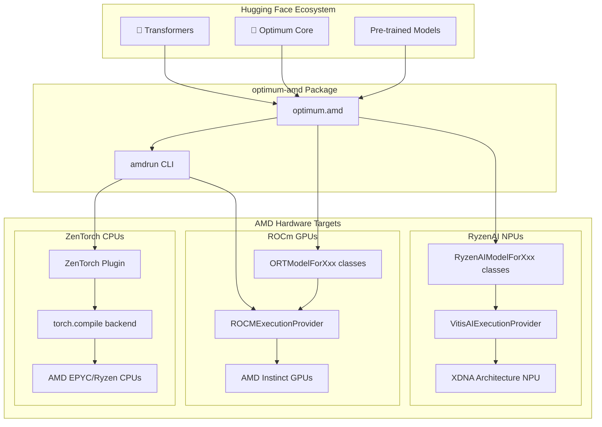
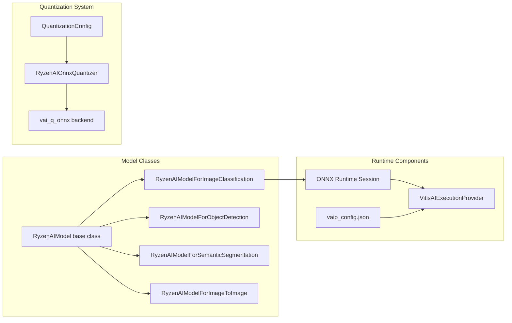
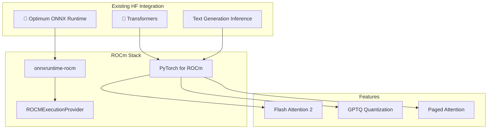
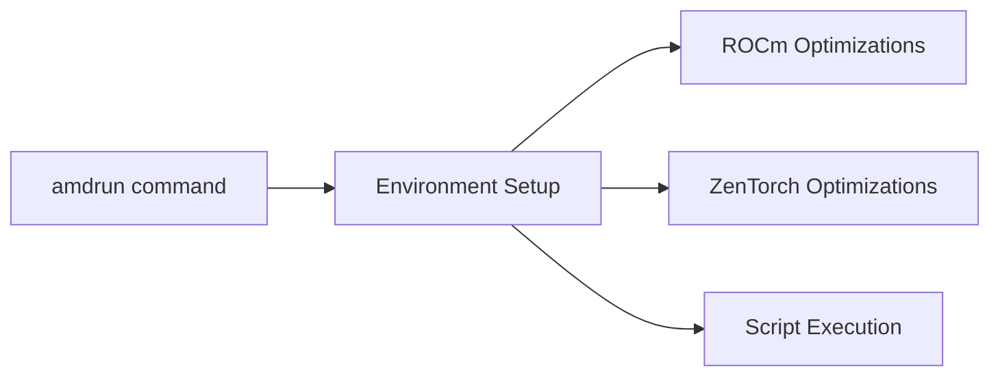

<!-- source: DeepWiki mcp.deepwiki.com · repo huggingface/optimum-amd · page 1 Overview · fetched 2026-10-26 -->

# Overview

<details>
<summary>Relevant source files</summary>

The following files were used as context for generating this wiki page:

- [README.md](README.md)
- [docs/source/index.mdx](docs/source/index.mdx)
- [setup.py](setup.py)

</details>


## Purpose and Scope

Optimum-AMD is the interface layer between Hugging Face libraries and AMD's hardware acceleration platforms. This library provides performance optimizations and hardware-specific integrations for three main AMD compute targets: ROCm-enabled GPUs, RyzenAI Neural Processing Units (NPUs), and ZenTorch-optimized CPUs.

The library extends the Hugging Face ecosystem by providing drop-in replacements for standard model classes, specialized quantization tools, and optimized inference pipelines tailored for AMD hardware. For detailed information about specific hardware targets, see [RyzenAI System](#2), [Brevitas Quantization](#3), [ROCm GPU Support](#4), and [ZenTorch CPU Optimization](#5).

Sources: [README.md:1-11](), [setup.py:54-58](), [docs/source/index.mdx:7-7]()

## Hardware Target Architecture

The following diagram illustrates the three primary AMD hardware targets and their corresponding software integrations:



Sources: [README.md:21-29](), [README.md:76-81](), [setup.py:80-80]()

## Core System Components

### RyzenAI Integration

The RyzenAI system represents the most comprehensive component of optimum-amd, providing specialized model classes and quantization tools for AMD's Neural Processing Units.



Sources: [README.md:93-112](), [setup.py:39-39](), [setup.py:83-83]()

### Brevitas Quantization System

Brevitas provides advanced post-training quantization techniques specifically optimized for Large Language Models, with support for GPTQ, SmoothQuant, and weight equalization methods.

| Component | Purpose | Code Entity |
|-----------|---------|-------------|
| `BrevitasQuantizer` | Main quantization interface | Core quantizer class |
| `BrevitasQuantizationConfig` | Configuration management | Quantization parameters |
| GPTQ Implementation | Post-training quantization | GPTQ algorithm support |
| ONNX Export | Model format conversion | ONNX optimization pipeline |

Sources: [setup.py:41-50]()

### ROCm GPU Acceleration

ROCm support leverages existing Hugging Face integrations with PyTorch and ONNX Runtime, providing seamless GPU acceleration for AMD hardware.



Sources: [README.md:21-28](), [README.md:51-74]()

## Package Structure and Entry Points

The library provides multiple interfaces for different use cases and technical requirements:

### Installation Variants

| Installation Command | Purpose | Dependencies |
|---------------------|---------|-------------|
| `pip install optimum[amd]` | Base installation | Core optimum-amd functionality |
| `pip install optimum-amd[ryzenai]` | RyzenAI support | opencv-python, timm |
| `pip install optimum-amd[brevitas]` | LLM quantization | brevitas, torch>=2.2, datasets |
| `pip install optimum-amd[zentorch]` | CPU optimization | torch==2.2.1 |

Sources: [README.md:7-19](), [setup.py:36-51]()

### Command Line Interface

The `amdrun` CLI provides automatic environment optimization for AMD hardware:



Sources: [setup.py:80-80]()

### Python API Structure

The library follows Hugging Face conventions with drop-in replacement classes:

```python
# Standard Transformers usage
from transformers import AutoModelForImageClassification

# Drop-in replacement for RyzenAI
from optimum.amd.ryzenai import RyzenAIModelForImageClassification

# ROCm GPU usage with ONNX Runtime
from optimum.onnxruntime import ORTModelForSequenceClassification

# Brevitas quantization
from optimum.amd.brevitas import BrevitasQuantizer
```

Sources: [README.md:93-112](), [README.md:59-74]()

## Development and Testing Infrastructure

The repository includes comprehensive testing and development tools:

- **Test Framework**: Pytest-based with custom markers (`prequantized_model_test`, `quant_test`)
- **CI/CD**: GitHub Actions workflows with AMD hardware-specific testing
- **Docker Support**: Pre-configured environments for ROCm, RyzenAI, and ZenTorch
- **Quality Assurance**: Black, Ruff formatting with automated checks

For detailed development information, see [Development and Testing](#7).

Sources: [README.md:114-152](), [setup.py:20-34]()

---

